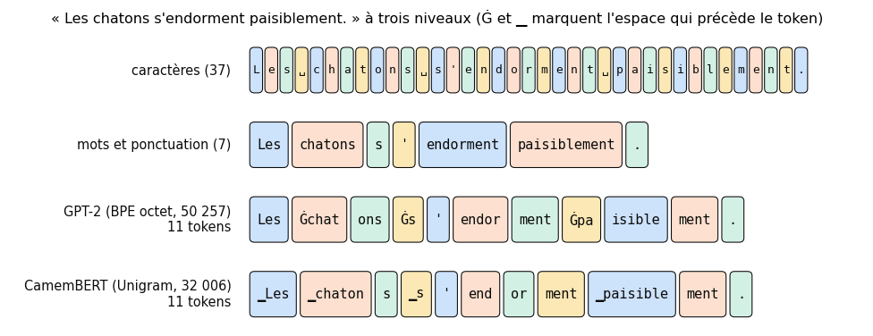
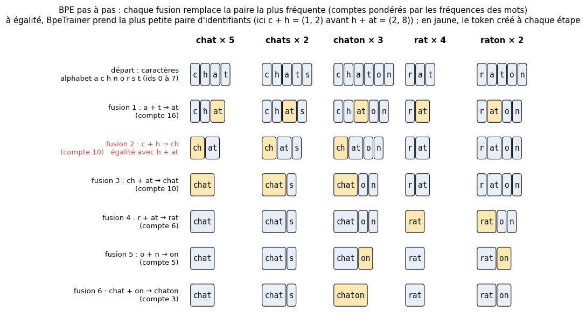

# B2 · Tokenisation et embeddings — fiche de cours

> Ce chapitre bonus n'a pas d'équivalent dans le livre de Glassner : **cette fiche est le cours**. Un modèle de langue lit des nombres : la **tokenisation** découpe le texte en morceaux numérotés, les tokens, puis la **table d'embedding** remplace chaque numéro par un vecteur. Le livre travaille par caractères ou par mots (ch. 22 et 24) ; les modèles actuels, par **sous-mots**. Tu comprends Unicode et UTF-8, tu écris un tokenizer BPE que tu compares à la bibliothèque `tokenizers`, tu mesures ce que la tokenisation coûte selon la langue, puis tu construis des vecteurs de mots, par comptage (PPMI et SVD) et par apprentissage (word2vec), jusqu'aux embeddings de phrases et à la recherche sémantique.

| | |
|---|---|
| **Livre** | — (chapitre propre au workbook) |
| **Sections** | 202.1 à 202.10 (numérotation interne du workbook : 202 = bonus B2) |
| **Temps total estimé** | ≈ 18 h : lecture de la fiche ≈ 1,7 h, exercices ≈ 15 h, 26 flashcards ≈ 0,9 h |
| **Prérequis** | 0A (chaînes, fichiers en UTF-8, expressions régulières `re`, §100.6.5) · 0B (produit scalaire, norme, similarité cosinus) · ch. 6 (entropie, code de Huffman, cross-entropy, divergence KL, perplexité) · ch. 12 (one-hot, PCA et SVD, UMAP) · ch. 17 (sigmoïde, softmax, log-sum-exp) · ch. 18 (règle de la chaîne) · ch. 20 (boucle d'entraînement PyTorch) · ch. 22 (vocabulaire, `encode` et `decode`, token inconnu) · ch. 24 (`nn.Embedding`, génération mot par mot) · B1 (embedding d'un modèle pré-entraîné, cosinus, fiche modèle, licences) |
| **Fichiers du chapitre** | `02_exercices.md` (quiz, rappels, papier, réflexion, entretien) · `03_notebook.ipynb` · `04_indices.md` · `05_solutions.md` et `05_solutions.ipynb` · `06_mes_reponses.md` · `flashcards.csv` |
| **mylearn** | `tokenizer.py` : `get_pair_counts` et `merge_pair` (B2.15), `BPETokenizer.fit` (B2.16), `encode`, `decode` et `tokenize` (B2.17) ; `pre_tokenize`, `save` et `load` sont fournis · `embeddings.py` : `cooccurrence_matrix` et `ppmi` (B2.22), `cosine_similarity_matrix` et `most_similar` (B2.23). Le tokenizer resservira en B3 (un mini-GPT sur des tokens BPE) et B4 ; `most_similar` en B4 (recherche dense) |

## Comment utiliser ce chapitre

La fiche et les exercices papier posent les idées et les calculs ; le notebook les met en œuvre sur Holmes et Verne. Les codes de la fiche ont été exécutés avec les versions du workbook (Python 3.13, tokenizers 0.23.3, transformers 5.21, PyTorch 2.11, NumPy 2.1, scikit-learn 1.6), sur **d'autres phrases et d'autres corpus** que les exercices.

**Ordre conseillé.**
1. Lis 202.1 et 202.2. Fais les quiz Q1 à Q3, le rappel R2 et le calcul ✏️ B2.1.
2. Lis 202.3 et 202.4. Fais les quiz Q4 à Q6, le rappel R3, les calculs ✏️ B2.3 et B2.4, l'explication 🗣️ B2.10 et la lecture 📄 B2.12.
3. Lis 202.5 et 202.6. Fais les quiz Q7 et Q8, l'estimation 🧮 B2.8 et la première moitié du cas ⚖️ B2.11 (la langue).
4. Lis 202.7 et 202.8. Fais les quiz Q9 et Q10, le rappel R1, les calculs ✏️ B2.5 et B2.6, la dérivation ∂ B2.7 et l'estimation 🧮 B2.9.
5. Lis 202.9 et 202.10. Fais les quiz Q11 et Q12, le calcul ✏️ B2.2 et la seconde moitié de ⚖️ B2.11 (les vecteurs). Vérifie tes réponses courtes dans la partie 0 du notebook.
6. Fais le notebook dans l'ordre des ID : **tokenisation** (B2.13 à B2.21 : tokenizers réels, ton BPE, expériences), **embeddings** (B2.22 à B2.29 : co-occurrences, word2vec, phrases), puis 🛠️ B2.30 et le défi 🏆 B2.31. Termine par les entretiens.

| Section | Quiz 🧠 et rappels 🔁 | Papier ✏️ ∂ 🧮 et réflexion | Notebook | Entretien 💼 |
|---|---|---|---|---|
| 202.1 Du texte aux nombres | Q1, R2 | | B2.13 | E1 |
| 202.2 Unicode, UTF-8, normalisation | Q2, Q3 | B2.1 | B2.18 | |
| 202.3 Byte Pair Encoding | Q4, R3 | B2.3, B2.4, B2.10, B2.12 | B2.15, B2.16, B2.17, B2.20, B2.31 | E1, E2 |
| 202.4 BPE au niveau octet, tokens spéciaux | Q5, Q6 | B2.4 | B2.16, B2.17, B2.18, B2.30 | E3 |
| 202.5 WordPiece, Unigram, SentencePiece | Q7 | | B2.13, B2.19, B2.30 | E2 |
| 202.6 Coûts et biais de la tokenisation | Q8, R3 | B2.8, B2.11 | B2.14, B2.20, B2.21, B2.31 | |
| 202.7 One-hot et `nn.Embedding` | Q9, R1 | B2.5, B2.9 | B2.25 | E3 |
| 202.8 Embeddings distributionnels | Q10 | B2.6, B2.7 | B2.22, B2.24, B2.25 | |
| 202.9 Géométrie des embeddings | Q11, Q12 | B2.2, B2.11 | B2.23, B2.24, B2.26, B2.27 | E4 |
| 202.10 Embeddings contextuels et de phrases | Q11, R1 | | B2.28, B2.29 | E4, E5 |

## Objectifs d'apprentissage

À la fin de ce chapitre, tu sais :
1. **Expliquer** le compromis entre caractères, mots et sous-mots, et **manipuler** Unicode, UTF-8 et la normalisation d'un texte.
2. **Implémenter** BPE (entraînement, encodage, décodage) et le **valider** contre la bibliothèque `tokenizers`.
3. **Comparer** des tokenizers réels (BPE octet, WordPiece, Unigram) et **mesurer** leur coût selon la langue.
4. **Relier** `nn.Embedding` à un produit one-hot × matrice, et **entraîner** des embeddings word2vec en PyTorch.
5. **Construire** des embeddings par co-occurrences (PPMI et SVD) et les **interroger** (voisins, analogies).
6. **Utiliser** des embeddings de phrases pour une recherche sémantique, et **discuter** leurs biais.

## L'essentiel en 10 lignes

1. Un modèle de langue ne voit que des **identifiants** : le **tokenizer** découpe le texte en tokens et les numérote ; modèle et tokenizer sont indissociables.
2. Caractères : séquences longues. Mots : vocabulaire énorme et **mots inconnus**. **Sous-mots** : les mots fréquents restent entiers, les rares se découpent.
3. Un texte est une suite de **points de code** Unicode, qu'UTF-8 écrit avec **1 à 4 octets** ; deux chaînes identiques à l'écran peuvent différer en mémoire (NFC, NFD).
4. **BPE** apprend une **liste ordonnée de fusions** : à chaque étape, la paire voisine la plus fréquente devient un token. Cette liste et l'alphabet **sont** le tokenizer.
5. Pour encoder, on applique les fusions **par rang** (la plus ancienne d'abord) à l'intérieur de chaque **pré-token** ; décoder, c'est recoller les octets.
6. Le **BPE au niveau octet** part des 256 octets : aucun texte n'a de token inconnu. Les **tokens spéciaux** (`<|endoftext|>`, `[CLS]`, `[PAD]`) ne sont jamais découpés.
7. La **fertilité** (tokens par mot) dépend de la langue : avec GPT-2, un texte coûte 2 fois plus de tokens en français qu'en anglais, plus de 20 fois dans certaines langues. Or on paie, on attend et on remplit le contexte **au token**.
8. `nn.Embedding` est une **table** de forme $(V, d)$ : lire la ligne $i$ revient à multiplier un one-hot par la table, et seules les lignes lues reçoivent un gradient.
9. **Un mot se définit par ses voisins** : la PPMI des co-occurrences réduite par SVD, ou word2vec, qui distingue les vrais contextes de mots tirés au hasard, rapprochent par le **cosinus** les mots de sens proche.
10. Ces vecteurs **statiques** ont un sens par mot et héritent des stéréotypes du corpus ; les Transformers donnent des embeddings **contextuels**, et un **embedding de phrase** (mean pooling) permet la recherche sémantique.

> 📐 **Conventions de la fiche** — L'**identifiant** (*id*) d'un token est un entier de $0$ à $V - 1$, $V$ étant la taille du vocabulaire (numérotation à partir de 0, comme en Python). $d$ est la dimension des embeddings et $\mathbf{E}$, de forme $(V, d)$, la table d'embedding ; $\mathbf{E}[i, :]$ est sa ligne $i$. Pour les co-occurrences, $w$ est un mot, $c$ un mot de son contexte, $\#(w, c)$ un compte et $\mathbf{C}$ la matrice des comptes. Dans word2vec, $\mathbf{v}_w$ est la ligne du mot $w$ dans la table des mots $\mathbf{E}$, $\mathbf{u}_c$ celle du contexte $c$ dans une seconde table $\mathbf{E}'$, et $n_1, \dots, n_K$ sont les $K$ mots tirés au hasard. $\mathbf{h}_t$ est l'embedding contextuel du token $t$ et $m_t \in \{0, 1\}$ son masque. $\log$ est le logarithme naturel (des nats, ch. 6) ; $\sigma$ est la sigmoïde. **Écarts au §6** : $d$ est la dimension d'un embedding (comme en B1), $K$ un nombre de tirages et non de classes, $V$ (en italique) une taille et non une matrice ; les vecteurs de word2vec s'appellent $\mathbf{u}$ et $\mathbf{v}$, comme dans l'article de Mikolov et coll. (2013).

---

## 202.1 · Du texte aux nombres : caractères, mots, sous-mots ⏩

### Un modèle ne lit que des identifiants

Au ch. 22, chaque caractère de Holmes recevait un numéro (`build_vocab`, `encode`, `decode`) ; au ch. 24, chaque mot, et `nn.Embedding` remplaçait le numéro par un vecteur appris. Ce chapitre généralise ces deux gestes.

Un **tokenizer** (ch. 6) **découpe** le texte en **tokens**, **numérote** chaque token par son identifiant, et sait revenir des identifiants au texte. Le modèle ne voit que les identifiants. Deux conséquences :
- **le tokenizer fait partie du modèle** : la ligne 4 213 de la table d'embedding n'a de sens que pour le tokenizer qui a donné l'identifiant 4 213 à un certain morceau de texte ; changer de tokenizer sans réentraîner, c'est donner au modèle un texte chiffré avec une autre clé (💼 E3) ;
- **la longueur d'un texte se compte en tokens** : la fenêtre de contexte, le temps de calcul et le prix d'une API aussi (202.6).

### Trois granularités

Où couper ? Trois réponses, illustrées sur une phrase de notre choix :



| Granularité | Vocabulaire | Longueur des séquences | Mots inconnus |
|---|---|---|---|
| **caractères** | petit : 88 caractères distincts dans Holmes (ch. 22) | longue : ≈ 562 000 identifiants pour Holmes | aucun, sauf un caractère jamais vu |
| **mots** | énorme : 7 819 mots distincts dans Holmes, 8 793 dans Verne (ch. 6), des centaines de milliers sur le web | courte : ≈ 106 000 identifiants pour Holmes | nombreux : avec les 2 000 mots les plus fréquents, 13,5 % des mots de Verne restaient inconnus (ch. 22) |
| **sous-mots** | choisi : de 30 000 à 250 000 tokens pour les modèles actuels (202.5) | entre les deux | aucun au niveau octet (202.4) |

Pourquoi pas les caractères ? Un Transformer (B3) compare chaque token à tous les autres : son coût croît comme le **carré** de la longueur. Une séquence 4 à 5 fois plus longue coûte 16 à 25 fois plus d'attention, et la fenêtre contient 4 à 5 fois moins de texte.

Pourquoi pas les mots ? Le vocabulaire explose : le français conjugue et élide (« chantions », « l'été »), l'allemand compose, le code invente des noms. On garde les $V$ mots les plus fréquents, et les autres deviennent un même **token inconnu** (`<unk>`, *out of vocabulary*, OOV), que le modèle ne peut ni comprendre ni écrire ; c'est le choix du livre au ch. 24 (8 000 mots).

Les **sous-mots** gardent les avantages des deux : un mot fréquent est un token, un mot rare se découpe en morceaux connus (« paisiblement » devient « Ġpa », « isible », « ment » pour GPT-2). Le découpage est **appris** par un algorithme de compression (202.3), pas choisi par un linguiste : GPT-2 coupe « endor » + « ment », CamemBERT « end » + « or » + « ment ».

### Le compromis, en un nombre

On résume un tokenizer par sa **fertilité**, le nombre moyen de tokens par mot (202.6). Sur la phrase de la figure, GPT-2 produit 11 tokens pour 4 mots séparés par des espaces : 2,75. La même idée en anglais, « The kittens fall asleep peacefully. », lui coûte 6 tokens pour 5 mots : 1,2. Son tokenizer a été appris sur un corpus presque entièrement anglais. Le 📦 B2.13 te fait mesurer Holmes et Verne avec trois tokenizers réels.

> 🔗 **Lien avec le ch. 22** — Un tokenizer BPE garde l'interface de `build_vocab` (`encode`, `decode`), mais son vocabulaire n'est plus une liste de symboles vus : c'est un **alphabet** plus une liste de **fusions** apprises (🔁 R2).

---

## 202.2 · Unicode, UTF-8 et normalisation ⏩

### Points de code et octets

Un texte est une suite de **points de code** (*code points*) Unicode : des entiers de 0 à 0x10FFFF, qui désignent plus de 150 000 caractères de toutes les écritures, emoji compris, notés U+ et quatre à six chiffres hexadécimaux (« ç » est U+00E7, « 🙂 » U+1F642). Pour les écrire dans un fichier, un **encodage** les transforme en **octets** (0 à 255). **UTF-8**, celui du web et du workbook, utilise 1 à 4 octets :

| Points de code | Octets | Motif binaire | Exemple |
|---|---|---|---|
| U+0000 à U+007F (ASCII) | 1 | `0xxxxxxx` | « a » → `61` |
| U+0080 à U+07FF | 2 | `110xxxxx 10xxxxxx` | « ç » → `C3 A7` |
| U+0800 à U+FFFF | 3 | `1110xxxx 10xxxxxx 10xxxxxx` | « € » → `E2 82 AC` |
| U+10000 à U+10FFFF | 4 | `11110xxx 10xxxxxx 10xxxxxx 10xxxxxx` | « 🙂 » → `F0 9F 99 82` |

Les `x` reçoivent les bits du point de code. Pour « ç » : $\text{0xE7} = 231 = 000\,1110\,0111$ sur 11 bits ; `00011` va dans `110 00011` = 0xC3, `100111` dans `10 100111` = 0xA7. Pour un tokenizer, UTF-8 a trois qualités : l'**ASCII reste un octet** ; **chaque octet dit son rôle** (`0…` complet, `110…`, `1110…`, `11110…` début, `10…` suite) ; et **256 symboles suffisent** pour tout texte, la base du BPE au niveau octet (202.4). Le prix : 2 octets pour un caractère accentué, grec, cyrillique ou arabe, 3 pour le hindi, le thaï, le chinois ou le japonais, 4 pour un emoji.

> 🧮 **Rappel outil — `str`, `bytes` et `encode`** — En Python 3, un `str` est une suite de points de code et `len` compte les points de code ; un `bytes` est une suite d'octets, écrite `b'...'`, et `len` compte les octets. `texte.encode("utf-8")` passe du premier au second, `donnees.decode("utf-8")` revient. `ord("ç")` donne le point de code (231), `chr(231)` le caractère, `f"U+{ord(c):04X}"` l'écriture U+. Un `bytes` se lit comme une liste d'entiers : `list(b"ab")` vaut `[97, 98]`. Décoder des octets qui ne forment pas de l'UTF-8 valide lève `UnicodeDecodeError`, sauf avec `errors="replace"`, qui met le caractère de remplacement « � » (U+FFFD) à la place de chaque morceau invalide.

```python
s = "Ça coûte 15 €"
b = s.encode("utf-8")
print(len(s), len(b))                     # 13 17: 13 code points, 17 bytes
print(b)                                  # b'\xc3\x87a co\xc3\xbbte 15 \xe2\x82\xac'
print([f"U+{ord(c):04X}" for c in s if ord(c) > 127])   # ['U+00C7', 'U+00FB', 'U+20AC']
print(b[:1].decode("utf-8", errors="replace"))           # '�': the first byte of 'Ç' alone
```

Treize points de code, dix-sept octets. Couper un `bytes` au milieu d'un caractère donne des octets invalides : c'est ce qui arrive quand on décode **un par un** les tokens d'un tokenizer au niveau octet (202.4, 🐛 B2.18).

### Un caractère affiché, plusieurs points de code

Un caractère affiché n'est pas toujours un point de code. Les **caractères combinants** (*combining characters*) s'ajoutent au précédent : U+0302, l'accent circonflexe combinant, fait de « u » un « û ». « û » s'écrit donc de **deux** façons, U+00FB ou « u » + U+0302, identiques à l'écran et différentes pour Python. La **normalisation** choisit une écriture :
- **NFC** (*forme de composition canonique*) compose tout ce qui peut l'être : c'est la forme du web, et le normaliseur du tokenizer de Qwen ;
- **NFD** (*forme de décomposition canonique*) décompose tout : pratique pour **retirer les accents** (on décompose, puis on supprime les combinants) ;
- **NFKC** et **NFKD** (*compatibilité*) remplacent aussi les variantes de présentation (« fi » → « fi », « ² » → « 2 ») : plus agressives, elles perdent de l'information.

> 🧮 **Rappel outil — `unicodedata`** — Ce module de la bibliothèque standard connaît la table Unicode. `unicodedata.normalize("NFC", s)` (ou `"NFD"`, `"NFKC"`, `"NFKD"`) rend la chaîne normalisée ; `unicodedata.name(c)` donne le nom officiel d'un caractère (`'COMBINING CIRCUMFLEX ACCENT'`) ; `unicodedata.combining(c)` rend un entier non nul pour un caractère combinant ; `unicodedata.category(c)` sa catégorie (`'Ll'` lettre minuscule, `'Mn'` marque sans chasse, `'Nd'` chiffre…).

```python
import unicodedata

s = "Ça coûte 15 €"
d = unicodedata.normalize("NFD", s)
print(len(s), len(d), s == d)                            # 13 15 False: 'Ç' and 'û' are now two code points each
print(unicodedata.normalize("NFC", d) == s)              # True
print("".join(c for c in d if not unicodedata.combining(c)))   # 'Ca coute 15 €': accents removed
print("Straße".lower(), "Straße".casefold())             # straße strasse
print(unicodedata.normalize("NFKC", "fin x²"))            # 'fin x2'
```

### Casse et accents

Mettre en minuscules (`lower()`, ou `casefold()` qui fait aussi de « ß » un « ss ») et retirer les accents réunit « Élève » et « eleve », mais confond « où » et « ou », « pêcheur » et « pécheur ». Les tokenizers récents ne font ni l'un ni l'autre et laissent le modèle apprendre que « The » et « the » se ressemblent ; BERT *uncased* (2018) faisait les deux (« Ça coûte » devient « ca coute », 202.5).

> ⚠️ **Piège classique — normaliser à l'entraînement et pas à l'usage** — Corpus en NFD, textes des utilisateurs en NFC : les fusions apprises sur « u » + U+0302 ne s'appliquent jamais à U+00FB, et le texte se découpe en morceaux inattendus, voire en tokens inconnus. Normalise les deux **de la même façon**, et écris-le dans la configuration du tokenizer (🐛 B2.18).

---

## 202.3 · Byte Pair Encoding : apprendre et appliquer les fusions ⏩

### Un algorithme de compression devenu tokenizer

Le **Byte Pair Encoding** (BPE) est d'abord un algorithme de compression (P. Gage, 1994) : remplacer la paire d'octets voisins la plus fréquente par un octet inutilisé, et recommencer. R. Sennrich, B. Haddow et A. Birch l'ont adapté à la traduction automatique (ACL 2016, 📄 B2.12) : on fusionne des caractères, puis des suites de caractères, et chaque fusion crée un **sous-mot**. Leurs systèmes anglais → allemand et anglais → russe gagnaient 1,1 et 1,3 point de BLEU sur une référence qui traitait les mots rares avec un dictionnaire.

Lien avec le ch. 6 : Huffman donne des codes courts aux symboles fréquents ; BPE donne **un seul token** aux suites fréquentes. Les deux compressent, mais BPE produit des unités qu'on peut donner à un réseau (🔁 R3).

### L'entraînement

On part d'un corpus déjà **pré-tokenisé** : coupé en mots (ou en morceaux, 202.4), chaque mot étant compté avec sa fréquence. Les fusions ne franchissent jamais la frontière d'un mot.

```text
learn_bpe(word_counts, vocab_size):
    alphabet = sorted(set of all characters)            # ids 0 .. len(alphabet) - 1
    words    = {tuple(ids of the characters of w): count}
    merges   = []                                       # the ordered list: rank 0, 1, 2...
    while len(alphabet) + len(merges) < vocab_size:
        counts = for every pair (a, b) of adjacent ids: sum of the counts of the words that contain it
        (a, b) = the most frequent pair (ties: the smallest pair of ids)
        stop if its count < min_frequency
        new_id = len(alphabet) + len(merges)            # the merged token gets the next id
        replace (a, b) by new_id in every word, left to right, without overlap
        merges.append((a, b))
    return alphabet, merges
```

Une fusion BPE s'écrit

$$(a, b)^* = \arg\max_{(a, b)} \operatorname{count}(a, b), \qquad \text{puis } a\,b \rightarrow \text{un nouveau token},$$

où $\operatorname{count}(a, b)$ somme la fréquence des mots, une fois par occurrence de $a$ suivi de $b$.

**Exemple.** Le corpus contient cinq mots, avec leurs fréquences : « chat » × 5, « chats » × 2, « chaton » × 3, « rat » × 4, « raton » × 2. L'alphabet trié est a, c, h, n, o, r, s, t (identifiants 0 à 7).
- **Fusion 1.** La paire « a t » apparaît dans les cinq mots : $5 + 2 + 3 + 4 + 2 = 16$ fois. C'est la plus fréquente : « at » devient le token 8.
- **Fusion 2.** On recompte avec « at » : « c h » vaut $5 + 2 + 3 = 10$, mais « h at » aussi, 10. **Égalité** (encadré ci-dessous) : on prend la plus petite paire d'identifiants, $(1, 2)$ pour « c h » contre $(2, 8)$ pour « h at ». « ch » devient le token 9.
- **Fusion 3.** « ch at » vaut 10 : « chat », token 10.
- **Fusion 4.** « r at » vaut $4 + 2 = 6$ : « rat », token 11.
- **Fusions 5 et 6.** « o n » (5) donne « on », token 12 ; puis « chat on » (3) donne « chaton », token 13.



Avec `vocab_size=14` (8 caractères et 6 fusions), l'entraînement s'arrête là : « chaton » est un token, « raton » reste « rat » + « on ». BPE retrouve des **racines** (« chat », « rat ») et un **suffixe** (« on »), simplement parce qu'ils reviennent souvent.

> 🕰️ **Mise à jour (2026) — le départage des fusions dans `tokenizers`** — **Le livre :** ne présente aucun tokenizer de sous-mots. · **Aujourd'hui :** `BpeTrainer` de la bibliothèque `tokenizers` range ses candidats dans un tas trié par compte décroissant ; à compte égal, c'est la **plus petite paire d'identifiants** qui sort la première (comparaison de `(a, b)` d'abord sur `a`, puis sur `b`). Les identifiants de l'alphabet suivent l'**ordre des points de code** (l'alphabet est trié par `char as u32`), et ceux des tokens fusionnés l'ordre de création. Les tokens spéciaux, eux, reçoivent les **premiers** identifiants. · **Faut-il quand même l'apprendre ?** Oui : sans cette règle, deux implémentations justes de BPE divergent dès la première égalité, et ton `BPETokenizer` ne pourrait pas se comparer exactement à `tokenizers` (📦 B2.19). · *Source :* [`tokenizers/src/models/bpe/trainer.rs`, tag v0.23.3](https://github.com/huggingface/tokenizers/blob/v0.23.3/tokenizers/src/models/bpe/trainer.rs) (`impl Ord for Merge` : « Here we want ascending order » ; `compute_alphabet` : `sort_unstable_by_key(|k| *k.0 as u32)`).

La bibliothèque `tokenizers` redonne exactement ces fusions :

```python
from tokenizers import Tokenizer, models, pre_tokenizers, trainers

corpus = ["chat"] * 5 + ["chats"] * 2 + ["chaton"] * 3 + ["rat"] * 4 + ["raton"] * 2
tok = Tokenizer(models.BPE())
tok.pre_tokenizer = pre_tokenizers.Whitespace()          # split into words, drop the spaces
trainer = trainers.BpeTrainer(vocab_size=14, min_frequency=2, show_progress=False)
tok.train_from_iterator([" ".join(corpus)], trainer)
print(tok.get_vocab_size())                              # 14
for w in ["ratons", "achat", "chatte"]:
    e = tok.encode(w)
    print(w, e.tokens, e.ids)
# ratons ['rat', 'on', 's'] [11, 12, 6]
# achat ['a', 'chat'] [0, 10]
# chatte ['chat', 't'] [10, 7]
```

### Encoder un mot nouveau : les fusions par rang

Le modèle appris n'est **pas** la liste des tokens : c'est la **liste ordonnée des fusions**. Pour encoder un mot, même jamais vu, on part de ses caractères et l'on applique les fusions **dans l'ordre où elles ont été apprises** : parmi les paires voisines présentes dans le mot, on fusionne celle de **plus petit rang**, puis on recommence, jusqu'à ce qu'aucune paire voisine ne soit une fusion connue.

« ratons », jamais vu à l'entraînement :
1. départ : r a t o n s ;
2. paires présentes : « r a » (pas une fusion), « a t » (rang 0), « t o », « o n » (rang 4), « n s » ; la plus petite est « a t » → r at o n s ;
3. puis « r at » (rang 3) → rat o n s ;
4. puis « o n » (rang 4) → rat on s ;
5. plus aucune paire voisine n'est une fusion (« rat on » n'en est pas une) : **[rat, on, s]**.

Pourquoi le rang, et pas l'ordre de lecture ? Parce que l'entraînement a fusionné dans cet ordre-là. Avec deux fusions, « b c » au rang 0 et « a b » au rang 1, le mot « abc » donne **[a, bc]** par rang, mais **[ab, c]** si l'on fusionne la première paire trouvée de gauche à droite : un découpage que le modèle n'a jamais vu (✏️ B2.4, 🔨 B2.17).

Décoder, c'est recoller les chaînes (ou les octets, 202.4) des identifiants. Avec un pré-tokenizer qui jette les espaces, comme `Whitespace`, « le chat » redevient « lechat » ; le 202.4 règle ce problème.

Recompter toutes les paires après chaque fusion coûte cher. Deux astuces : travailler sur les mots **distincts** (Holmes a 105 849 mots, mais 7 819 mots différents, ch. 6), et ne recompter que les mots qui contenaient la paire fusionnée. Le 📦 B2.19 compare ta vitesse à celle de `tokenizers`, écrite en Rust.

### Ta librairie : `tokenizer.py`

Les 🔨 B2.15 à B2.17 te font écrire un BPE complet avec la seule bibliothèque standard :
- `get_pair_counts(words)` reçoit `{mot en tuple d'identifiants: fréquence}` et rend `{(a, b): compte pondéré}` ; les paires d'un mot peuvent se chevaucher, et les comptes somment à $\sum \text{fréquence} \times (\text{longueur} - 1)$ ;
- `merge_pair(ids, pair, new_id)` remplace chaque occurrence de la paire, de gauche à droite et **sans chevauchement**, et rend une **nouvelle** liste ;
- `BPETokenizer.fit` apprend `merges_`, `vocab_` (les octets de chaque token), `n_base_` et `special_ids_`. Identifiants : l'alphabet (les 256 octets, ou les caractères vus triés par point de code), puis les fusions dans l'ordre, puis les tokens spéciaux ; `vocab_size` compte **tout**, comme `BpeTrainer`. Arrêt à cette taille, faute de paire, ou quand la meilleure paire apparaît moins de `min_frequency` fois ; à égalité, la plus petite paire d'identifiants ;
- `encode` applique les fusions par rang dans chaque pré-token, `decode` recolle les octets et décode l'UTF-8 avec `errors="replace"`. `pre_tokenize`, `save` et `load` sont fournis.

Au niveau caractère, avec `'whitespace'` et sans token spécial, tes fusions doivent être **identiques** à celles de `tokenizers`. Deux écarts sont permis (docstring) : `tokenizers` place les tokens spéciaux en tête, et réutilise l'identifiant d'une chaîne déjà présente au lieu d'en créer un.

---

## 202.4 · BPE au niveau octet, pré-tokenisation et tokens spéciaux ⏩

### Plus jamais de token inconnu

Au niveau caractère, un caractère jamais vu n'a pas d'identifiant : T5 (SentencePiece, 2019) transforme le « Ç » de « Ça » en `<unk>`. Le **BPE au niveau octet** (*byte-level BPE*), introduit pour GPT-2 (A. Radford et coll., 2019), part des **256 octets** de l'UTF-8 : tout texte s'écrit avec cet alphabet, **aucun token inconnu n'est possible** (🧠 Q5). Les fusions construisent des tokens de plusieurs octets (les deux octets de « é », puis « été », puis « Ġété ») ; GPT-2 compte $256 + 50\,000 + 1 = 50\,257$ tokens : les octets, 50 000 fusions et `<|endoftext|>`. Le revers : un caractère rare coûte **un token par octet**, qui ne veut rien dire seul.

```python
from transformers import AutoTokenizer

tok = AutoTokenizer.from_pretrained("openai-community/gpt2")
ids = tok.encode("Ça coûte 15 €")
print(ids)                               # [127, 229, 64, 763, 42324, 660, 1315, 10432]
print(tok.convert_ids_to_tokens(ids))    # ['Ã', 'ĩ', 'a', 'Ġco', 'û', 'te', 'Ġ15', 'ĠâĤ¬']
print([tok.decode([i]) for i in ids])    # ['�', '�', 'a', ' co', 'û', 'te', ' 15', ' €']
print(tok.decode(ids))                   # 'Ça coûte 15 €': decoding the whole list is exact
print(type(tok).__name__, len(tok))      # GPT2Tokenizer 50257
```

Les deux premiers tokens sont les octets 0xC3 et 0x87 de « Ç » : séparés, ils donnent « � » ; ensemble, « Ç ». On décode donc la **liste entière**, et un générateur qui affiche au fil de l'eau garde en attente les octets d'un caractère incomplet (🐛 B2.18).

### Pourquoi « Ġ » ? La table octet → caractère

Pour ranger ses tokens dans un fichier JSON sans octets invisibles, GPT-2 remplace chaque octet par un caractère imprimable : les 188 octets imprimables se représentent eux-mêmes, les 68 autres sont décalés vers U+0100. L'espace (0x20) devient « Ġ » (U+0120), le retour à la ligne « Ċ » (U+010A) : « Ġco » signifie « espace, c, o », et « û » les octets 0xC3 0xBB de « û ». Conséquence : **« Ġthe » n'est pas « the »** (🧠 Q6). Pour GPT-2, « the » en début de texte est le token 1169, précédé d'une espace le token 262 : une espace ajoutée en tête d'un prompt change le premier token.

### La pré-tokenisation

Le **pré-tokenizer** (*pre-tokenizer*) coupe d'abord le texte en morceaux, et **aucune fusion ne franchit la frontière de deux morceaux** ; sans lui, « chat. », « chat, » et « chat! » deviendraient trois tokens sans rapport. GPT-2 utilise une expression régulière :

```text
's|'t|'re|'ve|'m|'ll|'d| ?\p{L}+| ?\p{N}+| ?[^\s\p{L}\p{N}]+|\s+(?!\S)|\s+
```

Dans l'ordre : les contractions anglaises, des lettres (`\p{L}`, toutes écritures), des chiffres (`\p{N}`), d'autres signes, chacun précédé d'au plus une espace, puis les espaces. L'espace reste **collée au mot suivant** (« ␣chat ») et chaque caractère appartient à un morceau : `decode(encode(s)) == s` est exact. Le module `re` ignore `\p{L}` et `\p{N}` : le pré-tokenizer `'gpt2'` de ta librairie les approche par `[^\W\d_]` (un caractère de mot ni chiffre ni tiret bas) et `\d` ; `'whitespace'` reprend le motif `\w+|[^\w\s]+` de `tokenizers`, qui jette les espaces.

```python
from tokenizers import pre_tokenizers

print(pre_tokenizers.Whitespace().pre_tokenize_str("Le chat, l'été !"))
# [('Le', (0, 2)), ('chat', (3, 7)), (',', (7, 8)), ('l', (9, 10)), ("'", (10, 11)), ('été', (11, 14)), ('!', (15, 16))]
print(pre_tokenizers.ByteLevel(add_prefix_space=False).pre_tokenize_str("Le chat, l'été !"))
# [('Le', (0, 2)), ('Ġchat', (2, 7)), (',', (7, 8)), ('Ġl', (8, 10)), ("'", (10, 11)), ('été', (11, 14)), ('Ġ!', (14, 16))]
```

Les couples de nombres sont les **offsets** (*décalages*), la position de chaque morceau dans le texte d'origine : ils permettent de surligner d'où vient un token. Les tokenizers récents changent surtout les **chiffres** : Llama 3 les groupe par 1 à 3 (`\p{N}{1,3}`), Qwen et SmolLM2 les isolent (202.6).

### Les tokens spéciaux

Un **token spécial** (*special token*) est un signal pour le modèle : il a son identifiant, n'est jamais découpé et ne participe pas aux fusions.

| Token | Rôle | Exemples |
|---|---|---|
| **BOS** (*beginning of sequence*) | début d'une séquence | `<s>` (CamemBERT, XLM-R), `<|begin_of_text|>` (Llama 3) |
| **EOS** (*end of sequence*) | fin d'un document ; le modèle le génère pour s'arrêter | `<|endoftext|>` (GPT-2, id 50 256), `</s>` (T5) |
| **PAD** | remplissage des séquences courtes d'un batch (202.5) | `[PAD]` (BERT, id 0) |
| **UNK** | token inconnu, si l'alphabet en a besoin | `[UNK]` (BERT), `<unk>` (T5) |
| **CLS**, **SEP**, **MASK** | résumé de la phrase, séparation de deux phrases, mot masqué à deviner | `[CLS]`, `[SEP]`, `[MASK]` (BERT) |
| balises de conversation | début et fin d'un tour de parole dans un modèle de chat | `<|im_start|>`, `<|im_end|>` (Qwen) |

GPT-2 n'a que `<|endoftext|>`, qui sépare les documents et sert de début et de fin ; faute de token de remplissage, on le prend souvent à sa place. Les modèles de chat (B4) ajoutent des balises qui délimitent les messages.

> ⚠️ **Piège classique — un token spécial tapé par l'utilisateur** — Avec `transformers`, `"<|endoftext|>"` écrit **dans le texte** devient le token spécial : `tok.encode("hi<|endoftext|>")` rend `[5303, 50256]`, et un utilisateur peut glisser une fin de document ou une balise de conversation dans un prompt. `tiktoken` refuse par défaut un tel texte (`disallowed_special="all"`) ; avec `transformers`, filtre ces chaînes avant d'encoder.

Ton `BPETokenizer` fait comme `transformers` : `pre_tokenize` isole les tokens spéciaux, `encode` leur donne leur identifiant, en fin de vocabulaire. Au niveau octet avec `'gpt2'`, l'aller-retour doit être exact sur toute chaîne Unicode (🔨 B2.17) ; le 🛠️ B2.30 te fait sauvegarder ton tokenizer en JSON et le protéger par un test de non-régression.

---

## 202.5 · WordPiece, Unigram, SentencePiece ; la bibliothèque `tokenizers` et les tokenizers des modèles ⏩

### WordPiece : un autre critère de fusion

**WordPiece** (M. Schuster et K. Nakajima, 2012, repris par BERT) fusionne aussi, mais pas la paire la plus **fréquente** : dans la version que décrit le cours de Hugging Face, la paire au meilleur **score**

$$\text{score}(a, b) = \frac{\operatorname{count}(a, b)}{\operatorname{count}(a)\,\operatorname{count}(b)},$$

qui favorise les paires dont les éléments apparaissent **surtout ensemble** (le rapport ressemble à celui de la PMI, 202.8). Deux différences pratiques :
- **le préfixe `##`** marque un morceau qui **continue** un mot : « unbelievably » devient `un`, `##bel`, `##ie`, `##va`, `##bly` ;
- **l'encodage est glouton** : le plus long morceau connu au début du mot, puis on recommence sur le reste ; si un morceau est introuvable, **le mot entier** devient `[UNK]` (« café☕ » pour BERT *uncased*, qui ignore l'emoji).

### Unigram : partir de trop et élaguer

**Unigram** (T. Kudo, ACL 2018) prend le chemin inverse : partir d'un **grand** vocabulaire (les caractères et les sous-chaînes fréquentes) et l'**élaguer**. Chaque token a une probabilité $p(x)$, et un découpage $x_1, \dots, x_k$ a la probabilité $\prod_i p(x_i)$. On alterne : estimer les $p(x)$ par l'algorithme EM ; mesurer de combien la vraisemblance du corpus baisserait sans chaque token ; garder les plus utiles (par exemple 80 %), et toujours les caractères seuls. Pour **encoder**, on prend le découpage le plus probable (algorithme de Viterbi) ; Kudo en **tire** aussi au hasard pour régulariser un modèle de traduction (*subword regularization*).

### SentencePiece : sans pré-tokenisation

**SentencePiece** (T. Kudo et J. Richardson, EMNLP 2018) n'est pas un algorithme mais une **bibliothèque** qui entraîne BPE ou Unigram **sur le texte brut**, sans supposer d'espaces entre les mots (le japonais et le chinois n'en ont pas). L'espace devient un symbole ordinaire, « ▁ » (U+2581), collé au morceau qui suit (« ▁chaton ») : le décodage est sans perte. T5, CamemBERT, XLM-R et la famille e5 multilingue utilisent SentencePiece avec Unigram ; Mistral 7B, SentencePiece avec BPE et un repli sur les octets (*byte fallback*) : un caractère absent du vocabulaire s'écrit avec les tokens de ses octets.

### Les tokenizers des modèles, lus dans leur `tokenizer.json`

Sur le Hub, le fichier `tokenizer.json` d'un modèle contient son normaliseur, son pré-tokenizer, son modèle (vocabulaire et fusions), ses tokens spéciaux et son décodeur. Lus le 1ᵉʳ novembre 2026 avec transformers 5.21 (`len(tok)`, qui compte les tokens spéciaux) :

| Modèle (dépôt) | Méthode | Taille du vocabulaire | À savoir |
|---|---|---|---|
| GPT-2 (`openai-community/gpt2`, 2019) | BPE octet | 50 257 | 256 octets, 50 000 fusions, `<|endoftext|>` |
| BERT *uncased* (`google-bert/bert-base-uncased`, 2018) | WordPiece | 30 522 | met en minuscules et **retire les accents** |
| T5 (`google-t5/t5-small`, 2019) | SentencePiece Unigram | 32 100 | dont 100 tokens `<extra_id_…>` ; « Ç » est inconnu |
| CamemBERT (`almanach/camembert-base`, 2019) | SentencePiece Unigram | 32 006 | appris sur du français ; `config.json` : 32 005 |
| XLM-R et multilingual-e5 (`intfloat/multilingual-e5-small`) | SentencePiece Unigram | 250 002 | une centaine de langues |
| Mistral 7B (`mistralai/Mistral-7B-v0.1`, 2023) | SentencePiece BPE | 32 000 | repli sur les octets |
| SmolLM2 (`HuggingFaceTB/SmolLM2-135M`, 2024) | BPE octet | 49 152 | chiffres un par un |
| Llama 3 (`meta-llama/…`, 2024) | BPE octet | 128 256 | 128 000 appris, 256 réservés ; dépôts à **accès contrôlé** (*gated*) : lu dans une copie publique (`unsloth/Llama-3.2-1B`), confirmé par Hugging Face |
| Qwen3 (`Qwen/Qwen3-0.6B`, 2025) | BPE octet | 151 669 | NFC, chiffres un par un ; table d'embedding de 151 936 lignes |
| gpt-oss (`openai/gpt-oss-20b`, 2025) | BPE octet (`o200k_harmony`) | 200 019 | famille des tokenizers récents d'OpenAI |

Les dépôts de Gemma et de Llama sont à accès contrôlé : leur `tokenizer.json` ne se lit qu'après avoir accepté la licence.

> 🕰️ **Mise à jour (2026) — la tokenisation des modèles de langue** — **Le livre :** travaille par caractères (le générateur de Holmes du ch. 22, 89 caractères) ou par mots (ch. 24 : les 8 000 mots les plus fréquents, un même mot pour tous les autres) ; il ne parle pas de sous-mots. · **Aujourd'hui :** tous les modèles de langue utilisent des sous-mots : BPE au niveau octet pour GPT, Llama 3, Qwen et gpt-oss, SentencePiece Unigram pour T5 et XLM-R, WordPiece pour BERT ; les vocabulaires vont de 32 000 à plus de 250 000 tokens, et grandissent avec les modèles multilingues (32 000 pour Llama 2, 128 256 pour Llama 3). · **Faut-il quand même l'apprendre ?** Oui : le coût, les limites (chiffres, langues) et des bugs d'un modèle viennent de son tokenizer. · *Sources :* les `tokenizer.json` des dépôts cités ; [annonce de Llama 3 par Hugging Face](https://huggingface.co/blog/llama3) (« expands the vocabulary size to 128,256 (from 32K tokens in the previous version) »).

### Utiliser un tokenizer avec `transformers`

`AutoTokenizer.from_pretrained(nom)` télécharge les fichiers du tokenizer (quelques Mo, sans les poids) et rend un objet qui découpe, numérote, ajoute les tokens spéciaux, **complète** (*padding*) et **tronque** :

```python
bert = AutoTokenizer.from_pretrained("google-bert/bert-base-uncased")
enc = bert(["Ça coûte 15 €", "a short one"], padding=True)
print(bert.convert_ids_to_tokens(enc["input_ids"][0]))
# ['[CLS]', 'ca', 'co', '##ute', '15', '€', '[SEP]']
print(enc["attention_mask"])
# [[1, 1, 1, 1, 1, 1, 1], [1, 1, 1, 1, 1, 0, 0]]: two [PAD] at the end of the second text
```

Pour ranger plusieurs textes dans un tenseur, `padding=True` complète les plus courts avec `[PAD]`, et le **masque d'attention** (`attention_mask`) vaut 1 sur les vrais tokens, 0 sur le remplissage (il servira en 202.10) ; `truncation=True` coupe à `tok.model_max_length`.

> 🕰️ **Mise à jour (2026) — les tokenizers dans transformers 5** — **Le livre :** n'en parle pas (la bibliothèque est née fin 2018, sous un autre nom). · **Aujourd'hui :** la version 5 supprime la distinction entre tokenizers « lents » (Python) et « rapides » (`…Fast`, Rust) : **un seul** fichier `tokenization_<modèle>.py` par modèle, qui utilise de préférence le moteur de `tokenizers` (`TokenizersBackend`), sinon SentencePiece ou Python ; `type(tok).__name__` affiche `GPT2Tokenizer`, `BertTokenizer` ou `TokenizersBackend`, sans « Fast ». · **Faut-il quand même l'apprendre ?** Oui, pour lire du code ancien, plein de `use_fast=True` et de `BertTokenizerFast`. · *Source :* [guide de migration vers transformers v5, tag v5.21](https://raw.githubusercontent.com/huggingface/transformers/v5.21/MIGRATION_GUIDE_V5.md) (« In v5, we consolidate to a single tokenizer file per model »).

### Entraîner son propre tokenizer avec `tokenizers`

`tokenizers` assemble un tokenizer en blocs (normaliseur, pré-tokenizer, modèle, entraîneur, décodeur). Un BPE au niveau octet, à la façon de GPT-2 :

```python
from tokenizers import Tokenizer, decoders, models, pre_tokenizers, trainers

tok = Tokenizer(models.BPE())
tok.pre_tokenizer = pre_tokenizers.ByteLevel(add_prefix_space=False)     # GPT-2 regex + byte -> char table
tok.decoder = decoders.ByteLevel()
trainer = trainers.BpeTrainer(vocab_size=300, min_frequency=2, special_tokens=["<|endoftext|>"],
                              initial_alphabet=pre_tokenizers.ByteLevel.alphabet(),   # the 256 bytes
                              show_progress=False)
tok.train_from_iterator(["Le chat dort. Le rat dort aussi. Ça coûte cher."] * 3, trainer)
e = tok.encode("Ça coûte<|endoftext|>")
print(e.tokens, e.ids)                    # ['Ãĩ', 'a', 'Ġcoûte', '<|endoftext|>'] [273, 65, 283, 0]
```

Le token spécial a l'identifiant 0 : `tokenizers` place les tokens spéciaux **en tête**. `tok.save("tokenizer.json")` et `Tokenizer.from_file` sauvegardent et relisent ; `PreTrainedTokenizerFast(tokenizer_object=tok)` le branche dans `transformers`.

> ⚠️ **Piège classique — un BPE qui jette des caractères** — `models.BPE()` sans `unk_token`, au niveau caractère, **supprime sans prévenir** les caractères jamais vus : avec le tokenizer « chat » de 202.3, `tok.encode("Le chat, le rat.").tokens` rend `['chat', 'rat']`. Déclare un `unk_token`, ou travaille au niveau octet.

> 🕰️ **Mise à jour (2026) — `tiktoken`** — **Le livre :** —. · **Aujourd'hui :** OpenAI publie ses tokenizers dans `tiktoken` (0.14.0) : `tiktoken.encoding_for_model("gpt-4o")` ; GPT-4o, o1, o3 et GPT-5 utilisent `o200k_base`, GPT-4 `cl100k_base`. Préinstallée sur Colab, absente de l'environnement du workbook : le chapitre s'en passe (`openai/gpt-oss-20b` donne un tokenizer de la même famille dans `transformers`). · **Faut-il quand même l'apprendre ?** Oui, pour compter les tokens d'un prompt avant d'appeler l'API d'OpenAI. · *Source :* [dépôt `openai/tiktoken`](https://github.com/openai/tiktoken) (`README.md`, `tiktoken/model.py`, `tiktoken/core.py`).

---

## 202.6 · Coûts et biais de la tokenisation : fertilité, contexte, prix, chiffres ⏩

### Deux rapports

$$\text{fertilité} = \frac{\text{nombre de tokens}}{\text{nombre de mots}}, \qquad \text{compression} = \frac{\text{nombre d'octets}}{\text{nombre de tokens}}.$$

La **fertilité** dit combien de tokens coûte un mot ; elle dépend de la définition du mot (espaces seuls, ou aussi ponctuation et apostrophes, comme `words` du ch. 6), se compare donc sur le même texte, et n'a pas de sens sans espaces entre les mots (chinois, japonais, thaï). La **compression** dit combien d'octets UTF-8 transporte un token : plus elle est grande, plus le texte est court. Ce n'est pas le **taux de compression** du ch. 6 (une taille comprimée sur une taille d'origine, plus petit que 1).

Sur la Déclaration universelle des droits de l'homme (préambule et 30 articles, 1 681 mots en anglais, 1 882 en français), GPT-2 produit 1 935 tokens pour l'anglais et 3 900 pour le français : une fertilité de 1,15 contre 2,07, une compression de 5,3 contre 3,1 octets par token.

### Le même texte, un autre prix selon la langue


Lecture de la figure :
- **GPT-2**, appris sur de l'anglais, paie environ 2 fois plus en français, en espagnol ou en allemand, 6,5 fois en russe, 9 en hindi, 19 en tamoul, 22 en birman : pour les écritures non latines, il retombe souvent sur un token par octet ;
- **gpt-oss** (`o200k`) réduit beaucoup l'écart (1,33 pour le français, 1,66 pour le hindi), sauf en birman (4,3) ;
- **Qwen3** est économe en chinois (0,91, moins que l'anglais), pas en grec ni en hindi (5,4) ;
- **XLM-R** (250 000 tokens, une centaine de langues) est le plus égal, de 0,87 à 3,5 (le yoruba, hors figure), mais l'anglais lui coûte 10 à 13 % de plus qu'aux trois autres.

A. Petrov, E. La Malfa, P. Torr et A. Bibi (NeurIPS 2023) ont mesuré ces écarts sur FLORES-200, des phrases traduites en 200 langues. Leur **surcoût** (*tokenization premium*), le rapport au nombre de tokens de la traduction anglaise, vaut 2,00 pour le français avec GPT-2, comme ici, et dépasse 15 pour certaines langues ; même au niveau des caractères ou des octets, l'écart dépasse 4 fois entre certaines langues. Leur conclusion : entraîner des tokenizers **équitables entre les langues** (⚖️ B2.11). Personne n'a décidé de faire payer plus les locuteurs du tamoul : le surcoût vient du corpus du tokenizer, où l'anglais domine, et il se paie trois fois :
- **en argent** : les API facturent au token ;
- **en temps** : un modèle génère un token à la fois ;
- **en contexte** : la fenêtre de 32 768 tokens de Qwen3-0.6B contient environ $32\,768 / 1{,}12 \approx 29\,000$ mots anglais, mais $32\,768 / 1{,}57 \approx 21\,000$ mots français (fertilités mesurées sur la Déclaration).

### Le prix d'un token

Les API facturent au million de tokens, avec un tarif pour l'**entrée** (le prompt, les documents) et un pour la **sortie** (le texte généré). Relevés fin octobre 2026 par deux comparateurs ([BenchLM](https://benchlm.ai/md/blog/posts/llm-pricing-2026.md), données du 29 octobre ; [GeoToolbox](https://geotoolbox.ai/blog/ai-token-cost.md), mise à jour du 28 octobre), les prix vont de 0,05 $ à 30 $ par million de tokens d'entrée, et de 0,40 $ à 180 $ par million de tokens de sortie ; la sortie coûte en général 3 à 8 fois plus que l'entrée, et la plupart des modèles courants coûtent entre 0,10 $ et 10 $ par million de tokens d'entrée. Ces prix baissent vite : vérifie la page officielle du fournisseur le jour de ton estimation. Exemple : classer 10 000 tickets de support de 150 mots en anglais, soit 1,5 million de mots ; avec une fertilité de 1,2, 1,8 million de tokens d'entrée, de 0,18 $ (à 0,10 $ le million) à 18 $ (à 10 $). En français, avec une fertilité de 1,5 : 2,25 millions de tokens, 25 % de plus (🧮 B2.8).

### Les chiffres et les lettres

Le tokenizer explique deux faiblesses célèbres des modèles de langue (🧠 Q8).

**Les nombres.** GPT-2 les découpe selon ses fusions : « 1234567 » devient « 123 », « 45 », « 67 », et « 1234656 » « 12 », « 34 », « 656 ». Les chiffres d'un même rang ne tombent pas au même endroit des tokens, et poser une addition devient difficile. Les tokenizers récents imposent un découpage régulier : Llama 3 par groupes de 1 à 3 chiffres depuis la gauche (« 123 », « 456 », « 7 »), Qwen3 et SmolLM2 chiffre par chiffre, plus long mais toujours avec les mêmes identifiants.

**Les lettres.** « Ġpeacefully » est un seul identifiant pour GPT-2, aussi opaque qu'un numéro de série. Compter les « r » d'un mot ou l'épeler à l'envers demande au modèle d'avoir appris de quelles lettres chaque token est fait : il le sait souvent, pas toujours.

> 💼 **En entreprise** — Avant de choisir un modèle pour une autre langue que l'anglais, on mesure la fertilité de son tokenizer sur **ses** textes : trois lignes de code, et souvent 30 % d'écart sur la facture et la fenêtre de contexte, bien plus pour du code, des nombres ou une langue peu dotée.

---

## 202.7 · Embeddings : de one-hot à `nn.Embedding`, entraînement et poids liés ⏩

### Un numéro n'est pas une représentation

Un identifiant n'est qu'un index : le token 4 213 n'est pas « plus grand » que le token 12. Le **one-hot** (ch. 12) ne suppose aucun ordre, mais il est énorme (50 257 composantes pour GPT-2, une seule non nulle) et met tous les tokens à la même distance : « chat » n'est pas plus près de « chaton » que de « parlement ».

### Une couche dense sur un one-hot, c'est une lecture de table

Multiplions un one-hot par une matrice $\mathbf{E}$ de forme $(V, d)$ :

$$\mathbf{e} = \mathbf{x}_{\text{one-hot}}^\top\, \mathbf{E} = \sum_{j} x_j\, \mathbf{E}[j, :] = \mathbf{E}[i, :].$$

Le produit **lit la ligne $i$** de la table (ch. 24). `nn.Embedding(V, d)` le fait sans construire le one-hot : des entiers de forme $(N, T)$ donnent des vecteurs de forme $(N, T, d)$. La table `emb.weight` est un paramètre, initialisé selon une loi normale centrée réduite et appris par descente de gradient : ses lignes sont les **embeddings** des tokens (🧠 Q9).

```python
import torch
from torch import nn

torch.manual_seed(0)
emb = nn.Embedding(6, 2)                        # V = 6 tokens, d = 2
ids = torch.tensor([4, 1, 4])                   # token 4 appears twice
x = nn.functional.one_hot(ids, num_classes=6).float()
print(torch.allclose(x @ emb.weight, emb(ids)))  # True: one-hot times the table = reading rows

emb(ids).sum().backward()                       # any loss: here the sum of the outputs
print(emb.weight.grad)
# tensor([[0., 0.],
#         [1., 1.],
#         [0., 0.],
#         [0., 0.],
#         [2., 2.],
#         [0., 0.]])
```

Le gradient de la table est **creux** : seules les lignes lues dans le batch en reçoivent un, et une ligne lue deux fois reçoit la **somme** des deux (règle de la chaîne, ch. 18). Les autres ne bougent pas, sauf par le momentum ou le weight decay de l'optimiseur ; un token **jamais vu** garde sa ligne aléatoire (✏️ B2.5). `padding_idx=0` met la ligne 0 à zéro et ne lui donne jamais de gradient ; `sparse=True` rend un gradient creux pour les très grandes tables (avec `torch.optim.SparseAdam`).

### Le poids de la table

Une table d'embedding a $V \times d$ paramètres, et ce n'est pas un détail :

| Modèle | $V$ | $d$ | Table d'embedding | Part du modèle |
|---|---|---|---|---|
| `sentence-transformers/all-MiniLM-L6-v2` | 30 522 | 384 | 11 720 448 | 52 % de 22 713 216 |
| `intfloat/multilingual-e5-small` | 250 037 | 384 | 96 014 208 | 82 % de 117 653 760 |
| `Qwen/Qwen3-0.6B` | 151 936 | 1 024 | 155 582 464 | 26 % de 596 049 920 (sans la copie de la table, `lm_head.weight`, que le fichier range aussi) |

Tailles lues dans les fichiers de poids. e5 multilingue est surtout une table : 82 % de ses paramètres donnent un vecteur à ses 250 000 tokens. Un grand vocabulaire raccourcit les séquences (202.6) mais alourdit la table, dont beaucoup de lignes servent rarement (🧮 B2.9).

### Les poids liés

Un modèle de langue a une table d'entrée $\mathbf{E}$, de forme $(V, d)$, et une couche de sortie qui transforme un vecteur $\mathbf{h}$ en $V$ logits : une matrice $\mathbf{W}_{\text{out}}$ de forme $(V, d)$ elle aussi. Les **poids liés** (*weight tying*, O. Press et L. Wolf, 2017) imposent $\mathbf{W}_{\text{out}} = \mathbf{E}$ : les logits $\mathbf{E}\,\mathbf{h}$ comparent $\mathbf{h}$ à l'embedding de chaque token. On économise $V \times d$ paramètres, souvent avec une meilleure perplexité sur de petits corpus.

```python
class TinyLM(nn.Module):
    def __init__(self, V, d):
        super().__init__()
        self.emb = nn.Embedding(V, d)
        self.head = nn.Linear(d, V, bias=False)
        self.head.weight = self.emb.weight           # one shared Parameter of shape (V, d)

m = TinyLM(1000, 64)
print(sum(p.numel() for p in m.parameters()))       # 64000, not 128000: parameters() lists it once
```

GPT-2 et Qwen3-0.6B lient leurs poids (`"tie_word_embeddings": true`), Mistral 7B et gpt-oss non ; sans poids liés, la tête de Qwen3-0.6B ajouterait 155,6 millions de paramètres.

> ⚠️ **Piège classique — changer de tokenizer sans changer la table** — Ajouter des tokens (`tok.add_tokens([...])`) sans agrandir la table fait lire des lignes inexistantes (`IndexError`) : `model.resize_token_embeddings(len(tok))`, puis un fine-tuning pour apprendre les nouvelles lignes. Remplacer tout le tokenizer revient à réentraîner le modèle (💼 E3).

---

## 202.8 · Embeddings distributionnels : co-occurrences, PPMI, SVD, word2vec ⏩

### L'hypothèse distributionnelle

Comment rapprocher « chat » de « chaton » sans dictionnaire ? En regardant **où** apparaissent les mots. L'**hypothèse distributionnelle** (Z. Harris, 1954 ; J. R. Firth, 1957 : « you shall know a word by the company it keeps ») dit que des mots aux contextes semblables ont des sens semblables (🧠 Q10) : « thé » et « café » se boivent, se servent, refroidissent. Inutile de savoir ce qu'est un café : on compte ses voisins.

### La matrice de co-occurrences

On parcourt le texte avec une **fenêtre** de $k$ positions de chaque côté : pour chaque mot $w$ et chaque mot $c$ à une distance de 1 à $k$, on ajoute 1 à $\#(w, c)$. C'est la **matrice de co-occurrences** $\mathbf{C}$, de forme $(V, V)$, une ligne par mot, une colonne par contexte. Dans « le vieux phare éclaire la côte », avec une fenêtre de 2, « phare » a pour contextes « le », « vieux », « éclaire » et « la ». Variantes : une pondération **harmonique** (un contexte à la distance $\delta$ ajoute $1/\delta$, comme GloVe), ou les seuls contextes de droite. Avec la pondération uniforme et la fenêtre symétrique, $\mathbf{C}$ est symétrique et sa somme vaut $2\sum_{\delta = 1}^{k} (n - \delta)$ pour un texte de $n$ tokens.

Une ligne de $\mathbf{C}$ est déjà un vecteur du mot, mais un mauvais : immense, presque vide, et dominé par les mots fréquents (« le », « the »), voisins de tout le monde.

### PMI et PPMI

On ne veut pas savoir si $c$ est **souvent** près de $w$, mais s'il y est **plus souvent que par hasard**.

> 🧮 **Rappel maths — l'information mutuelle ponctuelle (PMI)** — Avec $N = \sum_{w, c} \#(w, c)$, on estime $p(w, c) = \#(w, c) / N$, $p(w) = \sum_c \#(w, c) / N$ (somme de la ligne) et $p(c) = \sum_w \#(w, c) / N$ (somme de la colonne). L'**information mutuelle ponctuelle** compare la probabilité de voir $w$ et $c$ ensemble à celle de l'indépendance :
> $$\operatorname{PMI}(w, c) = \log \frac{p(w, c)}{p(w)\,p(c)}, \qquad \operatorname{PPMI}(w, c) = \max\big(0, \operatorname{PMI}(w, c)\big).$$
> PMI $> 0$ : plus souvent que par hasard ; $< 0$ : moins ; $-\infty$ si $\#(w, c) = 0$, d'où la **PPMI** (*positive PMI*), qui vaut alors 0. Lien avec le ch. 6 : la moyenne de la PMI pondérée par $p(w, c)$ est l'**information mutuelle** $I(W; C)$, la divergence KL entre la loi jointe et le produit des marginales, nulle exactement à l'indépendance.
>
> *Exemple.* Trois mots, « chien », « chat », « os », et la matrice de comptes (lignes et colonnes dans cet ordre) $\begin{pmatrix} 0 & 4 & 1 \\ 4 & 0 & 1 \\ 1 & 1 & 2 \end{pmatrix}$, de total $N = 14$. Les sommes des lignes valent 5, 5 et 4. $\operatorname{PMI}(\text{chien}, \text{chat}) = \log \frac{4/14}{(5/14)(5/14)} = \log \frac{4 \times 14}{25} = \log 2{,}24 \approx 0{,}807$ ; $\operatorname{PMI}(\text{chien}, \text{os}) = \log \frac{1 \times 14}{5 \times 4} = \log 0{,}7 \approx -0{,}357$, donc PPMI $= 0$ ; $\operatorname{PMI}(\text{os}, \text{os}) = \log \frac{2 \times 14}{16} \approx 0{,}560$.

La PMI exagère les contextes **rares** : un contexte vu une fois, justement à côté de $w$, a une PMI énorme. O. Levy, Y. Goldberg et I. Dagan (2015) reprennent un réglage de word2vec : **lisser** la loi des contextes avec $\alpha = 0{,}75$,

$$p_\alpha(c) = \frac{\#(c)^{\alpha}}{\sum_{c'} \#(c')^{\alpha}},$$

ce qui augmente la probabilité des contextes rares, donc diminue leur PMI. Dans l'exemple, $p_\alpha$ vaut 0,351 pour « chien » et « chat » (au lieu de 0,357) et 0,297 pour « os » (au lieu de 0,286), et la PPMI de (chien, chat) passe de 0,807 à 0,823. `ppmi(C, alpha)` de ta librairie calcule cette formule (avec $\alpha = 1$ par défaut, la PPMI simple), et `cooccurrence_matrix(ids, vocab_size, window, weighting, symmetric)` la matrice de comptes, avec les deux pondérations (🔨 B2.22).

### Réduire : la SVD tronquée

La matrice PPMI reste immense et creuse. On la **factorise** pour obtenir des vecteurs courts et denses.

> 🧮 **Rappel maths — la SVD tronquée, une PCA sans centrage** — Au ch. 12, la PCA décomposait la matrice **centrée** $\mathbf{X}_c = \mathbf{U}\,\mathbf{S}\,\mathbf{V}^\top$ (la SVD) et gardait les premières composantes. La **SVD tronquée** fait la même chose **sans centrer** : on garde les $d$ plus grandes valeurs singulières, $\mathbf{M} \approx \mathbf{U}_d\,\mathbf{S}_d\,\mathbf{V}_d^\top$, la meilleure approximation de rang $d$ au sens des moindres carrés. Ne pas centrer est voulu : soustraire la moyenne de chaque colonne d'une matrice creuse la rendrait pleine (des milliers de fois plus de mémoire). `sklearn.decomposition.TruncatedSVD(n_components=d)` accepte une matrice creuse de `scipy.sparse` ; sa méthode `fit_transform` rend $\mathbf{U}_d \mathbf{S}_d$, et `singular_values_` les valeurs singulières. `np.linalg.svd(M, full_matrices=False)` fait la SVD complète d'une petite matrice dense.

Chaque ligne de $\mathbf{U}_d\,\mathbf{S}_d^{\,p}$ est l'embedding d'un mot. Levy et ses coauteurs trouvent que $p = 1$ (la sortie de `fit_transform`) marche nettement moins bien que $p = 0{,}5$ ou $p = 0$ :

```python
import numpy as np
from sklearn.decomposition import TruncatedSVD

svd = TruncatedSVD(n_components=100, random_state=0)
US = svd.fit_transform(M)                 # M: the sparse PPMI matrix, shape (V, V); US = U_d S_d
E = US / np.sqrt(svd.singular_values_)    # U_d S_d^(1/2): one 100-d vector per word
```

La carte de 202.9 a été faite ainsi, sur Holmes, en deux secondes : PPMI lissée, 4 000 mots, fenêtre de 2, $d = 100$. Le 📦 B2.24 te fait construire les tiens et interroger leurs voisins.

### word2vec : prédire plutôt que compter

En 2013, T. Mikolov et ses collègues de Google proposent **word2vec** : au lieu de compter puis factoriser, on **apprend** les vecteurs par une tâche de prédiction. En **skip-gram**, chaque mot $w$ doit prédire les mots $c$ de sa fenêtre. Deux tables : $\mathbf{E}$, dont la ligne $\mathbf{v}_w$ représente $w$ au centre, et $\mathbf{E}'$, dont la ligne $\mathbf{u}_c$ représente $c$ en contexte ; le score de la paire est $\mathbf{u}_c^\top \mathbf{v}_w$.

Une softmax sur les $V$ mots demanderait $V$ produits scalaires par paire. L'**échantillonnage négatif** (*negative sampling*, Mikolov et coll., NeurIPS 2013) remplace la softmax par une **régression logistique** (ch. 13) : distinguer la vraie paire $(w, c)$ de $K$ paires $(w, n_k)$ où $n_k$ est un mot tiré au hasard, le **négatif**. La loss d'une paire est

$$L = -\log \sigma(\mathbf{u}_c^\top \mathbf{v}_w) - \sum_{k=1}^{K} \log \sigma(-\mathbf{u}_{n_k}^\top \mathbf{v}_w).$$

Le premier terme pousse $\sigma(\mathbf{u}_c^\top \mathbf{v}_w)$ vers 1 : le vrai contexte doit avoir un grand score. Chaque terme de la somme pousse $\sigma(\mathbf{u}_{n_k}^\top \mathbf{v}_w)$ vers 0, puisque $\sigma(-s) = 1 - \sigma(s)$ : les mots tirés au hasard doivent avoir un petit score. Chaque pas ne touche que $K + 2$ lignes des tables (∂ B2.7 te fait calculer les gradients).


*Exemple chiffré* ($d = 3$, $K = 2$). $\mathbf{v}_w = (0{,}5 ;\ -1 ;\ 2)$, le vrai contexte $\mathbf{u}_c = (1 ;\ 0 ;\ 0{,}5)$, deux négatifs $\mathbf{u}_{n_1} = (0 ;\ 1 ;\ 0)$ et $\mathbf{u}_{n_2} = (-1 ;\ 0{,}5 ;\ 1)$. Scores : $\mathbf{u}_c^\top \mathbf{v}_w = 0{,}5 + 0 + 1 = 1{,}5$, puis $-1$ et $-0{,}5 - 0{,}5 + 2 = 1$. $L = -\log \sigma(1{,}5) - \log \sigma(1) - \log \sigma(-1) \approx 0{,}201 + 0{,}313 + 1{,}313 = 1{,}828$. Le second négatif, qui a un score positif, coûte le plus : c'est lui que le gradient corrigera le plus.

```python
import torch
import torch.nn.functional as F

v_w = torch.tensor([0.5, -1.0, 2.0])
u_c = torch.tensor([1.0, 0.0, 0.5])
u_neg = torch.tensor([[0.0, 1.0, 0.0], [-1.0, 0.5, 1.0]])         # K = 2 negatives
loss = -F.logsigmoid(u_c @ v_w) - F.logsigmoid(-(u_neg @ v_w)).sum()
print(round(loss.item(), 3))                                       # 1.828
```

`F.logsigmoid` calcule $\log \sigma$ sans débordement (le log-sum-exp du ch. 17). Trois réglages de l'article font la qualité des vecteurs :
- **la loi des négatifs** : la fréquence à la puissance 3/4, nettement meilleure que la fréquence brute ou l'uniforme. Deux mots vus 100 fois et 1 fois passent de 0,990 et 0,010 à 0,969 et 0,031 ($100^{0{,}75} \approx 31{,}6$) : le rare est tiré trois fois plus souvent ;
- **le nombre de négatifs** : $K$ de 5 à 20 sur de petits corpus, de 2 à 5 sur de très grands ;
- **le sous-échantillonnage des mots fréquents** : chaque occurrence d'un mot de fréquence $f(w)$ est **jetée** avec la probabilité $1 - \sqrt{t / f(w)}$, $t \approx 10^{-5}$. Un mot qui fait 1 % du texte est jeté 97 fois sur 100 ($1 - \sqrt{10^{-3}} \approx 0{,}968$), un mot de fréquence $10^{-5}$ jamais : moins de paires inutiles avec « le » ou « the », un entraînement plus rapide, de meilleurs vecteurs pour les mots rares.

L'autre version, **CBOW** (*continuous bag of words*), prédit le mot central à partir de la moyenne de ses contextes. On garde $\mathbf{E}$ (parfois $\mathbf{E} + \mathbf{E}'$). Le 📦 B2.25 te fait entraîner un skip-gram en PyTorch sur Verne.

### Compter ou prédire : les deux se rejoignent

**GloVe** (J. Pennington, R. Socher et C. Manning, EMNLP 2014) part des comptes, mais apprend les vecteurs par descente de gradient : il ajuste le produit scalaire de deux vecteurs (plus deux biais) au **logarithme** du compte $X_{ij}$, par moindres carrés pondérés par $f(X_{ij}) = \min\big(1, (X_{ij} / 100)^{3/4}\big)$, qui limite le poids des paires très fréquentes ; ses comptes utilisent la pondération harmonique.

O. Levy et Y. Goldberg (2014) ont montré que le skip-gram à $K$ négatifs **factorise implicitement** la PMI décalée : à l'optimum, $\mathbf{u}_c^\top \mathbf{v}_w = \operatorname{PMI}(w, c) - \log K$. Compter et prédire apprennent au fond la même chose ; leur article de 2015 montre qu'avec les mêmes réglages (le lissage $\alpha = 0{,}75$, le sous-échantillonnage, la pondération de la SVD), les méthodes par comptage font jeu égal avec word2vec sur plusieurs tâches : une bonne part de l'avance de word2vec venait de ses réglages.

> 🕰️ **Mise à jour (2026) — word2vec et les embeddings statiques** — **Le livre :** propose word2vec pour « donner des numéros proches à des mots proches » (ch. 22, p. 1077), sans le décrire. · **Aujourd'hui :** word2vec, GloVe et fastText (2017, qui ajoute des n-grammes de caractères pour les mots rares) donnent **un** vecteur par mot, quel que soit le contexte : ils ont été supplantés par les embeddings **contextuels** des Transformers (202.10) pour presque toutes les tâches. Ils restent utiles pour comprendre les embeddings, pour des systèmes très légers (quelques Mo, aucune passe de réseau), et comme point de comparaison. · **Faut-il quand même l'apprendre ?** Oui : l'échantillonnage négatif est le cousin des losses contrastives de CLIP (B1) et des modèles d'embedding de phrases, et le lien avec la PMI explique ce que capturent les embeddings. · *Sources :* [Mikolov et coll., NeurIPS 2013, arXiv:1310.4546](https://arxiv.org/abs/1310.4546) ; [Levy, Goldberg et Dagan, TACL 2015](https://transacl.org/ojs/index.php/tacl/article/viewFile/570/124) ; [Pennington, Socher et Manning, GloVe, EMNLP 2014](https://aclanthology.org/D14-1162.pdf).

---

## 202.9 · Géométrie des embeddings : cosinus, voisins, analogies, visualisation, biais ⏩

### Le cosinus

On compare deux embeddings par la **similarité cosinus** (0B, B1) :

$$\cos(\mathbf{a}, \mathbf{b}) = \frac{\mathbf{a} \cdot \mathbf{b}}{\lVert\mathbf{a}\rVert\,\lVert\mathbf{b}\rVert} \in [-1, 1].$$

Elle compare des **directions** : la norme d'un embedding de mot dépend aussi de sa fréquence et de l'entraînement, pas seulement du sens. Pour des vecteurs **normalisés** (norme 1), le cosinus est un produit scalaire, et la distance euclidienne classe les voisins dans le même ordre, puisque $\lVert\mathbf{a} - \mathbf{b}\rVert^2 = 2 - 2\cos(\mathbf{a}, \mathbf{b})$ (🧠 Q12). On normalise donc les lignes une fois, puis un produit matriciel donne tous les cosinus : c'est `cosine_similarity_matrix(A, B)` de ta librairie, avec un petit $\varepsilon$ ajouté aux normes pour qu'un vecteur nul ait un cosinus de 0 (🔨 B2.23).

### Les plus proches voisins

Les **voisins** d'un mot sont les lignes de plus grand cosinus avec la sienne. Sur les vecteurs PPMI + SVD de Holmes de la carte ci-dessous, ceux de « father » sont « sister », « son » et « wife » ; ceux de « three », « four », « hundred », puis un intrus, « smack », qui vient d'une seule phrase (« Smack! smack! smack! Three gone… ») : un mot rare, vu à côté de « three », garde une forte PPMI malgré le lissage. `most_similar(E, query, k, exclude)` de ta librairie rend les $k$ indices de plus grand cosinus avec `query`, par cosinus décroissant (égalités : le plus petit indice), sans ceux de `exclude`.

### Les analogies

Mikolov et coll. (2013) ont rendu célèbres les **analogies vectorielles** : $\mathbf{v}_{\text{Madrid}} - \mathbf{v}_{\text{Espagne}} + \mathbf{v}_{\text{France}}$ est plus proche de $\mathbf{v}_{\text{Paris}}$ que de tout autre vecteur. Pour « $a$ est à $b$ ce que $c$ est à ? », la méthode **3CosAdd** cherche

$$x^* = \arg\max_{x \notin \{a, b, c\}} \cos(\mathbf{x}, \mathbf{b} - \mathbf{a} + \mathbf{c}).$$

La différence $\mathbf{b} - \mathbf{a}$ capte une **relation** (« capitale de »), qu'on ajoute à $\mathbf{c}$.

*Exemple* (des vecteurs jouets en dimension 3, dont les axes seraient « être une ville », « être français », « être italien ») : France $= (0{,}1 ;\ 1 ;\ 0)$, Paris $= (1 ;\ 1 ;\ 0{,}1)$, Italie $= (0{,}1 ;\ 0 ;\ 1)$, Rome $= (1 ;\ 0{,}1 ;\ 1)$, Milan $= (0{,}6 ;\ 0 ;\ 1)$, Lyon $= (0{,}6 ;\ 1 ;\ 0)$. Pour « France est à Paris ce que Italie est à ? », la requête vaut Paris − France + Italie $= (1 ;\ 0 ;\ 1{,}1)$. Cosinus : Rome 0,996, Milan 0,981, Italie 0,803, Paris 0,527, Lyon 0,346, France 0,067. On **exclut** France, Paris et Italie, les trois mots de la question : la réponse est Rome, de justesse devant Milan.

L'exclusion n'est pas un détail : sur de vrais embeddings, le plus proche de $\mathbf{b} - \mathbf{a} + \mathbf{c}$ est souvent $\mathbf{c}$ ou $\mathbf{b}$ lui-même, et des analogies spectaculaires ne tiennent que grâce à elle (✏️ B2.2).

### Visualiser

Une PCA ou un UMAP en 2D (ch. 12) montre des groupes, avec les précautions du ch. 12 et de B1 : la projection perd presque toute l'information, et UMAP ne conserve pas les distances entre groupes.


Sans aucun label, à partir des seules co-occurrences, les cinq groupes se séparent ; « minutes » se range près des nombres, que suivent près de la moitié de ses 46 occurrences (« ten minutes »). Le 📈 B2.27 te fait lire une carte faite avec tes vecteurs word2vec de Verne.

### Les biais des embeddings

Un embedding résume les cooccurrences d'un corpus : il en hérite les **stéréotypes**. T. Bolukbasi, K.-W. Chang, J. Zou, V. Saligrama et A. Kalai (NeurIPS 2016) l'ont montré sur les vecteurs word2vec de Google News (300 dimensions) : les analogies construites sur la direction « he → she » reproduisent des stéréotypes de genre sur les métiers, jusqu'au titre de leur article (« l'homme est au programmeur ce que la femme est à la femme au foyer »). Leur correction : trouver une **direction de genre** (la première composante principale des différences de dix paires, « she » − « he », « mother » − « father »…), **neutraliser** les mots qui ne devraient pas être genrés en retirant leur composante sur elle, **égaliser** les paires (« grand-mère », « grand-père »). H. Gonen et Y. Goldberg (2019) ont montré qu'elle **cache** le biais plus qu'elle ne le supprime : les mots stéréotypés restent groupés entre eux. Ces biais (genre, origines, prénoms) passent dans tout système qui classe par cosinus, un moteur de recrutement par exemple (⚖️ B2.11, B6).

> 💼 **En entreprise** — Les analogies impressionnent en démonstration ; en production, ce qui sert, ce sont les **voisins** (synonymes, regroupement de produits, doublons), évalués sur des paires que l'équipe juge proches ou non.

---

## 202.10 · Embeddings contextuels et embeddings de phrases ; recherche sémantique ⏩

### Un mot, plusieurs sens

Un embedding statique donne **un seul** vecteur à « glace », à la vanille, d'un lac ou de salle de bains : une moyenne de tous ses emplois (🧠 Q11). Un Transformer (B3) calcule pour chaque token un vecteur qui dépend de **toute** la phrase, la sortie de son dernier bloc $\mathbf{h}_t$ : un **embedding contextuel**. Dans « la glace a fondu » et « il se regarde dans la glace », « glace » part de la même ligne de la table mais sort avec deux vecteurs différents (🔬 B2.29). Un **encodeur** comme BERT rend ces vecteurs dans `last_hidden_state`, de forme $(N, T, d)$.

### D'une suite de vecteurs à un vecteur de phrase

Pour comparer deux phrases, il faut **un** vecteur par phrase. Le plus courant est le **mean pooling** (*moyenne des tokens*) : la moyenne des $\mathbf{h}_t$, en ignorant le remplissage grâce au masque d'attention,

$$\mathbf{s} = \frac{\sum_t m_t\,\mathbf{h}_t}{\sum_t m_t},$$

où $m_t = 1$ pour un vrai token et 0 pour un `[PAD]` : sans le masque, le vecteur d'une phrase dépendrait de la longueur de ses voisines dans le batch. D'autres modèles prennent le token `[CLS]` ou le dernier token ; chacun est entraîné pour **un** pooling, écrit dans sa fiche modèle.

Un BERT ordinaire, moyenné ainsi, donne de mauvais embeddings de phrases. N. Reimers et I. Gurevych (EMNLP 2019) l'ont fine-tuné **en siamois** (*siamese*) : le même réseau encode deux phrases, et la loss rapproche celles de même sens. Leur **Sentence-BERT** (SBERT) trouve la paire la plus proche parmi 10 000 phrases en 5 secondes environ, contre ≈ 65 heures (50 millions de passes) pour un BERT qui lit les deux phrases ensemble : chaque phrase n'est encodée qu'**une fois**.

### Deux modèles d'embedding de phrases

| | `sentence-transformers/all-MiniLM-L6-v2` | `intfloat/multilingual-e5-small` |
|---|---|---|
| Langues | anglais | une centaine de langues |
| Paramètres | 22 713 216 | 117 653 760 (dont 82 % de table, 202.7) |
| Dimension $d$ | 384 | 384 |
| Couches | 6 | 12 |
| Longueur | textes tronqués à 256 tokens (fiche modèle) | 512 tokens |
| Pooling | moyenne avec masque | moyenne avec masque |
| Préfixes | aucun | **obligatoires** : « query: » pour une requête, « passage: » pour un document (« query: » pour les autres tâches) |
| Licence | Apache 2.0 | MIT |

Lus le 1ᵉʳ novembre 2026 sur les fiches modèles et les fichiers de poids. MiniLM a été fine-tuné sur un milliard de paires de phrases avec une loss contrastive, comme CLIP (B1).

### Une recherche sémantique en vingt lignes

La **recherche sémantique** retrouve des documents par le **sens**, pas par les mots : **indexer** (l'embedding normalisé de chaque document, calculé une fois), **interroger** (l'embedding de la requête, puis ses cosinus avec tous les documents, un produit matriciel), **classer** (les $k$ plus grands cosinus).

```python
import torch
import torch.nn.functional as F
from transformers import AutoModel, AutoTokenizer

name = "sentence-transformers/all-MiniLM-L6-v2"
rev = "1110a243fdf4706b3f48f1d95db1a4f5529b4d41"             # a fixed revision of the repository (ch. 29, B1)
tok = AutoTokenizer.from_pretrained(name, revision=rev)
model = AutoModel.from_pretrained(name, revision=rev).eval()

def embed(texts):
    batch = tok(texts, padding=True, truncation=True, max_length=256, return_tensors="pt")
    with torch.inference_mode():
        h = model(**batch).last_hidden_state                   # (N, T, 384): one vector per token
    m = batch["attention_mask"].unsqueeze(-1).float()          # (N, T, 1): 1 for real tokens, 0 for padding
    s = (h * m).sum(dim=1) / m.sum(dim=1)                      # mean pooling with the mask
    return F.normalize(s, dim=1)                               # norm 1: cosine = dot product

docs = ["The train to Lyon leaves at nine.", "My laptop will not start after the update.",
        "Our cat sleeps all day on the sofa.", "How do I reset a forgotten password?",
        "The bakery sells fresh bread every morning."]
D = embed(docs)                                                # (5, 384), computed once
sims = embed(["I can't log in to my account"]) @ D.T           # (1, 5) cosines
for i in sims[0].argsort(descending=True)[:3]:
    print(round(sims[0, i].item(), 3), docs[i])
# 0.502 How do I reset a forgotten password?
# 0.293 My laptop will not start after the update.
# 0.042 The bakery sells fresh bread every morning.
```

Aucun mot de la requête n'est dans le document trouvé. Avec e5 multilingue, on préfixe « passage: » et « query: » ; ses cosinus sont tous élevés (de 0,76 à 0,86 sur ces phrases traduites en français), et il classe même la phrase sur l'ordinateur juste devant celle du mot de passe. Seul le **classement** compte, un seuil choisi pour un modèle ne vaut rien pour un autre, et l'on évalue sur ses propres requêtes (📦 B2.28 : des passages de Holmes avec MiniLM).

Sur des millions de documents, une **base de données vectorielle** (ch. 7) trouve des voisins approchés, et un **cross-encoder**, qui lit la requête et le document ensemble, reclasse souvent les premiers résultats : c'est la recherche d'un RAG (B4, 💼 E5).

> 🕰️ **Mise à jour (2026) — les embeddings de phrases** — **Le livre :** —. · **Aujourd'hui :** des modèles dédiés (all-MiniLM-L6-v2, e5, BGE, GTE…), comparés sur le benchmark MTEB ; beaucoup demandent des **préfixes** (« query: », « passage: ») dont l'oubli dégrade la recherche sans message d'erreur. `sentence-transformers` les emballe en une ligne (`SentenceTransformer(nom).encode(textes)`) ; préinstallée sur Colab, absente du workbook, elle n'est pas nécessaire : `transformers` et un mean pooling suffisent. · **Faut-il quand même l'apprendre ?** Oui : c'est la brique de toute recherche sémantique et de tout RAG. · *Sources :* [fiche modèle de all-MiniLM-L6-v2](https://huggingface.co/sentence-transformers/all-MiniLM-L6-v2) (« maps sentences & paragraphs to a 384 dimensional dense vector space », « input text longer than 256 word pieces is truncated ») ; [fiche modèle de multilingual-e5-small](https://huggingface.co/intfloat/multilingual-e5-small) (« Each input text should start with "query: " or "passage: ", even for non-English texts ») ; [Reimers et Gurevych, arXiv:1908.10084](https://arxiv.org/abs/1908.10084).

> ⚠️ **Piège classique — la longueur maximale** — Pour all-MiniLM-L6-v2, `tok.model_max_length` vaut 512, mais la fiche modèle tronque à 256 tokens : passe `max_length=256`, et découpe les longs documents en passages avant de les indexer, sinon leur fin est ignorée sans prévenir.

---

## Les pièges classiques ⚠️ (récapitulatif)

| Piège | Exemple | Ce qu'il faut faire |
|---|---|---|
| Compter les caractères avec `len` sur des octets, ou l'inverse | `len("Ça coûte 15 €".encode())` vaut 17, pas 13 | savoir si l'on manipule un `str` (points de code) ou un `bytes` (octets) |
| Normaliser autrement à l'entraînement et à l'usage | corpus en NFD, textes des utilisateurs en NFC | une même normalisation (NFC en général), écrite dans la configuration du tokenizer |
| Décoder les tokens un par un | `[tok.decode([i]) for i in ids]` affiche « � » au milieu des accents | décoder la liste entière ; en génération, garder les octets d'un caractère incomplet |
| Appliquer les fusions dans l'ordre de lecture | la première paire trouvée de gauche à droite, au lieu de la plus petite par rang | fusionner toujours la paire voisine de plus petit rang |
| Croire que « the » et « Ġthe » sont le même token | une espace ajoutée en tête de prompt change le premier identifiant | regarder `convert_ids_to_tokens` ; garder les espaces telles qu'à l'entraînement |
| Un BPE au niveau caractère sans `unk_token` | `models.BPE()` jette sans prévenir « L », « e » et la ponctuation inconnus | déclarer un `unk_token`, ou travailler au niveau octet |
| Laisser passer un token spécial écrit par un utilisateur | `"<|endoftext|>"` dans un texte reçu devient l'identifiant 50 256 | filtrer ces chaînes avant `encode` (`tiktoken` les refuse par défaut) |
| Comparer des perplexités entre tokenizers | deux modèles aux vocabulaires différents | comparer à tokenizer égal, ou en bits par caractère (ch. 22) |
| Estimer un coût d'API en mots | « 1 000 mots = 1 000 tokens », pour un texte en français | mesurer la fertilité sur ses textes, avec le tokenizer du modèle |
| Ajouter des tokens sans agrandir la table | `tok.add_tokens([...])`, puis `IndexError` dans `nn.Embedding` | `model.resize_token_embeddings(len(tok))`, puis un fine-tuning |
| Une analogie sans exclusion | le mot le plus proche de $\mathbf{b} - \mathbf{a} + \mathbf{c}$ est $\mathbf{c}$ | exclure $a$, $b$ et $c$, et le dire en présentant le résultat |
| Un mean pooling sans masque | le vecteur d'une phrase change avec la longueur des autres phrases du batch | multiplier par le masque d'attention avant de sommer, diviser par sa somme |
| Oublier les préfixes d'un modèle d'embedding | des requêtes e5 sans « query: » | lire la fiche modèle : préfixes, pooling, longueur maximale |
| Comparer des cosinus entre modèles | « 0,8 est pertinent » choisi pour un modèle, appliqué à un autre | ne regarder que le classement, ou recalibrer le seuil sur des exemples annotés |

## Liens avec les autres chapitres 🔗

- **0A et 0B** : chaînes, UTF-8, expressions régulières ; produit scalaire, norme, similarité cosinus.
- **Ch. 6** : Huffman et la compression sans perte (BPE est un compresseur), la perplexité, l'information mutuelle dont la PMI est la version ponctuelle.
- **Ch. 12, 13 et 17** : one-hot, PCA et SVD, UMAP ; régression logistique, sigmoïde et log-sum-exp, au cœur de l'échantillonnage négatif.
- **Ch. 18, 20, 22 et 24** : la règle de la chaîne (gradient d'une ligne lue deux fois), la boucle d'entraînement ; le vocabulaire, `encode`, `decode` et le token inconnu ; `nn.Embedding` et la génération mot par mot.
- **B1** : des embeddings d'images comparés par cosinus ; fiche modèle, licence et révision figée ; la loss contrastive de CLIP.
- **B3** : le mini-GPT **réutilise ton `BPETokenizer`** sur Holmes et Verne, ajoute des encodages de **position** aux embeddings de tokens et discute les poids liés.
- **B4** : la recherche dense d'un RAG avec `cosine_similarity_matrix` de ta librairie et un modèle d'embedding de phrases ; les tokens spéciaux des modèles de chat ; le coût en tokens d'un prompt.
- **B6** : les biais des modèles, dont ceux des embeddings.

## Guide de lecture et de travail

Ce chapitre n'a pas de lecture dans le livre : **tous les parcours lisent la fiche en entier** (≈ 1,7 h), d'où ses dix sections marquées ⏩. Refais à la main ses exemples chiffrés (les octets de « ç », les six fusions du corpus « chat », la PMI de (chien, chat), la loss du skip-gram), suis l'ordre conseillé, écris tes réponses papier dans `mon_travail/b2_tokenisation/06_mes_reponses.md` et vérifie les ✏️ dans la partie 0 du notebook (`wb.check`).

**Le notebook** télécharge quelques tokenizers (quelques Mo chacun, sans les poids), puis all-MiniLM-L6-v2 (≈ 90 Mo) ; e5 multilingue (≈ 470 Mo) est en option. Tout tourne sur CPU.

**Parcours rapide** : toute la fiche, les quiz Q1, Q2 et Q4 à Q11, les trois rappels, les ✏️ B2.1, B2.3 et B2.5, 🧮 B2.8, 🗣️ B2.10 et ⚖️ B2.11 ; dans le notebook B2.13 à B2.18, B2.23, B2.28 et B2.30 ; les cinq entretiens ; les corrigés de ✏️ B2.2 et B2.4 à lire. **Parcours maths** : le quiz Q12, les ✏️ B2.1 à B2.6, ∂ B2.7, 🧮 B2.8 et B2.9, 📄 B2.12, puis B2.15 à B2.17, B2.19, B2.20 et B2.22. **Parcours code** : tout le notebook (B2.13 à B2.31), et les corrigés de ✏️ B2.2 à B2.4, ✏️ B2.6 et ∂ B2.7 à lire. La liste exacte est dans `docs/PARCOURS.md`. **Si tu bloques** : règle des 15 minutes, puis les indices de `04_indices.md`, un niveau à la fois.

## Pour aller plus loin

- Le [cours LLM de Hugging Face, chapitre 6](https://huggingface.co/learn/llm-course/fr/chapter6/6) (en français) : la bibliothèque `tokenizers`, et une page par algorithme (BPE, WordPiece, Unigram), avec le code de chaque entraînement.
- A. Karpathy, [`minbpe`](https://github.com/karpathy/minbpe) et sa vidéo « Let's build the GPT Tokenizer » (2024) : un BPE au niveau octet en quelques centaines de lignes de Python, jusqu'au tokenizer de GPT-4.
- D. Jurafsky et J. H. Martin, [*Speech and Language Processing*](https://web.stanford.edu/~jurafsky/slp3/), 3ᵉ édition en ligne (version du 19 août 2026) : chapitre 2 (*Words and Tokens*), chapitre 5 (*Embeddings*) et annexe J (*PPMI*).
- A. Petrov, E. La Malfa, P. Torr et A. Bibi, « [Language Model Tokenizers Introduce Unfairness Between Languages](https://proceedings.neurips.cc/paper_files/paper/2023/hash/74bb24dca8334adce292883b4b651eda-Abstract.html) », NeurIPS 2023 : le surcoût de la tokenisation dans 200 langues.
- R. Sennrich, B. Haddow et A. Birch, « [Neural Machine Translation of Rare Words with Subword Units](https://arxiv.org/abs/1508.07909) », ACL 2016 : l'article qui a fait de BPE un tokenizer (📄 B2.12).
