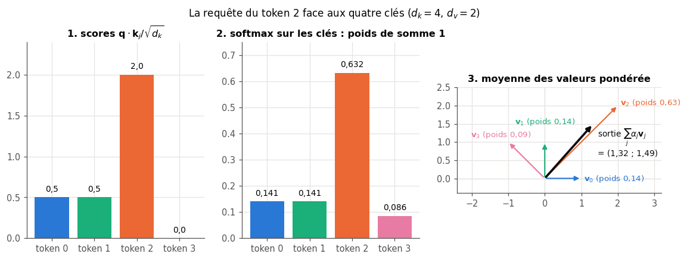

# B3 · Attention et Transformers : un mini-GPT from scratch — fiche de cours

> Ce chapitre bonus n'a pas d'équivalent dans le livre de Glassner : **cette fiche est le cours**. Le livre de 2018 traite les séquences avec des réseaux récurrents (ch. 22) ; depuis l'article de Vaswani et coll. (2017), presque tous les modèles de langue, de traduction, de parole et beaucoup de modèles d'images reposent sur un autre mécanisme, l'**attention** : chaque position d'une séquence va chercher directement, ailleurs dans la séquence, l'information dont elle a besoin. Tu vas du goulot des encodeurs-décodeurs récurrents à l'attention par produit scalaire, à ses masques, à ses têtes et à ses encodages de position, jusqu'au **bloc Transformer** complet, que tu écris en NumPy dans ta librairie. Puis tu écris en PyTorch un petit GPT qui apprend Holmes caractère par caractère, tu le fais générer avec un **KV cache** et tu chiffres ce que coûte un long contexte.

| | |
|---|---|
| **Livre** | — (chapitre propre au workbook) |
| **Sections** | 203.1 à 203.10 (numérotation interne du workbook : 203 = bonus B3) |
| **Temps total estimé** | ≈ 22 h : lecture de la fiche ≈ 2,0 h, exercices ≈ 19 h, 28 flashcards ≈ 0,9 h |
| **Prérequis** | 0B (produit matriciel, transposée, produit scalaire) · ch. 2 (variance d'une somme de variables indépendantes) · ch. 6 (cross-entropy, perplexité) · ch. 16 (paramètres d'une couche dense, initialisation) · ch. 17 (softmax stable, GELU, température) · ch. 18 (règle de la chaîne) · ch. 19 (AdamW, warmup + cosinus, gradient clipping) · ch. 20 (layer norm, connexion résiduelle, dropout, boucle PyTorch) · ch. 21 (convolution de stride $s$, Vision Transformer cité) · ch. 22 (RNN, LSTM, gradient évanescent, génération caractère par caractère, `sequences.py`) · ch. 28 (top-k et top-p) · B2 (tokenizer BPE, `nn.Embedding`, poids liés, masque d'attention d'un tokenizer) |
| **Fichiers du chapitre** | `02_exercices.md` (quiz, rappels, papier, réflexion, entretien) · `03_notebook.ipynb` · `04_indices.md` · `05_solutions.md` et `05_solutions.ipynb` · `06_mes_reponses.md` · `flashcards.csv` |
| **mylearn** | `attention.py` : `causal_mask`, `padding_mask` et `scaled_dot_product_attention` (B3.12), `split_heads`, `merge_heads` et `multi_head_attention` (B3.14), `positional_encoding` et `apply_rope` (B3.15), `transformer_block` (B3.16). Il réutilise tes `softmax` et `gelu` (ch. 17) et ta `layer_norm` (ch. 20) ; `positional_encoding` resservira en B5 pour encoder le pas de temps d'une diffusion |

## Comment utiliser ce chapitre

La fiche et les exercices papier posent les idées et les calculs ; le notebook les met en œuvre : les briques NumPy de ta librairie, validées contre PyTorch, puis un mini-GPT entraîné sur Holmes. Les codes de la fiche ont été exécutés avec les versions du workbook (Python 3.13, PyTorch 2.11, NumPy 2.1, transformers 5.21), sur **d'autres vecteurs, d'autres tailles et d'autres modèles** que les exercices : les tiens, tu les calcules toi-même.

**Ordre conseillé.**
1. Lis 203.1 et 203.2. Fais les quiz Q1 à Q3, le rappel R2, le calcul ✏️ B3.1, la dérivation ∂ B3.6 et l'explication 🗣️ B3.9.
2. Lis 203.3 et 203.4. Fais les quiz Q4 à Q6, les calculs ✏️ B3.2 et B3.3.
3. Lis 203.5 et 203.6. Fais les quiz Q7 et Q8, le rappel R3, le calcul ✏️ B3.4 et la dérivation ∂ B3.7.
4. Lis 203.7 et 203.8. Fais les quiz Q9 et Q10, le rappel R1, le calcul ✏️ B3.5, la lecture 📄 B3.11 et le cas ⚖️ B3.10.
5. Lis 203.9 et 203.10. Fais les quiz Q11 et Q12 et l'estimation 🧮 B3.8. Vérifie tes réponses courtes dans la partie 0 du notebook.
6. Fais le notebook dans l'ordre des ID, en deux phases : **ta librairie NumPy** (B3.12 à B3.17 : masques et attention, têtes, positions, bloc complet, chasse aux masques), puis **le mini-GPT en PyTorch** (B3.18 à B3.30 : module d'attention, modèle, entraînement, génération, cartes d'attention, ablations, contexte long, ViT, test de causalité, défi). Termine par les cinq questions d'entretien.

| Section | Quiz 🧠 et rappels 🔁 | Papier ✏️ ∂ 🧮 et réflexion | Notebook | Entretien 💼 |
|---|---|---|---|---|
| 203.1 Des RNN à l'attention | Q1, R2 | | | |
| 203.2 Attention par produit scalaire | Q2, Q3 | B3.1, B3.6, B3.9, B3.11 | B3.12, B3.13, B3.18 | E1 |
| 203.3 Masques | Q4, Q5 | B3.2, B3.11 | B3.12, B3.17, B3.18, B3.29 | |
| 203.4 Attention multi-têtes | Q6 | B3.3, B3.11 | B3.14, B3.18, B3.24 | E1 |
| 203.5 Positions | Q7 | B3.4, B3.7, B3.11 | B3.15, B3.25 | E5 |
| 203.6 Le bloc Transformer | Q8, R3 | B3.5, B3.11 | B3.16, B3.19, B3.25 | |
| 203.7 Familles | Q5, Q9 | B3.5, B3.11 | B3.19 | E3 |
| 203.8 Mini-GPT from scratch | Q10, R1 | B3.10 | B3.19, B3.20, B3.21, B3.22, B3.26, B3.29, B3.30 | |
| 203.9 Génération | Q11 | B3.8 | B3.23 | E4 |
| 203.10 Coût et passage à l'échelle | Q12 | B3.8, B3.10 | B3.27, B3.28 | E2 |

## Objectifs d'apprentissage

À la fin de ce chapitre, tu sais :
1. **Calculer** à la main une attention par produit scalaire, avec et sans masque causal, et **justifier** la division par $\sqrt{d_k}$.
2. **Implémenter** en NumPy les masques, l'attention multi-têtes, les encodages de position (sinusoïdal, RoPE) et un bloc Transformer pré-LN, et les **valider** contre PyTorch.
3. **Distinguer** encodeur, décodeur et encodeur-décodeur, avec leurs masques et leurs objectifs d'entraînement.
4. **Écrire** et **entraîner** en PyTorch un mini-GPT, et **évaluer** sa perplexité face au LSTM du ch. 22.
5. **Générer** du texte avec température, top-k, top-p et un KV cache.
6. **Estimer** les paramètres, les FLOPs et la mémoire d'un Transformer, et **expliquer** le coût quadratique du contexte.
7. **Mener** des ablations (position, résiduel, normalisation, têtes) et en **tirer** des conclusions.

## L'essentiel en 10 lignes

1. Un encodeur-décodeur récurrent résume la phrase source en **un seul vecteur** : un goulot. L'**attention** laisse le décodeur relire **toutes** les positions de la source, avec des poids différents à chaque pas.
2. Chaque position émet une **requête** $\mathbf{q}$, une **clé** $\mathbf{k}$ et une **valeur** $\mathbf{v}$. Le score d'une paire est $\mathbf{q}_i \cdot \mathbf{k}_j / \sqrt{d_k}$, une **softmax sur les clés** en fait des poids de somme 1, et la sortie est la moyenne des valeurs pondérée par ces poids.
3. On divise par $\sqrt{d_k}$ car le produit scalaire de deux vecteurs aléatoires a une variance $d_k$ : sinon la softmax sature et ses gradients s'éteignent.
4. Un **masque** met $-\infty$ dans les scores interdits : le **masque causal** cache le futur, le **masque de padding** le remplissage. `True` veut dire « autorisé » pour `F.scaled_dot_product_attention`, « masqué » pour `nn.MultiheadAttention`.
5. L'**attention multi-têtes** répartit les $d$ features entre $H$ têtes de taille $d/H$, chacune avec sa carte d'attention, puis recolle les têtes et les mélange par une projection de sortie : $4d^2$ paramètres (plus les biais), quel que soit $H$.
6. L'attention ne voit pas l'ordre : on ajoute aux embeddings un **encodage de position** (sinusoïdal ou appris), ou l'on **tourne** requêtes et clés selon leur position (**RoPE**), ce qui rend leurs scores fonction de la seule distance.
7. Un **bloc Transformer** enchaîne attention et MLP à GELU de largeur $4d$, chacun avec une **connexion résiduelle** et une **layer norm**, avant (pré-LN, GPT-2) ou après (post-LN, 2017) : environ $12d^2$ paramètres.
8. **BERT** est un encodeur (attention dans les deux sens, tokens masqués à deviner), **GPT** un décodeur (masque causal, token suivant), **T5** un encodeur-décodeur (attention croisée).
9. Un GPT apprend à prédire le token suivant **à chaque** position (loss $L$, perplexité $e^L$) ; il génère un token à la fois, et le **KV cache** garde clés et valeurs déjà calculées, au prix d'une mémoire qui grandit avec le texte.
10. L'attention coûte $O(T^2)$ ; **FlashAttention** calcule le même résultat sans stocker la matrice $T \times T$. L'entraînement coûte environ $6ND$ FLOPs, et les **lois d'échelle** disent comment partager un budget entre paramètres et tokens.

> 📐 **Conventions de la fiche** — Comme aux ch. 22 et B2, on reprend les noms de PyTorch : un batch contient $N$ séquences de $T$ tokens ; dans une attention, $L$ est le nombre de **requêtes** et $S$ le nombre de **clés** ($L = S = T$ en auto-attention). $d$ est la dimension du modèle (*d_model*, notée $D$ dans les docstrings et les formes de ta librairie), $H$ le nombre de têtes, $d_h = d/H$ la taille d'une tête, $d_k$ et $d_v$ celles des clés et des valeurs ($d_k = d_v = d_h$ dans une attention multi-têtes), $F$ la largeur du MLP d'un bloc ($F = 4d$ d'habitude) et $V$ (en italique) la taille du vocabulaire. Les matrices sont en gras : $\mathbf{X}$, de forme $(T, d)$, a une ligne par token ; $\mathbf{Q}$, $\mathbf{K}$, $\mathbf{V}$ sont les requêtes, clés et valeurs, $\mathbf{W}_Q$, $\mathbf{W}_K$, $\mathbf{W}_V$, $\mathbf{W}_O$ les projections $(d, d)$, avec la convention de `mylearn` (ch. 16) : $\mathbf{z} = \mathbf{x}\mathbf{W} + \mathbf{b}$. Les positions $p$, $m$, $n$ et les indices de tokens $i$, $j$ partent de 0, comme en Python. $\log$ est le logarithme naturel. **Écarts au §6** : $d$ est une dimension d'embedding (comme en B1 et B2) ; $L$ change de sens selon la section, comme dans les bibliothèques : nombre de requêtes en 203.2 à 203.4, **loss** en 203.8 (§6), **nombre de couches** dans les formules de coût de 203.9 et 203.10 ; dans la formule $6ND$ (203.10), $N$ est un nombre de **paramètres** et $D$ un nombre de **tokens**, comme dans les articles sur les lois d'échelle ; $H$ compte des têtes (au ch. 22, c'était la taille de l'état). Le contexte dit toujours de quoi il s'agit.

---

## 203.1 · Des RNN à l'attention : goulot de l'encodeur-décodeur et alignement ⏩

### Traduire avec deux RNN

En 2014, K. Cho et ses coauteurs (Montréal), puis I. Sutskever, O. Vinyals et Q. Le (Google) traduisent avec un **encodeur-décodeur** (*encoder-decoder*, ou *seq2seq*), fait de deux réseaux récurrents (ch. 22) :
- l'**encodeur** lit la phrase source token après token et met à jour son état $\mathbf{h}_t$ ; son **dernier** état, le **vecteur de contexte** $\mathbf{c}$, doit résumer toute la phrase ;
- le **décodeur** part de $\mathbf{c}$ et génère la traduction token après token, chaque token produit devenant l'entrée du pas suivant, comme le générateur de Holmes du ch. 22.

Les mots « encodeur » et « décodeur » ont le sens du ch. 25 (une moitié résume, l'autre reconstruit), sauf que le décodeur produit une **autre** séquence.

### Le goulot

Toute la phrase passe par $\mathbf{c}$, un vecteur de taille fixe, qu'elle compte 5 mots ou 50. C'est un **goulot** (*bottleneck*, ch. 25), et il se voit : la qualité des traductions de l'encodeur-décodeur s'effondre quand les phrases s'allongent. Deux raisons :
- **la capacité** : un vecteur de taille fixe ne garde pas tout d'une phrase longue ;
- **le chemin** : l'information du premier mot doit traverser tous les pas de l'encodeur puis tous ceux du décodeur. Le gradient qui relie le premier mot source au dernier mot traduit traverse autant de pas, et s'évanouit (🔁 R2, ch. 22). Sutskever et ses coauteurs le contournaient en retournant la phrase source, ce qui rapproche ses premiers mots du début de la traduction.

### L'idée de Bahdanau : relire la source à chaque pas

D. Bahdanau, K. Cho et Y. Bengio (« Neural Machine Translation by Jointly Learning to Align and Translate », arXiv 2014, ICLR 2015) suppriment le goulot. L'encodeur, un RNN bidirectionnel (ch. 22), garde **tous** ses états $\mathbf{h}_1, \dots, \mathbf{h}_S$, un par mot source. À chaque pas $i$ de la traduction, le décodeur :
1. compare son état courant $\mathbf{s}_{i-1}$ à **chaque** état de l'encodeur, par un petit réseau qui rend un score $e_{ij}$ (« le mot source $j$ est-il utile pour le mot cible $i$ ? ») ;
2. transforme les $S$ scores en poids positifs de somme 1 par une softmax : $\alpha_{ij} = e^{e_{ij}} / \sum_{j'} e^{e_{ij'}}$ ;
3. calcule un contexte **propre à ce pas** : $\mathbf{c}_i = \sum_j \alpha_{ij}\,\mathbf{h}_j$, la moyenne des états source pondérée par les poids ;
4. s'en sert pour produire le mot $i$.

Les poids $\alpha_{ij}$ forment l'**attention** : le décodeur « regarde » les mots source qui l'aident. L'article parle d'**alignement** (*alignment*), au sens de la traduction : quel mot source correspond à quel mot cible (rien à voir avec l'alignement d'un LLM sur des préférences humaines, ch. 1). L'alignement est **souple** (*soft*) : une distribution de poids, pas un choix d'un seul mot, donc dérivable et appris par rétropropagation avec le reste du réseau, sans aucun alignement annoté.


Deux effets, mesurés dans l'article : la qualité ne s'effondre plus sur les phrases longues, et les cartes de poids $\alpha_{ij}$ se lisent : sur l'anglais et le français, elles suivent presque la diagonale, et s'en écartent là où les deux langues n'ordonnent pas les mots de la même façon (l'adjectif après le nom en français). C'est la première **carte d'attention** (*attention map*) : la matrice des poids, une ligne par mot cible, une colonne par mot source (📈 B3.24).

Bahdanau calcule son score par un petit MLP, $e_{ij} = \mathbf{w}^\top \tanh(\mathbf{W}\mathbf{s}_{i-1} + \mathbf{U}\mathbf{h}_j)$ (l'**attention additive**) ; M.-T. Luong, H. Pham et C. Manning (EMNLP 2015) essaient le **produit scalaire** $\mathbf{s}_i \cdot \mathbf{h}_j$ (0B), que le Transformer garde (203.2).

### Et si l'on supprimait les RNN ?

L'attention résout le goulot, mais l'encodeur et le décodeur restent récurrents : l'état $t$ attend l'état $t - 1$, et l'entraînement ne se parallélise pas le long de la séquence (💼 22.E1). A. Vaswani, N. Shazeer, N. Parmar, J. Uszkoreit, L. Jones, A. Gomez, Ł. Kaiser et I. Polosukhin (« Attention Is All You Need », NeurIPS 2017) font le pas suivant : **plus aucune récurrence**. Chaque couche laisse chaque position regarder toutes les autres par attention, d'un seul coup ; toutes les positions se calculent en parallèle, et deux tokens éloignés sont reliés en **un** pas, quelle que soit leur distance. C'est le **Transformer** (📄 B3.11). La même attention sert alors trois fois : la source se regarde elle-même, la traduction aussi, et la traduction regarde la source (203.3).

| | Encodeur-décodeur récurrent | avec attention (Bahdanau) | Transformer |
|---|---|---|---|
| Ce que le décodeur voit de la source | un vecteur | tous les états, pondérés | toutes les positions, pondérées, à chaque couche |
| Chemin entre deux tokens éloignés de $k$ positions | $O(k)$ pas | $O(1)$ entre source et cible, $O(k)$ dans chaque RNN | $O(1)$ |
| Calcul le long de la séquence | séquentiel | séquentiel | parallèle à l'entraînement |
| Coût d'une couche sur $T$ tokens | $O(T d^2)$ | $O(T d^2 + T^2 d)$ | $O(T d^2 + T^2 d)$ |

> 🕰️ **Mise à jour (2026) — RNN contre Transformers** — **Le livre :** les RNN et les LSTM sont l'outil des séquences (ch. 22). · **Aujourd'hui :** les Transformers dominent le texte, la traduction, la parole, le code et une bonne part de la vision. Pour les contextes très longs, les **modèles à espace d'états** (Mamba, A. Gu et T. Dao, 2023 ; ch. 22) reviennent dans des **hybrides** qui gardent quelques couches d'attention : Jamba (AI21, 2024), Nemotron-H (NVIDIA, avril 2025 : jusqu'à 3 fois plus rapide à l'inférence que des Transformers de taille voisine), Granite 4.0 (IBM, octobre 2025 : neuf couches Mamba-2 pour une d'attention, plus de 70 % de mémoire en moins sur les longues entrées selon IBM). · **Faut-il quand même l'apprendre ?** Oui : l'attention est la brique de tous ces modèles, hybrides compris, et les RNN restent utiles sur des flux et de petites séries (ch. 22). · *Sources :* [Vaswani et coll., arXiv:1706.03762](https://arxiv.org/abs/1706.03762) ; [Gu et Dao, Mamba, arXiv:2312.00752](https://arxiv.org/abs/2312.00752) ; [Lieber et coll., Jamba, arXiv:2403.19887](https://arxiv.org/abs/2403.19887) ; [NVIDIA, Nemotron-H, arXiv:2504.03624](https://arxiv.org/abs/2504.03624) ; [IBM, annonce de Granite 4.0 (2 octobre 2025)](https://www.ibm.com/new/announcements/ibm-granite-4-0-hyper-efficient-high-performance-hybrid-models).

---

## 203.2 · Attention par produit scalaire : requêtes, clés, valeurs, mise à l'échelle, softmax ⏩

### Un dictionnaire où l'on cherche « à peu près »

Un dictionnaire Python associe des **clés** à des **valeurs** : `d["chat"]` cherche la clé égale à `"chat"` et rend sa valeur, une seule. L'attention en est une version **souple** (🧠 Q2) :
- une **requête** (*query*) $\mathbf{q}$ décrit ce que l'on cherche ;
- chaque élément de la séquence offre une **clé** (*key*) $\mathbf{k}_j$, qui dit ce qu'il contient, et une **valeur** (*value*) $\mathbf{v}_j$, ce qu'il rend ;
- au lieu d'exiger l'égalité, on mesure la **ressemblance** de $\mathbf{q}$ à chaque clé par un produit scalaire, on la transforme en poids de somme 1, et l'on rend la **moyenne des valeurs pondérée** par ces poids. Tout reste dérivable : le réseau peut apprendre où regarder.

### D'où viennent les requêtes, les clés et les valeurs

Dans un Transformer, chaque token arrive avec un vecteur $\mathbf{x}_i$ de dimension $d$ (son embedding, B2, plus sa position, 203.5). Trois **projections linéaires apprises** en tirent ses trois rôles :

$$\mathbf{q}_i = \mathbf{x}_i \mathbf{W}_Q, \qquad \mathbf{k}_i = \mathbf{x}_i \mathbf{W}_K, \qquad \mathbf{v}_i = \mathbf{x}_i \mathbf{W}_V,$$

ou, pour toute la séquence d'un coup, $\mathbf{Q} = \mathbf{X}\mathbf{W}_Q$, $\mathbf{K} = \mathbf{X}\mathbf{W}_K$, $\mathbf{V} = \mathbf{X}\mathbf{W}_V$, de formes $(T, d_k)$, $(T, d_k)$ et $(T, d_v)$ (avec des biais dans GPT-2 et dans ta librairie, sans dans la plupart des modèles récents). Ce qu'un token cherche ($\mathbf{q}_i$) n'est pas ce qu'il montre ($\mathbf{k}_i$), ni ce qu'il transmet ($\mathbf{v}_i$) : dans « le chat que Marie a adopté dort », « dort » peut chercher son sujet, que « chat » annonce par sa clé.

### La formule

Pour toutes les requêtes à la fois :

$$\operatorname{Attention}(\mathbf{Q}, \mathbf{K}, \mathbf{V}) = \operatorname{softmax}\left(\frac{\mathbf{Q}\mathbf{K}^\top}{\sqrt{d_k}} + \mathbf{M}\right)\mathbf{V}, \qquad M_{ij} = -\infty \text{ si la paire } (i, j) \text{ est masquée}, \ 0 \text{ sinon}.$$

Lis-la de l'intérieur vers l'extérieur :
1. $\mathbf{Q}\mathbf{K}^\top$, de forme $(L, S)$ : la case $(i, j)$ est le produit scalaire $\mathbf{q}_i \cdot \mathbf{k}_j$, le **score** de la requête $i$ pour la clé $j$ ;
2. division par $\sqrt{d_k}$ : la **mise à l'échelle** (*scaling*), justifiée plus bas ;
3. $+\,\mathbf{M}$ : le **masque** (203.3) ; $-\infty$ dans une case donne un poids exactement nul ;
4. softmax **ligne par ligne**, c'est-à-dire **sur les clés** : chaque ligne devient une distribution de poids $\alpha_{ij} \ge 0$ de somme 1, la ligne $i$ de la **carte d'attention** ;
5. produit par $\mathbf{V}$, de forme $(S, d_v)$ : la sortie $i$ est $\sum_j \alpha_{ij}\,\mathbf{v}_j$, de forme $(L, d_v)$.

C'est l'**attention par produit scalaire mis à l'échelle** (*scaled dot-product attention*), la fonction `scaled_dot_product_attention` de ta librairie (🔨 B3.12) et `torch.nn.functional.scaled_dot_product_attention` de PyTorch. La softmax porte sur l'axe des **clés** (le dernier) : sur l'autre axe, chaque **clé** se répartirait entre les requêtes, ce qui n'a pas de sens (⚠️ en fin de fiche).

*Exemple chiffré* ($d_k = 4$, donc $\sqrt{d_k} = 2$ ; $d_v = 2$). Une requête, celle du token 2 d'une séquence de 4 tokens, $\mathbf{q} = (1, 0, 1, 0)$ ; les clés et les valeurs des quatre tokens :

| token $j$ | 0 | 1 | 2 | 3 |
|---|---|---|---|---|
| clé $\mathbf{k}_j$ | $(1, 1, 0, 0)$ | $(0, 1, 1, 0)$ | $(2, 0, 2, 0)$ | $(0, 0, 0, 2)$ |
| valeur $\mathbf{v}_j$ | $(1, 0)$ | $(0, 1)$ | $(2, 2)$ | $(-1, 1)$ |
| score $\mathbf{q} \cdot \mathbf{k}_j / 2$ | $0{,}5$ | $0{,}5$ | $2$ | $0$ |
| $e^{\text{score}}$ | $1{,}6487$ | $1{,}6487$ | $7{,}3891$ | $1$ |
| poids $\alpha_j$ | $0{,}1411$ | $0{,}1411$ | $0{,}6323$ | $0{,}0856$ |

La somme des exponentielles vaut $11{,}6865$. La sortie est $0{,}1411\,(1, 0) + 0{,}1411\,(0, 1) + 0{,}6323\,(2, 2) + 0{,}0856\,(-1, 1) \approx (1{,}3201 ;\ 1{,}4912)$ : surtout la valeur du token 2, dont la clé ressemble le plus à la requête, un peu des autres. Le token 3, de clé orthogonale à la requête (score 0), reçoit quand même un poids : la softmax ne donne jamais exactement 0 à un score fini.



```python
import numpy as np

q = np.array([[1., 0., 1., 0.]])                         # (L, d_k) = (1, 4)
K = np.array([[1., 1., 0., 0.], [0., 1., 1., 0.], [2., 0., 2., 0.], [0., 0., 0., 2.]])
V = np.array([[1., 0.], [0., 1.], [2., 2.], [-1., 1.]])  # (S, d_v) = (4, 2)
s = q @ K.T / np.sqrt(K.shape[1])                        # (1, 4) scores: [[0.5 0.5 2.  0. ]]
w = np.exp(s - s.max(axis=-1, keepdims=True))            # stable softmax over the keys (ch. 17)
w /= w.sum(axis=-1, keepdims=True)
print(w.round(4), (w @ V).round(4))                      # [[0.1411 0.1411 0.6323 0.0856]] [[1.3201 1.4912]]
```

> 🧮 **Rappel outil — produits matriciels par batches : `@` sur des tableaux à 4 axes et `np.einsum`** — Un modèle traite à la fois $N$ séquences et $H$ têtes : `q` a la forme `(N, H, L, d_k)` et `k` la forme `(N, H, S, d_k)`. L'opérateur `@` (`np.matmul`) multiplie les **deux derniers** axes et traite tous les axes précédents comme des **axes de batch**, qui doivent être égaux ou diffusables (*broadcasting*, 0A) : `q @ k.swapaxes(-1, -2)` a la forme `(N, H, L, S)`, un produit $(L, d_k) \times (d_k, S)$ par séquence et par tête. `swapaxes(-1, -2)` (ou `transpose(-2, -1)` en PyTorch) échange les deux derniers axes ; `.T` les inverserait **tous**, une erreur classique sur un tableau à 4 axes. `np.einsum` écrit la même chose avec des lettres : `np.einsum("nhld,nhsd->nhls", q, k)` dit « pour chaque $n$, $h$, $l$, $s$, somme sur $d$ de `q[n, h, l, d] * k[n, h, s, d]` » ; une lettre absente du résultat est sommée. Exemple : `q` de forme `(2, 3, 5, 4)` et `k` de forme `(2, 3, 7, 4)` donnent `(2, 3, 5, 7)` par les deux écritures, avec `np.allclose` vrai.

### Pourquoi diviser par $\sqrt{d_k}$

Imagine des requêtes et des clés dont les composantes sont tirées au hasard, indépendantes, de moyenne 0 et de variance 1 (c'est à peu près le cas à l'initialisation). Le score $\mathbf{q} \cdot \mathbf{k} = \sum_{c=1}^{d_k} q_c k_c$ est une somme de $d_k$ produits indépendants, et

$$\operatorname{Var}(\mathbf{q} \cdot \mathbf{k}) = d_k \quad \text{pour des composantes indépendantes, centrées, de variance 1}.$$

> 🧮 **Rappel maths — variance du produit de deux variables indépendantes centrées** — Si $X$ et $Y$ sont indépendantes, $\mathbb{E}[XY] = \mathbb{E}[X]\,\mathbb{E}[Y]$, et de même pour $X^2$ et $Y^2$. Si de plus elles sont **centrées** ($\mathbb{E}[X] = \mathbb{E}[Y] = 0$), le produit $XY$ est centré, et $\operatorname{Var}(XY) = \mathbb{E}[X^2 Y^2] - 0 = \mathbb{E}[X^2]\,\mathbb{E}[Y^2] = \operatorname{Var}(X)\,\operatorname{Var}(Y)$. Exemple : deux dés « centrés » qui valent $-1$ ou $+1$ avec la même probabilité ont chacun une variance 1 ; leur produit vaut aussi $\pm 1$, de variance $1 = 1 \times 1$. Sans le centrage, la formule est fausse : il faut ajouter des termes en $\mathbb{E}[X]^2$ et $\mathbb{E}[Y]^2$. Avec la variance d'une **somme** de variables indépendantes (ch. 2), c'est tout ce qu'il faut pour la formule ci-dessus (∂ B3.6).

L'écart-type des scores grandit donc comme $\sqrt{d_k}$ : de l'ordre de 8 pour $d_k = 64$, de 23 pour $d_k = 512$. Or une softmax de scores très étalés **sature** : le plus grand score prend presque tout le poids. Ses dérivées deviennent alors presque nulles (sa Jacobienne, ch. 17, $\operatorname{diag}(\mathbf{p}) - \mathbf{p}^\top\mathbf{p}$, s'annule quand $\mathbf{p}$ tend vers un one-hot) : le gradient ne passe plus, et requêtes et clés n'apprennent plus. C'est l'argument de Vaswani et ses coauteurs (📄 B3.11).

Diviser par $\sqrt{d_k}$ ramène la variance des scores à 1, quelle que soit la dimension :

```python
rng = np.random.default_rng(0)
for dk in (4, 64, 512):
    q, k = rng.normal(size=(100_000, dk)), rng.normal(size=(100_000, dk))
    dots = (q * k).sum(axis=1)                            # 100,000 dot products
    print(dk, dots.var().round(2), (dots / np.sqrt(dk)).var().round(3))
# 4 4.03 1.007
# 64 64.09 1.001
# 512 514.18 1.004
```

Le paramètre `scale` de PyTorch et de ta librairie remplace $1/\sqrt{d_k}$ si besoin.

> ⚠️ **Piège classique — la softmax sur le mauvais axe** — `softmax(scores, axis=0)` sur une matrice $(L, S)$ normalise chaque **colonne** : le code tourne, les formes sont justes, mais les poids d'une requête ne font plus 1 et la sortie mélange les requêtes. Vérifie toujours `w.sum(axis=-1)` : des 1 partout.

---

## 203.3 · Masques : causal, padding ; auto-attention et attention croisée ⏩

### Auto-attention et attention croisée

Tout dépend de l'origine des trois rôles (🧠 Q5) :
- dans l'**auto-attention** (*self-attention*), $\mathbf{Q}$, $\mathbf{K}$ et $\mathbf{V}$ viennent de la **même** séquence $\mathbf{X}$ : chaque token regarde les tokens de sa propre séquence, et $L = S = T$ ;
- dans l'**attention croisée** (*cross-attention*), les requêtes viennent d'une séquence (la traduction en cours, dans le décodeur) et les clés et valeurs d'une **autre** (la sortie de l'encodeur, la phrase source) : $\mathbf{Q} = \mathbf{Y}\mathbf{W}_Q$, $\mathbf{K} = \mathbf{X}\mathbf{W}_K$, $\mathbf{V} = \mathbf{X}\mathbf{W}_V$, et $L \ne S$ en général. C'est l'attention de Bahdanau, sans RNN.

Ta fonction `multi_head_attention(query, key, value, ...)` couvre les deux cas : on lui passe `x, x, x` pour une auto-attention, `y, x, x` pour une attention croisée.

### Le masque causal

Un modèle qui génère du texte de gauche à droite apprend à prédire le token $t + 1$ à partir des tokens $0$ à $t$ (203.8). En auto-attention, rien n'empêcherait le token $t$ de regarder le token $t + 1$, c'est-à-dire la réponse : à l'entraînement, il tricherait, et à la génération, ce token futur n'existe pas encore. Le **masque causal** (*causal mask*) interdit à chaque requête $i$ les clés $j > i$ (🧠 Q4) :

$$M_{ij} = \begin{cases} 0 & \text{si } j \le i \\ -\infty & \text{si } j > i \end{cases}$$

En booléen (`True` = autorisé), c'est une matrice **triangulaire inférieure** : la ligne $i$ a $i + 1$ cases vraies.

```python
import torch
print(torch.tril(torch.ones(4, 4, dtype=torch.bool)))
# tensor([[ True, False, False, False],
#         [ True,  True, False, False],
#         [ True,  True,  True, False],
#         [ True,  True,  True,  True]])
```

*Exemple chiffré* : reprenons l'exemple de 203.2 avec un masque causal. La requête du token 2 n'a plus le droit de voir le token 3 : son score devient $-\infty$, son exponentielle 0, et les trois autres se partagent le poids. La somme des exponentielles tombe à $10{,}6865$, les poids deviennent $0{,}1543$, $0{,}1543$, $0{,}6914$ et $0$, et la sortie $(1{,}5372 ;\ 1{,}5372)$. Masquer ne retire pas seulement une valeur de la moyenne : cela **renormalise** les autres poids.

Une conséquence utile : avec un masque causal, la sortie à la position $i$ ne dépend que des tokens $0$ à $i$. **Modifier un token futur ne change rien aux sorties passées** : c'est un invariant qui se teste (🛠️ B3.29), et un masque transposé (triangulaire supérieur) le viole, tout en laissant le code tourner. Avec ce masque à l'envers, chaque position voit son avenir : la loss d'entraînement tombe anormalement bas, et le modèle ne sait plus rien générer (🐛 B3.17).


### Le masque de padding

Les séquences d'un batch n'ont pas la même longueur : on complète les plus courtes par un token de padding (`[PAD]`, B2) jusqu'à une longueur commune $S$. Ces positions ne contiennent rien : aucune requête ne doit les regarder. Le **masque de padding** (*padding mask*) est vrai sur les vrais tokens et faux sur le padding, une ligne par séquence :

$$m_{n,j} = \big(j < \text{longueur}_n\big), \qquad \text{forme } (N, S).$$

```python
lengths = torch.tensor([3, 5])
print(torch.arange(5) < lengths[:, None])        # broadcasting: (5,) against (2, 1) gives (2, 5)
# tensor([[ True,  True,  True, False, False],
#         [ True,  True,  True,  True,  True]])
```

C'est le **masque d'attention** que rend un tokenizer avec `padding=True` (B2), en booléen. Pour l'appliquer à des scores de forme $(N, H, L, S)$, on le remet en forme $(N, 1, 1, S)$ : la diffusion le répète sur les têtes et sur les requêtes, car il porte sur les **clés**. Il se combine au masque causal par un ET logique : `causal & pad`, de forme $(N, 1, L, S)$. C'est `padding_mask(lengths, max_len)` de ta librairie (🔨 B3.12).

Deux remarques :
- les **requêtes** de padding calculent encore une sortie (qui ne veut rien dire) : on ne la jette pas dans l'attention, mais dans la **loss**, en ignorant ces positions (`ignore_index`, 203.8). L'oublier fait apprendre au modèle à prédire du padding (🐛 B3.17) ;
- une ligne **entièrement** masquée n'a aucune clé permise : sa softmax divise 0 par 0. `F.scaled_dot_product_attention` de PyTorch 2.11 rend alors une ligne de zéros (vérifié sur CPU), `nn.MultiheadAttention` des `nan`, et ta fonction lève une `ValueError`, comme le demande sa docstring : une requête sans aucune clé est presque toujours un bug de masque.

### Le masque causal quand il y a moins de requêtes que de clés

Pendant une génération avec KV cache (203.9), on calcule une seule nouvelle requête (ou quelques-unes) face à toutes les clés déjà vues : $L < S$. La requête $i$ est alors le token de position $i + S - L$, et elle a le droit de voir les clés $j \le i + S - L$ : le triangle est **aligné en bas à droite**, et la **dernière** requête voit **toutes** les clés.

$$\text{autorisé}(i, j) = \big(j \le i + S - L\big), \qquad \text{c'est-à-dire } \texttt{torch.tril(torch.ones(L, S), diagonal=S - L)}.$$

```python
print(torch.tril(torch.ones(2, 5, dtype=torch.bool), diagonal=3))   # L = 2 queries, S = 5 keys
# tensor([[ True,  True,  True,  True, False],
#         [ True,  True,  True,  True,  True]])
```

C'est la convention de `causal_mask(q_len, kv_len)` de ta librairie ; pour $L = S$, elle redonne le triangle ordinaire.

> 🕰️ **Mise à jour (2026) — `F.scaled_dot_product_attention`** — **Le livre :** —. · **Aujourd'hui :** depuis PyTorch 2.0, `F.scaled_dot_product_attention(query, key, value, attn_mask=None, dropout_p=0.0, is_causal=False, scale=None, enable_gqa=False)` calcule l'attention en une ligne sur des tenseurs `(..., L, d_k)`. Un `attn_mask` **booléen** vaut `True` pour une paire qui **participe** à l'attention ; un masque flottant est **ajouté** aux scores. `is_causal=True` aligne le triangle **en haut à gauche** quand $L \ne S$ (la requête 0 ne voit que la clé 0) : pour le KV cache, il faut `torch.nn.attention.bias.causal_lower_right(L, S)` ou ton propre masque. On ne passe jamais `attn_mask` **et** `is_causal` (le noyau de référence lève une erreur ; sur CPU, un autre noyau les combine sans prévenir). `dropout_p` s'applique même en `eval()`. La fonction choisit seule son noyau : FlashAttention-2, un noyau économe en mémoire ou l'implémentation de référence sur GPU ; sur CPU, PyTorch 2.11 prend un noyau de type FlashAttention écrit pour CPU (`SDPBackend.FLASH_ATTENTION`, vérifié par `torch._fused_sdp_choice`), le noyau `EFFICIENT_ATTENTION` n'y existe pas, et `with torch.nn.attention.sdpa_kernel(SDPBackend.MATH):` impose la référence. · **Faut-il quand même l'apprendre ?** Oui : c'est l'appel de nanoGPT et des modèles de transformers ; l'écrire en NumPy (🔨 B3.12) t'apprend ce qu'il calcule. · *Sources :* [documentation de `scaled_dot_product_attention` (PyTorch 2.11)](https://docs.pytorch.org/docs/2.11/generated/torch.nn.functional.scaled_dot_product_attention.html) (« True indicates values to participate in attention » ; « An error is thrown if both attn_mask and is_causal are set ») ; [`torch.nn.attention.bias`](https://docs.pytorch.org/docs/2.11/nn.attention.bias.html).

```python
import torch.nn.functional as F
from torch.nn.attention.bias import causal_lower_right

torch.manual_seed(0)
q, k, v = torch.randn(1, 1, 2, 8), torch.randn(1, 1, 5, 8), torch.randn(1, 1, 5, 8)   # L = 2, S = 5
top_left = F.scaled_dot_product_attention(q, k, v, is_causal=True)
bottom_right = F.scaled_dot_product_attention(q, k, v, attn_mask=causal_lower_right(2, 5))
mine = F.scaled_dot_product_attention(q, k, v, attn_mask=torch.tril(torch.ones(2, 5, dtype=torch.bool), diagonal=3))
print(torch.allclose(top_left, bottom_right), torch.allclose(bottom_right, mine))     # False True
```

> 🕰️ **Mise à jour (2026) — `nn.MultiheadAttention`** — **Le livre :** —. · **Aujourd'hui :** la couche d'attention multi-têtes de PyTorch, bien plus ancienne que `F.scaled_dot_product_attention`, garde deux conventions : `batch_first=False` par défaut (tenseurs `(T, N, d)`, comme `nn.LSTM`, ch. 22) et des masques booléens **inversés** : pour `attn_mask` comme pour `key_padding_mask`, `True` veut dire « **masqué** » (« a True value indicates that the corresponding position is not allowed to attend »). Elle rend par défaut les poids **moyennés sur les têtes** (`average_attn_weights=True`). · **Faut-il quand même l'apprendre ?** Oui, pour la lire : beaucoup de code l'utilise, et passer d'une convention à l'autre sans inverser le masque est un bug silencieux (🐛 B3.17). · *Source :* [documentation de `nn.MultiheadAttention` (PyTorch 2.11)](https://docs.pytorch.org/docs/2.11/generated/torch.nn.MultiheadAttention.html).

```python
from torch import nn

mha = nn.MultiheadAttention(8, 2, batch_first=True)       # d = 8, H = 2
x = torch.randn(1, 4, 8)
causal = torch.tril(torch.ones(4, 4, dtype=torch.bool))   # True = may attend (SDPA convention)
_, w = mha(x, x, x, attn_mask=~causal, average_attn_weights=False)   # inverted for nn.MultiheadAttention
print(w.shape, w[0, 0, 0])                                # torch.Size([1, 2, 4, 4]) tensor([1., 0., 0., 0.])
_, w_bad = mha(x, x, x, attn_mask=causal, average_attn_weights=False) # forgot to invert
print(w_bad[0, 0, 3])                                     # tensor([nan, nan, nan, nan]): the last token sees nothing
```

Sans l'inversion, la première requête voit tout sauf elle-même et la dernière ne voit rien (`nan`) ; avec un masque de padding inversé, l'erreur ne se voit pas : les poids restent finis, et le modèle apprend sur du padding. Ta `multi_head_attention` est testée ainsi : contre `nn.MultiheadAttention` avec `attn_mask = ~mask`.

---

## 203.4 · Attention multi-têtes : projections, découpage en têtes, concaténation ⏩

### Plusieurs questions à la fois

Une seule attention rend, pour chaque token, **une** moyenne pondérée : un seul « regard ». Or un token a souvent besoin de plusieurs informations à la fois : le sujet de son verbe, le mot précédent, la fin de la phrase. L'**attention multi-têtes** (*multi-head attention*, MHA) fait $H$ attentions en parallèle, chacune avec ses propres projections, donc ses propres requêtes, clés et valeurs, et sa propre carte d'attention (🧠 Q6). Chaque attention est une **tête d'attention** (*attention head*), à ne pas confondre avec la **tête** d'un modèle (sa dernière couche, propre à la tâche, ch. 23 et B1).

$$\operatorname{MHA}(\mathbf{X}) = \operatorname{concat}(\text{tête}_1, \dots, \text{tête}_H)\,\mathbf{W}_O, \qquad \text{tête}_h = \operatorname{Attention}(\mathbf{X}\mathbf{W}_Q^h, \mathbf{X}\mathbf{W}_K^h, \mathbf{X}\mathbf{W}_V^h).$$

Chaque $\mathbf{W}_Q^h$ a la forme $(d, d_h)$ avec $d_h = d / H$ : chaque tête travaille dans un **sous-espace** de dimension $d_h$, et les $H$ têtes ensemble ont autant de features que le modèle. Leurs sorties, $H$ matrices $(T, d_h)$, sont mises **côte à côte** (`concat`) en une matrice $(T, d)$, que la **projection de sortie** $\mathbf{W}_O$, de forme $(d, d)$, mélange : sans elle, les têtes ne pourraient pas combiner ce qu'elles ont trouvé.

L'article de 2017 prend $d = 512$, $H = 8$, $d_h = 64$. Le calcul total est celui d'**une** tête de taille $d$ : on **partage** les features entre les regards.

### Une seule matrice pour toutes les têtes

En pratique, on ne fait pas $H$ produits séparés. Les $H$ matrices $\mathbf{W}_Q^h$ côte à côte forment une seule matrice $\mathbf{W}_Q$ de forme $(d, d)$ : un seul produit $\mathbf{Q} = \mathbf{X}\mathbf{W}_Q$ calcule les requêtes de toutes les têtes, et la tête $h$ est le bloc de colonnes $h\,d_h$ à $(h + 1)\,d_h - 1$. Il reste à **découper** ces colonnes en têtes, pour que l'attention se calcule tête par tête avec un produit par batches (203.2) :

$$(N, T, d) \xrightarrow{\text{reshape}} (N, T, H, d_h) \xrightarrow{\text{échanger les axes 1 et 2}} (N, H, T, d_h).$$


Le **reshape** coupe le dernier axe en $H$ blocs consécutifs de $d_h$ features ; l'**échange d'axes** met les têtes avant le temps, pour que chaque tête voie une séquence complète $(T, d_h)$ : les produits `q @ k.swapaxes(-1, -2)` se font alors pour chaque $(n, h)$. Après l'attention, on fait le chemin inverse (échanger, puis reshape en $(N, T, d)$) : c'est la concaténation. Ce sont `split_heads` et `merge_heads` de ta librairie (🔨 B3.14), et, en PyTorch, `x.view(N, T, H, d_h).transpose(1, 2)` puis `y.transpose(1, 2).reshape(N, T, d)`.

> ⚠️ **Piège classique — un reshape direct vers `(N, H, T, d_h)`** — `x.reshape(N, H, T, d_h)` a la bonne forme, ne lève aucune erreur, et mélange tout : il coupe la mémoire du tenseur dans l'ordre C (ch. 23), si bien que la « tête 0 » reçoit les $T/H$ premiers **tokens** en entier au lieu des $d_h$ premières features de **chaque** token. L'attention calcule alors des scores entre morceaux de tokens différents. La forme ne prouve rien : vérifie qu'une tête contient bien les features $h\,d_h$ à $(h + 1)\,d_h - 1$ de tous les tokens (l'exemple de la docstring de `split_heads`), ou compare à PyTorch. En PyTorch, `view` après `transpose` échoue (`RuntimeError: view size is not compatible with input tensor's size and stride`) : le tenseur n'est plus contigu en mémoire, il faut `reshape` ou `.contiguous().view(...)`.

### Compter les paramètres

Quatre matrices $(d, d)$ et quatre biais $(d,)$ :

$$\#\text{paramètres}(\text{MHA}) = 4d^2 + 4d,$$

**indépendamment de $H$** : changer le nombre de têtes redécoupe les mêmes matrices. `nn.MultiheadAttention(8, 2)` en a $4 \times 64 + 4 \times 8 = 288$, rangés en `in_proj_weight` de forme $(24, 8)$ (les trois matrices d'entrée empilées, chacune transposée par rapport à notre convention, puisque PyTorch calcule $\mathbf{x}\mathbf{W}^\top$), `in_proj_bias` $(24,)$, `out_proj.weight` $(8, 8)$ et `out_proj.bias` $(8,)$ (✏️ B3.3 te fait suivre les formes et compter pour un autre modèle).

### Des têtes, mais combien ?

Plus de têtes, ce sont des têtes plus petites. Les modèles publiés gardent $d_h$ entre 64 (GPT-2, BERT) et 128 (Llama 3, Qwen3). P. Michel, O. Levy et G. Neubig (NeurIPS 2019) ont montré qu'on peut **retirer** beaucoup de têtes d'un modèle entraîné sans grande dégradation : elles sont en partie redondantes. Tu compareras un mini-GPT à quatre têtes et à une seule (🔬 B3.25).

### Moins de têtes pour les clés : MQA et GQA

À la génération, chaque couche garde en mémoire les clés et les valeurs de tous les tokens déjà vus (le KV cache, 203.9), et cette mémoire est proportionnelle au nombre de têtes de clés. N. Shazeer (2019) propose l'**attention à requêtes multiples** (*multi-query attention*, MQA) : $H$ têtes de requêtes, mais **une seule** tête de clés et de valeurs, partagée. J. Ainslie et ses coauteurs (EMNLP 2023) généralisent : l'**attention à requêtes groupées** (*grouped-query attention*, GQA) partage chaque tête de clés et de valeurs entre un **groupe** de têtes de requêtes. Llama 3.1 8B a 32 têtes de requêtes et 8 de clés et valeurs (`num_key_value_heads: 8` dans son `config.json`) : chaque tête de clés sert 4 têtes de requêtes, et le KV cache est 4 fois plus petit. PyTorch le prend en charge directement :

```python
q = torch.randn(1, 8, 5, 4)                           # 8 query heads
k, v = torch.randn(1, 2, 5, 4), torch.randn(1, 2, 5, 4)   # 2 key/value heads, each shared by 4 query heads
out = F.scaled_dot_product_attention(q, k, v, enable_gqa=True)
ref = F.scaled_dot_product_attention(q, k.repeat_interleave(4, dim=1), v.repeat_interleave(4, dim=1))
print(out.shape, torch.allclose(out, ref))            # torch.Size([1, 8, 5, 4]) True
```

`repeat_interleave` répète chaque tête de clés 4 fois **de suite** (têtes 0, 0, 0, 0, 1, 1, 1, 1) : les têtes de requêtes 0 à 3 partagent la tête de clés 0. `repeat` (0, 1, 0, 1…) grouperait autrement, une erreur fréquente en portant des poids d'un modèle à l'autre.

> 💼 **En entreprise** — Le nombre de têtes de clés et de valeurs d'un modèle (`num_key_value_heads`) pèse plus sur le coût de son déploiement que son nombre de têtes de requêtes : c'est lui qui fixe la mémoire par token du KV cache, donc combien de conversations tiennent en même temps sur un GPU.

---

## 203.5 · Positions : encodage sinusoïdal, positions apprises, RoPE ⏩

### L'attention ne voit pas l'ordre

Permute les tokens d'une séquence, sans masque : chaque requête retrouve les mêmes clés et les mêmes valeurs, simplement rangées ailleurs ; ses scores sont permutés de la même façon, la softmax aussi, et la moyenne pondérée **ne change pas**. La sortie de chaque token est la même, à sa nouvelle place. L'auto-attention est **équivariante par permutation** : pour elle, « le chien mord l'homme » et « l'homme mord le chien » sont le même sac de mots (🧠 Q7). Le MLP d'un bloc, appliqué token par token, ne voit pas l'ordre non plus.

Le masque causal casse un peu cette symétrie : la position $i$ voit $i + 1$ clés, et un décodeur peut en déduire une idée de sa place (A. Haviv et coll., 2022, montrent que des modèles de langue causaux sans encodage de position apprennent quand même une information de position). Mais on ne compte pas dessus : un Transformer reçoit toujours une information de position explicite, de l'une des trois façons ci-dessous. Tu mesureras ce que perd un mini-GPT sans elle (🔬 B3.25).

### L'encodage sinusoïdal (2017)

Vaswani et ses coauteurs **ajoutent** à l'embedding de chaque token un vecteur qui ne dépend que de sa position $p$, l'**encodage de position** (*positional encoding*), de même dimension $d$ :

$$PE_{p, 2i} = \sin\left(\frac{p}{10000^{2i/d}}\right), \qquad PE_{p, 2i+1} = \cos\left(\frac{p}{10000^{2i/d}}\right), \qquad i = 0, \dots, \tfrac{d}{2} - 1.$$

Chaque paire de colonnes $(2i, 2i + 1)$ est une horloge : un sinus et un cosinus de même fréquence angulaire $\omega_i = 10000^{-2i/d}$, donc de période $2\pi \cdot 10000^{2i/d}$. Les premières colonnes tournent vite (période $2\pi \approx 6{,}3$ positions pour $i = 0$), les dernières très lentement (près de 20 000 positions pour la dernière paire, avec $d = 16$). Comme les aiguilles d'une montre, les rapides distinguent deux positions voisines, les lentes deux positions lointaines : chaque position reçoit un code différent, aux valeurs dans $[-1, 1]$.


**Pourquoi des sinus et des cosinus ?** Parce qu'un décalage de $k$ positions agit sur chaque paire comme une **rotation** d'angle $k\,\omega_i$, la même pour toutes les positions. Les formules d'addition ($\sin(a + b) = \sin a \cos b + \cos a \sin b$, $\cos(a + b) = \cos a \cos b - \sin a \sin b$) le montrent, avec $a = p\,\omega_i$ et $b = k\,\omega_i$ :

$$\begin{pmatrix} PE_{p+k,\,2i} \\ PE_{p+k,\,2i+1} \end{pmatrix} = \begin{pmatrix} \cos k\omega_i & \sin k\omega_i \\ -\sin k\omega_i & \cos k\omega_i \end{pmatrix} \begin{pmatrix} PE_{p,\,2i} \\ PE_{p,\,2i+1} \end{pmatrix}.$$

La matrice ne dépend que de $k$, pas de $p$ : un modèle peut apprendre « regarde trois positions plus loin » par une transformation linéaire fixe. Une autre conséquence : le produit scalaire $PE_p \cdot PE_{p'}$ ne dépend que de l'écart $p - p'$ (pour $d = 16$, $PE_5 \cdot PE_9 = PE_{20} \cdot PE_{24} \approx 5{,}56$, et $PE_p \cdot PE_p = d/2 = 8$ toujours). Les auteurs espéraient que le modèle **extrapole** au-delà des longueurs d'entraînement ; en pratique, il le fait mal.

```python
T, d = 50, 16
p = np.arange(T)[:, None]                          # (T, 1) positions
omega = 10000.0 ** (-np.arange(0, d, 2) / d)       # (d/2,) angular frequencies
PE = np.zeros((T, d))
PE[:, 0::2], PE[:, 1::2] = np.sin(p * omega), np.cos(p * omega)   # even columns sin, odd columns cos
G = PE @ PE.T
print(np.allclose(G[5, 9], G[20, 24]), G[5, 9].round(4))         # True 5.5597: only p - p' matters
```

C'est `positional_encoding(seq_len, d_model, base)` de ta librairie (🔨 B3.15), avec `base = 10000` (✏️ B3.4 te fait calculer quelques valeurs et l'effet d'un décalage). Elle resservira en B5 pour encoder le pas de temps d'un modèle de diffusion.

### Les positions apprises

Plus simple encore : une table `nn.Embedding(T_max, d)` d'**embeddings de position appris** (*learned positional embeddings*), une ligne par position, ajoutée à l'embedding du token : $\mathbf{x}_p = \mathbf{E}[\text{token}_p] + \mathbf{P}[p]$. Vaswani et ses coauteurs rapportent des résultats « presque identiques » à ceux de l'encodage sinusoïdal ; GPT-2 (1 024 positions), BERT (512) et ViT les utilisent. Leur limite est nette : la table n'a que $T_{\max}$ lignes, et le modèle ne peut rien faire au-delà. Ton mini-GPT, comme nanoGPT, en a une de 128 lignes (📦 B3.19).

### RoPE : tourner les requêtes et les clés

J. Su, Y. Lu, S. Pan, A. Murtadha, B. Wen et Y. Liu (« RoFormer: Enhanced Transformer with Rotary Position Embedding », 2021) ne touchent pas aux embeddings. Ils **tournent** les requêtes et les clés, juste avant le produit scalaire, d'un angle proportionnel à leur position : c'est l'**encodage de position rotatif** (*rotary position embedding*, RoPE), celui de Llama, Qwen, Mistral et de presque tous les LLM de 2026.

> 🧮 **Rappel maths — la rotation d'un vecteur du plan** — Tourner le vecteur $(x_1, x_2)$ d'un angle $\theta$ (dans le sens inverse des aiguilles d'une montre) donne $(x_1\cos\theta - x_2\sin\theta,\ x_1\sin\theta + x_2\cos\theta)$, soit, en écrivant le vecteur en colonne, le produit par la **matrice de rotation**
> $$R_\theta = \begin{pmatrix} \cos\theta & -\sin\theta \\ \sin\theta & \cos\theta \end{pmatrix}.$$
> Exemple : $(1, 0)$ tourné de $90°$ ($\theta = \pi/2$) donne $(0, 1)$. Trois propriétés suffisent pour ce chapitre : tourner de $\alpha$ puis de $\beta$, c'est tourner de $\alpha + \beta$, soit $R_\beta R_\alpha = R_{\alpha + \beta}$ (formules d'addition) ; la transposée défait la rotation, $R_\theta^\top = R_{-\theta}$ ; et une rotation garde les longueurs, $\lVert R_\theta \mathbf{x}\rVert = \lVert \mathbf{x} \rVert$ (car $\cos^2 + \sin^2 = 1$). La matrice de l'encodage sinusoïdal ci-dessus est $R_{-k\omega_i}$, écrite pour le vecteur (sin, cos).

On découpe les $d_h$ coordonnées d'une requête ou d'une clé en $d_h / 2$ **paires**, et l'on tourne la paire $i$ d'un angle $p\,\theta_i$, où $p$ est la position du token et $\theta_i = \text{base}^{-2i/d_h}$ (base 10 000 dans RoFormer et Llama 2 ; 500 000 dans Llama 3, 1 000 000 dans Qwen3) : les mêmes fréquences que l'encodage sinusoïdal. La propriété qui compte relie la rotation $R_m$ (position $m$) et la rotation $R_n$ (position $n$), appliquées paire par paire :

$$\langle R_m \mathbf{q}, R_n \mathbf{k} \rangle = \langle \mathbf{q}, R_{n-m} \mathbf{k} \rangle.$$

Le score d'une requête en position $m$ et d'une clé en position $n$ ne dépend que de leur **écart** $n - m$ (et de leurs contenus) : une position **relative**, obtenue avec une opération **absolue** (chaque vecteur tourné selon sa propre position, sans connaître l'autre). ∂ B3.7 te fait démontrer cette égalité.

*Exemple* en dimension 2, avec $\theta = 0{,}5$ radian par position, $\mathbf{q} = (1, 2)$ et $\mathbf{k} = (3, -1)$ :

```python
def rot2(v, angle):                        # rotate a 2-D vector by `angle` radians
    c, s = np.cos(angle), np.sin(angle)
    return np.array([v[0] * c - v[1] * s, v[1] * c + v[0] * s])

q, k, theta = np.array([1.0, 2.0]), np.array([3.0, -1.0]), 0.5
for m, n in [(0, 3), (4, 7), (10, 13), (7, 4)]:
    print(m, n, round(rot2(q, m * theta) @ rot2(k, n * theta), 4))
# 0 3 7.0532
# 4 7 7.0532
# 10 13 7.0532
# 7 4 -6.9117    (the gap is -3, not 3: the order matters)
```

Les trois premières paires, toutes à trois positions d'écart, ont le même score ; la dernière, à l'écart inverse, un autre. Les normes ne changent pas : la rotation ne fait que déplacer l'information dans le plan de chaque paire.

Trois points pratiques :
- RoPE s'applique **dans chaque couche**, aux requêtes et aux clés seulement (pas aux valeurs, ni aux embeddings), après les projections et le découpage en têtes ;
- il n'a **aucun paramètre** ;
- deux conventions existent pour former les paires : les coordonnées **voisines** $(0, 1), (2, 3), \dots$ dans l'article et le code d'origine de Meta, ou les **moitiés** $(i, i + d_h/2)$ dans transformers, la convention « rotate half » de Llama, celle de ta `apply_rope` (🔨 B3.15). Les deux sont équivalentes à une permutation des coordonnées près (transformers permute les colonnes de $\mathbf{W}_Q$ et $\mathbf{W}_K$ quand il convertit les poids de Meta) ; `apply_rotary_pos_emb` de transformers calcule `q * cos + rotate_half(q) * sin`. Mélanger un modèle et une convention donne des scores faux sans message d'erreur.

### Allonger le contexte

Un modèle entraîné sur 8 192 positions voit, au-delà, des angles de RoPE qu'il n'a jamais rencontrés, et se dégrade vite. Plusieurs méthodes **étirent** les fréquences au lieu de réentraîner de zéro : l'interpolation de positions, NTK, **YaRN** (B. Peng et coll., 2023). Les `config.json` les déclarent : Llama 3.1 8B a `"rope_scaling": {"rope_type": "llama3", "factor": 8.0, "original_max_position_embeddings": 8192}` et `max_position_embeddings: 131072` ; gpt-oss-20b, `"rope_type": "yarn"`, un facteur 32 à partir de 4 096 positions. Une autre famille ajoute aux scores un biais **linéaire** en la distance, sans aucun encodage : **ALiBi** (O. Press, N. Smith et M. Lewis, 2021).

---

## 203.6 · Le bloc Transformer : résiduel, layer norm (pré ou post), MLP GELU ⏩

### Deux sous-couches

Un Transformer empile des **blocs** identiques (6 dans l'article de 2017, 12 dans GPT-2 small, 32 dans Llama 3.1 8B), chacun fait de deux sous-couches :
- l'**attention multi-têtes** fait **communiquer** les tokens : c'est la seule opération qui mélange les positions ;
- un **MLP** à deux couches denses, appliqué à **chaque token séparément** avec les mêmes poids, le **bloc feed-forward** (*position-wise feed-forward network*, FFN, ch. 16), fait **calculer** chaque token sur ce qu'il a rassemblé. Sa couche cachée est 4 fois plus large que le modèle ($F = 4d$) et son activation est GELU (ch. 17) depuis GPT et BERT (ReLU dans l'article de 2017) :

$$\operatorname{MLP}(\mathbf{x}) = \operatorname{GELU}(\mathbf{x}\mathbf{W}_1 + \mathbf{b}_1)\,\mathbf{W}_2 + \mathbf{b}_2, \qquad \mathbf{W}_1 : (d, F), \quad \mathbf{W}_2 : (F, d).$$

Chaque sous-couche est entourée d'une **connexion résiduelle** et d'une **layer norm** (ch. 20, 🔁 R3) : la connexion résiduelle garde une voie directe pour le gradient à travers des dizaines de blocs, la layer norm garde les activations de chaque token à une échelle stable.

### Pré-LN ou post-LN

Où mettre la layer norm ? L'article de 2017 la place **après** l'addition résiduelle : c'est le bloc **post-LN**,

$$\mathbf{h} = \operatorname{LN}_1\big(\mathbf{x} + \operatorname{MHA}(\mathbf{x})\big), \qquad \mathbf{y} = \operatorname{LN}_2\big(\mathbf{h} + \operatorname{MLP}(\mathbf{h})\big).$$

GPT-2 (2019) la déplace **à l'entrée** de chaque sous-couche, et ajoute une layer norm finale après le dernier bloc : c'est le bloc **pré-LN**,

$$\mathbf{h} = \mathbf{x} + \operatorname{MHA}(\operatorname{LN}_1(\mathbf{x})), \qquad \mathbf{y} = \mathbf{h} + \operatorname{MLP}(\operatorname{LN}_2(\mathbf{h})).$$


En pré-LN, le **chemin résiduel** de l'entrée à la sortie ne traverse **aucune** normalisation : chaque bloc **ajoute** sa contribution au flux. En post-LN, le gradient doit traverser toutes les layer norms. R. Xiong et ses coauteurs (« On Layer Normalization in the Transformer Architecture », ICML 2020) montrent qu'à l'initialisation, les gradients des paramètres proches de la sortie sont **grands** en post-LN : un learning rate ordinaire déstabilise l'entraînement, et il faut un **warmup** (ch. 19) long et soigneux. En pré-LN, les gradients sont bien répartis, et l'entraînement supporte un warmup court, voire aucun (🧠 Q8). Presque tous les modèles de langue depuis GPT-2 sont pré-LN, comme ta `transformer_block` (🔨 B3.16). Tu compareras les deux sur Holmes (🔬 B3.25).

### Le bloc en équations, et sa vérification

Ta `transformer_block(x, params, n_heads, mask)` calcule exactement le bloc pré-LN (sans dropout, GELU exacte), avec ta `multi_head_attention` (203.4), ta `layer_norm` (ch. 20) et ta `gelu` (ch. 17). Sa docstring dit son oracle : `nn.TransformerEncoderLayer(d, H, F, dropout=0.0, activation="gelu", batch_first=True, norm_first=True)` de PyTorch, en `eval()`, avec les mêmes poids (et le masque inversé, puisque cette couche passe par `nn.MultiheadAttention`). Avec un masque causal, ce bloc « d'encodeur » (sans attention croisée) est un bloc de GPT ; `norm_first=False`, le défaut, donne le post-LN.

### Compter les paramètres d'un bloc

Avec des biais partout :
- attention : $4d^2 + 4d$ (203.4) ;
- MLP : $dF + F + Fd + d$, soit $8d^2 + 5d$ avec $F = 4d$ ;
- deux layer norms : $2 \times 2d = 4d$ ($\gamma$ et $\beta$).

$$\#\text{paramètres}(\text{bloc}) \approx 12\,d^2 \qquad (\text{attention } 4d^2,\ \text{MLP } 8d^2 \text{ avec } F = 4d),$$

les termes en $d$ (ici $13d$) étant négligeables dès que $d$ dépasse quelques centaines. Le MLP pèse **deux fois** plus que l'attention. Vérification sur un bloc de PyTorch, $d = 256$, $F = 1\,024$ :

```python
layer = nn.TransformerEncoderLayer(256, 8, 1024, dropout=0.0, activation="gelu", batch_first=True, norm_first=True)
print(sum(p.numel() for p in layer.parameters()), 12 * 256**2)   # 789760 786432
```

L'écart, $789\,760 - 786\,432 = 3\,328 = 13 \times 256$, ce sont les biais et les layer norms.

*Exemple : GPT-2 medium.* Son `config.json` donne 24 blocs, $d = 1\,024$, un vocabulaire de 50 257 tokens et 1 024 positions. Un bloc compte $12 \times 1\,024^2 + 13 \times 1\,024 = 12\,596\,224$ paramètres, les 24 blocs $302\,309\,376$ ; la table des tokens $50\,257 \times 1\,024 = 51\,463\,168$, celle des positions $1\,024 \times 1\,024 = 1\,048\,576$, la layer norm finale $2\,048$ ; la couche de sortie réutilise la table des tokens (poids liés, B2) et n'ajoute rien. Total : $354\,823\,168$, exactement le nombre que donne `sum(p.numel() for p in model.parameters())` sur le modèle de transformers. ✏️ B3.5 te fait faire ce compte pour GPT-2 small.

> 🔗 **Lien avec le ch. 20** — Ta `layer_norm` normalise chaque **exemple** sur ses features ; ici l'exemple est un **token** : moyenne et variance sur ses $d$ features, indépendamment du batch et de la longueur, ce qui convient à des séquences de longueurs variables.

> ⚠️ **Piège classique — la GELU de GPT-2** — GPT-2 utilise l'**approximation par tanh** de la GELU (`"activation_function": "gelu_new"` dans son `config.json`), alors que `nn.GELU()`, `activation="gelu"` de PyTorch et ta `gelu` calculent la GELU **exacte**. Les deux diffèrent de moins de $10^{-3}$, assez pour faire échouer une comparaison au millionième. Pour reproduire GPT-2 : `nn.GELU(approximate="tanh")`.

> 🕰️ **Mise à jour (2026) — l'architecture des LLM** — **Le livre :** absente (2018). · **Aujourd'hui :** le bloc de ce chapitre est l'ancêtre direct de celui des grands modèles ouverts, avec cinq retouches lisibles dans leur `config.json` (lus sur le Hub le 1ᵉʳ novembre 2026, tableau ci-dessous) : **pré-norm** par **RMSNorm** (ch. 20) ; un MLP **SwiGLU** (ch. 17, trois matrices) ; **RoPE** ; l'attention à requêtes groupées (**GQA**) ; **aucun biais**, Qwen3 ajoutant une normalisation des requêtes et des clés (QK-Norm). Beaucoup sont des **mélanges d'experts** (*mixture of experts*, MoE) : le MLP devient 128 MLP « experts », dont 8 servent à chaque token dans Qwen3-30B-A3B (environ 3 milliards de paramètres actifs sur 30) ; gpt-oss-20b en a 32, dont 4 actifs, et alterne attention complète et fenêtre glissante de 128 tokens. Les contextes atteignent 128 000 tokens et plus. · **Faut-il quand même l'apprendre ?** Oui : chaque retouche est une variation du bloc pré-LN que tu sais écrire. · *Sources :* [« The Llama 3 Herd of Models », arXiv:2407.21783](https://arxiv.org/abs/2407.21783) ; [« Qwen3 Technical Report », arXiv:2505.09388](https://arxiv.org/abs/2505.09388) (« we remove QKV-bias used in Qwen2 and introduce QK-Norm ») ; `config.json` de [Qwen/Qwen3-8B](https://huggingface.co/Qwen/Qwen3-8B/blob/main/config.json), [Qwen/Qwen3-30B-A3B](https://huggingface.co/Qwen/Qwen3-30B-A3B/blob/main/config.json), [openai/gpt-oss-20b](https://huggingface.co/openai/gpt-oss-20b/blob/main/config.json) et, pour Llama 3.1 8B (dépôt à accès contrôlé), sa copie publique [unsloth/Meta-Llama-3.1-8B](https://huggingface.co/unsloth/Meta-Llama-3.1-8B/blob/main/config.json) ; [Shazeer, « GLU Variants Improve Transformer », arXiv:2002.05202](https://arxiv.org/abs/2002.05202).

| | GPT-2 small (2019) | Llama 3.1 8B (2024) | Qwen3-8B (2025) |
|---|---|---|---|
| Blocs, $d$ | 12, 768 | 32, 4 096 | 36, 4 096 |
| Têtes de requêtes / de clés et valeurs | 12 / 12 | 32 / 8 | 32 / 8 |
| Normalisation | layer norm, pré-LN | RMSNorm, pré-norm | RMSNorm, pré-norm, QK-Norm |
| MLP | GELU (tanh), $F = 4d$ | SwiGLU, 14 336 | SwiGLU, 12 288 |
| Positions | apprises, 1 024 | RoPE, base 500 000, 131 072 (étiré) | RoPE, base 1 000 000, 40 960 |
| Biais, poids liés | oui, oui | non, non | non, non |
| Vocabulaire | 50 257 | 128 256 | 151 936 |

---

## 203.7 · Familles : encodeur (BERT), décodeur (GPT), encodeur-décodeur (T5) ; objectifs causal et masqué ⏩

Le Transformer de 2017 est un **encodeur-décodeur** pour la traduction. Ses deux moitiés ont ensuite servi séparément, et l'on parle de trois familles (🧠 Q9). Les mots « encodeur » et « décodeur » y prennent un sens précis : l'**encodeur** est une pile de blocs **sans** masque causal (chaque token voit tous les autres, dans les deux sens), le **décodeur** une pile de blocs **avec** masque causal.

### L'encodeur : BERT et le modèle de langue masqué

J. Devlin, M.-W. Chang, K. Lee et K. Toutanova (« BERT: Pre-training of Deep Bidirectional Transformers for Language Understanding », arXiv 2018, NAACL 2019) entraînent un **encodeur seul**. Sans masque causal, prédire le token suivant serait trivial (il est visible) ; ils inventent une autre tâche, le **modèle de langue masqué** (*masked language model*, MLM) : on choisit 15 % des tokens au hasard, on en remplace la plupart par `[MASK]` (80 % des cas ; 10 % par un token au hasard, 10 % inchangés), et le modèle doit retrouver les tokens d'origine, en s'aidant du contexte **des deux côtés**. La loss ne porte que sur les positions choisies. Un encodeur produit un **embedding contextuel** par token (B2) : il sert à **comprendre** un texte (classer, extraire, chercher par le sens), pas à générer. BERT-base a 12 blocs, $d = 768$ et environ 110 millions de paramètres ; RoBERTa, ModernBERT et les modèles d'embedding de phrases (MiniLM, e5, B2) sont des encodeurs.

### Le décodeur : GPT et le modèle de langue causal

A. Radford et ses coauteurs chez OpenAI (GPT en 2018, GPT-2 en 2019 : « Language Models are Unsupervised Multitask Learners ») gardent le **décodeur seul** (sans attention croisée) : des blocs avec masque causal, entraînés à prédire le **token suivant** à chaque position. C'est le **modèle de langue causal** (*causal language model*), ou **auto-régressif** : il génère en ajoutant ses propres tokens un à un, comme le LSTM du ch. 22. Son objectif est le plus simple qui soit (aucun token à masquer, toutes les positions donnent une prédiction utile), et le même modèle sait générer, compléter, résumer ou répondre selon le **prompt**. Presque tous les LLM de 2026 sont des décodeurs. Ton mini-GPT en est un (203.8).

### L'encodeur-décodeur : T5 et l'attention croisée

Le décodeur d'un **encodeur-décodeur** a **trois** sous-couches par bloc : l'auto-attention causale sur ce qu'il a déjà produit, une **attention croisée** dont les clés et les valeurs sont la sortie de l'encodeur (203.3), puis le MLP. C. Raffel et ses coauteurs (T5, « Exploring the Limits of Transfer Learning with a Unified Text-to-Text Transformer », 2019, JMLR 2020) écrivent toutes les tâches comme « texte en entrée, texte en sortie » (« translate English to German: … », « summarize: … ») et pré-entraînent par **corruption de segments** (*span corruption*) : des segments du texte d'entrée sont remplacés par des marqueurs, et le décodeur doit écrire les segments manquants. On le garde quand l'entrée et la sortie sont bien distinctes : traduction, résumé, transcription de la parole (Whisper : l'encodeur lit l'audio, le décodeur écrit le texte).

| | Encodeur (BERT) | Décodeur (GPT) | Encodeur-décodeur (T5) |
|---|---|---|---|
| Masque d'auto-attention | aucun (padding seulement) | causal | aucun dans l'encodeur, causal dans le décodeur |
| Attention croisée | non | non | oui, du décodeur vers l'encodeur |
| Objectif de pré-entraînement | tokens masqués (MLM) | token suivant | segments corrompus à réécrire |
| Sortie typique | un vecteur par token, ou par texte | le token suivant, puis un texte | un texte |
| Usages | classification, extraction, embeddings, recherche | génération, chat, code, tout par le prompt | traduction, résumé, parole vers texte |
| Exemples | BERT, RoBERTa, MiniLM, e5 | GPT-2, Llama, Qwen3, gpt-oss | T5, BART, Whisper |

### Teacher forcing et décalage d'un token

Comment un décodeur s'entraîne-t-il à générer, alors que générer est séquentiel ? On lui donne la séquence **vraie** en entrée, et l'on demande à chaque position le token **suivant** de cette même séquence : c'est le **teacher forcing** (*forçage par l'enseignant*). Pour le texte « chat » :

| position $t$ | 0 | 1 | 2 | 3 |
|---|---|---|---|---|
| entrée $x_t$ | `c` | `h` | `a` | `t` |
| cible $y_t = x_{t+1}$ | `h` | `a` | `t` | (le caractère suivant du texte) |

Les cibles sont les entrées **décalées d'un token** (🧠 Q10) : avec un masque causal, la position $t$ voit $x_0, \dots, x_t$ et doit prédire $x_{t+1}$. Une séquence de $T$ tokens donne ainsi $T$ exemples d'entraînement d'un coup, calculés **en parallèle** : c'est l'avantage décisif sur le RNN, qui doit dérouler ses $T$ pas l'un après l'autre (💼 22.E1). À la génération, en revanche, le modèle lit ses **propres** prédictions : une erreur peut l'emmener loin de ce qu'il a vu à l'entraînement (le **biais d'exposition**, *exposure bias*).

---

## 203.8 · Mini-GPT from scratch : données, entraînement, loss, perplexité ⏩

### Le modèle

Ton mini-GPT (📦 B3.19) est un décodeur, au niveau caractère sur Holmes, comme le générateur LSTM du ch. 22, ce qui permettra de les comparer :
1. une table d'**embeddings de tokens** $\mathbf{E}$, de forme $(V, d)$ (B2), et une table de **positions apprises** $\mathbf{P}$, de forme $(T_{\max}, d)$ : $\mathbf{x}_t = \mathbf{E}[\text{id}_t] + \mathbf{P}[t]$ ;
2. une pile de blocs pré-LN (203.6), chacun avec une auto-attention causale ;
3. une layer norm finale ;
4. une couche de sortie qui rend $V$ logits par position, avec des **poids liés** (B2) : $\text{logits}_t = \mathbf{h}_t\,\mathbf{E}^\top$, sans paramètre de plus.

La configuration du notebook (4 blocs, 4 têtes, $d = 128$, $T_{\max} = 128$) compte environ 0,8 million de paramètres. Le contexte est de 128 caractères : le modèle ne voit jamais plus loin que les 128 derniers caractères, une ou deux phrases de Holmes.

**Crédit : nanoGPT.** La structure du mini-GPT du notebook (noms des modules, initialisation, poids liés, boucle d'entraînement) suit [**nanoGPT**](https://github.com/karpathy/nanoGPT) d'A. Karpathy (2022), sous **licence MIT** : un GPT complet en deux fichiers d'environ 300 lignes (`model.py`, `train.py`), dont la configuration « CPU » du README est voisine de la nôtre (4 blocs, 4 têtes, $d = 128$). Depuis novembre 2025, son README le dit « très vieux et obsolète » et renvoie à [nanochat](https://github.com/karpathy/nanochat), du même auteur, qui va jusqu'au modèle de chat ; nanoGPT reste la référence la plus lisible pour un premier GPT. Le code du workbook n'en recopie aucun fichier.

### Les données

On encode Holmes caractère par caractère (ton vocabulaire du ch. 22, ou un tokenizer BPE de B2 en 🔬 B3.26), en une longue suite d'identifiants, et on la coupe en deux morceaux **contigus**, entraînement puis validation, comme au ch. 22 : un découpage aléatoire de fenêtres mettrait des passages presque identiques des deux côtés. Pour un batch, on tire $N$ positions de départ au hasard et l'on découpe $N$ fenêtres de $T$ tokens ; les cibles sont les mêmes fenêtres décalées d'un token (203.7) :

```python
def get_batch(data, batch_size, block_size, generator=None):
    """Random windows of `data` (a 1-D tensor of ids): inputs (N, T) and targets shifted by one token."""
    ix = torch.randint(len(data) - block_size, (batch_size,), generator=generator)
    x = torch.stack([data[i:i + block_size] for i in ix])
    y = torch.stack([data[i + 1:i + 1 + block_size] for i in ix])
    return x, y

x, y = get_batch(torch.arange(1000), 4, 8, torch.Generator().manual_seed(0))   # ids 0..999 as a stand-in
print(x[0], y[0])
# tensor([204, 205, 206, 207, 208, 209, 210, 211]) tensor([205, 206, 207, 208, 209, 210, 211, 212])
```

Toutes les fenêtres ont la même longueur, donc pas de padding. On compte des **itérations** (des pas d'optimiseur) plutôt que des epochs, et l'on évalue la loss de validation régulièrement, sur plusieurs batches de la partie validation.

### La loss et la perplexité

Le modèle rend des logits de forme $(N, T, V)$ : une distribution sur le token suivant **à chaque position**. La loss est la cross-entropy moyenne sur toutes les positions (ch. 6, ch. 22) :

$$L = -\frac{1}{T}\sum_{t} \log p(x_{t+1} \mid x_{\le t}), \qquad \text{perplexité} = e^{L},$$

moyennée aussi sur les $N$ séquences du batch. `F.cross_entropy` attend des logits $(\text{exemples}, V)$ et des cibles $(\text{exemples},)$ : on aplatit les deux premiers axes.

```python
logits = torch.randn(2, 3, 5)                               # (N, T, V)
targets = torch.tensor([[1, 4, 0], [2, -100, -100]])        # -100: positions to ignore (padding)
loss = F.cross_entropy(logits.reshape(-1, 5), targets.reshape(-1))   # ignore_index=-100 by default
```

Deux remarques :
- quand il y a du padding (des séquences de longueurs différentes, 203.3), ses cibles valent `-100`, la valeur par défaut de `ignore_index` (nanoGPT passe `ignore_index=-1`) : ces positions sont exclues de la moyenne. Sans cela, le modèle apprend à prédire du padding, et la loss s'améliore sans que le modèle progresse (🐛 B3.17) ;
- **le contrôle de départ** : à l'initialisation, les logits sont petits et la distribution presque uniforme, donc $L \approx \log V$. Pour le vocabulaire de GPT-2, $\log 50\,257 \approx 10{,}825$. Une loss initiale très au-dessus signale une initialisation trop forte ; une loss qui tombe très vite très bas, une fuite (le futur visible, ou des cibles non décalées).

La perplexité se lit comme un nombre de choix équivalent (ch. 6, ch. 22). En **bits par caractère**, on divise la loss par caractère par $\log 2$. Pour comparer un modèle de caractères à un modèle de tokens BPE, on ramène les deux au **caractère** : la loss par caractère vaut la loss par token multipliée par le nombre de tokens et divisée par le nombre de caractères du même texte. Un modèle à 2,8 nats par token sur un texte de 4 caractères par token en moyenne fait $2{,}8 / 4 = 0{,}7$ nat par caractère (environ 1,01 bit par caractère, une perplexité par caractère de $e^{0{,}7} \approx 2{,}01$), alors que sa perplexité par token, $e^{2{,}8} \approx 16{,}4$, ne se compare à rien (🔬 B3.26).

### La recette d'entraînement

C'est la boucle du ch. 20, avec les réglages du ch. 19 :
- **Initialisation** (ch. 16) : nanoGPT tire les poids des couches denses et des embeddings selon $\mathcal{N}(0;\ 0{,}02^2)$, biais nuls, et réduit les projections qui écrivent dans le chemin résiduel (la sortie de l'attention et celle du MLP) d'un facteur $1/\sqrt{2 n_{\text{blocs}}}$ : chaque bloc **ajoute** deux contributions au flux résiduel, dont la variance grandirait avec la profondeur. GPT-2 le décrit ainsi : « We scale the weights of residual layers at initialization by a factor of $1/\sqrt{N}$ where $N$ is the number of residual layers ».
- **AdamW** avec un weight decay (souvent 0,1) sur les matrices seulement (nanoGPT : tous les paramètres à deux axes, tables d'embedding comprises), pas sur les biais ni sur les $\gamma$ et $\beta$ des layer norms ; pour de petits batches, nanoGPT prend $\beta_2 = 0{,}99$.
- **Warmup + cosinus** (ch. 19) : quelques dizaines à quelques centaines d'itérations de montée, puis la décroissance jusqu'à un dixième du learning rate.
- **Gradient clipping** à une norme de 1 (ch. 19) : les premières itérations d'un Transformer ont des gradients irréguliers.
- **Dropout** (ch. 20) sur les poids d'attention et les sorties des sous-couches, faible ou nul pour un petit modèle peu entraîné.
- `model.eval()` et `torch.no_grad()` pour l'évaluation, et `dropout_p` remis à 0 (203.3).

Le 📦 B3.20 te fait entraîner le mini-GPT, puis comparer sa perplexité de validation à celle du LSTM du ch. 22 sur le **même** vocabulaire et le **même** texte, et le 📈 B3.21 lire ses courbes.

> 💼 **En entreprise** — Avant un long entraînement, trois contrôles de cinq minutes : la loss initiale vaut environ $\log V$ ; le modèle **surapprend** un seul batch jusqu'à une loss presque nulle (sinon, il y a un bug) ; changer un token futur ne change aucun logit passé (🛠️ B3.29).

### Ce que le modèle retient

Un modèle de langue apprend la distribution de son corpus, et parfois le corpus lui-même : un passage peut ressortir mot pour mot. N. Carlini et ses coauteurs (« Extracting Training Data from Large Language Models », USENIX Security 2021) ont ainsi fait générer à GPT-2 des centaines de passages de ses données d'entraînement, dont des noms, des numéros de téléphone et des adresses électroniques. Ton mini-GPT, qui revoit Holmes de nombreuses fois, permet d'étudier ce phénomène à petite échelle (⚖️ B3.10).

---

## 203.9 · Génération : KV cache et échantillonnage (température, top-k, top-p) ⏩

### La boucle de génération

Un décodeur génère comme le LSTM du ch. 22 : on lui donne un **prompt**, il rend une distribution sur le token suivant (les logits de la **dernière** position), on tire un token, on l'ajoute à la séquence, et l'on recommence. Si la séquence dépasse $T_{\max}$, on ne garde que ses $T_{\max}$ derniers tokens.

Le tirage reprend les ch. 17, 22 et 28 : **température**, **top-k** (les $k$ tokens les plus probables) ou **top-p** (A. Holtzman et coll., ICLR 2020 : le plus petit ensemble de probabilité cumulée $p$) ; les autres tokens reçoivent $-\infty$.

```python
logits = torch.tensor([2.0, 1.0, 0.5, 0.0, -1.0])     # logits of the last position, V = 5
z = logits / 0.8                                        # temperature 0.8
kth = torch.topk(z, 3).values[-1]                       # top-k with k = 3
z[z < kth] = float("-inf")
probs = torch.softmax(z, dim=-1)
print(probs.round(decimals=4))                          # tensor([0.6945, 0.1990, 0.1065, 0.0000, 0.0000])
next_id = torch.multinomial(probs, num_samples=1)       # one random draw
```

### Pourquoi c'est lent sans cache

Sans précaution, chaque nouveau token relance le modèle sur **toute** la séquence. Or, avec un masque causal, les sorties des positions déjà vues ne changent pas quand on ajoute un token à la fin (203.3) : les clés et les valeurs des anciens tokens, dans chaque couche, sont **les mêmes** qu'au pas précédent. Recalculer, c'est refaire $t$ fois le même travail au pas $t$ : générer $n$ tokens coûte alors de l'ordre de $n^2$ passes de token dans les couches denses, et $n^3$ dans l'attention.

### Le KV cache

Le **KV cache** (*key-value cache*) garde, pour chaque couche, les clés et les valeurs de tous les tokens déjà traités (🧠 Q11). À chaque nouveau token :
1. on ne fait passer **que lui** dans le modèle : une requête, une clé, une valeur par tête et par couche ;
2. on **ajoute** sa clé et sa valeur au cache de la couche ;
3. sa requête regarde tout le cache : une attention avec $L = 1$ requête et $S = t + 1$ clés, sans masque (la seule requête est la dernière position, qui a le droit de tout voir : c'est le masque causal aligné en bas à droite de 203.3, réduit à une ligne pleine).

Le travail par nouveau token devient proportionnel à $t$ dans l'attention (une ligne de scores) et **constant** dans les couches denses. On vérifie sur une seule couche d'attention que le calcul incrémental redonne exactement le calcul complet :

```python
torch.manual_seed(0)
d = 16
Wq, Wk, Wv = (torch.randn(d, d) / d**0.5 for _ in range(3))
x = torch.randn(1, 1, 10, d)                                # (N, H, T, d): 10 tokens, one head
full = F.scaled_dot_product_attention(x @ Wq, x @ Wk, x @ Wv, is_causal=True)

K_cache, V_cache, outs = torch.empty(1, 1, 0, d), torch.empty(1, 1, 0, d), []
for t in range(10):                                         # one new token at a time
    xt = x[:, :, t:t + 1]                                   # (1, 1, 1, d)
    K_cache = torch.cat([K_cache, xt @ Wk], dim=2)          # the cache grows by one row
    V_cache = torch.cat([V_cache, xt @ Wv], dim=2)
    outs.append(F.scaled_dot_product_attention(xt @ Wq, K_cache, V_cache))   # 1 query, t + 1 keys
print(torch.allclose(full, torch.cat(outs, dim=2), atol=1e-6), K_cache.shape)  # True torch.Size([1, 1, 10, 16])
```

Avec RoPE, on tourne chaque clé selon sa position **avant** de la ranger dans le cache, et la nouvelle requête selon la sienne ; avec des positions apprises, le nouveau token reçoit l'embedding de sa position $t$. Le 📦 B3.23 te fait écrire un cache pour tout ton mini-GPT et mesurer le gain selon la longueur générée.

En production, on distingue deux phases : le **prefill**, qui traite tout le prompt d'un coup (en parallèle, comme à l'entraînement) et remplit le cache, puis le **décodage**, un token à la fois. Le décodage est limité par la **mémoire** plus que par le calcul : à chaque token, il faut relire tous les poids et tout le cache pour très peu d'opérations.

### Ce que coûte le cache

Le cache garde une clé et une valeur ($2$) par couche ($L$), par token ($T$) et par feature ($d$) :

$$\text{KV cache} = 2 \times L \times T \times d \times \text{octets par valeur},$$

par séquence ; avec la GQA (203.4), $d$ devient $n_{kv} \times d_h$, le nombre de têtes de clés et valeurs fois leur taille. *Exemple* : Llama 3.1 8B, d'après son `config.json` (32 couches, 8 têtes de clés et valeurs de taille 128, valeurs en bfloat16 de 2 octets), à 131 072 tokens de contexte :

$$2 \times 32 \times 131\,072 \times (8 \times 128) \times 2 = 17\,179\,869\,184 \text{ octets} = 16 \text{ Gio},$$

soit 128 Kio par token, et **autant que ses poids** (8 milliards de paramètres en bfloat16 : environ 16 Go) pour **une seule** conversation à pleine longueur. Sans GQA (32 têtes de clés), ce serait 64 Gio. C'est ce qui limite le nombre de requêtes servies en même temps, et ce qui pousse aux têtes de clés partagées, aux caches quantifiés et à l'attention paginée (💼 E4, 🧮 B3.8).

> 🕰️ **Mise à jour (2026) — l'inférence des LLM** — **Le livre :** —. · **Aujourd'hui :** le KV cache est le défaut partout : `generate()` de transformers utilise un `DynamicCache`, qui grandit token par token (un `StaticCache` réserve une taille fixe, compatible avec `torch.compile` ; un `QuantizedCache` stocke clés et valeurs en précision réduite). **vLLM** (W. Kwon et coll., SOSP 2023 ; version 0.32.0 du 18 octobre 2026) range le cache par **pages** de taille fixe, comme la mémoire virtuelle d'un système d'exploitation (*PagedAttention*), ce qui multiplie le débit par 2 à 4 selon l'article, et sert des modèles **quantifiés** (FP8, INT8, INT4, GPTQ, AWQ, GGUF…). Le **décodage spéculatif** (Y. Leviathan et coll., ICML 2023 ; C. Chen et coll., 2023) fait proposer plusieurs tokens par un petit modèle, que le grand vérifie en une passe, sans changer la distribution des tokens générés. · **Faut-il quand même l'apprendre ?** Mention : le principe et le coût du cache se calculent ici, les outils se pratiquent en B4. · *Sources :* [transformers, « Cache strategies »](https://huggingface.co/docs/transformers/kv_cache) (« The DynamicCache is the default cache class for all models ») ; [Kwon et coll., arXiv:2309.06180](https://arxiv.org/abs/2309.06180) ; [vLLM sur PyPI](https://pypi.org/project/vllm/) ; [Leviathan et coll., arXiv:2211.17192](https://arxiv.org/abs/2211.17192) ; [Chen et coll., arXiv:2302.01318](https://arxiv.org/abs/2302.01318).

---

## 203.10 · Coût et passage à l'échelle : complexité quadratique, FlashAttention, lois d'échelle, ViT ⏩

### Le calcul d'une couche

Compte les FLOPs (une multiplication et une addition font 2 FLOPs, ch. 16) d'une passe avant, **par token et par couche** :
- les couches denses (quatre projections, le MLP) : 2 FLOPs par paramètre, soit $2 \times 12d^2 = 24d^2$ ;
- l'attention elle-même : le score de la requête avec chaque clé, puis la somme pondérée des valeurs, soit $2 \times 2 \times T \times d = 4Td$ face à $T$ clés ; avec un masque causal, une requête voit en moyenne la moitié des clés, d'où environ $2Td$.

Le premier terme ne dépend pas de la longueur, le second y est **proportionnel** : sur toute une séquence de $T$ tokens, la couche coûte $O(Td^2)$ dans les couches denses et $O(T^2 d)$ dans l'attention. Le rapport, pour un décodeur causal, vaut $2Td / 24d^2 = T / (12d)$ : l'attention ne domine qu'au-delà de $T = 12d$ tokens. J. Kaplan et ses coauteurs (2020) négligent l'attention quand $d > T/12$. Pour $d = 4\,096$, le seuil est à 49 152 tokens : sur un prompt court, presque tout le calcul est dans les couches denses ; sur un livre entier, presque tout est dans l'attention (🧠 Q12, 💼 E2).

### La mémoire : la matrice $T \times T$

Une implémentation directe range la matrice des scores, puis celle des poids, de forme $(N, H, T, T)$, pour chaque couche (et la garde pour la passe arrière). En float32, pour **une** séquence, $H = 32$ têtes et $T = 8\,192$ tokens : $32 \times 8\,192^2 \times 4$ octets $= 8$ Gio **par couche** ; à $T = 131\,072$, 2 Tio. La mémoire croît comme $T^2$ : doubler le contexte la multiplie par 4.


### FlashAttention : le même résultat, sans la matrice

T. Dao, D. Fu, S. Ermon, A. Rudra et C. Ré (« FlashAttention: Fast and Memory-Efficient Exact Attention with IO-Awareness », NeurIPS 2022) partent d'un constat : sur GPU, l'attention est limitée par les **lectures et écritures** dans la mémoire principale (HBM, quelques dizaines de Go, 1,5 To/s sur l'A100 de l'article), pas par le calcul. Écrire puis relire une matrice $T \times T$ coûte plus cher que de la calculer. Ils découpent $\mathbf{Q}$, $\mathbf{K}$ et $\mathbf{V}$ en **blocs** qui tiennent dans la petite mémoire rapide du processeur (SRAM, environ 20 Mo à 19 To/s), et calculent la softmax **par morceaux**, sans jamais écrire la matrice entière (🧠 Q12).

Le calcul par morceaux repose sur la **softmax en ligne** (*online softmax*) : on parcourt les clés bloc par bloc en gardant, pour chaque requête, le plus grand score vu $m$, la somme des exponentielles $\ell$ et la somme pondérée des valeurs $\mathbf{a}$ ; quand un bloc apporte un score plus grand, on **remet à l'échelle** ce qui a déjà été accumulé par $e^{m_{\text{ancien}} - m_{\text{nouveau}}}$ (l'astuce de la softmax stable du ch. 17). À la fin, $\mathbf{a}/\ell$ est exactement la sortie de l'attention :

```python
rng = np.random.default_rng(1)
q, K, V = rng.normal(size=16), rng.normal(size=(1000, 16)), rng.normal(size=(1000, 8))
s = K @ q / 4.0                                                   # all scores at once (sqrt(16) = 4)
w = np.exp(s - s.max())
reference = (w / w.sum()) @ V

m, l, acc = -np.inf, 0.0, np.zeros(8)                            # running max, sum, weighted sum
for start in range(0, 1000, 128):                                 # keys by blocks of 128
    sb = K[start:start + 128] @ q / 4.0
    m_new = max(m, sb.max())
    p = np.exp(sb - m_new)
    l = l * np.exp(m - m_new) + p.sum()                           # rescale what was accumulated
    acc = acc * np.exp(m - m_new) + p @ V[start:start + 128]
    m = m_new
print(np.allclose(acc / l, reference))                            # True: exact, never the full row of weights
```

Résultat : une attention **exacte** (ce n'est pas une approximation), une mémoire **linéaire** en $T$ au lieu de quadratique, et un entraînement plus rapide : 15 % de gain sur BERT-large, 3 fois plus vite sur GPT-2 avec 1 024 tokens, selon l'article. Le nombre de FLOPs, lui, reste en $T^2$ : FlashAttention ne change pas la complexité, il supprime le goulot de la mémoire. FlashAttention-2 (T. Dao, 2023) et FlashAttention-3 (J. Shah, T. Dao et coll., 2024, GPU H100) l'accélèrent encore ; `F.scaled_dot_product_attention` les appelle quand le matériel le permet (203.3). Le 🔬 B3.27 te fait mesurer le temps et la mémoire de l'attention de 64 à 2 048 tokens, avec le noyau de référence et le noyau de type FlashAttention de PyTorch sur CPU.

### Les autres voies vers les contextes longs

Partager les clés (MQA, GQA, 203.4) réduit le cache, pas le calcul. L'attention à **fenêtre glissante** (*sliding window*) ne laisse chaque token voir que ses $w$ prédécesseurs (4 096 dans Mistral 7B v0.1, 128 une couche sur deux dans gpt-oss), pour un coût en $O(Tw)$ ; des motifs **creux** (Sparse Transformer, R. Child et coll., 2019 ; Longformer, I. Beltagy et coll., 2020) y ajoutent quelques tokens globaux. On peut aussi étirer les positions (YaRN, 203.5) ou remplacer une partie de l'attention par une récurrence linéaire (les hybrides de 203.1).

### Les lois d'échelle

J. Kaplan et ses coauteurs (« Scaling Laws for Neural Language Models », OpenAI, 2020) montrent que la loss de test d'un modèle de langue baisse comme une **loi de puissance** du nombre de paramètres, du nombre de tokens et du calcul, sur plusieurs ordres de grandeur : ce sont les **lois d'échelle** (*scaling laws*). Le calcul d'entraînement se compte ainsi :

$$\text{FLOPs d'entraînement} \approx 6\,N\,D \qquad (N \text{ paramètres}, D \text{ tokens}),$$

2 FLOPs par paramètre et par token pour la passe avant, environ 4 pour la passe arrière (deux produits matriciels par couche : le gradient des entrées et celui des poids, ch. 18), le terme de l'attention étant négligé tant que $T < 12d$. *Exemple* : Llama 3 405B, $N = 405 \times 10^9$, $D = 15{,}6 \times 10^{12}$ tokens : $6ND \approx 3{,}79 \times 10^{25}$ FLOPs, le $3{,}8 \times 10^{25}$ qu'annonce son rapport technique.

J. Hoffmann et ses coauteurs chez DeepMind (« Training Compute-Optimal Large Language Models », 2022) posent la question du budget : pour $C$ FLOPs donnés, quel $N$ et quel $D$ ? En entraînant plus de 400 modèles de 70 millions à plus de 16 milliards de paramètres, ils trouvent qu'il faut faire grandir $N$ et $D$ **au même rythme** : doubler le modèle, c'est doubler les données. Leur modèle **Chinchilla**, 70 milliards de paramètres entraînés sur 1 400 milliards de tokens (environ 20 tokens par paramètre), avec le même budget que Gopher (280 milliards de paramètres, $5{,}76 \times 10^{23}$ FLOPs), le bat sur un large éventail de tâches ; les grands modèles de l'époque étaient **sous-entraînés**. Depuis, on dépasse volontairement ce rapport : un modèle plus petit entraîné plus longtemps coûte plus à entraîner, mais moins à **utiliser**. Le rapport de Llama 3 le dit : « we also train our smaller models for much longer than is compute-optimal ». L'estimation 🧮 B3.8 te fait chiffrer ton mini-GPT et GPT-3.

### Le Vision Transformer

A. Dosovitskiy et ses coauteurs (« An Image is Worth 16x16 Words: Transformers for Image Recognition at Scale », ICLR 2021) appliquent un **encodeur** de Transformer à des images, presque sans changement. L'image est découpée en **patchs** carrés de $P \times P$ pixels (16 dans ViT-B/16), chacun aplati en un vecteur de $P^2 C$ valeurs puis projeté en un token de dimension $d$ par une couche dense : une image de $224 \times 224$ devient une séquence de $14 \times 14 = 196$ tokens. On ajoute un token appris `[CLS]` en tête (comme BERT), dont la sortie sert à classer, et des positions apprises (une table 1D, que les auteurs trouvent aussi bonne qu'une table 2D). ViT-B/16 a 12 blocs, $d = 768$, 12 têtes et environ 86 millions de paramètres.

La projection des patchs est une **convolution** de noyau $P$ et de stride $P$ (ch. 21) : chaque position du filtre voit un patch, sans recouvrement.

```python
img = torch.randn(8, 3, 32, 32)                          # a CIFAR-10-sized batch (N, C, H, W)
patchify = nn.Conv2d(3, 192, kernel_size=4, stride=4)    # P = 4: 8 x 8 = 64 patches of 4 x 4 x 3 = 48 values
tokens = patchify(img).flatten(2).transpose(1, 2)        # (8, 192, 8, 8) -> (8, 192, 64) -> (8, 64, 192)
print(tokens.shape)                                      # torch.Size([8, 64, 192])
```

Le ViT a **moins de biais inductifs** qu'un CNN : rien ne lui dit que des pixels voisins vont ensemble ni qu'un motif se reconnaît partout (ch. 21). Il doit l'apprendre, d'où son besoin de données : entraîné sur ImageNet seul (1,3 million d'images), il fait moins bien qu'un ResNet de taille comparable ; pré-entraîné sur ImageNet-21k (14 millions) ou JFT-300M (300 millions d'images, un dataset interne de Google), il le dépasse. Ses successeurs (DINOv2 en B1, l'encodeur d'images de CLIP) en ont fait un backbone standard. Le 📦 B3.28 te fait entraîner un ViT minuscule sur Fashion-MNIST.

---

## Les pièges classiques ⚠️ (récapitulatif)

| Piège | Exemple | Ce qu'il faut faire |
|---|---|---|
| La softmax sur l'axe des requêtes | `softmax(scores, axis=0)` : les colonnes font 1, pas les lignes | softmax sur le **dernier** axe (les clés) ; vérifier `w.sum(-1)` |
| Oublier la mise à l'échelle | des scores d'écart-type $\sqrt{d_k}$, une softmax saturée dès l'initialisation | diviser par $\sqrt{d_k}$ (ou passer `scale` en connaissance de cause) |
| Inverser la convention du masque | passer à `nn.MultiheadAttention` un masque `True` = autorisé | `True` = autorisé pour SDPA et `mylearn`, `True` = masqué pour `nn.MultiheadAttention` : `~mask` en passant de l'un à l'autre |
| Transposer le masque causal | `torch.triu` au lieu de `torch.tril` : chaque position voit l'avenir, loss anormalement basse | tester l'invariant : changer un token futur ne change aucune sortie passée |
| `is_causal=True` avec $L \ne S$ | une seule nouvelle requête face au cache ne voit que la première clé | un masque aligné en bas à droite (`causal_lower_right`, `causal_mask(L, S)`) |
| Compter le padding dans la loss | des cibles de padding laissées à leur identifiant | les mettre à `-100` (`ignore_index`) |
| Un reshape direct en têtes | `x.reshape(N, H, T, d_h)` : la bonne forme, des têtes faites de morceaux de tokens | `reshape(N, T, H, d_h)` puis échanger les axes 1 et 2 |
| Mélanger deux conventions de RoPE | des poids de Meta (paires voisines) avec `rotate_half` (moitiés) | une seule convention, celle des poids ; comparer à `apply_rotary_pos_emb` |
| Oublier le décalage des cibles | `y = x` : la loss tombe près de 0, le modèle recopie | `y[:, :-1] == x[:, 1:]` sur un batch |
| Comparer des perplexités de tokenizers différents | un modèle BPE « à 16 » contre un modèle de caractères « à 2,5 » | ramener la loss au caractère (ou au bit par caractère) sur le même texte |
| Ignorer la mémoire du KV cache | « 16 Go de poids, ça tient sur un GPU de 24 Go » | ajouter $2 \times L \times T \times n_{kv} d_h \times$ octets par séquence servie |

## Liens avec les autres chapitres 🔗

- **0B, ch. 2 et ch. 6** : produits matriciels et transposées ; variance d'une somme (∂ B3.6) ; cross-entropy et perplexité.
- **Ch. 16 à 19** : paramètres, FLOPs et initialisation ; softmax stable et GELU de ta librairie, réutilisées par `attention.py` ; le coût de la passe arrière ; AdamW, warmup + cosinus et gradient clipping.
- **Ch. 20** : la **layer norm** de ta librairie, que `transformer_block` réutilise ; les **connexions résiduelles**, sans lesquelles un Transformer de 12 blocs ne s'entraîne pas ; le dropout ; la boucle PyTorch.
- **Ch. 21** : la convolution de stride $P$ qui fait les patchs d'un ViT ; ce que les biais inductifs d'un CNN apportent quand les données sont rares.
- **Ch. 22** : le goulot et le gradient évanescent des RNN ; `sequences.py` et le **LSTM de Holmes**, auquel tu compares ton mini-GPT ; l'entretien 22.E1 (pourquoi les Transformers ont remplacé les RNN), que ce chapitre prolonge.
- **Ch. 25 et 28** : encodeur, décodeur et goulot ; température, top-k et top-p.
- **B2** : le mini-GPT **réutilise ton tokenizer** (caractères, puis ton `BPETokenizer` en 🔬 B3.26) ; `nn.Embedding`, poids liés, masque d'attention d'un tokenizer et embeddings contextuels d'un encodeur.
- **B4** : des LLM réels (Hugging Face) avec leur `generate()`, leur KV cache, leurs chat templates ; l'attention à requêtes groupées et RoPE dans des modèles que tu charges ; LoRA appliqué aux projections $\mathbf{W}_Q$ et $\mathbf{W}_V$.
- **B5** : `positional_encoding` encode le pas de temps d'un modèle de diffusion ; des blocs d'attention dans le débruiteur.
- **B6** : ce que montrent (et ne montrent pas) les cartes d'attention pour expliquer un modèle.

## Guide de lecture et de travail

Ce chapitre n'a pas de lecture dans le livre : **tous les parcours lisent la fiche en entier** (≈ 2 h), d'où ses dix sections marquées ⏩. Refais à la main ses exemples chiffrés (l'attention sur quatre clés avec et sans masque, GPT-2 medium, le KV cache de Llama 3.1 8B), suis l'ordre conseillé, écris tes réponses papier dans `mon_travail/b3_transformers/06_mes_reponses.md` et vérifie les ✏️ dans la partie 0 du notebook (`wb.check`).

**Le notebook** ne télécharge aucun modèle pré-entraîné ; le mini-GPT s'entraîne sur CPU en mode rapide, est sauvegardé une fois et rechargé par les exercices suivants ; les modes complets 🚀 (B3.20, B3.25, B3.26, B3.28) tournent mieux sur un GPU de Colab, et le défi 🏆 B3.30 impose 10 minutes de CPU.

**Parcours rapide** : toute la fiche, les quiz Q1 à Q7 et Q9 à Q11, les trois rappels, les ✏️ B3.1, B3.2, B3.3 et B3.5, 🧮 B3.8 et 🗣️ B3.9 ; dans le notebook B3.12, B3.14, B3.15, B3.17 à B3.20 et B3.23 ; les cinq entretiens ; les corrigés de ✏️ B3.4 et ∂ B3.7 à lire. **Parcours maths** : le quiz Q3, les ✏️ B3.1 à B3.5, ∂ B3.6 et B3.7, 🧮 B3.8, 📄 B3.11, puis B3.12, B3.14, B3.15, B3.18 à B3.20 et B3.26. **Parcours code** : tout le notebook (B3.12 à B3.30), et les corrigés de ✏️ B3.2 à B3.4, ∂ B3.6 et B3.7 à lire. La liste exacte est dans `docs/PARCOURS.md`. **Si tu bloques** : règle des 15 minutes, puis les indices de `04_indices.md`, un niveau à la fois.

## Pour aller plus loin

- A. Karpathy, « [Let's build GPT: from scratch, in code, spelled out](https://www.youtube.com/watch?v=kCc8FmEb1nY) » (2023, environ 2 heures) et le dépôt [nanoGPT](https://github.com/karpathy/nanoGPT) (licence MIT) : le mini-GPT de ce chapitre, écrit en direct, de la bigramme à l'attention multi-têtes ; son successeur [nanochat](https://github.com/karpathy/nanochat) va jusqu'au modèle de chat.
- A. Rush et coll., [*The Annotated Transformer*](https://nlp.seas.harvard.edu/annotated-transformer/) (Harvard NLP) : l'article de 2017 paragraphe par paragraphe, avec le code PyTorch de chaque équation, encodeur-décodeur et attention croisée compris.
- J. Alammar, [*The Illustrated Transformer*](https://jalammar.github.io/illustrated-transformer/) : requêtes, clés, valeurs, têtes et positions en schémas, la meilleure lecture d'accompagnement pour 203.2 à 203.6.
- Le [cours LLM de Hugging Face, chapitre 1, « Comment fonctionnent les transformers ? »](https://huggingface.co/learn/llm-course/fr/chapter1/4) (en français) : les trois familles (encodeur, décodeur, encodeur-décodeur) et leurs usages, avant B4.
- T. Dao et coll., « [FlashAttention: Fast and Memory-Efficient Exact Attention with IO-Awareness](https://arxiv.org/abs/2205.14135) », NeurIPS 2022 : la figure 1 et la section 3.1 expliquent le découpage en blocs et la softmax en ligne de 203.10.
