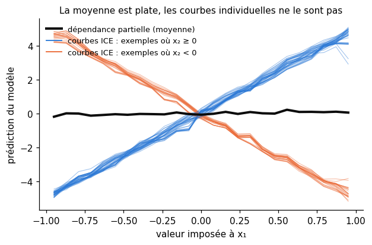
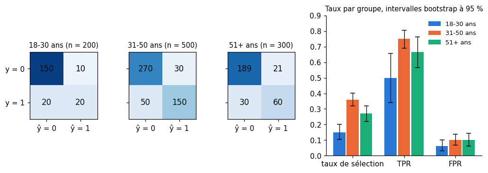
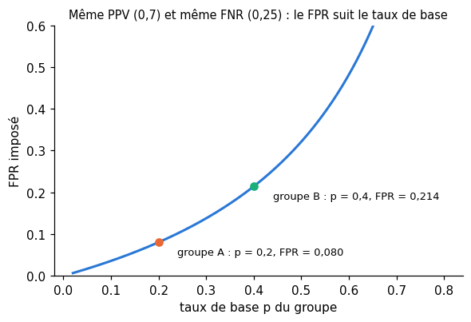

# B6 · Explicabilité, équité et éthique — fiche de cours

> Ce chapitre bonus n'a pas d'équivalent dans le livre de Glassner : **cette fiche est le cours**. Le livre de 2018 évoque la difficulté d'expliquer un réseau (ch. 20) et s'en tient là. Or un modèle qui accorde un prêt ou trie des candidatures doit pouvoir **s'expliquer** et **s'auditer**. Tu construis ici des explications **globales** (permutation, dépendance partielle) et **locales** (valeurs de Shapley, exactes puis avec shap), des cartes d'attribution pour les réseaux (**gradients intégrés**, **Grad-CAM**), et tu vérifies qu'une explication dit bien quelque chose du modèle. Puis tu mesures l'**équité** d'un classifieur groupe par groupe, tu comprends pourquoi plusieurs critères raisonnables sont incompatibles, tu essaies des corrections et tu chiffres leur prix. La dernière section relie tout cela à la fiche modèle, au RGPD et à l'AI Act.

| | |
|---|---|
| **Livre** | — (chapitre propre au workbook) |
| **Sections** | 206.1 à 206.11 (numérotation interne du workbook : 206 = bonus B6) |
| **Temps total estimé** | ≈ 19 h : lecture de la fiche ≈ 1,8 h, exercices ≈ 16 h, 28 flashcards ≈ 0,9 h |
| **Prérequis** | 0B (dérivées partielles, gradient, règle de la chaîne) · ch. 2 (intervalle de confiance bootstrap, ta `bootstrap_ci`) · ch. 3 (matrice de confusion, TPR, FPR, precision, calibration, ta `metrics.py`) · ch. 4 (règle de Bayes, pour ∂ B6.6) · ch. 5 (dérivées, pour ✏️ B6.3) · ch. 14 (gradient boosting, forêt aléatoire, importance par permutation) · ch. 15 (`Pipeline`, `ColumnTransformer`, `sklearn.inspection`) · ch. 20 (hooks, explicabilité, explication contrefactuelle) · ch. 21 (cartes d'activation, maximisation d'activation, FGSM) · ch. 23 et 29 (fiche modèle, data card, données personnelles) · ch. 28 (hooks sur un réseau pré-entraîné) · B1 (ResNet fine-tuné sur CIFAR-10) · MP3 (*Adult*, pipeline tabulaire, audit par sous-groupe) |
| **Fichiers du chapitre** | `02_exercices.md` (quiz, rappels, papier, réflexion, entretien) · `03_notebook.ipynb` · `04_indices.md` · `05_solutions.md` et `05_solutions.ipynb` · `06_mes_reponses.md` · `flashcards.csv` |
| **mylearn** | `explain.py` : `shapley_values` (B6.14), `integrated_gradients` et `grad_cam` (B6.18), `group_rates`, `demographic_parity_difference` et `equalized_odds_difference` (B6.23). NumPy seulement : le modèle arrive sous forme de fonction (`f`, `grad_fn`) ou de tableaux déjà extraits (activations et gradients), les hooks restent côté PyTorch. `group_rates` réutilise ta `confusion_matrix` du ch. 3 |

## Comment utiliser ce chapitre

La fiche et les exercices papier posent les idées et les calculs ; le notebook les met en œuvre en trois phases : modèles tabulaires (California et Penguins), réseaux (CIFAR-10), équité (*Adult*). Les codes de la fiche ont été exécutés le 3 novembre 2026 avec les versions du workbook (Python 3.13, NumPy 2.1, scikit-learn 1.6.1, shap 0.54.1, PyTorch 2.11), sur deux cœurs de CPU, avec **d'autres nombres** que les exercices et des données synthétiques : les résultats sur les fils rouges, c'est toi qui les mesures.

**Ordre conseillé.**
1. Lis 206.1 et 206.2. Fais les quiz Q1 à Q3 et le rappel R2.
2. Lis 206.3. Fais le quiz Q4, le calcul ✏️ B6.1, la dérivation ∂ B6.2, l'estimation 🧮 B6.7 et l'explication 🗣️ B6.8.
3. Lis 206.4. Fais les quiz Q5 et Q6 et la lecture 📄 B6.11.
4. Lis 206.5 et 206.6. Fais les quiz Q7 et Q8, le rappel R1 et les calculs ✏️ B6.3 et B6.4.
5. Lis 206.7. Fais le quiz Q9.
6. Lis 206.8 et 206.9. Fais les quiz Q10 et Q11, le rappel R3, le calcul ✏️ B6.5, la dérivation ∂ B6.6 et le cas ⚖️ B6.10.
7. Lis 206.10 et 206.11. Fais le quiz Q12 et le cas ⚖️ B6.9. Vérifie tes réponses courtes dans la partie 0 du notebook.
8. Fais le notebook dans l'ordre des ID, en trois phases : **tabulaire** (B6.12 à B6.17 : explications globales, puis Shapley exact, puis shap), **réseaux** (B6.18 à B6.22 : ta librairie, attributions, Grad-CAM, test de santé), **équité** (B6.23 à B6.29 : indicateurs, audit, atténuation, fiche modèle, défi). Termine par les cinq questions d'entretien.

| Section | Quiz 🧠 et rappels 🔁 | Papier ✏️ ∂ 🧮 et réflexion | Notebook | Entretien 💼 |
|---|---|---|---|---|
| 206.1 Pourquoi expliquer | Q1, Q2 | | | |
| 206.2 Explications globales | Q2, Q3, R2 | | B6.12, B6.13 | E1 |
| 206.3 Valeurs de Shapley | Q4, Q5 | B6.1, B6.2, B6.7, B6.8, B6.11 | B6.14, B6.17 | E2 |
| 206.4 SHAP en pratique | Q5, Q6 | B6.2, B6.7, B6.11 | B6.15, B6.16, B6.17 | E1, E2 |
| 206.5 Attributions pour les réseaux | Q7, R1 | B6.3 | B6.18, B6.19 | |
| 206.6 Grad-CAM | Q8, Q9, R1 | B6.4 | B6.18, B6.20, B6.21, B6.22 | E4 |
| 206.7 Limites des explications | Q6, Q9 | | B6.16, B6.22 | E2, E4 |
| 206.8 Biais | Q10 | B6.9, B6.10 | B6.24, B6.26 | E3, E5 |
| 206.9 Équité | Q11, R3 | B6.5, B6.6, B6.10 | B6.23, B6.24, B6.25 | E3 |
| 206.10 Atténuer | | | B6.26, B6.27, B6.29 | E5 |
| 206.11 Éthique et régulation | Q12 | B6.8, B6.9 | B6.28 | |

## Objectifs d'apprentissage

À la fin de ce chapitre, tu sais :
1. **Choisir** une méthode d'explication selon la question posée : globale ou locale, modèle tabulaire ou réseau, interprétable par construction ou expliqué après coup.
2. **Calculer** des valeurs de Shapley exactes en énumérant les coalitions, les **relier** à SHAP et **interpréter** les graphiques waterfall, beeswarm et de dépendance.
3. **Produire** et **critiquer** des cartes d'attribution (gradients intégrés, Grad-CAM) et leur appliquer un **test de santé**.
4. **Mesurer** l'équité d'un classifieur groupe par groupe, avec des intervalles de confiance, et **expliquer** pourquoi tous les critères ne peuvent pas être satisfaits à la fois.
5. **Tester** des stratégies d'atténuation des biais et **chiffrer** leur coût.
6. **Rédiger** une fiche modèle qui documente explicabilité, équité, limites et usage prévu, et **situer** un projet face au RGPD et à l'AI Act.

## L'essentiel en 10 lignes

1. On explique un modèle pour le **déboguer**, lui **faire confiance** à bon escient et **se conformer** à la loi ; un modèle simple s'explique par sa structure, un modèle complexe par une **explication post hoc**, globale ou locale.
2. L'**importance par permutation** mesure ce que coûte le mélange d'une feature ; la **dépendance partielle** trace la prédiction moyenne quand on impose une valeur à une feature, et les **courbes ICE** montrent ce que cette moyenne cache.
3. La **valeur de Shapley** d'une feature est son apport moyen sur toutes les **coalitions** auxquelles elle peut s'ajouter ; c'est la seule répartition qui vérifie efficacité, symétrie, joueur nul et additivité.
4. Une coalition vaut la prédiction moyenne quand ses features prennent les valeurs de l'exemple et les autres celles d'un **fond** : changer de fond change les valeurs. Le calcul exact coûte $2^M$ coalitions.
5. **SHAP** approche ces valeurs (KernelSHAP pour tout modèle, TreeSHAP exact et rapide pour les arbres) ; avec des features corrélées, il suit ce que fait le **modèle**, pas le monde.
6. Les **gradients intégrés** somment le gradient le long d'un chemin depuis une **ligne de référence** ; leur total vaut exactement l'écart de prédiction (**complétude**), même quand le réseau sature.
7. **Grad-CAM** pondère les cartes d'activation de la dernière couche convolutive par la moyenne des gradients du score d'une classe, garde le positif et agrandit la carte.
8. Une explication peut avoir l'air juste et être fausse : le **test de santé** randomise les poids et vérifie que la carte change ; et une explication décrit le modèle, jamais les causes.
9. Les biais viennent des données, des labels, des mesures, des **variables de substitution** et des **boucles de rétroaction** ; l'équité se mesure par groupe, avec des intervalles, et quand les **taux de base** diffèrent, calibration et égalité des erreurs sont **incompatibles**.
10. On atténue avant, pendant ou après l'entraînement, toujours à un prix ; on documente dans une **fiche modèle**, sous **supervision humaine**, dans le cadre du RGPD (art. 22) et de l'AI Act (le scoring de crédit est **à haut risque**).

> 📐 **Conventions de la fiche** — Un modèle est une fonction $f$ qui rend un nombre (une prédiction, une probabilité ou un logit). $\mathbf{x}$ est l'exemple à expliquer, $\mathbf{b}$ une ligne du **fond**. Dans les formules, les features sont numérotées **de 1 à $M$** ; dans le code, ce sont les colonnes **0 à $M - 1$** (la feature 1 est la colonne 0). $S$ est une coalition (un sous-ensemble de features), $\bar S$ son complémentaire, $|S|$ sa taille, $\phi_i$ la valeur de Shapley de la feature $i$. En 206.5, $\mathbf{x}'$ est la ligne de référence et $\alpha \in [0, 1]$ la position sur le chemin ; en 206.6, $A^c$ est la carte d'activation du canal $c$ et $\alpha_c$ son poids. En 206.9, $\hat{y}$ est la décision (0 ou 1), $y$ la vérité, $g$ un groupe, $p$ un **taux de base**. **Écarts au §6** : le nombre de features s'écrit $M$, comme chez Lundberg et Lee, parce que $p$ sert au taux de base dans la relation de Chouldechova ; $f$ est le modèle (pas une activation) ; $k$ est une classe en 206.6 (pas un neurone) ; $\sigma$ est la sigmoïde.

---

## 206.1 · Pourquoi expliquer : déboguer, faire confiance, se conformer ; interprétable ou post-hoc, global ou local ⏩

### Trois raisons d'expliquer

**Déboguer.** Un modèle peut avoir une excellente accuracy pour une mauvaise raison. Dans l'article de LIME (M. Ribeiro et coll., 2016), un classifieur « loup ou husky », entraîné à dessein sur des photos où les loups sont sur la neige, apprend à détecter la neige : l'accuracy ne le montre pas, une explication si. C'est le phénomène des fuites du ch. 12 et du MP3. Regarder **sur quoi** s'appuie un modèle est le premier usage de l'explicabilité, et le plus rentable.

**Faire confiance, à bon escient.** Un médecin ou un conseiller bancaire qui reçoit une prédiction doit pouvoir la confronter à ce qu'il sait ; une explication l'aide à repérer le cas où le modèle sort de son domaine. Elle peut aussi l'endormir : une explication convaincante d'une prédiction fausse est pire que rien (206.7).

**Se conformer.** Le RGPD donne aux personnes visées par une décision automatisée le droit d'obtenir des « informations utiles concernant la logique sous-jacente » ; l'AI Act ajoute, pour les systèmes à haut risque, un droit à des « explications claires et pertinentes » sur le rôle du système dans la décision (206.11). Un modèle de scoring qui ne sait pas dire pourquoi il refuse un crédit n'est pas livrable en Europe.

### Interprétable par construction, ou expliqué après coup

Un modèle est **interprétable par construction** (*interpretable by design*) quand sa structure **est** l'explication : une régression linéaire ou logistique avec peu de features, un arbre peu profond (le chemin jusqu'à la feuille est la règle appliquée), une liste de règles, un modèle additif $f(\mathbf{x}) = \sum_j g_j(x_j)$ dont on trace chaque courbe $g_j$. On lit le modèle lui-même.

Une **explication post hoc** (ch. 13) s'applique à un modèle déjà entraîné, souvent une boîte noire (ch. 20) : une forêt de 500 arbres, un gradient boosting, un réseau. Elle **approche** le comportement du modèle sans en être la règle. Elle peut être **agnostique** (elle n'interroge le modèle que par ses prédictions : permutation, dépendance partielle, KernelSHAP) ou **spécifique** à une famille (TreeSHAP lit les arbres, Grad-CAM lit les couches d'un CNN).

C. Rudin (2019) défend une position forte : pour une décision à fort enjeu, préférer un modèle interprétable par construction, car l'écart d'accuracy avec une boîte noire est souvent faible sur des données tabulaires, et une explication post hoc peut être infidèle au modèle. Bon réflexe de projet : **essaie d'abord le modèle simple** et mesure ce qu'apporte la boîte noire (💼 E1).

### Global ou local

Une explication **globale** (*global explanation*) décrit le modèle entier : « quelles features comptent le plus ? ». Une explication **locale** (*local explanation*) décrit **une** prédiction : « pourquoi ce client a-t-il un score de 0,82 ? ». L'une ne se déduit pas de l'autre : une feature peu importante en moyenne peut décider d'un cas particulier.

| Question | Portée | Outils de ce chapitre |
|---|---|---|
| quelles features le modèle utilise-t-il, en tout ? | globale | importance par permutation (206.2), moyenne des $\lvert\phi_i\rvert$ (206.4) |
| comment la prédiction dépend-elle d'une feature ? | globale | dépendance partielle et ICE (206.2), graphique de dépendance SHAP (206.4) |
| pourquoi cette prédiction-ci ? | locale | valeurs de Shapley et waterfall (206.3, 206.4), explication contrefactuelle (206.4) |
| où le réseau regarde-t-il dans cette image ? | locale | saillance, gradients intégrés (206.5), Grad-CAM (206.6) |
| le modèle traite-t-il les groupes de la même façon ? | globale, par groupe | indicateurs d'équité (206.9) |

> 🕰️ **Mise à jour (2026) — l'explicabilité post hoc** — **Le livre :** au ch. 20 (p. 920-923), il distingue une explication *complète* (montrer tous les calculs) d'une explication *satisfaisante* (nommer les facteurs décisifs et dire pourquoi ils sont légitimes), sans proposer d'outil. · **Aujourd'hui :** les outils sont mûrs et standardisés : `sklearn.inspection` (importance par permutation, dépendance partielle et ICE), la bibliothèque **shap** (TreeSHAP, KernelSHAP, graphiques), les gradients intégrés et Grad-CAM pour les réseaux. Pour les grands modèles de langue, une branche récente, l'**interprétabilité mécaniste** (*mechanistic interpretability*), cherche les « features » internes d'un réseau : des **autoencodeurs parcimonieux** (*sparse autoencoders*), entraînés sur les activations d'une couche, les décomposent en directions dont beaucoup sont lisibles par un humain (H. Cunningham et coll., 2023) ; Google DeepMind en a publié pour toutes les couches des modèles Gemma 2 (Gemma Scope, 2024). · **Faut-il quand même l'apprendre ?** Oui : la distinction complète/satisfaisante reste la bonne question, et les outils de ce chapitre sont ceux qu'on attend d'un data scientist. · *Sources :* [scikit-learn 1.6, `sklearn.inspection`](https://scikit-learn.org/1.6/inspection.html) ; [Lundberg et Lee, arXiv:1705.07874](https://arxiv.org/abs/1705.07874v2) ; [Cunningham et coll., arXiv:2309.08600](https://arxiv.org/abs/2309.08600v3) ; [Lieberum et coll., Gemma Scope, arXiv:2408.05147](https://arxiv.org/abs/2408.05147v2).

---

## 206.2 · Explications globales : coefficients, arbres, importance par permutation, dépendance partielle et ICE ⏩

### Coefficients et arbres

Pour un modèle linéaire, le coefficient $w_j$ dit de combien la prédiction bouge quand $x_j$ augmente d'une unité, les autres features **fixées**. Deux précautions : comparer des coefficients de features **standardisées** (ch. 12), sinon l'échelle décide ; et se méfier des features corrélées, entre lesquelles le modèle répartit l'effet de façon arbitraire (une L2 le partage, une L1 en garde une, ch. 9). Pour un arbre, le chemin d'un exemple **est** son explication. L'importance `feature_importances_` (MDI, ch. 13 et 14) est gratuite, mais calculée sur l'entraînement et biaisée vers les features à beaucoup de valeurs (🔁 R2).

### L'importance par permutation

L'importance par permutation (ch. 14) répond à : « que perd le modèle si cette feature ne contient plus d'information ? ». On mélange au hasard la colonne $j$ d'un jeu de **validation**, on recalcule le score, et l'on mesure la baisse :

$$I_j = s(\text{modèle}, \mathbf{X}_{\text{val}}, \mathbf{y}) - \frac{1}{K}\sum_{k=1}^{K} s\big(\text{modèle}, \mathbf{X}_{\text{val}}^{(j \text{ mélangée}, k)}, \mathbf{y}\big).$$

Le modèle n'est **pas réentraîné** : on mesure ce que ce modèle-ci tire de la feature. Deux limites, qu'on retrouvera avec SHAP : avec deux features très corrélées, mélanger l'une laisse l'information dans l'autre, et **chacune** paraît peu importante ; et le mélange crée des exemples **irréalistes** (2 pièces et 9 chambres), où le modèle n'a rien appris.

### La dépendance partielle

L'importance dit **combien** une feature compte, pas **comment**. La **dépendance partielle** (*partial dependence*, PDP ; J. Friedman, 2001) trace la prédiction moyenne quand on impose la valeur $v$ à la feature $j$ pour **tous** les exemples, les autres features gardant leurs valeurs :

$$\operatorname{PD}_j(v) = \frac{1}{n}\sum_{i=1}^{n} f\big(v,\ \mathbf{x}_{i,\bar{j}}\big),$$

où $\mathbf{x}_{i,\bar{j}}$ désigne les autres features de l'exemple $i$. Pour un modèle linéaire, c'est une droite de pente $w_j$.

### Les courbes ICE

La moyenne peut cacher l'essentiel. A. Goldstein et coll. (2015) tracent **une courbe par exemple**, $v \mapsto f(v, \mathbf{x}_{i,\bar{j}})$ : ce sont les courbes **ICE** (*individual conditional expectation*), dont la dépendance partielle est la moyenne. Si elles ont toutes la même forme, la moyenne les résume ; si elles se croisent, la feature **interagit** avec une autre, et la moyenne ment.

Leur exemple, que la figure reprend : $y = 0{,}2\,x_1 - 5\,x_2 + 10\,x_2\,\mathbb{1}[x_3 \ge 0] + \text{bruit}$, avec trois features uniformes sur $[-1, 1]$. Quand $x_3 \ge 0$, la prédiction **monte** avec $x_2$ (pente $+5$) ; sinon elle **descend** (pente $-5$). En moyenne, les deux s'annulent : la dépendance partielle de $x_2$ reste bien plus plate que chacune des courbes ICE, comme si $x_2$ ne servait à rien, alors que c'est l'une des deux features les plus importantes par permutation.

```python
import numpy as np
from sklearn.ensemble import HistGradientBoostingRegressor
from sklearn.inspection import partial_dependence, permutation_importance
from sklearn.model_selection import train_test_split

rng = np.random.default_rng(0)
X = rng.uniform(-1, 1, size=(3000, 3))                          # columns 0, 1, 2 = features x1, x2, x3
y = 0.2 * X[:, 0] - 5 * X[:, 1] + 10 * X[:, 1] * (X[:, 2] >= 0) + rng.normal(0, 0.3, 3000)
X_tr, X_va, y_tr, y_va = train_test_split(X, y, random_state=0)
model = HistGradientBoostingRegressor(random_state=0).fit(X_tr, y_tr)
imp = permutation_importance(model, X_va, y_va, n_repeats=10, random_state=0)
print(imp.importances_mean.round(2))                            # [0.   1.9  1.91]  (drop of R²)
pd_ = partial_dependence(model, X_va, features=[1], kind="both")   # x2 is column 1
print(pd_["average"].shape, pd_["individual"].shape)            # (1, 100) (1, 750, 100)
```



Le R² de validation vaut 0,975 ; mélanger $x_2$ ou $x_3$ le fait baisser d'environ 1,9, mélanger $x_1$ presque pas. `kind="both"` rend `average` (la PDP) et `individual` (les ICE), sur une grille de 100 valeurs prise entre les percentiles 5 et 95 de la feature. Pour tracer, `PartialDependenceDisplay.from_estimator(model, X_va, [1], kind="both")` ; `centered=True` fait partir toutes les courbes ICE de 0, ce qui fait ressortir les différences de **pente** (🧠 Q3).

> ⚠️ **Piège classique — une dépendance partielle hors des données** — Imposer $v$ à tous les exemples suppose qu'on peut changer $x_j$ sans toucher aux autres. Avec des features corrélées, $\operatorname{PD}_j(v)$ fait la moyenne sur des combinaisons qui n'existent pas. Regarde la distribution de la feature (les traits sous l'axe), méfie-toi des bords, et préfère alors les courbes **ALE** (*accumulated local effects*, D. Apley et J. Zhu, 2016 ; absentes de scikit-learn 1.6), qui ne comparent que des exemples voisins.

Sur California (📦 B6.12), tu compares les coefficients d'une régression, l'importance par permutation d'un gradient boosting et ses courbes de dépendance ; puis tu prédis la forme des courbes ICE de deux features avant de les tracer (🔮 B6.13).

---

## 206.3 · Valeurs de Shapley : jeu coopératif, propriétés, calcul exact par coalitions, rôle du fond ⏩

### Partager un gain entre joueurs

L. Shapley (1953) : $M$ joueurs coopèrent et produisent un gain ; comment le partager **équitablement** ? Un **jeu coopératif** (*cooperative game*) se donne par une **fonction de valeur** (*value function*) $v$ qui associe à chaque **coalition** $S$ (un sous-ensemble de joueurs) ce qu'elle gagnerait seule ; $v(F)$ est le gain de tous, $F = \{1, \dots, M\}$.

On fait entrer les joueurs **un par un** et l'on crédite chacun de sa **contribution marginale** $v(S \cup \{i\}) - v(S)$, où $S$ est le groupe déjà présent. Elle dépend de l'ordre (deux associés qui ne valent rien seuls) : Shapley fait la **moyenne sur tous les ordres**. En regroupant les ordres selon le groupe $S$ présent à l'arrivée de $i$ :

$$\phi_i = \sum_{S \subseteq F \setminus \{i\}} \frac{|S|!\,(M - |S| - 1)!}{M!}\left[v(S \cup \{i\}) - v(S)\right].$$

Le poids compte les ordres où $i$ arrive juste après les joueurs de $S$ : $|S|!$ ordres avant lui, $(M - |S| - 1)!$ après, sur $M!$.

> 🧮 **Rappel maths — sous-ensembles, factorielles et poids de Shapley** — Un ensemble de $M$ éléments a $2^M$ sous-ensembles (chaque élément est dedans ou non). La **factorielle** $m! = 1 \times 2 \times \dots \times m$ (avec $0! = 1$) compte les façons d'ordonner $m$ objets, le **coefficient binomial** $\binom{m}{s} = \frac{m!}{s!\,(m-s)!}$ les sous-ensembles de taille $s$ parmi $m$. Le poids de Shapley vaut $\frac{1}{M}\cdot\frac{1}{\binom{M-1}{|S|}}$ : tirer une taille entre 0 et $M - 1$ (probabilité $1/M$), puis un sous-ensemble de cette taille parmi les $M - 1$ autres. Avec $M = 4$, les coalitions sans $i$ ont 0, 1, 2 ou 3 membres ; il y en a $1, 3, 3, 1$, de poids $\frac{0!\,3!}{4!} = \frac{1}{4}$, $\frac{1!\,2!}{4!} = \frac{1}{12}$, $\frac{1}{12}$ et $\frac{1}{4}$ ; la somme $\frac14 + 3 \times \frac{1}{12} + 3 \times \frac{1}{12} + \frac14 = 1$ : c'est une moyenne. Les coalitions extrêmes pèsent plus, chacune, parce qu'elles sont seules de leur taille.


### Quatre propriétés, une seule solution

Shapley a montré que sa répartition est la **seule** qui vérifie ensemble quatre propriétés (🧠 Q4) :
- **efficacité** (*efficiency*) : tout le gain est réparti, $\sum_i \phi_i = v(F) - v(\varnothing)$ ;
- **symétrie** : deux joueurs qui apportent toujours la même chose, à toute coalition, reçoivent la même part ;
- **joueur nul** (*null player*) : un joueur qui n'apporte jamais rien reçoit 0 ;
- **additivité** : pour deux jeux $v$ et $w$ joués ensemble, la part dans le jeu $v + w$ est la somme des parts.

### Les features comme joueurs

Pour expliquer $f(\mathbf{x})$, les joueurs sont les $M$ features. Que prédit le modèle quand il ne « connaît » que les features de $S$ ? Il exige toutes ses entrées : on remplace les absentes par des valeurs prises dans un **fond** (*background*), $B$ lignes de référence, souvent un échantillon de l'entraînement. Une coalition vaut la prédiction **moyenne** quand les features de $S$ prennent les valeurs de $\mathbf{x}$ et les autres celles de chaque ligne du fond :

$$v(S) = \mathbb{E}_{\mathbf{b} \sim \text{fond}}\left[f(\mathbf{x}_S, \mathbf{b}_{\bar{S}})\right] = \frac{1}{B}\sum_{k=1}^{B} f(\mathbf{x}_S, \mathbf{b}^{(k)}_{\bar S}).$$

Ici $v(\varnothing)$ n'est pas nul : c'est la prédiction moyenne sur le fond, la **valeur de base** (*base value*). L'efficacité devient

$$\sum_{i=1}^{M} \phi_i = f(\mathbf{x}) - \mathbb{E}[f(\mathbf{b})],$$

« la prédiction de ce client, moins la prédiction moyenne, se répartit entre ses features ». C'est la définition de ta `shapley_values` (🔨 B6.14), le Shapley **interventionnel** (*interventional*) : on **impose** les valeurs de $\mathbf{x}$ sur $S$, sans se demander si la combinaison est plausible (206.4).

### Un exemple à deux features

Prends un score $f(\mathbf{x}) = 2x_1 + x_1 x_2$, un exemple $\mathbf{x} = (3, 2)$, donc $f(\mathbf{x}) = 12$, et un fond de deux lignes, $\mathbf{b}^{(1)} = (1, 0)$ et $\mathbf{b}^{(2)} = (1, 2)$. Les quatre coalitions :
- $v(\varnothing) = \frac{1}{2}\big[f(1, 0) + f(1, 2)\big] = \frac{1}{2}(2 + 4) = 3$, la valeur de base ;
- $v(\{1\}) = \frac{1}{2}\big[f(3, 0) + f(3, 2)\big] = \frac{1}{2}(6 + 12) = 9$ : $x_1$ prend la valeur de l'exemple, $x_2$ celles du fond ;
- $v(\{2\}) = \frac{1}{2}\big[f(1, 2) + f(1, 2)\big] = 4$ ;
- $v(\{1, 2\}) = f(3, 2) = 12$.

Avec $M = 2$, les deux poids valent $\frac{0!\,1!}{2!} = \frac{1!\,0!}{2!} = \frac{1}{2}$ : chaque feature reçoit la moyenne de son apport quand elle arrive la première et quand elle arrive la seconde.

$$\phi_1 = \tfrac{1}{2}\big[(9 - 3) + (12 - 4)\big] = 7, \qquad \phi_2 = \tfrac{1}{2}\big[(4 - 3) + (12 - 9)\big] = 2.$$

Contrôle d'efficacité : $7 + 2 = 9 = 12 - 3$. L'additivité s'y lit : le terme $2x_1$ apporte 4 à $\phi_1$ ; l'interaction $x_1 x_2$ vaut 6 en $\mathbf{x}$ et 1 en moyenne sur le fond, et son écart de 5 se partage en 3 et 2 (refais ces deux petits jeux). shap donne les mêmes nombres :

```python
import numpy as np
import shap

f = lambda X: 2 * X[:, 0] + X[:, 0] * X[:, 1]                   # columns 0, 1 = features x1, x2
x = np.array([3.0, 2.0])
background = np.array([[1.0, 0.0], [1.0, 2.0]])
explainer = shap.explainers.Exact(f, shap.maskers.Independent(background, max_samples=len(background)))
sv = explainer(x[None, :])
print(sv.values, sv.base_values)                                 # [[7. 2.]] [3.]

mask = np.array([True, False])                                   # the coalition {x1}
X_S = background.copy()
X_S[:, mask] = x[mask]                                           # x1 from x, x2 from each background row
print(f(X_S).mean())                                             # 9.0 = v({1})
```

Le masqueur `shap.maskers.Independent` remplace les features absentes par celles du fond. Son `max_samples` vaut **100** par défaut : d'un fond plus grand, shap ne garde qu'un échantillon de 100 lignes. Pour comparer à ta fonction, passe `max_samples=len(background)`, comme les tests de `explain.py`.

### Le cas linéaire

Pour un modèle linéaire $f(\mathbf{x}) = w_0 + \sum_j w_j x_j$, $v(S)$ se calcule terme par terme, et l'apport de $i$ ne dépend plus de $S$. Résultat (∂ B6.2, à démontrer) :

$$\phi_i = w_i\,\big(x_i - \mathbb{E}[x_i]\big),$$

où $\mathbb{E}[x_i]$ est la moyenne de la feature $i$ **sur le fond**. Une feature au niveau moyen reçoit 0 ; une feature à coefficient nul aussi (le joueur nul). Avec $\mathbf{w} = (1{,}5 ;\ -2 ;\ 0{,}5)$ et un fond aléatoire de 20 lignes, `shap.explainers.Exact` redonne cette formule au millionième près : un excellent test pour ta fonction.

### Le fond fait partie de la question

$\phi_i$ répond à « pourquoi ce score **plutôt que le score moyen du fond** ? ». Changer de fond change la question : toute la population, les seuls clients acceptés ou une ligne « client type » donnent des valeurs, et même des signes, différents (🧠 Q5, 🔬 B6.16). Écris toujours **quel fond** a servi.

### Combien ça coûte

Le calcul exact demande $v(S)$ pour les $2^M$ coalitions, chacune sur les $B$ lignes du fond : $2^M \times B$ prédictions. Avec $M = 8$ et $B = 50$, $256 \times 50 = 12\,800$ prédictions : 0,08 s pour un `HistGradientBoostingRegressor` de 100 arbres sur nos deux cœurs (environ 150 000 lignes par seconde) ; avec $M = 12$, 204 800 prédictions, environ 1,3 s. Chaque feature de plus **double** le coût : d'où le garde-fou `max_features=12` de ta fonction, et les approximations de 206.4 (🧮 B6.7).

---

## 206.4 · SHAP en pratique : TreeExplainer, Explainer, graphiques, features corrélées ⏩

### SHAP, une famille d'explications additives

S. Lundberg et S.-I. Lee (2017, 📄 B6.11) ont remarqué que six méthodes d'explication (LIME, DeepLIFT, la propagation de pertinence par couches et trois variantes de Shapley) ont la même forme, une **explication additive** : une valeur de base plus une contribution par feature,

$$f(\mathbf{x}) \approx \phi_0 + \sum_{i=1}^{M} \phi_i .$$

Ils exigent la **précision locale** (*local accuracy* : la somme redonne $f(\mathbf{x})$), l'**absence** (*missingness* : une feature absente reçoit 0) et la **cohérence** (*consistency* : si un modèle change de sorte qu'une feature apporte plus à toute coalition, sa part ne baisse pas), et montrent que seules les valeurs de Shapley les vérifient : ce sont les **valeurs SHAP** (*SHapley Additive exPlanations*). Pour calculer $v(S)$, ils supposent les features **indépendantes** : c'est le $v(S)$ de 206.3. Le calcul exact étant exponentiel, ils proposent des approximations :

- **KernelSHAP**, pour n'importe quel modèle, tire des coalitions, calcule leur $v(S)$ sur le fond, puis ajuste une **régression linéaire pondérée** dont les coefficients sont les $\phi_i$ ; le *noyau de Shapley* $\pi(S) = \frac{M - 1}{\binom{M}{|S|}\,|S|\,(M - |S|)}$ fait retomber la régression sur les valeurs de Shapley quand toutes les coalitions sont tirées. Coût : `nsamples` coalitions (par défaut $2M + 2\,048$ dans shap 0.54.1), chacune sur les $B$ lignes du fond. C'est un estimateur **aléatoire**.
- **TreeSHAP** (Lundberg et coll., 2018 et 2020) est **exact** et rapide pour les arbres, forêts et gradient boostings : il parcourt les arbres au lieu d'énumérer les coalitions. Sa version « chemins de l'arbre » coûte $O(TLD^2)$ par exemple ($T$ arbres de $L$ feuilles, de profondeur $D$), sa version interventionnelle $O(TLR)$ pour un fond de $R$ lignes : linéaire, et non exponentielle, en $M$.

### L'API de shap

`shap.Explainer(model, background)` choisit l'algorithme : `TreeExplainer` pour des arbres, `Exact` ou `Permutation` (une autre approximation) sinon. `explainer(X)` rend un `shap.Explanation` : `.values` de forme `(n, M)`, `.base_values`, `.data`. Pour un classifieur, on explique une sortie à la fois, la probabilité (`lambda X: model.predict_proba(X)[:, 1]`) ou le logit, qui ne donnent pas les mêmes valeurs (le cas multiclasse est 📦 B6.17).

Pour les arbres, `TreeExplainer` a deux modes, et ils ne répondent pas à la même question :
- **sans fond** (`feature_perturbation="tree_path_dependent"`), il remplace une feature absente en suivant les deux branches d'un nœud **au prorata des exemples d'entraînement** ; la valeur de base est la prédiction moyenne sur l'entraînement ;
- **avec un fond** (`"interventional"`, le choix automatique dans ce cas), il calcule **exactement** le Shapley interventionnel de 206.3.

```python
from sklearn.datasets import make_friedman1
from sklearn.ensemble import HistGradientBoostingRegressor

X, y = make_friedman1(n_samples=2000, n_features=6, noise=0.5, random_state=0)
names = [f"x{j + 1}" for j in range(6)]
model = HistGradientBoostingRegressor(max_depth=3, random_state=0).fit(X[:1500], y[:1500])
bg = X[:50]                                                      # the background: 50 training rows
tree = shap.TreeExplainer(model, data=bg, feature_perturbation="interventional", feature_names=names)
sv = tree(X[1500:1700])                                          # 200 explained rows
exact = shap.explainers.Exact(model.predict, shap.maskers.Independent(bg, max_samples=50))
print(abs(sv.values[:10] - exact(X[1500:1510]).values).max())   # 8.0e-08
print(sv.base_values[0].round(4), model.predict(bg).mean().round(4))   # 14.0088 14.0088
```

Sur ces données de Friedman ($10\sin(\pi x_1 x_2) + 20(x_3 - 0{,}5)^2 + 10 x_4 + 5 x_5$ plus du bruit, et une feature inutile), TreeSHAP interventionnel et le calcul exact coïncident à $10^{-7}$ près (les seuils des arbres sont en simple précision) : c'est l'égalité que vérifie 📦 B6.15 avec ta `shapley_values`. Avec un autre fond (les 50 lignes où $x_4$ est le plus petit), la valeur de base passe de 14,0 à 9,9 et la valeur SHAP de $x_4$ change de signe.

### Les trois graphiques à connaître

- Le **waterfall** (*graphique en cascade*), `shap.plots.waterfall(sv[0])`, explique **une** prédiction : de la valeur de base en bas à $f(\mathbf{x})$ en haut, une barre par feature (rouge vers le haut, bleue vers le bas), la plus grande d'abord. C'est l'explication à montrer à un client (🗣️ B6.8).
- Le **beeswarm** (*essaim d'abeilles*), `shap.plots.beeswarm(sv)`, résume **beaucoup** de prédictions : une ligne par feature, un point par exemple placé à sa valeur SHAP, coloré selon la valeur de la feature (bleu petite, rouge grande) ; les features sont triées par **moyenne des $\lvert\phi_i\rvert$**, une importance globale tirée des explications locales.
- Le **graphique de dépendance** (*dependence plot*), `shap.plots.scatter(sv[:, "x4"], color=sv)` : la valeur de la feature en abscisse, sa valeur SHAP en ordonnée, colorée par la feature qui interagit le plus avec elle. Une dispersion verticale à valeur égale révèle une interaction, comme les courbes ICE.

### Features corrélées : ce que SHAP répartit

Le Shapley interventionnel évalue le modèle sur des combinaisons $(\mathbf{x}_S, \mathbf{b}_{\bar S})$ qui peuvent ne jamais exister (la surface de l'exemple avec le nombre de pièces d'une ligne du fond) : avec des features corrélées, le modèle est interrogé hors de ses données, comme avec la permutation.

Deux philosophies s'opposent (H. Chen et coll., 2020, « *True to the model or true to the data?* »). Le Shapley **interventionnel** est **fidèle au modèle** : si deux features presque identiques entrent dans un modèle linéaire avec les coefficients 3 et 0, la seconde reçoit $\phi = 0$, car le modèle ne la lit pas. Le Shapley **observationnel** (ou conditionnel) tire les features absentes sachant celles de $S$ ; il est **fidèle aux données** et partage l'effet entre les deux copies, au risque de créditer une feature que le modèle ignore. D. Janzing et coll. (2019) défendent l'interventionnel au nom de la causalité : on veut savoir ce que fait le modèle quand on change une entrée.

Conséquence pratique : entre features corrélées, la répartition dépend de **comment le modèle les a départagées** (une graine, l'ordre des colonnes, la régularisation) ; la **somme** de leurs valeurs est stable, leur **partage** non (🧠 Q6). Ce que fait un gradient boosting de California quand on lui ajoute une copie d'une feature, c'est 🔬 B6.16.

### Deux autres explications locales : substitut et contrefactuel

**LIME** (*local interpretable model-agnostic explanations*, Ribeiro et coll., 2016) explique une prédiction par un **substitut** (*surrogate*) local : des points tirés autour de $\mathbf{x}$, prédits par le modèle, sur lesquels on ajuste un modèle linéaire pondéré par la proximité ; ses coefficients sont l'explication. Limites : le résultat dépend du voisinage choisi et change d'un tirage à l'autre, et rien ne garantit que les contributions redonnent la prédiction. KernelSHAP est un LIME dont le voisinage et les poids sont fixés pour retomber sur Shapley.

Une **explication contrefactuelle** (ch. 20 ; S. Wachter, B. Mittelstadt et C. Russell, 2017) répond à « qu'aurait-il fallu changer pour obtenir une autre décision ? » : on cherche le point $\mathbf{x}'$ le plus **proche** de $\mathbf{x}$ dont la prédiction franchit le seuil, par exemple en minimisant $(f(\mathbf{x}') - \text{cible})^2 + \lambda\, d(\mathbf{x}, \mathbf{x}')$. « Avec 2 300 € de revenu au lieu de 2 000 €, le prêt aurait été accordé. » C'est l'explication la plus utile à une personne (206.11). Limites : il en existe souvent **plusieurs**, la distance $d$ doit refléter ce qui est réaliste (on ne rajeunit pas), et le contrefactuel décrit le modèle, pas ce qui ferait vraiment rembourser.

> 🕰️ **Mise à jour (2026) — la bibliothèque shap** — **Le livre :** absente (shap date de 2017). · **Aujourd'hui :** shap (licence MIT) est maintenue par une communauté (organisation GitHub `shap`). La **0.52.0** (28 mai 2026) a réécrit ses liaisons natives avec **nanobind** et aligné ses dépendances minimales sur la politique **SPEC 0** ; la **0.53.0** (9 octobre 2026) n'exige plus numba ; la **0.54.1** (16 octobre 2026), celle de Colab et du workbook, déplace le GPU dans un paquet séparé, `shap-cuda`. L'API utilisée ici (`Explainer`, `TreeExplainer`, `explainers.Exact`, `maskers.Independent(data, max_samples=100)`, `shap.plots`) n'a pas changé, et `TreeExplainer` lit les `HistGradientBoosting` de scikit-learn (vérifié en exécutant). · **Faut-il quand même l'apprendre ?** Oui, c'est l'outil standard du tabulaire ; mais après le calcul exact, pour savoir ce qu'il approche. · *Sources :* [notes de version de shap](https://shap.readthedocs.io/en/latest/release_notes.html) ; [shap 0.54.1 sur PyPI](https://pypi.org/project/shap/0.54.1/) ; [Lundberg et coll., « From local explanations to global understanding with explainable AI for trees », arXiv:1905.04610](https://arxiv.org/abs/1905.04610v1) (complexités de TreeSHAP, §10).

---

## 206.5 · Attributions pour les réseaux : saillance, gradient × entrée, gradients intégrés ⏩

### Le gradient comme explication

Une image CIFAR-10 a 3 072 entrées : énumérer des coalitions de pixels est hors de question. Mais un réseau est **dérivable**, et une passe arrière (ch. 20) donne le gradient du score d'une classe par rapport à **chaque** pixel. K. Simonyan, A. Vedaldi et A. Zisserman (2014) en tirent la **carte de saillance** (*saliency map*) : $\lvert \partial f / \partial x_i \rvert$, pixel par pixel (le maximum sur les trois canaux). Elle dit où une **petite retouche** changerait le plus le score : le gradient même de l'attaque FGSM du ch. 21 (🔁 R1). Variante : **gradient × entrée** (*gradient × input*), $x_i \,\partial f/\partial x_i$ ; pour un modèle linéaire $\mathbf{w}^\top\mathbf{x}$, c'est exactement $w_i x_i$.

### Le problème de la saturation

Un gradient est **local** : si le réseau sature, la pente est nulle alors que la feature a tout décidé. Exemple, avec une sigmoïde :

$$f(\mathbf{x}) = \sigma(x_1 x_2 - 2), \qquad \mathbf{x} = (2, 3), \qquad f(\mathbf{x}) = \sigma(4) = 0{,}9820.$$

Par rapport à $(0, 0)$, où $f = \sigma(-2) = 0{,}1192$, la prédiction a gagné $0{,}8628$. Pourtant, en $\mathbf{x}$, la sigmoïde est presque plate : $\partial f/\partial x_1 = \sigma'(4)\,x_2 = 0{,}0530$ et $\partial f/\partial x_2 = \sigma'(4)\,x_1 = 0{,}0353$. Gradient × entrée donne $(0{,}106 ;\ 0{,}106)$, de somme 0,212 : un quart de l'écart.

### Les gradients intégrés

M. Sundararajan, A. Taly et Q. Yan (2017) regardent la pente **le long d'un chemin** : partir d'une **ligne de référence** (*baseline*, à ne pas confondre avec le modèle de référence du ch. 13) $\mathbf{x}'$, une entrée « neutre » (souvent l'image noire), aller en ligne droite jusqu'à $\mathbf{x}$ et accumuler le gradient. Les **gradients intégrés** (*integrated gradients*, IG) :

$$\operatorname{IG}_i(\mathbf{x}) = (x_i - x'_i)\int_0^1 \frac{\partial f}{\partial x_i}\big(\mathbf{x}' + \alpha(\mathbf{x} - \mathbf{x}')\big)\, d\alpha .$$

Leur propriété clé, la **complétude** (*completeness*), vient du théorème fondamental de l'analyse appliqué au chemin (avec la règle de la chaîne, 0B) : la dérivée de $\alpha \mapsto f(\mathbf{x}' + \alpha(\mathbf{x} - \mathbf{x}'))$ est $\sum_i (x_i - x'_i)\,\partial f/\partial x_i$, donc

$$\sum_{i=1}^{M} \operatorname{IG}_i(\mathbf{x}) = f(\mathbf{x}) - f(\mathbf{x}').$$

C'est l'efficacité de Shapley, transposée. Dans l'exemple, le chemin traverse la zone où la sigmoïde monte fort ; IG vaut $(0{,}4314 ;\ 0{,}4314)$, de somme $0{,}8628$ : tout l'écart.


Les auteurs justifient la méthode par deux **axiomes** : la **sensibilité** (si $\mathbf{x}$ et $\mathbf{x}'$ ne diffèrent que par une feature et ont des prédictions différentes, cette feature reçoit une attribution non nulle : le défaut de la saturation) et l'**invariance à l'implémentation** (deux réseaux qui calculent la même fonction reçoivent les mêmes attributions). C'est une cousine de Shapley, pour des joueurs qui entrent « continûment » (la valeur d'Aumann-Shapley).

### En pratique : une somme à la place de l'intégrale

L'intégrale n'a pas de forme fermée pour un réseau ; on la remplace par une somme sur quelques points du chemin.

> 🧮 **Rappel maths — approcher une intégrale par une somme** — L'intégrale $\int_0^1 g(\alpha)\,d\alpha$ est l'aire sous la courbe de $g$. On découpe $[0, 1]$ en $n$ intervalles de largeur $h = 1/n$. **Rectangles à gauche** : $h\sum_{k=0}^{n-1} g(k h)$ ; **à droite** : $h\sum_{k=1}^{n} g(kh)$ ; **au milieu** : $h\sum_{k=0}^{n-1} g\big((k + \tfrac12)h\big)$ ; **trapèzes** : $h\big[\tfrac12 g(0) + g(h) + \dots + g((n-1)h) + \tfrac12 g(1)\big]$, sur $n + 1$ points dont les extrêmes comptent pour moitié (l'aire sous la courbe ROC du ch. 3). Avec $g(\alpha) = \alpha^3$ (intégrale $\tfrac14$) et $n = 2$ : à gauche $\tfrac12(0 + \tfrac18) = 0{,}0625$, à droite $\tfrac12(\tfrac18 + 1) = 0{,}5625$, au milieu $\tfrac12(\tfrac{1}{64} + \tfrac{27}{64}) = 0{,}21875$, trapèzes $\tfrac12(0 + \tfrac18 + \tfrac12) = 0{,}3125$. Une fonction croissante est sous-estimée à gauche, surestimée à droite ; le milieu et les trapèzes se trompent bien moins, et leur erreur est divisée par 4 environ quand on double $n$ (fonction régulière).

Ta `integrated_gradients` (🔨 B6.18) reçoit une fonction `grad_fn` qui rend le gradient pour un **batch** de points ; sa docstring fixe les conventions : `n_steps` compte les **intervalles**, `'left'`, `'right'` et `'midpoint'` utilisent $n$ points de poids $1/n$, `'trapezoid'` $n + 1$ points. Sur la sigmoïde, la somme des attributions s'approche de 0,8628 :

| `n_steps` | left | right | midpoint | trapezoid |
|---|---|---|---|---|
| 5 | 0,8301 | 0,8725 | 0,8685 | 0,8513 |
| 20 | 0,8568 | 0,8674 | 0,8632 | 0,8621 |
| 100 | 0,8617 | 0,8638 | 0,8628 | 0,8628 |

```python
import torch

def f(x):
    return torch.sigmoid(x[..., 0] * x[..., 1] - 2)

def grad_fn(points):                                   # (n, 2) -> (n, 2): one gradient per point
    p = torch.tensor(points, dtype=torch.float64, requires_grad=True)
    f(p).sum().backward()                              # the sum: each output depends on its own row only
    return p.grad.numpy()

x, x_ref = np.array([2.0, 3.0]), np.zeros(2)
alphas = np.linspace(0, 1, 21)                         # 20 intervals, 21 points
g = grad_fn(x_ref + alphas[:, None] * (x - x_ref))     # (21, 2)
ig = (x - x_ref) * np.trapezoid(g, alphas, axis=0)
print(ig.round(4), ig.sum().round(4))                  # [0.431 0.431] 0.8621
```

Le `.sum()` avant `backward()` rend un batch de gradients en une passe : chaque sortie ne dépend que de sa ligne. Les auteurs conseillent de vérifier la complétude ; selon eux, 20 à 300 pas suffisent en général pour l'approcher à 5 % près.

### Le choix de la ligne de référence

IG explique $f(\mathbf{x}) - f(\mathbf{x}')$ : la référence fait partie de la question, comme le fond de Shapley (🧠 Q7). L'image noire attribue 0 à tous les pixels noirs, même s'ils comptent (un chat noir) ; d'autres prennent une image floutée, du bruit (moyenné sur plusieurs tirages) ou l'image moyenne. Une bonne référence a une prédiction **proche de « rien »**. Dis toujours laquelle tu as prise. Les cartes brutes étant bruitées, **SmoothGrad** (D. Smilkov et coll., 2017) moyenne les gradients de copies légèrement bruitées de l'image. Sur un CNN CIFAR-10, tu compares saillance, gradient × entrée et gradients intégrés (📦 B6.19).

---

## 206.6 · Grad-CAM : cartes d'activation pondérées par les gradients ⏩

### L'idée

Les attributions pixel à pixel sont bruitées. R. Selvaraju et coll. (2017) raisonnent au niveau d'une **couche convolutive profonde** : ses cartes d'activation $A^c$ (ch. 21) portent des notions de haut niveau (une oreille, une roue) et gardent la **position**. Le poids d'un canal est la **moyenne spatiale** du gradient du score de la classe $k$ par rapport à ses activations, et la carte **Grad-CAM** est la somme pondérée des cartes, dont on garde le positif :

$$\alpha_c = \frac{1}{HW}\sum_{i,j} \frac{\partial y^{k}}{\partial A^{c}_{ij}}, \qquad L_{\text{Grad-CAM}} = \operatorname{ReLU}\left(\sum_c \alpha_c A^c\right).$$

$y^k$ est le score de la classe $k$ **avant** la softmax, $H \times W$ la taille des cartes. Le **ReLU** garde les régions qui **augmentent** le score : sans lui, notent les auteurs, la carte montre aussi des régions d'autres classes et localise moins bien.

**Pourquoi la dernière couche convolutive ?** (🧠 Q8) Plus on avance, plus les canaux portent des notions liées aux classes ; mais après elle vient le pooling global (ch. 21), qui efface la position. C'est le meilleur compromis entre **sens** et **localisation** ; une couche précoce donne une carte fine qui suit les bords et les textures (🐛 B6.21).

### Un exemple à la main

Une couche de trois canaux de 2 × 2, ses activations et les gradients du score de la classe :

$$A^1 = \begin{pmatrix} 1 & 0 \\ 2 & 1 \end{pmatrix},\quad A^2 = \begin{pmatrix} 0 & 3 \\ 1 & 0 \end{pmatrix},\quad A^3 = \begin{pmatrix} 2 & 2 \\ 0 & 1 \end{pmatrix};\qquad \frac{\partial y^k}{\partial A^1} = \begin{pmatrix} 0{,}5 & 0{,}5 \\ 0{,}5 & 0{,}5 \end{pmatrix},\quad \frac{\partial y^k}{\partial A^2} = \begin{pmatrix} -1 & -1 \\ 0 & -2 \end{pmatrix},\quad \frac{\partial y^k}{\partial A^3} = \begin{pmatrix} 0{,}5 & 0{,}5 \\ 0{,}5 & 0{,}5 \end{pmatrix}.$$

Les poids sont les moyennes des gradients : $\alpha_1 = 0{,}5$, $\alpha_2 = -4/4 = -1$, $\alpha_3 = 0{,}5$. La somme $0{,}5\,A^1 - A^2 + 0{,}5\,A^3$ vaut $\begin{pmatrix} 1{,}5 & -2 \\ 0 & 1 \end{pmatrix}$ ; le ReLU met $-2$ à 0. Ta `grad_cam` (🔨 B6.18) divise ensuite chaque carte par sa plus grande valeur absolue : $\begin{pmatrix} 1 & 0 \\ 0 & 0{,}67 \end{pmatrix}$ ; une carte nulle reste nulle. Le canal 2 « vote contre » la classe : là où il s'active, la carte s'éteint.

```python
A = np.array([[[1, 0], [2, 1]], [[0, 3], [1, 0]], [[2, 2], [0, 1]]], dtype=float)   # (C, H, W)
G = np.array([np.full((2, 2), 0.5), [[-1, -1], [0, -2]], np.full((2, 2), 0.5)])
alpha = G.mean(axis=(1, 2))                            # [ 0.5 -1.   0.5]
cam = np.maximum(np.tensordot(alpha, A, axes=1), 0)    # weighted sum over channels, then ReLU
print((cam / np.abs(cam).max()).round(2))              # [[1.   0.  ] [0.   0.67]]
```


### Avec PyTorch : deux hooks

Un hook de passe avant (ch. 20 et 28) garde la sortie de la couche, et un hook posé sur ce tenseur garde son gradient pendant la passe arrière :

```python
import torch.nn.functional as F

store = {}

def save_activation(module, inputs, output):          # returns None: the output is left unchanged
    store["A"] = output.detach()
    output.register_hook(lambda grad: store.__setitem__("G", grad))

layer = model.features                                 # the last convolutional block of the network
handle = layer.register_forward_hook(save_activation)
scores = model(images)                                 # (N, 10) logits; model in eval() mode
model.zero_grad()
scores.gather(1, target[:, None]).sum().backward()     # the score of the class to explain, per image
handle.remove()

w = store["G"].mean(dim=(2, 3))                        # (N, C): alpha_c
cam = F.relu(torch.einsum("nc,nchw->nhw", w, store["A"]))
cam = F.interpolate(cam[:, None], size=images.shape[-2:], mode="bilinear", align_corners=False)[:, 0]
```

Quatre détails. **La classe** : `target` est la classe à expliquer, pas forcément la prédite ; sur une erreur, compare les deux cartes (📦 B6.20). **Le hook ne rend rien** : un hook de passe avant qui renvoie une valeur **remplace** la sortie du module. **La taille** : sur un ResNet de torchvision, `layer4` divise la taille de l'image par 32 (B1) : 1 × 1 pour une image de 32 pixels, qui ne localise rien ; 4 × 4 à 128 ; 7 × 7 à 224. **L'alignement** : agrandir la carte avec une convention (`align_corners`) et l'image avec une autre décale la carte d'un demi-pixel de la couche, 16 pixels de l'image pour `layer4` à 224. Et si tous les poids sont gelés (`requires_grad=False`, comme un backbone du B1), la sortie de la couche n'a pas de gradient et `register_hook` lève une erreur : demande le gradient de l'image d'entrée (`images.requires_grad_()`).

Ta `grad_cam` ne fait que la combinaison, en NumPy, sur les tableaux `(N, C, H, W)` extraits par les hooks ; avec `normalize=True`, multiplier tous les gradients par un même nombre positif ne la change pas. **Guided Grad-CAM**, du même article, multiplie la carte agrandie par une carte de « guided backpropagation » pour gagner en finesse (206.7).

> 🕰️ **Mise à jour (2026) — les bibliothèques d'attribution et d'équité** — **Le livre :** aucune. · **Aujourd'hui :** quatre bibliothèques font référence, aucune installée sur Colab (image du 2 novembre 2026) ni dans le workbook : **captum** (organisation `meta-pytorch` ; 0.9.0, avril 2026, qui retire Captum Insights) pour les gradients intégrés et des dizaines d'autres méthodes ; **pytorch-grad-cam** (paquet `grad-cam` 1.5.7, août 2026) ; **fairlearn** (0.15.0, octobre 2026) pour les indicateurs (`MetricFrame`, `equalized_odds_difference`, `agg="worst_case"` par défaut) et les corrections (`ThresholdOptimizer`, `ExponentiatedGradient`) ; **AIF360** d'IBM (0.6.1, avril 2024, peu actif depuis). Tes hooks et ta `explain.py` les remplacent. Deux écarts à connaître, relevés avec captum 0.9.0 et fairlearn 0.15.0 installés à part : le `n_steps` de captum compte des **points**, et son `riemann_trapezoid` à $n + 1$ points vaut le trapèze de ta docstring **multiplié par $n/(n+1)$**, parce que ses poids somment à moins de 1 (la note de la docstring, qui les dit égaux, est inexacte) ; fairlearn rend un nombre pour un groupe sans positif ou sans négatif, là où ta `equalized_odds_difference` lève une `ValueError`. · **Faut-il quand même l'apprendre ?** Oui : en entreprise, tu installeras captum ou fairlearn, et tu sauras vérifier ce qu'ils rendent. · *Sources :* [captum 0.9.0, notes de version](https://github.com/meta-pytorch/captum/releases/tag/v0.9.0) ; [grad-cam sur PyPI](https://pypi.org/project/grad-cam/1.5.7/) ; [fairlearn, `equalized_odds_difference`](https://fairlearn.org/main/api_reference/generated/fairlearn.metrics.equalized_odds_difference.html) ; [fairlearn 0.15.0 sur PyPI](https://pypi.org/project/fairlearn/0.15.0/) ; [AIF360 sur PyPI](https://pypi.org/project/aif360/0.6.1/) ; [googlecolab/backend-info, `pip-freeze.txt`](https://github.com/googlecolab/backend-info/blob/fecf4f8/pip-freeze.txt).

---

## 206.7 · Limites des explications : instabilité, tests de santé, corrélation n'est pas causalité ⏩

### Une explication peut avoir l'air juste et être fausse

Une carte d'attribution se juge à l'œil, et l'œil aime les contours nets qui suivent l'objet. J. Adebayo et coll. (2018) ont montré que certaines méthodes populaires produisent presque la même carte que le réseau soit entraîné ou non : un **détecteur de bords**, qui ne dit rien du modèle.

### Les tests de santé

Leur méthode, le **test de santé** (*sanity check*), part d'une exigence simple : une explication censée décrire le modèle doit **changer quand le modèle change**.
- **Randomisation des paramètres** : on remplace les poids du réseau entraîné par des poids aléatoires, couche par couche en partant de la sortie (randomisation **en cascade**), ou une seule couche à la fois (randomisation **indépendante**), et l'on recalcule la carte pour la même image. Si la carte reste semblable alors que le réseau ne sait plus rien, elle ne dépend pas de ce que le réseau a appris.
- **Randomisation des données** : on réentraîne le même réseau sur des labels **mélangés** (il apprend par cœur, sans rien comprendre) ; une carte qui décrit le modèle doit être très différente de celle du réseau entraîné sur les vrais labels.

On mesure la ressemblance des cartes avant et après par une **corrélation de rangs** de Spearman (les pixels sont-ils rangés dans le même ordre ?) et par un indice de similarité structurelle (SSIM). Dans l'article, les gradients purs réussissent le test ; la guided backpropagation et Guided Grad-CAM, qui lui emprunte sa finesse, restent presque inchangées quand on randomise les couches hautes : elles échouent. Ce que donnent Grad-CAM et les gradients intégrés sur ton CNN, tu le mesures en 🔬 B6.22.

Ce que **prouve** un test de santé réussi est limité (🧠 Q9) : la méthode dépend du modèle, ce qui est nécessaire mais ne suffit pas à montrer qu'elle est **fidèle**. Ce que prouve un test raté est fort : la méthode ne peut pas servir à déboguer ce modèle.

### L'instabilité et la manipulation

A. Ghorbani, A. Abid et J. Zou (2019) construisent des perturbations invisibles, à la manière de FGSM, qui gardent la classe mais **déplacent** la carte. D. Slack et coll. (2020) construisent un modèle qui discrimine, mais détecte les points artificiels de LIME et KernelSHAP (les combinaisons hors des données de 206.4) et y répond de façon anodine : son explication est « propre ». Une explication fournie par celui qui a intérêt à ce qu'elle soit belle ne vaut pas audit.

### Corrélation n'est pas causalité

Une valeur SHAP élevée dit que **le modèle** utilise cette feature pour ce cas, pas qu'elle **cause** l'issue. Si un modèle de crédit s'appuie sur le nombre de cartes de fidélité, en ouvrir une ne rend pas plus solvable : la feature est corrélée à autre chose. Une explication ne dit donc pas **quoi faire** pour changer l'issue réelle ; elle peut en revanche révéler qu'un modèle utilise une **variable de substitution** d'un attribut sensible (206.8).

Enfin, une explication dépend de choix extérieurs au modèle : le fond, la ligne de référence, la couche, la classe, le nombre de pas. **Documente-les** (206.11), et préfère les explications que tu peux **vérifier** : complétude, efficacité, TreeSHAP = calcul exact, test de santé.

---

## 206.8 · Biais : données, labels, mesure, variables de substitution, déploiement ; cas célèbres ⏩

### D'où vient un biais

Un modèle apprend ce que contiennent ses données, injustices comprises. « Biais » prend ici un sens de plus qu'aux ch. 0B, 2 et 9 : un **écart systématique de traitement entre des groupes de personnes**, définis par un **attribut sensible** (*sensitive attribute*) : sexe, âge, origine, handicap… Les sources, le long d'un projet :

- **biais de données** (historique ou de représentation) : les données reflètent un monde inégal ou représentent mal certains groupes (un dataset de visages à 80 % de peaux claires ; des salaires passés plus bas pour les femmes). C'est le biais d'échantillonnage du ch. 2, avec des personnes ;
- **biais de labels** : la cible n'est pas ce qu'on croit mesurer ; un label « bon employé » tiré d'évaluations de managers apprend aussi leurs préjugés ;
- **biais de mesure** : une feature, ou la cible, se mesure moins bien pour un groupe. Cas d'école (Z. Obermeyer et coll., 2019) : un algorithme de santé américain prédisait les **dépenses** de soins comme substitut des **besoins** ; or on dépense moins pour les patients noirs à besoins égaux. À score égal, ils étaient nettement plus malades ; corriger la cible faisait passer la part de patients noirs orientés vers un suivi renforcé de 17,7 % à 46,5 % ;
- **variables de substitution** (ch. 13) : un code postal, un prénom, une situation familiale peuvent porter l'attribut sensible à sa place ;
- **biais de déploiement** : le modèle sert une autre population ou une autre décision que celles pour lesquelles il a été évalué ;
- **boucles de rétroaction** (*feedback loops*) : les décisions fabriquent les futures données. La police prédictive envoie plus de patrouilles là où elle a vu des délits, en constate donc plus, et s'y confirme (D. Ensign et coll., 2018) ; une banque n'observe que les prêts accordés (le biais de sélection du ch. 20).

Un audit commence donc par des questions : **qui est concerné, qui a produit les labels, quelles colonnes peuvent porter un attribut sensible, qui subira quelle erreur** (💼 E3).

### L'équité par aveuglement

Un modèle qui ne « voit » pas le sexe ne peut pas discriminer selon le sexe ? Cette idée, l'**équité par aveuglement** (MP3), suppose qu'aucune autre colonne ne porte la même information. Cela se **mesure** : peut-on **prédire** l'attribut sensible à partir des autres features (bien mieux que la baseline) ? Les écarts entre groupes **changent-ils** quand on retire l'attribut et qu'on réentraîne ? Et sans l'attribut, on ne peut plus ni **auditer** ni corriger. Sur *Adult*, tu prédis puis mesures l'effet du retrait de `sex` (🔮 B6.26, 💼 E5).

### Cas célèbres

- **COMPAS** (ProPublica, 2016) : un score de risque de récidive utilisé par des tribunaux américains. À score égal, la récidive était à peu près aussi fréquente chez les accusés noirs et blancs (le score était **calibré**) ; mais parmi ceux qui n'ont **pas** récidivé, les noirs avaient été classés « à haut risque » environ deux fois plus souvent (un **FPR** plus élevé). L'éditeur et les journalistes avaient chacun raison selon leur critère : c'est le point de départ du théorème d'impossibilité (206.9).
- **Recrutement chez Amazon** (Reuters, 2018) : un outil expérimental de tri de CV, entraîné sur dix ans de candidatures surtout masculines, pénalisait le mot « women's » ; il a été abandonné.
- **Gender Shades** (J. Buolamwini et T. Gebru, 2018, ⚖️ B6.10) : trois systèmes commerciaux de classification du genre, testés sur 1 270 visages de six pays, se trompaient au plus 0,8 % du temps sur les hommes à peau claire et jusqu'à 34,7 % sur les femmes à peau foncée ; l'écart n'apparaissait qu'en croisant **deux** attributs (analyse **intersectionnelle**).

> 🕰️ **Mise à jour (2026) — le dataset *Adult*** — **Le livre :** absent. · **Aujourd'hui :** *Adult* (UCI, 1996), tiré du recensement américain de **1994**, reste le dataset le plus cité des recherches sur l'équité (tu l'as audité au MP3). F. Ding, M. Hardt, J. Miller et L. Schmidt (2021) en montrent les limites : son seuil de **50 000 $** correspondait au 76ᵉ centile des revenus individuels, mais au 88ᵉ pour la population noire et au 89ᵉ pour les femmes, et l'ampleur des écarts d'équité comme l'efficacité des corrections changent beaucoup avec ce seuil. Ils proposent des tâches tirées de l'enquête ACS (revenu, emploi, santé…), pour plusieurs années et tous les États, dans le paquet **folktables** (non installé ; dernière version 0.0.12, 2023). · **Faut-il quand même l'apprendre ?** Oui, pour apprendre l'audit sur un cas connu ; mais une conclusion tirée d'*Adult* ne vaut ni pour les États-Unis d'aujourd'hui, ni pour la France. · *Sources :* [Ding et coll., « Retiring Adult », arXiv:2108.04884](https://arxiv.org/abs/2108.04884v3) (§2.2) ; [folktables](https://github.com/socialfoundations/folktables) ; [folktables sur PyPI](https://pypi.org/project/folktables/0.0.12/).

---

## 206.9 · Équité : indicateurs de groupe (parité démographique, égalité des chances, equalized odds, calibration) et impossibilités ⏩

### Des taux par groupe

Un classifieur décide $\hat{y} \in \{0, 1\}$ ; la vérité est $y$ ; chaque personne a un groupe $g$. Les indicateurs **de groupe** comparent des taux du ch. 3, calculés sur la **matrice de confusion de chaque groupe** (🔁 R3) :

| Taux du groupe $g$ | Formule | Ce qu'il dit |
|---|---|---|
| taux de base $p_g$ | $\frac{TP + FN}{n_g}$ | la part de positifs réels ($y = 1$) dans le groupe (la prévalence) |
| taux de sélection | $\frac{TP + FP}{n_g} = P(\hat y = 1 \mid g)$ | la part du groupe que le modèle sélectionne |
| TPR (recall) | $\frac{TP}{TP + FN} = P(\hat y = 1 \mid y = 1, g)$ | parmi les positifs du groupe, la part reconnue |
| FPR | $\frac{FP}{FP + TN} = P(\hat y = 1 \mid y = 0, g)$ | parmi les négatifs du groupe, la part sélectionnée à tort |
| precision (PPV) | $\frac{TP}{TP + FP} = P(y = 1 \mid \hat y = 1, g)$ | parmi les sélectionnés du groupe, la part à raison |

C'est ta `group_rates` (🔨 B6.23), plus l'accuracy et l'effectif. Un taux de dénominateur nul (pas de TPR sans positif) vaut `nan`, pas 0.

### Les critères

- **Parité démographique** (*demographic parity*) : même taux de sélection dans tous les groupes. On mesure l'écart par
$$\Delta_{\text{DP}} = \max_g P(\hat{y} = 1 \mid g) - \min_g P(\hat{y} = 1 \mid g).$$
Elle ignore $y$ : si les taux de base diffèrent, l'imposer oblige à sélectionner des négatifs ou à rejeter des positifs. On la mesure aussi par un **rapport** : aux États-Unis, la « règle des quatre cinquièmes » des agences fédérales de l'emploi (1978) tient un taux de sélection inférieur à 80 % de celui du groupe le mieux servi pour un indice d'effet défavorable ([29 CFR 1607.4 D](https://www.ecfr.gov/current/title-29/subtitle-B/chapter-XIV/part-1607/section-1607.4)).
- **Égalité des chances** (*equal opportunity*, M. Hardt, E. Price et N. Srebro, 2016) : même **TPR** dans tous les groupes. « Parmi ceux qui rembourseraient, chacun a la même chance d'obtenir le prêt, quel que soit son groupe. »
- **Equalized odds** (*égalité des taux d'erreur*, même article) : même TPR **et** même FPR. L'écart se mesure par le plus grand des deux écarts, l'agrégation « pire cas » de fairlearn :
$$\Delta_{\text{EO}} = \max\left(\max_g \operatorname{TPR}_g - \min_g \operatorname{TPR}_g,\ \max_g \operatorname{FPR}_g - \min_g \operatorname{FPR}_g\right).$$
- **Parité prédictive** (*predictive parity*) : même precision dans tous les groupes.
- **Calibration par groupe** (ch. 3) : parmi les personnes d'un groupe qui reçoivent le score 0,7, environ 70 % sont positives, dans **chaque** groupe ; on trace une courbe de calibration par groupe. Elle porte sur le score ; la parité prédictive en est la version à un seuil.

Le choix du critère est une **décision**, pas un calcul : quelle erreur coûte quoi, et à qui ? Pour un dépistage, rater un malade est grave (égalité des chances) ; pour un signalement à la police, accuser un innocent (égalité des FPR).

### Un audit à la main

Un modèle sélectionne des dossiers dans trois tranches d'âge. Ses matrices de confusion :

| Tranche | $n$ | TP | FN | FP | TN | taux de base | sélection | TPR | FPR | precision | accuracy |
|---|---|---|---|---|---|---|---|---|---|---|---|
| 18-30 ans | 200 | 20 | 20 | 10 | 150 | 0,20 | 0,15 | 0,500 | 0,0625 | 0,667 | 0,85 |
| 31-50 ans | 500 | 150 | 50 | 30 | 270 | 0,40 | 0,36 | 0,750 | 0,1000 | 0,833 | 0,84 |
| 51 ans et plus | 300 | 60 | 30 | 21 | 189 | 0,30 | 0,27 | 0,667 | 0,1000 | 0,741 | 0,83 |

Les accuracies sont presque égales (0,839 en tout) : « le modèle marche pour tout le monde », dirait un rapport pressé. Pourtant $\Delta_{\text{DP}} = 0{,}36 - 0{,}15 = 0{,}21$, l'écart de TPR vaut $0{,}75 - 0{,}50 = 0{,}25$ et celui de FPR $0{,}1 - 0{,}0625 = 0{,}0375$, d'où $\Delta_{\text{EO}} = 0{,}25$ : la moitié des jeunes qui méritaient d'être sélectionnés l'ont été, contre les trois quarts des 31-50 ans.



### Des écarts avec leurs intervalles

Le TPR des 18-30 ans repose sur **40** positifs : son intervalle bootstrap à 95 % (2 000 tirages avec remise **dans chaque groupe**, ta `bootstrap_ci` du ch. 2) va de 0,34 à 0,66 ; celui des 31-50 ans, sur 200 positifs, de 0,69 à 0,81. L'intervalle de l'**écart** de TPR, sur les mêmes tirages, va de 0,08 à 0,42 : l'écart est probablement réel, mais sa taille très incertaine. Rapporte l'effectif de chaque groupe et un intervalle pour chaque écart (📦 B6.24, 📈 B6.25). Avec beaucoup de groupes croisés, certains écarts sortiront de leur intervalle par hasard (les comparaisons multiples) : choisis tes comparaisons d'avance.

```python
import pandas as pd

counts = pd.DataFrame({"tp": [20, 150, 60], "fn": [20, 50, 30], "fp": [10, 30, 21], "tn": [150, 270, 189]},
                      index=["18-30", "31-50", "51+"])
rates = pd.DataFrame({"selection": (counts.tp + counts.fp) / counts.sum(axis=1),
                      "tpr": counts.tp / (counts.tp + counts.fn),
                      "fpr": counts.fp / (counts.fp + counts.tn)})
gaps = rates.max() - rates.min()
print(gaps.round(4).to_dict())        # {'selection': 0.21, 'tpr': 0.25, 'fpr': 0.0375}
print(max(gaps.tpr, gaps.fpr))        # 0.25: the equalized odds difference
```

### L'impossibilité

Ces critères se contredisent dès que les **taux de base diffèrent**. A. Chouldechova (2017) l'a montré par une identité : en écrivant $TP$, $FP$ et $FN$ d'un groupe de taux de base $p$ en fonction de $p$, de la precision (PPV) et du taux de faux négatifs $\operatorname{FNR} = 1 - \operatorname{TPR}$,

$$\operatorname{FPR} = \frac{p}{1 - p}\cdot\frac{1 - \operatorname{PPV}}{\operatorname{PPV}}\cdot(1 - \operatorname{FNR}).$$

Si deux groupes ont la **même** PPV (parité prédictive) et le **même** FNR (même TPR), leurs FPR sont dans le rapport de $\frac{p}{1-p}$ : ils ne peuvent être égaux que si leurs taux de base le sont. Exemple : avec PPV = 0,7 et FNR = 0,25 dans les deux groupes, un groupe de taux de base 0,2 a un FPR de $0{,}25 \times \frac{0{,}3}{0{,}7} \times 0{,}75 = 0{,}080$, un groupe de taux de base 0,4 un FPR de $\frac{0{,}4}{0{,}6} \times \frac{0{,}3}{0{,}7} \times 0{,}75 = 0{,}214$. La démonstration de l'identité, à partir des définitions et de la règle de Bayes, est ∂ B6.6.



J. Kleinberg, S. Mullainathan et M. Raghavan (2017) montrent un résultat voisin pour les **scores** : calibration dans chaque groupe et égalité des scores moyens parmi les positifs et parmi les négatifs ne vont ensemble que si le score est **parfait** ou les taux de base **égaux**. C'est le **théorème d'impossibilité** : COMPAS ne pouvait être à la fois calibré et à taux d'erreur égaux dans les deux groupes (🧠 Q11). La leçon : **il faut choisir** le critère qui compte pour cette décision, le justifier par écrit, et mesurer ce qu'on sacrifie.

---

## 206.10 · Atténuer : avant, pendant et après l'entraînement, et le prix à payer ⏩

### Trois moments pour agir

**Avant l'entraînement** (sur les données) :
- collecter mieux : des groupes sous-représentés, des labels revus, une meilleure cible (le cas Obermeyer se corrige par la cible) ;
- retirer des variables de substitution, l'information se répartissant souvent sur plusieurs colonnes ;
- **repondérer** (*reweighing*, F. Kamiran et T. Calders, 2012) : donner à chaque exemple un poids qui rend le groupe et le label **indépendants** dans les données d'entraînement,
$$w(g, y) = \frac{P(g)\,P(y)}{P(g, y)},$$
puis entraîner avec `sample_weight`. Sur les tranches d'âge de 206.9, les positifs des 18-30 ans, rares, reçoivent $\frac{0{,}2 \times 0{,}33}{0{,}04} = 1{,}65$, leurs négatifs $0{,}8375$, les positifs des 31-50 ans $0{,}825$ ; chaque tranche a alors le même taux de base pondéré, 0,33.

**Pendant l'entraînement** : une **contrainte** ou une pénalité d'équité. La méthode des réductions d'A. Agarwal et coll. (2018), `ExponentiatedGradient` dans fairlearn, réentraîne des classifieurs sur des données repondérées et les mélange pour respecter un écart maximal donné.

**Après l'entraînement** : un **seuil** de décision par groupe. Hardt et ses coauteurs obtiennent ainsi l'égalité des chances ou l'equalized odds à partir de n'importe quel score, au prix d'un peu de hasard si nécessaire (`ThresholdOptimizer`). Sur des scores synthétiques à deux groupes, le seuil commun 0,5 donne des TPR de 0,856 et 0,912 et des FPR de 0,158 et 0,256 ; un seuil par groupe choisi pour un TPR de 0,80 (le quantile 0,2 des scores des positifs, sur la validation) donne des TPR de 0,799 et 0,800 et des FPR de 0,113 et 0,126.

```python
thresholds = {g: np.quantile(scores_val[(groups_val == g) & (y_val == 1)], 0.2) for g in np.unique(groups_val)}
y_pred = scores_test >= np.vectorize(thresholds.get)(groups_test)   # one threshold per group
```

### Le prix à payer

Toute correction se paie, et il faut le **chiffrer** (🔬 B6.27) :
- **en performance** : l'accuracy totale, ou le profit attendu, baisse en général ;
- **en équité individuelle** : deux personnes au même score peuvent recevoir des décisions différentes selon leur groupe ;
- **juridiquement** : utiliser l'attribut sensible **dans la décision** (des seuils par sexe) peut être une discrimination directe, même pour corriger ; l'utiliser **pour mesurer et corriger** demande de traiter des données sensibles, ce que l'AI Act encadre (206.11) ;
- **en déplacement** : corriger un critère en dégrade souvent un autre, ou un autre groupe ; réaudite **après** chaque correction.

Reste la question de fond : **faut-il automatiser cette décision ?** Parfois, la meilleure atténuation est une personne dans la boucle, ou de ne pas déployer (⚖️ B6.10). Le défi 🏆 B6.29 cherche, sur *Adult*, le meilleur compromis entre écart d'equalized odds et accuracy.

---

## 206.11 · Éthique et régulation en pratique : model cards, supervision humaine, RGPD, AI Act ⏩

### La fiche modèle

M. Mitchell et coll. (2019) accompagnent tout modèle publié d'une **fiche modèle** (ch. 8 et 23 ; B1) en neuf rubriques : **détails du modèle** (qui, quand, version, algorithme, licence) ; **usage prévu** (et usages **hors périmètre**) ; **facteurs** (groupes et conditions où les performances peuvent varier) ; **métriques** (et seuil de décision) ; **données d'évaluation** ; **données d'entraînement** ; **analyses quantitatives**, par groupe et **croisées** ; **considérations éthiques** ; **mises en garde et recommandations**. Pour un modèle de décision, ajoute à ta fiche du ch. 23 une rubrique **explicabilité** (méthodes, fond, ce qu'elles montrent, leurs limites) et une rubrique **équité** (attributs, critère retenu et **pourquoi**, taux par groupe avec effectifs et intervalles, corrections essayées et leur coût), avec la data card des données (ch. 29). C'est ta 🛠️ B6.28.

### La supervision humaine

Un « humain dans la boucle » qui valide tout ne supervise rien. Le **biais d'automatisation** (*automation bias*) est la tendance à suivre une recommandation automatique, même fausse, surtout sous pression. Une **supervision humaine** (*human oversight*) réelle demande une personne **compétente**, le **temps** et l'**autorité** de ne pas suivre le modèle, une explication à côté de chaque recommandation, et le suivi de la fréquence à laquelle elle le contredit (jamais : supervision de façade).

### Le RGPD, article 22

L'article 22 du RGPD (ch. 20 et 29) donne à toute personne « le droit de ne pas faire l'objet d'une décision fondée exclusivement sur un traitement automatisé, y compris le profilage, produisant des effets juridiques la concernant ou l'affectant de manière significative de façon similaire ». Une telle décision n'est permise que si elle est nécessaire à un contrat, autorisée par la loi ou fondée sur un consentement explicite ; dans les cas du contrat et du consentement, la personne peut au moins « obtenir une intervention humaine », « exprimer son point de vue et contester la décision ». Les articles 13 à 15 ajoutent le droit à des « informations utiles concernant la logique sous-jacente ». Deux arrêts de la Cour de justice de l'Union européenne (CJUE) les précisent pour le scoring :
- **SCHUFA** (C-634/21, 7 décembre 2023) : le calcul automatique, par une agence d'information sur le crédit, d'une **probabilité** de remboursement est **lui-même** une décision automatisée au sens de l'article 22 dès lors que la banque qui la reçoit s'en sert de manière déterminante pour accorder ou refuser le contrat ;
- **Dun & Bradstreet Austria** (C-203/22, 27 février 2025) : il faut expliquer de façon compréhensible la **procédure et les principes effectivement appliqués**, pas livrer une formule complexe ; pour un profilage, dire **dans quelle mesure une variation des données aurait conduit à un autre résultat** peut suffire, une explication contrefactuelle (206.4) ; le secret des affaires ne justifie pas un refus en bloc.

### L'AI Act

Le règlement européen sur l'IA (règlement (UE) 2024/1689, ch. 20, B1, B4 et B5) classe les systèmes par **niveaux de risque** :
- **risque inacceptable** (art. 5) : pratiques interdites, comme la notation sociale ou la manipulation qui exploite des vulnérabilités ;
- **haut risque** : les domaines de l'**annexe III**, dont l'emploi (point 4 : tri de candidatures) et les services essentiels, où le point 5 b) vise l'évaluation de « la solvabilité des personnes physiques » ou l'établissement de « leur note de crédit », **sauf** la détection de fraude ; et les produits réglementés (annexe I) ;
- **transparence** (art. 50) : dire qu'on parle à une IA, marquer les contenus générés (B4, B5) ;
- **risque minimal** : le reste.

Un **scoring de crédit** des particuliers est donc **à haut risque** (🧠 Q12, ⚖️ B6.9). Son **fournisseur** doit tenir un système de gestion des risques (art. 9), une **gouvernance des données** qui examine les biais possibles (art. 10), une documentation technique (art. 11), des journaux (art. 12), une notice claire (art. 13), une conception qui permette une **supervision humaine** effective (art. 14), une accuracy, une robustesse et une cybersécurité adaptées (art. 15), et passer une évaluation de conformité. La banque qui l'**utilise** (le « déployeur ») doit le superviser (art. 26), réaliser une **analyse d'impact sur les droits fondamentaux** (art. 27, qui vise les points 5 b) et c) de l'annexe III) et donner à la personne visée par une décision défavorable des « explications claires et pertinentes sur le rôle du système d'IA dans la procédure décisionnelle et sur les principaux éléments de la décision prise » (art. 86).

> 🕰️ **Mise à jour (2026) — la régulation du scoring et des décisions automatisées** — **Le livre :** aucune réglementation de l'IA (2018) ; le RGPD entrait en application la même année. · **Aujourd'hui :** le règlement « omnibus numérique » (UE) **2026/1744** (Journal officiel du 24 juillet 2026, en vigueur le 27 juillet) a repoussé les obligations des systèmes à haut risque de l'annexe III, scoring de crédit et recrutement compris, du 2 août 2026 au **2 décembre 2027** (2 août 2028 pour l'annexe I), sans changer leur contenu ; un système déjà en service avant cette date n'y est soumis qu'en cas de modification importante (les autorités publiques, au plus tard le 2 août 2030). Il crée un **article 4 bis**, qui autorise à titre exceptionnel le traitement de données sensibles (origine, santé…) quand c'est strictement nécessaire pour **détecter et corriger des biais**. Le projet de lignes directrices de la Commission (2026) limite l'exception « fraude » aux systèmes dont c'est l'usage principal. Côté RGPD, les arrêts SCHUFA et Dun & Bradstreet. Ce résumé n'est pas un conseil juridique : en entreprise, la conformité se fait avec un juriste ou le délégué à la protection des données. · **Faut-il quand même l'apprendre ?** Oui : savoir dire qu'un projet de scoring est à haut risque, ce que cela implique et ce que le RGPD exige déjà aujourd'hui, c'est ce qu'on attend d'un profil data en Europe. · *Sources :* [règlement (UE) 2024/1689](https://eur-lex.europa.eu/eli/reg/2024/1689/oj) ; [service d'assistance de la Commission sur l'AI Act, article 86 (texte consolidé au 27 juillet 2026)](https://ai-act-service-desk.ec.europa.eu/fr/ai-act/article-86) ; [Cuatrecasas, « Digital Omnibus on AI has been published » (2026)](https://www.cuatrecasas.com/en/spain/intellectual-property/art/digital-omnibus-ai-has-been-published) (règlement 2026/1744, art. 4 bis et 113) ; [McCann FitzGerald, projet de lignes directrices sur le haut risque, services essentiels (9 juin 2026)](https://www.mccannfitzgerald.com/knowledge/technology-and-innovation/essential-services-spotlight-eu-ai-act-draft-guidelines-on-high-risk-ai-classification) ; [règlement (UE) 2016/679, art. 22](https://eur-lex.europa.eu/eli/reg/2016/679/oj) ; [CJUE, C-634/21, *OQ c. Land Hessen* (SCHUFA)](https://curia.europa.eu/juris/liste.jsf?num=C-634/21) ; [Stibbe, sur l'arrêt C-203/22 *Dun & Bradstreet Austria*](https://stibbe.com/publications-and-insights/cjeu-confirms-right-of-explanation-in-battle-between-trade-secrets-and).

---

## Les pièges classiques ⚠️ (récapitulatif)

| Piège | Exemple | Ce qu'il faut faire |
|---|---|---|
| Lire une importance comme une cause | « le modèle utilise le nombre de cartes de fidélité, donc en ouvrir une rend solvable » | une explication décrit le modèle ; une question causale demande une expérience ou un raisonnement causal |
| Conclure « inutile » d'une dépendance partielle plate | la PDP de $x_2$ est plate alors que $x_2$ décide de tout, avec $x_3$ | tracer les courbes ICE ; regarder l'importance par permutation |
| Oublier le fond | deux rapports SHAP sur le même modèle, avec des fonds différents, comparés valeur à valeur | écrire le fond avec chaque explication ; le même fond pour tout ce qu'on compare |
| Comparer TreeSHAP « chemins » et Shapley interventionnel | `TreeExplainer(model)` sans fond, comparé à un calcul exact avec un fond | `TreeExplainer(model, data=bg, feature_perturbation="interventional")` |
| Croire une carte de saillance au premier coup d'œil | une carte nette qui suit les contours de l'objet | test de santé : randomiser les poids, la carte doit changer |
| Prendre le gradient en un seul point d'un réseau saturé | gradient × entrée explique un quart de l'écart sur une sigmoïde saturée | gradients intégrés, et vérifier la complétude |
| Grad-CAM sur la mauvaise couche ou la mauvaise classe | une couche précoce : une carte fine qui suit les bords ; la classe prédite au lieu de la classe étudiée | la dernière couche convolutive ; `target` = la classe qu'on explique |
| Un hook de passe avant qui renvoie une valeur | `register_forward_hook(lambda m, i, o: (store(o), ...))` : la sortie du module est remplacée | une fonction qui ne renvoie rien ; retirer le hook (`handle.remove()`) après usage |
| Agrandir une carte Grad-CAM de 1 × 1 | un ResNet sur des images de 32 × 32 : `layer4` est en 1 × 1 | agrandir l'image avant le réseau (128 ou 224 pixels), ou une couche plus large |
| Juger l'équité à l'accuracy par groupe | trois tranches à 0,83-0,85 d'accuracy, mais des TPR de 0,50 à 0,75 | taux de sélection, TPR, FPR et precision par groupe, avec effectifs |
| Comparer ses gradients intégrés à captum sans précaution | `riemann_trapezoid` de captum avec `n_steps + 1` points : un écart d'un facteur $n/(n+1)$ avec le trapèze de ta docstring | comparer les règles `left`, `right` et `midpoint`, identiques aux `riemann_*` de captum au même nombre de points, ou corriger du facteur |
| Un écart sans intervalle | « TPR de 0,50 contre 0,75 » sur 40 positifs | bootstrap dans chaque groupe ; un intervalle pour l'écart lui-même |
| Retirer l'attribut sensible et conclure « équitable » | le sexe retiré, la situation familiale gardée | mesurer : prédire l'attribut depuis les autres features, réauditer après réentraînement |
| Exiger tous les critères à la fois | calibration et taux d'erreur égaux avec des taux de base différents | choisir le critère selon les erreurs qui coûtent, l'écrire, chiffrer ce qu'on sacrifie |
| Corriger un groupe et ne plus regarder les autres | seuils par sexe, écart selon l'âge aggravé | réauditer tous les groupes, et leurs croisements, après chaque correction |

## Liens avec les autres chapitres 🔗

- **Ch. 2** : le biais d'échantillonnage, et ta `bootstrap_ci`, qui donne les intervalles des taux par groupe.
- **Ch. 3** : la matrice de confusion, TPR, FPR, precision et calibration, ici calculés **groupe par groupe** ; ta `confusion_matrix`, réutilisée par `group_rates` ; la méthode des trapèzes, de l'AUC aux gradients intégrés.
- **Ch. 14 et 15** : `feature_importances_` contre l'importance par permutation, les forêts et le gradient boosting que TreeSHAP explique, `Pipeline` et `sklearn.inspection`.
- **Ch. 20, 21 et 28** : les hooks, l'autograd, les cartes d'activation et la maximisation d'activation ; FGSM, qui utilise le même gradient que la carte de saillance ; les hooks sur un réseau pré-entraîné du ch. 28 deviennent ceux de Grad-CAM.
- **Ch. 23 et 29** : la fiche modèle, ici complétée par l'explicabilité et l'équité ; la data card et les données personnelles.
- **B1** : le ResNet-18 fine-tuné sur CIFAR-10, dont tu regardes les erreurs avec Grad-CAM (📦 B6.20) ; la taille des cartes d'un ResNet selon la résolution.
- **MP3** : *Adult*, le pipeline sans fuite, l'audit par sexe et par âge, l'équité par aveuglement et le taux de sélection ; ici, avec des intervalles, des critères nommés et des corrections.
- **B7** : ta fiche modèle de B6.28 peut servir de point de départ à l'artefact de modèle de B7.17 ; la surveillance de la dérive en production (B7.22) prolonge l'audit : un modèle équitable au déploiement peut cesser de l'être quand la population change.
- **B8** : le RLHF apprend un modèle de récompense sur des préférences humaines ; « qui choisit les préférences » (B8.10) est une question d'équité et de biais de labels, et le *reward hacking* rappelle qu'un modèle optimise ce qu'on mesure, pas ce qu'on veut.

## Guide de lecture et de travail

Ce chapitre n'a pas de lecture dans le livre : **tous les parcours lisent la fiche en entier** (≈ 1 h 50), d'où ses onze sections marquées ⏩. Refais à la main ses exemples chiffrés (poids de Shapley pour $M = 4$, exemple à deux features, saturation de la sigmoïde, règles d'intégration sur $\alpha^3$, Grad-CAM à trois canaux, audit des trois tranches d'âge, relation de Chouldechova, repondération), suis l'ordre conseillé, écris tes réponses papier dans `mon_travail/b6_explicabilite/06_mes_reponses.md` et vérifie les ✏️ dans la partie 0 du notebook (`wb.check`).

**Le notebook** utilise California, Penguins, CIFAR-10 et *Adult* (déjà téléchargés aux chapitres précédents, ou les copies du dépôt) et ton ResNet fine-tuné du B1 s'il existe, sinon un petit CNN entraîné en une minute environ. Aucun exercice n'est marqué 🚀.

**Parcours rapide** : toute la fiche, les quiz Q1 à Q5 et Q8 à Q12, les trois rappels, ✏️ B6.1 et B6.5, 🗣️ B6.8, ⚖️ B6.9 et B6.10 ; dans le notebook B6.12, B6.14, B6.15, B6.18, B6.20, B6.23, B6.24 et B6.26 à B6.28 ; les cinq entretiens ; les corrigés de ∂ B6.2, ✏️ B6.3 et ✏️ B6.4 à lire. **Parcours maths** : le quiz Q4, les ✏️ B6.1 et B6.3 à B6.5, ∂ B6.2 et B6.6, 🧮 B6.7, 📄 B6.11, puis dans le notebook B6.14 et B6.18 (ta librairie). **Parcours code** : tout le notebook (B6.12 à B6.29), et les corrigés de ✏️ B6.1, ∂ B6.2, ✏️ B6.3 à B6.5 à lire. Les quiz Q6 et Q7 ne sont dans aucun parcours réduit : fais-les dans le parcours complet. La liste exacte est dans `docs/PARCOURS.md`. **Si tu bloques** : règle des 15 minutes, puis les indices de `04_indices.md`, un niveau à la fois.

## Pour aller plus loin

- C. Molnar, *[Interpretable Machine Learning](https://christophm.github.io/interpretable-ml-book/)* (livre en ligne, 3ᵉ édition) : modèles interprétables, permutation, PDP, ICE, ALE, LIME, Shapley et SHAP, contrefactuels, chacun avec ses limites ; le meilleur compagnon des sections 206.1 à 206.4.
- S. Lundberg et S.-I. Lee, « [A Unified Approach to Interpreting Model Predictions](https://arxiv.org/abs/1705.07874v2) », NeurIPS 2017 (📄 B6.11), puis la [documentation de shap](https://shap.readthedocs.io/en/latest/) et ses notebooks d'exemples (« An introduction to explainable AI with Shapley values »).
- J. Adebayo et coll., « [Sanity Checks for Saliency Maps](https://arxiv.org/abs/1810.03292v3) », NeurIPS 2018 : court, très visuel, à lire avant de faire confiance à une carte d'attribution (🔬 B6.22).
- S. Barocas, M. Hardt et A. Narayanan, *[Fairness and Machine Learning: Limitations and Opportunities](https://fairmlbook.org/)* (MIT Press, 2023, en accès libre) : les critères de groupe, leurs incompatibilités, la causalité et les limites des corrections techniques ; le chapitre 3 complète 206.9 et 206.10.
- M. Mitchell et coll., « [Model Cards for Model Reporting](https://arxiv.org/abs/1810.03993v2) », FAT* 2019 : les neuf rubriques et deux fiches complètes en exemple, à garder sous la main pour 🛠️ B6.28.
