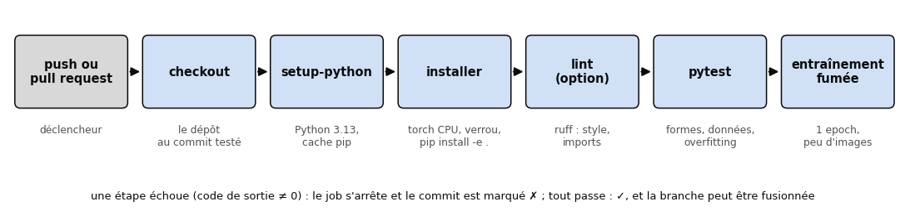
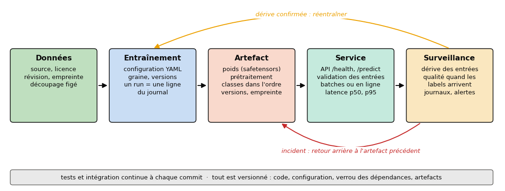
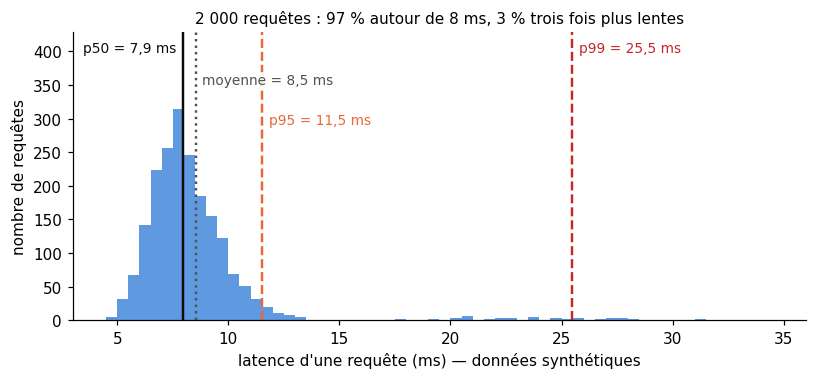
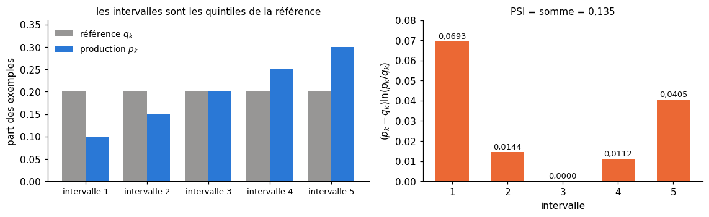
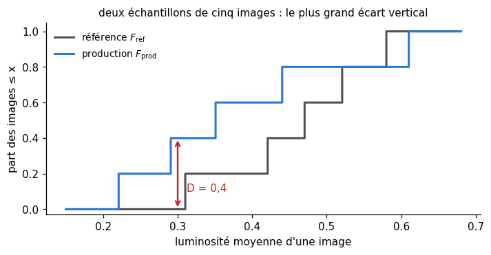

# B7 · Du notebook à la production — fiche de cours

> Ce chapitre bonus n'a pas d'équivalent dans le livre de Glassner : **cette fiche est le cours**. Le livre s'arrête quand le modèle est entraîné et sauvegardé ; en entreprise, le travail commence là. Tu pars du classifieur CIFAR-10 de ton MP5 et tu en fais un **projet** (un paquet Python (*package*) installable, piloté par une ligne de commande et une configuration, **reproductible**, suivi run par run, **testé** à chaque commit), tu le **livres** (un artefact complet, une API dont tu mesures la latence, un export) et tu le **surveilles**, car la population change.

| | |
|---|---|
| **Livre** | — (chapitre propre au workbook) |
| **Sections** | 207.1 à 207.10 (numérotation interne du workbook : 207 = bonus B7) |
| **Temps total estimé** | ≈ 18 h : lecture de la fiche ≈ 1,5 h, exercices ≈ 15 h, 24 flashcards ≈ 0,8 h |
| **Prérequis** | 0A (git ; `pathlib`, `json` et `@dataclass` : 0A.38, 0A.39, 0A.47) · ch. 2 (percentiles, erreur type, bootstrap) · ch. 6 (divergence KL) · ch. 15 (sauvegarder un `Pipeline` avec ses versions, 15.30) · ch. 21 (tests pytest paramétrés, 21.16) · ch. 23 (`state_dict`, `torch.load(weights_only=True)`, checkpoint, fiche modèle) · ch. 24 (journal d'expériences, précision mixte) · MP5 (le paquet `cifarkit`, `fit()`, le modèle livré) |
| **Fichiers du chapitre** | `02_exercices.md` (quiz, rappels, papier, réflexion, entretien) · `03_notebook.ipynb` · `04_indices.md` · `05_solutions.md` et `05_solutions.ipynb` · `06_mes_reponses.md` · `flashcards.csv` |
| **mylearn** | aucun module : ici, le code que tu écris **est** le paquet de ton projet (données, modèle, ligne de commande, API, tests), pas une bibliothèque de ML à comparer à une référence ; c'est ce dépôt que tu montreras |

## Comment utiliser ce chapitre

La fiche pose les outils et les formules, les exercices papier font les calculs, le notebook transforme ton projet : il **écrit** les fichiers du paquet dans ton dossier de travail (`pathlib`), les **exécute** par `subprocess`, lance l'API dans un thread et te fait **lire et compléter** un Dockerfile sans le construire (ni Docker ni GPU ne sont nécessaires). Sans MP5, il fournit un CNN de référence et son checkpoint.

Les codes de la fiche ont été exécutés le 4 novembre 2026 avec les versions du workbook (Python 3.13, PyTorch 2.11, FastAPI 0.141.1, pydantic 2.13.5, PyYAML 6.0.3, safetensors 0.8, scipy 1.16) sur deux cœurs, avec un **autre modèle** que ton projet (un CNN de 18 322 paramètres).

**Ordre conseillé.**
1. Lis 207.1 à 207.6 en faisant au fil de la lecture les quiz, les rappels, ✏️ B7.2, 🗣️ B7.6 et les entretiens E1 à E3 (tableau ci-dessous).
2. Lis 207.7 à 207.10 de la même façon : ✏️ B7.1, B7.3, B7.4, 🧮 B7.5, ⚖️ B7.7, 📄 B7.8 et les entretiens E4 et E5. Vérifie tes réponses courtes dans la partie 0 du notebook.
3. Fais le notebook dans l'ordre des ID, en trois phases : **projet** (B7.9 à B7.15), **service** (B7.16 à B7.21), **exploitation** (B7.22 à B7.25).

| Section | Quiz 🧠 et rappels 🔁 | Papier ✏️ 🧮 et réflexion | Notebook | Entretien 💼 |
|---|---|---|---|---|
| 207.1 Du notebook au projet | Q1, Q2 | B7.6, B7.8 | B7.9, B7.25 | E1 |
| 207.2 Ligne de commande | Q3 | | B7.10, B7.25 | E1 |
| 207.3 Configuration | Q4 | | B7.11, B7.25 | E1 |
| 207.4 Reproductibilité | Q5, Q6, R3 | B7.2 | B7.12, B7.13, B7.17, B7.25 | E2 |
| 207.5 Suivi d'expériences | R1 | B7.2 | B7.14, B7.25 | E2 |
| 207.6 Tester un projet ML | Q7 | | B7.15, B7.23, B7.25 | E3 |
| 207.7 Empaqueter et servir | Q8, Q9, R2, R3 | B7.3, B7.5 | B7.16, B7.17, B7.18, B7.19, B7.25 | E5 |
| 207.8 Exporter et optimiser | Q9, Q10 | B7.1 | B7.19, B7.20, B7.21, B7.25 | E5 |
| 207.9 Conteneurs et déploiement | Q4 | | B7.23, B7.24, B7.25 | |
| 207.10 Surveiller en production | Q11 | B7.4, B7.7, B7.8 | B7.16, B7.22 | E4 |

## Objectifs d'apprentissage

À la fin de ce chapitre, tu sais :
1. **Restructurer** un notebook en paquet Python installable, avec une ligne de commande, du logging et une configuration validée.
2. **Rendre** un entraînement reproductible et traçable (graines, déterminisme, versions, empreinte des données, journal des runs) et **rapporter** un score avec sa dispersion sur plusieurs graines.
3. **Écrire** des tests utiles à un projet de ML et les **automatiser** dans une intégration continue.
4. **Empaqueter** un modèle avec tout ce qu'il faut pour s'en servir, le **servir** par une API qui valide ses entrées, et **mesurer** sa latence (p50, p95) et son débit.
5. **Exporter** un modèle avec `torch.export`, **vérifier** l'équivalence numérique, et **évaluer** ce que rapportent batches, précision réduite et quantification sur CPU.
6. **Détecter** une dérive des données (PSI, test de Kolmogorov-Smirnov), **journaliser** les prédictions dans le respect du RGPD et **décider** : surveiller, réentraîner ou revenir en arrière.

## L'essentiel en 10 lignes

1. Un notebook garde un **état caché** : le projet se range en paquet (`src/`, `tests/`, `configs/`), installé en mode **éditable**.
2. Un script a une **ligne de commande** (`argparse`), écrit par le **logging**, rend un **code de sortie**.
3. Les paramètres vivent dans une **configuration** typée, **validée** au chargement et **surchargeable** ; les secrets n'y vont jamais.
4. **Reproductible** : graines, déterminisme, versions figées (un **fichier de verrouillage**), **empreinte** des données ; un score se rapporte sur plusieurs graines, avec un intervalle.
5. Chaque **run** laisse une ligne : identifiant, configuration, versions, métriques, **artefacts**.
6. Un projet de ML se teste comme du code **et** comme du ML (données, mini-batch appris par cœur) ; l'**intégration continue** rejoue tout à chaque commit.
7. L'**artefact** = les poids **plus** le prétraitement, les classes dans l'ordre, les versions, l'empreinte des données ; sans eux, gare au **training-serving skew**.
8. L'utilisateur ressent la **latence p95**, pas la moyenne ; le **débit** et la **loi de Little** dimensionnent le service.
9. `torch.export` fige le graphe (TorchScript est déprécié), ONNX le sert sans PyTorch ; bfloat16 et int8 réduisent la taille, et leur gain de vitesse se **mesure**.
10. Les données **dérivent** : **PSI** et **test KS** comparent la production à la référence ; on journalise le minimum, on alerte sur des seuils écrits, on prévoit le **retour arrière**.

> 📐 **Conventions de la fiche** — En 207.4, $n$ est le nombre de **graines**, $a_i$ l'accuracy du run $i$, $\bar a$ leur moyenne et $s$ leur écart-type corrigé (divisé par $n - 1$, ch. 2). En 207.7, $p_{95}$ est le 95ᵉ percentile des latences ; dans la loi de Little, $\lambda$ est un débit d'arrivée, $W$ un temps de réponse et $L$ un nombre moyen de requêtes en cours. En 207.8, $N$ est un nombre de paramètres. En 207.10, $q_k$ et $p_k$ sont les parts de la référence et de la production dans l'intervalle $k$ (sur $K$ intervalles), $F$ une fonction de répartition empirique et $m$ un nombre de tests. **Écarts au §6** : $n$ compte des graines, pas des exemples ; $p_k$ est une part, pas un nombre de features ; $L$ n'est pas une loss ni $W$ une matrice de poids (ce sont les notations de J. Little, 1961).

---

## 207.1 · Du notebook au projet : limites du notebook, structure d'un dépôt, pyproject.toml, installation éditable ⏩

### Ce que cache un notebook

Un notebook est idéal pour explorer, mais pas pour du code qui doit durer. **L'état caché** : le noyau garde les variables dans l'ordre où **tu** as exécuté les cellules, pas dans l'ordre où elles sont écrites (une cellule supprimée a pu définir une variable dont la suite dépend). J. F. Pimentel et coll. (MSR 2019) ont exécuté 863 878 notebooks publics de GitHub : 24 % seulement sont allés au bout sans erreur, et 4 % ont redonné leurs résultats. **Le code qu'on n'importe pas** : une fonction écrite dans une cellule ne sert ni à un test ni à un serveur ; on la recopie, et les copies divergent. **Ce qui ne se relit pas** : un `.ipynb` mélange code, sorties et images, et son `git diff` est presque illisible.

D'où deux règles : « Redémarrer et tout exécuter » avant de croire un résultat, et **le notebook appelle, le paquet fait**, comme `cifarkit` au MP5.

### Une structure de dépôt

Une forme courante, que reprend le notebook :

```text
cifar-prod/
├── pyproject.toml          # what the package needs; its command-line entry points
├── requirements.txt        # exact versions (or a lock file: uv.lock, pylock.toml)
├── README.md  MODEL_CARD.md  .gitignore
├── configs/                # YAML settings: fast.yaml, full.yaml, smoke.yaml
├── src/cifarprod/          # the package: importable code only
│   ├── __init__.py  __main__.py
│   ├── data.py  model.py  train.py  config.py  cli.py  serve.py
├── tests/                  # test_data.py, test_model.py, test_api.py
├── notebooks/              # exploration and figures, which import the package
├── artifacts/              # the delivered models, one folder per version
└── .github/workflows/ci.yml
```

Les données et les sorties de runs restent hors de git (`.gitignore`), retrouvées par un script et une empreinte (207.4). Le **layout `src/`** a un avantage discret : depuis la racine du dépôt, `import cifarprod` échoue tant que le paquet n'est pas installé, donc tes tests utilisent le paquet **installé**, comme un utilisateur, et pas une copie du dossier courant (le guide de packaging de Python détaille cet avantage).

### pyproject.toml et installation éditable

Le `pyproject.toml` décrit le projet dans un format standard (la table `[project]` de la PEP 621), que lisent pip, uv et les autres outils :

```toml
[build-system]
requires = ["setuptools>=68"]
build-backend = "setuptools.build_meta"

[project]
name = "cifarprod"
version = "0.1.0"
requires-python = ">=3.11"
dependencies = ["numpy>=2.0", "torch>=2.5", "pyyaml>=6.0"]   # loose bounds: what the code needs

[project.optional-dependencies]
serve = ["fastapi>=0.110", "uvicorn>=0.30"]
dev = ["pytest>=8.0"]

[project.scripts]
cifarprod = "cifarprod.cli:main"          # installs a `cifarprod` command that calls main()
```

Les **bornes** de `dependencies` disent ce que le code supporte ; les **versions exactes** d'un environnement qui a marché vont ailleurs (207.4), comme les versions de Colab dans le `requirements.txt` du workbook.

`pip install -e .` installe le paquet en mode **éditable** (*editable install*, PEP 660) : un lien vers ton dossier `src/` au lieu d'une copie. Une modification du code est visible au prochain import, et la commande `cifarprod` existe tout de suite ; dans un notebook, un module déjà importé n'est pas relu : redémarre le noyau.

> 🕰️ **Mise à jour (2026) — l'outillage Python** — **Le livre :** absent (2018 : `setup.py` et `requirements.txt` à la main). · **Aujourd'hui :** `pyproject.toml` (PEP 621) décrit tout projet ; **uv** (Astral, 0.13 en novembre 2026) crée l'environnement, installe et **verrouille** en quelques secondes (`uv lock` écrit un `uv.lock` multiplateforme, à versionner ; `uv sync --locked` refuse un verrou périmé) ; **pip-tools** (`pip-compile`) épingle un `requirements.txt` ; la **PEP 751**, acceptée le 31 mars 2025, normalise un verrou commun, `pylock.toml` (`uv export --format pylock.toml` ; `pip lock`, expérimental depuis pip 25.1, ne vaut que pour la plateforme où il tourne) ; **ruff** vérifie le style et formate, **pre-commit** lance ces vérifications avant chaque commit (ni l'un ni l'autre n'est dans le workbook ou sur Colab : le chapitre n'en dépend pas). · **Faut-il quand même l'apprendre ?** Oui : un `pyproject.toml` propre, un verrou et un linter sont le minimum qu'un recruteur regarde. · *Sources :* [guide « Writing your pyproject.toml »](https://packaging.python.org/en/latest/guides/writing-pyproject-toml/) ; [« src layout vs flat layout »](https://packaging.python.org/en/latest/discussions/src-layout-vs-flat-layout/) ; [PEP 751](https://peps.python.org/pep-0751/) et la [spécification `pylock.toml`](https://packaging.python.org/en/latest/specifications/pylock-toml/) ; [uv, projets et verrou](https://docs.astral.sh/uv/concepts/projects/layout/) ; [`pip lock`](https://pip.pypa.io/en/stable/cli/pip_lock/) ; Pimentel et coll., « [A Large-scale Study about Quality and Reproducibility of Jupyter Notebooks](https://leomurta.github.io/papers/pimentel2019a.pdf) », MSR 2019.

---

## 207.2 · Scripts et ligne de commande : argparse, point d'entrée, logging, codes de sortie ⏩

### argparse et le point d'entrée

Une ligne de commande rend l'entraînement **rejouable** : `cifarprod train --config configs/fast.yaml --set lr=0.01` dit exactement ce qui a été lancé. Le module `argparse` lit les arguments, écrit l'aide (`-h`) et refuse ce qu'il ne comprend pas :

```python
import argparse
import logging
import sys

from .config import load_config

log = logging.getLogger(__name__)          # one logger per module, named after it


def build_parser() -> argparse.ArgumentParser:
    parser = argparse.ArgumentParser(prog="cifarprod", description="Train and serve a CIFAR-10 classifier.")
    sub = parser.add_subparsers(dest="command", required=True)
    train = sub.add_parser("train", help="train a model and save its artifact")
    train.add_argument("--config", default="configs/fast.yaml", help="YAML file (default: %(default)s)")
    train.add_argument("--set", action="append", default=[], metavar="KEY=VALUE", help="override a setting")
    train.add_argument("-v", "--verbose", action="store_true", help="also show DEBUG messages")
    return parser


def main(argv: list[str] | None = None) -> int:
    args = build_parser().parse_args(argv)          # a bad option: a message and exit code 2
    logging.basicConfig(level=logging.DEBUG if args.verbose else logging.INFO,
                        format="%(asctime)s %(levelname)s %(name)s: %(message)s")
    try:
        config = load_config(args.config, args.set)
    except (OSError, ValueError) as err:
        log.error("invalid configuration: %s", err)
        return 2
    log.info("training with %s", config)
    ...                                              # train, save the artifact, log the run
    return 0


if __name__ == "__main__":
    sys.exit(main())
```

`main(argv)` reçoit ses arguments au lieu de lire `sys.argv` : un test peut l'appeler (`assert main(["train", "--set", "epochs=0"]) == 2`). Le **point d'entrée** (*entry point*) de `[project.scripts]` installe la commande `cifarprod` ; un `__main__.py` (`raise SystemExit(main())`) permet `python -m cifarprod`, qui marche partout, Colab compris. Le travail reste dans des fonctions testées sans la ligne de commande.

### Le logging plutôt que print

`print` écrit tout au même endroit, sans date ni gravité. Le module `logging` (*journalisation*) donne à chaque message un **niveau** : `DEBUG` (le détail pour un bug), `INFO` (les étapes normales : « epoch 3/10, val_acc 0,612 »), `WARNING` (inattendu, on continue), `ERROR` (une opération a échoué), `CRITICAL` (on s'arrête). Un **logger** par module (`logging.getLogger(__name__)`) dit d'où vient le message ; des **handlers** (*gestionnaires*) disent où il va (console, fichier, service de collecte). On les configure **une seule fois**, dans le point d'entrée ; un module de bibliothèque appelle `log.info(...)`, jamais `basicConfig`, et `log.exception(...)` dans un `except` ajoute la trace. Un bon message donne les valeurs (« loaded 2 000 train images (sha256 8b49f765…) »), pas « données OK ».

### Les codes de sortie

Un programme rend au système un entier : **0** pour un succès, autre chose pour un échec. C'est ce que lisent un script shell, une intégration continue ou `subprocess.run(...).returncode` dans ton notebook : un entraînement qui affiche une erreur mais rend 0 passe pour réussi. Convention courante : 1 pour une erreur générale, 2 pour une mauvaise utilisation (le code de `argparse` devant une option inconnue) ; `sys.exit(main())` transmet ton `return`.

---

## 207.3 · Configuration : dataclasses, YAML ou JSON, surcharges, validation ; séparer code et paramètres ⏩

Un learning rate écrit en dur dans `train.py` se change sans trace. La configuration sort les **paramètres** du code (le code dit **comment** on entraîne, la configuration **avec quoi**), et chaque run enregistre la sienne (207.5). Elle contient hyperparamètres, architecture, graine, tailles, chemins relatifs, mode, et **jamais** un mot de passe ou une clé d'API : une configuration se versionne et se recopie dans les journaux (207.9).

Le **YAML** est un format texte de paires `clé: valeur` et de listes, plus agréable à écrire à la main que le JSON, commentaires compris :

```yaml
# configs/fast.yaml
seed: 0
epochs: 1
lr: 0.05
batch_size: 128
n_train: 2000
widths: [16, 32]
```

Une **configuration typée** déclare chaque paramètre avec son type et sa valeur par défaut : une `@dataclass` (0A.47), ici `frozen=True` pour qu'un run ne la modifie pas en route.

```python
from dataclasses import dataclass, fields
from pathlib import Path

import yaml


@dataclass(frozen=True)
class TrainConfig:
    seed: int = 0
    epochs: int = 1
    lr: float = 0.05
    batch_size: int = 128
    n_train: int = 2000
    widths: tuple[int, ...] = (16, 32)

    def __post_init__(self) -> None:
        for f in fields(self):                      # dataclasses do not check types: we do
            value, kind = getattr(self, f.name), type(f.default)
            if kind is float and type(value) is int:
                object.__setattr__(self, f.name, float(value))       # 1 -> 1.0 is fine
            elif type(value) is not kind:
                raise ValueError(f"{f.name}: expected {kind.__name__}, got {value!r}")
        if self.epochs < 1 or not 0 < self.lr < 1:
            raise ValueError(f"need epochs >= 1 and 0 < lr < 1, got {self.epochs} and {self.lr}")


def load_config(path: str | Path, overrides: list[str] = ()) -> TrainConfig:
    raw = yaml.safe_load(Path(path).read_text(encoding="utf-8")) or {}
    known = {f.name for f in fields(TrainConfig)}
    for item in overrides:                          # --set lr=0.01 --set widths=[8,16]
        key, sep, value = item.partition("=")
        if not sep:
            raise ValueError(f"--set expects KEY=VALUE, got {item!r}")
        raw[key] = yaml.safe_load(value)
    unknown = set(raw) - known
    if unknown:                                     # a typo must fail, not be ignored
        raise ValueError(f"unknown settings: {sorted(unknown)}")
    if "widths" in raw:
        raw["widths"] = tuple(raw["widths"])
    return TrainConfig(**raw)
```

La **validation** se fait au chargement, avant toute minute de calcul : une faute de frappe (`lerning_rate: 0.01`) lève « unknown settings: ['lerning_rate'] » au lieu d'être ignorée, et `--set epochs=0` est refusé. Les **surcharges** (*overrides*) changent un réglage sans toucher au fichier. Pour des schémas plus riches, **pydantic** (installé avec FastAPI, 207.7) valide types et contraintes ; OmegaConf (préinstallé sur Colab) et Hydra composent plusieurs fichiers.

> 🧮 **Rappel outil — YAML avec PyYAML** — PyYAML (`import yaml`, installé avec transformers) lit un YAML en dictionnaires, listes, nombres et chaînes. Utilise toujours `yaml.safe_load` : un chargeur complet peut construire des objets Python arbitraires, donc exécuter du code caché dans le fichier (le danger de `pickle`, ch. 15 et 23). PyYAML suit la version 1.1 du format, qui réserve des surprises (vérifiées avec PyYAML 6.0.3) : `lr: 1e-3` est lu comme la **chaîne** `'1e-3'` (il faut un point : `1.0e-3`) ; `version: 1.10` devient le nombre 1,1 ; `country: no` devient `False` (comme `yes`, `on`, `off`) ; `n: 012` devient 10 (un nombre octal). La dataclass ci-dessus refuse `'1e-3'` avec « lr: expected float, got '1e-3' ». JSON (`json.load`) n'a pas ces pièges, mais ni commentaires ni écriture confortable.

---

## 207.4 · Reproductibilité : graines, déterminisme, versions figées, empreinte des données ⏩

« Reproductible » a deux sens : **refaire le même run** (mêmes code, données, environnement et graines, donc mêmes nombres), pour déboguer et reprendre un entraînement ; **retrouver la même conclusion** (avec d'autres graines, A bat toujours B), pour croire un résultat. Le premier demande de tout figer, le second de mesurer la dispersion.

### Les graines et le déterminisme

Un entraînement tire au hasard l'initialisation, l'ordre des mini-batches, l'augmentation et le dropout (ch. 23). Une fonction, appelée au début de chaque run, fixe tous les générateurs :

```python
import random

import numpy as np
import torch


def seed_everything(seed: int, deterministic: bool = True) -> torch.Generator:
    """Seed Python, NumPy and PyTorch; return a generator for the DataLoader."""
    random.seed(seed)
    np.random.seed(seed)
    torch.manual_seed(seed)                     # CPU, and every GPU if there is one
    torch.use_deterministic_algorithms(deterministic)
    return torch.Generator().manual_seed(seed)
```

Le générateur rendu se passe au `DataLoader` (`generator=g`), pour que l'ordre des mini-batches ne dépende pas de ce qui a été tiré avant. Les workers du `DataLoader` (ch. 24) ont leurs propres générateurs, dérivés d'une graine de base (`generator`, `worker_init_fn`). Ce que changent `num_workers` et le GPU à graine égale, c'est la question du 🔮 B7.12.

Même avec des graines fixées, deux exécutions peuvent différer : certaines opérations additionnent dans un ordre qui varie (les threads d'un GPU qui accumulent dans la même case), et l'addition des flottants n'est pas associative. `torch.use_deterministic_algorithms(True)` impose une implémentation déterministe là où elle existe, et lève une `RuntimeError` sur une opération qui n'en a pas ; sur GPU, `torch.backends.cudnn.benchmark = False` empêche aussi cuDNN de choisir son algorithme en chronométrant. Le prix : un peu de vitesse. Ce que cela change sur cinq exécutions, c'est le 🔬 B7.13. Et la documentation ne promet la même sortie qu'avec le même logiciel sur le même matériel : on fige donc aussi l'environnement.

> 🕰️ **Mise à jour (2026) — le déterminisme dans PyTorch** — **Le livre :** fixe la graine de NumPy « pour faciliter le débogage » (ch. 23), sans plus. · **Aujourd'hui :** la page « Reproducibility » de PyTorch 2.11 recommande ce que fait `seed_everything`, plus `cudnn.benchmark = False` et, pour le `DataLoader`, un `generator` et une `worker_init_fn` qui sème NumPy et `random` ; `use_deterministic_algorithms(True, warn_only=True)` avertit au lieu de lever. Jusqu'à PyTorch 2.9, il fallait aussi poser la variable `CUBLAS_WORKSPACE_CONFIG=:4096:8` sur GPU ; la documentation et le code de 2.10 et 2.11 ne la demandent plus (vérifié dans les sources), mais elle reste dans beaucoup de code. · **Faut-il quand même l'apprendre ?** Oui : c'est une question d'entretien classique (💼 E2). · *Sources :* [PyTorch 2.11, « Reproducibility »](https://docs.pytorch.org/docs/2.11/notes/randomness.html) ; [`torch.use_deterministic_algorithms`](https://docs.pytorch.org/docs/2.11/generated/torch.use_deterministic_algorithms.html) ; la même page de [PyTorch 2.9](https://docs.pytorch.org/docs/2.9/generated/torch.use_deterministic_algorithms.html), qui la demandait encore.

### Les versions figées et l'empreinte des données

Un **fichier de verrouillage** (*lock file*) dit ce qui **a** marché : la version exacte de chaque paquet, dépendances indirectes comprises, souvent avec l'empreinte de chaque fichier. Un `requirements.txt` épinglé (`torch==2.11.0`) en est la forme simple ; `uv.lock` (et le `pylock.toml` qu'uv en exporte, 207.1) couvre toutes les plateformes. Un projet qu'on **livre** a un verrou versionné ; une bibliothèque qu'on **publie** garde des bornes larges. Note aussi, avec chaque run, `platform.python_version()`, `importlib.metadata.version("torch")` et le **commit** git (`git rev-parse --short HEAD`), signalé si `git status --porcelain` n'est pas vide : du code non commité n'est pas rejouable.

Le même nom de fichier peut cacher d'autres données : un dataset retéléchargé, un sous-ensemble tiré autrement. L'**empreinte** identifie le contenu exact : une fonction de hachage, ici SHA-256 (module `hashlib`), transforme des octets en nombre de 256 bits, écrit en 64 chiffres hexadécimaux ; un seul bit changé donne une tout autre empreinte (c'est la somme de contrôle du ch. 29). Pour des tableaux en mémoire, on hache leur type, leur forme et leurs octets :

```python
import hashlib

import numpy as np


def array_fingerprint(*arrays: np.ndarray) -> str:
    """SHA-256 of the dtype, shape and bytes of each array: another value if one pixel changes."""
    h = hashlib.sha256()
    for a in arrays:
        a = np.ascontiguousarray(a)
        h.update(f"{a.dtype}{a.shape}".encode())
        h.update(a.tobytes())
    return h.hexdigest()
```

Pour cinq images aléatoires et leurs labels, changer un bit d'un pixel change toute l'empreinte (`8b49f765…` devient `02d015bd…`), et les mêmes valeurs en `int64` au lieu d'`uint8` en donnent une troisième : le type fait partie des données. L'empreinte du sous-ensemble d'entraînement va dans le run et dans l'artefact (207.7).

### Rapporter un score : plusieurs graines et un intervalle

Un seul run ne dit pas si un écart de 0,5 point est réel ou dû à la graine (ch. 23 et 24). On répète le run avec $n$ graines, et l'on rapporte la moyenne $\bar a$ avec un **intervalle de confiance** :

$$\bar a \pm t_{0{,}975;\,n-1}\,\frac{s}{\sqrt{n}}.$$

> 🧮 **Rappel maths — l'intervalle de Student sur quelques graines** — La moyenne de $n$ runs a une **erreur type** $s/\sqrt{n}$ (ch. 2). Avec le vrai écart-type, on prendrait $\bar a \pm 1{,}96 \times$ l'erreur type (la loi normale) ; comme on l'estime sur $n$ valeurs, on remplace 1,96 par le quantile 97,5 % de la **loi de Student** à $n - 1$ degrés de liberté, plus grand quand $n$ est petit : 12,706 pour $n = 2$, 4,303 pour 3, 3,182 pour 4, 2,776 pour 5, 2,571 pour 6, 2,262 pour 10, puis il tend vers 1,96 (`scipy.stats.t.ppf(0.975, n - 1)`). La formule suppose des scores à peu près gaussiens ; le bootstrap du ch. 2 s'en passe, mais sur cinq ou six valeurs il est trop grossier.

**Exemple.** Six graines donnent 71,2 ; 70,5 ; 72,1 ; 69,8 ; 71,6 et 70,9 % d'accuracy de validation : moyenne 71,02 %, $s = 0{,}813$ point, erreur type $0{,}813/\sqrt 6 = 0{,}332$, demi-largeur $2{,}571 \times 0{,}332 = 0{,}854$. On écrit **71,0 % ± 0,9 (intervalle à 95 % sur 6 graines)**, soit [70,2 ; 71,9]. Un concurrent à 71,4 % sur une seule graine n'est pas « meilleur » ; deux modèles se comparent sur les **mêmes** graines, par l'intervalle de leur différence graine par graine.

---

## 207.5 · Suivi d'expériences : runs, métriques, artefacts, comparaison ⏩

Au ch. 24, ton journal d'expériences avait une ligne par run. Il devient la **mémoire** du projet : six mois plus tard, on doit savoir quel run, avec quels code, données et réglages, a produit le modèle en production. Un **run** reçoit un **identifiant** unique (la date et quelques caractères aléatoires : `20261104-161731-e06339`), et il enregistre ce qui le **définit** (configuration complète, graine, commit, versions, empreinte des données), ce qu'il **mesure** (métriques par epoch et finales, durée, machine) et ce qu'il **produit** : ses **artefacts** (*artifacts*), les fichiers qu'il écrit (checkpoints, modèle livré, figures), avec leur chemin et leur empreinte. Le format le plus simple est le **JSONL** (*JSON Lines*) : un objet JSON par ligne, ajouté à la fin du fichier, jamais réécrit.

```python
import json
import uuid
from datetime import datetime, timezone
from pathlib import Path


def new_run_id() -> str:
    return f"{datetime.now(timezone.utc):%Y%m%d-%H%M%S}-{uuid.uuid4().hex[:6]}"


def log_run(path: Path, record: dict) -> None:
    """Append one JSON line per run: never rewrite the past."""
    path.parent.mkdir(parents=True, exist_ok=True)
    with path.open("a", encoding="utf-8") as f:
        f.write(json.dumps(record, sort_keys=True) + "\n")
```

Contrairement au CSV de `cifarkit`, une ligne JSON peut contenir une configuration imbriquée, et un champ ajouté ne casse pas les anciennes lignes. Pour comparer, `pandas.json_normalize([json.loads(l) for l in open(path)])` met tout dans un tableau (une colonne `config.lr` par réglage imbriqué). Un run raté reste dans le journal avec son statut : l'effacer fausse les comparaisons (⚖️ 24.9).

> 🕰️ **Mise à jour (2026) — le suivi d'expériences** — **Le livre :** absent. · **Aujourd'hui :** **MLflow** (3.18 en novembre 2026) enregistre pour chaque *run* paramètres, métriques et artefacts (`mlflow.start_run()`, `log_param`, `log_metric`, `log_artifact`), les compare dans une interface web et tient un registre de modèles. **Weights & Biases** (service en ligne) et **TensorBoard** (courbes d'entraînement) sont préinstallés sur Colab, contrairement à MLflow. Aucun n'est dans le workbook : le suivi JSONL de quinze lignes montre ce qu'ils font. · **Faut-il quand même l'apprendre ?** Oui : la discipline (tout run enregistré, configuration complète, artefacts liés au run) est la même quel que soit l'outil. · *Sources :* [MLflow Tracking](https://mlflow.org/docs/latest/ml/tracking/) ; [googlecolab/backend-info, `pip-freeze.txt`](https://github.com/googlecolab/backend-info/blob/main/pip-freeze.txt) (commit `fecf4f8` du 2 novembre 2026 : tensorboard et wandb présents, mlflow absent).

---

## 207.6 · Tester un projet ML : tests unitaires, tests de données, test d'overfitting, intégration continue ⏩

### Quatre familles de tests

Un bug de ML ne plante pas : des labels décalés d'un cran donnent un modèle **un peu moins bon**, qui passe inaperçu. On teste donc des **propriétés** :

- **tests unitaires** (0A) : une fonction sur un petit cas calculé à la main (forme de sortie, image constante prétraitée, configuration invalide, code de sortie) ;
- **tests de données** : le **schéma** de ce qui entre (type `uint8`, forme `(N, 32, 32, 3)`, labels de 0 à 9), l'équilibre des classes, aucun recouvrement entre entraînement et test (par empreinte de chaque image) ;
- **overfitting d'un mini-batch** : un réseau correct doit **apprendre par cœur** 16 images en une centaine de pas ; sinon, la boucle a un bug (labels mélangés, `zero_grad` oublié, couche gelée) ;
- **bout en bout** : un **entraînement fumée** (*smoke test* : « la machine fume-t-elle quand on l'allume ? ») d'une epoch sur quelques centaines d'images, qui doit aller au bout, écrire son artefact et rendre 0, sans juger l'accuracy.

```python
import pytest
import torch
import torch.nn.functional as F

from cifarprod.model import build_model


@pytest.fixture
def model():
    torch.manual_seed(0)
    return build_model(widths=(12, 24))


@pytest.mark.parametrize("batch", [1, 7])
def test_output_shape(model, batch):
    out = model(torch.zeros(batch, 3, 32, 32))
    assert out.shape == (batch, 10), f"expected ({batch}, 10), got {tuple(out.shape)}"


def test_overfits_one_batch(model):
    g = torch.Generator().manual_seed(0)
    x, y = torch.randn(16, 3, 32, 32, generator=g), torch.arange(16) % 10
    opt = torch.optim.Adam(model.parameters(), lr=1e-2)
    for _ in range(100):
        opt.zero_grad()
        loss = F.cross_entropy(model(x), y)
        loss.backward()
        opt.step()
    assert loss.item() < 0.05, f"expected a loss < 0.05 on 16 memorised images, got {loss.item():.3f}"
```

Une **fixture** pytest (`@pytest.fixture`) prépare un objet pour les tests qui la nomment en argument : chaque test reçoit un modèle neuf, et aucun ne dépend d'un autre ; `@pytest.mark.parametrize` (21.16) rejoue un test sur plusieurs valeurs. Avec le CNN de la fiche, ces tests tournent en moins de 3 s sur deux cœurs ; un test plus lent se marque `@pytest.mark.slow`. Chaque `assert` dit sur sa première ligne ce qui était attendu : quand l'intégration continue échoue, c'est tout ce que tu lis.

### Une grille : le ML Test Score

E. Breck, D. Sculley et leurs collègues de Google (IEEE Big Data 2017) proposent **28 tests** en quatre familles de sept : **données** (le schéma attendu est écrit…), **modèle** (un modèle plus simple ne fait pas mieux, la qualité tient sur chaque tranche importante…), **infrastructure** (l'entraînement est reproductible, on peut revenir vite à une version précédente…) et **surveillance** (207.10). Un test vaut un demi-point fait à la main, un point automatisé ; le score est le **minimum** des quatre sommes. Chez Google, aucun de ces tests n'était appliqué par plus de 80 % des équipes interrogées. Tu t'en serviras pour juger ton dépôt (🏆 B7.25).

### L'intégration continue

L'**intégration continue** (*continuous integration*, CI) rejoue l'installation et les tests à **chaque** `push` ou *pull request*, sur une machine propre. Sur GitHub, c'est **GitHub Actions** : un fichier YAML dans `.github/workflows/` décrit un **workflow** (*flux de travail*), fait de **jobs** qui enchaînent des **étapes** (*steps*) ; une étape réutilise une **action** publiée (`uses:`) ou lance une commande (`run:`), et une commande qui rend un code non nul (207.2) arrête le job et marque le commit en échec.



```yaml
name: ci
on: [push, pull_request]
jobs:
  test:
    runs-on: ubuntu-latest
    steps:
      - uses: actions/checkout@v7
      - uses: actions/setup-python@v7
        with:
          python-version: "3.13"
          cache: pip
      # then: install torch from the CPU index, the pinned requirements, the package; run the tests; smoke-train
```

Deux pièges propres au ML : sans l'index CPU de PyTorch (`--index-url https://download.pytorch.org/whl/cpu`), `pip install torch` télécharge sous Linux la version CUDA, plus de 2 Go ; et les données ne sont pas dans le dépôt : l'entraînement fumée télécharge un petit sous-ensemble fixe (vérifié par son empreinte) ou utilise des images synthétiques.

> 🕰️ **Mise à jour (2026) — GitHub Actions** — **Le livre :** absent. · **Aujourd'hui :** les actions officielles sont `actions/checkout@v7` (v7.0.1, juillet 2026 ; depuis la v7, elle refuse par défaut le code d'une *pull request* venue d'un fork sous `pull_request_target`) et `actions/setup-python@v7` (v7.1.0, octobre 2026), sur Node 24 ; pour uv, l'action `astral-sh/setup-uv`. Les exemples de 2024 et 2025 utilisent souvent `checkout@v4` et `setup-python@v5`, qui tournent encore sur Node 20. · **Faut-il quand même l'apprendre ?** Oui : un badge « CI passing » dit en un coup d'œil que le dépôt s'installe et que ses tests passent (🛠️ B7.23). · *Sources :* [README de `actions/checkout`](https://github.com/actions/checkout) ; [README de `actions/setup-python`](https://github.com/actions/setup-python) (tags vérifiés par `git ls-remote` le 4 novembre 2026) ; Breck et coll., « [The ML Test Score](https://research.google.com/pubs/archive/aad9f93b86b7addfea4c419b9100c6cdd26cacea.pdf) », IEEE Big Data 2017, p. 1123-1132.

---

## 207.7 · Empaqueter et servir : artefact de modèle, inférence par batches ou en ligne, API HTTP, latence ⏩



### L'artefact du modèle

Au ch. 23 et au MP5, ton modèle livré était un `state_dict` et un `model.json`. L'**artefact de modèle** est le dossier versionné qui contient **tout** ce qu'il faut pour prédire sans le notebook : les **poids**, en **safetensors** (ch. 23 : des tenseurs nommés et un petit en-tête JSON, chargés sans rien exécuter, contrairement à un `pickle`) ; l'**architecture** (la fonction qui la construit et ses arguments : `{"arch": "small_cnn", "widths": [12, 24]}`) ; le **prétraitement** exact (taille d'entrée, ordre des canaux, échelle des pixels, moyenne et écart-type **appris sur l'entraînement**) ; les **classes**, dans l'ordre des sorties (la sortie 3 n'est « chat » que si la liste le dit) ; la **traçabilité** (version, run, commit, versions des bibliothèques, empreinte des données, métriques) ; la **fiche modèle** (M. Mitchell et coll., 2019 ; ch. 23, B6).

```python
from safetensors.torch import load_file, save_file

save_file(model.state_dict(), "artifact/model.safetensors", metadata={"version": "1.0.0"})
model = build_model(**meta["config"])                       # meta: the JSON written next to the weights
model.load_state_dict(load_file("artifact/model.safetensors"))   # plain tensors, nothing executed
model.eval()
```

Les métadonnées de safetensors ne sont que des chaînes : le reste va dans un `meta.json`. Pour le CNN de la fiche, le fichier pèse 73 744 octets (18 322 poids en float32 plus l'en-tête). Sans le `model.eval()` final, dropout et batchnorm restent en mode entraînement (ch. 20).

Le **training-serving skew** (ch. 12) est l'écart entre ce que le modèle a vu à l'entraînement et ce qu'il reçoit en service, quand les deux chaînes de préparation diffèrent : un redimensionnement fait avec une autre interpolation, un recadrage appliqué d'un côté et pas de l'autre, une feature calculée sur une autre fenêtre de temps. Le modèle ne plante pas : il répond moins bien. Parades : **une seule fonction** de prétraitement, appelée par l'entraînement **et** par le service, et un **test de non-régression** (ch. 7) qui compare les réponses de l'API à l'évaluation hors ligne sur quelques images (🐛 B7.16).

### En ligne ou par batches, et une API HTTP

L'**inférence par batches** (*batch inference*) prédit d'un coup un grand ensemble, à heure fixe : on optimise le **débit** (les exemples traités par seconde). L'**inférence en ligne** (*online inference*) répond pendant que quelqu'un attend : on optimise la **latence** (le temps de réponse). Entre les deux, un serveur peut **regrouper** les requêtes qui arrivent presque ensemble (*dynamic batching*), en attendant quelques millisecondes pour remplir un batch.

Une **API HTTP** expose le modèle à n'importe quel programme : le client envoie une requête (`POST /predict`, un corps JSON), le serveur répond par un **code de statut** (200 : succès ; 422 : entrée invalide ; 500 : erreur du serveur) et un corps JSON. Deux **routes** (*endpoints*) au minimum : `/health` et `/predict`. **FastAPI** valide les entrées avec **pydantic** avant d'appeler ta fonction.

```python
import numpy as np
import torch
from fastapi import FastAPI
from pydantic import BaseModel, field_validator


class Image(BaseModel):
    pixels: list[list[list[int]]]                   # 32 x 32 x 3 RGB values in 0..255

    @field_validator("pixels")
    @classmethod
    def check_shape(cls, v):
        a = np.asarray(v)
        if a.shape != (32, 32, 3):
            raise ValueError(f"expected shape (32, 32, 3), got {a.shape}")
        if a.min() < 0 or a.max() > 255:
            raise ValueError("pixel values must be in 0..255")
        return v


app = FastAPI(title="cifar-api")


@app.get("/health")
def health() -> dict:
    return {"status": "ok", "model_version": VERSION}


@app.post("/predict")
def predict(image: Image) -> dict:
    with torch.inference_mode():
        proba = model(preprocess(image.pixels)).softmax(dim=1)[0]   # the SAME preprocess as in training
    k = int(proba.argmax())
    return {"label": CLASSES[k], "probability": round(float(proba[k]), 4), "model_version": VERSION}
```

Une image de 28 × 28 reçoit un 422 et « Value error, expected shape (32, 32, 3), got (28, 28, 3) », une chaîne « Input should be a valid list », un corps vide « Field required » : `predict` n'a pas à vérifier ses entrées, et FastAPI écrit la documentation de l'API (`/docs`). Pour la tester sans serveur :

```python
from fastapi.testclient import TestClient

client = TestClient(app)
assert client.get("/health").status_code == 200
r = client.post("/predict", json={"pixels": np.zeros((28, 28, 3), int).tolist()})
assert r.status_code == 422, f"expected 422 for a 28 x 28 image, got {r.status_code}"
```

En vrai, on lance le serveur avec **uvicorn** (`uvicorn cifarprod.serve:app --port 8000`). `TestClient` affiche un avertissement de Starlette 1.10 qui conseille `httpx2` : il fonctionne pourtant avec le `httpx` 0.28 du workbook.

**Le repli : `http.server`.** Sans FastAPI, une sous-classe de `BaseHTTPRequestHandler` qui définit `do_GET` et `do_POST` suffit (lire le corps par `self.rfile.read(int(self.headers["Content-Length"]))`, répondre par `send_response`, `send_header` et `wfile.write`, valider avec le modèle pydantic, dont la `ValidationError` est une `ValueError`). Dans un notebook, le serveur tourne dans un thread, et il faut **l'arrêter**, même si la cellule échoue :

```python
import threading
from http.server import ThreadingHTTPServer

server = ThreadingHTTPServer(("127.0.0.1", 0), Handler)      # port 0: the system picks a free port
port = server.server_address[1]
thread = threading.Thread(target=server.serve_forever, daemon=True)
thread.start()
try:
    ...                                                      # requests.get(f"http://127.0.0.1:{port}/health")
finally:
    server.shutdown()                                        # stop serve_forever, then free the port
    server.server_close()
```

> 🕰️ **Mise à jour (2026) — servir un modèle** — **Le livre :** absent. · **Aujourd'hui :** **FastAPI** et **uvicorn** sont la façon courante de servir un modèle Python (versions du workbook : celles de Colab au 30 septembre 2026 ; Colab est passé depuis à uvicorn 0.54 et pydantic 2.14.1) ; **Gradio** pour les démonstrations ; **BentoML** et **Triton Inference Server** (NVIDIA) pour la grande échelle (batches, plusieurs modèles, GPU). **TorchServe** n'est plus maintenu (« Limited Maintenance », sans correctifs de sécurité). Pour les modèles de langue, **vLLM** et `transformers serve` exposent une API compatible avec celle d'OpenAI. · **Faut-il quand même l'apprendre ?** Oui : une petite API qui valide ses entrées, testée sans serveur, est une compétence d'entretien de base (💼 E5). · *Sources :* [FastAPI, « Testing »](https://fastapi.tiangolo.com/tutorial/testing/) ; [Starlette, « Test Client »](https://starlette.dev/testclient/) ; [README de TorchServe](https://github.com/pytorch/serve) ; [transformers 5.21, « Serving »](https://huggingface.co/docs/transformers/v5.21.0/serve-cli/serving) ; [googlecolab/backend-info](https://github.com/googlecolab/backend-info).

### Latence, percentiles et débit

La **latence** d'une requête est le temps entre son envoi et la réponse. Elle varie (ramasse-miettes, autre processus, file d'attente), et sa **distribution** a presque toujours une **queue** : beaucoup de requêtes rapides, quelques-unes très lentes. On la résume par des **percentiles** (ch. 2) : $p_{50}$, la médiane ; $p_{95}$, la latence que 95 % des requêtes ne dépassent pas ; $p_{99}$ pour la queue. La moyenne, tirée par les lentes, ne décrit ni la requête typique ni les pires.



Pourquoi le p95 ? Un utilisateur fait beaucoup de requêtes : sur 20, la probabilité qu'**au moins une** dépasse le p95 vaut $1 - 0{,}95^{20} \approx 0{,}64$. Les objectifs de service (un **SLO**, *service level objective*) s'écrivent donc en percentiles : « 95 % des requêtes en moins de 100 ms ».

**Un calcul à la main.** Dix requêtes ont pris 12, 15, 11, 14, 13, 40, 12, 16, 13 et 12 ms ; triées : 11, 12, 12, 12, 13, 13, 14, 15, 16, 40. La moyenne vaut 15,8 ms, plus que huit des dix. Avec la méthode par défaut de NumPy (positions 0 à 9), la médiane, en position $0{,}5 \times 9 = 4{,}5$, vaut 13 ms, et le $p_{95}$, en position $0{,}95 \times 9 = 8{,}55$, vaut $16 + 0{,}55 \times 24 = 29{,}2$ ms ; avec la convention « la plus petite valeur qui laisse au moins 95 % des mesures en dessous » (`method="inverted_cdf"`), 40 ms. Sur dix mesures, le $p_{95}$ tient à une requête et à la convention.

**Mesurer** : sur la machine cible, avec `time.perf_counter()`, après quelques appels à blanc (les premiers allouent la mémoire et choisissent les noyaux de calcul), sous `torch.inference_mode()` :

```python
import time

import numpy as np
import torch


def latencies_ms(model, x, n=200, warmup=20):
    with torch.inference_mode():
        for _ in range(warmup):
            model(x)
        times = []
        for _ in range(n):
            t0 = time.perf_counter()
            model(x)
            times.append(time.perf_counter() - t0)
    return 1000 * np.array(times)


p50, p95 = np.percentile(latencies_ms(model.eval(), torch.randn(1, 3, 32, 32)), [50, 95])
```

Pour le CNN de la fiche, un appel direct pour une image prend quelques dixièmes de milliseconde ; une requête HTTP coûte bien plus (sérialiser 3 072 pixels en JSON, les relire, valider) : mesure le **chemin complet**, celui du client.

Le **débit** (B1) est le nombre d'exemples traités par seconde :

$$\text{débit} = \frac{\text{taille du batch}}{\text{latence du batch}}.$$

Un batch de 16 images traité en 60 ms donne $16/0{,}060 \approx 267$ images par seconde ; une image seule en 13 ms, $1/0{,}013 \approx 77$. Le batch amortit les coûts fixes de chaque appel ; en contrepartie, chaque image attend la fin de son batch.

**La loi de Little** relie le tout : dans un système stable, le nombre moyen de requêtes **en cours** vaut le débit d'arrivée multiplié par le temps moyen passé dans le système,

$$L = \lambda \times W.$$

Avec 40 requêtes par seconde qui restent chacune 50 ms, il y a en moyenne $40 \times 0{,}05 = 2$ requêtes en cours : avec moins de deux traitements en parallèle, la file grandit sans fin ; avec deux tout juste, chacun est occupé 100 % du temps et la moindre rafale crée une file qui ne se résorbe pas : on prévoit une marge. La loi ne suppose rien sur la forme des arrivées (J. Little, 1961) : elle dimensionne un service à la louche (🧮 B7.5).

---

## 207.8 · Exporter et optimiser l'inférence : torch.export, ONNX, précision réduite, quantification ⏩

### torch.export et ONNX

Servir un `state_dict` demande le code Python qui construit le modèle. **Exporter**, c'est enregistrer le **graphe de calcul** lui-même (opérations et poids) dans un format qui se recharge sans ce code (autre programme, C++, téléphone, moteur d'inférence) ; le graphe est figé, et un `if x.sum() > 0` en Python fait échouer l'export. `torch.export.export(model, exemple)` trace le modèle sur des entrées d'exemple et rend un `ExportedProgram` : le graphe, les poids et des **gardes** (*guards*) qui disent pour quelles formes d'entrée il reste valable.

```python
import torch

x = torch.randn(4, 3, 32, 32)
batch = torch.export.Dim("batch", min=1, max=1024)                   # the batch size may vary
ep = torch.export.export(model.eval(), (x,), dynamic_shapes={"input": {0: batch}})
torch.export.save(ep, "artifact/model.pt2")

exported = torch.export.load("artifact/model.pt2").module()          # a callable, without the model code
x_val = torch.randn(64, 3, 32, 32)
with torch.inference_mode():
    gap = (model(x_val) - exported(x_val)).abs().max().item()       # numerical equivalence
```

Le nom `"input"` est celui de l'argument de `forward` (ici celui de `nn.Sequential`). Sans `dynamic_shapes`, la taille de batch de l'exemple est figée : exporté avec un batch de 4, le modèle refuse un batch de 5 (« Guard failed: input.size()[0] == 4 ») ; et une image de 28 × 28 est toujours refusée (« Guard failed: input.size()[2] == 32 ») : un modèle exporté ne calcule jamais en silence sur une entrée inconnue.

On vérifie l'**équivalence numérique** sur des données qui n'ont pas servi à l'export, à plusieurs tailles de batch : l'écart maximal doit rester de l'ordre de l'arrondi du float32 ou moins ; plus grand, il signale une opération mal exportée, un `model.eval()` oublié ou un autre prétraitement (📦 B7.21). Le `.pt2` du CNN de la fiche pèse 142 313 octets, deux fois le safetensors : il contient aussi le graphe.

**ONNX** (*Open Neural Network Exchange*, ch. 15) est un format ouvert de graphes, lu par ONNX Runtime (C++, Python, JavaScript, mobile) et de nombreux moteurs : on l'utilise quand le service ne doit pas dépendre de PyTorch. `torch.onnx.export(model, (x,), "model.onnx")` passe par `torch.export` et demande le paquet **onnxscript** ; sans lui : `ModuleNotFoundError: No module named 'onnxscript'`. onnx, onnxscript et onnxruntime ne sont ni dans le workbook ni sur Colab (extra `prod`).

> 🕰️ **Mise à jour (2026) — exporter un modèle PyTorch** — **Le livre :** absent (Keras sauvegardait en HDF5, ch. 23). · **Aujourd'hui :** **TorchScript** (`torch.jit.script`, `torch.jit.trace`) est **déprécié** : dans PyTorch 2.11, chaque appel émet une `DeprecationWarning` (« `torch.jit.script` is deprecated. Please switch to `torch.compile` or `torch.export` »), que pytest affiche mais qu'un script masque par défaut, et sa documentation a quitté le site ; **`torch.export`** est la voie recommandée pour figer un graphe complet (gardes sur les formes, fichier `.pt2`) ; `torch.onnx.export` s'appuie sur lui par défaut depuis la 2.9 (`dynamo=True` ; l'ancien chemin par TorchScript reste accessible par `dynamo=False`). `torch.compile` (ch. 24) accélère un modèle **dans** un programme Python, sans produire de fichier à servir. · **Faut-il quand même l'apprendre ?** Oui, pour lire le code existant, qui sert encore beaucoup de modèles TorchScript ; un nouveau projet exporte avec `torch.export` ou ONNX (🧠 Q10). · *Sources :* [PyTorch 2.11, `torch.export`](https://docs.pytorch.org/docs/2.11/user_guide/torch_compiler/export.html) ; [PyTorch 2.11, `torch.onnx`](https://docs.pytorch.org/docs/2.11/onnx.html) ; les sources [`torch/jit/_script.py` (v2.11.0)](https://github.com/pytorch/pytorch/blob/v2.11.0/torch/jit/_script.py) et `torch/onnx/__init__.py` en [v2.8.0](https://github.com/pytorch/pytorch/blob/v2.8.0/torch/onnx/__init__.py) et [v2.9.0](https://github.com/pytorch/pytorch/blob/v2.9.0/torch/onnx/__init__.py).

### Accélérer sur CPU

**Les batches**, premier levier du débit (207.7). **L'autograd coupé** : `torch.inference_mode()` (ou `no_grad()`) ne construit pas le graphe des gradients. **Les threads** : `torch.set_num_threads(k)` ; sur un serveur à plusieurs processus, on vise threads × processus ≈ nombre de cœurs. **La précision réduite** (16 bits) et **la quantification** (poids en entiers de 8 bits). Chaque levier peut accélérer ou ralentir selon le processeur, le modèle et le batch : seule une mesure sur la machine cible répond (🔬 B7.20).

> 🧮 **Rappel maths — précision réduite et taille d'un modèle** — Un flottant se range en un **signe**, un **exposant** (l'ordre de grandeur) et une **mantisse** (les chiffres). Le `float32` a 8 bits d'exposant et 23 de mantisse : environ 7 chiffres significatifs, jusqu'à $3{,}4 \times 10^{38}$. Le `bfloat16` (ch. 24) garde les 8 bits d'exposant, donc la même étendue, avec 7 bits de mantisse : 2 à 3 chiffres ($\varepsilon = 2^{-7} \approx 0{,}0078$, l'écart entre 1 et le nombre suivant). Le `float16` a plus de chiffres ($\varepsilon = 2^{-10}$) mais s'arrête à 65 504. L'**int8** range un entier de −128 à 127 : un poids $w$ devient $\operatorname{round}(w / \text{échelle})$ (B4). D'où
>
> $$\text{taille des poids} = N \times \text{octets par paramètre} \quad (4 \text{ en float32, } 2 \text{ en bfloat16 ou float16, } 1 \text{ en int8}).$$
>
> ResNet-50 ($N = 25\,557\,032$) pèse 102,2 Mo en float32 (97,5 Mio, avec $1 \text{ Mio} = 2^{20}$ octets), 51,1 Mo en bfloat16 et 25,6 Mo en int8, plus les échelles et les 53 173 valeurs des buffers de ses batchnorms. **Au chargement**, la mémoire monte plus haut : `build_model()` alloue des poids aléatoires, puis `torch.load` en lit une seconde copie. Mesuré sur une couche de 25 millions de poids (95 Mio) : le pic monte de 193 Mio ; avec le modèle construit sur le device `meta` (sans mémoire, B4), `torch.load(..., mmap=True)` et `load_state_dict(..., assign=True)`, d'environ 100 Mio. La taille du fichier n'est qu'un plancher.

**En bfloat16 sur CPU** : `model.to(torch.bfloat16)` convertit les poids, et l'entrée doit suivre ; `torch.autocast("cpu", dtype=torch.bfloat16)` ne passe en 16 bits que les opérations qui le supportent. Sur le CNN de la fiche, les logits s'écartent du float32 d'environ 0,003, pour des logits d'au plus 0,7 en valeur absolue : on vérifie que les **décisions** (l'argmax) restent les mêmes sur la validation.

**La quantification dynamique** (*dynamic quantization*) range en int8 les poids des couches denses (et des LSTM) et quantifie leurs activations à la volée, d'après leur étendue dans chaque batch : rien à calibrer. En PyTorch 2.11 : `torch.ao.quantization.quantize_dynamic(model, {nn.Linear}, dtype=torch.qint8)`. Elle ne touche **que** les modules listés : les convolutions d'un CNN restent en float32. Sur le CNN de la fiche, dont la couche dense porte 15 370 des 18 322 paramètres, le `state_dict` passe de 76 117 à 30 733 octets. La quantification **statique** calibre aussi les activations, et peut quantifier les convolutions.

> 🕰️ **Mise à jour (2026) — la quantification sur CPU** — **Le livre :** absent. · **Aujourd'hui :** dans PyTorch 2.11, `quantize_dynamic` fonctionne encore, mais affiche « torch.ao.quantization is deprecated and will be removed in 2.10 » (le retrait n'a pas encore eu lieu) et renvoie vers **torchao** : `quantize_(model, Int8DynamicActivationInt8WeightConfig())`, `Int8WeightOnlyConfig()` pour les poids seuls, l'API PT2E (`prepare_pt2e`, `convert_pt2e`) pour un graphe exporté. torchao s'installe à part, à une version compatible avec ton torch (0.18 en août 2026) ; la torchao 0.10.0 de Colab date d'avril 2025, bien avant torch 2.11, sans compatibilité garantie. Le chapitre s'en tient à `quantize_dynamic` et au bfloat16. · **Faut-il quand même l'apprendre ?** Oui, l'idée (4 fois moins de mémoire pour les poids) ; l'API bouge vite : lis la documentation de ta version. · *Sources :* le message de dépréciation dans [`torch/ao/quantization/utils.py` (v2.11.0)](https://github.com/pytorch/pytorch/blob/v2.11.0/torch/ao/quantization/utils.py) ; [README de torchao](https://github.com/pytorch/ao) et la [discussion de migration](https://github.com/pytorch/ao/issues/2259) ; [torchao sur PyPI](https://pypi.org/project/torchao/).

---

## 207.9 · Conteneurs et déploiement : Dockerfile, variables d'environnement, secrets, démos hébergées ⏩

### Image, conteneur et Dockerfile

« Ça marche sur ma machine » vient souvent de ce qui n'est **pas** dans le dépôt. Un **conteneur** (*container*) emballe le programme avec tout son environnement (système, Python, paquets) et le fait tourner isolé, sans le coût d'une machine virtuelle. On le lance à partir d'une **image**, figée et en lecture seule, construite par **Docker** d'après une recette, le **Dockerfile** : l'image est la classe, le conteneur l'objet, et la même image tourne à l'identique sur ton PC, en CI et sur un serveur. Chaque instruction du Dockerfile crée une **couche** que Docker garde en cache et ne reconstruit que si elle ou une précédente a changé.

| Instruction | Rôle | Bonne pratique |
|---|---|---|
| `FROM python:3.13-slim` | l'image de base | une image **slim** (Debian minimal) ; une version précise (`3.13.18-slim-trixie`), car un tag bouge |
| `WORKDIR /app` | le dossier de travail | un dossier à soi, pas la racine |
| `COPY requirements.txt .` puis `RUN pip install ...` | installer les dépendances | copier **d'abord** la liste des dépendances, puis le code : un changement du code ne réinstalle pas tout |
| `COPY src/ src/` | ajouter le code et l'artefact | un `.dockerignore` exclut données, runs, `.git`, caches |
| `ENV PYTHONUNBUFFERED=1` | une variable d'environnement | des réglages, jamais des secrets |
| `USER app` | l'utilisateur qui exécute | un utilisateur **non root**, créé avec `useradd` |
| `EXPOSE 8000` | le port annoncé | documentation ; le port se publie au lancement (`-p 8000:8000`) |
| `CMD ["uvicorn", "cifarprod.serve:app", "--host", "0.0.0.0", "--port", "8000"]` | la commande au démarrage | la forme **exec** (une liste) : le serveur reçoit directement les signaux d'arrêt |

Pour un modèle servi sur CPU, l'image installe torch depuis l'**index CPU** (la version CUDA pour Linux et ses bibliothèques NVIDIA pèsent plusieurs gigaoctets). `--host 0.0.0.0` est nécessaire : dans le conteneur, un serveur qui n'écoute que `127.0.0.1` est injoignable. Et pas de root : qui exploite une faille de ton API obtient les droits de l'utilisateur qui la fait tourner (Docker recommande un utilisateur sans privilèges). On construit par `docker build -t cifar-api .`, on lance par `docker run -p 8000:8000 cifar-api` ; Docker n'étant ni sur Colab ni dans le workbook, le 📦 B7.24 se fait en lisant et en complétant.

### Variables d'environnement et secrets

Une **variable d'environnement** est une paire nom-valeur que le système passe au programme (`os.environ.get("MODEL_DIR", "artifacts/current")`) : elle règle ce qui change d'un déploiement à l'autre (dossier du modèle, port, niveau de log) sans reconstruire l'image. C'est par là qu'arrivent les **secrets** (clé d'API, mot de passe), **jamais** par le dépôt, la configuration ou le Dockerfile : un `ENV TOKEN=...` reste lisible dans l'image (`docker history`), un secret commité reste dans l'historique de git, et il faut alors le **révoquer**. Les secrets se déclarent dans le service qui exécute : *secrets* de GitHub Actions (`${{ secrets.HF_TOKEN }}`, masqués dans les journaux), de Colab (l'icône de clé) ; en local, un `.env` listé dans `.gitignore`.

### Une démo hébergée

Pour un portfolio, une **démo** qu'un recruteur peut essayer vaut mieux qu'une description : **Gradio** (préinstallé sur Colab) construit une page web autour d'une fonction `predict(image) -> dict`, et **Hugging Face Spaces** l'héberge. En novembre 2026, le matériel « CPU Basic » (2 cœurs, 16 Go) n'est pas facturé à l'heure, mais créer un Space Gradio ou Docker demande un abonnement payant (un compte gratuit peut héberger deux Spaces Gradio sur ZeroGPU ; [documentation des Spaces](https://huggingface.co/docs/hub/spaces-overview)) : vérifie avant de promettre une démo. Une démo n'est pas une production, et chaque image envoyée par un visiteur est une donnée dont tu es responsable (207.10).

---

## 207.10 · Surveiller en production : dérive des données et des performances, journalisation, retour arrière ⏩

### Pourquoi un modèle se dégrade sans changer, et que surveiller

Le modèle ne bouge pas ; le monde, si (nouveaux téléphones, saison, capteur remplacé). C'est la **dérive des données** (ch. 8) : avec le temps, la distribution des données de production s'éloigne de celle de l'entraînement. Dérive des **entrées** (*covariate shift* : des photos plus sombres), des **classes** (*label shift* : plus de camions) ou de la **relation** entre les deux (*concept shift*). Et un classifieur ne prévient pas : il donne toujours une classe, souvent avec assurance. Un système de ML tend à **échouer en silence**, et il faut le construire pour qu'il échoue **bruyamment** (S. Rabanser, S. Günnemann et Z. Lipton, « Failing Loudly », NeurIPS 2019).

On surveille **la qualité** quand les vrais labels arrivent (souvent en retard, parfois jamais) ou sur un petit échantillon labellisé à la main ; **les entrées**, comparées à une **référence** (la validation, les premières semaines) : luminosité, contraste, taille ou embeddings ; **les sorties** : la distribution des classes prédites doit suivre celle des classes observées, et un écart soudain, le **biais de prédiction** (*prediction bias*) de Sculley et coll. (2015), signale que le monde a changé ; **le service** : latence p95, taux d'erreurs (codes 4xx et 5xx), mémoire.

### L'indice de stabilité de population (PSI)

L'**indice de stabilité de population** (*population stability index*, PSI), venu du scoring de crédit, compare la distribution d'une variable en production à celle de la référence. On découpe les valeurs en $K$ intervalles, souvent les **quantiles de la référence** (de même part $q_k$), on compte la part $p_k$ de la production dans chacun, puis :

$$\operatorname{PSI} = \sum_{k=1}^{K} (p_k - q_k)\ln\frac{p_k}{q_k}.$$

Chaque terme est positif ou nul (les deux facteurs ont le même signe). Le PSI est la **divergence KL symétrisée** du ch. 6 : en développant, $\operatorname{PSI} = D_{\text{KL}}(p \,\|\, q) + D_{\text{KL}}(q \,\|\, p)$.

**Exemple.** On découpe la luminosité moyenne des images en $K = 5$ intervalles par les quintiles de la référence : $q_k = 0{,}2$ partout. Cette semaine, la production remplit les intervalles avec les parts 0,10 ; 0,15 ; 0,20 ; 0,25 et 0,30 : les images sont plus claires. Les contributions valent $(0{,}10 - 0{,}2)\ln\frac{0{,}10}{0{,}2} = 0{,}0693$, puis 0,0144 ; 0 ; 0,0112 et 0,0405 : le PSI vaut **0,135** ($D_{\text{KL}}(p\,\|\,q) = 0{,}0650$ plus $D_{\text{KL}}(q\,\|\,p) = 0{,}0704$). Les intervalles où la part a le plus changé en proportion pèsent le plus.



**Les seuils** : l'usage, venu du scoring de crédit (E. Lewis, 1994), lit un PSI sous 0,1 comme « pas de changement notable », de 0,1 à 0,25 comme « petit changement », au-delà comme « changement important ». Ce sont des **conventions** : un PSI dépend du nombre d'intervalles et, à distribution inchangée, du nombre d'exemples ; B. Yurdakul et J. Naranjo (2020) calculent des seuils selon ces deux nombres. Un intervalle vide rend $\ln(p_k/q_k)$ infini : on ajoute une petite constante ($10^{-4}$) à **toutes** les parts, de la production et de la référence, et on l'écrit avec le résultat. Les bornes se fixent **une fois**, sur la référence.

### Le test de Kolmogorov-Smirnov

Pour une variable continue, le **test de Kolmogorov-Smirnov** à deux échantillons compare les fonctions de répartition empiriques ($F(x)$ = la part des valeurs inférieures ou égales à $x$) et retient leur plus grand écart vertical :

$$D = \sup_x \big|F_{\text{réf}}(x) - F_{\text{prod}}(x)\big|.$$

> 🧮 **Rappel outil — le test KS avec scipy** — `scipy.stats.ks_2samp(ref, prod)` rend $D$ (entre 0 et 1) et une **p-valeur** (ch. 8) : la probabilité d'observer un écart au moins aussi grand si les deux échantillons venaient de la même distribution ; sous 0,05, par convention, on conclut que les distributions diffèrent. On l'utilise comme un outil, sans démonstration ; il ne suppose rien sur la forme des distributions, seulement des valeurs continues tirées indépendamment.

**Exemple.** Cinq images de référence ont pour luminosités moyennes 0,31 ; 0,42 ; 0,47 ; 0,52 ; 0,58, et cinq images de production 0,22 ; 0,29 ; 0,35 ; 0,44 ; 0,61. Juste après 0,29, deux images de production sur cinq sont passées et aucune de la référence : l'écart vaut 0,4 ; il vaut encore 0,4 après 0,35 ($0{,}6 - 0{,}2$) et après 0,44 ($0{,}8 - 0{,}4$), jamais plus : $D = 0{,}4$. La p-valeur vaut 0,87 : avec cinq images de chaque côté, un tel écart arrive souvent par hasard.



En production, c'est l'inverse qui gêne : avec beaucoup de données, tout devient significatif. Deux échantillons gaussiens de 10 000 valeurs décalés de 0,05 écart-type donnent $D = 0{,}024$ et une p-valeur de 0,008, pour un décalage sans importance ; avec 200 valeurs chacun, $D = 0{,}08$ et p = 0,55. Une p-valeur mesure la **certitude** d'un écart, pas sa **taille** : on juge sur $D$ ou le PSI, sur des fenêtres de taille fixe. Avec beaucoup de variables, on fait un test par variable, corrigé pour leur nombre (la **correction de Bonferroni** compare la plus petite p-valeur à $0{,}05 / m$ pour $m$ tests). Chez Rabanser et coll., sur MNIST et CIFAR-10, la meilleure méthode dans l'ensemble était l'une des plus simples : ces tests KS corrigés, appliqués aux **sorties softmax** d'un classifieur déjà entraîné. Et un décalage détecté n'est pas toujours **nuisible** : mesure s'il dégrade la qualité.

> 🕰️ **Mise à jour (2026) — les outils de surveillance** — **Le livre :** absent. · **Aujourd'hui :** **Evidently** (0.7) produit des rapports de dérive par colonne avec une vingtaine de méthodes ; par défaut, le test KS pour une colonne numérique d'au plus 1 000 valeurs, une distance de Wasserstein normalisée (seuil 0,1) au-delà, et un PSI à seuil 0,1 si on le choisit. **NannyML** estime en plus la performance **sans** les labels. Aucun n'est dans le workbook ni sur Colab : le notebook calcule PSI et KS lui-même. · **Faut-il quand même l'apprendre ?** Oui : choisir la référence, les fenêtres et les seuils, puis décider quoi faire d'une alerte, reste ton travail (💼 E4). · *Sources :* [Evidently, « Customize data drift »](https://docs.evidentlyai.com/metrics/customize_data_drift) ; Rabanser et coll., « [Failing Loudly](https://arxiv.org/abs/1810.11953v4) », NeurIPS 2019 ; du Pisanie et coll., « [A critical review of existing and new population stability testing procedures in credit risk scoring](https://arxiv.org/abs/2303.01227) » (2023), qui rapporte les seuils de Lewis et les critiques de Yurdakul et Naranjo.

### Journaliser les prédictions, et le RGPD

On garde une trace des requêtes (heure, version du modèle, classe, probabilité, latence, parfois l'entrée). Dès qu'une ligne peut être reliée à une personne (une photo où l'on reconnaît quelqu'un, un identifiant, une adresse IP), ce journal est un **traitement de données personnelles** au sens du RGPD :
- **minimisation** (art. 5, 1 c) : des données « adéquates, pertinentes et limitées à ce qui est nécessaire » (souvent, les statistiques d'une image suffisent ; un identifiant devient un pseudonyme) ;
- **limitation de la conservation** (art. 5, 1 e) : une durée **écrite** et une suppression automatique (repère : six mois à un an pour les journaux de sécurité des accès, selon la CNIL, délibération 2021-122) ;
- **finalité** (art. 5, 1 b) : un journal créé pour surveiller ne se réutilise pas pour entraîner un modèle sans vérifier que ce nouvel usage est compatible avec le premier (art. 6, 4) ;
- **droits** d'**accès** (art. 15) et d'**effacement** (art. 17), qui valent aussi pour les journaux, à prévoir dès la conception (art. 25) ;
- **sécurité** (art. 32) : accès restreint, pas de données personnelles dans les messages de log ; or FastAPI renvoie l'entrée refusée dans la réponse 422 (le champ `input`).

Ces repères ne remplacent pas l'avis du délégué à la protection des données (⚖️ B7.7).

### Agir : alerter, réentraîner, revenir en arrière

Une alerte ne sert que si elle déclenche une décision écrite à l'avance (qui, à quel seuil, pour quoi faire) : **surveiller de plus près** ; **réentraîner** sur des données récentes, puis valider sur un test qui représente la production d'aujourd'hui ; ou **revenir en arrière** (*rollback*) : remettre en service, en une minute, l'artefact précédent, gardé et que le service sait charger (une variable d'environnement, un lien `current`). Un nouveau modèle se déploie progressivement : en **canari** (*canary*, une petite part du trafic d'abord) ou en **ombre** (*shadow* : il reçoit les requêtes, on compare ses réponses sans les servir).

### La dette technique du ML

D. Sculley et ses collègues de Google (« Hidden Technical Debt in Machine Learning Systems », NeurIPS 2015) reprennent la métaphore de la **dette technique** : aller vite aujourd'hui (un notebook copié, un seuil réglé à la main) crée des coûts de maintenance qui s'accumulent en silence. Leur figure 1 montre le code de ML comme une petite boîte noire au milieu d'une infrastructure bien plus vaste ; ils nomment le « code de colle » (*glue code*), les **boucles de rétroaction cachées**, les **jungles de pipelines**, la **dette de configuration** et le principe **CACE** (*Changing Anything Changes Everything*). Ce chapitre rembourse cette dette tôt (📄 B7.8).

---

## Les pièges classiques ⚠️ (récapitulatif)

| Piège | Exemple | Ce qu'il faut faire |
|---|---|---|
| Un script qui rend 0 après un échec | `except Exception: print(err)`, puis fin normale | laisser remonter l'erreur ou `return 1` ; lire `returncode` dans le notebook |
| Faire confiance aux nombres YAML | `lr: 1e-3` lu comme une chaîne, `no` comme `False` | `yaml.safe_load`, des types vérifiés, les clés inconnues refusées |
| Un secret dans le dépôt ou l'image | une clé d'API dans `config.yaml`, ou `ENV TOKEN=...` dans le Dockerfile | variables d'environnement, secrets de la CI ; révoquer un secret publié |
| Rapporter la meilleure graine | « 72,1 % » quand la moyenne des six est 71,0 % | moyenne et intervalle sur toutes les graines, comparées graine par graine |
| Croire un run reproductible sans l'avoir rejoué | graine fixée, mais un `DataLoader` sans `generator` et du code non commité | `seed_everything`, algorithmes déterministes, commit propre ; rejouer et comparer |
| Un artefact sans son prétraitement, ou deux chaînes de préparation | le service renormalise à sa façon, reconstruit la liste des classes ou décode les images autrement | normalisation, format d'image et classes dans l'artefact ; une seule fonction de prétraitement, partagée et testée |
| Résumer une latence par sa moyenne | « 8,5 ms de moyenne », et des requêtes à 25 ms | p50 et p95 sur des centaines de mesures, premiers appels écartés, convention écrite |
| Croire qu'un format plus petit est plus rapide | bfloat16 ou int8 annoncés « plus rapides » sans mesure | mesurer sur la machine cible ; vérifier que l'argmax ne change pas |
| Exporter sans vérifier | un `.pt2` exporté en mode entraînement, ou avec la taille de batch figée | `model.eval()`, `dynamic_shapes`, écart maximal mesuré sur des données neuves |
| Conclure à une dérive sur une p-valeur | KS « significatif » sur 10 000 requêtes pour un écart minuscule | juger la taille de l'écart ($D$, PSI) sur des fenêtres fixes, seuils écrits à l'avance |
| Tout journaliser « au cas où » | les images de tous les clients, sans durée de conservation | minimiser, pseudonymiser, fixer une durée, savoir effacer les lignes d'une personne |
| Aucun retour arrière possible | l'ancien artefact écrasé par le nouveau | versionner chaque artefact, garder le précédent, tester le retour arrière |

## Liens avec les autres chapitres 🔗

- **Ch. 2 et 6** : les percentiles et l'erreur type, qui donnent la latence p95 et l'intervalle sur plusieurs graines ; la divergence KL, dont le PSI est la version symétrisée.
- **Ch. 15** : la sérialisation d'un `Pipeline` avec ses versions (15.30), généralisée ici en artefact ; ONNX.
- **Ch. 23 et 24** : `state_dict`, `weights_only=True`, safetensors, checkpoint et fiche modèle ; le journal d'expériences, devenu le suivi JSONL de 207.5 ; la précision mixte, qu'on mesure avant d'y croire.
- **MP5** : `cifarkit`, devenu un projet installable, testé, servi et surveillé.
- **B6** : ta fiche modèle de 🛠️ B6.28 complète l'artefact de 📦 B7.17 ; un modèle équitable au déploiement peut cesser de l'être quand la population dérive, d'où une surveillance par sous-groupe.

## Guide de lecture et de travail

Sans lecture dans le livre, **tous les parcours lisent la fiche en entier** (≈ 1 h 30) : ses dix sections sont marquées ⏩. Refais à la main ses exemples chiffrés, écris tes réponses papier dans `mon_travail/b7_production/06_mes_reponses.md` et vérifie les ✏️ dans la partie 0 du notebook. **Le notebook** part de ton `cifarkit` (ou du CNN de référence) et de 2 000 images de CIFAR-10 en mode rapide ; aucun exercice n'est marqué 🚀.

**Parcours rapide** : toute la fiche, les quiz Q1 à Q8 et Q11, les trois rappels, 🧮 B7.5, 🗣️ B7.6, ⚖️ B7.7 ; dans le notebook B7.9 à B7.11, B7.14, B7.15, B7.17, B7.18 et B7.23 ; les cinq entretiens ; le corrigé de ✏️ B7.3 à lire. **Parcours maths** : les ✏️ B7.1 à B7.4 et 🧮 B7.5. **Parcours code** : tout le notebook (B7.9 à B7.25), et les corrigés de ✏️ B7.1 à B7.4 à lire. Les quiz Q9 et Q10 et la lecture 📄 B7.8 ne sont dans aucun parcours réduit : fais-les dans le parcours complet. La liste exacte est dans `docs/PARCOURS.md`. **Si tu bloques** : règle des 15 minutes, puis les indices de `04_indices.md`, un niveau à la fois.

## Pour aller plus loin

- D. Sculley et coll., « [Hidden Technical Debt in Machine Learning Systems](https://proceedings.neurips.cc/paper/2015/file/86df7dcfd896fcaf2674f757a2463eba-Paper.pdf) », NeurIPS 2015 (📄 B7.8) : neuf pages, qui ont donné son vocabulaire au MLOps.
- E. Breck et coll., « [The ML Test Score: A Rubric for ML Production Readiness and Technical Debt Reduction](https://research.google.com/pubs/archive/aad9f93b86b7addfea4c419b9100c6cdd26cacea.pdf) », IEEE Big Data 2017 : les 28 tests, chacun avec son « comment », à garder sous la main pour 🏆 B7.25.
- S. Rabanser, S. Günnemann et Z. Lipton, « [Failing Loudly: An Empirical Study of Methods for Detecting Dataset Shift](https://arxiv.org/abs/1810.11953v4) », NeurIPS 2019 : quelles méthodes détectent quels décalages, avec combien d'exemples (📈 B7.22).
- PyTorch 2.11, « [Reproducibility](https://docs.pytorch.org/docs/2.11/notes/randomness.html) » et « [torch.export](https://docs.pytorch.org/docs/2.11/user_guide/torch_compiler/export.html) » : les deux pages de documentation de ce chapitre à lire en entier.
- Le [Python Packaging User Guide](https://packaging.python.org/en/latest/) et la [documentation de FastAPI](https://fastapi.tiangolo.com/tutorial/) : le premier pour `pyproject.toml` et les verrous, la seconde pour aller au-delà de deux routes.
