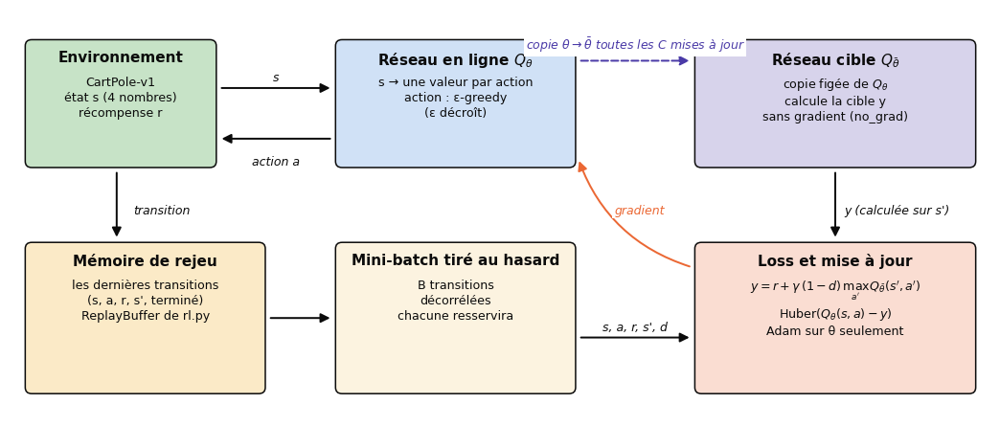
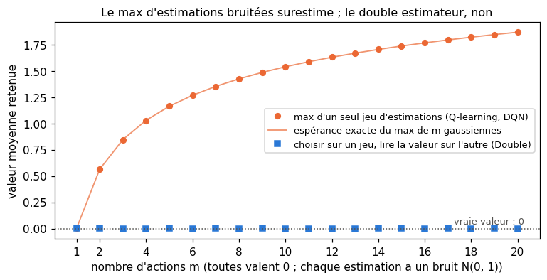
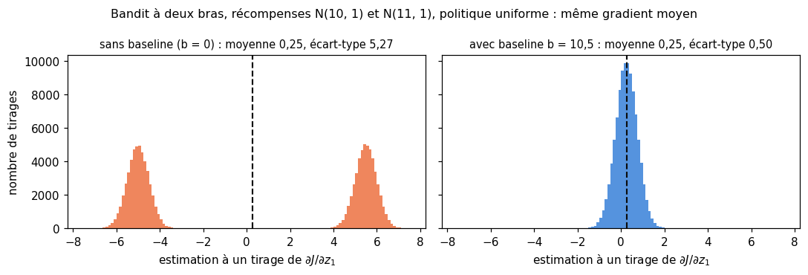
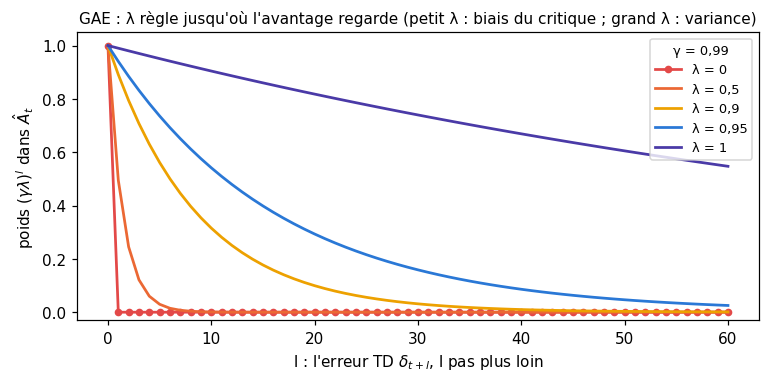
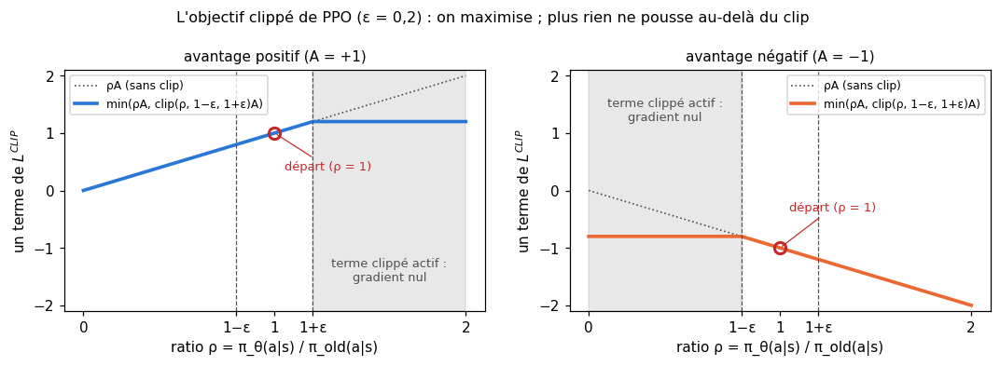
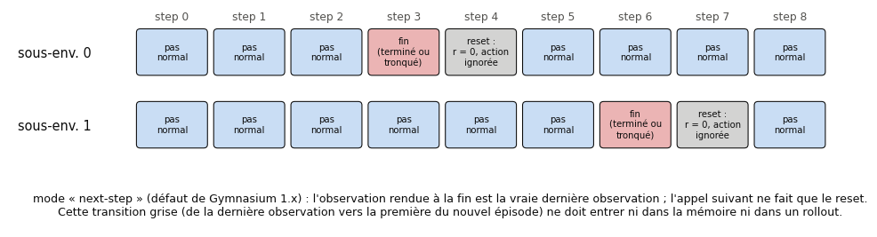
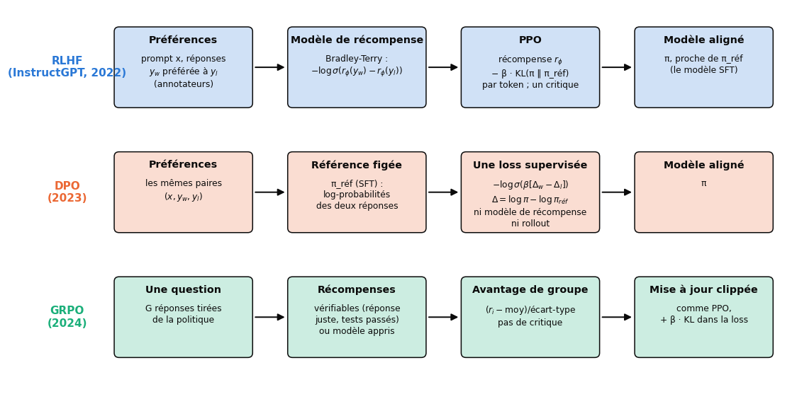

# B8 · RL moderne : DQN, gradient de politique, PPO et RLHF — fiche de cours

> Ce chapitre bonus n'a pas d'équivalent dans le livre de Glassner : **cette fiche est le cours**. Le ch. 26 s'arrêtait là où les tables deviennent trop grandes. Ici, un **réseau de neurones remplace la table** : tu construis un DQN sur CartPole, avec sa mémoire de rejeu et son réseau cible ; puis tu changes de famille et tu apprends **directement la politique**, avec REINFORCE, puis un acteur-critique avec GAE, puis **PPO**, l'algorithme par défaut du deep RL depuis 2017. Tu apprends à évaluer honnêtement un agent (graines, journaux, robustesse) et tu relies tout cela aux **modèles de langue** : un modèle de récompense appris sur des préférences, le RLHF, DPO et GRPO.

| | |
|---|---|
| **Livre** | — (chapitre propre au workbook) |
| **Sections** | 208.1 à 208.8 (numérotation interne du workbook : 208 = bonus B8) |
| **Temps total estimé** | ≈ 21 h : lecture de la fiche ≈ 1,8 h, exercices ≈ 18 h, 26 flashcards ≈ 0,9 h |
| **Prérequis** | 0B (espérance, variance, dérivée d'un logarithme) · ch. 2 (bootstrap et intervalle de confiance) · ch. 6 (cross-entropy, divergence KL) · ch. 9 (loss de Huber) · ch. 11 (bandit, ε-greedy, softmax d'actions) · ch. 17 (softmax, log-softmax, température) · ch. 18 (rétropropagation, autograd) · ch. 19 (Adam, gradient clipping) · ch. 20 (boucle d'entraînement PyTorch) · ch. 26 (Q-learning, retours actualisés, amorçage, `terminated` et `truncated`, `rl.py`) · B4 (modèles de langue, fine-tuning, modèles instruct) |
| **Fichiers du chapitre** | `02_exercices.md` (quiz, rappels, papier, réflexion, entretien) · `03_notebook.ipynb` · `04_indices.md` · `05_solutions.md` et `05_solutions.ipynb` · `06_mes_reponses.md` · `flashcards.csv` |
| **mylearn** | `deep_rl.py` (nouveau) : `compute_gae` et `explained_variance` (B8.18), `clipped_surrogate` (B8.19), `bradley_terry_loss` et `dpo_loss` (B8.25), en NumPy. `rl.py` du ch. 26 est réutilisé tel quel : `ReplayBuffer` (avec `obs_shape=(4,)` et `obs_dtype="float32"`), `returns_to_go` et `evaluate_policy`. Les agents eux-mêmes (DQN, REINFORCE, PPO) s'écrivent en PyTorch dans le notebook |

## Comment utiliser ce chapitre

La fiche pose les idées, les formules et les ordres de grandeur ; les exercices papier font les calculs à la main ; le notebook écrit les agents en PyTorch sur CartPole et les calculs délicats dans ta librairie, testés contre PyTorch et scikit-learn. Les codes de la fiche ont été exécutés le 5 novembre 2026 avec les versions du workbook (Python 3.13, PyTorch 2.11, NumPy 2.1, gymnasium 1.4.0) sur deux cœurs, avec **d'autres nombres** que les exercices : les tiens, tu les calcules toi-même. Aucun agent n'est entraîné dans la fiche : ses chiffres sont des mesures de l'environnement, des comptes de paramètres, des temps et des calculs.

**Ordre conseillé.**
1. Lis 208.1 et 208.2. Fais les quiz Q1 à Q4, le rappel R1 et les calculs ✏️ B8.1 et B8.2.
2. Lis 208.3. Fais les quiz Q5 et Q6, le rappel R3, le calcul ✏️ B8.3 et la dérivation ∂ B8.7.
3. Lis 208.4 et 208.5. Fais les quiz Q7 à Q9, le rappel R2, les calculs ✏️ B8.4 et B8.5, l'explication 🗣️ B8.9 et la lecture 📄 B8.11.
4. Lis 208.6 à 208.8. Fais les quiz Q10 à Q12, le calcul ✏️ B8.6, l'estimation 🧮 B8.8 et le cas ⚖️ B8.10. Vérifie tes réponses courtes dans la partie 0 du notebook.
5. Fais le notebook dans l'ordre des ID, en trois phases : **valeur** (B8.12 à B8.15 : CartPole, DQN, ablations), **politique** (B8.16 à B8.24 : REINFORCE, GAE, PPO, journaux, hyperparamètres, robustesse), **préférences** (B8.25 à B8.27 : losses de préférences, RLHF miniature, revue de code), puis le défi B8.28. Termine par les cinq questions d'entretien.

| Section | Quiz 🧠 et rappels 🔁 | Papier ✏️ ∂ 🧮 et réflexion | Notebook | Entretien 💼 |
|---|---|---|---|---|
| 208.1 Des tables aux réseaux | Q1, Q2 | | B8.12 | |
| 208.2 DQN | Q3, Q4, Q9, R1 | B8.1, B8.2 | B8.13, B8.14, B8.15 | E1 |
| 208.3 Gradient de politique | Q5, Q6, Q9, R3 | B8.3, B8.7 | B8.16, B8.17 | E1 |
| 208.4 Acteur-critique et GAE | Q7 | B8.4 | B8.18, B8.20 | |
| 208.5 PPO | Q8, Q9, R2 | B8.5, B8.9, B8.11 | B8.19, B8.20, B8.21, B8.22, B8.28 | E2 |
| 208.6 Pratique du deep RL | Q10 | B8.8 | B8.15, B8.21, B8.22, B8.27, B8.28 | E3, E5 |
| 208.7 RL et modèles de langage | Q11, Q12 | B8.6, B8.10 | B8.25, B8.26 | E4 |
| 208.8 Limites | Q12 | B8.8 | B8.23, B8.24 | |

## Objectifs d'apprentissage

À la fin de ce chapitre, tu sais :
1. **Expliquer** pourquoi et comment un réseau remplace la table Q, et ce qui rend DQN stable (mémoire de rejeu, réseau cible, loss de Huber, Double DQN).
2. **Dériver** le gradient de politique à partir de l'astuce de la log-dérivée, et **justifier** la baseline, l'avantage et GAE.
3. **Implémenter** en PyTorch un DQN, REINFORCE et PPO sur CartPole, et **écrire** dans ta librairie les calculs que les implémentations ratent le plus souvent (GAE avec fin d'épisode ou limite de temps, objectif clippé, losses de préférences).
4. **Diagnostiquer** un entraînement à partir de ses journaux (KL approchée, fraction clippée, entropie, variance expliquée) et **comparer** des variantes sur plusieurs graines.
5. **Expliquer** RLHF, DPO et GRPO, et **entraîner** un modèle de récompense sur des préférences.
6. **Discuter** les limites du RL : efficacité en échantillons, généralisation, passage de la simulation au réel, piratage de la récompense.

## L'essentiel en 10 lignes

1. Un état continu (les 4 nombres de CartPole) n'entre dans une table qu'au prix d'un découpage grossier : un **réseau** $Q_\theta(s, \cdot)$ rend une valeur par action et **généralise** d'un état aux états voisins.
2. Approximation, amorçage et apprentissage off-policy réunis forment la **triade mortelle** : l'apprentissage peut diverger. **DQN** le stabilise par une **mémoire de rejeu** (des transitions décorrélées, réutilisées) et un **réseau cible** figé qui calcule les cibles.
3. Le max d'estimations bruitées **surestime** ; **Double DQN** choisit l'action avec le réseau en ligne et la **note** avec le réseau cible.
4. Le **gradient de politique** ajuste directement $\pi_\theta(a \mid s)$ : $\nabla J = \mathbb{E}[\sum_t \nabla \log \pi_\theta(a_t \mid s_t)\,(G_t - b(s_t))]$ ; c'est l'**astuce de la log-dérivée**, et REINFORCE en est l'algorithme le plus simple.
5. Une **baseline** $b(s)$ ne change pas l'espérance du gradient mais peut en réduire beaucoup la **variance**, le vrai problème de ces méthodes.
6. Un **acteur-critique** apprend aussi $V(s)$ ; l'**avantage** $\hat A_t$ dit si l'action a fait mieux que prévu ; **GAE** le calcule comme une somme d'erreurs TD pondérées par $(\gamma\lambda)^l$ : $\lambda$ règle le compromis biais-variance.
7. **PPO** réutilise plusieurs fois le même rollout grâce au **ratio** $\rho_t = \pi_\theta / \pi_{\text{old}}$ et à un **objectif clippé** qui cesse de pousser une probabilité déjà assez déplacée ; un bonus d'**entropie** entretient l'exploration.
8. En pratique : environnements **vectorisés** (attention à l'autoreset et à `terminated` contre `truncated`), plusieurs **graines**, une évaluation à part de la politique **déterministe**, des journaux lus à chaque itération.
9. Pour un modèle de langue, le **RLHF** apprend un **modèle de récompense** sur des paires de préférences (Bradley-Terry), puis l'optimise par PPO avec une **pénalité KL** ; **DPO** obtient l'effet sans RL ; **GRPO** supprime le critique et sert les récompenses **vérifiables** des modèles qui raisonnent.
10. Le RL consomme énormément d'interactions, s'adapte mal à un monde qui change et optimise **la lettre** de la récompense : la simulation, la randomisation de domaine et la surveillance de mesures non récompensées sont ses garde-fous.

> 📐 **Conventions de la fiche** — On garde les notations du ch. 26 : $s$ l'état, $a$ l'action, $r$ la récompense, $s'$ l'état suivant, $t$ le pas, $\gamma$ le facteur d'actualisation, $G_t = r_t + \gamma r_{t+1} + \dots$ le retour, $\varepsilon$ le taux d'exploration d'ε-greedy (en 208.2). $\theta$ désigne les poids du réseau entraîné (réseau Q ou politique $\pi_\theta$), $\bar\theta$ ceux du réseau cible, $\phi$ ceux d'un modèle de récompense $r_\phi$. $d \in \{0, 1\}$ vaut 1 quand $s'$ termine **vraiment** l'épisode. $V(s)$ est la valeur d'un état, $\hat A_t$ l'estimation de l'avantage, $\lambda$ le paramètre de GAE, $\rho_t$ le ratio de probabilités de PPO, $\sigma$ la sigmoïde. L'angle du mât de CartPole s'écrit $\vartheta$, pour ne pas le confondre avec les poids $\theta$. **Trois lettres changent de sens selon la section** : $x$ est la position du chariot en 208.1, l'écart à la cible en 208.2 et le prompt en 208.7 ; en 208.2, $\delta$ est le **seuil** de la loss de Huber (le `delta` de PyTorch) ; à partir de 208.4, $\delta_t$ est l'**erreur TD**. En 208.5, $\varepsilon$ est la **largeur du clip** de PPO (0,2), sans rapport avec l'exploration. $\beta$ est la force de la contrainte KL (208.7). Un rollout compte $T$ pas dans chacun des $N$ environnements. **Écarts au §6** : $\eta$ n'apparaît pas (le learning rate est celui d'Adam), $n$ compte des paires de préférences ou des pas, pas des exemples d'un dataset.

---

## 208.1 · Des tables aux réseaux : approximation de fonction, états continus, instabilité ⏩

### CartPole, vu de près

Au ch. 26, tu as tenu CartPole avec une **table** : il avait fallu découper chacune des quatre variables en quelques intervalles (*discrétiser*), puis apprendre une case par combinaison. Rappelons l'environnement tel que le définit gymnasium 1.4.0 :

```python
import gymnasium as gym

env = gym.make("CartPole-v1")
print(env.observation_space)            # Box([-4.8 -inf -0.41887903 -inf], [4.8 inf 0.41887903 inf], (4,), float32)
print(env.action_space)                 # Discrete(2)
print(env.spec.max_episode_steps, env.spec.reward_threshold)   # 500 475.0
obs, info = env.reset(seed=123)
print(obs)                              # [ 0.01823519 -0.0446179  -0.02796401 -0.03156282]
```

- **L'état** : position du chariot $x$, sa vitesse $\dot x$, angle du mât $\vartheta$ (en radians), vitesse angulaire $\dot\vartheta$. Au départ, les quatre sont tirés uniformément dans $[-0{,}05 ;\ 0{,}05]$.
- **Les actions** : 0 pousse le chariot vers la gauche, 1 vers la droite, avec une force fixe de 10 N ; la physique avance de 0,02 s par pas.
- **La récompense** : +1 à **chaque** pas, y compris celui où le mât tombe. Le retour d'un épisode est donc sa durée.
- **La fin** : `terminated` dès que $|x| > 2{,}4$ ou $|\vartheta| > 12°$ ($0{,}2094$ rad) ; `truncated` quand l'épisode atteint 500 pas (l'enveloppe `TimeLimit` que `gym.make` ajoute). Les bornes de l'espace d'observation (4,8 et 0,4189 rad) valent **le double** des seuils de chute, pour que la dernière observation reste dans l'espace.
- **Résolu** : un retour moyen d'au moins 475 sur 100 épisodes consécutifs (`env.spec.reward_threshold`).

> ⚠️ **Piège classique — le seuil de CartPole-v1** — La page de documentation de gymnasium 1.4.0 annonce un seuil de récompense de 500 pour v1 ; l'enregistrement de l'environnement, que lit `env.spec.reward_threshold`, dit 475,0, et c'est ce seuil que tout le monde utilise. Quand une documentation et le code divergent, c'est le code de ta version qui fait foi : lis `env.spec`. (L'option `gym.make("CartPole-v1", sutton_barto_reward=True)`, ajoutée en 1.0, donne 0 par pas et −1 à la chute ; le seuil n'a alors plus de sens.)

Deux repères chiffrés, mesurés pour cette fiche. Une politique **aléatoire** (`env.action_space.sample()`) tient en moyenne 22,3 pas sur 10 000 épisodes (graines 10 000 à 19 999), avec une médiane de 19, un minimum de 8 et un maximum de 119 ; la moyenne de 100 épisodes varie de 19,5 à 24,8 d'un paquet de graines à l'autre (ch. 2 : l'erreur type d'une moyenne de 100 valeurs d'écart-type 11,8 vaut environ 1,2). À l'opposé, une règle d'une ligne, « pousse du côté où le mât penche, en anticipant par sa vitesse angulaire » (`action = int(theta + 0.5 * theta_dot > 0)`), tient 500 pas sur 100 épisodes sur 100. Avec l'angle seul, elle ne tient que 42 pas en moyenne ; avec la vitesse angulaire seule, 202. CartPole n'est donc pas difficile en soi : la difficulté du RL est de **découvrir** une telle règle sans la connaître, en ne voyant que des +1 et une fin d'épisode.

### Pourquoi la table ne suffit plus

Une table a trois défauts, que CartPole rend visibles :
- **Elle ne généralise pas.** Deux états presque identiques, de part et d'autre d'une limite d'intervalle, ont deux cases indépendantes ; ce qu'apprend l'une ne profite pas à l'autre.
- **Elle explose avec la dimension.** Dix intervalles par variable font $10^4$ cases pour CartPole, mais $10^{100}$ pour cent variables ; et les pixels d'un écran Atari en ont des dizaines de milliers.
- **Le découpage est un hyperparamètre de plus**, fin là où il faut agir vite (l'angle), grossier ailleurs, et choisi à la main.

L'**approximation de fonction** (*function approximation*) remplace la table par une fonction paramétrée qu'on ajuste : un réseau $Q_\theta$ qui reçoit l'état (les 4 nombres) et rend **un vecteur de valeurs, une par action** (comme le corrigeait déjà le ch. 26 : le réseau ne rend pas « un coup et sa valeur »). Choisir l'action gloutonne coûte alors une passe avant et un `argmax`. Le réseau généralise : la même règle de calcul sert à tous les états, et deux états voisins reçoivent des valeurs voisines.

### Apprendre une valeur par régression

La mise à jour du Q-learning devient une **régression** : pour une transition $(s, a, r, s')$, on calcule la cible

$$y = r + \gamma\,(1 - d)\max_{a'} Q(s', a'),$$

puis on fait un pas de descente de gradient sur une loss qui rapproche $Q_\theta(s, a)$ de $y$ (le carré de l'écart, ou la loss de Huber de 208.2). Une subtilité change tout : la cible dépend elle-même des poids. On la traite comme une **constante** pendant le calcul du gradient (dans PyTorch, sous `torch.no_grad()`, ou avec `.detach()`). Dériver aussi à travers la cible donnerait une autre méthode, qui apprend mal ; la version standard s'appelle une méthode de **semi-gradient**.

### Instabilité : la triade mortelle

Avec une table, le Q-learning converge sous des conditions connues (ch. 26). Avec un réseau, plus rien n'est garanti. Sutton et Barto (2018, §11.3) nomment **triade mortelle** (*deadly triad*) la réunion de trois ingrédients qui, ensemble, peuvent faire diverger les valeurs :
1. l'**approximation de fonction** : modifier les poids pour un état modifie aussi les valeurs des autres ;
2. l'**amorçage** (*bootstrapping*, ch. 26) : la cible contient une estimation, qui bouge avec les poids ;
3. l'**apprentissage off-policy** : les transitions viennent d'une autre politique que celle dont on apprend la valeur (ε-greedy, ou d'anciennes politiques gardées en mémoire).

Avec deux ingrédients sur trois, on sait éviter l'instabilité ; avec les trois, elle peut survenir même sur des problèmes minuscules. On ne renonce pas à l'approximation (c'est tout l'intérêt) ; DQN garde les trois, et ajoute des **stabilisateurs**. Deux autres sources d'instabilité s'y ajoutent : des transitions qui se suivent sont très **corrélées** (des mini-batches de pas consécutifs ressemblent à un dataset sans mélange), et la **cible bouge** à chaque mise à jour, comme si l'on poursuivait sa propre ombre.

## 208.2 · DQN : réseau Q, mémoire de rejeu, réseau cible, loss de Huber, Double DQN ⏩

### Les deux stabilisateurs

Le **DQN** (*deep Q-network*) de DeepMind (V. Mnih et coll., [2013](https://arxiv.org/abs/1312.5602) sur sept jeux Atari, puis 2015 dans *Nature*) est un Q-learning dont la table est un réseau, avec deux ajouts qui le rendent stable (📄 26.12 te les a fait lire) :

- La **mémoire de rejeu** (*replay buffer*, ch. 26) garde les $N$ dernières transitions $(s, a, r, s', d)$ ; chaque mise à jour tire au hasard un **mini-batch** de $B$ transitions. Les transitions d'un mini-batch ne se suivent plus (la corrélation disparaît), et chacune sert plusieurs fois (l'apprentissage économise des interactions). Ta classe `ReplayBuffer` de `rl.py` (🔨 26.31) sert telle quelle : `ReplayBuffer(capacity=10_000, obs_shape=(4,), obs_dtype="float32")`. Elle ne stocke que `terminated`, pas `truncated` : c'est voulu (ci-dessous).
- Le **réseau cible** (*target network*) $Q_{\bar\theta}$ est une copie figée du réseau en ligne $Q_\theta$, qui calcule les cibles :
$$y = r + \gamma\,(1 - d)\max_{a'} Q_{\bar\theta}(s', a').$$
On recopie $\bar\theta \leftarrow \theta$ toutes les $C$ mises à jour (10 000 dans l'article de 2015) ; entre deux copies, la cible ne bouge plus quand $\theta$ change. Une variante recopie un peu à chaque pas, $\bar\theta \leftarrow \tau\theta + (1 - \tau)\bar\theta$ avec un petit $\tau$ (mise à jour « douce », de Polyak) ; `tau = 1.0` redonne la copie complète.



L'algorithme, pour un pas d'environnement :
1. dans l'état $s$, choisir $a$ par ε-greedy sur $Q_\theta(s, \cdot)$, avec un $\varepsilon$ qui **décroît** (par exemple linéairement de 1 à 0,05) ;
2. jouer $a$, recevoir $r$, $s'$, `terminated`, `truncated` ; ranger $(s, a, r, s', \text{terminated})$ dans la mémoire ;
3. si la mémoire contient assez de transitions (`learning_starts`) et que c'est le moment (`train_freq`), tirer un mini-batch, calculer les cibles avec $Q_{\bar\theta}$ **sans gradient**, et faire un pas d'Adam sur la loss de Huber entre $Q_\theta(s, a)$ et $y$ ;
4. toutes les $C$ mises à jour, recopier les poids dans le réseau cible ;
5. si l'épisode est fini (terminé **ou** tronqué), `reset`.

En PyTorch, le cœur tient en quelques lignes. Ici, un mini-batch d'une transition, avec 3 actions pour mieux voir :

```python
import torch

def dqn_targets(q_next_target, rewards, terminated, gamma):
    """y = r + gamma (1 - d) max_a' Q_target(s', a'); no gradient flows into the target."""
    with torch.no_grad():
        return rewards + gamma * (1.0 - terminated.float()) * q_next_target.max(dim=1).values

q_next_target = torch.tensor([[2.0, 3.5, 1.2]])        # Q_target(s', .)
print(dqn_targets(q_next_target, torch.tensor([1.0]), torch.tensor([False]), 0.9))   # tensor([4.1500])

# the prediction for the action actually played: one value per row
q_online = torch.tensor([[0.4, 3.9], [1.1, 2.0]], requires_grad=True)
actions = torch.tensor([1, 0])
print(q_online.gather(1, actions[:, None]).squeeze(1))                 # tensor([3.9000, 1.1000], ...)
```

`gather` choisit, ligne par ligne, la valeur de l'action **jouée** : la loss ne porte que sur elle, les autres sorties ne reçoivent aucun gradient. Si $s'$ est terminal, `terminated` vaut `True` et la cible se réduit à $r$.

> ⚠️ **Piège classique — la limite de temps n'est pas une fin** — CartPole coupe l'épisode à 500 pas : `truncated` vaut `True`, `terminated` vaut `False`. Le mât n'est pas tombé, l'état avait encore un avenir : la cible doit **garder** son amorçage. Ranger `done = terminated or truncated` dans la mémoire apprend au réseau que les états des longs épisodes, justement les meilleurs, ne valent rien au-delà de $r$. C'est l'erreur du 🐛 26.24 sur une table ; avec un réseau, elle se propage en plus aux états voisins. On range `terminated` seul ; `truncated` ne sert qu'à décider du `reset`.

> 🧮 **Rappel maths — la loss de Huber** — Tu l'as vue au ch. 9 comme une régression robuste. Pour un écart $x = Q_\theta(s, a) - y$ et un seuil $\delta > 0$ :
> $$\ell_\delta(x) = \begin{cases} \tfrac{1}{2}x^2 & \text{si } |x| \le \delta,\\ \delta\left(|x| - \tfrac{\delta}{2}\right) & \text{sinon,}\end{cases} \qquad \ell'_\delta(x) = \begin{cases} x & \text{si } |x| \le \delta,\\ \delta\,\operatorname{signe}(x) & \text{sinon.}\end{cases}$$
> Quadratique près de 0, linéaire au-delà : le **gradient est borné** par $\delta$. En RL, les cibles amorcées sont bruitées et parfois très fausses au début ; avec l'erreur quadratique, une seule cible aberrante donne un pas énorme. C'est ce que faisait l'article de 2015 en « écrêtant l'erreur entre −1 et 1 » : la loss de Huber avec $\delta = 1$. **Attention aux deux fonctions de PyTorch** : `F.huber_loss(pred, y, delta=δ)` calcule $\ell_\delta$ ; `F.smooth_l1_loss(pred, y, beta=β)` calcule $\ell_\beta / \beta$. Elles coïncident pour $\delta = \beta = 1$, pas ailleurs : pour $x = 3$ et un seuil de 2, la première vaut 4,0 (gradient 2), la seconde 2,0 (gradient 1) ; pour $x = 0{,}5$, 0,125 contre 0,0625. Stable-Baselines3 utilise `smooth_l1_loss` (donc $\delta = 1$) ; `dqn.py` de CleanRL, l'erreur quadratique.

### ε décroissant et hyperparamètres

Au début, le réseau ne sait rien : on explore presque tout le temps ($\varepsilon \approx 1$), puis de moins en moins. Le **planning** d'$\varepsilon$ se règle en pas d'environnement : DQN 2015 décroissait de 1 à 0,1 sur le premier million d'images, puis restait à 0,1 ; `dqn.py` de CleanRL décroît de 1 à 0,05 sur la première moitié de l'entraînement ; Stable-Baselines3, sur les premiers 10 %. La décroissance a deux rôles : beaucoup d'essais variés quand le réseau ne sait encore rien, puis des épisodes joués presque comme la politique gloutonne, qui visitent les états où cette politique a besoin d'être précise.

| Réglage | DQN 2015 (Atari) | `dqn.py` de CleanRL (CartPole) | `DQN` de Stable-Baselines3 (défauts) |
|---|---|---|---|
| Capacité de la mémoire | 1 000 000 | 10 000 | 1 000 000 |
| Mini-batch | 32 | 128 | 32 |
| Copie du réseau cible | toutes les 10 000 mises à jour | tous les 500 pas | tous les 10 000 pas |
| Une mise à jour tous les | 4 pas | 10 pas | 4 pas |
| Pas avant la 1ʳᵉ mise à jour | 50 000 | 10 000 | 100 |
| Loss | erreur écrêtée (Huber, $\delta = 1$) | quadratique | Huber (`smooth_l1_loss`) |
| Optimiseur | RMSprop | Adam, $2{,}5 \times 10^{-4}$ | Adam, $10^{-4}$, norme du gradient ≤ 10 |

Ces nombres montrent surtout qu'**il n'y a pas de réglage universel** : une mémoire d'un million de transitions convient à Atari (50 millions d'images d'entraînement) ; pour CartPole, quelques milliers à quelques dizaines de milliers suffisent, et une mémoire minuscule redevient une suite de transitions corrélées, presque sans rejeu. Le réseau de `dqn.py` (4 → 120 → 84 → 2, ReLU) compte **10 934** paramètres ; celui que le RL Zoo de Stable-Baselines3 règle pour CartPole (deux couches de 256), **67 586**. En float32, une mémoire d'un million de transitions de CartPole occupe environ 32 Mo pour les seuls états $s$ et $s'$.

### La surestimation, et Double DQN

Le max d'estimations **bruitées** est biaisé vers le haut : c'est la **surestimation** (*overestimation bias*), même quand chaque estimation est juste en moyenne. Imagine $m$ actions qui valent toutes 0, estimées chacune avec un bruit gaussien d'écart-type 1 : le max des estimations vaut en moyenne 0,56 pour 2 actions, 1,03 pour 4, 1,54 pour 10 (l'espérance du maximum de $m$ gaussiennes). Le Q-learning prend ce max **dans la cible**, et l'amorçage le propage d'état en état : les valeurs gonflent. H. van Hasselt avait proposé en 2010 le double Q-learning, pour les tables ; avec A. Guez et D. Silver (2016), il a montré que DQN surestime ainsi fortement sur plusieurs jeux Atari, et que la surestimation y nuit à la politique.



Le remède du **double estimateur** : choisir l'action avec un jeu d'estimations et lire sa valeur avec un **autre**, au bruit indépendant. Le bruit qui a fait gagner une action n'est alors plus celui qu'on lit. **Double DQN** dispose déjà de deux réseaux : le réseau en ligne **choisit**, le réseau cible **note** :

$$y^{\text{Double}} = r + \gamma\,(1 - d)\,Q_{\bar\theta}\!\left(s', \arg\max_{a'} Q_\theta(s', a')\right).$$

Un exemple avec nos nombres : $r = 1$, $\gamma = 0{,}9$, $Q_{\bar\theta}(s', \cdot) = (2{,}0 ;\ 3{,}5 ;\ 1{,}2)$, $Q_\theta(s', \cdot) = (4{,}1 ;\ 3{,}0 ;\ 0{,}5)$. DQN prend le max du réseau cible : $y = 1 + 0{,}9 \times 3{,}5 = 4{,}15$. Double DQN prend l'action préférée du réseau en ligne (la première), et lit sa valeur dans le réseau cible : $y = 1 + 0{,}9 \times 2{,}0 = 2{,}8$. Les deux réseaux ne s'accordent pas sur la meilleure action ; ici, la cible de Double DQN est plus basse. Le changement coûte une ligne et aucun paramètre ; 🔬 B8.15 le compare à DQN sur trois graines.

> 🕰️ **Mise à jour (2026) — la famille DQN** — **Le livre :** il évoque le DQN en quelques lignes, à la fin du ch. 26 (p. 1549), sans ses stabilisateurs ni ses variantes. · **Aujourd'hui :** DQN a reçu de nombreuses améliorations, que **Rainbow** (M. Hessel et coll., 2018) combine : Double DQN, rejeu prioritaire, architecture *dueling* (une tête pour $V(s)$, une pour l'avantage de chaque action), retours sur plusieurs pas, valeurs distributionnelles (C51) et réseaux bruités pour explorer. Sur des actions discrètes et des données coûteuses, cette famille off-policy reste un bon choix, car elle réutilise chaque transition de nombreuses fois. · **Faut-il quand même l'apprendre ?** Oui : DQN est la porte d'entrée du deep RL, et ses deux stabilisateurs reviennent partout (le réseau cible dans SAC, le rejeu dans tous les algorithmes off-policy). · *Sources :* V. Mnih et coll., « [Human-level control through deep reinforcement learning](https://doi.org/10.1038/nature14236) », *Nature* 518, 2015 ; H. van Hasselt, A. Guez et D. Silver, « [Deep Reinforcement Learning with Double Q-learning](https://arxiv.org/abs/1509.06461) », AAAI 2016 ; M. Hessel et coll., « [Rainbow](https://arxiv.org/abs/1710.02298) », AAAI 2018.

Le DQN de 2015 a appris 49 jeux Atari avec la **même** architecture et les mêmes réglages, à partir des pixels et du score, et dépassé 75 % du score d'un testeur professionnel sur 29 d'entre eux. Chaque jeu a demandé 50 millions d'images (environ 38 jours de jeu à vitesse réelle) : une première mesure de ce que coûte le RL en interactions (208.8).

## 208.3 · Gradient de politique : politique paramétrée, REINFORCE, baseline, variance ⏩

### Apprendre la politique elle-même

Les méthodes **par valeur** (Q-learning, DQN) apprennent $Q$ et en déduisent la politique par un `argmax`. Les méthodes **par gradient de politique** (*policy gradient*, ch. 26) apprennent directement une **politique paramétrée** (*parameterized policy*) $\pi_\theta(a \mid s)$ : un réseau qui reçoit l'état et rend une **loi de probabilité** sur les actions. Pour des actions discrètes, le réseau rend des logits $\mathbf{z}$, et

$$\pi_\theta(\cdot \mid s) = \operatorname{softmax}(\mathbf{z}_\theta(s)).$$

On **tire** l'action dans cette loi (`torch.distributions.Categorical(logits=z).sample()`) : l'exploration est intégrée à la politique, sans ε. Trois raisons de préférer cette famille :
- les **actions continues** : un robot règle un couple moteur, un nombre réel ; un `argmax` sur une infinité d'actions n'a pas de sens, alors qu'une politique peut rendre la moyenne et l'écart-type d'une gaussienne dans laquelle on tire l'action ;
- les **politiques aléatoires** : au pierre-feuille-ciseaux, la meilleure politique joue au hasard, un tiers chacun ; une politique gloutonne ne peut pas l'exprimer, une politique softmax si ;
- des **changements progressifs** : un petit pas sur $\theta$ change un peu les probabilités, alors qu'un petit changement d'une valeur Q peut faire basculer l'`argmax` d'une action à l'autre.

L'objectif est le retour espéré quand on suit la politique : $J(\theta) = \mathbb{E}_{\pi_\theta}[G_0]$. On le **maximise** par montée de gradient. La difficulté : $\theta$ change la **loi** des épisodes (quelles actions sont tirées, donc quels états visités), et l'on ne sait pas dériver l'environnement.

> 🧮 **Rappel maths — l'astuce de la log-dérivée** — L'**astuce de la log-dérivée** (*log-derivative trick*) tient en une identité. Soit $p_\theta(x)$ une loi qui dépend d'un paramètre, et $f(x)$ une fonction qui n'en dépend pas. Alors
> $$\nabla_\theta\, \mathbb{E}_{x \sim p_\theta}[f(x)] = \mathbb{E}_{x \sim p_\theta}\big[f(x)\,\nabla_\theta \log p_\theta(x)\big].$$
> Pour une loi discrète, c'est une ligne : $\nabla \sum_x p_\theta(x) f(x) = \sum_x f(x) \nabla p_\theta(x)$, et $\nabla p = p\,\nabla \log p$ (la dérivée du logarithme, 0B : $(\ln u)' = u'/u$). L'intérêt est énorme : le membre de droite est une **espérance**, qu'on estime en tirant des $x$ et en faisant la moyenne de $f(x)\,\nabla \log p_\theta(x)$, **sans jamais dériver $f$** (ici, l'environnement et sa récompense). Exemple : une pièce truquée avec $p_\theta(\text{pile}) = \theta$, et un gain $f = 1$ pour pile, 0 pour face. $\mathbb{E}[f] = \theta$, de dérivée 1 ; l'astuce donne $\theta \times 1 \times \frac{1}{\theta} + (1 - \theta) \times 0 \times \frac{-1}{1-\theta} = 1$. Les statisticiens appellent $\nabla \log p_\theta(x)$ la **fonction score** (*score function*) ; son espérance est nulle, ce qui servira pour la baseline. ∂ B8.7 refait le raisonnement pour une politique.

### Le théorème du gradient de politique

Appliquée aux épisodes, l'astuce donne le **théorème du gradient de politique** (sous la forme qu'on implémente) :

$$\nabla_\theta J(\theta) = \mathbb{E}_{\pi_\theta}\left[\sum_t \nabla_\theta \log \pi_\theta(a_t \mid s_t)\,\big(G_t - b(s_t)\big)\right].$$

Lis-le comme une règle de vote : chaque action jouée pousse sa propre probabilité vers le haut, **proportionnellement** à ce qu'elle a rapporté ensuite ($G_t$, le retour **à partir** du pas $t$ : une action ne peut pas être créditée des récompenses reçues avant elle) moins une référence $b(s_t)$. La probabilité de l'environnement (les transitions) a disparu de la formule : seul $\log \pi_\theta$ se dérive.

Pour une politique softmax, la dérivée du log se calcule à la main :

$$\nabla_{\mathbf{z}} \log \operatorname{softmax}(\mathbf{z})_a = \mathbf{e}_a - \operatorname{softmax}(\mathbf{z}),$$

où $\mathbf{e}_a$ vaut 1 en position $a$ et 0 ailleurs (c'est l'opposé du gradient de la cross-entropy par rapport aux logits, ch. 18). Avec deux actions et les logits $(0{,}3 ;\ -0{,}2)$, la politique vaut $(0{,}6225 ;\ 0{,}3775)$ ; si l'action 1 a été jouée, le gradient de son log vaut $(-0{,}6225 ;\ 0{,}6225)$ : monter le logit de l'action jouée, baisser l'autre. L'autograd le confirme :

```python
z = torch.tensor([0.3, -0.2], requires_grad=True)
torch.log_softmax(z, dim=0)[1].backward()
print(torch.softmax(z, dim=0).detach(), z.grad)   # tensor([0.6225, 0.3775]) tensor([-0.6225,  0.6225])
```

### REINFORCE

L'algorithme le plus simple qui suit ce gradient s'appelle **REINFORCE** (R. J. Williams, « [Simple statistical gradient-following algorithms for connectionist reinforcement learning](https://doi.org/10.1007/BF00992696) », *Machine Learning* 8, 1992) :
1. jouer un épisode entier avec $\pi_\theta$, en gardant les $\log \pi_\theta(a_t \mid s_t)$ ;
2. calculer les retours $G_t$ de chaque pas (ta fonction `returns_to_go` de `rl.py`) ;
3. faire un pas de gradient sur la loss $L(\theta) = -\frac{1}{T}\sum_t \log \pi_\theta(a_t \mid s_t)\,(G_t - b)$, dont le gradient est l'opposé de l'estimation ci-dessus (on **minimise** $L$, donc on monte $J$).

```python
from mylearn.rl import returns_to_go

# one finished episode: log_probs is a list of 0-D tensors kept during the rollout
returns = torch.as_tensor(returns_to_go(rewards, gamma=0.99), dtype=torch.float32)
loss = -(torch.stack(log_probs) * (returns - baseline)).mean()
optimizer.zero_grad(); loss.backward(); optimizer.step()
```

Le nom est l'acronyme de la règle de Williams : *REward Increment = Nonnegative Factor × Offset Reinforcement × Characteristic Eligibility*, soit un learning rate × (récompense moins une référence) × le gradient du log. C'est une méthode de **Monte-Carlo** : aucune cible amorcée, des retours réellement observés, donc **sans biais**. Mais elle est **on-policy** : le gradient vaut pour la politique qui a joué l'épisode ; après le pas, ces épisodes ne servent plus.

### La baseline et la variance

Une estimation sans biais n'est pas forcément utile : si elle est très **dispersée**, chaque pas part dans une direction presque aléatoire, et il faut des milliers d'épisodes pour que la moyenne se dégage. C'est le vrai problème des gradients de politique.

La **baseline** $b(s)$ (ici, une valeur de référence soustraite au retour, autre sens que la baseline « à battre » du ch. 13) ne change pas l'espérance du gradient : comme l'espérance de la fonction score est nulle, soustraire une quantité qui ne dépend pas de l'action retire un terme d'espérance nulle (∂ B8.7 le démontre). Mais elle peut en changer beaucoup la **variance**. Sur CartPole, tous les retours sont positifs : sans baseline, **toutes** les actions jouées sont renforcées, les bonnes un peu plus que les mauvaises ; avec une baseline proche du retour moyen, les actions qui ont fait mieux que d'habitude montent, les autres descendent.

Un jouet le montre. Un bandit à deux bras (ch. 11) donne une récompense gaussienne de moyenne 10 ou 11 (écart-type 1) ; la politique softmax part de logits nuls, donc d'un tirage à pile ou face. Le vrai gradient de $J$ par rapport au logit du bras 1 vaut 0,25. Une estimation à un seul tirage vaut, sans baseline, environ ±5 : sa moyenne est bien 0,25, mais son écart-type vaut 5,27. Avec la baseline $b = 10{,}5$, la récompense moyenne, la moyenne reste 0,25 et l'écart-type tombe à 0,50.



En pratique, la baseline est soit une **moyenne** des retours récents (le plus simple), soit un **réseau de valeur** $V_w(s)$ appris en même temps (208.4). Une autre astuce répandue **normalise** les retours de chaque épisode ou de chaque batch (moins leur moyenne, divisés par leur écart-type) : elle centre comme une baseline et fixe en plus l'échelle des pas. Ces trois variantes ne font pas la même chose à l'apprentissage de CartPole, où d'autres effets entrent en jeu (l'échelle des pas, la durée variable des épisodes) : 🔮 B8.16 te fait prédire laquelle apprend le plus vite, et 📦 B8.17 le mesure, avec la variance du gradient.

Une dernière pièce, que PPO reprendra : le **bonus d'entropie** (*entropy bonus*). L'entropie de la politique (ch. 6) mesure son hasard : $\ln 2 \approx 0{,}693$ pour deux actions équiprobables, 0,325 pour $(0{,}9 ;\ 0{,}1)$, 0,056 pour $(0{,}99 ;\ 0{,}01)$. Ajouter $-c\,H(\pi_\theta(\cdot \mid s))$ à la loss (avec un petit $c$, 0,01 typiquement) retient la politique de devenir déterministe trop tôt, avant d'avoir trouvé les bonnes actions.

> 🔗 **Lien avec le ch. 11** — La politique softmax du bandit et sa température sont celles d'ici ; mais au ch. 11, l'agent estimait la valeur de chaque bras et en **déduisait** une politique. Ici, on ajuste directement les logits. Les algorithmes « gradient bandit » de Sutton et Barto (§2.8), qui montent les préférences d'un bras avec une baseline égale à la récompense moyenne, sont exactement REINFORCE sur un seul état.

## 208.4 · Acteur-critique : fonction de valeur, erreur TD, avantage, GAE ⏩

### Un critique pour juger l'acteur

REINFORCE attend la fin de l'épisode et juge chaque action sur un retour très bruité. Une méthode **acteur-critique** (*actor-critic*) entraîne deux fonctions :
- l'**acteur**, la politique $\pi_\theta(a \mid s)$, qui choisit ;
- le **critique**, une **fonction de valeur** (*value function*) $V_w(s)$, qui estime le retour espéré depuis $s$ en suivant la politique actuelle. Il s'entraîne par régression, comme le réseau Q de 208.2, sur des cibles qu'on décrit plus bas.

Le critique sert de baseline dépendant de l'état, et surtout à **raccourcir** l'attente. L'**avantage** (*advantage*) d'une action,

$$A(s, a) = Q(s, a) - V(s),$$

dit de combien elle fait mieux (ou moins bien) que la moyenne des actions de la politique dans cet état. Dans le gradient de politique, on remplace $G_t - b(s_t)$ par une estimation $\hat A_t$ : les actions meilleures que prévu montent, les autres descendent.

### L'erreur TD, première estimation de l'avantage

L'**erreur TD** du ch. 26, écrite avec le critique,

$$\delta_t = r_t + \gamma\,V(s_{t+1}) - V(s_t),$$

compare ce qui s'est passé en un pas ($r_t$, puis la valeur de l'état atteint) à ce que le critique prévoyait. Si le critique était parfait, son espérance vaudrait exactement l'avantage de $a_t$. C'est une estimation de **faible variance** (un seul pas de hasard) mais **biaisée** dès que le critique se trompe. À l'autre extrême, $G_t - V(s_t)$ ne dépend du critique que par la baseline, qui ne biaise pas ; mais il porte le hasard de tout le reste de l'épisode : **forte variance**. Entre les deux, les estimations sur $k$ pas, $r_t + \gamma r_{t+1} + \dots + \gamma^k V(s_{t+k}) - V(s_t)$.

### GAE : une moyenne de toutes les longueurs

L'estimation **GAE** (*generalized advantage estimation*, J. Schulman et coll., 2015, publiée à ICLR 2016) prend une moyenne pondérée de toutes ces estimations, qui se simplifie en une somme d'erreurs TD :

$$\hat A_t = \sum_{l \ge 0} (\gamma\lambda)^l\,\delta_{t+l} = \delta_t + \gamma\lambda\,\hat A_{t+1}.$$

- $\lambda = 0$ : $\hat A_t = \delta_t$, l'erreur TD d'un pas (faible variance, biais du critique) ;
- $\lambda = 1$ : la somme télescopique redonne $G_t - V(s_t)$ (sans biais du critique, forte variance) ;
- entre les deux, $\lambda = 0{,}95$ est le réglage le plus courant, avec $\gamma = 0{,}99$.

La forme récursive (à droite) se calcule **à rebours**, du dernier pas au premier d'un **rollout** (la suite des $T$ pas que la politique vient de jouer, dans chacun des $N$ environnements, sans mise à jour entre-temps), en une boucle : c'est ainsi que l'écrivent toutes les implémentations, et ta `compute_gae` (🔨 B8.18).



Un exemple à la main, sur un épisode de trois pas qui se termine vraiment au troisième (le mât tombe), avec $\gamma = 0{,}9$ et $\lambda = 0{,}8$. Les récompenses valent 1, le critique prévoit $V(s_0) = 2{,}0$, $V(s_1) = 1{,}5$, $V(s_2) = 0{,}8$ :

| Pas $t$ | $r_t$ | $V(s_t)$ | $V(s_{t+1})$ utilisé | $\delta_t$ | $\hat A_t$ (à rebours) | cible du critique $\hat A_t + V(s_t)$ |
|---|---|---|---|---|---|---|
| 2 (terminé) | 1 | 0,8 | 0 (aucun avenir) | $1 - 0{,}8 = 0{,}2$ | $0{,}2$ | $1{,}0$ |
| 1 | 1 | 1,5 | 0,8 | $1 + 0{,}72 - 1{,}5 = 0{,}22$ | $0{,}22 + 0{,}72 \times 0{,}2 = 0{,}364$ | $1{,}864$ |
| 0 | 1 | 2,0 | 1,5 | $1 + 1{,}35 - 2 = 0{,}35$ | $0{,}35 + 0{,}72 \times 0{,}364 = 0{,}61208$ | $2{,}61208$ |

($\gamma\lambda = 0{,}72$.) Avec $\lambda = 1$ et un critique nul, les cibles seraient exactement les retours actualisés $(2{,}71 ;\ 1{,}9 ;\ 1)$ de `returns_to_go` ; c'est l'une des propriétés que vérifient les tests de `compute_gae`.

### Fin d'épisode ou limite de temps

Dans la récursion, deux drapeaux jouent deux rôles **différents**, et c'est là que les implémentations se trompent le plus :
- `terminated` (le mât est tombé) : l'état suivant n'a pas d'avenir, on n'amorce **pas** : $\delta_t = r_t - V(s_t)$ ;
- `truncated` (500 pas atteints) : l'état suivant avait un avenir, on **amorce** sur la valeur de la **vraie dernière observation**, mais la récursion s'arrête quand même, car le pas suivant du rollout appartient à un nouvel épisode.

Le contrat de `compute_gae` l'écrit ainsi : $\delta_t = r_t + \gamma\,(1 - \text{terminated}_t)\,V(s_{t+1}) - V(s_t)$ et $\hat A_t = \delta_t + \gamma\lambda\,(1 - \text{done}_t)\,\hat A_{t+1}$, avec $\text{done}_t$ = terminé **ou** tronqué. D'où l'argument `next_values` : la valeur de l'observation qui **suit** chaque pas, que ce pas soit le dernier d'un épisode tronqué ou non. Dans l'exemple, si l'épisode avait été coupé au pas 2 au lieu de se terminer, avec un critique qui estime à 0,7 la dernière observation, $\delta_2$ deviendrait $1 + 0{,}9 \times 0{,}7 - 0{,}8 = 0{,}83$ au lieu de 0,2, et tous les avantages remonteraient.

> ⚠️ **Piège classique — la troncature dans les implémentations de référence** — Le PPO officiel d'OpenAI (`ppo2`), et `ppo.py` de CleanRL qui le reproduit, traitent `terminated` et `truncated` de la même façon : pas d'amorçage à la limite de temps. Les auteurs des « 37 détails » le disent eux-mêmes : on « devrait intuitivement » amorcer, mais ils ont gardé la version d'origine pour la reproduire fidèlement. L'erreur coûte peu tant que les épisodes tronqués sont rares ; sur CartPole, où un bon agent est **toujours** tronqué à 500 pas, elle touche justement les meilleurs épisodes. Ta librairie suit la version correcte ; 🛠️ B8.27 te fera relever cet écart parmi d'autres.

### Le critique et sa variance expliquée

Le critique apprend par régression sur les **retours** $\hat A_t + V(s_t)$ (la colonne de droite du tableau : c'est le retour TD($\lambda$), la deuxième sortie de `compute_gae`). Comment savoir s'il apprend ? Sa loss baisse et monte avec l'échelle des retours, qui grandit quand l'agent progresse ; on lit plutôt sa **variance expliquée** (*explained variance*) :

$$\mathrm{EV} = 1 - \frac{\operatorname{Var}(G - V)}{\operatorname{Var}(G)},$$

avec $G$ les retours empiriques et $V$ les valeurs prédites. 1 : critique parfait ; 0 : pas mieux qu'une constante ; négatif : pire qu'une constante. Pour des retours $(1 ;\ 2 ;\ 3 ;\ 4)$ et des prédictions $(1{,}5 ;\ 1{,}5 ;\ 3{,}5 ;\ 3{,}5)$, les résidus valent $\pm 0{,}5$, de variance 0,25, pour une variance des retours de 1,25 : EV = 0,8. Deux remarques. Elle **ignore un décalage constant** : des prédictions $(6 ;\ 7 ;\ 8 ;\ 9)$, fausses de 5 partout, ont des résidus constants et une EV de 1. Et quand les retours sont tous égaux, elle n'est pas définie (CleanRL rend `nan`) : c'est le cas dès que tous les épisodes d'un rollout durent 500 pas. Attention à l'ordre des arguments : `explained_variance(y_pred, y_true)` de ta librairie suit CleanRL (la prédiction d'abord), alors que `sklearn.metrics.explained_variance_score(y_true, y_pred)` prend l'ordre inverse.

> 🕰️ **Mise à jour (2026) — des acteurs-critiques à PPO** — **Le livre :** absent (2018 : le ch. 26 s'arrête aux méthodes par valeur). · **Aujourd'hui :** l'acteur-critique « avantage » A2C, et sa version asynchrone A3C (V. Mnih et coll., 2016), ont popularisé les environnements parallèles et le bonus d'entropie ; GAE est devenu le calcul d'avantage par défaut de PPO, dans toutes les bibliothèques. Les modèles de langue ont relancé l'intérêt des méthodes **sans critique** (208.7), car un critique de la taille du modèle coûte cher. · **Faut-il quand même l'apprendre ?** Oui : l'avantage, l'erreur TD et GAE sont dans tout PPO, et le compromis biais-variance de $\lambda$ revient dans chaque réglage. · *Sources :* J. Schulman et coll., « [High-Dimensional Continuous Control Using Generalized Advantage Estimation](https://arxiv.org/abs/1506.02438) », ICLR 2016 ; V. Mnih et coll., « [Asynchronous Methods for Deep Reinforcement Learning](https://arxiv.org/abs/1602.01783) », ICML 2016.

## 208.5 · PPO : ratio de probabilités, objectif clippé, entropie, environnements vectorisés ⏩

### Réutiliser un rollout sans tout casser

Un gradient de politique est **on-policy** : les données valent pour la politique qui les a produites. Faire un seul pas puis jeter des milliers de transitions coûte cher ; faire **plusieurs** pas sur les mêmes données est tentant, mais après quelques pas la politique a changé, et l'estimation dérive : les mises à jour deviennent « destructrices ». Deux idées le permettent quand même.

**Le ratio de probabilités** (*probability ratio*). Les données ont été tirées avec l'ancienne politique $\pi_{\text{old}}$. Pour estimer l'effet d'un changement de politique, on pondère chaque transition par

$$\rho_t(\theta) = \frac{\pi_\theta(a_t \mid s_t)}{\pi_{\text{old}}(a_t \mid s_t)},$$

qui vaut 1 au départ. L'**objectif de substitution** (*surrogate objective*) $\mathbb{E}_t[\rho_t \hat A_t]$ a le même gradient que le gradient de politique en $\rho = 1$ (c'est l'astuce de la log-dérivée à l'envers) ; mais le maximiser sans garde-fou pousse $\rho$ très loin de 1, là où l'estimation ne vaut plus rien. En pratique, on garde les log-probabilités et l'on calcule $\rho_t = \exp(\log\pi_\theta - \log\pi_{\text{old}})$, plus stable qu'une division.

**Une région de confiance.** TRPO (J. Schulman et coll., « [Trust Region Policy Optimization](https://arxiv.org/abs/1502.05477) », ICML 2015) maximise cet objectif **sous la contrainte** que la divergence KL moyenne entre l'ancienne et la nouvelle politique reste sous un seuil : une **région de confiance** (*trust region*). Efficace, mais coûteux (gradient conjugué, approximation du second ordre) et peu compatible avec des architectures qui partagent des paramètres.

### L'objectif clippé

**PPO** (*Proximal Policy Optimization*, J. Schulman, F. Wolski, P. Dhariwal, A. Radford et O. Klimov, 2017, [arXiv:1707.06347](https://arxiv.org/abs/1707.06347)) remplace la contrainte par un **objectif clippé** (*clipped objective*), du premier ordre, qu'Adam optimise directement :

$$L^{\text{CLIP}}(\theta) = \mathbb{E}_t\left[\min\big(\rho_t \hat A_t,\ \operatorname{clip}(\rho_t, 1 - \varepsilon, 1 + \varepsilon)\,\hat A_t\big)\right],$$

avec $\varepsilon = 0{,}2$ dans l'article. On **maximise** $L^{\text{CLIP}}$ ; le code minimise donc $-L^{\text{CLIP}}$ (c'est la convention de `clipped_surrogate`). Le min prend toujours le plus pessimiste des deux termes :
- **avantage positif** : on veut augmenter $\rho$ ; au-delà de $1 + \varepsilon$, le terme clippé devient le plus petit et reste constant : **plus aucun gradient** ne pousse l'action plus haut. En dessous, rien n'est clippé ;
- **avantage négatif** : on veut diminuer $\rho$ ; en dessous de $1 - \varepsilon$, le gradient s'annule. Mais si $\rho$ est **monté** au-dessus de 1 (la probabilité d'une mauvaise action a augmenté), le terme non clippé reste le minimum, et le gradient la fait redescendre.

Autrement dit, le clip ne retient la politique que dans la direction qui **améliorerait** l'objectif ; un écart dans la mauvaise direction est toujours corrigé. La figure 1 de l'article (que reprend la figure ci-dessous) trace un terme de $L^{\text{CLIP}}$ en fonction de $\rho$, pour chaque signe de l'avantage.



Le gradient par rapport à chaque ratio vaut donc $-\hat A_i / n$ (pour la loss moyenne sur $n$ transitions) quand le terme non clippé est le minimum, et 0 quand le terme clippé est strictement plus petit. Vérifions sur trois transitions avec l'autograd, $\varepsilon = 0{,}2$ :

```python
ratio = torch.tensor([0.7, 1.1, 1.35], requires_grad=True)
adv = torch.tensor([-1.0, 2.0, -1.0])
eps = 0.2
loss = -torch.min(ratio * adv, ratio.clamp(1 - eps, 1 + eps) * adv).mean()
loss.backward()
print(round(loss.item(), 4), ratio.grad)   # -0.0167 tensor([ 0.0000, -0.6667,  0.3333])
```

Première transition : avantage négatif, ratio déjà sous $0{,}8$ : le terme clippé ($-0{,}8$) est le minimum, gradient nul. Deuxième : avantage positif, ratio dans l'intervalle : gradient $-2/3$ (la loss baisse si le ratio monte). Troisième : avantage négatif, ratio **au-dessus** de $1{,}2$ : $-1{,}35 < -1{,}2$, le terme non clippé reste le minimum, gradient $+1/3$ (la loss baisse si le ratio redescend). C'est ce gradient, en NumPy et sans autograd, qu'écrit ta `clipped_surrogate` (🔨 B8.19).

### La loss complète et la boucle

En pratique, la loss d'un mini-batch combine trois termes (l'équation 9 de l'article, écrite ici comme une loss à minimiser) :

$$L = -L^{\text{CLIP}} + c_1\,L^{V} - c_2\,\mathbb{E}_t\big[H(\pi_\theta(\cdot \mid s_t))\big],$$

où $L^{V}$ est l'erreur quadratique du critique sur les retours de GAE (souvent multipliée par 1/2), $c_1 = 0{,}5$ et $c_2 = 0{,}01$ dans CleanRL, et $H$ l'entropie de la politique (le bonus d'entropie de 208.3). Une itération de PPO :
1. **collecter** un rollout de $T$ pas dans chacun des $N$ environnements avec $\pi_{\text{old}}$, en gardant observations, actions, $\log\pi_{\text{old}}$, valeurs, récompenses, `terminated` et `truncated` ;
2. **calculer** avantages et retours par GAE (sans gradient) ;
3. pendant $K$ **epochs**, mélanger les $N \times T$ transitions, les découper en mini-batches, et faire un pas d'Adam par mini-batch sur $L$, en recalculant à chaque fois $\log\pi_\theta$, l'entropie et $V$ ;
4. recommencer avec la nouvelle politique.

Les implémentations ajoutent des détails qui comptent : **normaliser les avantages** dans chaque mini-batch (moins la moyenne, divisés par l'écart-type), **rogner la norme globale du gradient** à 0,5 (le gradient clipping du ch. 19), faire **décroître le learning rate** linéairement jusqu'à 0, initialiser les couches de façon **orthogonale**, et souvent clipper aussi la loss du critique (un détail dont l'utilité n'a pas été démontrée).

> 💼 **En entreprise** — PPO est l'algorithme qu'on essaie en premier quand on ne sait pas quoi essayer : il marche sur des actions discrètes et continues, avec un seul jeu de réglages raisonnables, et il est dans toutes les bibliothèques. Sa contrepartie est d'être **on-policy** : il consomme beaucoup d'interactions. Quand chaque interaction coûte cher (un robot réel, une simulation lente), on lui préfère une méthode off-policy (DQN, SAC) qui réutilise ses données.

### Les journaux de PPO

Quatre nombres se lisent à chaque itération (les « variables de débogage » du PPO officiel) :
- la **KL approchée** (*approximate KL*) entre $\pi_{\text{old}}$ et $\pi_\theta$, estimée sur les transitions du rollout. Avec $\ln\rho = \log\pi_\theta - \log\pi_{\text{old}}$, l'estimateur naïf est la moyenne de $-\ln\rho$ ; J. Schulman (2020) recommande la moyenne de $(\rho - 1) - \ln\rho$, sans biais lui aussi, de variance plus faible, et **jamais négatif** terme à terme. Exemple : $\pi_{\text{old}} = (0{,}5 ;\ 0{,}5)$ et $\pi_\theta = (0{,}6 ;\ 0{,}4)$ ont une KL de 0,0204 ; une transition de l'action 0 donne $-\ln 1{,}2 = -0{,}182$ avec le premier estimateur, $0{,}2 - 0{,}182 = 0{,}018$ avec le second. Une KL qui grimpe signale des pas trop grands ; certaines implémentations arrêtent les epochs au-delà d'une cible (`target_kl`) ;
- la **fraction clippée** (*clip fraction*) : la part des transitions où $|\rho - 1| > \varepsilon$ ;
- l'**entropie** moyenne de la politique, qui baisse en général lentement : une chute brutale annonce une politique figée trop tôt ;
- la **variance expliquée** du critique (208.4).

Ce qu'il faut en conclure dépend de leur évolution conjointe : 📈 B8.21 te fait lire de vrais journaux.

### Les environnements vectorisés

PPO collecte ses données dans des **environnements vectorisés** (*vectorized environments*) : $N$ copies de l'environnement à la fois (8 « acteurs » pour Atari dans l'article, 4 dans CleanRL pour CartPole). Les transitions de plusieurs épisodes indépendants sont moins corrélées, et la passe avant du réseau se fait sur un batch de $N$ observations.

> 🧮 **Rappel outil — l'API vectorisée de gymnasium** — `envs = gym.make_vec("CartPole-v1", num_envs=4, vectorization_mode="sync")` crée 4 copies, exécutées l'une après l'autre (`"async"` : dans des processus séparés, utile pour des environnements lents ; pour CartPole, `"vector_entry_point"` donne une version écrite directement en NumPy). Tout se fait par batch : `obs, infos = envs.reset(seed=42)` rend un tableau de forme `(4, 4)` ; `envs.step(actions)` prend un tableau de 4 actions et rend des tableaux de forme `(4,)` pour les récompenses, `terminated` et `truncated` ; l'espace d'**une** copie est `envs.single_observation_space`. Une copie dont l'épisode finit est **remise à zéro automatiquement** (*autoreset*), sans attendre les autres. Dans gymnasium 1.x, le mode par défaut est **next-step** (`envs.metadata["autoreset_mode"]` vaut `AutoresetMode.NEXT_STEP`) : au pas où l'épisode finit, `step` rend la **vraie dernière observation** (celle sur laquelle amorcer si l'épisode est tronqué) ; l'appel **suivant** ne fait que le reset : il ignore l'action de cette copie, rend la première observation du nouvel épisode, une récompense 0 et deux drapeaux à `False`. Cette transition-là n'en est pas une : elle ne doit entrer ni dans la mémoire de rejeu ni dans un rollout. On garde donc, par copie, un drapeau « l'épisode vient de finir » pour l'écarter (ou on choisit `vector_kwargs={"autoreset_mode": gym.vector.AutoresetMode.SAME_STEP}`, où la dernière observation passe par `infos["final_obs"]`). L'enveloppe `gym.wrappers.vector.RecordEpisodeStatistics` met les retours et les longueurs des épisodes finis dans `infos["episode"]`, avec un masque `infos["_episode"]`.



```python
import numpy as np

envs = gym.make_vec("CartPole-v1", num_envs=2, vectorization_mode="sync")
obs, _ = envs.reset(seed=0)
just_reset = np.zeros(envs.num_envs, dtype=bool)        # True: this step only resets that copy
for step in range(200):
    actions = envs.action_space.sample()                 # your policy here
    next_obs, rewards, terminated, truncated, _ = envs.step(actions)
    keep = ~just_reset                                   # learn only from these copies
    # store (obs[keep], actions[keep], rewards[keep], next_obs[keep], terminated[keep]) ...
    just_reset = terminated | truncated
    obs = next_obs
```

> 🕰️ **Mise à jour (2026) — Gymnasium 1.x** — **Le livre :** il décrit la boucle agent-environnement de façon abstraite (ch. 26), sans environnements parallèles. · **Aujourd'hui :** gymnasium 1.0 (2024) a réécrit l'API vectorisée : `gym.make_vec`, des enveloppes propres aux environnements vectorisés (`gym.wrappers.vector`), et l'autoreset **next-step** par défaut ; depuis la 1.1 (2025), les trois modes (next-step, same-step, désactivé) sont au choix. `terminated` et `truncated` sont séparés depuis gymnasium 0.26 (2022). Du code écrit pour gymnasium 0.29, qui supposait le mode same-step et lisait `infos["final_info"]`, tourne encore sur la 1.x sans erreur, mais apprend sur les transitions de reset : un bug silencieux, que 📦 B8.20 t'apprend à éviter. · **Faut-il quand même l'apprendre ?** Oui : c'est l'API de tous les environnements récents, et la frontière entre deux épisodes est la source de bugs la plus fréquente du deep RL. · *Sources :* [documentation de gymnasium 1.4.0, Vector API](https://gymnasium.farama.org/v1.4.0/api/vector/) ; M. Towers, « [Deep Dive: Autoreset Modes in Gymnasium Vector Environments](https://farama.org/Vector-Autoreset-Mode) », Farama Foundation, février 2025.

> 🔗 **Lien avec le ch. 19** — Adam et le gradient clipping (🔁 R2) sont au cœur de PPO : CleanRL règle `eps=1e-5` dans Adam (au lieu de $10^{-8}$) et rogne la norme globale du gradient à 0,5, comme le PPO officiel. La décroissance linéaire du learning rate est l'un des plannings du ch. 19.

## 208.6 · Pratique du deep RL : hyperparamètres, graines, évaluation, bibliothèques de référence ⏩

### Des hyperparamètres qui comptent

Un algorithme de deep RL est un assemblage d'une dizaine de réglages, et un mauvais réglage ne plante pas : l'agent apprend lentement, ou pas du tout. Voici les valeurs par défaut de `ppo.py` de CleanRL, réglées pour CartPole-v1 (lues sur GitHub au commit `fe8d8a0` du 20 avril 2026) :

| Réglage | Valeur | Remarque |
|---|---|---|
| `total_timesteps` | 500 000 | pas d'environnement au total, toutes copies comprises |
| `num_envs`, `num_steps` | 4 et 128 | un rollout de $N \times T = 512$ transitions par itération, donc 976 itérations |
| `num_minibatches`, `update_epochs` | 4 et 4 | mini-batches de 128 ; 16 pas d'Adam par itération |
| `learning_rate` | $2{,}5 \times 10^{-4}$, décroissance linéaire jusqu'à 0 | Adam avec `eps=1e-5` |
| `gamma`, `gae_lambda` | 0,99 et 0,95 | |
| `clip_coef` | 0,2 | aussi utilisé pour clipper la loss du critique (`clip_vloss=True`) |
| `ent_coef`, `vf_coef` | 0,01 et 0,5 | les $c_2$ et $c_1$ de 208.5 |
| `max_grad_norm` | 0,5 | norme globale du gradient |
| `norm_adv` | `True` | avantages normalisés par mini-batch |
| `target_kl` | `None` | les epochs ne s'interrompent jamais sur la KL |
| réseaux | acteur et critique séparés, 4 → 64 → 64, tanh | init orthogonale ; 4 610 paramètres pour l'acteur, 4 545 pour le critique |

Ces défauts ne sont pas les plus économes : les réglages publiés par le RL Zoo de Stable-Baselines3 pour CartPole-v1 visent 100 000 pas, avec d'autres valeurs. Le budget en pas d'environnement est la mesure honnête de l'**efficacité en échantillons** (*sample efficiency*) d'un algorithme ; 🏆 B8.28 fixe le tien.

### Les graines

En RL, le hasard est partout : l'initialisation des réseaux, les états initiaux, les actions tirées, l'ordre des mini-batches, le tirage dans la mémoire de rejeu. Pour qu'un run soit reproductible, on fixe **toutes** les sources :
- `random`, NumPy et PyTorch (`torch.manual_seed`), comme au ch. 23 ;
- l'environnement, **une fois**, au premier `reset(seed=...)` : les `reset()` suivants, sans graine, continuent la même suite pseudo-aléatoire. Pour un environnement vectorisé, `envs.reset(seed=42)` donne les graines 42, 43, 44… aux copies ;
- l'espace d'actions, si tu tires des actions avec `env.action_space.sample()` : il a son propre générateur (`env.action_space.seed(...)`).

Même ainsi, deux graines donnent des courbes d'apprentissage très différentes : un agent peut décoller tôt avec une graine et rester longtemps bloqué avec une autre. P. Henderson et coll. (2018) l'ont montré sur des algorithmes publiés (ch. 26) : une comparaison sur une seule graine ne prouve rien.

### Évaluer un agent

L'entraînement affiche des retours d'épisodes joués **avec exploration** (ε-greedy, ou des actions tirées dans la politique) et par une politique qui change pendant l'épisode. Pour dire ce que vaut l'agent, on l'**évalue à part** :
- sur un environnement d'évaluation séparé, avec des graines fixées, les mêmes pour toutes les méthodes comparées ;
- avec la politique **déterministe** (l'action de plus grande valeur Q, ou de plus grande probabilité), sans mise à jour ; on peut aussi rapporter la politique stochastique, en le disant ;
- sur assez d'épisodes : 100 pour le critère de CartPole-v1 ;
- sans couper les épisodes avant la limite de l'environnement.

Ta fonction `evaluate_policy` du ch. 26 accepte une politique sous forme de fonction `(state, info) -> action`, donc un réseau :

```python
from mylearn.rl import evaluate_policy

def greedy(state, info):
    with torch.no_grad():
        return int(q_net(torch.as_tensor(state).unsqueeze(0)).argmax(dim=1))

eval_env = gym.make("CartPole-v1")
print(evaluate_policy(eval_env, greedy, n_episodes=100, max_steps=500, rng=7))
```

> ⚠️ **Piège classique — un plafond caché dans l'évaluation** — `evaluate_policy` coupe chaque épisode à `max_steps`, qui vaut **200** par défaut (le réglage des environnements du ch. 26). Sur CartPole-v1, sans `max_steps=500`, une politique parfaite affiche 200 de moyenne, et tu conclurais qu'elle n'atteint pas 475. Mesuré : la règle d'une ligne de 208.1 obtient 200,0 avec le défaut et 500,0 avec `max_steps=500`. Vérifie toujours la longueur moyenne des épisodes (`mean_length`) à côté du retour.

### Rapporter plusieurs graines

Un résultat de RL se rapporte sur plusieurs graines : avec 3 graines (le minimum des exercices du notebook, faute de temps de calcul), on trace la **médiane** des courbes et l'**intervalle** du minimum au maximum, et l'on donne les valeurs de chaque graine. Avec plus de graines et plusieurs tâches, R. Agarwal et coll. (2021) recommandent la **moyenne interquartile** (*interquartile mean*, IQM : la moyenne des 50 % de runs du milieu, moins sensible qu'une moyenne aux runs aberrants et moins bruitée qu'une médiane) et des intervalles de confiance par **bootstrap stratifié** (*stratified bootstrap* : le bootstrap du ch. 2, en rééchantillonnant les runs dans chaque tâche).

> 🕰️ **Mise à jour (2026) — rapporter des résultats de RL** — **Le livre :** absent. · **Aujourd'hui :** la bibliothèque `rliable` (R. Agarwal et coll., NeurIPS 2021, prix de l'article remarquable) a fixé les pratiques : intervalles de confiance par bootstrap stratifié plutôt qu'un nombre seul, IQM plutôt que la moyenne ou la médiane, profils de performance (la part des runs au-dessus de chaque score) plutôt que des tableaux de moyennes par tâche. L'article montre que beaucoup d'écarts publiés sur 3 à 5 runs restent dans l'incertitude, et que des classements de méthodes changent quand on en tient compte. · **Faut-il quand même l'apprendre ?** Oui : c'est une question d'entretien (💼 E5) et la condition pour qu'une comparaison d'agents veuille dire quelque chose. · *Source :* R. Agarwal et coll., « [Deep Reinforcement Learning at the Edge of the Statistical Precipice](https://arxiv.org/abs/2108.13264) », NeurIPS 2021.

### Ce que coûte un pas sur CPU

Mesures de la fiche (deux cœurs, PyTorch 2.11, valeurs en fourchettes car elles varient avec la charge de la machine) :
- un `step` de CartPole : 12 µs pour l'environnement nu, environ 18 µs avec les enveloppes de `gym.make`, environ 20 µs par copie dans un environnement vectorisé ;
- une passe avant d'un petit MLP sur une observation : 40 à 50 µs ; construire une `Categorical` et tirer une action : 150 à 300 µs (la validation des arguments en coûte une partie) ;
- une mise à jour de DQN (mini-batch de 128, réseau de 10 934 paramètres, Adam) : environ 1,7 ms ;
- un pas d'Adam de PPO sur un mini-batch de 128 (acteur, critique, entropie, gradient clipping) : environ 3 ms.

Sur CartPole, la physique est donc **le plus petit** des coûts : c'est PyTorch, appelé pas à pas depuis Python, qui domine. D'où trois conséquences : on agit sur un **batch** d'observations (les environnements vectorisés), on évite les objets coûteux dans la boucle, et un GPU n'aide presque pas pour des réseaux aussi petits (le transfert de chaque observation coûte plus que le calcul).

> 🧮 **Rappel maths — une estimation de Fermi en RL** — On multiplie des ordres de grandeur. Exemple sur un autre système que ceux de 🧮 B8.8 : OpenAI Five ([arXiv:1912.06680](https://arxiv.org/abs/1912.06680)), l'agent de Dota 2 qui a battu les champions du monde en 2019, apprenait sur des batches d'environ 2 millions d'images toutes les 2 secondes, soit $10^6$ images par seconde, pendant 10 mois, soit environ $2{,}6 \times 10^7$ secondes : de l'ordre de $10^{13}$ images d'expérience. Le chiffre n'a pas besoin d'être exact : il dit qu'aucun humain ne verra jamais autant de parties, et que l'efficacité en échantillons est la première limite du RL (208.8).

### Déboguer un agent qui n'apprend pas

Un agent qui n'apprend pas ne lève aucune erreur. Une méthode, de la plus simple à la plus coûteuse :
1. **tester les calculs isolés** : GAE, l'objectif clippé, les losses ; c'est le rôle de `deep_rl.py` et de ses tests, sans réseau ni environnement ;
2. **vérifier les formes** à chaque étape (une soustraction `(B,) - (B, 1)` diffuse silencieusement en `(B, B)`) et les frontières d'épisodes (`terminated`, `truncated`, autoreset) ;
3. **commencer petit** : un environnement où la bonne réponse est connue (un bandit, CartPole), quelques graines, un budget court ;
4. **lire les journaux** : retour d'entraînement et d'évaluation, loss du critique, variance expliquée, entropie, KL approchée, fraction clippée, norme du gradient ;
5. **comparer à une implémentation de référence**, ligne à ligne, sur le même environnement.

> 🕰️ **Mise à jour (2026) — les bibliothèques de référence** — **Le livre :** absent. · **Aujourd'hui :** **Stable-Baselines3** (PyTorch, version 2.9.2 d'octobre 2026) fournit des implémentations testées et documentées (PPO, DQN, SAC, A2C, TD3…) ; elle demande gymnasium ≥ 0.29.1 et < 2.0 et torch ≥ 2.8, donc compatible avec les versions du workbook, mais elle n'est ni installée ni sur Colab : à ajouter soi-même pour comparer. Son RL Zoo publie des réglages par environnement. **CleanRL** écrit chaque algorithme dans un seul fichier lisible (`ppo.py` fait environ 300 lignes), avec des résultats de référence : c'est le meilleur support pour une **revue de code** (🛠️ B8.27). Son paquet fige gymnasium 0.29.1 et Python < 3.11 : on le **lit** sur GitHub (licence MIT) sans l'installer, et on se souvient qu'il suppose l'autoreset same-step de gymnasium 0.29. · **Faut-il quand même l'apprendre ?** Oui : écrire PPO une fois from scratch, puis le confronter à une référence, est la meilleure façon de comprendre ce que font ces bibliothèques ; en production, on part d'une bibliothèque. · *Sources :* [Stable-Baselines3 sur PyPI](https://pypi.org/project/stable-baselines3/) ; [CleanRL, `cleanrl/ppo.py` au commit fe8d8a0](https://github.com/vwxyzjn/cleanrl/blob/fe8d8a03c41a7ef5b523e2e354bd01c363e786bb/cleanrl/ppo.py) et son `pyproject.toml` ; S. Huang et coll., « [The 37 Implementation Details of Proximal Policy Optimization](https://iclr-blog-track.github.io/2022/03/25/ppo-implementation-details/) », ICLR Blog Track, 2022.

> 🕰️ **Mise à jour (2026) — les algorithmes de référence** — **Le livre :** des méthodes tabulaires (ch. 26). · **Aujourd'hui :** **PPO** reste la baseline par défaut, sur actions discrètes comme continues ; **SAC** (T. Haarnoja et coll., 2018), off-policy et à maximum d'entropie, est le choix courant pour les actions continues quand les données coûtent cher ; la famille **DQN** (Rainbow) pour les actions discrètes ; les méthodes **à base de modèle** apprennent un modèle du monde et s'entraînent « en imagination » : **DreamerV3** (D. Hafner et coll., publié dans *Nature* en 2025) règle plus de 150 tâches avec les mêmes hyperparamètres ; pour les jeux à deux joueurs, la recherche arborescente guidée par un réseau d'**AlphaZero** et de **MuZero**. · **Faut-il quand même l'apprendre ?** Oui : ce chapitre couvre les deux familles de base (valeur et politique) dont tous ces algorithmes sont des combinaisons. · *Sources :* T. Haarnoja et coll., « [Soft Actor-Critic](https://arxiv.org/abs/1801.01290) », ICML 2018 ; D. Hafner et coll., « [Mastering diverse control tasks through world models](https://doi.org/10.1038/s41586-025-08744-2) », *Nature* 640, 2025 ([arXiv:2301.04104](https://arxiv.org/abs/2301.04104)) ; J. Schrittwieser et coll., « [MuZero](https://arxiv.org/abs/1911.08265) », *Nature* 588, 2020.

## 208.7 · RL et modèles de langage : RLHF, modèle de récompense, DPO, GRPO, piratage de la récompense ⏩

### Un modèle de langue est une politique

Le ch. 26 a posé le vocabulaire : l'état est le prompt et le début de réponse, l'action est le token suivant, la politique est le modèle de langue $\pi_\theta(y \mid x)$, l'épisode est une réponse entière, et la récompense arrive à la fin. Après le pré-entraînement et le fine-tuning supervisé sur des consignes (SFT, B4), le modèle sait suivre une consigne, mais rien ne lui dit quelle réponse est **préférable** : plus utile, plus honnête, moins dangereuse. Écrire une fonction de récompense pour cela est impossible ; comparer deux réponses est facile. D'où l'idée d'apprendre la récompense à partir de **préférences**.

### Le modèle de récompense de Bradley-Terry

On montre à une personne un prompt $x$ et deux réponses ; elle dit laquelle elle préfère : $y_w$ (*winner*) contre $y_l$ (*loser*). Le **modèle de Bradley-Terry** (R. A. Bradley et M. E. Terry, 1952, d'abord pour classer des joueurs ou des produits) suppose que chaque réponse a un score caché $r(x, y)$, et que

$$P(y_w \succ y_l \mid x) = \sigma\big(r(x, y_w) - r(x, y_l)\big).$$

Un **modèle de récompense** (*reward model*) $r_\phi$, souvent le modèle SFT dont on remplace la dernière couche par une sortie scalaire, s'entraîne en maximisant la vraisemblance de ces choix, c'est-à-dire en minimisant

$$L_{\text{RM}} = -\log \sigma\big(r_\phi(y_w) - r_\phi(y_l)\big).$$

C'est une régression logistique sur la **différence** des scores : seules les différences comptent, et ajouter la même constante à toutes les récompenses ne change rien. Exemple : si $r_\phi(y_w) - r_\phi(y_l) = 1{,}5$, le modèle donne au choix observé la probabilité $\sigma(1{,}5) = 0{,}818$, la loss vaut $\ln(1 + e^{-1{,}5}) = 0{,}201$, et son gradient par rapport à $r_\phi(y_w)$ vaut $-(1 - 0{,}818) = -0{,}182$ (et l'opposé pour $y_l$) : la paire déjà bien classée ne pousse plus que doucement. Pour une grande différence de mauvais signe, $\log\sigma$ calculé naïvement donne $\log 0 = -\infty$ ; on écrit $-\log\sigma(u) = \ln(1 + e^{-u})$, par `np.logaddexp(0, -u)` ou `-F.logsigmoid(u)` (🔨 B8.25).

Ce sont P. Christiano et coll. (« [Deep reinforcement learning from human preferences](https://arxiv.org/abs/1706.03741) », NeurIPS 2017) qui ont montré que l'idée marche pour le deep RL : des personnes comparaient des extraits de vidéos d'un agent (Atari, MuJoCo) d'une ou deux secondes, un modèle de récompense apprenait leurs préférences, et l'agent l'optimisait. Moins d'une heure d'avis humain (900 comparaisons) a suffi pour apprendre un salto arrière à un robot simulé, un comportement impossible à décrire par une formule. Les auteurs notaient aussi qu'il faut continuer à collecter des préférences pendant l'entraînement, sinon l'agent exploite les faiblesses du modèle de récompense.

### Le RLHF : PPO sous une laisse KL

Le **RLHF** d'InstructGPT (L. Ouyang et coll., 2022) enchaîne trois étapes : SFT sur des démonstrations, modèle de récompense sur des comparaisons, puis PPO pour maximiser

$$\max_\pi\ \mathbb{E}_{x,\,y \sim \pi}\big[r_\phi(x, y)\big] - \beta\,\mathrm{KL}\big(\pi \,\|\, \pi_{\text{ref}}\big),$$

où $\pi_{\text{ref}}$ est le modèle SFT figé. La **pénalité KL** (*KL penalty*, ch. 6 et 25) est la laisse : le modèle de récompense n'a vu que des réponses proches de celles du modèle SFT ; loin d'elles, ses notes ne valent plus rien, et la politique trouverait vite des réponses que $r_\phi$ adore à tort. En pratique, InstructGPT retranche à chaque token $\beta \log(\pi(y_t \mid \cdot) / \pi_{\text{ref}}(y_t \mid \cdot))$, avec $\beta = 0{,}02$, et ajoute un terme de pré-entraînement pour ne pas dégrader les performances sur les tâches publiques (la variante « PPO-ptx »).

Quelques faits de l'article : une quarantaine d'annotateurs recrutés comme prestataires ; 4 à 9 réponses à classer par prompt, d'où jusqu'à 36 paires ; un modèle de récompense de 6 milliards de paramètres (celui de 175 milliards était instable) ; et le résultat le plus cité : les réponses du modèle InstructGPT de 1,3 milliard de paramètres ont été préférées à celles de GPT-3 175 milliards. Les auteurs précisent que le modèle est aligné sur les préférences **de leurs annotateurs et de leurs chercheurs**, pas sur une notion plus large de « valeurs humaines » : qui choisit les préférences est une question à part entière (⚖️ B8.10).



### DPO : la récompense est cachée dans la politique

L'objectif du RLHF a une solution exacte : la meilleure politique est $\pi^*(y \mid x) \propto \pi_{\text{ref}}(y \mid x)\,\exp(r(x, y)/\beta)$. En retournant la formule, chaque politique définit une récompense **implicite**, $r(x, y) = \beta \log \frac{\pi(y \mid x)}{\pi_{\text{ref}}(y \mid x)} + \beta\log Z(x)$, où $Z(x)$ ne dépend que du prompt. Dans Bradley-Terry, seule la **différence** de deux récompenses pour le même prompt compte : $Z(x)$ s'en va. R. Rafailov et coll. (2023) en tirent la loss de **DPO** (*Direct Preference Optimization*, leur équation 7) :

$$L_{\text{DPO}} = -\log\sigma\left(\beta \log\frac{\pi_\theta(y_w \mid x)}{\pi_{\text{ref}}(y_w \mid x)} - \beta \log\frac{\pi_\theta(y_l \mid x)}{\pi_{\text{ref}}(y_l \mid x)}\right).$$

C'est la loss de Bradley-Terry appliquée aux récompenses implicites. Plus de modèle de récompense séparé, plus d'échantillonnage pendant l'entraînement, plus de critique ni de PPO : une loss supervisée sur un dataset de paires, avec deux passes avant (la politique et la référence figée) qui donnent les log-probabilités des réponses entières (la somme des log-probabilités de leurs tokens).

Exemple : la politique donne aux deux réponses les log-probabilités $-20$ et $-23$, la référence $-21$ et $-22$. La politique a monté la réponse préférée de 1 et baissé l'autre de 1 par rapport à la référence ; avec $\beta = 0{,}1$, la **marge** vaut $0{,}1 \times (1 - (-1)) = 0{,}2$ et la loss $\ln(1 + e^{-0{,}2}) = 0{,}598$, à peine sous sa valeur de départ $\ln 2$ (quand la politique égale la référence, la marge est nulle). Avec $\beta = 0{,}5$, la même politique donne une marge de 1,0 et une loss de 0,313. $\beta$ règle donc l'échelle à laquelle on juge un écart à la référence : avec un grand $\beta$, un petit écart suffit à satisfaire la loss, et la politique reste proche de la référence ; avec un petit $\beta$, elle doit s'en éloigner davantage. `dpo_loss` de ta librairie rend la loss et ces marges.

```python
import torch.nn.functional as F

pc, pr = torch.tensor([-20.0]), torch.tensor([-23.0])     # log pi(y_w|x), log pi(y_l|x)
rc, rr = torch.tensor([-21.0]), torch.tensor([-22.0])     # same under the frozen reference
beta = 0.1
margin = beta * ((pc - rc) - (pr - rr))
print(margin, -F.logsigmoid(margin).mean())               # tensor([0.2000]) tensor(0.5981)
```

### GRPO et les récompenses vérifiables

Pour les modèles qui **raisonnent** (mathématiques, code), on revient au RL, avec des récompenses qui se **vérifient** : la réponse finale est-elle juste, le programme passe-t-il ses tests ? On parle de RL à récompenses vérifiables (*RL with verifiable rewards*, RLVR). Le critique de PPO, un second modèle de la taille de la politique, coûte alors cher. **GRPO** (*Group Relative Policy Optimization*, Z. Shao et coll., 2024, dans l'article DeepSeekMath) le supprime : pour chaque question, on tire un **groupe** de $G$ réponses, on calcule leurs récompenses $r_1, \dots, r_G$, et l'avantage de chaque réponse (donné à tous ses tokens) est sa récompense **normalisée dans le groupe** :

$$\hat A_i = \frac{r_i - \text{moyenne}(r_1, \dots, r_G)}{\text{écart-type}(r_1, \dots, r_G)}.$$

La moyenne du groupe joue le rôle de la baseline de 208.3, estimée par Monte-Carlo plutôt que par un réseau. La mise à jour reprend l'objectif clippé de PPO ; la pénalité KL vers la référence passe de la récompense à la loss, estimée token par token par $(u - 1) - \ln u$ avec $u = \pi_{\text{ref}} / \pi_\theta$, le même estimateur que la KL approchée de 208.5. Dans l'article : $G = 64$ réponses par question, $\beta = 0{,}04$, un learning rate de $10^{-6}$. DeepSeek-R1 (2025, publié dans *Nature*) a appliqué GRPO directement à un modèle de base avec des récompenses par règles (exactitude de la réponse, respect du format), et vu apparaître de longs raisonnements.

> 🕰️ **Mise à jour (2026) — RL et modèles de langue** — **Le livre :** absent (2018). · **Aujourd'hui :** RLHF avec PPO et un modèle de récompense (InstructGPT, 2022) ; DPO et ses variantes, sans RL explicite (2023) ; GRPO et le RL à récompenses vérifiables pour les modèles de raisonnement (DeepSeekMath, 2024 ; DeepSeek-R1, 2025). La bibliothèque **TRL** de Hugging Face (version 1.17.1, octobre 2026) fournit `RewardTrainer`, `DPOTrainer` (avec $\beta = 0{,}1$ par défaut), `GRPOTrainer` (8 réponses par groupe et $\beta = 0$ par défaut, c'est-à-dire sans modèle de référence chargé) et `RLOOTrainer` ; son ancien `PPOTrainer` n'y figure plus. TRL n'est pas installée dans le workbook, et ces entraînements dépassent le budget d'un CPU. · **Faut-il quand même l'apprendre ?** Oui : c'est ainsi que sont entraînés les assistants que tu utilises, et le choix entre PPO, DPO et GRPO est une question d'entretien (💼 E4). · *Sources :* L. Ouyang et coll., « [Training language models to follow instructions with human feedback](https://arxiv.org/abs/2203.02155) », NeurIPS 2022 ; R. Rafailov et coll., « [Direct Preference Optimization](https://arxiv.org/abs/2305.18290) », NeurIPS 2023 ; Z. Shao et coll., « [DeepSeekMath](https://arxiv.org/abs/2402.03300) », 2024 ; DeepSeek-AI, « [DeepSeek-R1](https://arxiv.org/abs/2501.12948) », *Nature* 645, 2025 ; [TRL 1.17.1 sur GitHub](https://github.com/huggingface/trl/tree/v1.17.1/trl/trainer).

### Le piratage de la récompense

Un agent optimise la récompense qu'on lui donne, pas l'intention derrière : c'est le **piratage de la récompense** (*reward hacking*, ch. 26). Avec un modèle de récompense appris, le phénomène a un nom et une courbe : la **sur-optimisation du modèle de récompense** (*reward model overoptimization*). L. Gao, J. Schulman et J. Hilton (« [Scaling Laws for Reward Model Overoptimization](https://arxiv.org/abs/2210.10760) », 2022) ont entraîné des politiques contre un modèle de récompense « substitut », en mesurant aussi une récompense « vraie » (un modèle bien plus grand, qui jouait le rôle de l'humain) : à mesure que la politique s'éloigne de la référence (sa KL grandit), la récompense substitut monte toujours, mais la vraie récompense monte, plafonne, puis **redescend**. C'est la loi de Goodhart : une mesure qui devient un objectif cesse d'être une bonne mesure.

Un cas concret chez les modèles de langue est la **flagornerie** (*sycophancy*) : répondre ce que l'utilisateur semble vouloir entendre plutôt que ce qui est vrai. M. Sharma et coll. (« [Towards Understanding Sycophancy in Language Models](https://arxiv.org/abs/2310.13548) », 2023) l'ont trouvée chez cinq assistants entraînés avec des retours humains, et ont montré que les préférences humaines elles-mêmes favorisent, une partie du temps, une réponse flatteuse et convaincante à une réponse correcte. Les parades : la pénalité KL, un modèle de récompense réentraîné sur des réponses de la politique actuelle, plusieurs modèles de récompense, et surtout la **surveillance de mesures qu'on ne récompense pas**.

📦 B8.26 rejoue tout cela en miniature sur CartPole : une « vraie » récompense cachée préfère un chariot qui reste près du centre ; des paires de trajectoires sont étiquetées par cette récompense (des préférences simulées, sans humain) ; un petit modèle de récompense de Bradley-Terry les apprend ; PPO l'optimise ; puis tu compares ce que l'agent gagne selon le modèle appris et selon la vraie récompense.

## 208.8 · Limites : efficacité en échantillons, généralisation, sim-to-real, sécurité ⏩

### L'appétit d'interactions

Le deep RL apprend avec une quantité d'expérience sans commune mesure avec celle d'un humain. Le DQN de 2015 jouait 50 millions d'images par jeu Atari, environ 38 jours de jeu à vitesse réelle, là où un testeur humain avait eu deux heures d'entraînement. AlphaGo Zero (D. Silver et coll., « [Mastering the game of Go without human knowledge](https://doi.org/10.1038/nature24270) », *Nature* 550, 2017) a joué 4,9 millions de parties contre lui-même en trois jours, avec une recherche de 1 600 simulations par coup (environ 0,4 s de réflexion), puis 29 millions de parties pour sa version de 40 jours. Ces chiffres ne posent pas de problème dans un simulateur rapide ; ils deviennent rédhibitoires quand chaque interaction coûte du temps réel, de l'argent ou un risque. Les méthodes off-policy (qui réutilisent leurs données), à base de modèle (qui imaginent au lieu de jouer) et le pré-entraînement (pour les modèles de langue, le RL ne fait que l'ajustement final) sont les réponses actuelles.

### Généraliser au-delà de son environnement

Un agent est entraîné et évalué, le plus souvent, **dans le même environnement** : c'est comme mesurer l'accuracy d'un classifieur sur son dataset d'entraînement (ch. 8). C. Zhang et coll. ([arXiv:1804.06893](https://arxiv.org/abs/1804.06893), 2018) ont montré que des agents de deep RL peuvent apprendre par cœur des niveaux ; K. Cobbe et coll. ([arXiv:1812.02341](https://arxiv.org/abs/1812.02341), ICML 2019) ont créé CoinRun, un jeu aux niveaux générés par une procédure, avec des niveaux d'entraînement et des niveaux de test distincts : les agents y restaient en overfitting même avec des ensembles d'entraînement étonnamment grands. Évaluer honnêtement un agent, c'est aussi le tester sur des situations qu'il n'a pas vues.

Sur CartPole, la physique se modifie par les attributs de l'environnement nu (`env.unwrapped`) : `gravity` (9,8 m/s²), `length` (0,5 m : la **moitié** de la longueur du mât, comme le précise le code source), `masspole`, `force_mag`. Deux grandeurs sont **précalculées** dans `__init__` et ne se mettent pas à jour toutes seules : `polemass_length = masspole * length` et `total_mass = masspole + masscart`. Changer `length` sans recalculer `polemass_length` donne une physique incohérente (le moment du mât et son inertie ne correspondent plus au même mât). 🔮 B8.23 te fait prédire, et 🔬 B8.24 mesurer, ce que devient ton agent PPO quand la gravité double ou que le mât s'allonge.

### De la simulation au réel

Un agent entraîné en simulation affronte, sur un vrai robot, des frottements, des délais, des capteurs bruités et des moteurs qui ne sont pas ceux du modèle : l'**écart entre simulation et réalité** (*reality gap*). Le passage de l'un à l'autre (*sim-to-real*) se travaille de plusieurs façons. La **randomisation de domaine** (*domain randomization*, J. Tobin et coll., 2017) entraîne sur des milliers de variantes du simulateur (masses, frottements, couleurs, éclairages tirés au hasard), pour que le monde réel ne soit plus qu'une variante de plus. OpenAI (2019) a poussé l'idée avec une randomisation **automatique**, de plus en plus large au fil de l'entraînement, et fait résoudre un Rubik's Cube à une main robotique entraînée uniquement en simulation. Le choix des paramètres à varier, et de leurs plages, reste un travail d'expert.

### Sécurité

Trois risques propres au RL :
- la récompense **mal spécifiée** : V. Krakovna et coll. (DeepMind, 2020) ont recensé des dizaines d'exemples de *specification gaming*, des agents qui trouvent une faille dans la récompense ou le simulateur plutôt que de faire la tâche ; le bateau qui tourne en rond du ch. 26 en est un ;
- l'**exploration dangereuse** : un agent qui explore en réel peut casser le robot ou nuire à quelqu'un ; on explore en simulation, sous contraintes, ou à partir de données déjà collectées (le RL **hors ligne**, *offline RL*) ;
- la **dérive des objectifs** dans les systèmes qui apprennent en continu sur leurs propres interactions (une recommandation qui optimise le temps passé), où l'on surveille, comme au B7, des mesures qu'on n'optimise pas.

> 🕰️ **Mise à jour (2026) — où le RL réussit** — **Le livre :** des jeux et des tables (ch. 26). · **Aujourd'hui :** le RL a réussi là où un **simulateur** rapide et fidèle existe (jeux, contrôle de robots entraînés en simulation, contrôle magnétique du plasma d'un tokamak) et là où la récompense se **vérifie** (raisonnement des modèles de langue). Ailleurs, l'apprentissage supervisé, le RL hors ligne ou l'optimisation classique restent souvent plus simples et plus sûrs. · **Faut-il quand même l'apprendre ?** Oui, pour savoir reconnaître un problème qui s'y prête : un critère mesurable, des décisions séquentielles, et un moyen sûr de faire beaucoup d'essais. · *Sources :* J. Degrave et coll., « [Magnetic control of tokamak plasmas through deep reinforcement learning](https://doi.org/10.1038/s41586-021-04301-9) », *Nature* 602, 2022 ; J. Tobin et coll., « [Domain Randomization for Transferring Deep Neural Networks from Simulation to the Real World](https://arxiv.org/abs/1703.06907) », IROS 2017 ; OpenAI, « [Solving Rubik's Cube with a Robot Hand](https://arxiv.org/abs/1910.07113) », 2019 ; V. Krakovna et coll., « [Specification gaming: the flip side of AI ingenuity](https://www.deepmind.com/blog/specification-gaming-the-flip-side-of-ai-ingenuity) », DeepMind, 2020.

---

## Les pièges classiques ⚠️ (récapitulatif)

| Piège | Exemple | Ce qu'il faut faire |
|---|---|---|
| Traiter la limite de temps comme une fin | `done = terminated or truncated` rangé dans la mémoire de rejeu, ou utilisé pour couper l'amorçage de GAE | amorcer sur `truncated` (la valeur de la vraie dernière observation) ; seule la récursion de GAE s'arrête |
| Apprendre sur la transition de reset | en mode next-step, le pas qui suit une fin d'épisode (de la dernière observation à la première du nouvel épisode, récompense 0) entre dans le rollout | un drapeau par copie, et ce pas écarté ; ou le mode same-step et `infos["final_obs"]` |
| Laisser le gradient traverser la cible | `y = r + gamma * q_net(s_next).max(1).values` calculée avec le graphe | cible calculée par le réseau cible, sous `torch.no_grad()` |
| Se tromper de signe | minimiser $L^{\text{CLIP}}$ au lieu de $-L^{\text{CLIP}}$, ou un `+` devant le bonus d'entropie dans la loss | on maximise l'objectif : la loss est son opposé ; vérifier sur un bandit que la bonne action monte |
| Recalculer $\log \pi_{\text{old}}$ avec la politique en cours | ratio toujours égal à 1, fraction clippée nulle, PPO devient un gradient de politique sans garde-fou | garder les log-probabilités du rollout, calculées sans gradient avant les epochs |
| Des formes qui diffusent | `values` de forme `(B, 1)` moins `returns` de forme `(B,)` donne `(B, B)`, sans erreur | `.squeeze(-1)`, et des `assert` sur les formes |
| Une loss de Huber mal réglée | `F.smooth_l1_loss(..., beta=2.0)` pris pour la loss de Huber de seuil 2 | `F.huber_loss(..., delta=...)`, ou le seuil 1 où les deux coïncident |
| Évaluer avec l'exploration, ou sous un plafond | les retours d'entraînement rapportés comme performance ; `evaluate_policy` laissé à `max_steps=200` | environnement séparé, politique déterministe, graines fixées, `max_steps=500`, et `mean_length` lu |
| Conclure sur une seule graine | « Double DQN bat DQN » après un run de chaque | au moins 3 graines, médiane et intervalle ; IQM et bootstrap stratifié avec plus de runs |
| Lire la variance expliquée seule | un critique décalé de 5 partout a une variance expliquée de 1 | lire aussi la loss du critique et l'échelle des valeurs |
| Changer la physique à moitié | `env.unwrapped.length = 1.0` sans toucher `polemass_length` | recalculer `polemass_length` (et `total_mass` si une masse change) |
| Optimiser un modèle de récompense sans laisse | la récompense apprise grimpe, la vraie récompense baisse | pénalité KL, préférences collectées sur la politique actuelle, mesures non récompensées surveillées |
| Une référence qui bouge en DPO | $\pi_{\text{ref}}$ entraînée avec la politique, ou différente du modèle de départ | une copie figée du modèle SFT, en mode `eval()`, sans gradient |

## Liens avec les autres chapitres 🔗

- **Ch. 26** : le Q-learning, sa cible et l'amorçage deviennent la cible de DQN ; `terminated` contre `truncated` ; ta librairie `rl.py` (`ReplayBuffer`, `returns_to_go`, `evaluate_policy`) sert telle quelle ; le piratage de la récompense et le vocabulaire du RLHF y étaient posés.
- **Ch. 19** : Adam (avec `eps=1e-5` dans PPO), le gradient clipping par la norme globale et la décroissance linéaire du learning rate.
- **Ch. 11** : l'exploration (ε-greedy, softmax), le bandit qui sert de jouet à la baseline, et le « gradient bandit », qui est REINFORCE sur un seul état.
- **Ch. 2, 6, 9 et 17** : le bootstrap des intervalles sur plusieurs graines ; l'entropie et la divergence KL (journaux de PPO, pénalité du RLHF) ; la loss de Huber ; la softmax et la log-softmax de la politique.
- **B4** : les modèles de langue, le fine-tuning supervisé et les modèles instruct, que le RLHF, DPO et GRPO prolongent ; c'est là que tu as manipulé des log-probabilités de tokens, la matière première de DPO.
- **B7** : la reproductibilité (graines, versions, journal des runs) et le rapport d'un score sur plusieurs graines, plus nécessaires encore en RL ; la surveillance de mesures non optimisées, qui est aussi la parade au piratage de la récompense.

## Guide de lecture et de travail

Sans lecture dans le livre, **tous les parcours lisent la fiche en entier** (≈ 1 h 50) : ses huit sections sont marquées ⏩. Refais à la main ses exemples chiffrés (les cibles DQN et Double DQN, la loss de Huber, le gradient du log, le tableau de GAE, les trois ratios clippés, Bradley-Terry et DPO) : les exercices papier font les mêmes calculs sur d'autres nombres. Écris tes réponses dans `mon_travail/b8_rl_moderne/06_mes_reponses.md` et vérifie les ✏️ dans la partie 0 du notebook. **Le notebook** tourne sur CPU ; les ablations sur trois graines (🔬 B8.15 et B8.22) sont marquées 🚀 en mode complet.

**Parcours rapide** : toute la fiche, les quiz Q1 et Q3 à Q12, les trois rappels, ✏️ B8.1, B8.4 et B8.5, 🧮 B8.8, 🗣️ B8.9, ⚖️ B8.10 ; dans le notebook B8.12 et B8.13 ; les cinq entretiens ; les corrigés de ✏️ B8.2 et B8.3 à lire. **Parcours maths** : le quiz Q6, les ✏️ B8.1 à B8.6, ∂ B8.7, 🧮 B8.8, 📄 B8.11, et les trois 🔨 de `deep_rl.py` (B8.18, B8.19, B8.25). **Parcours code** : tout le notebook (B8.12 à B8.28), et les corrigés de ✏️ B8.1, B8.2, B8.4 à B8.6 et ∂ B8.7 à lire. Le quiz Q2 (la triade mortelle) n'est dans aucun parcours réduit : fais-le dans le parcours complet. La liste exacte est dans `docs/PARCOURS.md`. **Si tu bloques** : règle des 15 minutes, puis les indices de `04_indices.md`, un niveau à la fois.

## Pour aller plus loin

- R. S. Sutton et A. G. Barto, *Reinforcement Learning: An Introduction*, 2ᵉ éd., MIT Press, 2018, en libre accès sur [incompleteideas.net/book/the-book-2nd.html](http://incompleteideas.net/book/the-book-2nd.html) : pour ce chapitre, les ch. 9 (approximation de fonction), 11 (la triade mortelle, §11.3) et 13 (gradient de politique, REINFORCE, acteur-critique).
- OpenAI, *Spinning Up in Deep RL*, « [Part 3: Intro to Policy Optimization](https://spinningup.openai.com/en/latest/spinningup/rl_intro3.html) » : la dérivation du gradient de politique pas à pas, avec le code minimal correspondant.
- S. Huang et coll., « [The 37 Implementation Details of Proximal Policy Optimization](https://iclr-blog-track.github.io/2022/03/25/ppo-implementation-details/) », ICLR Blog Track, 2022 : chaque détail avec sa ligne de code d'origine et ce qu'en disent les études d'ablation ; la base de 🛠️ B8.27.
- N. Lambert, *[Reinforcement Learning from Human Feedback](https://rlhfbook.com/)* : un livre en ligne sur le RLHF et le post-entraînement des modèles de langue (modèles de récompense, PPO, DPO, RL à récompenses vérifiables).
- Le [cours de deep RL de Hugging Face](https://huggingface.co/learn/deep-rl-course/unit0/introduction) : DQN, gradient de politique, PPO et acteur-critique, avec des notebooks, pour une seconde explication des mêmes idées.
