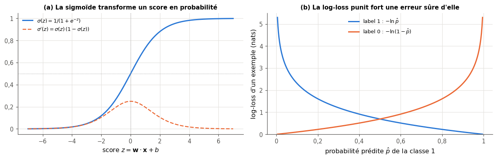
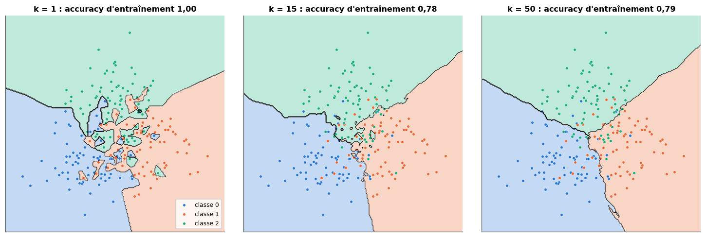
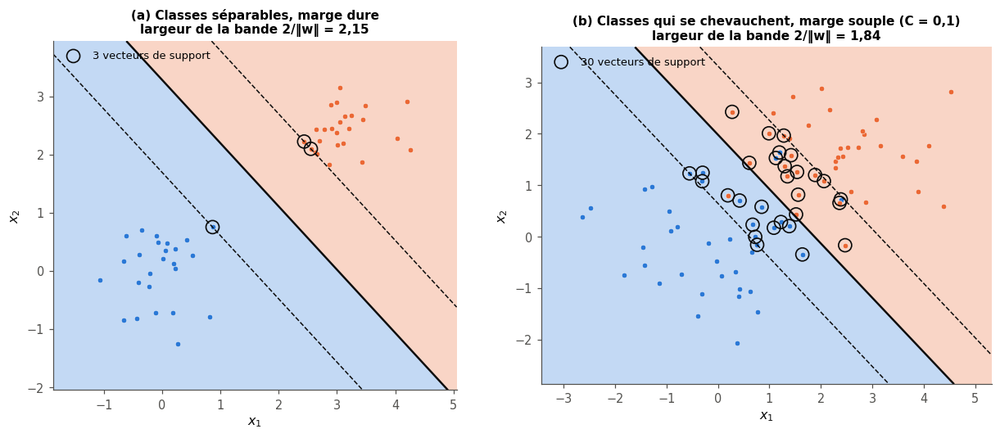
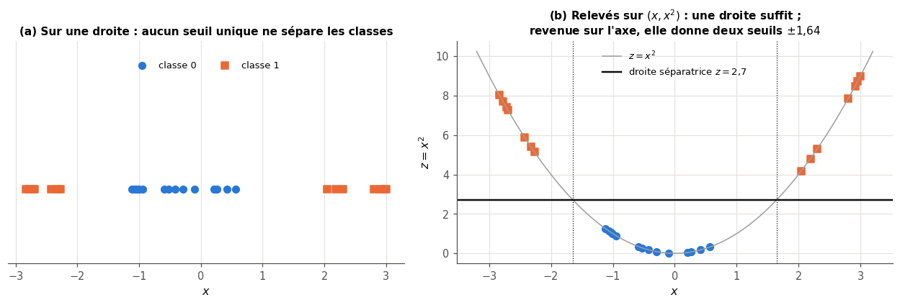
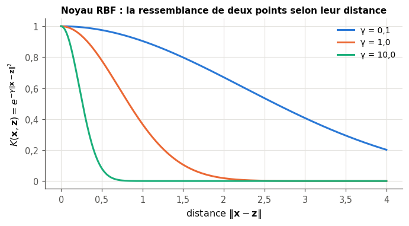
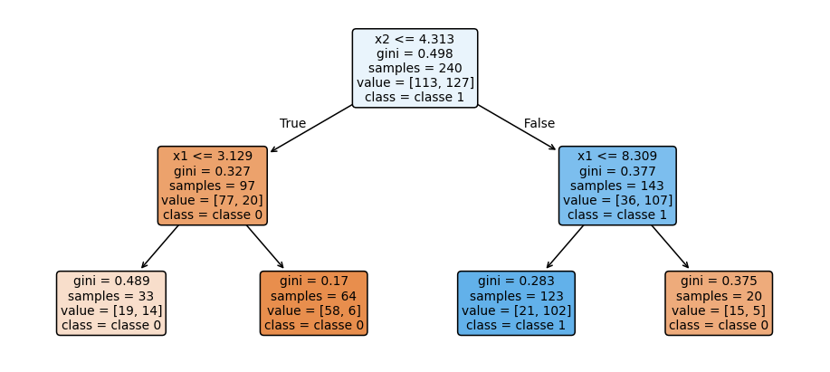
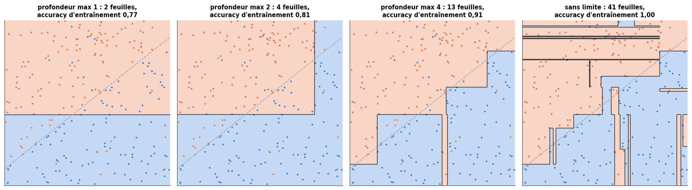
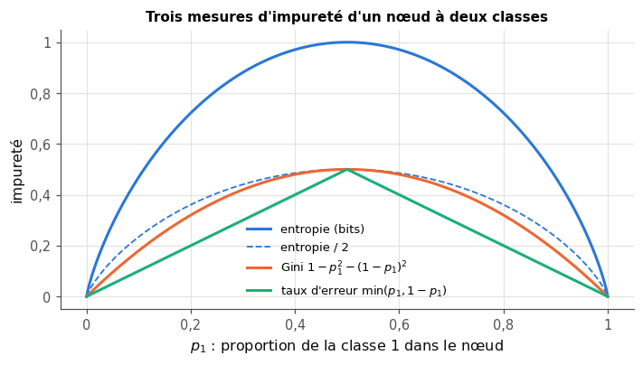
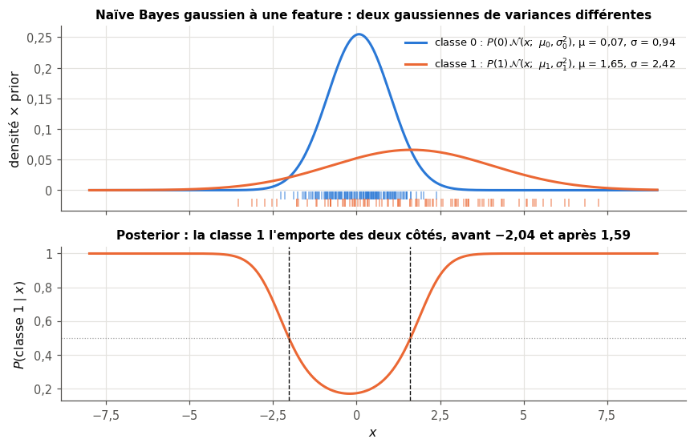

# 13 · Classifieurs — fiche de cours

> Cette fiche accompagne le chapitre 13 du livre, un tour d'horizon des classifieurs « classiques », ceux qu'on essaie avant tout réseau de neurones. Le livre les range en deux familles, **paramétriques** et **non paramétriques**, puis en présente quatre : les **k plus proches voisins** (kNN), qui font voter les exemples d'entraînement les plus proches ; les **machines à vecteurs de support** (SVM), qui cherchent la frontière la plus éloignée des deux classes et se plient à des frontières courbes grâce à l'**astuce du noyau** ; les **arbres de décision**, qui enchaînent des questions simples choisies par une mesure d'**impureté** ; et **Naïve Bayes**, la règle de Bayes avec une hypothèse simplificatrice. La fiche ajoute les formules que le livre laisse de côté (la distance à une droite, la marge, les impuretés de Gini et d'entropie, le gain d'un split, la vraisemblance gaussienne et le lissage), corrige plusieurs affirmations du livre (le sens de « naïf », le calcul du gain, l'astuce du noyau « automatique »…) et présente un classifieur absent du livre mais incontournable : la **régression logistique**, le pont entre le perceptron du ch. 10 et les réseaux de neurones. Les exemples du livre (le vote autour d'une étoile, le « sourire » et ses yeux, les anneaux relevés en 3D, le jeu des 20 questions, les demi-lunes) ne sont que résumés : chaque section te dit où les lire.

| | |
|---|---|
| **Livre** | vol. 1, ch. 13 « Classifiers », p. 488-538 (§13.1 à §13.7) |
| **Temps total estimé** | ≈ 27 h : lecture du livre et de la fiche ≈ 5,5 h, exercices ≈ 21 h, 30 flashcards ≈ 1,0 h |
| **Prérequis** | 0A (classes Python, fonctions récursives, `@dataclass`) · 0B (produit scalaire, norme, règle de la chaîne, exponentielle et logarithme) · ch. 2 (loi normale, variance) · ch. 3 (probabilité conditionnelle, matrice de confusion) · ch. 4 (règle de Bayes, prior et posterior, astuce logsumexp) · ch. 5 (descente de gradient) · ch. 6 (entropie en bits, cross-entropy, log-loss) · ch. 7 (classification, malédiction de la dimension) · ch. 8 (validation croisée) · ch. 9 (overfitting, biais et variance) · ch. 10 (perceptron, frontière $\mathbf{w} \cdot \mathbf{x} + b = 0$) · ch. 12 (standardisation, fuite de données) |
| **Fichiers du chapitre** | `02_exercices.md` (quiz, rappels, papier, réflexion, entretien) · `03_notebook.ipynb` · `04_indices.md` · `05_solutions.md` et `05_solutions.ipynb` · `06_mes_reponses.md` · `flashcards.csv` |
| **mylearn** | `neighbors.py` : `pairwise_distances` et `KNeighborsClassifier` (13.14) · `tree.py` : impuretés et `split_gain` (13.20), `best_split` (13.22), `DecisionTreeClassifier` (13.24, 13.25), `DecisionTreeRegressor` (13.26) · `naive_bayes.py` : `log_gaussian_pdf`, `logsumexp` et `GaussianNB` (13.28), `MultinomialNB` (13.29) · `logistic.py` : `LogisticRegression` (13.32). Le ch. 14 réutilisera tes arbres tels quels (forêts, AdaBoost, gradient boosting) |

## Comment utiliser ce chapitre

Le livre avance en quatre temps : pourquoi essayer des classifieurs simples et comment les classer (§13.1 et §13.2), deux méthodes géométriques, les k plus proches voisins et les SVM (§13.3 et §13.4), les arbres de décision, leur construction, le choix des splits et leur overfitting (§13.5 à §13.5.3), puis Naïve Bayes et un bilan (§13.6 et §13.7). Compte environ cinq heures et demie pour ses 51 pages et cette fiche. La fiche suit le même plan, avec une section en plus, la régression logistique, placée après le §13.2 ; ses encadrés 🧮 donnent les maths qui manquent au livre (la sigmoïde et sa dérivée, la distance d'un point à un hyperplan, l'astuce du noyau sur un exemple, les impuretés et le gain, l'indépendance conditionnelle, la log-densité gaussienne, le lissage de Laplace) et deux outils (mesurer un temps d'exécution, des textes aux comptes de mots).

**Ordre conseillé.**
1. Lis le livre §13.1 et §13.2, puis les sections 13.1 et 13.2 de la fiche et la section sur la régression logistique. Fais les quiz Q1 et Q2, le rappel R2 et la preuve ∂ 13.8.
2. Lis le livre §13.3, puis la section 13.3 de la fiche. Fais les quiz Q3 et Q4, le rappel R1 et les exercices 13.1 et 13.9.
3. Lis le livre §13.4, puis la section 13.4 de la fiche. Fais les quiz Q5 et Q6, les exercices 13.4 et 13.5 et l'oral 🗣️ 13.10.
4. Lis le livre §13.5 à §13.5.3, puis les sections 13.5 à 13.5.3 de la fiche. Fais les quiz Q7 à Q10, le rappel R3 et les exercices 13.2 et 13.3.
5. Lis le livre §13.6 et §13.7, puis la fin de la fiche. Fais les quiz Q11 et Q12, les exercices 13.6 et 13.7 et le cas ⚖️ 13.11. Vérifie tes réponses courtes dans la partie 0 du notebook.
6. Fais le notebook dans l'ordre : partie A (13.12 à 13.15 : prédire les frontières de cinq classifieurs, puis les k plus proches voisins, dont ta classe `KNeighborsClassifier`), partie B (13.16 à 13.18 : SVM linéaire, relèvement en 3D, noyau RBF), partie C (13.19 à 13.26 : les arbres, de l'expérience à ton propre `DecisionTreeClassifier`), partie D (13.27 à 13.30 : Naïve Bayes gaussien et multinomial, et des phrases de Holmes), partie E (13.31 et 13.32 : la régression logistique), partie F (13.33 à 13.36 : frontières, vitesse, comparatif et défi sur MNIST). Finis par les cinq questions d'entretien.

| Section | Quiz 🧠 et rappels 🔁 | Papier ✏️ ∂ et réflexion | Notebook | Entretien 💼 |
|---|---|---|---|---|
| 13.1 Pourquoi ce chapitre | Q1 | | 13.12 | E5 |
| 13.2 Paramétrique ou non paramétrique | Q2 | 13.9 | 13.12, 13.35 | E5 |
| Au-delà du livre : la régression logistique | R2 | 13.8 | 13.31, 13.32 | E5 |
| 13.3 Les k plus proches voisins | Q3, Q4, R1 | 13.1, 13.9 | 13.13, 13.14, 13.15, 13.34 | E1 |
| 13.4 Les machines à vecteurs de support | Q5, Q6, R2 | 13.4, 13.5, 13.10 | 13.16, 13.17, 13.18, 13.36 | E5 |
| 13.5 Les arbres de décision | Q7, Q8 | 13.11 | 13.19, 13.24 | E3 |
| 13.5.1 Construire un arbre | Q8 | | 13.19, 13.24 | E3 |
| 13.5.2 Choisir les splits | Q9, R3 | 13.2, 13.3 | 13.20, 13.22, 13.25, 13.26 | E2 |
| 13.5.3 Limiter l'overfitting | Q10 | | 13.21, 13.23 | E3 |
| 13.6 Naïve Bayes | Q11 | 13.6, 13.7 | 13.27, 13.28, 13.29, 13.30 | E4 |
| 13.7 Bilan : choisir un classifieur | Q12 | 13.11 | 13.33, 13.35, 13.36 | E5 |

**Lire les formules.** Comme au ch. 12, $\mathbf{X}$ est la matrice des données d'entraînement, de forme $(n, p)$ : $n$ exemples en lignes, $p$ features en colonnes ; $\mathbf{x}$ désigne un exemple (une ligne), $x_j$ sa feature $j$, et $y$ son label. Les classes sont numérotées $0, 1, \dots, K - 1$, comme en Python ; $c$ désigne une classe. $\mathbf{w}$ est un vecteur de poids, $b$ un biais (l'ordonnée à l'origine), et $\mathbf{w} \cdot \mathbf{x}$ le produit scalaire (0B) ; $\lVert \mathbf{w} \rVert$ est la norme euclidienne. La lettre $k$ désigne le nombre de voisins d'un kNN (sauf dans le paragraphe « kNN et k-means », où elle nomme aussi le $k$ du k-means) ; $K$ est le nombre de classes, et $K(\mathbf{x}, \mathbf{z})$ (avec ses deux arguments) un noyau de SVM. La lettre $\alpha$ sert à plusieurs réglages sans rapport entre eux : la force de la pénalité de la régression logistique, le coefficient d'élagage, le lissage de Naïve Bayes, les coefficients $\alpha_i$ d'un SVM ; chaque section dit de quel $\alpha$ elle parle. $p_c$ est la proportion de la classe $c$ dans un nœud d'arbre ; $\hat p$ une probabilité prédite. $\log$ sans base est le logarithme népérien ($\ln$) ; les entropies des arbres sont en bits ($\log_2$), comme au ch. 6. $\sigma(z)$ est la sigmoïde ; $\mathcal{N}(x;\ \mu, \sigma^2)$ la densité de la loi normale de moyenne $\mu$ et de variance $\sigma^2$ (attention : le même $\sigma$ sert aux deux, le contexte tranche).

## Objectifs d'apprentissage

À la fin du chapitre, tu sais :
- **expliquer** la différence entre classifieurs paramétriques et non paramétriques (ce qu'ils gardent en mémoire, où ils passent leur temps, ce qu'ils supposent) ;
- **calculer** à la main un vote de k plus proches voisins, une distance à une droite et une marge, une impureté de Gini, une entropie, un gain de split et un posterior de Naïve Bayes ;
- **implémenter** un kNN, un arbre de décision (classification et régression), Naïve Bayes gaussien et multinomial, et la régression logistique, avec l'API `fit` / `predict` / `predict_proba` ;
- **expliquer** la marge d'un SVM, le rôle de C et l'astuce du noyau ;
- **régler** $k$, C, $\gamma$ et la profondeur d'un arbre par validation croisée ;
- **diagnostiquer** l'overfitting d'un arbre et le **limiter** (profondeur, taille minimale des feuilles, élagage) ;
- **choisir** un classifieur de référence selon les données, le budget de calcul et le besoin d'explicabilité.

## L'essentiel en 10 lignes

1. Avant un réseau de neurones, on essaie des classifieurs **classiques** : rapides, bien compris, ils donnent une **référence** (*baseline*) et révèlent la structure des données.
2. Un classifieur **paramétrique** résume les données par un nombre fixe de paramètres (régression logistique, Naïve Bayes, SVM linéaire) ; un classifieur **non paramétrique** garde une structure qui grandit avec les données (kNN, arbre, SVM à noyau).
3. La **régression logistique** calcule un score $z = \mathbf{w} \cdot \mathbf{x} + b$, le transforme en probabilité par la **sigmoïde** et s'entraîne par descente de gradient sur la **log-loss** ; son gradient vaut $\frac1n \mathbf{X}^\top(\hat{\mathbf{p}} - \mathbf{y})$.
4. Les **k plus proches voisins** font voter les $k$ exemples d'entraînement les plus proches : petit $k$, frontière en dents de scie (overfitting) ; grand $k$, frontière lisse qui efface les petites régions. Les distances exigent des features **à la même échelle**.
5. Un **SVM** cherche l'hyperplan de **marge** maximale ; seuls les **vecteurs de support** le déterminent. Le paramètre **C** règle la tolérance aux points dans la marge (petit C : marge large et tolérante).
6. L'**astuce du noyau** calcule les produits scalaires d'une transformation $\varphi$ des données sans calculer $\varphi$ ; le noyau **RBF** et son paramètre $\gamma$ donnent des frontières courbes. On choisit le noyau et on règle C et $\gamma$ par validation croisée.
7. Un **arbre de décision** pose des questions « $x_j \le s$ ? » choisies une à une, de façon **gloutonne**, pour maximiser le **gain** : la baisse d'**impureté** (Gini ou entropie) pondérée par la taille des enfants. Il découpe l'espace en rectangles.
8. Un arbre sans limite apprend l'entraînement par cœur (**overfitting**) et change beaucoup d'un échantillon à l'autre ; on limite sa profondeur, la taille de ses feuilles, ou on l'**élague**. Il n'a pas besoin de standardisation et se lit comme une suite de règles.
9. **Naïve Bayes** applique la règle de Bayes en supposant les features **indépendantes sachant la classe** (c'est ça, « naïf ») ; il calcule en **log-probabilités**, avec un **lissage** pour les comptes nuls, et marche très bien sur les textes.
10. Aucun classifieur ne gagne partout : on compare plusieurs candidats en **validation croisée**, en pesant l'accuracy, la vitesse d'entraînement et de prédiction, la mémoire et l'**explicabilité**.

## 13.1 · Pourquoi ce chapitre ? ⏩

Les réseaux de neurones occupent la suite du livre, mais ils ne sont pas toujours le bon premier outil. Face à un nouveau problème de classification, le livre conseille de commencer par **explorer** les données avec des classifieurs prêts à l'emploi, qui s'entraînent en une ou deux lignes de code (p. 490-491) : ils disent combien de classes on peut raisonnablement distinguer, si une frontière simple suffit ou si les classes sont morcelées, et parfois ils résolvent le problème à eux seuls. Son exemple est celui de photographies aériennes de champs à classer selon leur culture : avant de construire quoi que ce soit, il faut regarder les données pour savoir combien de cultures distinguer.

Il y a une seconde raison, que le livre laisse implicite : un classifieur simple fournit une **référence** (*baseline*). Un réseau de neurones qui demande des heures d'entraînement doit faire nettement mieux qu'une régression logistique entraînée en une seconde pour justifier son coût ; s'il ne fait pas mieux, c'est souvent le signe d'un problème de données ou de mise en œuvre. Sur des données **tabulaires** (des lignes et des colonnes, comme Penguins), les méthodes de ce chapitre et les ensembles d'arbres du ch. 14 restent d'ailleurs, en 2026, les meilleurs choix dans la grande majorité des cas.

> 💼 **En entreprise** — Une équipe qui présente un modèle de deep learning sans le comparer à une baseline simple (régression logistique, arbre, gradient boosting) se fait presque toujours poser la question en revue de projet : « et une régression logistique, elle fait combien ? ». Savoir entraîner et régler en quelques minutes une régression logistique, un kNN, un SVM, un arbre et un Naïve Bayes, puis comparer leurs scores en validation croisée, est le minimum attendu d'un data scientist. Les questions d'entretien 💼 13.E1 à 13.E5 portent sur ces réflexes.

## 13.2 · Paramétrique ou non paramétrique ? ⏩

Le livre range les classifieurs en deux familles (p. 491-493).

- Un classifieur **paramétrique** suppose d'avance la **forme** de la règle de décision (une droite, un hyperplan, une loi normale par classe) et apprend un **nombre fixe** de paramètres qui la précisent. Quelle que soit la taille du jeu d'entraînement, le modèle appris tient dans ces paramètres : une régression logistique sur $p$ features garde $p + 1$ nombres, qu'elle ait vu cent exemples ou dix millions.
- Un classifieur **non paramétrique** ne fixe pas cette forme : sa structure **grandit avec les données**. Un kNN garde tous les exemples d'entraînement ; un arbre de décision ajoute des nœuds tant que les données le justifient ; un SVM à noyau garde ses vecteurs de support, dont le nombre augmente avec $n$. « Non paramétrique » ne veut donc pas dire « sans paramètres » : il y en a, mais leur nombre n'est pas fixé d'avance.

Les deux familles font des compromis opposés, que le livre résume ainsi : un modèle paramétrique occupe peu de mémoire et prédit vite, mais son entraînement peut être long (il faut optimiser ses paramètres) ; un modèle non paramétrique simple comme le kNN s'entraîne instantanément, mais sa mémoire grandit avec les données et il prédit lentement. Ce compromis est une tendance, pas une loi : un arbre de décision est non paramétrique et prédit pourtant très vite (une dizaine de comparaisons), et Naïve Bayes est paramétrique et s'entraîne en un seul passage sur les données.

| | paramétrique (régression logistique, Naïve Bayes, SVM linéaire) | non paramétrique (kNN, arbre, SVM à noyau) |
|---|---|---|
| ce qui est appris | un nombre fixe de paramètres | une structure qui grandit avec $n$ |
| hypothèse | forte : la forme de la frontière ou des lois | faible : la frontière peut prendre presque toutes les formes |
| risque principal | **underfitting**, si la forme supposée est fausse | **overfitting**, si rien ne limite la structure |
| mémoire | petite, indépendante de $n$ | grandit avec $n$ (kNN : tout le jeu d'entraînement) |
| quand les données augmentent | gagne peu au-delà d'un certain $n$ | continue de s'améliorer, à un coût croissant |

> ⚠️ **Le livre, corrigé — déduction, induction et prior** — Le livre propose de voir l'approche paramétrique comme **déductive** (elle part d'une hypothèse et cherche des données qui la satisfont) et l'approche non paramétrique comme **inductive** (elle part des données), en reprenant le vocabulaire du ch. 11 ; il ajoute que l'hypothèse paramétrique serait un **prior** bayésien (p. 492). Les deux comparaisons trompent. Les deux familles **apprennent à partir des données**, donc par induction : une régression logistique tire ses poids des exemples, exactement comme un arbre tire ses seuils. Et la forme supposée d'un modèle n'est pas un prior au sens du ch. 4, qui est une **probabilité** donnée à chaque hypothèse avant l'observation ; c'en serait tout au plus l'image extrême, qui donnerait une probabilité nulle à toutes les autres formes (un prior apparaît bien en Naïve Bayes, mais c'est la probabilité $P(c)$ de chaque classe). La bonne distinction est celle du nombre de paramètres : **fixé d'avance**, ou **croissant avec les données**. Ce que le livre appelle hypothèse s'appelle un **biais inductif** (*inductive bias*) : ce que l'algorithme suppose pour généraliser, et tous les classifieurs en ont un (le kNN suppose que des points proches ont la même classe).

## Au-delà du livre : la régression logistique, le classifieur paramétrique de référence

Le livre ne présente pas la régression logistique (le ch. 15 utilisera `RidgeClassifier` comme classifieur linéaire), alors que c'est la première baseline de tout problème de classification tabulaire et une question d'entretien classique. Elle prolonge directement le perceptron du ch. 10 : même score linéaire $z = \mathbf{w} \cdot \mathbf{x} + b$, même frontière $\mathbf{w} \cdot \mathbf{x} + b = 0$ (🔁 13.R2), mais au lieu de seuiller $z$ en 0 ou 1, elle le transforme en **probabilité**.

> 🧮 **Rappel maths — la sigmoïde et sa dérivée** — La fonction **sigmoïde** (ou logistique) est $\sigma(z) = \dfrac{1}{1 + e^{-z}}$. Elle envoie tout réel dans $]0, 1[$ : $\sigma(0) = 0{,}5$, $\sigma(z) \to 1$ quand $z \to +\infty$ et $\sigma(z) \to 0$ quand $z \to -\infty$ ; elle est croissante et vérifie $\sigma(-z) = 1 - \sigma(z)$. Sa dérivée s'écrit avec elle-même : $\sigma'(z) = \sigma(z)\,(1 - \sigma(z))$, maximale en 0, où elle vaut $0{,}25$ (∂ 13.8 te le fait démontrer avec la règle de la chaîne). Sa réciproque est le **logit** : si $\hat p = \sigma(z)$, alors $z = \log\frac{\hat p}{1 - \hat p}$, le logarithme de la **cote** (*odds*) ; c'est pour cela qu'on appelle $z$ un **log-odds**. *Mini-exemple :* $\sigma(2) = 1/(1 + e^{-2}) \approx 0{,}881$, et $\sigma'(2) \approx 0{,}881 \times 0{,}119 \approx 0{,}105$. Calculée naïvement, $e^{-z}$ déborde pour $z = -1000$ : la version de `mylearn.logistic.sigmoid`, fournie, n'exponentie jamais un nombre positif (tu écriras la tienne au ch. 17).

**Le modèle.** Pour deux classes codées 0 et 1, la régression logistique prédit

$$\hat p = P(y = 1 \mid \mathbf{x}) = \sigma(\mathbf{w} \cdot \mathbf{x} + b),$$

puis la classe 1 si $\hat p > 0{,}5$, c'est-à-dire si $z > 0$ : la frontière est l'**hyperplan** $\mathbf{w} \cdot \mathbf{x} + b = 0$, une droite en dimension 2. Chaque poids se lit simplement : augmenter $x_j$ d'une unité ajoute $w_j$ au log-odds, autrement dit multiplie la cote par $e^{w_j}$. *Mini-exemple :* avec $\mathbf{w} = (2, -1)$, $b = 0{,}5$ et $\mathbf{x} = (1, 1)$, $z = 2 - 1 + 0{,}5 = 1{,}5$ et $\hat p = \sigma(1{,}5) \approx 0{,}818$ : classe 1.

**L'entraînement.** On cherche $\mathbf{w}$ et $b$ qui minimisent la **log-loss** moyenne du ch. 6 (la cross-entropy binaire), la moyenne sur les exemples de $-\log$ de la probabilité donnée au bon label :

$$L(\mathbf{w}, b) = -\frac{1}{n} \sum_{i=1}^{n} \big[\, y_i \log \hat p_i + (1 - y_i) \log(1 - \hat p_i) \,\big].$$

Dans le mini-exemple, si le vrai label est 1, l'exemple coûte $-\log 0{,}818 \approx 0{,}20$ ; s'il est 0, il coûte $-\log 0{,}182 \approx 1{,}70$. Une prédiction sûre d'elle et fausse coûte très cher (figure ci-dessous). La dérivée se simplifie remarquablement : pour un exemple, $\partial \ell / \partial z = \hat p - y$, l'erreur de probabilité. Par la règle de la chaîne,

$$\nabla_{\mathbf{w}} L = \frac{1}{n}\, \mathbf{X}^\top (\hat{\mathbf{p}} - \mathbf{y}), \qquad \frac{\partial L}{\partial b} = \frac{1}{n} \sum_i (\hat p_i - y_i),$$

et la descente de gradient du ch. 5 fait le reste. Contrairement à la loss des moindres carrés appliquée à une sigmoïde, la log-loss est **convexe** en $(\mathbf{w}, b)$ : pas de minimum local piège. Le gradient ressemble à la règle du perceptron écrite avec des labels 0 et 1, $\mathbf{w} \leftarrow \mathbf{w} + \eta\,(y - \hat y)\,\mathbf{x}$ (sur un exemple mal classé, $y - \hat y$ vaut $\pm 1$ : c'est la règle $\eta\,y\,\mathbf{x}$ du ch. 10, réécrite avec des labels 0 et 1), avec une probabilité $\hat p$ à la place d'une décision 0 ou 1 : chaque exemple pousse les poids proportionnellement à son erreur de probabilité (∂ 13.8 te fait comparer les deux règles).



**La régularisation.** Si les classes sont **séparables** par un hyperplan, la log-loss peut toujours baisser en multipliant $\mathbf{w}$ par un grand nombre, et n'atteint jamais son minimum (∂ 13.8 te fait voir pourquoi). On ajoute donc d'ordinaire une pénalité $\frac{\alpha}{2} \lVert \mathbf{w} \rVert^2$ (Ridge, ch. 9), sur les poids seulement, pas sur le biais $b$. Comme pour Ridge, cette pénalité dépend de l'échelle des features : on **standardise** d'abord, ce qui accélère aussi la descente de gradient (ch. 12). Ta classe `LogisticRegression` (🔨 13.32) suit exactement ces formules ; ∂ 13.8 démontre le gradient.

> 🕰️ **Mise à jour (2026) — la régression logistique, baseline n° 1** — **Le livre :** ne la présente pas ; le ch. 15 utilise `RidgeClassifier` comme classifieur linéaire. · **Aujourd'hui :** `sklearn.linear_model.LogisticRegression` est la baseline par défaut des problèmes tabulaires et le point de départ des modèles de scoring (crédit, fraude, médecine), parce que ses coefficients se lisent et que ses probabilités sont souvent assez bien calibrées. Deux pièges de ses réglages par défaut : la **régularisation L2 est active** (`C=1.0`, inverse de la force de pénalité, comme pour les SVM : petit C, forte pénalité), et le solveur `lbfgs` s'arrête après `max_iter=100` itérations, ce qui ne suffit pas toujours sur des données non standardisées (un `ConvergenceWarning` le signale). Avec plus de deux classes, tous les solveurs sauf `liblinear` optimisent directement la loss **multinomiale** (softmax, ch. 17) ; le paramètre `multi_class`, déprécié en version 1.5, a disparu en 1.8. La version 1.8 déprécie aussi `penalty` (retrait prévu en 1.10) : le type de pénalité se règle par `l1_ratio` (0 pour L2, le défaut), et `C=np.inf` supprime la pénalité (ce qui marche aussi avec la version 1.6 qu'utilise le workbook). · **Faut-il quand même l'apprendre ?** Oui, absolument : c'est un neurone sigmoïde entraîné avec une cross-entropy, exactement la brique des réseaux des ch. 16 à 18. · *Source :* [`LogisticRegression` (scikit-learn 1.9)](https://scikit-learn.org/1.9/modules/generated/sklearn.linear_model.LogisticRegression.html).

## 13.3 · Les k plus proches voisins ⏩

**L'algorithme.** Les **k plus proches voisins** (*k-nearest neighbors*, kNN) classent un nouveau point en trois temps : calculer sa distance à **chaque** exemple d'entraînement, garder les $k$ plus proches, et leur faire **voter** leur classe ; la classe la plus représentée gagne. L'entraînement ne fait rien d'autre que mémoriser les données : on dit que l'algorithme est **paresseux** (*lazy*), car tout le travail est repoussé au moment de la prédiction. Le livre l'illustre par une étoile entourée de ronds, de carrés et de triangles : ronde avec 1 voisin, carrée avec 9 comme avec 25 (p. 493-494, figure 13.1).

```text
fit(X, y):                          # lazy: only store the training set
    keep a copy of X and y
predict_proba(x):
    d[i] <- distance(x, X[i]) for every training sample i
    nearest <- indices of the k smallest d (equal distances: lower index first)
    share[c] <- (number of neighbours of class c) / k      # or weighted by 1/d
predict(x):
    the class with the largest share (ties: the first class)
```

*Mini-exemple :* sur une droite, cinq exemples d'entraînement : 1 et 2 de classe 0, 4, 5 et 7 de classe 1. Pour le point $x = 3{,}2$, les distances valent 2,2 ; 1,2 ; 0,8 ; 1,8 et 3,8. Avec $k = 1$, le plus proche est 4 : classe 1. Avec $k = 3$, les voisins sont 4, 2 et 5 : deux votes pour la classe 1 sur trois, d'où la probabilité $2/3$. Avec $k = 5$, tout le monde vote : $3/5$ pour la classe 1.

**Distances.** La distance **euclidienne** $d(\mathbf{x}, \mathbf{z}) = \sqrt{\sum_j (x_j - z_j)^2}$ est celle de la règle graduée ; la distance de **Manhattan** $d_1(\mathbf{x}, \mathbf{z}) = \sum_j \lvert x_j - z_j \rvert$ additionne les écarts feature par feature, comme un trajet dans les rues d'une ville en damier. Entre $(1, 2)$ et $(4, 6)$, la première vaut 5 et la seconde 7. Elles ne classent pas toujours les voisins dans le même ordre : un point décalé de $(1, 1)$ est plus proche qu'un point décalé de $(1{,}5 ;\ 0)$ pour la distance euclidienne ($1{,}41$ contre $1{,}5$), mais plus loin pour Manhattan (2 contre 1,5).

**Égalités et pondération.** Deux règles de départage rendent la prédiction reproductible. Ta librairie prend deux voisins à la même distance dans l'ordre des indices d'entraînement (un **tri stable**) ; scikit-learn ne le garantit pas (sa documentation prévient que le résultat dépend alors de l'ordre des données), si bien que les deux peuvent différer quand le $k$-ième et le $(k+1)$-ième voisins sont à égale distance. Dans les deux, une égalité de votes donne la **première** classe dans l'ordre trié des labels. Pour éviter les égalités à deux classes, on choisit souvent un $k$ impair. On peut aussi **pondérer** les votes par l'inverse de la distance (`weights="distance"`) : un voisin deux fois plus proche compte deux fois plus. Dans le mini-exemple, avec $k = 3$, la classe 1 reçoit $1/0{,}8 + 1/1{,}8 \approx 1{,}806$ et la classe 0 reçoit $1/1{,}2 \approx 0{,}833$, d'où la probabilité $1{,}806/2{,}639 \approx 0{,}684$ pour la classe 1. Un voisin à distance nulle (un doublon exact) prendrait alors tout le poids ; scikit-learn, et ta librairie, partagent dans ce cas le vote entre les voisins à distance nulle.

**Choisir k.** Le livre teste un kNN sur un nuage en forme de « sourire » à deux classes, net puis bruité, puis avec deux « yeux » de la classe minoritaire (p. 496-501, figures 13.2 à 13.7). Il en tire deux leçons. Un petit $k$ suit chaque point : avec du bruit, la frontière devient déchiquetée, c'est de l'**overfitting** (avec $k = 1$, chaque point d'entraînement est son propre voisin et l'accuracy d'entraînement vaut 1 dès qu'il n'y a pas de doublons contradictoires). Un grand $k$ lisse la frontière, mais finit par **éroder** les petites régions : quand $k$ dépasse environ le double du nombre de points d'un petit groupe isolé, ce groupe ne peut plus avoir la majorité, même en son centre, et il disparaît (avec $k = n$, le kNN prédit partout la classe majoritaire de l'entraînement). Le bon $k$ se choisit par **validation croisée** (ch. 8), jamais sur l'accuracy d'entraînement, qui favorise toujours $k = 1$. La figure ci-dessous montre les deux régimes sur trois classes qui se chevauchent.



Avec $k = 15$ et $k = 50$, l'accuracy d'entraînement est presque la même (0,78 et 0,79) : elle ne dit pas lequel de ces deux réglages généralise le mieux ; seule une validation le peut.

**Des features à la même échelle.** Une distance additionne les écarts de toutes les features : une feature mesurée en grands nombres (une masse en grammes) écrase une feature en petits nombres (une longueur de bec en millimètres). Avant un kNN, on **standardise** (ch. 12, 🔁 13.R1), avec un scaler appris sur l'entraînement seul. Pour la même raison, une feature sans rapport avec la classe ajoute du bruit à toutes les distances : le kNN souffre plus que d'autres méthodes des features inutiles.

**La malédiction de la dimension.** Le livre le rappelle (p. 495-496, et ch. 7) : quand le nombre de features augmente sans que le nombre d'exemples suive, les voisins s'éloignent, et les distances se ressemblent toutes (le plus proche et le plus lointain voisin sont à des distances presque égales). Le vote des « plus proches » perd alors son sens. 🔬 13.15 le mesure en ajoutant des features de bruit à Penguins.

**Le coût.** Le kNN s'entraîne en un instant, mais il garde tout le jeu d'entraînement, et chaque prédiction calcule $n$ distances en dimension $p$.

> 🧮 **Rappel maths — compter la mémoire et le temps d'un kNN** — Avec $n$ exemples de $p$ features, le kNN garde $n \times p$ nombres : 8 octets chacun en `float64`, 4 en `float32`, 1 en `uint8`. Une prédiction en force brute fait de l'ordre de $3np$ opérations (une soustraction, un carré et une addition par valeur), plus le tri des distances. *Mini-exemple :* $n = 200\,000$ exemples de $p = 300$ features en `float32` occupent $200\,000 \times 300 \times 4 = 240$ millions d'octets, soit 240 Mo ; une requête demande environ $3 \times 6 \times 10^7 = 1{,}8 \times 10^8$ opérations, soit environ 0,02 s à $10^{10}$ opérations par seconde ; un million de requêtes, environ cinq heures, sans compter le tri. Une régression logistique sur les mêmes données garde $p + 1 = 301$ nombres. 🧮 13.9 refait ces calculs pour MNIST.

**Accélérer.** En pratique, on ne boucle pas en Python sur les exemples : on calcule toutes les différences d'un coup par **broadcasting** (`A[:, None, :] - B[None, :, :]`, de forme $(n_a, n_b, p)$, comme dans ta fonction `pairwise_distances` de 🔨 13.14), ou par l'identité $\lVert \mathbf{a} - \mathbf{b} \rVert^2 = \lVert \mathbf{a} \rVert^2 - 2\,\mathbf{a} \cdot \mathbf{b} + \lVert \mathbf{b} \rVert^2$, qui ramène tout à un produit de matrices (plus rapide et moins gourmande en mémoire, mais un peu moins précise : un carré de distance peut sortir légèrement négatif par arrondi). Pour beaucoup de requêtes, on les traite par **batches**, pour que la matrice des distances tienne en mémoire. Les structures d'arbres (KD-tree, ball tree) évitent de calculer toutes les distances en faible dimension ; au-delà de quelques dizaines de dimensions, on passe aux méthodes **approximatives** (encadré 🕰️). 🛠️ 13.34 te fait mesurer ces gains.

> 🧮 **Rappel outil — mesurer un temps d'exécution** — `time.perf_counter()` donne une horloge précise : `t0 = time.perf_counter()`, le calcul, puis `time.perf_counter() - t0` en secondes. Une seule mesure est bruitée (autres programmes, caches, compilation au premier appel) : on répète et l'on garde le **minimum** ou la **médiane**. Le module `timeit` le fait pour toi : `timeit.repeat(lambda: f(X), number=10, repeat=5)` renvoie cinq durées, chacune pour dix appels. (Dans un notebook Jupyter, la commande magique `%timeit` fait la même chose ; les notebooks de ce workbook s'en passent, car ils n'utilisent pas de commandes `%`.) Pour comparer deux versions, on vérifie d'abord qu'elles donnent le **même résultat** (`np.allclose`), puis on mesure sur des tailles croissantes : une boucle Python sur $n$ exemples coûte souvent cent fois plus qu'une opération vectorisée de NumPy sur le même tableau. Une durée dépend de la machine : on la rapporte, on ne la compare pas d'un ordinateur à l'autre.

> 🕰️ **Mise à jour (2026) — les plus proches voisins à grande échelle** — **Le livre :** note que la recherche des voisins est lente et que des méthodes l'accélèrent, sans les nommer (p. 495). · **Aujourd'hui :** la recherche de plus proches voisins est devenue une infrastructure à part entière. Les **bases vectorielles** qui servent la recherche sémantique et la génération augmentée par recherche (RAG, bonus B4) cherchent, parmi des millions d'**embeddings**, les plus proches d'une requête ; elles acceptent de rater de temps en temps le vrai plus proche voisin en échange d'une vitesse bien plus grande (recherche **approximative**, *approximate nearest neighbors*, ANN). L'algorithme **HNSW** (Malkov et Yashunin, 2016) organise les points en graphes de proximité superposés, du plus grossier au plus fin, et parcourt ces couches de haut en bas, pour un coût qui croît à peu près comme le logarithme du nombre de points ; la bibliothèque **Faiss** de Meta propose HNSW, des index par partition et des codes compressés, sur CPU, et sur GPU pour une partie de ces index. · **Faut-il quand même l'apprendre ?** Oui : le kNN exact reste la référence qui mesure la qualité d'une recherche approximative (la part des vrais voisins retrouvés), et un classifieur kNN sur des embeddings pré-entraînés est une baseline redoutable. · *Sources :* [Y. Malkov et D. Yashunin, « Efficient and robust approximate nearest neighbor search using Hierarchical Navigable Small World graphs » (arXiv:1603.09320)](https://arxiv.org/abs/1603.09320) ; [Faiss (GitHub)](https://github.com/facebookresearch/faiss).

**kNN et k-means.** Le livre prévient (p. 493) : malgré leurs noms, le kNN et le k-means du ch. 7 n'ont presque rien en commun. Le kNN est **supervisé** : il utilise les labels, et son $k$ est un nombre de voisins. Le k-means est **non supervisé** : il ignore les labels, et son $k$ est un nombre de groupes, sans nom de classe. Leur seul point commun est de calculer des distances.

> ⚠️ **Piège classique — « le kNN ne trace pas de frontière »** — Le livre dit que le kNN ne crée pas de frontière explicite entre les classes (p. 495) : c'est vrai au sens où il n'en **stocke** aucune, mais chaque point du plan reçoit bien une classe, donc une frontière existe, implicite, et l'on peut la dessiner (figure ci-dessus). Avec $k = 1$, elle suit les médiatrices entre points de classes différentes : le plan est découpé en **cellules de Voronoï**, une par exemple d'entraînement. Ce qui distingue le kNN, c'est que cette frontière peut prendre n'importe quelle forme, y compris plusieurs morceaux séparés pour une même classe.

## 13.4 · Les machines à vecteurs de support ⏩

**Quelle droite choisir ?** Deux nuages de points de classes différentes se séparent souvent par une infinité de droites. Le livre part de deux blobs bien séparés et compare trois droites qui les séparent toutes (p. 502-504, figures 13.8 à 13.10) : la meilleure est celle qui passe **le plus loin** des deux nuages, parce qu'un nouveau point un peu décalé a alors le moins de chances de tomber du mauvais côté. Une **machine à vecteurs de support** (*support vector machine*, SVM) cherche exactement cette droite (un **hyperplan** en dimension $p$) : celle dont la distance au point le plus proche est maximale. Pour la formuler, il faut savoir mesurer la distance d'un point à un hyperplan.

> 🧮 **Rappel maths — la distance d'un point à un hyperplan** — L'hyperplan d'équation $\mathbf{w} \cdot \mathbf{x} + b = 0$ (une droite en dimension 2) a pour **vecteur normal** $\mathbf{w}$ : $\mathbf{w}$ est perpendiculaire à l'hyperplan, et le signe de $f(\mathbf{x}) = \mathbf{w} \cdot \mathbf{x} + b$ dit de quel côté se trouve $\mathbf{x}$. La distance de $\mathbf{x}$ à l'hyperplan vaut
> $$d = \frac{\lvert \mathbf{w} \cdot \mathbf{x} + b \rvert}{\lVert \mathbf{w} \rVert}.$$
> *Pourquoi :* partons de $\mathbf{x}$ et descendons perpendiculairement à l'hyperplan, le long de $\mathbf{w}$, jusqu'au point $\mathbf{x} - t\,\mathbf{w}/\lVert \mathbf{w} \rVert$ ; il est sur l'hyperplan quand $\mathbf{w} \cdot \mathbf{x} - t\,\lVert \mathbf{w} \rVert + b = 0$, soit $t = f(\mathbf{x})/\lVert \mathbf{w} \rVert$, et la distance parcourue est $\lvert t \rvert$. Multiplier $\mathbf{w}$ et $b$ par un même nombre positif ne change ni l'hyperplan ni cette distance. *Mini-exemple :* la droite $x_1 + 2x_2 - 4 = 0$ a pour vecteur normal $(1, 2)$, de norme $\sqrt 5$ ; le point $(3, 3)$ donne $f = 3 + 6 - 4 = 5 > 0$ (il est du côté vers lequel pointe $\mathbf{w}$) et se trouve à la distance $5/\sqrt 5 = \sqrt 5 \approx 2{,}24$ ; le point $(4, 0)$ donne $f = 0$ : il est sur la droite.

**La marge.** Codons les deux classes par $y = +1$ et $y = -1$. Comme $\mathbf{w}$ et $b$ ne sont définis qu'à un facteur près, on choisit leur échelle pour que les points les plus proches de l'hyperplan vérifient $\lvert \mathbf{w} \cdot \mathbf{x} + b \rvert = 1$. Tous les points d'entraînement doivent alors satisfaire $y_i\,(\mathbf{w} \cdot \mathbf{x}_i + b) \ge 1$ : ils sont du bon côté, à distance au moins $1/\lVert \mathbf{w} \rVert$. Les deux hyperplans parallèles $\mathbf{w} \cdot \mathbf{x} + b = \pm 1$ (les pointillés des figures) délimitent une **bande** vide de largeur $2/\lVert \mathbf{w} \rVert$. La **marge** est la distance de la frontière à chaque bord, $1/\lVert \mathbf{w} \rVert$, comme dans le livre (p. 505) et au ch. 10 ; certains ouvrages appellent marge la largeur de la bande entière : précise toujours laquelle tu emploies. Maximiser la bande revient à minimiser $\lVert \mathbf{w} \rVert$, d'où le problème du **SVM à marge dure** :

$$\min_{\mathbf{w},\, b}\ \tfrac12 \lVert \mathbf{w} \rVert^2 \quad \text{sous les contraintes} \quad y_i\,(\mathbf{w} \cdot \mathbf{x}_i + b) \ge 1 \ \text{ pour tout } i.$$

Les points posés sur les bords de la bande, pour lesquels la contrainte est une égalité, sont les **vecteurs de support** (*support vectors* ; « vecteur » veut dire ici « exemple », p. 505) : eux seuls fixent la solution. Retire un autre point et réentraîne : rien ne change. Déplace un vecteur de support : la frontière bouge. Le livre décrit l'algorithme comme trouvant d'abord les vecteurs de support, puis la droite (p. 505) : les deux sortent en fait de la même optimisation, et l'on ne sait quels points sont des vecteurs de support qu'une fois le problème résolu. ✏️ 13.4 te fait vérifier une solution à la main.

**Quand les classes se chevauchent : la marge souple et C.** Si aucun hyperplan ne sépare les classes, les contraintes sont impossibles. Le **SVM à marge souple** (Cortes et Vapnik, 1995) autorise des violations, mais les fait payer : chaque point reçoit une pénalité $\xi_i = \max\big(0,\ 1 - y_i\,(\mathbf{w} \cdot \mathbf{x}_i + b)\big)$, nulle s'il est hors de la bande et du bon côté, entre 0 et 1 s'il est dans la bande mais bien classé, supérieure à 1 s'il est mal classé. On minimise

$$\tfrac12 \lVert \mathbf{w} \rVert^2 + C \sum_i \xi_i.$$

La fonction $\max(0, 1 - y f)$ s'appelle la **hinge loss** (*charnière*). Le paramètre $C > 0$ dose le compromis : un **grand C** rend chaque violation coûteuse, d'où une bande étroite qui colle aux points proches de la frontière (avec C infini, on retrouve la marge dure) ; un **petit C** accepte des violations pour élargir la bande, et la frontière dépend de plus de points. Les vecteurs de support sont maintenant tous les points sur le bord, dans la bande ou du mauvais côté : avec un petit C, ils sont nombreux. Le livre le montre sur deux blobs qui se chevauchent avec C = 100 000 puis C = 0,01 (p. 506-508, figures 13.12 à 13.14). C joue le rôle inverse de l'$\alpha$ de Ridge : la pénalité porte sur $\lVert \mathbf{w} \rVert^2$, et C multiplie les erreurs ; petit C, forte régularisation. Comme le kNN, le SVM dépend des distances : on **standardise** les features.



> ⚠️ **Le livre, corrigé — C n'est pas une « clearance »** — Pour retenir C, le livre propose de le lire comme une *clearance*, un « dégagement » : plus il est grand, plus l'algorithme exige une zone vide autour de la droite (p. 506). Le sens de variation est le bon (grand C, peu de points tolérés dans la bande), mais le mot pousse à croire qu'un grand C donne une **large** zone dégagée, alors que c'est l'inverse : un grand C donne d'ordinaire une bande **plus étroite**, parce qu'il préfère rétrécir la marge plutôt que d'y laisser des points. Lis C comme un **coût** (*cost*) : le prix de chaque violation.

**Des frontières courbes : relever les données.** Le livre prend un blob d'une classe entouré d'un anneau de l'autre : aucune droite ne les sépare. Il ajoute alors à chaque point une troisième coordonnée, sa « hauteur », qui croît avec la distance au centre : l'anneau monte, le blob reste en bas, et un **plan** les sépare ; vu d'en haut, ce plan coupe la surface selon un cercle (p. 508-511, figures 13.15 à 13.19 ; 🎨 13.17 te le fait construire). La figure ci-dessous montre la même idée en une dimension : des points dont la classe dépend de $\lvert x \rvert$ ne se séparent par aucun seuil unique, mais deviennent séparables par une droite une fois relevés sur la parabole $(x, x^2)$. En général, on applique une transformation $\varphi$ qui envoie les données dans un espace de plus grande dimension, on y cherche un hyperplan, et cet hyperplan correspond à une frontière **courbe** dans l'espace de départ.



**L'astuce du noyau.** Calculer $\varphi$ explicitement coûte cher : les transformations utiles ont beaucoup de coordonnées, parfois une infinité. Or l'entraînement et la prédiction d'un SVM peuvent s'écrire uniquement avec des **produits scalaires** entre exemples : la solution prend la forme $f(\mathbf{x}) = \sum_{i} \alpha_i\, y_i\, \varphi(\mathbf{x}_i) \cdot \varphi(\mathbf{x}) + b$, où les coefficients $\alpha_i \ge 0$ ne sont non nuls que pour les vecteurs de support. Il suffit donc de savoir calculer $K(\mathbf{x}, \mathbf{z}) = \varphi(\mathbf{x}) \cdot \varphi(\mathbf{z})$, la fonction **noyau** (*kernel*), sans jamais construire $\varphi$ : c'est l'**astuce du noyau** (*kernel trick*). La prédiction devient $f(\mathbf{x}) = \sum_{i \in \text{SV}} \alpha_i\, y_i\, K(\mathbf{x}_i, \mathbf{x}) + b$ : le modèle garde ses vecteurs de support, et leur nombre grandit avec les données (un SVM à noyau est non paramétrique).

> 🧮 **Rappel maths — l'astuce du noyau sur un exemple** — En dimension 2, posons $\varphi(\mathbf{x}) = (x_1^2,\ \sqrt 2\,x_1 x_2,\ x_2^2)$, trois coordonnées. Alors $\varphi(\mathbf{x}) \cdot \varphi(\mathbf{z}) = x_1^2 z_1^2 + 2\,x_1 x_2 z_1 z_2 + x_2^2 z_2^2 = (x_1 z_1 + x_2 z_2)^2 = (\mathbf{x} \cdot \mathbf{z})^2$ : le **noyau polynomial** de degré 2 donne le produit scalaire dans l'espace relevé à partir du seul produit scalaire de départ. *Mini-exemple :* $\mathbf{x} = (2, 0)$ et $\mathbf{z} = (1, 1)$ : $\varphi(\mathbf{x}) = (4, 0, 0)$, $\varphi(\mathbf{z}) = (1, \sqrt 2, 1)$, leur produit scalaire vaut 4, et $(\mathbf{x} \cdot \mathbf{z})^2 = 2^2 = 4$. Le gain grandit avec la dimension : le nombre de coordonnées de $\varphi$ croît comme le carré de $p$ (plus de 5 000 pour $p = 100$ ; ✏️ 13.5 te les fait compter), alors que le noyau ne demande qu'un produit scalaire et un carré. Les distances s'en déduisent aussi : $\lVert \varphi(\mathbf{x}) - \varphi(\mathbf{z}) \rVert^2 = K(\mathbf{x}, \mathbf{x}) - 2K(\mathbf{x}, \mathbf{z}) + K(\mathbf{z}, \mathbf{z})$. ✏️ 13.5 te fait vérifier tout cela à la main.

**Le noyau RBF et γ.** Le noyau le plus employé est le noyau **gaussien**, ou **RBF** (*radial basis function*) : $K(\mathbf{x}, \mathbf{z}) = e^{-\gamma \lVert \mathbf{x} - \mathbf{z} \rVert^2}$. Il vaut 1 pour deux points confondus et tend vers 0 quand ils s'éloignent : c'est une mesure de **ressemblance**, et la prédiction devient une somme de « bosses » centrées sur les vecteurs de support. Sa transformation $\varphi$ a une infinité de coordonnées, que l'astuce du noyau évite de calculer. Le paramètre $\gamma > 0$ règle la **portée** de chaque bosse : avec un grand $\gamma$, un point ne ressemble qu'à ses voisins immédiats et la frontière peut épouser chaque exemple (overfitting, comme un kNN à petit $k$) ; avec un petit $\gamma$, les bosses sont larges et la frontière presque linéaire. *Mini-exemple :* pour deux points à distance 1, $K = e^{-\gamma}$, soit 0,90 avec $\gamma = 0{,}1$, 0,37 avec $\gamma = 1$ et $4{,}5 \times 10^{-5}$ avec $\gamma = 10$. C et $\gamma$ se règlent **ensemble**, par validation croisée sur une grille logarithmique (📦 13.18).



> ⚠️ **Le livre, corrigé — l'astuce du noyau ne choisit pas la transformation** — Le livre écrit que le SVM peut « essayer automatiquement de nombreuses transformations » et retenir la meilleure, et que l'astuce du noyau est appliquée automatiquement par les bibliothèques, sans qu'on ait à la demander (p. 511-512). Ce n'est pas ainsi que cela marche. L'astuce du noyau rend **un** relèvement calculable : celui du noyau que **tu** choisis (`kernel="linear"`, `"poly"`, `"rbf"`…), avec ses hyperparamètres ($\gamma$, le degré). Le SVM ne parcourt aucune famille de transformations : c'est toi qui compares les noyaux et les valeurs de C et de $\gamma$, par validation croisée. Ce que la bibliothèque fait sans qu'on le demande, c'est utiliser un noyau par défaut (`SVC` de scikit-learn prend `kernel="rbf"`), ce qui n'est pas la même chose. Le livre dit aussi que l'astuce calcule les distances entre points transformés : elle calcule leurs **produits scalaires**, dont on déduit les distances (encadré 🧮).

**Plusieurs classes et probabilités.** Un SVM sépare deux classes. Pour $K$ classes, `SVC` entraîne un SVM par **paire** de classes, soit $K(K-1)/2$ SVM, et fait voter (*one-vs-one*), alors que le ch. 7 présentait l'approche un-contre-tous (*one-vs-rest*), qu'utilise `LinearSVC`. Un SVM donne un score $f(\mathbf{x})$, pas une probabilité : `SVC(probability=True)` en fabrique une par une calibration (Platt), au prix d'une validation croisée interne à cinq folds qui ralentit l'entraînement, et ces probabilités peuvent contredire `predict` (l'option est dépréciée depuis la version 1.9 : on écrit `CalibratedClassifierCV(SVC(), ensemble=False)`).

> 🕰️ **Mise à jour (2026) — les SVM à noyau aujourd'hui** — **Le livre :** présente le SVM et l'astuce du noyau comme appliquée automatiquement. · **Aujourd'hui :** dans scikit-learn, `SVC` prend par défaut `kernel="rbf"` et `gamma="scale"`, soit $\gamma = 1/(p \times \mathrm{Var}(\mathbf{X}))$, où $\mathrm{Var}(\mathbf{X})$ est la variance de toutes les valeurs du tableau (défaut depuis la version 0.22) ; C vaut 1. La documentation prévient que le temps d'entraînement croît **au moins comme le carré** du nombre d'exemples et devient impraticable au-delà de quelques dizaines de milliers : on passe alors à `LinearSVC` ou `SGDClassifier` (un SVM linéaire entraîné par descente de gradient stochastique), éventuellement après une **approximation du noyau** (`Nystroem`, qui construit explicitement quelques centaines de coordonnées d'un $\varphi$ approché). Sur les données tabulaires, les ensembles d'arbres du ch. 14 (gradient boosting) les ont largement remplacés, et sur les images, les réseaux de neurones. · **Faut-il quand même l'apprendre ?** Oui : la marge, la hinge loss et les noyaux restent des idées centrales (la hinge loss revient dans les réseaux, les noyaux dans les processus gaussiens et dans l'analyse des réseaux très larges), et un SVM RBF bien réglé reste une excellente baseline sur des jeux de taille moyenne : 🏆 13.36 te le montrera sur MNIST. · *Source :* [`SVC` (scikit-learn 1.9)](https://scikit-learn.org/1.9/modules/generated/sklearn.svm.SVC.html).

## 13.5 · Les arbres de décision ⏩

**L'idée : le jeu des 20 questions.** Le livre part du jeu où l'on devine un objet en posant des questions à réponse oui ou non (p. 512-513). Un **arbre de décision** fait de même avec un exemple : à chaque étape, il pose une question sur une feature, du type « $x_j \le s$ ? », et suit la branche « oui » ou « non » jusqu'à une réponse finale. L'exemple descend ainsi de la question de départ jusqu'à une **feuille**, qui donne la prédiction.

**Le vocabulaire** (le livre le donne p. 513-516, avec un arbre des mois de naissance). Les mots qui servent dans ce chapitre et dans le code :

| terme | sens | dans scikit-learn et ta librairie |
|---|---|---|
| **nœud** | une case de l'arbre ; les liens entre nœuds sont des **arêtes** (ou branches) | `tree_.node_count` ; `tree.Node` |
| **racine** | le nœud du haut, par où entre chaque exemple | `tree_` nœud 0 ; `root_` |
| **nœud interne** | un nœud qui pose une question « $x_j \le s$ ? » et a deux **enfants** (son **parent** est le nœud au-dessus) | `tree_.feature`, `tree_.threshold` ; `Node.feature`, `Node.threshold` |
| **feuille** | un nœud sans enfant, qui donne la prédiction | `get_n_leaves()` ; `Node.left is None` |
| **profondeur** | pour un nœud, le nombre d'arêtes qui le séparent de la racine (0 pour elle) ; pour l'arbre, la plus grande profondeur d'une feuille | `get_depth()` |
| **sous-arbre** | un nœud et tous ses descendants | `tree_.children_left`, `tree_.children_right` |

Un arbre est **binaire** si chaque nœud interne a exactement deux enfants ; le livre appelle « touffu » (*bushy*) un arbre dont certains nœuds en ont plus, et montre qu'on peut toujours le récrire en arbre binaire (p. 515-516). La légende de sa figure 13.21 définit la profondeur comme un nombre de nœuds, mais la valeur qu'elle donne (4) compte bien les arêtes. Un arbre binaire a toujours **une feuille de plus que de nœuds internes**, et un arbre binaire de profondeur $D$ a au plus $2^D$ feuilles.

**Prédire.** Chaque feuille garde les **proportions des classes** des exemples d'entraînement qui y sont arrivés. Pour classer un nouvel exemple, on le fait descendre jusqu'à sa feuille : `predict_proba` renvoie ces proportions, `predict` la classe majoritaire. Une feuille où arrivent 80 % d'exemples de la classe 0 et 20 % de la classe 1 prédit la classe 0 avec la probabilité 0,8 (le livre prend cet exemple p. 518). Le livre propose même, s'il faut une seule classe, de répondre la classe 0 80 % du temps et la classe 1 20 % du temps : ce tirage se trompe plus souvent que de toujours répondre la classe majoritaire, et `predict` ne le fait jamais. Prédire coûte au plus une comparaison par niveau : une vingtaine pour un arbre de profondeur 20, quel que soit le nombre d'exemples d'entraînement.



Ce dessin se lit de haut en bas : à la racine, 240 exemples (113 de la classe 0, 127 de la classe 1) et la question « x2 ≤ 4,313 ? » ; la branche *True* part à gauche. Les feuilles sont colorées selon leur classe majoritaire, d'autant plus foncées qu'elles sont pures. La question de la racine est celle qui sépare le mieux les deux classes au sens de l'impureté de Gini (§13.5.2), celles des enfants sont choisies de la même façon sur leurs propres exemples. `export_text` donne le même arbre sous forme de règles imbriquées, et 📦 13.23 te fait lire les deux sur Penguins.

**Classification et régression.** Le livre parle d'arbres de décision « à variable catégorielle » pour la classification et « à variable continue » pour la régression (p. 516) ; on dit plutôt **arbres de classification** et **arbres de régression**, deux variantes de la méthode **CART** (*classification and regression trees*, Breiman et coll., 1984), celle qu'implémentent scikit-learn et ta librairie. Une feuille d'un arbre de régression prédit la **moyenne** des cibles de ses exemples d'entraînement (🔨 13.26), et la qualité d'un split se mesure par la baisse de **variance** (§13.5.2). Le livre ne traite que la classification ; les ensembles du ch. 14 se servent des deux.

> ⚠️ **Le livre, corrigé — un arbre ne se construit pas exemple par exemple** — Le livre décrit un processus « idéalisé » : les feuilles contiennent les exemples eux-mêmes, et chaque nouvel exemple d'entraînement descend jusqu'à une feuille, où il est ajouté s'il a la même classe que les autres, sinon la feuille est découpée par un nouveau test (p. 517-518). Les arbres de scikit-learn et de ta librairie ne fonctionnent pas ainsi. La construction se fait **d'un bloc et de haut en bas**, sur **tous** les exemples à la fois : on cherche la meilleure question pour la racine sur l'ensemble des données, on répartit les exemples entre les deux enfants, puis on recommence dans chaque enfant (pseudo-code ci-dessous). Une fois l'arbre construit, les feuilles ne gardent pas les exemples, seulement leurs **proportions** de classes (ou leur moyenne, en régression) : un arbre est bien plus léger qu'un kNN. Le mot « glouton » (p. 519) est juste : chaque question est choisie au mieux **sur le moment**, sans revenir en arrière, et rien ne garantit l'arbre le plus petit ou le plus juste (trouver l'arbre optimal est un problème combinatoire très difficile).

```text
fit(X, y):  root_ <- build(all the samples, depth=0)
build(samples, depth):
    if the samples are pure, or depth == max_depth, or len(samples) < min_samples_split:
        return a leaf (class proportions of the samples)
    (j, s, gain) <- best_split(samples)          # best question "x_j <= s ?"
    if there is no split with a positive gain:
        return a leaf
    left  <- the samples with x_j <= s
    right <- the other samples
    return a node(j, s, build(left, depth + 1), build(right, depth + 1))
```

Une différence avec scikit-learn : ta librairie s'arrête dès qu'aucun split n'a un gain **strictement** positif, alors que scikit-learn accepte un gain nul. Cela n'arrive que si des valeurs se répètent : sur les quatre points d'un « ou exclusif » (deux features à 0 ou 1, la classe vaut 1 quand une seule des deux vaut 1), aucune question seule ne fait baisser l'impureté ; scikit-learn construit quand même un arbre parfait de profondeur 2, ta librairie s'arrête à une seule feuille.

### 13.5.1 · Construire un arbre ⏩

Chaque question « $x_j \le s$ ? » coupe une région de l'espace par un hyperplan **parallèle à un axe** : en dimension 2, une droite verticale ou horizontale. Un arbre découpe donc l'espace en **rectangles** (des pavés en dimension $p$), une feuille par rectangle. Chaque split ajoute un nœud interne et une feuille, si bien que la taille d'un arbre se compte souvent en feuilles. Le livre fait grandir un arbre sur deux demi-lunes bien séparées, de 600 points : dix feuilles suffisent à classer parfaitement l'entraînement, dont deux rectangles très fins qui attrapent trois points isolés (p. 519-521, figures 13.26 à 13.28). Une frontière oblique se paie cher : l'arbre l'approche par un **escalier**, d'autant plus fin qu'il est profond (figure ci-dessous).



**Un arbre surapprend.** Sans limite, l'arbre continue de couper jusqu'à ce que chaque feuille soit **pure** : il classe parfaitement l'entraînement (sauf si deux exemples identiques ont des classes différentes, et, pour ta librairie, sauf dans un nœud où aucun split n'a de gain strictement positif, comme le « ou exclusif » ci-dessus), en isolant chaque point bruité dans son propre petit rectangle. Sur des demi-lunes bruitées, le livre obtient ainsi 100 feuilles (p. 522-524, figures 13.30 à 13.32), dont beaucoup ne servent qu'à un ou deux exemples : de futurs points qui tomberont dans ces petits rectangles seront mal classés. C'est de l'**overfitting**, au sens du ch. 9 : un modèle à faible biais et à forte **variance**.

**Un arbre est instable.** Le livre refait l'arbre sur deux tirages différents de 70 % des données : sur les données nettes, les deux arbres se ressemblent ; sur les données bruitées, ils diffèrent nettement (p. 521-525, figures 13.29 et 13.33). Un petit changement des données change la première question, donc tout ce qui en dépend. 🔬 13.19 mesure cette instabilité. C'est justement cette variance qu'exploitent les **ensembles** du ch. 14 : moyenner de nombreux arbres différents réduit la variance sans beaucoup augmenter le biais.

**Ce qui ne compte pas pour un arbre.** Une question « $x_j \le s$ ? » ne dépend que de l'**ordre** des valeurs de $x_j$ : standardiser, normaliser ou passer au logarithme ne change pas les partitions possibles, ni donc l'arbre (seules les valeurs des seuils changent). Un arbre n'a pas besoin de mise à l'échelle, accepte des features d'unités très différentes, et s'accommode de points aberrants dans les features. En revanche, il ne sait pas **extrapoler** : un arbre de régression ne prédit jamais au-delà des cibles qu'il a vues.

### 13.5.2 · Choisir les splits ⏩

Pour chaque nœud, il faut choisir une feature $j$ et un seuil $s$. Le livre l'illustre par des cercles rouges et bleus à séparer d'après leur rayon, avec trois seuils candidats, 100, 70 et 50 ; le seuil 70 donne les enfants les plus purs (p. 526-527, figure 13.34). En pratique, pour une feature dont les exemples du nœud prennent $m$ valeurs distinctes, on n'essaie que les $m - 1$ seuils situés **au milieu** de deux valeurs consécutives triées (3,5 entre 3 et 4) : tout autre seuil entre ces deux valeurs donnerait la même partition, et le milieu est le choix de scikit-learn et de ta librairie. On essaie toutes les features et tous ces seuils, et l'on garde la question de meilleur **gain**. Il reste à définir la pureté d'un nœud et le gain d'une question.

> 🧮 **Rappel maths — impuretés et gain d'un split** — Soit $p_c$ la proportion de la classe $c$ parmi les exemples d'un nœud. Deux mesures d'**impureté** (*impurity*), nulles pour un nœud pur et maximales quand les classes sont à égalité :
> - l'**impureté de Gini** $G = 1 - \sum_c p_c^2$ : c'est la probabilité que deux exemples tirés au hasard (avec remise) dans le nœud soient de classes différentes, ou, ce qui revient au même, que l'on se trompe en attribuant à un exemple tiré au hasard une classe tirée au hasard selon les proportions du nœud ; son maximum vaut $1 - 1/K$ pour $K$ classes ;
> - l'**entropie** $H = -\sum_c p_c \log_2 p_c$, en bits, avec la convention $0 \log 0 = 0$ (ch. 6) ; son maximum vaut $\log_2 K$.
>
> *Mini-exemple :* un nœud à 30 % de classe 0 et 70 % de classe 1 a $G = 1 - 0{,}09 - 0{,}49 = 0{,}42$ et $H = -0{,}3 \log_2 0{,}3 - 0{,}7 \log_2 0{,}7 \approx 0{,}881$ bit. Un split envoie $n_G$ des $n$ exemples du nœud à gauche et $n_D$ à droite ; son **gain** est la baisse d'impureté, chaque enfant pesant selon sa **part des exemples** :
> $$\text{gain} = I(\text{parent}) - \frac{n_G}{n}\, I(\text{gauche}) - \frac{n_D}{n}\, I(\text{droite}).$$
> Avec l'entropie, ce gain s'appelle le **gain d'information** (*information gain*) : c'est l'information mutuelle entre la question et la classe. *Mini-exemple :* un nœud de 8 exemples, 4 de chaque classe ($G = 0{,}5$), coupé en un enfant (3 de classe 0, 1 de classe 1) et un enfant (1, 3) : chaque enfant a $G = 1 - 0{,}75^2 - 0{,}25^2 = 0{,}375$, d'où un gain de Gini de $0{,}5 - 0{,}5 \times 0{,}375 - 0{,}5 \times 0{,}375 = 0{,}125$ ; en entropie, $1 - 0{,}811 = 0{,}189$ bit. Avec des **poids** d'exemples (`sample_weight`, dont AdaBoost aura besoin au ch. 14), on remplace les comptes par des sommes de poids, partout.



**Gini ou entropie ?** Les deux courbes ont la même forme (figure ci-dessus : l'entropie divisée par deux est très proche de Gini), et elles choisissent le même split dans la grande majorité des cas ; Gini, sans logarithme, est un peu plus rapide, et c'est le défaut de scikit-learn. Le **taux d'erreur** $1 - \max_c p_c$, la part des exemples que la classe majoritaire classerait mal, paraît plus naturel mais choisit mal : sa courbe est en ligne brisée, si bien qu'un split qui ne change la classe majoritaire d'aucun enfant a un gain nul, même s'il rend un enfant pur. *Mini-exemple :* un nœud de 80 exemples de la classe 0 et 20 de la classe 1, coupé en (50, 0) et (30, 20), garde un taux d'erreur de 0,2 (gain nul), alors que Gini passe de 0,32 à 0,24 (gain 0,08). Les impuretés courbes, strictement concaves, récompensent ce progrès.

> ⚠️ **Le livre, corrigé — le gain d'information et l'impureté de Gini** — Deux phrases du livre sont fausses (p. 527). (1) Le gain d'information ne s'obtient pas en **additionnant** les entropies des enfants pour les comparer à celle du parent : il faut les **pondérer** par la part des exemples qui va dans chaque enfant (encadré 🧮). Sans pondération, la somme des entropies des enfants dépasse souvent celle du parent même pour un split utile (dans le mini-exemple de l'encadré, $2 \times 0{,}811 = 1{,}62$ bit contre 1 bit), alors qu'un split qui isole un seul exemple dans un enfant pur, et n'apprend presque rien, garde une somme proche de celle du parent : la règle du livre préférerait le mauvais split. (2) Pour illustrer Gini, le livre prend une feuille de 10 exemples de la classe A et 90 de la classe B, et dit que répondre A s'y tromperait 10 % du temps. C'est faux : demande-toi sur quels exemples se trompe la réponse A (✏️ 13.2 te fait calculer les vrais taux). Et l'impureté de Gini n'est le taux d'erreur d'aucune réponse fixe : c'est la probabilité de se tromper en répondant **au hasard** selon les proportions de la feuille (✏️ 13.2 te fait calculer ces taux). Le livre dit aussi que Gini « choisit le split qui a le moins de chances d'erreur » : il choisit le split de plus grand gain d'impureté pondérée, ce qui n'est pas le même critère (le paragraphe précédent montre pourquoi on évite le taux d'erreur).

**Arbres de régression.** Pour une cible réelle, l'impureté d'un nœud est la **variance** de ses cibles, $\frac1n \sum_i (y_i - \bar y)^2$, et le gain est la baisse de variance pondérée, avec la même formule que pour la classification. *Mini-exemple :* un nœud de cibles 2, 4 et 9 a pour moyenne 5 et pour variance $(9 + 1 + 16)/3 \approx 8{,}67$ ; le split $\{2, 4\}$ et $\{9\}$ laisse les variances 1 et 0, d'où un gain de $8{,}67 - \frac23 \times 1 - \frac13 \times 0 = 8$. C'est le critère `squared_error` de scikit-learn, et ta classe `DecisionTreeRegressor` (🔨 13.26).

**Le coût.** Pour un nœud de $n$ exemples, essayer tous les seuils d'une feature revient à trier ses valeurs ($n \log n$), puis à balayer les seuils dans l'ordre en mettant à jour les effectifs des deux enfants : l'impureté de chaque candidat se calcule alors en temps constant. Une version naïve, qui recalcule les deux impuretés à partir de zéro pour chaque seuil, coûte $n^2$ par feature : c'est la différence entre ta première version de `best_split` et une version rapide (🔨 13.22, 🔬 13.35).

> 🕰️ **Mise à jour (2026) — le critère d'entropie dans scikit-learn** — **Le livre :** parle de gain d'information, sans dire comment le demander à une bibliothèque. · **Aujourd'hui :** `DecisionTreeClassifier` accepte `criterion="gini"` (défaut), `"entropy"` et `"log_loss"`, les deux derniers pour le même gain d'information de Shannon (`"log_loss"` est un alias, ajouté en version 1.1) ; les impuretés affichées par `plot_tree` et stockées dans `tree_.impurity` sont en **bits**. Pour la régression, `DecisionTreeRegressor` propose `"squared_error"` (défaut), `"friedman_mse"`, `"absolute_error"` et `"poisson"`. La documentation précise que les features sont **mélangées au hasard** à chaque nœud, même avec `splitter="best"` : quand deux questions ont exactement le même gain, l'arbre choisi peut changer avec `random_state`. Ta librairie, elle, départage par le plus petit indice de feature. · **Faut-il quand même l'apprendre ?** Oui : coder le gain toi-même (🔨 13.20) est le meilleur moyen de comprendre ce que l'arbre optimise. · *Source :* [`DecisionTreeClassifier` (scikit-learn 1.8)](https://scikit-learn.org/1.8/modules/generated/sklearn.tree.DecisionTreeClassifier.html).

### 13.5.3 · Limiter l'overfitting ⏩

Le livre le remarque en revenant à ses figures 13.27 et 13.31 (p. 528) : l'overfitting naît dans les niveaux profonds de l'arbre. Deux familles de remèdes.

**Arrêter plus tôt (pré-élagage).** On empêche l'arbre de pousser : une **profondeur maximale** (`max_depth`) ; un nombre minimal d'exemples pour découper un nœud (`min_samples_split`) ; un nombre minimal d'exemples dans chaque **feuille** (`min_samples_leaf`), qui interdit les splits isolant un ou deux points ; un gain minimal (`min_impurity_decrease`) ; un nombre maximal de feuilles (`max_leaf_nodes`). Ces réglages sont des **hyperparamètres** : on les choisit par validation croisée, en traçant par exemple le score de validation en fonction de la profondeur (une courbe de validation, ch. 9). Leur défaut : un split peu utile en apparence peut ouvrir la voie à d'excellents splits plus bas (le cas extrême est un « ou exclusif », où aucune question seule ne fait baisser l'impureté), et l'arrêt précoce les manque.

**Faire pousser puis couper (élagage).** On construit l'arbre complet, puis on retire les sous-arbres qui n'apportent pas assez : c'est l'**élagage** (*pruning*), ou post-élagage. Le livre le décrit comme le retrait des feuilles dont l'absence ne dégrade pas trop l'erreur, sans dire comment mesurer « pas trop » (p. 528). La méthode de CART, celle de scikit-learn, est l'**élagage coût-complexité** (*minimal cost-complexity pruning*) : pour un arbre $T$, on pénalise son erreur $R(T)$ par son nombre de feuilles $\lvert T \rvert$,
$$R_\alpha(T) = R(T) + \alpha\,\lvert T \rvert,$$
et l'on garde le sous-arbre qui minimise ce coût. Plus $\alpha$ (`ccp_alpha`) est grand, plus l'arbre élagué est petit ; $\alpha = 0$ garde l'arbre complet. *Mini-exemple :* un sous-arbre de 5 feuilles commet une erreur de 0,08 ; remplacé par une seule feuille, l'erreur monte à 0,13. Le sous-arbre l'emporte tant que $0{,}08 + 5\alpha < 0{,}13 + \alpha$, soit $\alpha < 0{,}0125$ : au-delà, on le coupe. Dans scikit-learn, $R$ est l'impureté totale des feuilles, pondérée par leur part des exemples, et `cost_complexity_pruning_path` donne la suite des valeurs de $\alpha$ où l'arbre perd une branche (📦 13.23).

**L'importance des features.** Un arbre mesure la contribution de chaque feature : la somme des gains de ses splits, chacun pondéré par la part des exemples qui atteignent le nœud, puis normalisée pour que le total fasse 1 (`feature_importances_`, appelée MDI, *mean decrease in impurity*). C'est un résumé commode, mais **biaisé** : calculé sur l'entraînement, il favorise les features qui offrent beaucoup de seuils possibles (des valeurs presque toutes distinctes), même sans rapport avec la cible, car un arbre profond trouve toujours à s'en servir pour isoler des points. On lui préfère souvent l'importance par permutation, mesurée sur des données de validation (ch. 15, bonus B6).

> 🕰️ **Mise à jour (2026) — élagage et valeurs manquantes dans les arbres** — **Le livre :** décrit l'élagage sans méthode précise, et suppose des données complètes. · **Aujourd'hui :** scikit-learn implémente l'élagage coût-complexité depuis la version 0.22 (`ccp_alpha`, ainsi que `cost_complexity_pruning_path`). Depuis la version 1.3, `DecisionTreeClassifier` et `DecisionTreeRegressor` acceptent des **valeurs manquantes** (NaN) : pour chaque seuil candidat, l'arbre essaie d'envoyer tous les exemples où la feature manque à gauche, puis à droite, et garde le meilleur choix ; il n'est donc plus obligatoire d'imputer avant un arbre (ch. 12). Ta librairie, plus simple, refuse les NaN. · **Faut-il quand même l'apprendre ?** Oui : limiter la profondeur et élaguer restent les deux leviers de base, et ils reviennent dans tous les ensembles d'arbres (ch. 14). · *Sources :* [`DecisionTreeClassifier` (scikit-learn 1.8)](https://scikit-learn.org/1.8/modules/generated/sklearn.tree.DecisionTreeClassifier.html) ; [notes de version 1.3](https://scikit-learn.org/stable/auto_examples/release_highlights/plot_release_highlights_1_3_0.html).

## 13.6 · Naïve Bayes ⏩

**La règle de Bayes pour classer.** Le ch. 4 donnait le posterior d'une classe $c$ sachant l'exemple $\mathbf{x}$ :
$$P(c \mid \mathbf{x}) = \frac{P(c)\, P(\mathbf{x} \mid c)}{P(\mathbf{x})}.$$
Le **prior** $P(c)$ est la fréquence de la classe dans l'entraînement ; le dénominateur $P(\mathbf{x}) = \sum_{c'} P(c')\,P(\mathbf{x} \mid c')$ est le même pour toutes les classes et ne sert qu'à normaliser. Tout le travail est dans la **vraisemblance** $P(\mathbf{x} \mid c)$, la loi des $p$ features **ensemble** dans la classe $c$ : bien trop de combinaisons pour l'estimer directement (avec 20 features binaires, il y a plus d'un million de vecteurs possibles par classe). Naïve Bayes la découpe grâce à une hypothèse forte.

> 🧮 **Rappel maths — l'indépendance conditionnelle** — Deux features $x_1$ et $x_2$ sont **indépendantes sachant la classe** (conditionnellement indépendantes) si, **à l'intérieur de chaque classe**, connaître l'une n'apprend rien sur l'autre : $P(x_1, x_2 \mid c) = P(x_1 \mid c)\,P(x_2 \mid c)$ pour toute classe $c$. Ce n'est pas la même chose que l'indépendance tout court, et aucune des deux n'entraîne l'autre. *Mini-exemple :* chez des enfants de 6 à 12 ans, la pointure et le niveau de lecture sont nettement liés, parce que les deux augmentent avec l'âge ; parmi les enfants d'un même âge, ils ne le sont presque plus : ils sont à peu près indépendants **sachant l'âge**, tout en étant liés sur l'ensemble des enfants. À l'inverse, deux pièces lancées indépendamment deviennent dépendantes si l'on sait que « exactement une a fait pile ». Avec $p$ features conditionnellement indépendantes, la vraisemblance devient un **produit** : $P(\mathbf{x} \mid c) = \prod_{j=1}^{p} P(x_j \mid c)$, et il suffit d'estimer $p$ lois à une dimension par classe.

**Le classifieur.** Sous cette hypothèse,
$$P(c \mid \mathbf{x}) \propto P(c) \prod_{j=1}^{p} P(x_j \mid c),$$
et Naïve Bayes prédit la classe de plus grand posterior. L'hypothèse est presque toujours **fausse** (chez les manchots, la longueur de la nageoire et la masse restent corrélées à l'intérieur de chaque espèce) : c'est elle, et elle seule, qui rend la méthode « naïve ». Il reste à choisir la forme des lois $P(x_j \mid c)$ : une loi normale pour des mesures (Naïve Bayes **gaussien**), une loi multinomiale pour des comptes de mots ou de lettres (Naïve Bayes **multinomial**), une loi de Bernoulli pour des features 0/1 (Naïve Bayes de **Bernoulli**).

> ⚠️ **Le livre, corrigé — ce qui est « naïf » dans Naïve Bayes** — Le livre explique que la méthode est dite naïve parce que son prior est fixé d'avance, « sans regarder les données », puis jamais vérifié, et il présente l'hypothèse gaussienne comme ce prior (p. 529). Ce n'est pas le sens du mot. Ce qui est naïf, c'est l'hypothèse d'**indépendance conditionnelle** des features sachant la classe, qui permet d'écrire la vraisemblance comme un produit. Le prior, lui, est la probabilité $P(c)$ de chaque classe, et il est **estimé sur les données** (la fréquence des classes), comme les moyennes et les variances des gaussiennes ; la forme gaussienne est un choix de modèle pour les $P(x_j \mid c)$, et l'on peut en faire d'autres (multinomiale, Bernoulli). On peut d'ailleurs **vérifier** ces hypothèses, contrairement à ce que dit le livre : regarder les corrélations entre features à l'intérieur de chaque classe, ou l'histogramme d'une feature par classe.

**Naïve Bayes gaussien.** Pour chaque classe $c$ et chaque feature $j$, on estime la moyenne $\mu_{cj}$ et la variance $\sigma_{cj}^2$ des valeurs de la feature $j$ chez les exemples de la classe $c$ (la variance « de population », en divisant par $n_c$ : c'est l'estimateur du maximum de vraisemblance). Un exemple reçoit, pour chaque classe, le produit des densités $\mathcal{N}(x_j;\ \mu_{cj}, \sigma_{cj}^2)$. Avec $K$ classes et $p$ features, le modèle garde $2Kp$ nombres plus $K$ priors : c'est un modèle **paramétrique**, qui s'entraîne en un seul passage sur les données. Pour qu'une feature constante dans une classe ne donne pas une variance nulle (et une densité infinie), scikit-learn, et ta librairie, ajoutent à toutes les variances un petit $\varepsilon$, égal à `var_smoothing` (par défaut $10^{-9}$) fois la plus grande variance des features.

> 🧮 **Rappel maths — la log-densité gaussienne** — La densité de la loi normale (ch. 2) est $\mathcal{N}(x;\ \mu, \sigma^2) = \frac{1}{\sqrt{2\pi\sigma^2}}\, e^{-(x - \mu)^2 / (2\sigma^2)}$. Comme Naïve Bayes multiplie des dizaines de densités, on travaille avec leurs **logarithmes**, qui s'additionnent :
> $$\log \mathcal{N}(x;\ \mu, \sigma^2) = -\tfrac12 \log(2\pi\sigma^2) - \frac{(x - \mu)^2}{2\sigma^2}.$$
> *Mini-exemple :* $x = 12$, $\mu = 10$, $\sigma^2 = 4$ : $-\frac12 \log(8\pi) - \frac{4}{8} \approx -1{,}612 - 0{,}5 = -2{,}112$, soit une densité $e^{-2{,}112} \approx 0{,}121$. Une densité n'est pas une probabilité : elle peut dépasser 1 (pour $\sigma^2 = 0{,}01$, la densité au centre vaut environ 3,99), et son logarithme peut donc être positif. Le terme $-\frac{(x - \mu)^2}{2\sigma^2}$ est quadratique en $x$ : la frontière d'un Naïve Bayes gaussien est **quadratique** (une droite seulement si chaque feature a la même variance dans toutes les classes).

La figure ci-dessous montre ce qu'une variance différente selon la classe produit, sur une seule feature : la classe 1, plus étalée, l'emporte des deux côtés, et la frontière est formée de **deux** seuils.



Le livre teste un Naïve Bayes gaussien sur deux nuages tirés de deux lois normales, où l'hypothèse est vraie, puis sur deux demi-lunes bruitées, où elle ne l'est pas, avec un entraînement sur 70 % des points (p. 530-535, figures 13.35 à 13.42). 🔮 13.27 refait l'expérience et te fait prédire, avant de les voir, des détails que le livre ne montre pas.

**Calculer en log-probabilités.** Le posterior multiplie un prior et $p$ densités, souvent toutes petites : avec 784 pixels, un produit de 784 nombres de l'ordre de 0,01 vaut $10^{-1568}$, bien en dessous du plus petit `float64` (environ $10^{-308}$), et devient 0 pour toutes les classes. On calcule donc les **log-probabilités jointes** $\ell_c = \log P(c) + \sum_j \log P(x_j \mid c)$, qui suffisent pour choisir la classe (le logarithme est croissant). Pour obtenir les posteriors, il faut normaliser : $\log P(c \mid \mathbf{x}) = \ell_c - \log \sum_{c'} e^{\ell_{c'}}$, et ce dernier terme se calcule avec l'**astuce logsumexp** du ch. 4 (4.18) : en notant $m = \max_c \ell_c$, $\log \sum_c e^{\ell_c} = m + \log \sum_c e^{\ell_c - m}$. Le plus grand terme devient $e^0 = 1$ : plus rien ne s'annule ni ne déborde. *Mini-exemple :* pour $\ell = (-1000, -1001)$, le calcul direct donne $\log(0 + 0) = -\infty$ ; l'astuce donne $-1000 + \log(1 + e^{-1}) \approx -999{,}687$, et les posteriors $e^{-1000 + 999{,}687} \approx 0{,}731$ et $0{,}269$. Tu coderas `logsumexp` en 🔨 13.28.

**Naïve Bayes multinomial et lissage.** Pour des **comptes** (le nombre d'occurrences de chaque mot, ou de chaque lettre, dans un texte), on modélise un texte de la classe $c$ comme une suite de tirages indépendants dans le vocabulaire, le mot $j$ sortant avec la probabilité $\theta_{cj}$. On estime $\theta_{cj}$ par la part des occurrences du mot $j$ parmi toutes les occurrences de la classe : $N_{cj}/N_c$. La log-probabilité jointe d'un texte de comptes $\mathbf{x}$ vaut alors $\log P(c) + \sum_j x_j \log \theta_{cj}$ (un produit matriciel pour tous les textes d'un coup). Un mot jamais vu dans une classe pose problème : $\theta_{cj} = 0$, son logarithme vaut $-\infty$, et **un seul** de ces mots suffit à rendre la classe impossible, quels que soient les autres mots. D'où le lissage.

> 🧮 **Rappel maths — le lissage de Laplace** — Le **lissage additif** ajoute $\alpha > 0$ à chaque compte, comme si chaque mot du vocabulaire avait été vu $\alpha$ fois de plus dans chaque classe ; ici, chaque mot est une feature, et la taille du vocabulaire est le nombre $p$ de features :
> $$\hat\theta_{cj} = \frac{N_{cj} + \alpha}{N_c + \alpha\, p}.$$
> Avec $\alpha = 1$, c'est le **lissage de Laplace** ; avec $0 < \alpha < 1$, celui de Lidstone. Les $\hat\theta_{cj}$ d'une classe font toujours 1 au total, et aucun n'est nul. *Mini-exemple :* une classe compte $N_c = 200$ occurrences, un vocabulaire de $p = 50$ mots, et le mot « marée » n'y apparaît jamais : sans lissage, $\hat\theta = 0$ ; avec $\alpha = 1$, $\hat\theta = 1/250 = 0{,}004$ ; un mot vu 9 fois passe de $9/200 = 0{,}045$ à $10/250 = 0{,}04$. Le lissage retire un peu de probabilité aux mots fréquents pour en donner aux mots rares. $\alpha$ est un **hyperparamètre**, à régler par validation croisée ; c'est aussi la moyenne du posterior sous un prior uniforme sur les $\theta$ (ch. 4). ✏️ 13.6 te le fait appliquer à des lettres.

> 🧮 **Rappel outil — des textes aux comptes de mots** — Pour classer des textes, on les transforme en vecteurs de comptes : c'est le **sac de mots** (*bag of words*), qui garde combien de fois chaque mot apparaît et oublie leur ordre. `CountVectorizer` de scikit-learn apprend le vocabulaire sur l'entraînement (`fit`) et renvoie une matrice creuse de comptes (`transform`), une colonne par mot. La pondération **TF-IDF** (*term frequency, inverse document frequency*) baisse le poids des mots présents partout (« le », « de ») : `TfidfVectorizer` multiplie chaque compte par $\mathrm{idf}(t) = \ln\frac{1 + n}{1 + \mathrm{df}(t)} + 1$, où $n$ est le nombre de documents et $\mathrm{df}(t)$ le nombre de documents qui contiennent le mot $t$, puis divise chaque vecteur par sa norme. *Mini-exemple :* sur $n = 3$ documents, un mot présent dans un seul a $\mathrm{idf} = \ln(4/2) + 1 \approx 1{,}693$, un mot présent dans les trois a $\mathrm{idf} = 1$. Comme tout transformateur, un vectoriseur s'apprend sur l'entraînement seul (ch. 12) : un mot qui n'apparaît que dans le test est ignoré. `MultinomialNB` accepte aussi des valeurs TF-IDF (non entières), ce qui marche souvent bien en pratique, même si le modèle multinomial suppose des comptes. 📦 13.30 te fait comparer ces représentations sur des phrases de Holmes.

**Pourquoi ça marche quand même.** Le livre s'étonne que Naïve Bayes réussisse si souvent malgré une hypothèse fausse (p. 535) et l'attribue à la fréquence des lois gaussiennes dans la nature. L'explication admise est autre (Domingos et Pazzani, 1997) : pour **classer**, il suffit que la bonne classe ait le plus grand posterior, pas que ce posterior soit exact. Des features corrélées comptent plusieurs fois la même information, ce qui pousse les probabilités vers 0 ou 1, mais déplace beaucoup moins souvent le maximum. Conséquence pratique, que rappelle la documentation de scikit-learn : Naïve Bayes est un **bon classifieur** mais un **mauvais estimateur** de probabilités, et l'on ne prend pas ses `predict_proba` au pied de la lettre. Il a aussi peu de paramètres par feature : ses estimations restent fiables avec peu d'exemples, d'où son succès historique sur les textes (filtres anti-spam), où l'on a des milliers de features et parfois peu de documents.

> ⚠️ **Le livre, corrigé — des réglages, et un argument de dimension douteux** — Le livre affirme que Naïve Bayes « n'a aucun paramètre à régler » et qu'il marche particulièrement bien en grande dimension parce que les exemples y sont plus éloignés les uns des autres (p. 537). Il a peu de réglages, mais il en a : `var_smoothing` pour la version gaussienne, $\alpha$ et `fit_prior` pour la version multinomiale, des priors imposés, et le choix de la variante elle-même ; on les règle par validation croisée, et le score en dépend (un $\alpha$ trop grand écrase les différences entre classes). Quant à la grande dimension, l'argument du livre (repris de VanderPlas) est que les classes s'y séparent mieux ; mais ce n'est pas l'éloignement des exemples qui aide Naïve Bayes, qui ne mesure aucune distance : ce qui l'aide, c'est d'estimer une loi à une dimension par feature et par classe, une tâche facile même avec beaucoup de features, là où une méthode qui modélise les features ensemble aurait besoin d'énormément d'exemples.

> 🕰️ **Mise à jour (2026) — Naïve Bayes dans scikit-learn** — **Le livre :** présente une seule variante, gaussienne, et en fait une méthode sans réglage. · **Aujourd'hui :** le guide utilisateur de scikit-learn (section 1.9) définit Naïve Bayes par l'hypothèse « naïve » d'indépendance conditionnelle entre toutes les paires de features sachant la classe, et propose cinq variantes : `GaussianNB` (moyenne et variance estimées par maximum de vraisemblance, `var_smoothing`), `MultinomialNB` (comptes, lissage `alpha`), `ComplementNB` (une variante plus robuste aux classes déséquilibrées, souvent meilleure sur les textes), `BernoulliNB` (features binaires) et `CategoricalNB` (features catégorielles). Depuis la version 1.4, `alpha` est utilisé tel quel, même très petit (`force_alpha=True` par défaut). La documentation prévient que Naïve Bayes est un bon classifieur mais un mauvais estimateur, et que ses probabilités ne sont pas à prendre trop au sérieux ; on peut les recalibrer (`CalibratedClassifierCV`, ch. 15). · **Faut-il quand même l'apprendre ?** Oui : c'est la baseline la plus rapide qui soit pour les textes, et un exercice parfait pour manier les log-probabilités. · *Source :* [scikit-learn, guide utilisateur, « 1.9. Naive Bayes »](https://scikit-learn.org/dev/modules/naive_bayes.html).

## 13.7 · Bilan : choisir un classifieur ⏩

Le livre conclut par les forces et les faiblesses de ses quatre classifieurs (p. 536-537). Le tableau ci-dessous les reprend, avec la régression logistique, pour $n$ exemples de $p$ features.

| | kNN | SVM à noyau | arbre de décision | Naïve Bayes | régression logistique |
|---|---|---|---|---|---|
| famille | non paramétrique | non paramétrique | non paramétrique | paramétrique | paramétrique |
| entraînement | instantané (stockage) | lent : au moins $n^2$ | rapide : de l'ordre de $p\,n \log n$ par niveau | très rapide : un passage | rapide (descente de gradient, convexe) |
| prédiction | lente : $n$ distances | moyenne : un noyau par vecteur de support | très rapide : une question par niveau | très rapide | très rapide : un produit scalaire |
| mémoire | tout le jeu d'entraînement | les vecteurs de support | les nœuds | $2Kp$ nombres | $p + 1$ nombres (par classe au-delà de deux classes) |
| mise à l'échelle | indispensable | indispensable | inutile | inutile (gaussien) | recommandée |
| réglages principaux | $k$, distance, pondération | C, noyau, $\gamma$ | profondeur, taille des feuilles, `ccp_alpha` | `var_smoothing`, $\alpha$ | C (pénalité) |
| frontière | quelconque | quelconque (selon le noyau) | en escalier, parallèle aux axes | quadratique (gaussien) | linéaire |
| probabilités | parts de votes, grossières | par calibration seulement | proportions des feuilles, grossières | souvent trop sûres d'elles | souvent bien calibrées |
| explicabilité | « ces exemples-là te ressemblent » | faible | forte (pour un petit arbre) | moyenne | forte (un poids par feature) |

**Comment choisir.** On ne choisit pas un classifieur d'après un tableau : on en essaie plusieurs, bien réglés, en **validation croisée**, sur les mêmes folds (ch. 8), et l'on garde le meilleur compromis entre le score, les coûts et les contraintes du projet. Quelques règles de départ : sur des données tabulaires, commencer par une régression logistique et un arbre peu profond, puis passer aux ensembles d'arbres (ch. 14) ; sur des textes, Naïve Bayes et la régression logistique sur TF-IDF ; sur des données de taille moyenne avec une frontière complexe, un SVM RBF ou un kNN, après standardisation ; quand chaque décision doit être expliquée à la personne concernée, un modèle **lisible** (petit arbre, régression logistique), quitte à perdre un peu d'accuracy. Le livre note que des praticiens préfèrent un arbre moins précis parce que ses décisions s'expliquent (p. 537) : 🗣️ 13.10 et ⚖️ 13.11 te font peser ce choix.

> ⚠️ **Le livre, corrigé — un SVM ne garde pas seulement une frontière** — Le livre écrit qu'un SVM entraîné prend peu de mémoire parce qu'il ne garde que les frontières (p. 536). C'est vrai d'un SVM **linéaire**, qui se résume à $\mathbf{w}$ et $b$. Un SVM **à noyau** ne peut pas écrire sa frontière autrement qu'avec ses **vecteurs de support** (la somme de noyaux du §13.4) : il les garde tous, et leur nombre grandit avec les données, d'autant plus que les classes se chevauchent et que C est petit (une part importante du jeu d'entraînement, parfois). Sa prédiction coûte un calcul de noyau par vecteur de support : plus rapide qu'un kNN, mais pas un simple produit scalaire.

> 🕰️ **Mise à jour (2026) — expliquer les décisions d'un modèle** — **Le livre :** recommande les arbres de décision parce que leurs décisions se racontent comme une suite de questions (p. 537). · **Aujourd'hui :** l'explicabilité est aussi une affaire de droit. Le RGPD (article 22) donne à une personne le droit de ne pas faire l'objet d'une décision « fondée exclusivement sur un traitement automatisé » qui produit des effets juridiques ou l'affecte de manière significative, sauf exceptions, et dans ce cas le responsable doit au moins lui permettre d'obtenir une intervention humaine, d'exprimer son point de vue et de contester la décision. Le règlement européen sur l'IA (*AI Act*) classe les systèmes qui évaluent la solvabilité des personnes ou établissent leur score de crédit parmi les systèmes **à haut risque** (annexe III, point 5 b), et son article 86 donne aux personnes concernées par une décision fondée sur un tel système le droit d'obtenir des explications claires sur son rôle et sur les principaux éléments de la décision ; le calendrier d'application de ces obligations a fait l'objet de discussions, vérifie-le avant de le citer. Côté technique, des outils **post hoc** expliquent aussi des modèles opaques : l'importance par permutation, les valeurs de Shapley (SHAP), les explications locales (bonus B6). Une explication post hoc reste une approximation du modèle, pas le modèle lui-même. · **Faut-il quand même l'apprendre ?** Oui : un modèle lisible par construction (petit arbre, régression logistique) reste le choix le plus sûr quand chaque décision doit être justifiée ; on ne cite le droit qu'avec prudence, sans se substituer à un juriste. · *Sources :* [RGPD, article 22 (texte commenté, leto.legal)](https://www.leto.legal/articles-rgpd/article-22) ; [AI Act, article 86](https://artificialintelligenceact.eu/article/86/).

## Les pièges classiques ⚠️ (récapitulatif)

| Piège | Exemple | Ce qu'il faut faire |
|---|---|---|
| kNN ou SVM sans mise à l'échelle | la masse en grammes décide seule des voisins, la longueur du bec ne compte plus | `StandardScaler` appris sur l'entraînement, dans un `Pipeline` |
| choisir $k$, C ou la profondeur sur l'accuracy d'entraînement | « $k = 1$ est parfait : 100 % » ; « l'arbre sans limite est le meilleur » | validation croisée ; l'entraînement favorise toujours le modèle le plus souple |
| confondre kNN et k-means | « le kNN regroupe les données en $k$ clusters » | kNN : supervisé, $k$ voisins qui votent ; k-means : non supervisé, $k$ groupes |
| oublier les égalités | une prédiction qui change quand on mélange l'ordre des données d'entraînement | tri stable des distances, première classe en cas d'égalité, $k$ impair à deux classes |
| additionner les impuretés des enfants | gain = $I(\text{parent}) - I(G) - I(D)$ | pondérer chaque enfant par sa part des exemples |
| lire C comme une largeur de marge | « grand C, grande zone dégagée » | grand C : violations chères, bande plus étroite ; petit C : régularisation forte |
| croire que le SVM choisit son noyau | « l'astuce du noyau trouve la bonne transformation » | choisir le noyau et régler C et $\gamma$ ensemble, sur une grille logarithmique |
| un $\gamma$ trop grand | accuracy d'entraînement 100 %, test médiocre, frontière en îlots autour de chaque point | baisser $\gamma$ (ou C) ; validation croisée |
| un arbre sans aucune limite | 100 % sur l'entraînement, des feuilles d'un seul exemple | `max_depth`, `min_samples_leaf` ou `ccp_alpha`, réglés par validation croisée |
| standardiser pour un arbre en croyant l'aider | « l'arbre est meilleur après le `StandardScaler` » | inutile : l'arbre ne voit que l'ordre des valeurs |
| se fier aux `feature_importances_` d'un arbre profond | un identifiant ou un numéro de ligne en tête des importances | importance par permutation sur la validation ; retirer les colonnes qui identifient les lignes |
| multiplier des probabilités | `np.prod(probas)` qui vaut 0 pour toutes les classes | additionner des log-probabilités, normaliser avec logsumexp |
| oublier le lissage | un mot absent d'une classe rend cette classe impossible | $\alpha > 0$ (Laplace : $\alpha = 1$), réglé par validation croisée |
| prendre `predict_proba` de Naïve Bayes pour une vraie probabilité | « 0,9999 : le modèle est certain » | Naïve Bayes classe bien mais estime mal ; calibrer si les probabilités comptent |
| appeler « naïf » le prior | « naïf, parce que le prior est fixé sans regarder les données » | naïf = features indépendantes sachant la classe |
| régression logistique non convergée | `ConvergenceWarning`, des poids qui changent avec `max_iter` | standardiser, augmenter `max_iter` ; vérifier la courbe de la loss |
| oublier la régularisation par défaut | « `LogisticRegression()` donne des poids plus petits que les miens » | scikit-learn pénalise par défaut (`C=1.0`) ; `C=np.inf` (ou `penalty=None`, déprécié depuis la version 1.8) pour comparer sans pénalité |

## Liens avec les autres chapitres 🔗

- **0A** : les classes Python pour tes classifieurs ; les fonctions récursives et `@dataclass` pour l'arbre (`tree.Node`).
- **0B** : produit scalaire, norme et règle de la chaîne (marge, gradient de la log-loss) ; exponentielle et logarithme (sigmoïde, log-probabilités).
- **Ch. 2** : la loi normale et la variance (Naïve Bayes gaussien, arbres de régression).
- **Ch. 3** : la matrice de confusion, pour comparer des classifieurs au-delà de l'accuracy.
- **Ch. 4** : la règle de Bayes, le prior et le posterior, et l'astuce logsumexp (4.18).
- **Ch. 5** : la descente de gradient de la régression logistique.
- **Ch. 6** : l'entropie en bits (les arbres), la cross-entropy et la log-loss (la régression logistique) ; tes fréquences de lettres de Holmes et de Verne (✏️ 13.6).
- **Ch. 7** : la classification, l'approche un-contre-tous, la malédiction de la dimension, et k-means, à ne pas confondre avec le kNN.
- **Ch. 8** : la validation croisée, pour régler $k$, C, $\gamma$ et la profondeur.
- **Ch. 9** : overfitting, biais et variance ; Ridge et sa pénalité, la même que celle de la régression logistique.
- **Ch. 10** : le perceptron, sa frontière $\mathbf{w} \cdot \mathbf{x} + b = 0$ et sa règle d'apprentissage, cousine du gradient de la log-loss.
- **Ch. 12** : la standardisation (kNN, SVM), la fuite de données par le prétraitement, et la PCA avant un kNN sur MNIST (🏆 13.36).
- **Ch. 14** : les ensembles d'arbres (bagging, forêts aléatoires, ExtraTrees, AdaBoost, gradient boosting), construits avec **ton** `tree.py`.
- **Ch. 15** : `Pipeline`, `GridSearchCV` et la régression logistique comme baseline des pipelines ; la calibration des probabilités.
- **Ch. 16 à 18** : un neurone sigmoïde entraîné avec la cross-entropy, c'est une régression logistique ; ta sigmoïde stable au ch. 17.
- **Bonus B4** : la recherche de plus proches voisins dans les bases vectorielles (RAG). **Bonus B6** : l'explicabilité post hoc (permutation, SHAP).

## Guide de lecture et de travail

**Lecture du livre.** Suis l'ordre conseillé en tête de fiche : un bloc de sections du livre (51 pages, une quarantaine de figures en tout), puis les sections correspondantes de la fiche, qui portent les mêmes numéros et citent les pages. La section sur la régression logistique n'existe que dans la fiche. Toutes les sections sont marquées ⏩ : le **parcours rapide** lit le chapitre en entier, soit environ 5,5 h avec la fiche, comme les autres parcours.

**Travail.** Pour chaque bloc de sections :
1. **Lis** le livre et la fiche ; refais les mini-exemples sur papier.
2. Fais le **quiz** 🧠 correspondant sans la fiche ; vérifie les réponses courtes dans la partie 0 du notebook, et les explications avec `05_solutions.md`.
3. Fais les exercices **papier** ✏️ et ∂ dans `mon_travail/ch13_classifieurs/06_mes_reponses.md`, et vérifie les réponses chiffrées dans la partie 0 du notebook.
4. Passe au **notebook** (ta copie : `python tools/start_chapter.py 13`) et complète `mylearn/neighbors.py`, `mylearn/tree.py`, `mylearn/naive_bayes.py` et `mylearn/logistic.py`.
5. En fin de journée : 10 minutes de **flashcards**, et une ligne dans ton journal.

**Parcours rapide.** La fiche entière et tout le chapitre du livre. Au programme : tous les quiz et les trois rappels, les exercices 13.1 et 13.2, l'oral 🗣️ 13.10 et le cas ⚖️ 13.11, puis, dans le notebook, les frontières de cinq classifieurs (13.12), le choix de $k$ (13.13), ta classe `KNeighborsClassifier` (13.14), le SVM linéaire (13.16), l'instabilité d'un arbre (13.19), les arbres de scikit-learn et leur élagage (13.23), Naïve Bayes sur des phrases de Holmes (13.30), la régression logistique de scikit-learn (13.31) et la lecture de frontières (13.33), sans oublier les cinq questions d'entretien (`docs/PARCOURS.md`).

**Si tu bloques** : règle des 15 minutes, puis les indices de `04_indices.md`, un niveau à la fois.

## Pour aller plus loin

- T. Cover et P. Hart, [« Nearest neighbor pattern classification »](https://doi.org/10.1109/TIT.1967.1053964), *IEEE Transactions on Information Theory* 13 (1), 1967 : l'article fondateur du plus proche voisin, avec son résultat célèbre : avec assez de données, l'erreur du 1-NN ne dépasse pas le double de la meilleure erreur possible (l'erreur de Bayes).
- C. Cortes et V. Vapnik, [« Support-vector networks »](https://doi.org/10.1007/BF00994018), *Machine Learning* 20 (3), 1995 : la marge souple et les noyaux réunis ; l'article qui a lancé les SVM.
- J. R. Quinlan, [« Induction of decision trees »](https://doi.org/10.1007/BF00116251), *Machine Learning* 1 (1), 1986 : l'algorithme ID3 et le gain d'information ; à lire avec le livre de L. Breiman, J. Friedman, R. Olshen et C. Stone, *Classification and Regression Trees* (1984), qui a donné CART et l'élagage coût-complexité.
- P. Domingos et M. Pazzani, [« On the optimality of the simple Bayesian classifier under zero-one loss »](https://doi.org/10.1023/A:1007413511361), *Machine Learning* 29, 1997 : pourquoi Naïve Bayes classe bien même quand son hypothèse est fausse.
- scikit-learn, guides utilisateur [« Nearest Neighbors »](https://scikit-learn.org/stable/modules/neighbors.html), [« Support Vector Machines »](https://scikit-learn.org/stable/modules/svm.html), [« Decision Trees »](https://scikit-learn.org/stable/modules/tree.html) et [« Naive Bayes »](https://scikit-learn.org/stable/modules/naive_bayes.html) : les formules, les réglages et leurs pièges, avec des exemples.
- J. VanderPlas, [*Python Data Science Handbook*](https://jakevdp.github.io/PythonDataScienceHandbook/), O'Reilly, 2016 (en ligne, gratuit) : le livre dont s'inspire la présentation des SVM et de Naïve Bayes du chapitre, avec son code.
