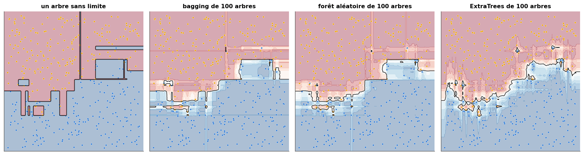
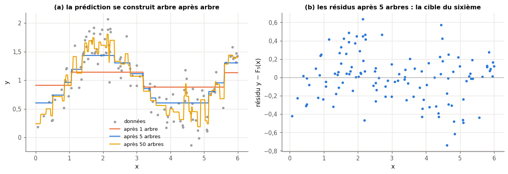

# 14 · Ensembles — fiche de cours

> Cette fiche accompagne le chapitre 14 du livre, court et sans formule, consacré aux **ensembles** : plutôt que de faire confiance à un seul modèle, on en entraîne beaucoup et on les fait **voter**. Le livre présente le vote à la pluralité et sa version pondérée, puis trois façons de construire des ensembles d'arbres de décision : le **bagging**, qui entraîne chaque arbre sur un tirage avec remise du jeu d'entraînement, les **forêts aléatoires**, qui ajoutent un tirage de features à chaque nœud, et les **ExtraTrees**, qui tirent aussi les seuils ; il termine par le **boosting**, qui combine des apprenants faibles en un apprenant fort. La fiche ajoute les maths qui justifient tout cela (la loi binomiale du vote, la limite de $(1 - 1/n)^n$, la variance d'une moyenne de modèles corrélés), l'algorithme **AdaBoost** que le livre ne fait qu'évoquer, et ce que le livre n'aborde pas : le **gradient boosting** (HistGradientBoosting, XGBoost, LightGBM), aujourd'hui la méthode de référence sur les données tabulaires, et l'**importance des features**. Elle corrige aussi plusieurs affirmations du livre (l'exemple d'Apollo, le nombre d'arbres conseillé, un boosting réservé au binaire, la taille des bootstraps). Les exemples du livre (les ordinateurs d'Apollo, les droites combinées en régions) ne sont que résumés : chaque section te dit où les lire.

| | |
|---|---|
| **Livre** | vol. 1, ch. 14 « Ensembles », p. 539-562 (§14.1 à §14.7) |
| **Temps total estimé** | ≈ 20 h : lecture du livre et de la fiche ≈ 3,2 h, exercices ≈ 16 h, 25 flashcards ≈ 0,8 h |
| **Prérequis** | 0B (exponentielle, logarithme et leurs propriétés) · ch. 2 (bootstrap, loi de Bernoulli, variance) · ch. 3 (probabilités d'événements indépendants) · ch. 5 (descente de gradient) · ch. 7 (un-contre-tous) · ch. 8 (validation croisée, `clone`) · ch. 9 (biais et variance, MSE, régression, early stopping) · ch. 13 (arbres de décision : impuretés, poids, `max_features`, `splitter`, arbres de régression) |
| **Fichiers du chapitre** | `02_exercices.md` (quiz, rappels, papier, réflexion, entretien) · `03_notebook.ipynb` · `04_indices.md` · `05_solutions.md` et `05_solutions.ipynb` · `06_mes_reponses.md` · `flashcards.csv` |
| **mylearn** | `ensemble.py` : `plurality_vote` et `bootstrap_indices` (14.12), `BaggingClassifier` (14.17), `RandomForestClassifier` et `ExtraTreesClassifier` (14.18), `AdaBoostClassifier` (14.24), `GradientBoostingRegressor` (14.25). Tous les membres sont **tes** arbres du ch. 13 (`tree.py`), créés par **ton** `clone` du ch. 8 |

## Comment utiliser ce chapitre

Le livre avance en trois temps : pourquoi combiner des modèles et comment les faire voter (§14.1 à §14.3), trois ensembles d'arbres de plus en plus aléatoires (§14.4 à §14.6), puis le boosting (§14.7). Compte un peu plus de trois heures pour ses 24 pages et cette fiche. La fiche suit le même plan, avec une section en plus, le gradient boosting, placée après le §14.7 ; ses encadrés 🧮 donnent les maths qui manquent au livre (la loi binomiale du vote majoritaire, la limite de $(1 - 1/n)^n$, la variance d'une moyenne de modèles corrélés, le gradient d'une loss par rapport aux prédictions) et un outil (fixer les graines d'un ensemble).

**Ordre conseillé.**
1. Lis le livre §14.1 et §14.2, puis les sections 14.1 et 14.2 de la fiche. Fais les quiz Q1 et Q2, le rappel R2 et l'exercice 14.5.
2. Lis le livre §14.3, puis la section 14.3 de la fiche. Fais le quiz Q3, le rappel R3, l'exercice 14.1 et le cas ⚖️ 14.9.
3. Lis le livre §14.4 à §14.6, puis les sections 14.4 à 14.6 de la fiche. Fais les quiz Q4 à Q7, le rappel R1 et la preuve ∂ 14.3.
4. Lis le livre §14.7, puis la section 14.7 de la fiche et celle sur le gradient boosting. Fais les quiz Q8 à Q11, les exercices 14.2, 14.6 et 14.7, la preuve ∂ 14.4, l'oral 🗣️ 14.8 et la lecture 📄 14.10. Vérifie tes réponses courtes dans la partie 0 du notebook.
5. Fais le notebook dans l'ordre : partie A (14.11 à 14.14 : faire voter des classifieurs, ton vote et ton bootstrap, un jury de votants indépendants puis corrélés, voting et stacking), partie B (14.15 à 14.19 : forêts de scikit-learn, nombre d'arbres, ton `BaggingClassifier`, ta forêt et tes ExtraTrees, importance des features), partie C (14.20 à 14.25 : courbes d'un boosting, AdaBoost, ton `AdaBoostClassifier` et ton gradient boosting), partie D (14.26 à 14.28 : HistGradientBoosting, XGBoost et LightGBM, un benchmark reproductible, le défi sur California). Finis par les cinq questions d'entretien.

| Section | Quiz 🧠 et rappels 🔁 | Papier ✏️ ∂ et réflexion | Notebook | Entretien 💼 |
|---|---|---|---|---|
| 14.1 Pourquoi ce chapitre | Q1 | | 14.11 | E1 |
| 14.2 Les ensembles | Q1, Q2, R2 | 14.5, 14.9 | 14.13 | |
| 14.3 Le vote | Q3, R3 | 14.1 | 14.11, 14.12, 14.13, 14.14 | |
| 14.4 Le bagging | Q4, Q5, Q10 | 14.3, 14.8 | 14.12, 14.16, 14.17 | E1 |
| 14.5 Les forêts aléatoires | Q6, R1 | | 14.15, 14.16, 14.18, 14.19 | E2, E4 |
| 14.6 ExtraTrees | Q7 | | 14.15, 14.16, 14.18 | |
| 14.7 Le boosting | Q8, Q9, Q10 | 14.2, 14.6, 14.8 | 14.22, 14.23, 14.24 | E1 |
| Au-delà du livre : le gradient boosting | Q11 | 14.4, 14.7, 14.10 | 14.20, 14.21, 14.25, 14.26, 14.27, 14.28 | E3, E5 |

**Lire les formules.** Un ensemble a $M$ **membres** (des classifieurs ou des régresseurs), numérotés $m = 1, \dots, M$ ; $h_m(\mathbf{x})$ est la prédiction du membre $m$ pour l'exemple $\mathbf{x}$. Comme au ch. 13, le jeu d'entraînement a $n$ exemples de $p$ features, $y$ est un label (ou une cible réelle en régression), et les classes sont numérotées $0, 1, \dots, K - 1$. Deux sortes de **poids** se croisent dans ce chapitre : le poids $w_m$ d'un **votant** (§14.3), que le boosting appelle $\alpha_m$, et le poids $w_i$ d'un **exemple** d'entraînement (AdaBoost) ; l'indice dit de quoi l'on parle ($m$ pour un membre, $i$ pour un exemple). $\mathbb{1}[\cdot]$ vaut 1 si la condition est vraie et 0 sinon. $\varepsilon_m$ est l'erreur pondérée du membre $m$ d'AdaBoost, $F_m(\mathbf{x})$ la prédiction d'un gradient boosting après $m$ étapes, $r_i$ un résidu et $\eta$ le learning rate. $\binom{M}{j}$ est le coefficient binomial (« $j$ parmi $M$ »), $q$ la probabilité qu'un votant ait raison (§14.2), $\rho$ un coefficient de corrélation et $\sigma^2$ une variance. $\ln$ est le logarithme népérien.

## Objectifs d'apprentissage

À la fin du chapitre, tu sais :
- **expliquer** pourquoi un ensemble réduit l'erreur et quand il échoue (erreurs corrélées, membres pires que le hasard, biais commun des données) ;
- **calculer** à la main un vote pondéré, la probabilité qu'une majorité se trompe, la part des exemples oubliés par un bootstrap, une itération d'AdaBoost et deux itérations de gradient boosting ;
- **implémenter** le vote, le bootstrap, le bagging, la forêt aléatoire, ExtraTrees, AdaBoost et un gradient boosting de régression, sur tes propres arbres ;
- **utiliser** HistGradientBoosting, XGBoost et LightGBM avec early stopping sur des données tabulaires ;
- **interpréter** l'importance des features d'une forêt, et savoir quand préférer l'importance par permutation ;
- **choisir** entre bagging et boosting selon le biais et la variance du modèle de base.

## L'essentiel en 10 lignes

1. Un **ensemble** combine les prédictions de plusieurs modèles. Il bat ses membres si chacun fait **mieux que le hasard** et si leurs erreurs sont **peu corrélées** : des copies d'un même modèle ne s'améliorent pas en votant.
2. Un ensemble ne corrige pas un **biais commun** à ses membres : si toutes les données d'entraînement penchent dans le même sens, tous les membres penchent avec elles.
3. Le **vote à la pluralité** donne la classe la plus citée ; le **vote pondéré** additionne des poids, éventuellement négatifs. Le **vote souple** (*soft voting*) moyenne les probabilités ; c'est celui des forêts de scikit-learn.
4. Un **bootstrap** tire $n$ exemples **avec remise** parmi $n$ : il contient environ 63,2 % d'exemples distincts ; les autres, **out-of-bag**, donnent une validation gratuite.
5. Le **bagging** entraîne chaque membre sur son propre bootstrap et moyenne leurs prédictions : il réduit surtout la **variance**, et sert donc les modèles instables, comme les arbres profonds.
6. Une **forêt aléatoire** ajoute un tirage de **features** à chaque nœud (`max_features`) : ses arbres sont moins corrélés, et leur moyenne varie moins. **ExtraTrees** tire en plus un **seuil** au hasard par feature candidate, sans bootstrap par défaut.
7. Ajouter des arbres à une forêt ne la fait **pas** surapprendre : au-delà de quelques centaines, on ne gagne plus rien, mais on ne perd que du temps.
8. Le **boosting** entraîne ses membres **l'un après l'autre**, chacun concentré sur les erreurs des précédents ; il réduit surtout le **biais** et combine des **apprenants faibles**, comme les **souches** (arbres de profondeur 1).
9. **AdaBoost** repondère les exemples (les mal classés pèsent plus) et donne à chaque membre un poids $\alpha_m$ qui grandit quand son erreur pondérée diminue ; sa version multi-classe s'appelle **SAMME**.
10. Le **gradient boosting** ajuste chaque nouvel arbre aux **résidus** (le gradient de la loss, changé de signe), multiplie sa contribution par un **learning rate** et s'arrête par **early stopping** : avec HistGradientBoosting, XGBoost ou LightGBM, c'est la méthode de référence sur les données tabulaires.

## 14.1 · Pourquoi ce chapitre ? ⏩

Les ingénieurs n'ont pas attendu le machine learning pour se méfier d'une machine unique : en aéronautique comme dans le spatial, on fait calculer la même chose par plusieurs copies d'un circuit et l'on garde la réponse de la majorité, pour qu'une panne isolée passe inaperçue. C'est la **redondance modulaire triple** (*triple modular redundancy*), que le livre prend pour point de départ avec les missions Apollo (p. 541). Le machine learning reprend l'idée avec des modèles au lieu de circuits : un **ensemble** est un groupe de modèles dont on combine les prédictions, en espérant que les erreurs de l'un soient rattrapées par les autres.

> ⚠️ **Le livre, corrigé — l'exemple d'Apollo** — Le livre attribue la redondance triple aux ordinateurs de guidage du module de commande et du module lunaire, dont chaque carte aurait été triplée, et ajoute qu'aucun des deux vaisseaux n'avait d'ordinateur de secours (p. 541). C'est inexact. L'ordinateur de guidage d'Apollo (AGC) était un ordinateur unique, non redondant (aucune copie qui vote) ; le module lunaire avait d'ailleurs un ordinateur de secours, l'*Abort Guidance System*. La redondance triple avec vote à la majorité équipait l'ordinateur de la fusée Saturn V (le *Launch Vehicle Digital Computer* d'IBM). L'idée reste la bonne ; seul l'exemple est mal attribué.

Un ensemble peut aussi coûter moins cher qu'il n'y paraît : le livre note qu'une foule de modèles minuscules, bien combinés, peut faire jeu égal avec un modèle bien plus lourd (p. 541) ; c'est l'idée du boosting (§14.7). Il y a une troisième raison, que le livre ne mentionne pas : sur les données **tabulaires** (des lignes et des colonnes, comme Penguins ou California), les ensembles d'arbres, et le **gradient boosting** en tête, restent en 2026 les modèles à battre, devant les réseaux de neurones (encadré 🕰️ de la section sur le gradient boosting).

> 💼 **En entreprise** — Sur un problème tabulaire (scoring de crédit, détection de fraude, prévision de la demande, prix de l'immobilier), le premier modèle « sérieux » qu'on entraîne après une régression linéaire ou logistique est presque toujours une forêt aléatoire ou un gradient boosting (XGBoost, LightGBM, HistGradientBoosting). Les compétitions de données tabulaires se gagnent encore très souvent avec eux, et les recruteurs posent des questions précises sur leurs réglages : le nombre d'arbres, le learning rate, la profondeur, l'early stopping. Les questions d'entretien 💼 14.E1 à 14.E5 portent sur ces réflexes.

## 14.2 · Les ensembles ⏩

**Pourquoi un vote aide.** Le livre part des institutions humaines : on confie les décisions importantes à des assemblées pour que les travers d'un individu ne décident pas seuls (p. 542). Pour qu'un vote améliore la décision, il faut deux conditions ; le livre ne parle que de la seconde, l'indépendance. D'abord, chaque membre doit faire **mieux que le hasard** : un jury de gens qui se trompent plus souvent qu'ils n'ont raison se trompe encore plus souvent en votant. Ensuite, leurs **erreurs** doivent être **peu corrélées** : dix copies du même modèle font dix fois la même erreur, et le vote n'y change rien. L'encadré ci-dessous chiffre la première condition dans le cas idéal de membres indépendants ; ✏️ 14.5 et 🔬 14.13 te font mesurer ce que coûte la corrélation.

> 🧮 **Rappel maths — la loi binomiale et le vote majoritaire** — On lance $M$ fois une expérience à deux issues, indépendantes et de même probabilité de succès $q$ (des épreuves de Bernoulli, ch. 2 ; on note $q$ cette probabilité, car $p$ est déjà le nombre de features). Le nombre $X$ de succès suit la **loi binomiale** :
> $$P(X = j) = \binom{M}{j}\, q^j\, (1 - q)^{M - j}, \qquad \binom{M}{j} = \frac{M!}{j!\,(M - j)!}.$$
> Le **coefficient binomial** $\binom{M}{j}$ (« $j$ parmi $M$ ») compte les façons de choisir les $j$ succès parmi les $M$ épreuves, et $q^j (1 - q)^{M - j}$ est la probabilité de chacune de ces façons. Appliquée à $M$ votants indépendants qui ont chacun raison avec la probabilité $q$ (à deux classes, $M$ impair), la majorité a raison quand plus de la moitié des votants ont raison :
> $$P(\text{majorité juste}) = \sum_{j > M/2} \binom{M}{j}\, q^j (1 - q)^{M - j}.$$
> La majorité se trompe dans le cas symétrique : remplace $q$ par $1 - q$. *Mini-exemple :* sept votants indépendants justes à 80 % : la majorité est juste dès que quatre au moins ont raison, et la somme des quatre termes ($j = 4$ à 7) vaut environ $0{,}967$, bien mieux que chacun. Ce résultat, connu depuis Condorcet (1785) sous le nom de **théorème du jury**, a sa face sombre : si $q < 0{,}5$, la majorité fait **pire** que chaque votant, et d'autant plus qu'ils sont nombreux. `scipy.stats.binom.sf(M // 2, M, q)` calcule cette somme.


> ⚠️ **Le livre, corrigé — des membres « indépendants » ne suffisent pas** — Le livre écrit que si l'on obtient plusieurs prédictions d'algorithmes indépendants, la plus populaire a de bonnes chances d'être la bonne (p. 541). Il manque une condition : que chaque membre fasse **mieux que le hasard**. Avec des membres indépendants pires que le hasard, la majorité se trompe plus souvent que chacun d'eux (encadré 🧮, panneau (a) de la figure). Et l'indépendance est un idéal : des modèles entraînés sur les **mêmes** données font souvent les **mêmes** erreurs, sur les exemples difficiles. Toute la suite du chapitre (bootstraps, features tirées, seuils tirés, repondération) sert à fabriquer des membres **différents**.

**Un ensemble ne corrige pas un biais commun.** Le livre insiste sur un point qui dépasse la technique (p. 542-543) : un modèle apprend ce que contiennent ses données, défauts compris. Si les décisions passées qui servent d'exemples étaient injustes envers un groupe, ou si ce groupe est rare dans les données, le modèle prolonge ces travers, et une décision qui touche des personnes (un crédit, un recrutement) en hérite. Faire voter plusieurs modèles entraînés sur les **mêmes** données ne change rien : ils partagent le même biais, qui survit au vote. Le livre propose de diversifier les **sources** des données d'entraînement ; même alors, un biais commun à toutes les sources reste. ⚖️ 14.9 te fait examiner un cas.

**Les ensembles hors du ML.** Le livre cite les modèles du climat, dont on agrège plusieurs modèles indépendants aux hypothèses différentes, et la **prévision d'ensemble** en météorologie, qui relance un même modèle météo à partir d'états de départ un peu perturbés (p. 543). À noter : une prévision d'ensemble ne retient pas seulement le scénario le plus fréquent, elle en tire une **probabilité** (« 70 % de chances de pluie » : 70 % des membres prévoient de la pluie), comme le vote souple de la section suivante.

## 14.3 · Le vote ⏩

**Pluralité et majorité.** Le **vote à la pluralité** (*plurality voting*, p. 543) donne à chaque membre une voix pour sa classe prédite, et la classe qui reçoit le plus de voix gagne, même sans majorité absolue : avec trois classes, 40 % des voix peuvent suffire. Le vote à la **majorité** exige plus de la moitié des voix ; à deux classes et avec un nombre impair de votants, les deux règles se confondent. Le livre note que les égalités se départagent au hasard ou par un nouveau vote ; les bibliothèques préfèrent une règle **déterministe**, pour que les prédictions soient reproductibles : scikit-learn, et ta fonction `plurality_vote` (🔨 14.12), donnent la **plus petite** classe parmi les ex aequo (c'est ce que fait `np.argmax`, qui renvoie le premier maximum).

**Le vote pondéré.** C'est la règle que suit le livre dans tout le chapitre (p. 544) : au lieu d'une voix chacun, les membres pèsent plus ou moins, et l'on additionne pour chaque classe les poids des membres qui la désignent ; la classe de plus grand total l'emporte, une classe que personne ne désigne gardant un total nul. Le livre autorise des poids négatifs. Avec des poids $w_m$,

$$\hat y(\mathbf{x}) = \arg\max_k \sum_{m=1}^{M} w_m\, \mathbb{1}[h_m(\mathbf{x}) = k].$$

*Mini-exemple :* quatre membres classent une photo ; deux disent « chat », avec les poids 3 et −0,7, deux disent « chien », avec les poids 1,8 et 1,8. Le total de « chat » vaut $3 - 0{,}7 = 2{,}3$, celui de « chien » $3{,}6$ : « chien » l'emporte. Sans les poids, chaque animal a deux voix, et la règle d'égalité donne « chat », le premier dans l'ordre alphabétique.

**Vote dur et vote souple.** Ce que le livre décrit est un **vote dur** (*hard voting*) : chaque membre donne une classe. Quand les membres donnent des **probabilités** (`predict_proba`), on peut les **moyenner** et prendre la classe de plus grande probabilité moyenne : c'est le **vote souple** (*soft voting*). Il tient compte de la confiance de chaque membre. *Mini-exemple :* trois classifieurs donnent à la classe 1 les probabilités 0,9, 0,4 et 0,45 : le vote dur donne la classe 0 (deux voix contre une), le vote souple donne la classe 1 (probabilité moyenne $1{,}75/3 \approx 0{,}583$). C'est le vote souple qu'utilisent le bagging et les forêts de scikit-learn, et ceux de ta librairie ; le vote dur du livre est ta fonction `plurality_vote`.

**Voting et stacking.** Rien n'oblige les membres à être du même type. `VotingClassifier` de scikit-learn fait voter des modèles différents (une régression logistique, un kNN, une forêt…), en vote dur (`voting="hard"`) ou souple (`voting="soft"`), avec des poids éventuels. Le **stacking** (*empilement*) va plus loin : au lieu de fixer les poids, on **apprend** à combiner les membres. Un second modèle, le **méta-modèle** (souvent une régression logistique), prend en entrée les prédictions des membres et apprend à en déduire la classe. Ses données d'entraînement doivent être des prédictions **hors échantillon** (obtenues par validation croisée), sinon il apprendrait à faire confiance au membre qui a le mieux appris l'entraînement par cœur : `StackingClassifier` s'en charge (par défaut, une validation croisée à 5 folds). 📦 14.14 te fait comparer les deux sur Penguins.

> 🕰️ **Mise à jour (2026) — voter avec des probabilités, empiler des modèles** — **Le livre :** fait voter chaque membre pour une seule classe (un vote dur), à la pluralité ou avec des poids (p. 543-546). · **Aujourd'hui :** scikit-learn combine les arbres d'une forêt en **moyennant leurs probabilités** ; son guide utilisateur précise que c'est un écart à l'article original de Breiman, qui faisait voter chaque arbre pour une seule classe. `VotingClassifier` propose les deux votes, et `StackingClassifier` (depuis la version 0.22) apprend la combinaison par un méta-modèle entraîné sur des prédictions de validation croisée. · **Faut-il quand même l'apprendre ?** Oui : le vote dur reste la règle quand les membres ne donnent pas de probabilités, et c'est celle des démonstrations théoriques (encadré 🧮 du §14.2). · *Source :* [scikit-learn, guide utilisateur, « 1.11. Ensembles: Gradient boosting, random forests, bagging, voting, stacking » (version 1.6)](https://scikit-learn.org/1.6/modules/ensemble.html).

## 14.4 · Le bagging ⏩

**Bootstrap et agrégation.** Le **bagging** (*bootstrap aggregating*, Breiman, 1996) construit un ensemble de modèles du même type, d'ordinaire des arbres de décision, entraînés chacun sur un jeu un peu différent (p. 544-546). Chaque jeu est un **bootstrap** du jeu d'entraînement : un tirage **avec remise**, comme au ch. 2, où un même exemple peut sortir plusieurs fois et d'autres jamais. Le livre montre trois bootstraps de 4 exemples tirés parmi 8, notés par des lettres (figure 14.1), puis l'ensemble au travail : un nouvel exemple passe dans chaque arbre, et la classe la plus citée l'emporte (figure 14.2). En régression, on prend la **moyenne** des prédictions.

```text
fit(X, y):
    for m = 1..M:
        rows <- n indices drawn uniformly WITH replacement      # a bootstrap sample
        member[m] <- a fresh, unfitted copy of the template     # clone (ch. 8)
        member[m].fit(X[rows], y[rows])
predict_proba(x):
    mean over m of member[m].predict_proba(x)                   # soft vote
predict(x):
    the class of largest mean probability
```

> 🧮 **Rappel maths — la limite de $(1 - 1/n)^n$ et le nombre e** — Dans un bootstrap de $n$ tirages parmi $n$ exemples, un exemple donné n'est pas tiré à un tirage avec la probabilité $1 - 1/n$, donc il n'est **jamais** tiré avec la probabilité $(1 - 1/n)^n$ (les tirages sont indépendants : ch. 3). Quand $n$ grandit, cette probabilité tend vers $e^{-1} \approx 0{,}368$, où $e \approx 2{,}718$ est la base du logarithme népérien. On l'admet ici ; l'idée tient en une ligne : $\ln\big((1 - 1/n)^n\big) = n \ln(1 - 1/n)$, et $\ln(1 + u) \approx u$ pour $u$ petit (0B), donc $n \ln(1 - 1/n) \approx n \times (-1/n) = -1$. *Mini-exemple :* $n = 5$ donne $0{,}8^5 \approx 0{,}328$, $n = 100$ donne $0{,}99^{100} \approx 0{,}366$ : la limite est atteinte très vite. Par linéarité de l'espérance, un bootstrap contient en moyenne $n\,\big(1 - (1 - 1/n)^n\big) \approx 0{,}632\,n$ exemples **distincts** (3,36 pour $n = 5$). ∂ 14.3 te fait démontrer ces résultats et les vérifier sur d'autres tailles.


**Les exemples out-of-bag.** Chaque arbre n'a donc jamais vu environ 36,8 % des exemples d'entraînement : ce sont ses exemples **out-of-bag** (*hors du sac*, OOB). Pour estimer l'accuracy de l'ensemble sans jeu de validation, on prédit chaque exemple d'entraînement avec les seuls arbres qui ne l'ont **pas** vu, et l'on compare au vrai label : c'est le **score out-of-bag** (`oob_score=True` dans scikit-learn, `oob_score_` après `fit`). Avec quelques dizaines d'arbres, presque chaque exemple est out-of-bag pour plusieurs d'entre eux. Ce score est une estimation honnête, un peu pessimiste (chaque exemple n'est prédit que par une partie de l'ensemble), qui évite de sacrifier des données à la validation.

**Pourquoi le bagging marche : la variance.** Un arbre profond a peu de biais mais beaucoup de **variance** (ch. 9, ch. 13) : un autre tirage des données donne un autre arbre. Moyenner les prédictions de nombreux arbres réduit cette variance, sans toucher au biais (la moyenne de modèles biaisés de la même façon garde ce biais). Mais les arbres d'un bagging ne sont pas indépendants : ils sont entraînés sur des bootstraps du **même** jeu, et se ressemblent. L'encadré suivant dit combien cette ressemblance limite le gain.

> 🧮 **Rappel maths — la variance d'une moyenne de modèles corrélés** — Soient $M$ prédictions $h_1, \dots, h_M$ de même variance $\sigma^2$, dont chaque paire a la même corrélation $\rho$ (leur covariance vaut $\rho\,\sigma^2$). La variance de leur moyenne vaut
> $$\operatorname{Var}\Big(\frac1M \sum_{m} h_m\Big) = \rho\,\sigma^2 + \frac{1 - \rho}{M}\,\sigma^2.$$
> *Pourquoi :* la variance d'une somme est la somme de toutes les covariances, soit $M$ variances $\sigma^2$ et $M(M - 1)$ covariances $\rho\,\sigma^2$ ; on divise par $M^2$. Avec $\rho = 0$, on retrouve la variance de la moyenne de variables indépendantes, $\sigma^2/M$, qui tend vers 0. Avec $\rho > 0$, le second terme disparaît quand $M$ grandit, mais le premier reste : **aucun nombre d'arbres ne descend sous $\rho\,\sigma^2$**. *Mini-exemple :* $\sigma^2 = 1$ et $\rho = 0{,}5$ : 10 arbres donnent $0{,}5 + 0{,}05 = 0{,}55$, une infinité donne 0,5. Pour aller plus bas, il faut **décorréler** les arbres : c'est l'idée de la forêt aléatoire (panneau (b) de la figure du §14.2).

**Les deux réglages.** Le livre en nomme deux (p. 546) : la taille de chaque bootstrap et le nombre d'arbres. Pour le premier, la règle est simple : $n$ tirages parmi $n$ (`max_samples=1.0` dans `BaggingClassifier` et ta librairie, `None` dans les forêts : $n$ tirages dans les deux cas) ; de plus petits bootstraps rendent les arbres plus différents et plus rapides à entraîner, au prix d'arbres moins bons. Pour le second, plus on met d'arbres, plus la variance baisse (encadré 🧮), et le gain finit par devenir négligeable : c'est la loi des **rendements décroissants** que cite le livre. Le bagging n'aide que les modèles **instables** : moyenner des régressions linéaires entraînées sur des bootstraps donne à peu près la même régression linéaire.

> ⚠️ **Le livre, corrigé — la taille des bootstraps et le nombre d'arbres** — (1) Le livre construit ses bootstraps en ne prenant « que quelques » exemples du jeu d'entraînement (p. 545), et sa figure 14.1 tire 4 exemples parmi 8. C'est une illustration : un bootstrap a d'ordinaire **autant** de tirages que le jeu a d'exemples ($n$ parmi $n$), et c'est le défaut de scikit-learn. (2) Il conseille, comme règle empirique, à peu près **autant de classifieurs que de classes** (p. 546, et de nouveau p. 560 pour le boosting), en citant Bonab et Can (2016). Cet article étudie un cadre bien particulier : des ensembles **en ligne** sur des flux de données, de membres supposés **indépendants**, combinés par vote majoritaire pondéré. Il ne s'applique ni aux forêts, dont les arbres sont corrélés (encadré 🧮), ni au boosting. Une forêt de deux arbres pour un problème à deux classes est bien trop petite : on en met d'ordinaire **100 à 500** (100 par défaut dans scikit-learn), et ajouter des arbres ne fait jamais surapprendre une forêt ; pour le boosting, le nombre de membres se règle avec le learning rate, par early stopping (section sur le gradient boosting). Le livre a raison sur un point : la validation croisée (ou le score out-of-bag) départage les choix.

## 14.5 · Les forêts aléatoires ⏩

**Décorréler les arbres.** Pour réduire la corrélation $\rho$ entre les arbres d'un bagging, la **forêt aléatoire** (*random forest*, Breiman, 2001) ajoute un second tirage, à **chaque nœud** (p. 547-548) : au lieu de chercher le meilleur split parmi les $p$ features, l'arbre n'en examine qu'un petit nombre, tirées **sans remise**, et choisit la meilleure parmi elles ; au nœud suivant, il tire un nouveau sous-ensemble. Le livre l'appelle **feature bagging** et le montre sur 5 features dont chaque nœud examine 3 (figure 14.3). Une feature très forte ne peut plus s'imposer à la racine de tous les arbres : quand elle n'est pas tirée, l'arbre en essaie une autre, et les arbres deviennent plus différents. Chaque arbre est un peu moins bon, mais leur moyenne est meilleure.

```text
grow(node):                           # the tree of chapter 13, one change
    if the node must be a leaf: stop
    features <- k of the p features drawn WITHOUT replacement   # a new draw at EVERY node
    best split among those k features only
    grow(left child), grow(right child)
```

Ton arbre du ch. 13 sait déjà le faire (`max_features` et `random_state`, 🔨 13.25) : ta forêt (🔨 14.18) n'est qu'un bagging de `DecisionTreeClassifier(max_features=...)`.

**Combien de features par nœud ?** Le livre note que les bibliothèques proposent une fraction ou une formule (p. 548). Dans scikit-learn, `max_features` vaut par défaut `"sqrt"` pour la classification, soit $\lfloor\sqrt{p}\rfloor$ features par nœud (3 pour $p = 9$, 5 pour $p = 30$), et 1.0, toutes les features, pour la régression (`RandomForestRegressor`, qui ne fait donc par défaut que du bagging). Un petit `max_features` décorrèle davantage mais affaiblit chaque arbre ; avec `max_features=None`, on retrouve le bagging d'arbres. Les autres réglages sont ceux des arbres (`max_depth`, `min_samples_leaf`), qu'on laisse souvent sans limite : la moyenne se charge de la variance. Une forêt est aussi facile à **paralléliser** : ses arbres sont indépendants, et `n_jobs=-1` les entraîne sur tous les cœurs (📦 14.15).



> 🕰️ **Mise à jour (2026) — les forêts dans scikit-learn** — **Le livre :** demande de choisir la taille des bootstraps, le nombre d'arbres et la fraction de features ; il ne donne qu'une règle pour le nombre d'arbres, autant que de classes (p. 546), corrigée au §14.4. · **Aujourd'hui :** `RandomForestClassifier` prend par défaut `n_estimators=100` (10 avant la version 0.22), `max_features="sqrt"` (défaut depuis la version 1.1, l'ancien `"auto"` a disparu en 1.3), `bootstrap=True` et `max_samples=None`, soit $n$ tirages parmi $n$ ; `oob_score=True` calcule le score out-of-bag. Le guide utilisateur résume le nombre d'arbres ainsi : plus il y en a, mieux c'est, mais plus c'est long, et les résultats cessent de s'améliorer nettement au-delà d'un nombre critique. `ExtraTreesClassifier` a les mêmes défauts, sauf `bootstrap=False`. · **Faut-il quand même l'apprendre ?** Oui : une forêt aléatoire bien réglée est une baseline solide, presque sans réglage, robuste au bruit et peu sensible à l'échelle des features. · *Sources :* [`RandomForestClassifier` (scikit-learn 1.3)](https://scikit-learn.org/1.3/modules/generated/sklearn.ensemble.RandomForestClassifier.html) ; [guide utilisateur, « 1.11. Ensembles » (version 1.6)](https://scikit-learn.org/1.6/modules/ensemble.html).

**L'importance des features.** Une forêt donne, comme un arbre (ch. 13), un `feature_importances_` : pour chaque feature, la baisse d'impureté pondérée qu'elle apporte dans tous les nœuds où elle sert, moyennée sur les arbres et normalisée pour faire 1 (on parle d'importance **MDI**, *mean decrease in impurity*). C'est gratuit, mais trompeur de deux façons. D'abord, cette importance favorise les features à **forte cardinalité** (beaucoup de valeurs distinctes, comme un identifiant ou une mesure continue) : elles offrent tant de seuils qu'un arbre profond trouve toujours à s'en servir, même si elles ne disent rien de la cible. Ensuite, elle est calculée sur l'**entraînement**, et mesure ce que l'arbre a appris par cœur autant que ce qui généralise. L'**importance par permutation** corrige ces deux défauts : on mélange au hasard les valeurs d'une feature dans le jeu de **validation** (ou de test), et l'on mesure la baisse du score ; une feature inutile ne fait rien perdre, aux fluctuations de la mesure près (sur la figure ci-dessous, 0,01 au plus pour les deux colonnes de bruit, soit 4 exemples de validation sur 320). Elle se calcule pour n'importe quel modèle (`sklearn.inspection.permutation_importance`), au prix de quelques prédictions par feature. Attention aux features **corrélées** : en mélanger une seule laisse l'autre porter l'information, et les deux paraissent peu importantes. 📦 14.19 te fait comparer les deux importances sur California.


> 🕰️ **Mise à jour (2026) — peut-on se fier à `feature_importances_` ?** — **Le livre :** ne parle pas de l'importance des features. · **Aujourd'hui :** la documentation de scikit-learn prévient, sous `feature_importances_`, que l'importance par l'impureté peut tromper pour les features à forte cardinalité, et renvoie à `permutation_importance`. Son exemple « Permutation Importance vs Random Forest Feature Importance (MDI) » ajoute au Titanic deux colonnes aléatoires, une numérique à valeurs toutes distinctes et une catégorielle à trois valeurs : l'importance MDI place la colonne numérique aléatoire parmi les features les plus importantes, l'importance par permutation sur le test donne aux deux colonnes une importance proche de 0. Pour expliquer les prédictions **une à une**, on utilise aujourd'hui les valeurs de Shapley (bibliothèque SHAP, bonus B6). · **Faut-il quand même l'apprendre ?** Oui : `feature_importances_` reste un premier coup d'œil utile, à condition de le confirmer par permutation sur des données que le modèle n'a pas vues. · *Sources :* [`RandomForestClassifier` (scikit-learn 1.3)](https://scikit-learn.org/1.3/modules/generated/sklearn.ensemble.RandomForestClassifier.html) ; [« Permutation Importance vs Random Forest Feature Importance (MDI) » (scikit-learn 1.6)](https://scikit-learn.org/1.6/auto_examples/inspection/plot_permutation_importance.html).

## 14.6 · ExtraTrees ⏩

Les **arbres extrêmement aléatoires** (*extremely randomized trees*, ExtraTrees ; Geurts, Ernst et Wehenkel, 2006) ajoutent un troisième tirage (p. 549) : pour chaque feature candidate d'un nœud, au lieu de chercher le **meilleur** seuil, l'arbre tire **un seul** seuil au hasard, uniformément entre la plus petite et la plus grande valeur de cette feature dans le nœud ; il garde ensuite la meilleure des features candidates, chacune avec son seuil tiré. C'est le `splitter="random"` de ton arbre (🔨 13.25). Par défaut, scikit-learn n'utilise **pas** de bootstrap pour ExtraTrees : chaque arbre voit tout le jeu d'entraînement, et le hasard vient seulement des features et des seuils.

Chaque arbre est moins bon qu'un arbre aux seuils optimaux, mais les arbres sont encore moins corrélés, et l'ensemble a souvent une variance plus faible qu'une forêt, avec un biais un peu plus grand (le livre résume : on échange un peu d'accuracy de chaque arbre contre moins d'overfitting). Côté calcul, ne pas chercher le meilleur seuil évite de trier les valeurs à chaque nœud, et chaque nœud coûte bien moins cher ; mais des seuils tirés au hasard coupent moins bien, et les arbres sont souvent plus grands : selon les données, ExtraTrees s'entraîne plus vite qu'une forêt, ou à peu près aussi vite. Laquelle des deux prédit le mieux dépend aussi des données : on compare en validation croisée (🔬 14.16).

| | bagging | forêt aléatoire | ExtraTrees |
|---|---|---|---|
| tirage des exemples | bootstrap | bootstrap | aucun (tout le jeu) par défaut |
| tirage des features | aucun | `max_features` à chaque nœud | `max_features` à chaque nœud |
| seuil de chaque feature | le meilleur | le meilleur | tiré au hasard |
| corrélation entre arbres | forte | moyenne | faible |
| coût d'un nœud | trier et tester tous les seuils de $p$ features | trier et tester tous les seuils de `max_features` features | un seuil tiré par feature candidate |

## 14.7 · Le boosting ⏩

**Apprenants faibles et forts.** Le **boosting** (Schapire, 1990 ; Freund et Schapire, 1997) suit une autre logique que le bagging : au lieu d'entraîner des membres indépendants et forts, il entraîne des membres **faibles**, **l'un après l'autre**, chacun corrigeant les erreurs des précédents (p. 549-560). Un **apprenant faible** (*weak learner*) fait à peine mieux que le hasard : à deux classes équilibrées, une accuracy de 51 % suffit ; un **apprenant fort** a raison la plupart du temps. Le livre montre deux classifieurs linéaires mal placés, l'un pas meilleur que le hasard, l'autre à peine meilleur (figure 14.4), et remarque qu'à deux classes, un classifieur pire que le hasard devient meilleur que le hasard si l'on échange ses deux réponses. L'apprenant faible le plus utilisé est la **souche** (*decision stump*) : un arbre de profondeur 1, une seule question, deux feuilles. Le boosting n'exige pas des apprenants faibles, mais il les tolère, et ils sont rapides.

**L'exemple du livre : des droites qui votent.** Sur des points de deux classes qu'aucune droite ne sépare (des ronds de part et d'autre d'une bande de carrés), le livre place trois droites A, B et C, chacune un classifieur faible, qui découpent le plan en sept régions d'une seule classe chacune (p. 551-557, figures 14.5 à 14.11). Chaque droite renvoie son **poids** pour un point situé de son côté « positif » (celui de la flèche) et 0 sinon ; la somme des poids, comparée à 0, donne la classe de chaque région. Avec des poids bien choisis, dont un **négatif**, les régions positives sont exactement celles des carrés. Un second exemple fait de même avec quatre droites et une grille de neuf régions (figures 14.12 à 14.15). ✏️ 14.2 te fait faire ces additions sur d'autres droites.

> ⚠️ **Le livre, corrigé — ce que fait vraiment un algorithme de boosting** — Les deux exemples du livre fixent les droites et leurs poids **à la main**, en regardant le résultat ; le livre ajoute que le boosting trouve tout seul quels classifieurs utiliser et avec quels poids (p. 560), mais il ne montre jamais comment. Le cœur du boosting est justement là : les membres sont entraînés **l'un après l'autre**, et chacun est choisi sur des données **repondérées** pour se concentrer sur les exemples que les précédents classent mal (AdaBoost, ci-dessous). Autre différence avec les figures : dans AdaBoost, les poids $\alpha_m$ des membres sont **positifs**, et chaque membre donne son poids à la classe qu'il prédit, quelle qu'elle soit, au lieu de « son poids ou rien » ; les deux conventions donnent les mêmes frontières, à un décalage du seuil près (✏️ 14.2 te fait passer de l'une à l'autre).

**AdaBoost.** L'algorithme **AdaBoost** (*adaptive boosting*, Freund et Schapire, 1997), que le livre cite sans le détailler (p. 560), garde un **poids** $w_i$ par exemple d'entraînement, d'abord tous égaux à $1/n$. À chaque tour, il entraîne un membre (une souche) avec ces poids, mesure son **erreur pondérée** $\varepsilon_m$, lui donne un poids de vote $\alpha_m$, puis **augmente** le poids des exemples qu'il a mal classés :

```text
fit(X, y):                                         # K classes, SAMME
    w[i] <- 1/n for every training sample
    for m = 1..M:
        w <- w / sum(w)                            # normalise: the weights sum to 1
        h[m] <- fresh stump fitted with sample_weight = w
        err <- sum of w[i] over the samples that h[m] misclassifies
        if err == 0: keep h[m] with alpha 1 and stop          # perfect member
        if err >= 1 - 1/K: discard h[m] and stop              # no better than chance
        alpha[m] <- learning_rate * (ln((1 - err) / err) + ln(K - 1))
        w[i] <- w[i] * exp(alpha[m]) for every misclassified sample i
predict(x):
    the class k that maximises sum over m of alpha[m] * [h[m](x) == k]
```

Avec les poids des exemples $w_i$ et le learning rate $\eta$ (1 par défaut), les formules s'écrivent

$$\varepsilon_m = \frac{\sum_i w_i\,\mathbb{1}[h_m(\mathbf{x}_i) \ne y_i]}{\sum_i w_i}, \qquad \alpha_m = \eta\left(\ln\frac{1 - \varepsilon_m}{\varepsilon_m} + \ln(K - 1)\right), \qquad w_i \leftarrow w_i\, e^{\alpha_m \mathbb{1}[h_m(\mathbf{x}_i) \ne y_i]}.$$

À deux classes, $\ln(K - 1) = 0$, et plus l'erreur d'un membre est petite, plus il pèse ; le pseudo-code rejette un membre qui n'est pas meilleur que le hasard. Beaucoup de textes écrivent $\alpha_m = \frac12 \ln\frac{1 - \varepsilon_m}{\varepsilon_m}$, avec des labels $\pm 1$ et une mise à jour $w_i \leftarrow w_i\,e^{-\alpha_m y_i h_m(\mathbf{x}_i)}$ : à deux classes, c'est le même algorithme, à un facteur 2 près sur les $\alpha_m$, qui ne change ni les votes ni les poids normalisés. *Mini-exemple :* sur 20 exemples de poids 0,05, une souche en classe mal 3 : $\varepsilon = 0{,}15$ et $\alpha = \ln(0{,}85/0{,}15) \approx 1{,}735$ ; les trois exemples mal classés sont multipliés par $e^{\alpha} = 0{,}85/0{,}15 \approx 5{,}67$, et l'on divise ensuite tous les poids par leur nouveau total. La souche suivante, entraînée avec ces poids, a tout intérêt à bien classer ces trois exemples. La figure ci-dessous montre trois tours sur un petit problème : la taille de chaque point est proportionnelle à son poids. Dans ton arbre, ces poids remplacent les comptes dans les impuretés (`sample_weight`, ch. 13 et 🔁 14.R1). ✏️ 14.6 te fait dérouler plusieurs tours à la main.


**Plusieurs classes : SAMME.** Le terme $\ln(K - 1)$ vient de **SAMME** (Zhu, Zou, Rosset et Hastie, 2009), la version multi-classe d'AdaBoost. Avec $K$ classes, deviner au hasard se trompe avec la probabilité $1 - 1/K$, et un membre n'est utile que si son erreur est plus petite : à cinq classes, un membre qui se trompe dans 65 % des cas fait encore mieux que le hasard, et reçoit $\alpha = \ln(0{,}35/0{,}65) + \ln 4 \approx 0{,}767 > 0$. C'est l'algorithme d'`AdaBoostClassifier` de scikit-learn, et de ta classe (🔨 14.24).

> ⚠️ **Le livre, corrigé — le boosting n'est pas réservé au binaire** — Le livre écrit que la théorie du boosting ne couvre que la classification **binaire**, et que c'est en partie pour cela qu'il marche si bien avec les arbres (p. 560). C'est inexact, et le lien avec les arbres ne tient pas. Dès 1997, Freund et Schapire ont proposé des versions multi-classes d'AdaBoost (AdaBoost.M1 et M2) ; SAMME (2009), ci-dessus, est celle qu'utilise scikit-learn ; et le gradient boosting (section suivante) s'applique à toute loss dérivable : classification à $K$ classes, régression, classement. Si le boosting d'arbres a tant de succès, c'est que les arbres sont rapides, insensibles à l'échelle des features, capables de capter des interactions, et qu'un arbre peu profond est un apprenant faible idéal.

**Biais, variance et bruit.** Le boosting réduit surtout le **biais** : chaque membre ajoute ce qui manquait aux précédents, et un ensemble de souches peut tracer des frontières très découpées (🎨 14.22). Contrairement à une forêt, il **peut surapprendre** si l'on ajoute trop de membres, surtout avec des labels bruités : AdaBoost donne alors un poids énorme aux exemples dont le label est faux, qu'il ne parvient jamais à classer. On règle donc le nombre de membres et le learning rate par validation, et l'on préfère des membres faibles. Le livre emploie aussi le mot **hypothèse** pour un membre (p. 560) : chaque souche affirme une règle simple et fausse par endroits, et l'ensemble en fait une règle fiable.

> 🕰️ **Mise à jour (2026) — AdaBoost dans scikit-learn** — **Le livre :** cite AdaBoost et limite la théorie du boosting au binaire. · **Aujourd'hui :** `AdaBoostClassifier` implémente l'algorithme SAMME de Zhu et coll. (2009), y compris à plusieurs classes ; par défaut, ses membres sont des souches (`DecisionTreeClassifier(max_depth=1)`), avec `n_estimators=50` et `learning_rate=1.0`, et l'apprentissage s'arrête plus tôt en cas d'ajustement parfait. Le paramètre `algorithm`, qui permettait de choisir la variante SAMME.R, est déprécié depuis la version 1.6 et doit disparaître en 1.8 : seul SAMME reste. · **Faut-il quand même l'apprendre ?** Oui, pour l'intuition (repondérer les erreurs, peser les membres) et parce qu'AdaBoost est le premier algorithme de boosting ; en pratique, on lui préfère le gradient boosting, plus souple et plus robuste au bruit. · *Source :* [`AdaBoostClassifier` (scikit-learn 1.6)](https://scikit-learn.org/1.6/modules/generated/sklearn.ensemble.AdaBoostClassifier.html).

## Au-delà du livre : le gradient boosting

**Corriger les résidus.** Le livre s'arrête à AdaBoost. Le **gradient boosting** (Friedman, 2001) généralise l'idée de corriger les erreurs des membres précédents, et c'est lui qui domine aujourd'hui les données tabulaires. En régression, avec la MSE, l'idée est très simple. On part d'une prédiction **constante**, la moyenne des cibles. À chaque étape, on calcule les **résidus** $r_i = y_i - F_{m-1}(\mathbf{x}_i)$, ce qui reste à expliquer ; on entraîne un petit arbre de régression (le `DecisionTreeRegressor` du ch. 13) à prédire ces résidus ; et l'on ajoute ses prédictions, multipliées par le **learning rate** $\eta$ :

$$F_0 = \bar y, \qquad r_i = y_i - F_{m-1}(\mathbf{x}_i), \qquad F_m = F_{m-1} + \eta\, h_m.$$

```text
fit(X, y):
    F <- mean(y) for every sample                    # init_
    for m = 1..M:
        r <- y - F                                   # residuals = negative gradient of (y - F)^2 / 2
        tree[m] <- fresh DecisionTreeRegressor(max_depth=d) fitted to (X, r)
        F <- F + learning_rate * tree[m].predict(X)
predict(x):
    mean(y) + learning_rate * (sum over m of tree[m].predict(x))
```

*Mini-exemple :* deux exemples, de cibles 3 et 4, sont prédits $F = 2{,}2$ tous les deux et sont les deux seuls exemples d'une feuille du nouvel arbre ; leurs résidus valent $0{,}8$ et $1{,}8$, et cette feuille prédit leur moyenne, $1{,}3$. Avec $\eta = 0{,}3$, les deux prédictions passent à $2{,}2 + 0{,}3 \times 1{,}3 = 2{,}59$, et les résidus à $0{,}41$ et $1{,}41$ : chaque étape ne corrige qu'une partie de l'erreur, et un arbre ne distingue pas les exemples d'une même feuille. ✏️ 14.7 te fait dérouler deux étapes à la main, et 🔨 14.25 coder ce boosting.

> 🧮 **Rappel maths — le gradient d'une loss par rapport aux prédictions** — Pourquoi « gradient » ? Regarde la loss d'un exemple comme une fonction de sa **prédiction** $F$, et non des paramètres d'un modèle. Pour la loss quadratique $\ell(y, F) = \frac12 (y - F)^2$, la dérivée vaut $\partial \ell / \partial F = -(y - F)$ : le résidu $y - F$ est exactement la **dérivée changée de signe**, la direction dans laquelle il faut déplacer $F$ pour faire baisser la loss (ch. 5). Ajouter $\eta \times$ (résidus) aux prédictions, c'est faire un pas de descente de gradient, sauf que le pas doit être **prédit par un arbre**, pour s'appliquer aussi aux exemples que l'on n'a pas vus. Avec une autre loss, on ajuste l'arbre aux **pseudo-résidus** $-\partial \ell / \partial F$ ; en classification binaire, $F$ est un log-odds et $\hat p = \sigma(F)$, avec la log-loss (ch. 6), dont ∂ 13.8 a calculé la dérivée. ∂ 14.4 te fait démontrer ces résultats, calculer les pseudo-résidus de la log-loss et dire ce que change une loss en valeur absolue.

**Le learning rate et le nombre d'arbres.** Avec $\eta = 1$, chaque arbre corrige tout ce qu'il peut, et le modèle colle vite à l'entraînement, bruit compris. Un petit $\eta$ (0,05 ou 0,1) corrige un peu à la fois : il faut **plus d'arbres** pour atteindre la même erreur d'entraînement, mais le modèle généralise d'ordinaire mieux (on parle de **shrinkage**, *rétrécissement*). Les deux réglages vont donc ensemble : on fixe un petit learning rate, puis on choisit le nombre d'arbres par **early stopping** : on suit le score sur un jeu de validation après chaque arbre, et l'on s'arrête quand il ne s'améliore plus depuis un certain nombre d'étapes (l'early stopping du ch. 9, appliqué au nombre d'arbres). Contrairement à une forêt, un gradient boosting **surapprend** si on le laisse ajouter des arbres sans contrôle. Les autres réglages limitent chaque arbre (profondeur de 3 à 8, ou nombre de feuilles ; taille minimale des feuilles) ou ajoutent du hasard : chaque arbre peut n'utiliser qu'une fraction des exemples, tirée sans remise (`subsample` < 1, le **gradient boosting stochastique** de Friedman, 2002), ou des features (`colsample_bytree` dans XGBoost). 📈 14.20 et 🔮 14.21 te font lire les courbes d'entraînement et de validation.



**Les bibliothèques.** Le `GradientBoostingRegressor` de scikit-learn suit exactement l'algorithme ci-dessus avec ses réglages `loss="squared_error"` (le défaut) et `criterion="squared_error"` (le défaut est `"friedman_mse"`, la formule de Friedman pour le gain d'un split, équivalente à la baisse de la somme des carrés ; les tests fixent `"squared_error"` pour ne dépendre d'aucun écart d'arrondi), et sert de référence aux tests de ta classe. Sur de vrais volumes, on utilise des implémentations bien plus rapides, qui rangent d'abord les valeurs de chaque feature dans un **histogramme** de quelques centaines d'intervalles au plus (*bins* ; 255 par défaut dans scikit-learn) et ne testent que les seuils entre deux intervalles :
- **HistGradientBoostingRegressor** et **HistGradientBoostingClassifier** de scikit-learn (depuis la version 0.21, inspirés de LightGBM) : rapides au-delà de quelques dizaines de milliers d'exemples, ils acceptent les **valeurs manquantes** sans imputation et les features catégorielles, et activent l'early stopping par défaut au-delà de 10 000 exemples ;
- **XGBoost** (Chen et Guestrin, 2016) : régularisation des feuilles, parallélisme, GPU ; le gagnant de très nombreuses compétitions ;
- **LightGBM** (Ke et coll., 2017, Microsoft) : arbres construits **feuille par feuille** (la feuille qui fait le plus baisser la loss d'abord), très rapides sur les gros volumes ;
- **CatBoost** (Prokhorenkova et coll., 2018, Yandex) : un traitement soigné des features **catégorielles** ; il n'est pas installé dans l'environnement du workbook.

Tous ont la même logique (un learning rate, un nombre d'arbres réglé par early stopping, des arbres limités), et leurs réglages par défaut diffèrent : XGBoost prend `learning_rate=0.3` et `max_depth=6`, LightGBM et HistGradientBoosting limitent le **nombre de feuilles** (31) plutôt que la profondeur. 📦 14.26 te les fait comparer sur California, et 🏆 14.28 battre une RMSE de 0,45.

> 🕰️ **Mise à jour (2026) — le gradient boosting, référence des données tabulaires** — **Le livre :** présente le boosting avec des droites pondérées à la main, ne fait que citer AdaBoost, et ne parle pas du gradient boosting. · **Aujourd'hui :** le gradient boosting d'arbres (XGBoost, LightGBM et CatBoost, dont les articles datent de 2016, 2017 et 2018, et les `HistGradientBoosting` de scikit-learn, qui accélèrent l'algorithme de plusieurs ordres de grandeur au-delà de quelques dizaines de milliers d'exemples) est la méthode de référence sur les données tabulaires. Une étude de Grinsztajn, Oyallon et Varoquaux (NeurIPS 2022, 45 datasets) montre que les modèles à base d'arbres restent meilleurs que les réseaux de neurones sur des données de taille moyenne (environ 10 000 exemples), et l'explique par leurs biais inductifs : ils résistent aux features inutiles, respectent l'orientation des données (une question par feature) et apprennent facilement des fonctions irrégulières. Depuis, des **modèles de fondation tabulaires** les concurrencent sur les petits jeux : TabPFN (Hollmann et coll., *Nature*, 2025), un transformer pré-entraîné sur un très grand nombre de datasets synthétiques, prédit sans nouvel entraînement sur des datasets d'au plus 10 000 exemples, et, en classification, bat en 2,8 s un ensemble des meilleures méthodes réglées pendant 4 h. · **Faut-il quand même l'apprendre ?** Oui, absolument : un gradient boosting bien réglé est la baseline que tout autre modèle tabulaire doit battre, et 📄 14.10 te fait lire l'étude de 2022. · *Sources :* [scikit-learn, guide utilisateur, « 1.11. Ensembles » (version 1.6)](https://scikit-learn.org/1.6/modules/ensemble.html) ; [`HistGradientBoostingRegressor` (scikit-learn 1.6)](https://scikit-learn.org/1.6/modules/generated/sklearn.ensemble.HistGradientBoostingRegressor.html) ; [L. Grinsztajn, E. Oyallon et G. Varoquaux, « Why do tree-based models still outperform deep learning on typical tabular data? » (NeurIPS 2022, arXiv:2207.08815)](https://arxiv.org/abs/2207.08815) ; [N. Hollmann et coll., « Accurate predictions on small data with a tabular foundation model », *Nature* 637, 2025](https://www.nature.com/articles/s41586-024-08328-6).

> 🧮 **Rappel outil — fixer les graines d'un ensemble** — Un ensemble tire beaucoup de nombres au hasard : bootstraps, features, seuils, sous-échantillons. Pour qu'une expérience soit **reproductible**, on fixe `random_state` (un entier) : le même code sur les mêmes données donne alors le même modèle. Ta librairie crée **un** générateur `np.random.default_rng(random_state)` au début de `fit`, et en tire tout le reste, y compris un entier par membre, passé à son `random_state` : un ensemble entier se reproduit à partir d'une seule graine. Deux pièges. Comparer deux modèles sur **une seule** graine peut faire prendre la chance pour un progrès : on répète sur plusieurs graines et l'on regarde l'écart. Et une graine fixée ne suffit pas d'une machine à l'autre : les versions des bibliothèques, et parfois le nombre de cœurs (`n_jobs`) ou le matériel (GPU), changent aussi les résultats ; un benchmark note donc ses versions (🛠️ 14.27).

## Bilan : bagging ou boosting ?

| | bagging, forêt aléatoire, ExtraTrees | AdaBoost, gradient boosting |
|---|---|---|
| membres | entraînés **indépendamment** (en parallèle) | entraînés **l'un après l'autre**, chacun selon les erreurs des précédents |
| modèle de base | fort et instable : arbres profonds | faible : souches, arbres de profondeur 3 à 8 |
| ce qui baisse | surtout la **variance** | surtout le **biais** (et la variance avec un petit learning rate) |
| combinaison | moyenne ou vote, membres égaux | somme pondérée ($\alpha_m$, ou $\eta$ pour chaque arbre) |
| plus de membres | ne surapprend pas, coûte du temps | finit par surapprendre : early stopping |
| réglages sensibles | peu : `max_features`, nombre d'arbres | learning rate, nombre d'arbres, profondeur |
| bruit des labels | robuste | AdaBoost sensible ; gradient boosting plus robuste avec une loss adaptée |
| validation gratuite | score out-of-bag | non (sauf sous-échantillonnage) : un jeu de validation |

Quelques règles de départ : une **forêt aléatoire** quand on veut un bon modèle vite, sans réglage ; un **gradient boosting** (HistGradientBoosting, XGBoost, LightGBM) quand on vise le meilleur score sur des données tabulaires et qu'on a le temps de régler le learning rate, le nombre d'arbres et la profondeur par validation. Dans les deux cas, on compare à une baseline simple (ch. 13) sur les mêmes folds.

## Les pièges classiques ⚠️ (récapitulatif)

| Piège | Exemple | Ce qu'il faut faire |
|---|---|---|
| faire voter des copies du même modèle | dix arbres identiques, entraînés sur les mêmes données sans aléa : aucun gain | diversifier : bootstraps, features tirées, seuils tirés, modèles différents |
| croire qu'un ensemble corrige un biais des données | « 50 modèles votent, donc la décision est équitable » | auditer les données et les erreurs par groupe ; un biais commun survit au vote |
| confondre un tirage sans remise de $n$ exemples avec un bootstrap | `bootstrap=False` et `max_samples=1.0` : chaque arbre voit tout le jeu, le bagging ne fait plus rien | avec remise, $n$ tirages parmi $n$ (`bootstrap=True`) ; sans remise, moins de $n$ exemples par arbre (le *pasting*, une variante reconnue) |
| peu d'arbres dans une forêt | `n_estimators=3` « parce qu'il y a trois classes » | 100 à 500 arbres ; vérifier sur le score out-of-bag que le gain s'arrête |
| craindre qu'une forêt surapprenne avec plus d'arbres | réduire `n_estimators` pour « éviter l'overfitting » | une forêt ne surapprend pas en ajoutant des arbres ; limiter plutôt la profondeur ou `min_samples_leaf` si besoin |
| laisser un gradient boosting ajouter des arbres sans contrôle | 5 000 arbres avec `learning_rate=0.3` : l'erreur de validation remonte | petit learning rate et early stopping sur un jeu de validation |
| régler l'early stopping sur le jeu de test | « j'arrête quand l'erreur de test remonte » | un jeu de validation séparé (ou celui que l'early stopping découpe dans l'entraînement) ; le test ne sert qu'à la fin |
| se fier aux `feature_importances_` | un identifiant ou une colonne de bruit continue parmi les features les plus importantes | importance par permutation sur la validation ; retirer les colonnes qui identifient les lignes |
| lire une importance basse comme « inutile » avec des features corrélées | deux mesures presque identiques, chacune peu importante par permutation | permuter les features corrélées ensemble, ou en retirer une et réévaluer |
| oublier que le vote de scikit-learn est souple | « la forêt prédit la classe la plus votée par les arbres » | `predict` prend l'argmax des probabilités moyennes ; le vote dur est `VotingClassifier(voting="hard")` |
| entraîner le méta-modèle d'un stacking sur des prédictions d'entraînement | le méta-modèle fait confiance au membre qui a tout appris par cœur | prédictions hors échantillon par validation croisée (`StackingClassifier`, `cv=5`) |
| AdaBoost sur des labels très bruités | les poids des exemples aux labels faux explosent ; l'accuracy de validation baisse avec les tours | nettoyer les labels, baisser le learning rate, limiter le nombre de tours, ou passer au gradient boosting |
| conclure sur une seule graine | « ExtraTrees bat la forêt de 0,4 point » sur un seul `random_state` | répéter sur plusieurs graines et regarder l'écart-type ; noter les versions des bibliothèques |

## Liens avec les autres chapitres 🔗

- **0B** : l'exponentielle et le logarithme (les poids $\alpha_m$ d'AdaBoost, la limite de $(1 - 1/n)^n$).
- **Ch. 2** : le bootstrap, la loi de Bernoulli et la variance (le vote de votants indépendants, la variance d'une moyenne).
- **Ch. 3** : les probabilités d'événements indépendants (ne jamais être tiré, une majorité qui se trompe).
- **Ch. 5** : la descente de gradient, que le gradient boosting fait dans l'espace des prédictions.
- **Ch. 7** : l'un-contre-tous, une autre façon de combiner des classifieurs binaires (🔁 14.R3).
- **Ch. 8** : la validation croisée, le jeu de validation (early stopping) et `clone`, qui crée chaque membre de tes ensembles.
- **Ch. 9** : biais et variance, ce que réduisent respectivement le boosting et le bagging ; la MSE et le R² de tes modèles de régression.
- **Ch. 11** : l'induction, et les biais d'échantillon qu'un ensemble ne corrige pas (🔁 14.R2).
- **Ch. 13** : les arbres de décision, avec `sample_weight` (AdaBoost), `max_features` et `random_state` (forêts), `splitter="random"` (ExtraTrees) et `DecisionTreeRegressor` (gradient boosting) ; l'importance MDI d'un arbre.
- **Ch. 15** : les ensembles dans les pipelines de scikit-learn, la recherche d'hyperparamètres, la calibration.
- **Ch. 20** : l'early stopping d'un réseau de neurones, la même idée que celle du gradient boosting.
- **Bonus B6** : l'explicabilité post hoc (importance par permutation, valeurs de Shapley) des ensembles d'arbres.

## Guide de lecture et de travail

**Lecture du livre.** Suis l'ordre conseillé en tête de fiche : un bloc de sections du livre (24 pages, une quinzaine de figures), puis les sections correspondantes de la fiche, qui portent les mêmes numéros et citent les pages. La section sur le gradient boosting n'existe que dans la fiche. Toutes les sections du livre sont marquées ⏩ : le **parcours rapide** lit le chapitre en entier et toute la fiche, section sur le gradient boosting comprise, soit environ 3,2 h, comme les autres parcours.

**Travail.** Pour chaque bloc de sections :
1. **Lis** le livre et la fiche ; refais les mini-exemples sur papier.
2. Fais le **quiz** 🧠 correspondant sans la fiche ; vérifie les réponses courtes dans la partie 0 du notebook, et les explications avec `05_solutions.md`.
3. Fais les exercices **papier** ✏️ et ∂ dans `mon_travail/ch14_ensembles/06_mes_reponses.md`, et vérifie les réponses chiffrées dans la partie 0 du notebook.
4. Passe au **notebook** (ta copie : `python tools/start_chapter.py 14`) et complète `mylearn/ensemble.py`, qui s'appuie sur tes `tree.py` (ch. 13) et `model_selection.py` (ch. 8).
5. En fin de journée : 10 minutes de **flashcards**, et une ligne dans ton journal.

**Parcours rapide.** La fiche entière et tout le chapitre du livre. Au programme : tous les quiz et les trois rappels, les exercices 14.1, 14.5 et 14.7, l'oral 🗣️ 14.8 et le cas ⚖️ 14.9, puis, dans le notebook, trois classifieurs qui votent (14.11), le jury de votants indépendants puis corrélés (14.13), les forêts de scikit-learn sur California (14.15), les courbes d'un boosting (14.20) et HistGradientBoosting, XGBoost et LightGBM (14.26), sans oublier les cinq questions d'entretien (`docs/PARCOURS.md`).

**Si tu bloques** : règle des 15 minutes, puis les indices de `04_indices.md`, un niveau à la fois.

## Pour aller plus loin

- L. Breiman, [« Bagging predictors »](https://doi.org/10.1007/BF00058655), *Machine Learning* 24 (2), 1996, et [« Random forests »](https://doi.org/10.1023/A:1010933404324), *Machine Learning* 45 (1), 2001 : les deux articles fondateurs, très lisibles ; le second introduit aussi l'importance par permutation et utilise le score out-of-bag. Puis P. Geurts, D. Ernst et L. Wehenkel, [« Extremely randomized trees »](https://doi.org/10.1007/s10994-006-6226-1), *Machine Learning* 63 (1), 2006 : ExtraTrees, avec une analyse du biais et de la variance selon le degré de hasard.
- Y. Freund et R. E. Schapire, [« A decision-theoretic generalization of on-line learning and an application to boosting »](https://doi.org/10.1006/jcss.1997.1504), *Journal of Computer and System Sciences* 55 (1), 1997 : AdaBoost ; et J. Zhu, H. Zou, S. Rosset et T. Hastie, [« Multi-class AdaBoost »](https://doi.org/10.4310/SII.2009.v2.n3.a8), *Statistics and Its Interface* 2 (3), 2009 : SAMME. Puis J. H. Friedman, [« Greedy function approximation: a gradient boosting machine »](https://doi.org/10.1214/aos/1013203451), *Annals of Statistics* 29 (5), 2001 : le gradient boosting, ses losses et le shrinkage.
- T. Chen et C. Guestrin, [« XGBoost: a scalable tree boosting system »](https://doi.org/10.1145/2939672.2939785), KDD 2016, et G. Ke et coll., [« LightGBM: a highly efficient gradient boosting decision tree »](https://proceedings.neurips.cc/paper/2017/hash/6449f44a102fde848669bdd9eb6b76fa-Abstract.html), NeurIPS 2017 : ce qui rend ces bibliothèques si rapides.
- T. Hastie, R. Tibshirani et J. Friedman, [*The Elements of Statistical Learning*](https://hastie.su.domains/ElemStatLearn/), 2ᵉ éd., Springer, 2009 (en ligne, gratuit), chapitres 10 (boosting), 15 (forêts aléatoires) et 16 (ensembles) : la référence mathématique, dont vient la formule de la variance d'une moyenne corrélée.
- scikit-learn, guide utilisateur [« 1.11. Ensembles »](https://scikit-learn.org/1.6/modules/ensemble.html) : tous les ensembles de la bibliothèque, leurs réglages et leurs pièges, avec des exemples.
