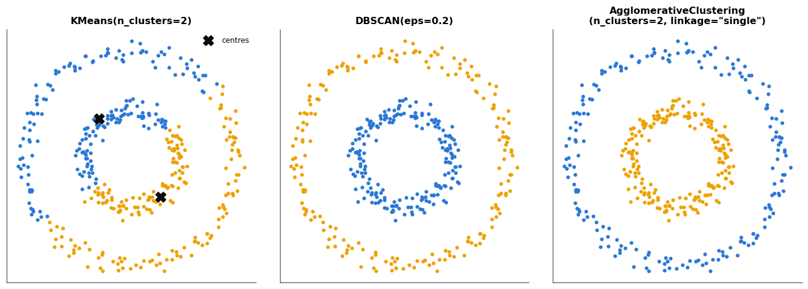

# 15 · scikit-learn — fiche de cours

> Cette fiche accompagne le chapitre 15 du livre, le premier où il passe des idées au code. Pendant quatorze chapitres, tu as écrit toi-même, dans `mylearn`, les algorithmes que le livre décrivait ; ici, le livre prend la bibliothèque **scikit-learn** et en fait le tour : les **estimateurs** (`fit`, `predict`, `decision_function`, `predict_proba`), le **clustering**, les **transformateurs** et leur `inverse_transform`, la **PCA**, les **ensembles**, puis l'automatisation : **validation croisée**, **recherche d'hyperparamètres** en grille ou au hasard, **pipelines**, frontières de décision, datasets et découpage. Le livre a été écrit pour la version 0.19 de 2017 ; son code ne tourne plus tel quel avec la version 1.6 du workbook. La fiche **modernise chaque fragment**, signale ce qui a changé (encadrés 🕰️) et corrige plusieurs affirmations du livre (encadrés ⚠️). Elle ajoute ce que le livre n'aborde pas et que l'on attend d'un professionnel : les données **hétérogènes** (`ColumnTransformer`), le **seuil de décision**, la **calibration** et les classes déséquilibrées, la **sauvegarde** d'un modèle avec ses versions, et la façon de brancher ton propre estimateur sur les outils de scikit-learn. Les exemples du livre (le sinus bruité, les sept nuages de points, les cinq spirales, les demi-lunes) ne sont que résumés : le notebook les refait, et chaque section te dit où les lire.

| | |
|---|---|
| **Livre** | vol. 1, ch. 15 « Scikit-learn », p. 563-654 (§15.1 à §15.12) |
| **Temps total estimé** | ≈ 22 h : lecture du livre et de la fiche ≈ 6,3 h, exercices ≈ 15 h, 25 flashcards ≈ 0,8 h |
| **Prérequis** | 0A (classes Python et héritage, `class A(B)`) · ch. 3 (precision, recall, courbe precision-recall, calibration) · ch. 7 (k-means, inertie, silhouette) · ch. 8 (découpage, validation croisée à k folds, stratification, fuite de données, `clone`) · ch. 9 (Ridge, features polynomiales, régularisation) · ch. 12 (transformateurs, règle d'or « fit sur l'entraînement », PCA, `Pipeline`, fuite en validation croisée) · ch. 13 (régression logistique, sigmoïde, SVM) · ch. 14 (ensembles, AdaBoost, coefficient binomial) |
| **Fichiers du chapitre** | `02_exercices.md` (quiz, rappels, papier, réflexion, entretien) · `03_notebook.ipynb` · `04_indices.md` · `05_solutions.md` et `05_solutions.ipynb` · `06_mes_reponses.md` · `flashcards.csv` |
| **mylearn** | aucun module nouveau : c'est le chapitre de la bibliothèque. Tu y compares ta librairie à scikit-learn, et tu écris dans le notebook (jamais dans `mylearn`, qui reste sans scikit-learn) un adaptateur qui fait accepter un de tes estimateurs par `cross_val_score` (🐛 15.29) |

## Comment utiliser ce chapitre

Le chapitre du livre est long (92 pages), mais il se lit vite : beaucoup de code, de figures et d'explications de l'interface, peu de maths. Il avance en trois temps : l'interface commune des objets de scikit-learn (§15.1 à §15.4), une visite des grandes familles d'outils, chacune avec un petit exemple (§15.5 à §15.8), puis l'automatisation du travail d'évaluation et de réglage (§15.9 à §15.11). Compte environ six heures pour le livre et cette fiche. La fiche suit le même plan, puis ajoute quatre sections « au-delà du livre ». Ses encadrés 🧮 donnent les petits calculs qui manquent au livre (la sigmoïde et le softmax, le nombre de modèles d'une recherche en grille, la probabilité qu'une recherche au hasard trouve une bonne zone, le nombre de features polynomiales) et quelques outils (`clone`, les distributions de SciPy).

Le livre renvoie à des notebooks Jupyter de l'auteur (sur le GitHub de Glassner, licence MIT), écrits pour l'ancienne version : ne les fais pas tourner tels quels, le notebook du workbook en refait les exemples avec la version 1.6.

**Ordre conseillé.**
1. Lis le livre §15.1 à §15.3, puis les sections 15.1 à 15.3 de la fiche. Fais les quiz Q1 et Q2.
2. Lis le livre §15.4, puis la section 15.4 de la fiche. Fais les quiz Q3 à Q5 et l'exercice 15.2.
3. Lis le livre §15.5 à §15.8, puis les sections correspondantes de la fiche. Fais les quiz Q6 à Q9, le rappel R1 et l'exercice 15.3.
4. Lis le livre §15.9 à §15.9.4, puis les sections correspondantes. Fais le quiz Q10 et le rappel R3.
5. Lis le livre §15.9.5 à §15.9.7, puis les sections correspondantes. Fais le quiz Q11, le rappel R2, les exercices 15.1 et 15.4, l'estimation 🧮 15.5 et l'oral 🗣️ 15.6.
6. Lis le livre §15.10 à §15.12, puis la fin de la fiche (sections 15.10 à 15.12 et « au-delà du livre »). Fais le quiz Q12, le cas ⚖️ 15.7 et la lecture 📄 15.8. Vérifie tes réponses courtes dans la partie 0 du notebook.
7. Fais le notebook dans l'ordre : partie A (15.9 à 15.12 : l'interface d'un estimateur, ses trois sorties, les datasets et le découpage, le code de 2018 à réparer), partie B (15.13 à 15.16 : clustering, transformateurs, PCA, ensembles), partie C (15.17 à 15.24 : validation croisée, recherches en grille et au hasard, frontières, pipeline polynomial, lecture de `cv_results_`, la fuite du ch. 8 refaite avec un pipeline), partie D (15.25 à 15.31 : seuil de décision, classes déséquilibrées, six familles de modèles comparées, `ColumnTransformer`, ta librairie face à scikit-learn, sauvegarde, défi). Finis par les cinq questions d'entretien.

| Section | Quiz 🧠 et rappels 🔁 | Papier ✏️ et réflexion | Notebook | Entretien 💼 |
|---|---|---|---|---|
| 15.1 Pourquoi ce chapitre | Q1 | | 15.27 | |
| 15.2 scikit-learn, NumPy et SciPy | Q1 | | 15.9 | |
| 15.3 Conventions | Q2 | 15.8 | 15.12 | |
| 15.4 Les estimateurs (15.4.1 à 15.4.3) | Q3, Q4 | 15.8 | 15.9, 15.12, 15.29 | |
| 15.4.4 decision_function et predict_proba | Q5 | 15.2 | 15.10, 15.25, 15.26 | E4 |
| 15.5 Le clustering | Q6 | | 15.13 | |
| 15.6 Les transformateurs (et 15.6.1) | Q7 | 15.3 | 15.14, 15.27, 15.28 | E1 |
| 15.7 La PCA | Q8 | | 15.15, 15.27 | |
| 15.8 Les ensembles | Q9, R1 | | 15.16, 15.27 | |
| 15.9 Automatiser, 15.9.1 La validation croisée | Q10, R3 | | 15.17, 15.31 | |
| 15.9.2 à 15.9.4 Les recherches d'hyperparamètres | Q10 | 15.1, 15.5 | 15.18, 15.19, 15.20, 15.23 | E2 |
| 15.9.5 Les pipelines | Q11 | 15.1, 15.4, 15.6 | 15.22, 15.23, 15.28, 15.29 | E3 |
| 15.9.6 La frontière de décision | Q11 | | 15.21, 15.25, 15.26 | |
| 15.9.7 Les transformations dans le pipeline | Q11, R2 | 15.6 | 15.24, 15.28, 15.31 | E3 |
| 15.10 Les datasets | Q12 | 15.7 | 15.11, 15.12 | |
| 15.11 Les utilitaires | Q12 | | 15.11 | |
| 15.12 Pour finir, et au-delà du livre | Q12 | | 15.25, 15.26, 15.28, 15.29, 15.30 | E4, E5 |

**Lire les formules.** Comme dans tout le workbook, $\mathbf{X}$ est la matrice des données, de forme $(n, p)$ : $n$ exemples (des lignes), $p$ features (des colonnes) ; $y$ est le vecteur des labels ou des cibles. Pour un classifieur, $s(\mathbf{x})$ est le **score** que renvoie `decision_function`, $\sigma$ la sigmoïde (ch. 13) et $\hat p$ une probabilité estimée. Pour une recherche d'hyperparamètres, $n_h$ est le nombre de valeurs essayées pour l'hyperparamètre $h$, $k$ le nombre de folds de la validation croisée (au §15.5, comme au ch. 7, $k$ est aussi le nombre de clusters d'un k-means), $n_{\text{iter}}$ le nombre d'essais d'une recherche au hasard et $q$ la part de l'espace des réglages que l'on juge « bonne ». Pour les features polynomiales, $d$ est le **degré** (comme au ch. 9) et $\binom{p + d}{d}$ un coefficient binomial (ch. 14).

## Objectifs d'apprentissage

À la fin du chapitre, tu sais :
- **utiliser** l'interface commune de scikit-learn : estimateurs, transformateurs, prédicteurs, hyperparamètres au constructeur, attributs appris suffixés par `_` ;
- **choisir** entre `predict`, `decision_function` et `predict_proba`, et **interpréter** leurs sorties (formes, sigmoïde, softmax, seuil) ;
- **construire** des `Pipeline` et des `ColumnTransformer` pour des données hétérogènes, sans fuite ;
- **rechercher** des hyperparamètres en grille et au hasard, **estimer** le coût d'une recherche et **lire** `cv_results_` ;
- **moderniser** du code scikit-learn ancien en lisant la documentation et les avertissements de dépréciation ;
- **comparer** tes propres implémentations à la bibliothèque, résultats et temps de calcul ;
- **sauvegarder** et recharger un modèle entraîné de façon reproductible, avec ses versions.

## L'essentiel en 10 lignes

1. scikit-learn rassemble des centaines d'outils de machine learning **classique** derrière une **interface commune** : on crée un objet avec ses **hyperparamètres**, on l'entraîne avec `fit`, puis on l'utilise avec `predict` ou `transform`. Il ne sert pas à entraîner de grands réseaux de neurones (ce sera PyTorch, à partir du ch. 20).
2. Les données sont une matrice `X` à **deux dimensions** `(n_samples, n_features)`, même pour une seule feature ou un seul exemple ; `y` est un vecteur. `fit` renvoie l'objet lui-même ; ce qu'il apprend est rangé dans des attributs qui finissent par `_` (`coef_`, `cluster_centers_`).
3. Un classifieur a trois sorties : `predict` (une classe), `decision_function` (un **score** sans borne) et `predict_proba` (des **probabilités** qui somment à 1) ; certains classifieurs n'ont pas les deux dernières.
4. Un **transformateur** apprend sa transformation avec `fit` sur l'**entraînement** seul, puis l'applique avec `transform` à toute donnée ; `fit_transform` fait les deux sur l'entraînement. `inverse_transform` revient en arrière, **quand il existe**.
5. Un **ensemble** (AdaBoost, forêt) ou un **pipeline** est lui-même un estimateur : il s'entraîne et prédit comme les autres, et peut entrer dans une recherche d'hyperparamètres.
6. `cross_val_score` et `cross_validate` font la validation croisée ; `KFold` et `StratifiedKFold` décident des folds ; les estimateurs `...CV` (`RidgeClassifierCV`) choisissent un hyperparamètre par validation croisée **pendant** `fit`.
7. `GridSearchCV` essaie **toutes** les combinaisons d'une grille, `RandomizedSearchCV` un nombre fixé de combinaisons **tirées au hasard** ; chacune est évaluée par validation croisée, et la meilleure est réentraînée sur tout l'entraînement (`best_estimator_`, `best_params_`, `cv_results_`).
8. Le coût d'une grille est le **produit** des nombres de valeurs, multiplié par le nombre de folds : il explose vite ; quand peu d'hyperparamètres comptent vraiment, la recherche **au hasard** trouve en général d'aussi bons réglages pour bien moins cher.
9. Un **`Pipeline`** enchaîne des transformateurs et un modèle final ; dans une validation croisée ou une recherche, il **réapprend chaque transformation dans chaque fold**, ce qui empêche la fuite de données. Ses hyperparamètres se nomment `étape__paramètre`.
10. Le code de 2018 se modernise en lisant la **documentation de la version installée** et ses avertissements (`FutureWarning`) ; un modèle se sauvegarde avec `joblib`, **avec les versions** des bibliothèques qui l'ont produit.

## 15.1 · Pourquoi ce chapitre ?

Faut-il écrire soi-même ses algorithmes ou prendre une bibliothèque ? Le livre pèse le pour et le contre (p. 566-567) : coder instruit, mais coûte cher et détourne vers la programmation ; une bibliothèque mûre est plus sûre et plus rapide. Il choisit la bibliothèque, et ne se sert de scikit-learn que dans ce chapitre et aux ch. 23 et 24.

Le workbook a fait les deux, dans cet ordre : tu as écrit dans `mylearn` le k-means, la validation croisée, Ridge, les transformateurs, les arbres et les ensembles ; tu sais donc ce que cache chaque appel de scikit-learn. Ce chapitre te fait passer de l'autre côté : savoir **lire la documentation**, enchaîner les outils sans fuite, et comparer ta librairie à la bibliothèque (🔬 13.35 l'a déjà fait pour les classifieurs ; 📦 15.27 compare six familles de modèles de scikit-learn sur les mêmes folds).

> 🕰️ **Mise à jour (2026) — la version de scikit-learn** — **Le livre :** utilise scikit-learn 0.19, sortie en août 2017, et pense que les versions suivantes devraient rester compatibles avec son code (p. 567). · **Aujourd'hui :** le workbook utilise la version **1.6.1**, celle qu'installe Google Colab (BIBLE §21) ; la dernière version publiée est la 1.9.1 (septembre 2026). L'interface `fit`/`predict`/`transform` n'a pas bougé, mais beaucoup de détails ont changé entre-temps : des paramètres renommés ou retirés, des valeurs par défaut modifiées, des outils nouveaux. Les encadrés 🕰️ de cette fiche les signalent un par un, et 🐛 15.12 te fait réparer un programme écrit pour 0.19. · **Faut-il quand même l'apprendre ?** Oui : les idées et la forme générale des appels du livre restent justes ; seul le détail est à vérifier dans la documentation de ta version. · *Sources :* [scikit-learn sur PyPI (historique des versions)](https://pypi.org/project/scikit-learn/#history) ; [documentation de scikit-learn 1.6](https://scikit-learn.org/1.6/).

> 💼 **En entreprise** — Presque tout projet de données tabulaires commence par scikit-learn : nettoyage et encodage dans un pipeline, une baseline (régression linéaire ou logistique), une validation croisée, quelques modèles plus forts (forêt, gradient boosting), une recherche d'hyperparamètres, puis la sauvegarde du meilleur pipeline. Les recruteurs testent rarement la syntaxe ; ils testent les **réflexes** : où se fait le `fit`, pourquoi un pipeline, comment éviter la fuite, comment choisir un seuil, comment rejouer un résultat six mois plus tard. Les questions 💼 15.E1 à 15.E5 portent sur ces réflexes.

## 15.2 · scikit-learn, NumPy et SciPy ⏩

scikit-learn est écrit en Python, et ses calculs s'appuient sur **NumPy** (les tableaux, l'algèbre linéaire) et sur **SciPy** (matrices creuses, optimisation, statistiques), avec des parties critiques compilées (Cython) pour aller vite ; le livre schématise l'empilement Python, NumPy, scikit-learn (figure 15.1, p. 568). Il cite aussi la famille des « scikits », des boîtes à outils scientifiques construites sur la même pile, comme scikit-image pour les images. Le livre suppose que tu sais lire du Python et du NumPy : c'est le cas depuis 0A.

Ce que scikit-learn **est** : une bibliothèque de machine learning classique, sur des données qui tiennent en mémoire, avec une interface unique pour l'apprentissage supervisé (régression, classification), non supervisé (clustering, réduction de dimension), la préparation des données, l'évaluation et le réglage. Ce qu'elle **n'est pas** : un framework de deep learning. Elle a bien un petit réseau de neurones (`MLPClassifier`, utilisé en boîte noire au ch. 1), sans GPU ni architectures modernes ; les réseaux du workbook se feront avec PyTorch. Le livre le dit à sa façon (p. 569) : scikit-learn sert d'outil d'exploration et de préparation autour d'un réseau, et beaucoup de projets de deep learning commencent par lui.

La bibliothèque a été présentée par Pedregosa et coll. (*JMLR*, 2011), et sa conception par Buitinck et coll. (2013), un article que tu lis en 📄 15.8. Ses principes tiennent en quelques mots : une interface **cohérente** pour tous les objets, des objets **inspectables** (hyperparamètres et résultats sont des attributs publics), des données en tableaux NumPy plutôt qu'en classes à elle, des objets qui se **composent** (pipelines, méta-estimateurs) et des **valeurs par défaut raisonnables**.

## 15.3 · Conventions : importer, lire la documentation, suivre les dépréciations ⏩

**Importer.** Le paquet s'installe sous le nom `scikit-learn` mais s'importe sous le nom `sklearn`, et ses outils sont rangés en **modules** (`sklearn.linear_model`, `sklearn.preprocessing`, `sklearn.model_selection`…). On importe soit le module, soit la classe dont on a besoin ; le livre conseille la première forme pendant qu'on explore et la seconde une fois le code stabilisé (p. 570-571). Voici le début type d'un notebook, modernisé :

```python
import numpy as np
import matplotlib.pyplot as plt
import seaborn as sns
from sklearn import linear_model            # le module : linear_model.Ridge()
from sklearn.linear_model import Ridge      # ou la classe seule : Ridge()

sns.set_theme()                             # le livre écrit sns.set() (encadré ci-dessous)
rng = np.random.default_rng(42)             # le livre écrit np.random.seed(42)
```

**Lire la documentation.** Pour chaque outil, la **référence de l'API** donne sa signature, ses paramètres avec leur valeur par défaut, ses attributs après `fit`, ses méthodes, et des notes de version (« *Added in version* », « *Changed in version* », « *Deprecated since version* »). Le **guide utilisateur** explique les méthodes, et la **galerie d'exemples** montre du code complet. Le livre conseille de regarder chaque outil la première fois qu'on le croise, puis d'y revenir quand on s'en sert à nouveau, plutôt que de tout mémoriser (p. 573) : c'est la bonne méthode, à une condition près, **lire la documentation de ta version**. L'adresse `scikit-learn.org/stable/` suit la dernière version (1.9 en 2026) ; pour Colab, lis `scikit-learn.org/1.6/`. `sklearn.__version__` donne la version installée, et `sklearn.show_versions()` celles de Python, NumPy, SciPy et de leurs dépendances, à coller dans tout rapport de bug.

**Suivre les dépréciations.** scikit-learn ne retire pas un paramètre du jour au lendemain. Il le **déprécie** d'abord : pendant deux versions (en général), il marche encore, mais chaque usage affiche un avertissement (`FutureWarning` ou `DeprecationWarning`) qui dit ce qui va disparaître, quand, et souvent par quoi le remplacer ; ensuite seulement, il est retiré, et le vieux code plante (`TypeError: ... got an unexpected keyword argument`, `ImportError`). Le livre explique déjà ce mécanisme (p. 572-573). Un avertissement de dépréciation est donc une **information**, pas un bruit à masquer : il te dit quoi changer avant que ton code casse. 🐛 15.12 te fait réparer pas à pas un programme écrit pour 0.19.

> 🕰️ **Mise à jour (2026) — seaborn, graines et k-means : trois habitudes du livre** — **Le livre :** importe seaborn avec `sns.set()`, fixe le hasard avec `np.random.seed(42)` (p. 572, 577) et crée ses k-means avec `KMeans(n_clusters=...)` seul (p. 583). · **Aujourd'hui :** `sns.set()` n'est plus qu'un alias de `sns.set_theme()`, l'interface que recommande seaborn, qui prévient que l'alias pourrait disparaître ; NumPy recommande de créer un générateur `np.random.default_rng(graine)` et d'en tirer les nombres, plutôt que de fixer l'état global (0A) ; et `KMeans` a pour défaut `n_init="auto"` depuis la version 1.4 (une seule initialisation k-means++ au lieu de dix) : un code qui comptait sur dix essais doit écrire `n_init=10`. · **Faut-il quand même l'apprendre ?** Non pour les deux premières, qu'on remplace sans réfléchir ; oui pour `n_init`, qui change les résultats. · *Sources :* [seaborn, `set`](https://seaborn.pydata.org/generated/seaborn.set.html) et [`set_theme`](https://seaborn.pydata.org/generated/seaborn.set_theme.html) ; [NumPy, « Random sampling »](https://numpy.org/doc/stable/reference/random/index.html) ; [`KMeans` (scikit-learn 1.6)](https://scikit-learn.org/1.6/modules/generated/sklearn.cluster.KMeans.html).

## 15.4 · Les estimateurs ⏩

Le mot **estimateur** désigne, dans scikit-learn, tout objet qui apprend quelque chose à partir de données avec une méthode `fit`. Le livre l'emploie pour l'apprentissage supervisé (p. 574) ; la bibliothèque, plus largement : un k-means et un scaler sont aussi des estimateurs. Selon ce qu'il sait faire ensuite, un estimateur est aussi un **prédicteur** (`predict`, et souvent `score`), un **transformateur** (`transform`) ou les deux. Un **méta-estimateur** en contient d'autres : un pipeline, une recherche d'hyperparamètres, un ensemble. Toute la force de la bibliothèque vient de là : comme tous suivent la même interface, n'importe quel modèle entre dans n'importe quelle validation croisée ou recherche.

Le livre suit un exemple simple : ajuster une droite à cent points tirés autour d'une courbe sinus (figures 15.2 et 15.3, p. 575-581), avec `Ridge` (la régression linéaire régularisée du ch. 9). 📦 15.9 le refait avec la version 1.6 ; voici les trois étapes, en général.

### 15.4.1 · Créer un estimateur : les hyperparamètres ⏩

On crée l'objet en lui donnant ses **hyperparamètres**, et rien d'autre : `model = Ridge(alpha=1.0)`. Le constructeur ne voit aucune donnée et n'apprend rien ; il range les arguments, sous le même nom, dans des attributs (`model.alpha`). Un argument qu'on ne donne pas prend sa valeur par défaut, choisie pour être raisonnable ; le livre s'en contente presque toujours (p. 574), et c'est souvent une bonne baseline. Deux méthodes permettent de lire et de changer les hyperparamètres d'un estimateur sans le recréer : `get_params()` renvoie un dictionnaire `{nom: valeur}`, `set_params(alpha=10.0)` les modifie. C'est par elles que les outils de scikit-learn manipulent les modèles (§15.9.3).

### 15.4.2 · Apprendre avec fit ⏩

`model.fit(X, y)` apprend à partir des exemples. `X` est un tableau à deux dimensions, de forme `(n_samples, n_features)` : une ligne par exemple, une colonne par feature, **même s'il n'y a qu'une feature**. Le livre transforme sa liste de valeurs de $x$ en colonne avec `np.reshape` (p. 577) ; on écrit aujourd'hui `x.reshape(-1, 1)` (le `-1` laisse NumPy calculer le nombre de lignes) ou, pour une colonne d'un DataFrame, `df[["x"]]` (deux paires de crochets : un DataFrame, pas une Series). `y` est un vecteur de forme `(n_samples,)`.

`fit` range ce qu'il apprend dans des **attributs suffixés par un tiret bas** : `coef_` et `intercept_` pour une droite, `classes_` pour un classifieur, `n_features_in_` (le nombre de features vues) et, si `X` était un DataFrame, `feature_names_in_`. Le suffixe signale « appris sur des données » : avant `fit`, ces attributs n'existent pas (`AttributeError`), et `predict` lève `NotFittedError`. `fit` **renvoie l'objet lui-même**, ce qui permet d'enchaîner `Ridge().fit(X, y).predict(X_new)`. Un second appel à `fit` **repart de zéro** avec les nouvelles données : il ne continue pas l'apprentissage précédent (sauf pour les rares estimateurs qui ont une option `warm_start` ou une méthode `partial_fit`). Le livre compare `fit` à un tailleur qui prend les mesures d'un client et coupe un costume sur mesure (p. 578) : chaque objet garde ses propres mesures, et l'on peut entraîner plusieurs objets côte à côte sans qu'ils se gênent.

> 🔗 **Lien avec le ch. 8 et ta librairie** — Tes classes de `mylearn` suivent ces conventions depuis le ch. 7 : `__init__` ne fait que ranger, `fit` renvoie `self`, les attributs appris finissent par `_`. Ton `clone` du ch. 8 relisait les hyperparamètres dans `vars()` ; celui de scikit-learn les lit avec `get_params()`.

### 15.4.3 · Prédire avec predict ⏩

`model.predict(X_new)` renvoie un tableau d'une valeur par ligne de `X_new` : un nombre pour un régresseur, une classe pour un classifieur. `X_new` doit avoir **deux dimensions** et le même nombre de colonnes que `X`. C'est le premier endroit où le code du livre ne tourne plus : il demande la prédiction en un seul point avec `predict(x_left)` (p. 579), un nombre seul.

```python
# Le livre (0.19) :         y_left = ridge_estimator.predict(x_left)
# scikit-learn 1.6 :        ValueError: Expected 2D array, got scalar array instead
ends = np.array([[x_left], [x_right]])         # deux exemples d'une feature : forme (2, 1)
y_left, y_right = ridge_estimator.predict(ends)
```

Un régresseur et un classifieur ont aussi `score(X, y)` : le $R^2$ pour un régresseur, l'**accuracy** pour un classifieur. Pour une autre mesure, on passe par `sklearn.metrics` (ch. 3) ou par l'argument `scoring` des outils de validation (§15.9.1).

> 🕰️ **Mise à jour (2026) — des données toujours en deux dimensions** — **Le livre :** passe un nombre seul à `predict` pour obtenir la valeur de la droite à une extrémité (p. 579). · **Aujourd'hui :** scikit-learn exige un tableau à deux dimensions pour `X`, à l'entraînement comme à la prédiction ; un nombre seul lève `ValueError: Expected 2D array, got scalar array instead`, et le message propose `reshape(-1, 1)` (une feature) ou `reshape(1, -1)` (un seul exemple). · **Faut-il quand même l'apprendre ?** Non : écris toujours `X` en deux dimensions. · *Sources :* [glossaire de scikit-learn 1.6, entrées « 2d array », « rectangular », « sample » et « feature »](https://scikit-learn.org/1.6/glossary.html) ; message d'erreur vérifié sur scikit-learn 1.6.1.

### 15.4.4 · decision_function et predict_proba ⏩

Un classifieur sait souvent dire plus que « la classe 2 ». Le livre présente deux méthodes de plus (p. 581-582) ; voici ce qu'elles renvoient exactement, avec $n$ exemples et $K$ classes :

| méthode | ce qu'elle renvoie | forme, 2 classes | forme, $K > 2$ classes |
|---|---|---|---|
| `predict(X)` | la classe prédite (un élément de `classes_`) | `(n,)` | `(n,)` |
| `decision_function(X)` | un **score** sans borne : plus il est grand, plus le modèle penche vers la classe | `(n,)` : **un seul** score, celui de la classe `classes_[1]` | `(n, K)` : un score par classe |
| `predict_proba(X)` | des **probabilités** estimées, dans $[0, 1]$, qui somment à 1 sur chaque ligne | `(n, 2)` | `(n, K)` |

À deux classes, `predict` renvoie `classes_[1]` quand le score est **strictement positif**, et `classes_[0]` sinon ; avec plus de classes, la classe du plus grand score. Pour une régression logistique, les deux autres sorties se déduisent l'une de l'autre : la probabilité de la classe `classes_[1]` est la sigmoïde du score (encadré ci-dessous et figure), et le seuil de probabilité 0,5 correspond au score 0. Le score est un **log-odds** (ch. 13), le logarithme de la cote.


> 🧮 **Rappel maths — de decision_function à predict_proba : sigmoïde et softmax** — Pour une régression logistique à deux classes, la probabilité de la classe `classes_[1]` vaut
> $$\hat p = \sigma(s) = \frac{1}{1 + e^{-s}}, \qquad\text{et inversement}\qquad s = \ln\frac{\hat p}{1 - \hat p}\ \ (\text{le logit}).$$
> $\sigma(0) = 0{,}5$, $\sigma(-s) = 1 - \sigma(s)$, et $\sigma$ croît : un score plus grand donne une probabilité plus grande. Avec $K$ classes, la régression logistique multinomiale donne un score $s_k$ par classe et les probabilités par le **softmax** :
> $$\hat p_k = \frac{e^{s_k}}{\sum_{j=1}^{K} e^{s_j}}.$$
> Ajouter la même constante à tous les scores ne change aucune probabilité (elle se simplifie dans la fraction). *Mini-exemple :* un score de 1 donne $\sigma(1) = 1/(1 + e^{-1}) \approx 0{,}731$, et un score de 3 environ $0{,}953$ ; une probabilité de 0,75 correspond au score $\ln 3 \approx 1{,}099$. Avec trois classes de scores $(1 ;\ 0 ;\ 0)$, la première a la probabilité $e/(e + 2) \approx 0{,}576$. En SciPy : `scipy.special.expit` (la sigmoïde) et `scipy.special.softmax`.

**Tous les classifieurs n'ont pas ces méthodes.** `RidgeClassifier` a un `decision_function` mais pas de `predict_proba` (son score n'a pas de lecture probabiliste) ; un arbre ou une forêt ont `predict_proba` (des proportions de classes dans les feuilles) mais pas de `decision_function` ; un `SVC` a un `decision_function`, et un `predict_proba` seulement avec `probability=True`, obtenu par une calibration interne coûteuse (une validation croisée de plus), et que la documentation prévient pouvoir **contredire** `predict` sur des exemples proches de la frontière. Le livre le résume en disant de vérifier dans la documentation ce que chaque classifieur propose (p. 582). Même quand `predict_proba` existe, ses valeurs ne sont pas forcément **calibrées** (ch. 3) : la section « au-delà du livre » sur la calibration y revient.

> ⚠️ **Le livre, corrigé — ce que renvoient decision_function et predict** — Le livre écrit que `decision_function` renvoie un score de confiance « pour chaque classe et chaque exemple » (p. 582), et le redit pour ses deux demi-lunes (p. 641). C'est vrai à partir de trois classes, pas à deux : un classifieur binaire de scikit-learn renvoie **un seul** score par exemple, de forme `(n,)`, celui de la classe `classes_[1]` (la classe `classes_[0]` correspond aux scores négatifs). Un code qui lit `decision_function(X)[:, 1]` plante sur un problème binaire. Plus haut, son exemple de photo (p. 581) se contredit : un modèle qui donne 49 % de chances au tigre et 48 % au léopard prédit le **tigre**, la classe la plus probable, et non le léopard ; l'idée qu'il veut illustrer reste juste : `predict` cache que le second choix était presque aussi probable.

## 15.5 · Le clustering

Le livre passe au non supervisé avec `KMeans` (p. 582-587), l'algorithme de Lloyd que tu as écrit au ch. 7. On crée l'objet avec le nombre de clusters (`n_clusters`, 8 par défaut) mais sans dire combien de features auront les données : `fit` le lit dans `X`. Après `fit`, `cluster_centers_` donne les centres, `labels_` le cluster de chaque exemple d'entraînement et `inertia_` l'inertie ; `predict(X_new)` affecte de nouveaux points au centre le plus proche (sur les données d'entraînement, il redonne `labels_`). Le livre fabrique des points autour de sept centres gaussiens qui se chevauchent, essaie de 2 à 9 clusters, et juge à l'œil que 5 à 8 clusters donnent un découpage raisonnable (figures 15.4 et 15.5) ; il conclut qu'il faut toujours choisir le nombre de clusters, et regarder le résultat. 📦 15.13 refait ces essais et ajoute les deux critères chiffrés du ch. 7.

> 🧮 **Rappel maths — inertie et silhouette (ch. 7)** — L'**inertie** est la somme des carrés des distances de chaque point à son centre, $\sum_i \lVert \mathbf{x}_i - \boldsymbol{\mu}_{c(i)} \rVert^2$ : elle baisse (en général) quand $k$ augmente, et ne choisit donc pas $k$ seule ; on cherche un **coude**. La **silhouette** d'un point compare $a_i$, sa distance moyenne aux autres points de son cluster, et $b_i$, sa distance moyenne aux points du cluster voisin le plus proche : $s_i = (b_i - a_i) / \max(a_i, b_i)$, entre −1 et 1 ; la silhouette moyenne (`sklearn.metrics.silhouette_score`) se compare d'un $k$ à l'autre. *Mini-exemple :* un point à 1 en moyenne des siens et à 4 du groupe voisin a la silhouette $(4 - 1)/4 = 0{,}75$.

**D'autres algorithmes.** Le livre note que scikit-learn propose plusieurs méthodes de clustering, qui ne cherchent pas les mêmes groupes. k-means suppose des groupes ronds, de tailles voisines ; il coupe en deux des cercles emboîtés (figure ci-dessous). **DBSCAN** (et sa version hiérarchique **HDBSCAN**, dans scikit-learn depuis la version 1.3) regroupe les points par **densité**, trouve seul le nombre de groupes et laisse de côté les points isolés (label −1) ; le **clustering hiérarchique** (`AgglomerativeClustering`) fusionne pas à pas les groupes les plus proches, selon une règle de distance entre groupes (`linkage`). Tous ont `fit` et `fit_predict` ; seuls k-means et quelques autres ont `predict` pour de nouveaux points.



## 15.6 · Les transformateurs ⏩

Un **transformateur** modifie les données : mise à l'échelle, encodage, imputation, réduction de dimension, features nouvelles. Tu connais la règle d'or du ch. 12, que le livre rappelle (p. 587-588) : la transformation s'**apprend** sur l'entraînement, puis s'**applique** telle quelle à toute autre donnée (validation, test, production). L'interface la sépare en méthodes :
- `fit(X_train)` calcule les paramètres de la transformation (pour un `MinMaxScaler`, le minimum et le maximum de chaque feature) et les range dans `data_min_`, `data_max_`… ;
- `transform(X)` applique la transformation apprise, à n'importe quelles données ;
- `fit_transform(X_train)` fait les deux d'un coup, **sur l'entraînement seulement**.

Le livre l'illustre avec un `MinMaxScaler` (p. 589-594) : sur l'entraînement, chaque feature arrive exactement dans $[0, 1]$ ; des données de test plus étendues sur une feature et plus resserrées sur l'autre sortent de la boîte $[0, 1] \times [0, 1]$ d'un côté et n'en occupent qu'une bande de l'autre (figures 15.7 à 15.9, et la figure ci-dessous, faite avec d'autres données). C'est **normal** : la transformation est celle de l'entraînement, pas une remise à l'échelle de chaque nouveau paquet de données. Si un modèle ne supporte vraiment pas de valeurs hors de $[0, 1]$, `MinMaxScaler(clip=True)` (depuis la version 0.24) les ramène aux bords.


> 🧮 **Rappel maths — la mise à l'échelle min-max et son inverse** — Pour une feature de minimum $m$ et de maximum $M$ sur l'entraînement,
> $$x' = \frac{x - m}{M - m}, \qquad x = m + (M - m)\, x'.$$
> Les deux formules sont **affines** (une multiplication et une addition) : elles transforment une droite en une droite, et l'on peut donc ramener une droite dans l'espace d'origine en ramenant **deux** de ses points. *Mini-exemple :* une feature de 2 à 6 à l'entraînement ; une valeur de test de 0 devient $(0 - 2)/4 = -0{,}5$, et la valeur transformée 0,4 redevient $2 + 4 \times 0{,}4 = 3{,}6$.

**Les sorties d'un transformateur.** Par défaut, `transform` renvoie un tableau NumPy, même si l'on a donné un DataFrame : on perd le nom des colonnes. Depuis la version 1.2, `scaler.set_output(transform="pandas")` lui fait rendre un DataFrame (et `sklearn.set_config(transform_output="pandas")` le fait pour tous) ; `get_feature_names_out()` donne le nom des colonnes produites. Le livre choisit chaque transformation d'après le modèle qui suivra, qui dit dans sa documentation ce qu'il attend (p. 587) : c'est toujours le bon réflexe.

### 15.6.1 · Revenir en arrière : inverse_transform

Les prédictions d'un modèle entraîné sur des données transformées sont exprimées dans l'**espace transformé**. Le livre reprend l'exemple de la circulation du ch. 12 (prédire un nombre de voitures) et l'illustre par une droite (p. 594-597) : on met à l'échelle les deux coordonnées de points du plan, on ajuste une droite aux points transformés, puis on repasse ses deux extrémités par `inverse_transform` pour la tracer sur les données d'origine (figures 15.10 à 15.12). Une droite ajustée dans l'espace transformé et tracée telle quelle sur les données d'origine tombe complètement à côté. ✏️ 15.3 te fait faire ce calcul à la main, et 📦 15.14 dans le notebook.

> ⚠️ **Le livre, corrigé — tous les transformateurs n'ont pas d'inverse_transform** — Le livre affirme que chaque transformateur de scikit-learn fournit `inverse_transform` (p. 594). C'est faux : les mises à l'échelle (`StandardScaler`, `MinMaxScaler`…), les encodeurs (`OneHotEncoder`, `OrdinalEncoder`) et la `PCA` en ont une, mais pas `PolynomialFeatures`, `Normalizer` (qui divise chaque **ligne** par sa norme), `KMeans` ni `SplineTransformer`, et dans scikit-learn 1.6 environ la moitié des transformateurs n'en ont pas. Et un inverse n'est pas toujours exact : celui d'une PCA qui a gardé moins de composantes que de features ne rend qu'une **approximation** (la projection sur le sous-espace gardé, ch. 12). Vérifie avec `hasattr(transformer, "inverse_transform")`. Pour une **cible** transformée (un logarithme du prix, par exemple), `TransformedTargetRegressor` applique l'inverse aux prédictions à ta place.

## 15.7 · Réduire les données : la PCA

Sous le nom d'« affinage des données » (*data refinement*, p. 598), le livre regroupe deux façons d'alléger un tableau dont des colonnes se répètent : en retirer (la **sélection de features** du ch. 12), ou les remplacer par moins de colonnes qui les résument, comme la **PCA**. Son exemple : un nuage de points en trois dimensions, en forme d'ellipsoïde aplati, réduit à deux dimensions avec `PCA(n_components=2, whiten=True)`, puis `fit` et `transform` (figures 15.13 et 15.14, p. 599-600). La PCA trouve le plan qui garde le plus de variance et projette chaque point dessus (ch. 12).

```python
from sklearn.decomposition import PCA
pca = PCA(n_components=2, whiten=True)
reduced = pca.fit_transform(blob_3d)        # (n, 3) → (n, 2)
pca.components_                             # (2, 3) : les deux directions, dans l'espace des 3 features
pca.explained_variance_ratio_               # la part de variance gardée par chaque composante
```

> ⚠️ **Le livre, corrigé — ce que la PCA et le blanchiment font vraiment** — Le livre écrit que `fit` permet à la PCA de « déterminer quelles features retirer » (p. 599). Ce n'est pas ce qu'elle fait : elle ne garde **aucune** feature d'origine, elle construit de **nouvelles** features, des combinaisons linéaires de toutes les features centrées (les lignes de `components_`), et garde les premières ; retirer des features d'origine, c'est la sélection de features (`SelectKBest`, ch. 12). Le livre dit aussi que le blanchiment (`whiten=True`) aide la PCA à donner ses meilleurs résultats (p. 599) : il ne change ni les directions trouvées ni la projection ; il **divise** chaque composante par son écart-type, pour que toutes aient une variance de 1 (sur l'entraînement). La documentation précise qu'il retire une information (la variance relative des composantes) et qu'il aide parfois le modèle **suivant**, quand celui-ci suppose des features de même échelle (un SVM à noyau RBF, un k-means). 📦 15.15 te le fait mesurer.

## 15.8 · Les ensembles

Pour scikit-learn, un ensemble du ch. 14 n'a rien de spécial (livre p. 601) : il a la même interface qu'un modèle seul, et ses membres restent cachés à l'intérieur (`estimators_`). Le bagging et AdaBoost prennent n'importe quel modèle de base ; une forêt, elle, n'est faite que d'arbres. Le livre entraîne un `AdaBoostClassifier` sur 1 000 points répartis en cinq spirales, une par classe, avec deux tiers d'entraînement et un tiers de test : avec des `RidgeClassifier` (des frontières droites), le résultat est mauvais ; avec des arbres de décision, presque parfait (figures 15.15 à 15.17, p. 602-605). 🔬 15.16 refait l'expérience et la prolonge.

```python
from sklearn.ensemble import AdaBoostClassifier
from sklearn.linear_model import RidgeClassifier
from sklearn.tree import DecisionTreeClassifier

# Le livre (0.19) : AdaBoostClassifier(RidgeClassifier(), algorithm='SAMME')
ridge_ensemble = AdaBoostClassifier(estimator=RidgeClassifier(), n_estimators=50)
tree_ensemble = AdaBoostClassifier(estimator=DecisionTreeClassifier())
stumps = AdaBoostClassifier()               # par défaut : des souches, DecisionTreeClassifier(max_depth=1)
```

> 🕰️ **Mise à jour (2026) — AdaBoost : estimator et algorithm** — **Le livre :** passe le modèle de base en premier argument et précise `algorithm='SAMME'`, parce que la version 0.19 utilisait par défaut une variante (SAMME.R) qui exige `predict_proba`, que `RidgeClassifier` n'a pas (p. 603). · **Aujourd'hui :** son appel tourne encore en 1.6, avec un seul avertissement (sur `algorithm`). Le modèle de base s'appelle `estimator` (l'ancien nom `base_estimator`, qu'on écrivait par mot-clé, a été déprécié en 1.2 et retiré en 1.4 : `TypeError` en 1.6) ; SAMME.R a été dépréciée en 1.4 et retirée, si bien qu'en 1.6 la classe n'implémente plus que SAMME et que le paramètre `algorithm` lui-même est déprécié (il n'a plus d'effet et sera retiré en 1.8). · **Faut-il quand même l'apprendre ?** Oui pour l'idée (un ensemble se manipule comme un modèle) ; écris `estimator=...` et oublie `algorithm`. · *Sources :* [`AdaBoostClassifier` (scikit-learn 1.6)](https://scikit-learn.org/1.6/modules/generated/sklearn.ensemble.AdaBoostClassifier.html) ; [notes de version 1.2](https://scikit-learn.org/1.6/whats_new/v1.2.html) et [1.4](https://scikit-learn.org/1.6/whats_new/v1.4.html).

> ⚠️ **Le livre, corrigé — comment AdaBoost combine ses membres, et combien il en garde** — Le livre dit que les ensembles choisissent en général la classe la plus souvent prédite (p. 604) : c'est le vote à la pluralité des forêts de Breiman, pas celui d'AdaBoost, qui **pondère** chaque membre par son poids $\alpha_m$ (ch. 14). Il parle aussi d'un ensemble de « 50 arbres de décision » (p. 605) : `n_estimators` n'est qu'un **maximum**, et AdaBoost s'arrête dès qu'un membre classe parfaitement l'entraînement, ou quand un membre ne fait pas mieux que le hasard (la règle de SAMME, ch. 14). Compte les membres gardés avec `len(model.estimators_)` avant de parler d'un ensemble de 50 (🔬 15.16). Enfin, le livre renvoie au ch. 13 pour les ensembles et le boosting (p. 601-602) : dans ce volume, c'est le ch. 14.

## 15.9 · Automatiser ⏩

Tu connais la distinction depuis le ch. 8 : les **paramètres** sont appris par `fit` (les poids d'une droite, les centres d'un k-means), les **hyperparamètres** sont choisis avant (livre p. 605). Automatiser leur choix, c'est répéter une boucle « essayer un réglage, le noter » : dans scikit-learn, la validation croisée sert de note, et une recherche en grille ou au hasard décide des réglages à essayer.

### 15.9.1 · La validation croisée ⏩

Tu as écrit la validation croisée au ch. 8 : on découpe l'entraînement en $k$ folds, on entraîne $k$ modèles, chacun sans un fold, et l'on note chacun sur le fold qu'il n'a pas vu (figure 15.18 du livre, p. 609). scikit-learn la propose en une ligne :

```python
from sklearn.model_selection import cross_val_score, cross_validate, KFold, StratifiedKFold

scores = cross_val_score(model, X, y, cv=5)                       # un tableau de 5 scores
folds = StratifiedKFold(n_splits=10, shuffle=True, random_state=0)
res = cross_validate(model, X, y, cv=folds, scoring=["accuracy", "f1_macro"],
                     return_train_score=True)                     # un dictionnaire de tableaux
res["test_accuracy"].mean(), res["train_accuracy"].mean(), res["fit_time"].sum()
```

Points à connaître :
- `cv` accepte un entier ou un **objet de découpage** (*CV splitter*). Avec un entier (ou rien : 5 folds par défaut), un classifieur reçoit des folds **stratifiés** (`StratifiedKFold`), un régresseur des folds simples (`KFold`), **sans mélange**. Si les données sont triées (par classe, par date), passe un objet avec `shuffle=True` et un `random_state` : les folds sont alors les mêmes à chaque appel, et deux modèles se comparent sur les **mêmes** folds. `StratifiedKFold(n_splits=...)` garde dans chaque fold à peu près les proportions des classes ; le livre regrette que son nombre de folds s'appelle `n_splits` (p. 608).
- `cross_validate` rend plus que les scores : plusieurs mesures à la fois (`scoring`), les scores d'entraînement si on les demande (`return_train_score=True`, utile pour diagnostiquer l'overfitting), les temps d'entraînement et de prédiction, et même les modèles entraînés (`return_estimator=True`).
- Les noms de `scoring` sont des chaînes (`"accuracy"`, `"f1_macro"`, `"roc_auc"`, `"neg_mean_squared_error"`…) : les erreurs sont comptées **négativement**, pour que « plus grand » veuille toujours dire « meilleur ».
- Certains estimateurs ont une version suffixée par **`CV`** (`RidgeCV`, `RidgeClassifierCV`, `LassoCV`, `LogisticRegressionCV`) : ils choisissent **leur propre** hyperparamètre de régularisation par validation croisée, **pendant `fit`**, souvent plus vite qu'une recherche générale grâce à une astuce de calcul. `RidgeClassifierCV` essaie par défaut `alphas=(0.1, 1.0, 10.0)` et utilise par défaut un leave-one-out calculé par une formule fermée, sans réentraîner $n$ modèles ; la valeur retenue est dans `alpha_`.

> ⚠️ **Le livre, corrigé — RidgeClassifierCV** — Le livre écrit qu'il suffit d'appeler `score` sur un `RidgeClassifierCV` tout neuf pour lancer toute la validation croisée et obtenir l'accuracy moyenne des folds, avec 8 folds par défaut (p. 607). C'est faux sur les trois points : la validation croisée a lieu dans **`fit`**, et sert à **choisir** `alpha` ; `score` renvoie l'accuracy du modèle **déjà entraîné** sur les données qu'on lui passe (sans `fit` avant, il lève `NotFittedError`) ; et le défaut n'est pas 8 folds, mais un leave-one-out efficace (`cv=None`). Pour obtenir les scores des folds d'un modèle, c'est `cross_val_score` qu'il faut. (Quand le livre rappelle ensuite qu'une transformation glissée sans précaution dans la validation croisée crée une fuite, p. 609, il renvoie au ch. 8, qui définit la fuite ; le cas précis d'un prétraitement appris sur tous les folds est au §12.10, et au §15.9.7 ci-dessous.)

### 15.9.2 · Chercher des hyperparamètres ⏩

Le livre décrit deux stratégies (p. 610-614). La **recherche en grille** essaie toutes les combinaisons des valeurs choisies pour chaque hyperparamètre : deux hyperparamètres à cinq valeurs donnent les 25 points d'une grille (figure 15.19). La **recherche au hasard** tire des combinaisons au hasard (figure 15.20) ; le livre y voit surtout un moyen de repérer vite une zone prometteuse, puis de lancer une grille fine autour (figure 15.21). Il insiste sur le coût : la machine ne va pas plus vite que si l'on écrivait les boucles soi-même, elle s'en charge seulement (p. 611) ; et une grille de quatre hyperparamètres à six valeurs, avec une heure par modèle, demande presque deux mois de calcul (p. 612).

> 🧮 **Rappel maths — combien de modèles entraîne une recherche ?** — Une grille de $H$ hyperparamètres, avec $n_h$ valeurs pour l'hyperparamètre $h$, compte $\prod_{h=1}^{H} n_h = n_1 \times n_2 \times \dots \times n_H$ **combinaisons** (on dit aussi *candidats*). Chacune est évaluée par une validation croisée à $k$ folds, soit $k$ entraînements ; avec le réentraînement final du meilleur réglage sur tout l'entraînement (`refit=True`, le défaut), une recherche en grille fait
> $$\Big(\prod_{h} n_h\Big) \times k + 1 \ \text{ entraînements.}$$
> Une recherche au hasard en fait $n_{\text{iter}} \times k + 1$, quel que soit le nombre d'hyperparamètres. Une grille donnée comme une **liste** de dictionnaires additionne les combinaisons de chaque dictionnaire. *Mini-exemple :* deux valeurs d'un hyperparamètre et trois d'un autre, avec 4 folds : $2 \times 3 = 6$ candidats, $6 \times 4 + 1 = 25$ entraînements.

**Pourquoi le hasard bat souvent la grille.** Bergstra et Bengio (*JMLR*, 2012) ont montré, sur des réseaux de neurones et des *deep belief networks*, que la recherche au hasard trouve d'aussi bons réglages que la grille, ou de meilleurs, pour une fraction du calcul. L'argument tient en une figure (ci-dessous) : souvent, **seuls un ou deux hyperparamètres comptent vraiment** (ils parlent de faible « dimension effective »), et ce ne sont pas les mêmes d'un problème à l'autre. Une grille de $3 \times 3$ n'essaie que **trois** valeurs de l'hyperparamètre important, chacune répétée pour rien sur l'autre axe ; neuf essais au hasard en essaient **neuf**. Un second argument ne dépend pas de la forme du problème : si l'on appelle « bonne » la meilleure part $q$ de l'espace des réglages, $n_{\text{iter}}$ essais indépendants au hasard en atteignent au moins un avec une probabilité que l'on sait calculer (encadré ci-dessous), quelle que soit la dimension.


> 🧮 **Rappel maths — la probabilité qu'au moins un essai soit bon** — Chaque essai au hasard tombe dans la meilleure part $q$ de l'espace avec la probabilité $q$, indépendamment des autres. La probabilité qu'**aucun** des $n_{\text{iter}}$ essais n'y tombe vaut $(1 - q)^{n_{\text{iter}}}$, donc
> $$P(\text{au moins un essai dans le meilleur } q) = 1 - (1 - q)^{n_{\text{iter}}}, \qquad n_{\text{iter}} \ge \frac{\ln(1 - P)}{\ln(1 - q)} \ \text{ pour atteindre } P.$$
> *Mini-exemple :* avec $q = 10\,\%$ et 20 essais, $1 - 0{,}9^{20} \approx 0{,}878$ ; pour atteindre 90 %, il faut au moins $\ln 0{,}1 / \ln 0{,}9 \approx 21{,}9$, soit 22 essais. Ce calcul suppose que la « bonne zone » occupe vraiment une part $q$ de l'espace **tel qu'on l'échantillonne** : d'où l'importance de choisir les bonnes distributions (une échelle logarithmique pour une régularisation, §15.9.4).

### 15.9.3 · La recherche en grille ⏩

`GridSearchCV` reçoit un estimateur, une grille et une validation croisée (figures 15.22 et 15.23, p. 615-617). La grille est un dictionnaire `{nom de l'hyperparamètre: liste de valeurs}` (ou une liste de tels dictionnaires, pour des grilles différentes selon une option, comme les hyperparamètres d'un noyau de SVM) ; les noms sont ceux du constructeur, exactement. L'exemple du livre règle un `RidgeClassifier` sur des demi-lunes avec six valeurs de `alpha` et trois algorithmes de calcul (`solver`) (p. 618-625) ; 📦 15.18 le refait.

```python
from sklearn.model_selection import GridSearchCV

search = GridSearchCV(estimator=RidgeClassifier(),
                      param_grid={"alpha": [0.1, 1, 10], "solver": ["svd", "lsqr"]},
                      cv=5, scoring="accuracy", n_jobs=-1)        # n_jobs=-1 : tous les cœurs
search.fit(X_train, y_train)                 # la recherche entière, puis le refit du meilleur
search.best_params_                          # {'alpha': ..., 'solver': ...}
search.best_score_                           # la moyenne des scores de validation du meilleur
search.best_estimator_.predict(X_new)        # ou directement search.predict(X_new)
search.score(X_test, y_test)                 # le test, une seule fois, à la fin
```

**Ce que contient le résultat.** `cv_results_` est un dictionnaire de tableaux, une case par candidat, que l'on lit mieux en DataFrame (`pd.DataFrame(search.cv_results_)`) : `params` (le réglage), `mean_test_score` et `std_test_score` (moyenne et écart-type des scores sur les folds), `rank_test_score` (le rang, 1 pour le meilleur), `split0_test_score`… (fold par fold), `mean_fit_time` ; les scores d'entraînement (`mean_train_score`…) seulement avec `return_train_score=True`. 📈 15.23 te fait lire ce tableau. `best_index_` désigne la ligne du meilleur ; en cas d'égalité des moyennes, c'est le **premier** candidat dans l'ordre de la grille qui l'emporte, comme le constate le livre (p. 625). Cet ordre est fixe : la grille parcourt les hyperparamètres **par ordre alphabétique de leur nom**, le dernier variant le plus vite (`ParameterGrid` te montre la liste). Enfin, avec `refit=True` (le défaut), le meilleur réglage est **réentraîné sur tout ce qu'on a passé à `fit`** : `best_estimator_` est ce modèle-là, déjà entraîné.

> ⚠️ **Piège classique — « test » dans `cv_results_` veut dire « validation »** — Dans `cv_results_`, `mean_test_score` est la moyenne des scores sur les folds **mis de côté pendant la validation croisée** : ce sont des scores de **validation** (ch. 8), qui ont servi à choisir le réglage, et sont donc un peu optimistes. Le livre l'écrit lui-même : il appelle « données de test » ces folds, et y voit une image des données réelles (p. 625) ; la légende de sa figure 15.27 parle même des meilleurs résultats « d'entraînement » pour ces scores de validation. Le vrai test est un jeu mis à part **avant** la recherche, utilisé une seule fois, à la fin (`search.score(X_test, y_test)`). Pour estimer honnêtement la performance d'une procédure qui inclut une recherche, on fait une **validation croisée imbriquée** : `cross_val_score(GridSearchCV(...), X, y)`, la recherche se refaisant dans chaque fold extérieur.

**Comment la recherche fabrique ses modèles.** Le livre se demande comment `GridSearchCV` tire 18 modèles différents de l'unique objet `RidgeClassifier()` qu'on lui donne, et répond qu'on lui passe « la routine qui crée l'objet », qu'il rappelle avec d'autres arguments (p. 620-621). Ce n'est pas le mécanisme : on lui passe bien un **objet**, et il en fait des copies neuves avec `clone`, qui relit les hyperparamètres de l'objet (`get_params`) et crée un objet du même type avec les mêmes valeurs, sans rien de ce qu'il aurait appris ; il change ensuite les hyperparamètres de la copie avec `set_params(**candidat)`. C'est pour cela que tout estimateur doit suivre la convention du §15.4.1 : un constructeur qui range ses arguments sous le même nom, et rien d'autre.

> 🧮 **Rappel outil — get_params, set_params, clone, et ton propre estimateur** — `est.get_params()` renvoie `{nom: valeur}` pour chaque argument du constructeur ; pour un méta-estimateur, aussi ceux de ses composants, sous la forme `composant__nom` (§15.9.5). `est.set_params(nom=valeur)` les change et renvoie l'objet. `sklearn.base.clone(est)` fabrique un estimateur neuf aux mêmes hyperparamètres, non entraîné. Ces méthodes ne sont pas magiques : la classe `sklearn.base.BaseEstimator` les écrit pour toi en lisant la **signature** de ton `__init__`, à condition que chaque argument soit rangé tel quel dans un attribut du même nom. scikit-learn ne regarde que l'interface (on dit du *duck typing*) : une classe qui hérite de `ClassifierMixin` (qui ajoute `score`, l'accuracy) et de `BaseEstimator`, dans cet ordre, et qui a `fit` et `predict` entre dans `cross_val_score` et `GridSearchCV` (section « brancher ton propre estimateur », plus bas). Ta librairie `mylearn` n'hérite de rien : 🐛 15.29 te montre ce qui coince, et te fait écrire un adaptateur dans le notebook.

> 🕰️ **Mise à jour (2026) — les attributs de GridSearchCV** — **Le livre :** utilise 3 folds par défaut (p. 615), lit `mean_train_score` dans `cv_results_` sans rien demander (p. 624), affiche `best_estimator_` avec tous ses arguments, et lit le meilleur réglage dans `best_parameters_` (p. 622-624). · **Aujourd'hui :** le défaut est de **5** folds depuis la version 0.22 ; les scores d'entraînement ne sont calculés qu'avec `return_train_score=True` (le défaut est passé à `False` en 0.21, après un avertissement en 0.19-0.20) ; l'affichage d'un estimateur ne montre que les arguments **différents du défaut** (réglage `print_changed_only=True`), et un notebook l'affiche en schéma interactif ; et le meilleur réglage est dans **`best_params_`** : `best_parameters_` n'a jamais été un attribut, même en 0.19 (la documentation de 0.19 l'écrivait par erreur dans la description de `refit`, ce qui explique sans doute la confusion). · **Faut-il quand même l'apprendre ?** Oui, avec les noms d'aujourd'hui. · *Sources :* [`GridSearchCV` (scikit-learn 1.6)](https://scikit-learn.org/1.6/modules/generated/sklearn.model_selection.GridSearchCV.html) ; [`GridSearchCV` (scikit-learn 0.19)](https://scikit-learn.org/0.19/modules/generated/sklearn.model_selection.GridSearchCV.html).

### 15.9.4 · La recherche aléatoire

`RandomizedSearchCV` s'emploie comme `GridSearchCV`, avec deux différences (p. 625-626) : on lui donne `param_distributions` au lieu de `param_grid`, et `n_iter`, le nombre de combinaisons à essayer (10 par défaut). Pour chaque hyperparamètre, on donne soit une **liste** (une valeur tirée uniformément dans la liste), soit une **distribution** de `scipy.stats`, dans laquelle il tire une valeur nouvelle à chaque essai. Quand toutes les entrées sont des listes, les combinaisons sont tirées **sans remise** (jamais deux fois la même) ; dès qu'une entrée est une distribution, même discrète comme `randint`, les tirages sont indépendants, avec remise : des doublons deviennent possibles (et presque sûrs avec de petites distributions discrètes). Fixe `random_state` pour que la recherche soit reproductible.

```python
from scipy.stats import loguniform, randint
from sklearn.model_selection import RandomizedSearchCV

search = RandomizedSearchCV(model, param_distributions={"alpha": loguniform(1e-3, 1e3),
                                                        "max_iter": randint(100, 1000)},
                            n_iter=40, cv=5, random_state=0, n_jobs=-1)
```

> 🧮 **Rappel outil — les distributions de scipy.stats** — `loguniform(a, b)` tire une valeur dont le **logarithme** est uniforme entre $\ln a$ et $\ln b$ : autant de chances entre 0,01 et 0,1 qu'entre 10 et 100, ce qu'on veut pour une régularisation ou un learning rate. `uniform(loc, scale)` tire uniformément dans $[\text{loc},\ \text{loc} + \text{scale}]$ : **attention**, le second argument est la **largeur**, pas la borne haute (`uniform(0.1, 1)` tire entre 0,1 et 1,1). `randint(low, high)` tire un entier de `low` à `high - 1` (la borne haute est exclue, comme `range`). Chaque objet a une méthode `rvs(random_state=...)`, que la recherche appelle.

> 🕰️ **Mise à jour (2026) — au-delà de la grille et du hasard** — **Le livre :** présente la grille et la recherche au hasard, et propose de zoomer à la main autour d'une zone prometteuse (p. 613-614). · **Aujourd'hui :** deux familles de méthodes vont plus loin. Le **successive halving** (*réduction de moitié successive* : `HalvingGridSearchCV` et `HalvingRandomSearchCV`, encore expérimentales dans scikit-learn, à activer par `from sklearn.experimental import enable_halving_search_cv`) évalue tous les candidats avec peu de ressources (peu d'exemples, peu d'arbres), garde le meilleur tiers (`factor=3`), et recommence avec trois fois plus de ressources. L'**optimisation bayésienne** et ses cousines choisissent chaque nouvel essai d'après les résultats des précédents ; la bibliothèque la plus utilisée est **Optuna** (Akiba et coll., KDD 2019), dont l'algorithme par défaut est TPE, et qui sait arrêter tôt les essais sans avenir. · **Faut-il quand même l'apprendre ?** Oui : la recherche au hasard reste la baseline à laquelle Bergstra et Bengio demandent de comparer toute méthode plus fine, et c'est souvent elle qu'on lance en premier. · *Sources :* [`HalvingGridSearchCV` (scikit-learn 1.6)](https://scikit-learn.org/1.6/modules/generated/sklearn.model_selection.HalvingGridSearchCV.html) ; [J. Bergstra et Y. Bengio, « Random search for hyper-parameter optimization », *JMLR* 13, 2012](https://www.jmlr.org/papers/v13/bergstra12a.html) ; [T. Akiba et coll., « Optuna: a next-generation hyperparameter optimization framework », KDD 2019 (arXiv:1907.10902)](https://arxiv.org/abs/1907.10902).

### 15.9.5 · Les pipelines ⏩

**Le problème.** Régler à la fois un prétraitement et un modèle (le nombre de composantes d'une PCA et la régularisation d'un classifieur, par exemple) demande de régler deux objets ensemble, et de les réapprendre ensemble dans chaque fold (livre p. 626). La solution : n'en faire qu'**un** estimateur : un **pipeline**, qui enchaîne des transformateurs et un estimateur final. Son `fit` fait `fit_transform` sur chaque transformateur, dans l'ordre, puis `fit` sur le dernier ; son `predict` fait `transform` sur chaque transformateur, puis `predict` sur le dernier.

**Des features polynomiales.** L'exemple du livre (p. 626-640) : un `RidgeClassifier` sur les deux coordonnées $x$ et $y$ ne peut tracer qu'une **droite** ; si on lui donne en plus les produits $x^2$, $xy$, $y^2$, $x^3$…, sa frontière, toujours linéaire **dans ces nouvelles features**, devient une courbe dans le plan (figures 15.28 à 15.30). C'est le transformateur `PolynomialFeatures(degree=d)`, que tu as écrit au ch. 9 pour une seule variable. Le livre souligne que ces features n'apportent aucune information nouvelle, seulement des **combinaisons** que le modèle linéaire ne sait pas fabriquer seul (p. 631) ; plus le degré est élevé, plus la frontière peut se tordre, jusqu'à l'overfitting, que la régularisation `alpha` freine. Degré et régularisation se règlent donc **ensemble**, dans une recherche sur un pipeline (📦 15.22).


> 🧮 **Rappel maths — combien de features polynomiales ?** — Avec $p$ features, les **monômes** de degré au plus $d$ sont les produits $x_1^{a_1} x_2^{a_2} \cdots x_p^{a_p}$ avec $a_1 + \dots + a_p \le d$ (les $a_j$ entiers positifs ou nuls ; l'ordre des facteurs ne compte pas, comme le note le livre). Leur nombre, constante comprise, est
> $$\binom{p + d}{d} = \frac{(p + d)!}{p!\,d!}.$$
> L'idée : un monôme, c'est une façon de répartir au plus $d$ « unités de degré » entre $p$ variables ; on ajoute une variable fictive qui reçoit le reste, pour un total d'exactement $d$, et l'on choisit la place des $d$ unités parmi $p + d$ cases (des étoiles et des barres). `PolynomialFeatures` les produit **tous** par défaut (`include_bias=True` garde la constante 1) ; `interaction_only=True` ne garde que les produits de variables **différentes** ($x_1 x_2$, pas $x_1^2$). Le nombre croît vite avec $p$ et $d$ : c'est le coût caché du pipeline polynomial. *Mini-exemple :* avec $p = 3$ features $(x, y, z)$ et $d = 2$, $\binom{5}{2} = 10$ monômes : $1$, $x$, $y$, $z$, $x^2$, $y^2$, $z^2$, $xy$, $xz$, $yz$ ; `PolynomialFeatures(2).fit(X).get_feature_names_out()` les nomme.

**Construire le pipeline.** On donne au `Pipeline` une liste de couples `(nom, objet)` ; `make_pipeline` choisit les noms à ta place (le nom de la classe en minuscules : `"polynomialfeatures"`, `"ridgeclassifier"`).

```python
from sklearn.pipeline import Pipeline, make_pipeline
from sklearn.preprocessing import PolynomialFeatures, StandardScaler

pipe = Pipeline([("poly", PolynomialFeatures()), ("scale", StandardScaler()), ("ridge", RidgeClassifier())])
same = make_pipeline(PolynomialFeatures(), StandardScaler(), RidgeClassifier())
pipe.named_steps["ridge"], pipe[-1]          # une étape par son nom ou par sa position
grid = {"poly__degree": [1, 2, 3], "ridge__alpha": [0.1, 1, 10]}      # étape, deux tirets bas, paramètre
search = GridSearchCV(pipe, grid, cv=5).fit(X_train, y_train)
```

**Nommer les hyperparamètres d'un pipeline.** Deux étapes peuvent avoir un hyperparamètre du même nom ; la grille désigne donc chacun par le **nom de l'étape** (celui qu'on a choisi dans le pipeline, pas le nom de la variable Python), **deux** tirets bas et le nom de l'hyperparamètre : `ridge__alpha`, `poly__degree` (p. 635-636). Le livre trouve la convention étrange ; elle a l'avantage de s'emboîter : dans un pipeline dont une étape est elle-même un pipeline ou un `ColumnTransformer`, on écrit `étape__sous_étape__paramètre`. `pipe.get_params().keys()` liste tous les noms possibles, ce qui évite les fautes de frappe (une faute lève `ValueError: Invalid parameter`). Une étape peut même être un hyperparamètre : `{"scale": [StandardScaler(), MinMaxScaler(), "passthrough"]}` essaie trois prétraitements, dont aucun.

> ⚠️ **Le livre, corrigé — le degré 0 n'est pas une droite** — La légende de la figure 15.35 (p. 640) dit que la version « droite » du classifieur correspond au degré 0. Avec `degree=0`, `PolynomialFeatures` ne produit qu'**une seule colonne de 1** (le monôme constant) : le modèle ne voit plus aucune feature, et prédit la même classe partout, quel que soit le point. La droite, c'est le degré **1** (la constante, $x$ et $y$). Quand une grille contient des réglages dégénérés comme celui-là, relis ses résultats avant de conclure (📈 15.23).

> ⚠️ **Piège classique — mettre à l'échelle après les features polynomiales** — Les features polynomiales ont des échelles très différentes (si $x$ va de 0 à 3, $x^2$ va jusqu'à 9 et $x^6$ jusqu'à 729, tandis qu'un $x$ entre 0 et 0,5 donne un $x^6$ minuscule) : la pénalité de Ridge, qui traite tous les poids de la même façon (ch. 9), pénalise alors inégalement les features. Un `StandardScaler` **après** `PolynomialFeatures` les remet à égalité, et aide les solveurs itératifs à converger. Le livre ne suggère qu'en passant une mise à l'échelle (un `MinMaxScaler`) après `PolynomialFeatures` (p. 646) ; le pipeline de la figure ci-dessus le fait.

### 15.9.6 · La frontière de décision ⏩

Le livre colore chaque point d'une grille fine par la classe prédite pour voir la frontière, puis trace en 3D la surface de `decision_function` des deux modèles, la droite et la courbe (figures 15.36 et 15.37, p. 641-643) : la frontière est la courbe où le score s'annule, et le score varie en douceur de part et d'autre. Aujourd'hui, une ligne suffit pour la carte (📦 15.21) :

```python
from sklearn.inspection import DecisionBoundaryDisplay

disp = DecisionBoundaryDisplay.from_estimator(search.best_estimator_, X_train,
                                              response_method="decision_function",   # ou "predict", "predict_proba"
                                              plot_method="contourf", alpha=0.6)
disp.ax_.scatter(X_train[:, 0], X_train[:, 1], c=y_train, s=10)
```

> ⚠️ **Le livre, corrigé — un score n'est pas une probabilité** — Commentant la surface de `decision_function` de son classifieur polynomial, le livre écrit que la **probabilité** qu'un point soit dans une classe ou l'autre y varie en douceur (p. 643). Ce sont des **scores** : ceux d'un `RidgeClassifier` n'ont pas de borne et pas de lecture probabiliste (le livre les a d'ailleurs écrêtés à $[-1, 1]$ pour mieux voir le centre de la surface). Seul un modèle probabiliste, comme la régression logistique, relie son score à une probabilité (la sigmoïde du §15.4.4), et encore faut-il qu'elle soit calibrée (au-delà du livre, plus bas).

### 15.9.7 · Les transformations dans le pipeline ⏩

C'est la raison d'être des pipelines, que le livre garde pour la fin (p. 643-646) : dans une validation croisée, la transformation doit être **apprise sur les folds d'entraînement du tour**, puis appliquée au fold de validation, et cela **à chaque tour** (figure 15.38 du livre). Un prétraitement appris une fois sur toutes les lignes, avant la validation croisée, a vu le fold de validation : c'est la fuite de données du ch. 12, et elle donne un score trop beau. Quand on passe un pipeline à `cross_val_score` ou à `GridSearchCV`, scikit-learn clone le pipeline entier pour chaque tour et chaque candidat, et la règle est respectée **par construction** (figure ci-dessous). Le livre ajoute qu'on peut enchaîner autant de transformations qu'on veut (features polynomiales, mise à l'échelle, PCA), toutes réapprises dans chaque fold.


L'effet d'une telle fuite est petit pour une simple mise à l'échelle sur beaucoup d'exemples, mais énorme pour une étape qui regarde la **cible**, comme une sélection de features : 🔬 15.24 refait avec un pipeline l'expérience du ch. 8, où une sélection faite avant la validation croisée trouvait du signal dans du bruit pur.

> ⚠️ **Piège classique — « l'estimateur passé à une recherche ne doit pas faire de validation croisée »** — Le livre le conseille (p. 614) : un modèle `...CV` dans un `GridSearchCV` refait une validation croisée dans chaque fold, ce qui coûte cher pour pas grand-chose ; mieux vaut régler cet hyperparamètre dans la grille. Mais ce n'est pas une règle : une validation croisée **dans** une autre est parfois exactement ce qu'il faut, comme la validation croisée imbriquée qui évalue une procédure de réglage (§15.9.3).

## 15.10 · Les datasets ⏩

Le livre distingue les datasets réels et les datasets synthétiques (p. 647-649) ; scikit-learn les range en trois familles :
- des petits datasets **embarqués**, chargés par `load_*` : `load_iris` (les iris de Fisher), `load_digits` (des chiffres manuscrits de 8 × 8 pixels), `load_wine`, `load_breast_cancer`, `load_diabetes` ;
- des datasets **téléchargés** à la première demande puis gardés en cache, par `fetch_*` : `fetch_california_housing` (le fil rouge du workbook), `fetch_20newsgroups` (des textes), `fetch_lfw_people` (des visages), et `fetch_openml`, qui donne accès aux milliers de datasets d'OpenML par nom ou par numéro ;
- des **générateurs** de données synthétiques, `make_*` : `make_moons` (deux demi-lunes), `make_circles` (deux cercles emboîtés), `make_blobs` (des nuages gaussiens), `make_classification` et `make_regression` (des problèmes réglables : nombre de features utiles, de classes, de bruit). Le livre montre les trois premiers (figure 15.39), les lunes et les cercles avec et sans bruit, les nuages avec deux écarts-types ; leurs arguments (`n_samples`, `noise`, `centers`, `cluster_std`, `random_state`) règlent la taille et la difficulté.

Un loader rend un objet `Bunch` (un dictionnaire dont on lit les clés comme des attributs : `data`, `target`, `feature_names`, `DESCR`) ; `return_X_y=True` rend directement `(X, y)`, et `as_frame=True` des objets pandas. 📦 15.11 te fait parcourir les trois familles.

> 🕰️ **Mise à jour (2026) — Boston Housing a disparu** — **Le livre :** charge le dataset Boston Housing avec `datasets.load_boston()`, un classique de la régression (p. 647-648). · **Aujourd'hui :** `load_boston` a été déprécié en 1.0 et **retiré en 1.2** (en 1.6, l'importer lève une `ImportError` qui explique pourquoi). Les mainteneurs ont relevé un problème éthique : ses auteurs (Harrison et Rubinfeld, 1978) y ont construit une variable à partir de la part d'habitants noirs de chaque ville, selon une hypothèse sur la ségrégation que l'étude n'a pas démontrée (⚖️ 15.7 te fait lire de quelle façon) ; ils déconseillent de l'utiliser, sauf pour étudier ces questions. La documentation propose California Housing (`fetch_california_housing`) ou Ames Housing (`fetch_openml(name="house_prices")`). Le workbook a choisi California dès la session 1 ; ⚖️ 15.7 te fait examiner le cas. · **Faut-il quand même l'apprendre ?** Non pour le code ; oui pour la leçon : un dataset « classique » peut porter des choix de construction contestables, qu'une fiche de données (*data card*) doit documenter. · *Sources :* [`load_boston` (scikit-learn 1.1, avertissement)](https://scikit-learn.org/1.1/modules/generated/sklearn.datasets.load_boston.html) ; [notes de version 1.0](https://scikit-learn.org/1.6/whats_new/v1.0.html) ; `data/cards/california_housing.md`.

## 15.11 · Les utilitaires : train_test_split

Parmi les outils divers, le livre retient `train_test_split` (p. 650-652), que tu as écrit au ch. 8. Il coupe un ou plusieurs tableaux (`X` et `y` ensemble, toujours avec les mêmes lignes) en entraînement et test : `test_size` est une proportion (ou un nombre d'exemples), 0,25 par défaut si l'on ne donne ni `test_size` ni `train_size` ; scikit-learn arrondit la taille du test **au-dessus** ($\lceil t \cdot n \rceil$).

```python
from sklearn.model_selection import train_test_split
X_train, X_test, y_train, y_test = train_test_split(X, y, test_size=0.2, stratify=y, random_state=0)
```

Il **mélange** les lignes avant de couper (`shuffle=True` par défaut). Le livre montre pourquoi avec des points d'un cercle générés dans l'ordre des aiguilles d'une montre : couper sans mélanger donnerait un test pris dans un seul quart du cercle, qui ne ressemble pas à l'entraînement (figures 15.40 et 15.41). Deux options valent d'être connues : `stratify=y` garde les proportions des classes dans les deux parties (indispensable pour une classe rare), et `random_state` rend le découpage reproductible. Mais un mélange n'est pas toujours souhaitable : pour des données ordonnées dans le temps, on coupe **sans** mélanger (le passé pour apprendre, l'avenir pour tester, `TimeSeriesSplit` en validation croisée), et pour des données groupées (plusieurs mesures d'un même patient), on coupe par groupe (`GroupShuffleSplit`, `GroupKFold`, ch. 8).

## 15.12 · Pour finir ⏩

Le livre reconnaît n'avoir qu'effleuré la bibliothèque, et juge sa documentation faite pour se rappeler une syntaxe plutôt que pour apprendre ; il renvoie aux livres de Müller et Guido (2016) et de Raschka (2015) (p. 652). Depuis, la documentation s'est beaucoup étoffée : le **guide utilisateur** explique chaque méthode avec ses maths et ses pièges, la **galerie d'exemples** montre des analyses complètes, et la page « *Common pitfalls and recommended practices* » résume en quelques exemples les erreurs les plus fréquentes (prétraitement incohérent entre entraînement et test, fuite de données, hasard mal contrôlé). Prends l'habitude d'y aller **avant** les forums.

## Au-delà du livre : les données hétérogènes

Les données réelles mêlent des nombres et des catégories, avec des valeurs manquantes : les manchots bruts du ch. 12 en sont un bon exemple. Chaque type de colonne demande sa préparation (imputer puis standardiser les nombres, encoder les catégories), et tout doit rester dans un pipeline pour la validation croisée. C'est le rôle de `ColumnTransformer` (depuis la version 0.20) : il applique à chaque groupe de colonnes son propre transformateur, puis met les résultats côte à côte.

```python
import pandas as pd
from sklearn.compose import ColumnTransformer, make_column_selector
from sklearn.impute import SimpleImputer
from sklearn.linear_model import LogisticRegression
from sklearn.pipeline import make_pipeline
from sklearn.preprocessing import OneHotEncoder, StandardScaler

numeric = make_pipeline(SimpleImputer(strategy="median"), StandardScaler())
categorical = make_pipeline(SimpleImputer(strategy="most_frequent"),
                            OneHotEncoder(handle_unknown="ignore", sparse_output=False))
prep = ColumnTransformer([("num", numeric, make_column_selector(dtype_include="number")),
                          ("cat", categorical, make_column_selector(dtype_include=object))])
model = make_pipeline(prep, LogisticRegression(max_iter=1000))
model.fit(df_train, y_train)                 # un DataFrame : les colonnes se choisissent par nom ou par type
prep.get_feature_names_out()                 # 'num__age', 'cat__ville_Lyon'…
```

Ce qu'il faut savoir :
- les colonnes se désignent par leur **nom**, leur position, ou un sélecteur par type (`make_column_selector`) ; les colonnes non citées sont **retirées** par défaut (`remainder="drop"`), ou gardées telles quelles avec `remainder="passthrough"` ;
- les colonnes de sortie suivent l'**ordre** des transformateurs de la liste, et `get_feature_names_out()` les nomme `nom__colonne`, avec le nom donné à chaque branche (`num__age`) ;
- `OneHotEncoder(handle_unknown="ignore")` code une catégorie jamais vue à l'entraînement par une ligne de zéros, au lieu de planter en production (ch. 12) ; `min_frequency` regroupe les catégories rares ;
- avec `set_output(transform="pandas")` sur le `ColumnTransformer` (ou le pipeline), la sortie est un DataFrame aux colonnes nommées, plus facile à inspecter ; il faut alors un `OneHotEncoder(sparse_output=False)`, car un DataFrame ne contient pas de matrice creuse (sinon `ValueError: Pandas output does not support sparse data`) ;
- dans une grille, les hyperparamètres d'une étape enfouie s'écrivent bout à bout : `columntransformer__num__simpleimputer__strategy`.

📦 15.28 te fait construire ce pipeline sur les manchots bruts, et 🏆 15.31 s'en sert pour prédire leur sexe.

> 🕰️ **Mise à jour (2026) — composer des pipelines aujourd'hui** — **Le livre :** construit ses pipelines avec `Pipeline([(nom, objet), ...])` sur des tableaux NumPy ; l'affichage de son `best_estimator_` montre encore l'option `normalize=False` de `RidgeClassifier` (p. 624). · **Aujourd'hui :** `make_pipeline` nomme les étapes à ta place ; `ColumnTransformer` (0.20) et `make_column_selector` traitent les données hétérogènes ; `get_feature_names_out` (1.0) et `set_output(transform="pandas")` (1.2) gardent le nom des colonnes ; un notebook affiche un pipeline sous forme de schéma interactif. L'option `normalize=True` des modèles linéaires (`Ridge`, `RidgeClassifier`, `Lasso`…), qui mettait les features à l'échelle dans le modèle, a été dépréciée en 1.0 et **retirée en 1.2** : la documentation demande de mettre un scaler dans le pipeline. · **Faut-il quand même l'apprendre ?** Oui : le pipeline du livre reste la brique de base ; ces outils le rendent utilisable sur des données réelles. · *Sources :* [guide utilisateur, « Pipelines and composite estimators » (1.6)](https://scikit-learn.org/1.6/modules/compose.html) ; [`ColumnTransformer` (1.6)](https://scikit-learn.org/1.6/modules/generated/sklearn.compose.ColumnTransformer.html) ; [notes de version 1.0](https://scikit-learn.org/1.6/whats_new/v1.0.html) et [1.2](https://scikit-learn.org/1.6/whats_new/v1.2.html).

## Au-delà du livre : seuil de décision, calibration et classes déséquilibrées

**Le seuil.** `predict` tranche à un seuil fixe : score 0, ou probabilité 0,5 à deux classes. Ce seuil n'a rien de sacré. Si un faux négatif coûte bien plus cher qu'un faux positif (un dépistage, une fraude), on baisse le seuil pour gagner du recall au prix de la precision, comme au ch. 3 ; si chaque alerte coûte une intervention, on le monte. Le seuil est un **hyperparamètre de décision**, à choisir sur une validation (jamais sur le test) d'après une mesure qui reflète le coût réel. Depuis la version 1.5, `TunedThresholdClassifierCV` le choisit par validation croisée (par défaut pour maximiser la *balanced accuracy*, ou toute autre mesure passée à `scoring`), et `FixedThresholdClassifier` applique un seuil qu'on a fixé soi-même ; tous deux s'utilisent comme un classifieur. 🔬 15.25 te fait régler un seuil.

**La calibration.** Un `predict_proba` est **calibré** si, parmi les exemples auxquels il donne 0,8, environ 80 % sont vraiment positifs (ch. 3). La régression logistique l'est souvent à peu près ; un `SVC`, un Naïve Bayes ou une forêt beaucoup moins. `CalibratedClassifierCV(model, method="sigmoid")` (la méthode de Platt : une régression logistique sur les scores) ou `method="isotonic"` (une fonction croissante par morceaux, pour les grands datasets) recalibre les probabilités par validation croisée ; `CalibrationDisplay` trace la courbe de calibration. Calibrer ne change presque pas le classement des exemples (l'AUC), mais rend les probabilités utilisables pour décider d'un seuil ou calculer un coût moyen.

**Les classes déséquilibrées.** Avec 1 % de positifs, prédire toujours « négatif » donne 99 % d'accuracy : l'accuracy ne dit plus rien. On mesure plutôt le recall, la precision, la *balanced accuracy* ou l'aire sous la courbe precision-recall (`average_precision_score`, ch. 3). Trois leviers : **repondérer** les erreurs (`class_weight="balanced"`, qui donne à la classe $c$ le poids $n / (K\, n_c)$, avec $n_c$ ses exemples et $K$ le nombre de classes) ; **rééchantillonner** l'entraînement (sous-échantillonner la classe fréquente, ou suréchantillonner la rare : la bibliothèque `imbalanced-learn`, non installée ici, en fait des pipelines) ; **déplacer le seuil**. Dans les trois cas, on garde des folds **stratifiés**, et l'on ne rééchantillonne que l'entraînement de chaque fold, jamais la validation ni le test. 📦 15.26 compare ces leviers.

> 🕰️ **Mise à jour (2026) — frontières, seuils et calibration** — **Le livre :** trace la frontière en calculant lui-même `decision_function` sur une grille, et ne parle ni de seuil ni de calibration. · **Aujourd'hui :** `DecisionBoundaryDisplay` (depuis la version 1.1) trace la frontière d'un modèle entraîné à deux features ; `TunedThresholdClassifierCV` et `FixedThresholdClassifier` (depuis 1.5) choisissent et appliquent un seuil ; `CalibratedClassifierCV` recalibre les probabilités, et la documentation conseille, si l'on veut seulement un score, `decision_function` plutôt que le `predict_proba` de `SVC(probability=True)`, qui peut contredire `predict`. · **Faut-il quand même l'apprendre ?** Oui : la frontière du livre reste la bonne image ; ces outils évitent du code et font le reste proprement. · *Sources :* [`DecisionBoundaryDisplay` (1.6)](https://scikit-learn.org/1.6/modules/generated/sklearn.inspection.DecisionBoundaryDisplay.html) ; [`TunedThresholdClassifierCV` (1.6)](https://scikit-learn.org/1.6/modules/generated/sklearn.model_selection.TunedThresholdClassifierCV.html) ; [guide utilisateur, « Support Vector Machines », section « Scores and probabilities » (1.6)](https://scikit-learn.org/1.6/modules/svm.html).

## Au-delà du livre : sauvegarder un modèle et ses versions

Un modèle entraîné dans un notebook disparaît avec lui. Pour le réutiliser (dans une application, un autre notebook, six mois plus tard), on le **sérialise** : on écrit l'objet Python, avec tout ce qu'il a appris, dans un fichier. Le plus simple, pour scikit-learn, est `joblib` :

```python
import json, platform
import joblib, numpy, sklearn

joblib.dump(model, "penguins_sex.joblib")                  # le pipeline entier, prétraitement compris
meta = {"sklearn": sklearn.__version__, "numpy": numpy.__version__, "python": platform.python_version(),
        "cv_accuracy": cv_score, "features": list(model.feature_names_in_)}   # cv_score : ton score mesuré
with open("penguins_sex.json", "w") as f:
    json.dump(meta, f, indent=2)
model_again = joblib.load("penguins_sex.joblib")           # dans le même environnement
```

Trois règles :
1. Sauvegarde le **pipeline entier**, pas le modèle seul : un modèle sans son prétraitement exact ne sert à rien.
2. Un fichier `joblib` ou `pickle` n'est relisible de façon **fiable** qu'avec les **mêmes versions** de scikit-learn (et de NumPy, SciPy) : la documentation le dit, et ne garantit rien d'une version à l'autre. Depuis la version 1.3, scikit-learn prévient par un `InconsistentVersionWarning` quand on charge un modèle produit par une autre version. Note donc les versions à côté du fichier (`requirements.txt`, un fichier de métadonnées), avec le score de validation et une référence aux données d'entraînement.
3. **Ne charge jamais** un fichier `pickle` ou `joblib` d'une source dont tu n'es pas sûr : le charger peut exécuter du code arbitraire. Pour des fichiers à partager, la documentation propose `skops.io` (qui vérifie les types avant de charger) ou le format **ONNX** (qui ne sert qu'à prédire, sans Python).

🛠️ 15.30 te fait sauvegarder, recharger et versionner un pipeline.

> 🕰️ **Mise à jour (2026) — la persistance des modèles** — **Le livre :** ne parle pas de sauvegarder un modèle. · **Aujourd'hui :** le guide utilisateur de scikit-learn compare quatre approches selon le besoin : `pickle` ou `joblib` (le plus simple, même environnement exigé, dangereux sur un fichier inconnu), `cloudpickle` (pour du code non empaqueté), `skops.io` (plus sûr) et ONNX (pour servir des prédictions sans Python, le plus sûr) ; il recommande d'épingler les versions de toutes les dépendances et de garder des métadonnées avec le modèle. · **Faut-il quand même l'apprendre ?** Oui : c'est une compétence d'entretien (💼 15.E5) et le premier pas vers la mise en production (bonus B7). · *Source :* [guide utilisateur, « Model persistence » (1.6)](https://scikit-learn.org/1.6/model_persistence.html).

## Au-delà du livre : brancher ton propre estimateur

scikit-learn ne vérifie pas qu'un objet hérite de ses classes : il lui suffit d'avoir les bonnes méthodes et de suivre les conventions. Mais plusieurs outils s'appuient sur des méthodes que tu n'as peut-être pas écrites : `clone` et les recherches appellent `get_params` et `set_params` ; `cross_val_score` décide de stratifier les folds si l'objet se déclare **classifieur** ; `score` sert de mesure par défaut. Une classe qui hérite de `sklearn.base.BaseEstimator` reçoit `get_params`, `set_params` et un joli affichage, construits à partir de la signature de son `__init__` ; `ClassifierMixin` (ou `RegressorMixin`) la déclare classifieur (ou régresseur) et lui donne `score`. L'ordre compte : les mixins **à gauche**, `BaseEstimator` en dernier, `class MonAdaptateur(ClassifierMixin, BaseEstimator)` ; dans l'autre ordre, en 1.6, l'objet n'est plus reconnu comme classifieur, sans aucun message, et `cross_val_score` ne stratifie plus ses folds. Les règles à respecter sont celles que suit `mylearn` depuis le ch. 7 : `__init__` range chaque argument **tel quel** sous **le même nom**, sans calcul ni validation ; `fit` vérifie, apprend, pose les attributs `..._` et renvoie `self`. `sklearn.utils.estimator_checks.check_estimator` lance une batterie de tests de conformité sur un estimateur. 🐛 15.29 part d'un classifieur de ta librairie que `cross_val_score` refuse, et te fait écrire un **adaptateur** dans le notebook.

## Bilan : quelle méthode pour quoi ?

| tu veux… | objet | méthode ou attribut |
|---|---|---|
| choisir un réglage avant d'apprendre | tout estimateur | le constructeur ; `get_params`, `set_params` |
| apprendre | tout estimateur | `fit(X, y)` (ou `fit(X)` sans labels) ; renvoie l'objet |
| lire ce qui a été appris | estimateur entraîné | les attributs `..._` (`coef_`, `classes_`, `cluster_centers_`, `components_`) |
| prédire | prédicteur | `predict(X)` ; `score(X, y)` pour l'accuracy ou le $R^2$ |
| un score ou des probabilités | classifieur | `decision_function(X)`, `predict_proba(X)` (si la classe les a) |
| transformer des données | transformateur | `transform(X)` ; `fit_transform(X_train)` sur l'entraînement ; `inverse_transform` s'il existe |
| enchaîner sans fuite | `Pipeline`, `make_pipeline`, `ColumnTransformer` | comme un estimateur ; hyperparamètres `étape__paramètre` |
| évaluer | `cross_val_score`, `cross_validate` | `cv=` un entier ou `KFold`, `StratifiedKFold`… ; `scoring=` |
| régler | `GridSearchCV`, `RandomizedSearchCV` | `fit`, puis `best_params_`, `best_score_`, `best_estimator_`, `cv_results_` |
| décider à un autre seuil | `TunedThresholdClassifierCV`, `FixedThresholdClassifier` | comme un classifieur |
| garder le modèle | `joblib` | `dump`, `load`, avec les versions |

## Les pièges classiques ⚠️ (récapitulatif)

| Piège | Exemple | Ce qu'il faut faire |
|---|---|---|
| passer une seule feature ou un seul exemple en une dimension | `model.predict(3.0)`, `model.fit(x, y)` avec `x` de forme `(n,)` | `X` toujours en deux dimensions : `x.reshape(-1, 1)` (une feature) ou `[[3.0]]` (un exemple) |
| appeler `fit` ou `fit_transform` sur le test | `scaler.fit_transform(X_test)` | `fit` sur l'entraînement seul, puis `transform` partout ; mieux : un pipeline |
| prétraiter avant la validation croisée | `StandardScaler().fit_transform(X)` puis `cross_val_score(model, X_scaled, y)` | `cross_val_score(make_pipeline(StandardScaler(), model), X, y)` |
| lire `decision_function(X)[:, 1]` sur un problème binaire | `IndexError: too many indices` | à deux classes, un seul score par exemple, celui de `classes_[1]` |
| prendre un score ou un `predict_proba` non calibré pour une probabilité | « le SVM donne 0,9, donc 90 % de chances » | `CalibratedClassifierCV`, et une courbe de calibration sur une validation |
| croire que tout transformateur s'inverse | `PolynomialFeatures().inverse_transform(...)` : `AttributeError` | `hasattr(t, "inverse_transform")` ; `TransformedTargetRegressor` pour une cible |
| prendre `mean_test_score` pour un score de test | annoncer le `best_score_` d'une recherche comme la performance attendue | un test mis de côté avant la recherche, ou une validation croisée imbriquée |
| se tromper de nom dans une grille de pipeline | `{"alpha": [...]}` ou `{"ridge_alpha": [...]}` pour l'étape `ridge` | `{"ridge__alpha": [...]}` (deux tirets bas) ; vérifier avec `pipe.get_params().keys()` |
| une grille trop grande | 6 hyperparamètres × 10 valeurs × 5 folds : 5 millions d'entraînements | estimer le coût avant ; recherche au hasard, ou successive halving |
| tirer une régularisation uniformément | `uniform(0.001, 100)` : presque tous les tirages entre 1 et 100 | `loguniform(0.001, 100)` |
| oublier le mélange ou la stratification | `KFold(5)` sur des données triées par classe | `StratifiedKFold(5, shuffle=True, random_state=0)` |
| compter sur un ancien défaut | `KMeans(n_clusters=5)` en croyant faire dix initialisations ; `GridSearchCV` en croyant avoir 3 folds | relire la documentation de **ta** version ; écrire les arguments importants |
| masquer les avertissements | `warnings.filterwarnings("ignore")` en tête de notebook | lire chaque `FutureWarning` et moderniser l'appel |
| sauvegarder le modèle sans son prétraitement ni ses versions | `joblib.dump(model[-1], ...)` sans noter les versions | le pipeline entier, et un fichier de versions et de métadonnées |
| charger un fichier `pickle` inconnu | un modèle téléchargé sur un forum | jamais ; `skops.io` ou ONNX pour partager |

## Liens avec les autres chapitres 🔗

- **0A** : les classes Python et l'héritage (`class A(B)`), pour l'adaptateur de 🐛 15.29.
- **Ch. 3** : precision, recall, courbes ROC et precision-recall, calibration : les mesures qu'on passe à `scoring`, et le choix du seuil.
- **Ch. 7** : k-means, l'inertie, la silhouette et les clusterings par densité (DBSCAN, HDBSCAN).
- **Ch. 8** : découpage, validation croisée, stratification, fuite de données et `clone`, que tu as écrits dans `mylearn.model_selection`.
- **Ch. 9** : Ridge, les features polynomiales et la régularisation, réglées ensemble en §15.9.5.
- **Ch. 12** : la règle d'or des transformateurs, la PCA, le `Pipeline` et la fuite en validation croisée (§12.10).
- **Ch. 13** : la régression logistique (score et sigmoïde), les SVM et leur `predict_proba`, les arbres.
- **Ch. 14** : les ensembles (AdaBoost, forêts, gradient boosting) et le coefficient binomial.
- **CP3** : le checkpoint de la partie III et son mini-projet, construits avec ces outils.
- **Ch. 20 et suivants** : PyTorch, où l'on retrouve les mêmes idées (séparer modèle et données, valider, régler, sauvegarder) sans l'interface `fit`/`predict`.
- **Bonus B7** : du notebook à la production (sérialisation, versions, API).

## Guide de lecture et de travail

**Lecture du livre.** Suis l'ordre conseillé en tête de fiche : un bloc de sections du livre, puis les sections correspondantes de la fiche, qui portent les mêmes numéros et citent les pages. Le code du livre se lit pour l'idée ; pour la syntaxe, fie-toi aux fragments de la fiche, écrits pour la version 1.6. Les quatre sections « au-delà du livre » n'existent que dans la fiche.

**Travail.** Pour chaque bloc de sections :
1. **Lis** le livre et la fiche ; refais les mini-exemples sur papier.
2. Fais le **quiz** 🧠 correspondant sans la fiche ; vérifie les réponses courtes dans la partie 0 du notebook, et les explications avec `05_solutions.md`.
3. Fais les exercices **papier** ✏️ et l'estimation 🧮 dans `mon_travail/ch15_sklearn/06_mes_reponses.md`, et vérifie les réponses chiffrées dans la partie 0 du notebook.
4. Passe au **notebook** (ta copie : `python tools/start_chapter.py 15`) ; garde la documentation de scikit-learn 1.6 ouverte dans un onglet.
5. En fin de journée : 10 minutes de **flashcards**, et une ligne dans ton journal.

**Parcours rapide.** Toute la fiche, et les sections ⏩ du livre (§15.2 à §15.4, §15.6, §15.9 à §15.9.3, §15.9.5 à §15.9.7, §15.10 et §15.12), soit environ 5 h de lecture. Au programme : tous les quiz et les trois rappels, les exercices 15.1 et 15.2, l'oral 🗣️ 15.6 et le cas ⚖️ 15.7, puis, dans le notebook, l'anatomie d'un estimateur (15.9), ses trois sorties (15.10), le code de 2018 (15.12), la validation croisée (15.17), la recherche en grille (15.18), le pipeline polynomial (15.22), la fuite refaite avec un pipeline (15.24), le seuil (15.25), les classes déséquilibrées (15.26), le `ColumnTransformer` (15.28) et la sauvegarde (15.30), sans oublier les cinq questions d'entretien (`docs/PARCOURS.md`).

**Si tu bloques** : règle des 15 minutes, puis les indices de `04_indices.md`, un niveau à la fois.

## Pour aller plus loin

- F. Pedregosa et coll., [« Scikit-learn: Machine Learning in Python »](https://jmlr.csail.mit.edu/papers/v12/pedregosa11a.html), *JMLR* 12, 2011, p. 2825-2830 : l'article qui présente la bibliothèque, à citer quand tu t'en sers ; et L. Buitinck et coll., [« API design for machine learning software: experiences from the scikit-learn project »](https://arxiv.org/abs/1309.0238), atelier d'ECML PKDD 2013 : la conception de l'interface (📄 15.8).
- J. Bergstra et Y. Bengio, [« Random search for hyper-parameter optimization »](https://www.jmlr.org/papers/v13/bergstra12a.html), *JMLR* 13, 2012 : pourquoi la recherche au hasard bat souvent la grille, avec des figures très claires.
- P. Domingos, [« A few useful things to know about machine learning »](https://doi.org/10.1145/2347736.2347755), *Communications of the ACM* 55 (10), 2012 : douze leçons de pratique, que le livre cite (p. 638) ; courtes et toujours justes.
- Le [MOOC « Machine learning in Python with scikit-learn »](https://www.fun-mooc.fr/fr/cours/machine-learning-python-scikit-learn/) de l'Inria (gratuit, par des mainteneurs de la bibliothèque ; les notebooks sont sur [GitHub](https://github.com/INRIA/scikit-learn-mooc)) : tout ce chapitre, en plus détaillé, avec des exercices.
- scikit-learn, [guide utilisateur](https://scikit-learn.org/1.6/user_guide.html) et page [« Common pitfalls and recommended practices »](https://scikit-learn.org/1.6/common_pitfalls.html) (version 1.6) : la référence, et dix minutes de lecture qui évitent les erreurs les plus fréquentes.
