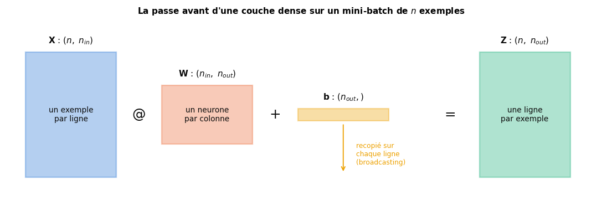
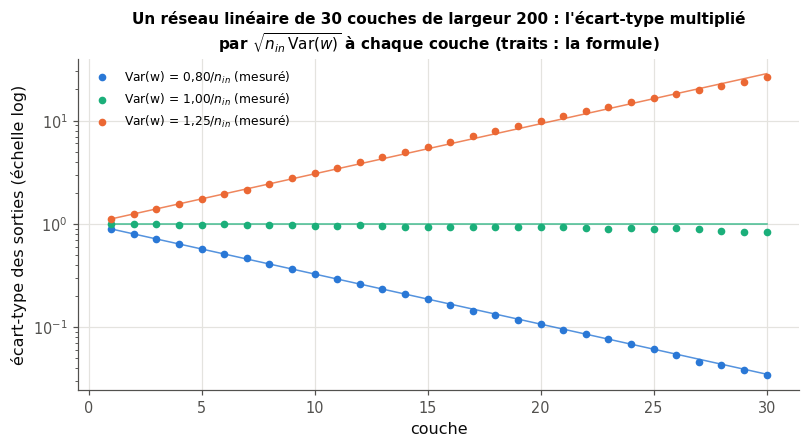

# 16 · Réseaux feed-forward — fiche de cours

> Cette fiche accompagne le chapitre 16 du livre, le premier de la partie consacrée aux réseaux de neurones. Le chapitre est court et sans formule : il pose le vocabulaire des **graphes** qui servent à dessiner les réseaux (nœuds, arêtes, parents, descendants, graphe orienté acyclique), décrit deux façons de faire circuler les données dans un graphe (**synchrone**, au rythme d'une horloge, ou **asynchrone**, avec des horodatages), puis pose la question de l'**initialisation des poids** avant tout apprentissage, en citant les règles de LeCun, Glorot et He. La fiche ajoute ce qu'il faut pour passer du dessin au calcul : l'**ordre d'évaluation** d'un graphe, la **passe avant** (*forward pass*) matricielle d'un réseau dense sur un mini-batch, le **comptage des paramètres**, la mémoire et le coût de calcul, et surtout la raison d'être des règles d'initialisation : **conserver la variance** des activations d'une couche à l'autre, sans quoi un réseau profond s'éteint ou explose avant même d'apprendre. Elle corrige aussi trois affirmations du livre (une influence initiale qui « s'efface », une densité appelée probabilité, des règles à « essayer » au hasard). Les figures du livre ne sont que résumées : chaque section te dit où les lire.

| | |
|---|---|
| **Livre** | vol. 1, ch. 16 « Feed-Forward Networks », p. 655-671 (§16.1 à §16.4.1) |
| **Temps total estimé** | ≈ 13 h : lecture du livre et de la fiche ≈ 2,2 h, exercices ≈ 11 h, 18 flashcards ≈ 0,6 h |
| **Prérequis** | 0A (arrays NumPy, broadcasting, `np.random.default_rng`, fonctions récursives) · 0B (produit matriciel, transposée, formes compatibles) · ch. 2 (lois uniforme et normale, variance, écart-type) · ch. 5 (dérivée, gradient numérique) · ch. 10 (neurone artificiel, biais, couche $\mathbf{Z} = \mathbf{X}\mathbf{W} + \mathbf{b}$, conventions des bibliothèques) · ch. 13 (arbres de décision) · ch. 15 (API de scikit-learn, attributs appris suffixés par `_`) |
| **Fichiers du chapitre** | `02_exercices.md` (quiz, rappels, papier, réflexion, entretien) · `03_notebook.ipynb` · `04_indices.md` · `05_solutions.md` et `05_solutions.ipynb` · `06_mes_reponses.md` · `flashcards.csv` |
| **mylearn** | `nn/layers.py`, le premier module du sous-package `mylearn.nn` : `count_parameters` (16.12), `dense_forward` (16.13), `init_weights` (16.14), `topological_order` (16.16), `init_mlp` et `mlp_forward` (16.17). La convention $\mathbf{W}$ de forme $(n_{in}, n_{out})$ et le cache de `mlp_forward` serviront tels quels à la rétropropagation du ch. 18 |

## Comment utiliser ce chapitre

Le livre avance en trois temps : ce qu'est un réseau feed-forward et comment on le dessine (§16.1 et §16.2), comment les données circulent dans le graphe (§16.3 et §16.3.1), puis les poids et leur initialisation (§16.4 et §16.4.1). Compte un peu plus de deux heures pour ses 16 pages et cette fiche. La fiche suit le même plan, avec deux sections en plus : la passe avant en matrices, après le §16.3.1, et le diagnostic des activations qui s'éteignent ou explosent, à la fin. Ses encadrés 🧮 donnent les maths et les outils qui manquent au livre : l'ordre topologique d'un graphe, une non-linéarité utilisée comme une boîte noire en attendant le ch. 17, les attributs `coefs_` et `intercepts_` du `MLPClassifier` de scikit-learn, et la variance d'une somme de produits, sur laquelle reposent toutes les règles d'initialisation.

**Ordre conseillé.**
1. Lis le livre §16.1 et §16.2, puis les sections 16.1 et 16.2 de la fiche. Fais les quiz Q1 à Q4, le rappel R2 et l'exercice 16.4.
2. Lis le livre §16.3 et §16.3.1, puis les sections 16.3 et 16.3.1 de la fiche. Fais les quiz Q5 à Q7 et l'exercice 16.5.
3. Lis la section de la fiche sur la passe avant en matrices. Fais les rappels R1 et R3, les exercices 16.1 et 16.3 et l'estimation 🧮 16.8.
4. Lis le livre §16.4 et §16.4.1, puis les sections 16.4 et 16.4.1 de la fiche et celle sur le diagnostic. Fais les quiz Q8 à Q10, l'exercice 16.2, les preuves ∂ 16.6 et 16.7, l'oral 🗣️ 16.9 et la lecture 📄 16.10. Vérifie tes réponses courtes dans la partie 0 du notebook.
5. Fais le notebook dans l'ordre : partie A (16.11 à 16.13 : prédire des formes, compter les paramètres, la couche dense), partie B (16.14 à 16.16 : les initialisations, leurs lois, l'ordre topologique), partie C (16.17 à 16.21 : empiler les couches, relire un `MLPClassifier`, des neurones jumeaux, un bug, des tests de reproductibilité), partie D (16.22 à 16.24 : des histogrammes d'activations, 20 couches selon l'initialisation, le défi des 50 couches). Finis par les quatre questions d'entretien.

| Section | Quiz 🧠 et rappels 🔁 | Papier ✏️ ∂ et réflexion | Notebook | Entretien 💼 |
|---|---|---|---|---|
| 16.1 Pourquoi ce chapitre | Q1 | 16.9 | | E4 |
| 16.2 Les graphes | Q1, Q2, Q3, Q4, R2 | 16.4 | 16.16 | E4 |
| 16.3 Flux synchrone et asynchrone | Q5, Q6 | 16.5 | | |
| 16.3.1 Le graphe en pratique | Q7 | 16.4 | 16.16, 16.17 | |
| Au-delà du livre : la passe avant en matrices | R1, R3 | 16.1, 16.2, 16.3, 16.8 | 16.11, 16.12, 16.13, 16.17, 16.18, 16.20 | E3 |
| 16.4 Les poids | Q8 | 16.1, 16.2 | 16.13 | |
| 16.4.1 L'initialisation | Q9, Q10 | 16.6, 16.7, 16.10 | 16.14, 16.15, 16.19, 16.21 | E1, E2 |
| Au-delà du livre : diagnostiquer les activations | Q10 | 16.7, 16.10 | 16.22, 16.23, 16.24 | E1, E2 |

**Lire les formules.** Un réseau dense a $L$ couches de neurones, numérotées $\ell = 1, \dots, L$ ; la couche $\ell$ a $n_\ell$ neurones, et $n_0$ est le nombre de features de l'entrée. Pour une couche, on écrit plus simplement $n_{in}$ (le nombre de ses entrées, son **fan-in**) et $n_{out}$ (le nombre de ses neurones, son **fan-out**). $\mathbf{W}^{(\ell)}$ est la matrice des poids de la couche $\ell$, de forme $(n_{\ell-1}, n_\ell)$, et $\mathbf{b}^{(\ell)}$ son vecteur de biais, de forme $(n_\ell,)$ ; $W_{jk}$ est le poids qui va de l'entrée $j$ au neurone $k$. Un mini-batch $\mathbf{X}$ a la forme $(n, n_0)$, un exemple par ligne. $\mathbf{Z}^{(\ell)}$ contient les sommes pondérées de la couche $\ell$ et $\mathbf{A}^{(\ell)} = f(\mathbf{Z}^{(\ell)})$ ses sorties (ses **activations**), avec $\mathbf{A}^{(0)} = \mathbf{X}$ ; $f$ est la fonction d'activation. $\mathcal{U}(-a, a)$ est la loi uniforme sur $[-a, a]$, $\mathcal{N}(0, \sigma^2)$ la loi normale de moyenne 0 et d'écart-type $\sigma$ ; $\mathbb{E}$ est l'espérance (la moyenne théorique) et $\mathrm{Var}$ la variance. $P$ est le nombre de paramètres d'un réseau. Ici, $L$ est le nombre de couches ; la loss, notée $L$ dans le reste du workbook, n'apparaît que dans ∂ 16.6, sous le nom $\mathcal{L}$.

## Objectifs d'apprentissage

À la fin du chapitre, tu sais :
- **décrire** un réseau feed-forward comme un graphe orienté acyclique, et en **déduire** un ordre d'évaluation de ses nœuds ;
- **calculer** à la main puis en NumPy la passe avant d'un MLP sur un mini-batch, en suivant les formes de chaque tableau et la diffusion du biais ;
- **compter** les paramètres d'un réseau dense et **estimer** sa mémoire et son coût de calcul ;
- **expliquer** pourquoi une initialisation constante empêche les neurones d'une couche de se différencier ;
- **dériver** et **implémenter** les initialisations LeCun, Glorot et He, et **choisir** la bonne selon l'activation ;
- **diagnostiquer** l'évanouissement ou l'explosion des activations dans un réseau profond, couche par couche.

## L'essentiel en 10 lignes

1. Un réseau **feed-forward** (ou **MLP**, *multilayer perceptron*) range ses neurones en couches : chaque couche reçoit les sorties de la précédente et envoie les siennes à la suivante, et les données ne reviennent jamais en arrière.
2. On le dessine comme un **graphe** : des **nœuds** (les neurones) reliés par des **arêtes** orientées ; une arête de A vers B fait de A un **parent** de B, et de B un **enfant** de A.
3. Un graphe sans boucle est un **graphe orienté acyclique** (**DAG**) : on peut toujours en ranger les nœuds dans un **ordre topologique**, où chaque nœud vient après ses parents, et c'est l'ordre dans lequel on les calcule.
4. La **rétroaction** (*feedback*) est une boucle qui ramène la sortie d'un nœud à son entrée ; la **passe arrière** de l'entraînement (ch. 18) parcourt le graphe à l'envers sans créer de boucle.
5. Dans un système **synchrone**, une horloge maître cadence les échanges ; dans un système **asynchrone**, un nœud qui attend toutes ses entrées s'aide d'**horodatages** pour savoir lesquelles sont nouvelles. Dans un programme, c'est l'**ordre des instructions** qui garantit l'ordre de calcul.
6. Une couche dense calcule $\mathbf{Z} = \mathbf{X}\mathbf{W} + \mathbf{b}$ sur tout un mini-batch : $\mathbf{X}$ $(n, n_{in})$, $\mathbf{W}$ $(n_{in}, n_{out})$, $\mathbf{b}$ $(n_{out},)$ ajouté à chaque ligne ; un MLP enchaîne $\mathbf{A}^{(\ell)} = f(\mathbf{A}^{(\ell-1)}\mathbf{W}^{(\ell)} + \mathbf{b}^{(\ell)})$.
7. Un réseau dense a $P = \sum_\ell (n_{\ell-1} n_\ell + n_\ell)$ paramètres ; en `float32`, chacun occupe 4 octets, et une passe avant coûte environ une multiplication par poids et par exemple.
8. Des poids **tous égaux** rendent les neurones d'une couche **jumeaux** : ils calculent la même chose et reçoivent les mêmes corrections, pour toujours. On tire donc les poids **au hasard**, avec des biais nuls.
9. Une somme de $n_{in}$ produits a une variance $n_{in}\,\mathrm{Var}(w)\,\mathbb{E}[x^2]$ : pour la garder constante d'une couche à l'autre, il faut $\mathrm{Var}(w) = 1/n_{in}$ (**LeCun**), $2/(n_{in} + n_{out})$ (**Glorot**, pour tanh et la sigmoïde) ou $2/n_{in}$ (**He**, pour ReLU).
10. Avec une mauvaise échelle, l'écart-type des activations est multiplié par le même facteur à chaque couche : il **s'évanouit** ou **explose** exponentiellement avec la profondeur, ce qui se voit en mesurant l'écart-type de chaque couche avant d'entraîner.

## 16.1 · Pourquoi ce chapitre ? ⏩

Ce chapitre ouvre la partie du livre consacrée au deep learning (p. 657-658). Au ch. 10, un neurone seul ne savait tracer qu'une frontière droite. Toute la puissance d'un réseau vient de l'**organisation** : on range les neurones en **couches**, la couche $\ell$ ne lit que les sorties de la couche $\ell - 1$, et, dans la plupart des architectures, deux neurones d'une même couche n'ont aucune connexion. Chaque couche transforme donc la représentation que lui donne la précédente : des pixels, une première couche peut tirer des traits, la suivante des combinaisons de traits, et ainsi de suite. On parle de traitement **hiérarchique**. Le livre signale que certaines aires sensorielles du cerveau semblent organisées ainsi ; retiens l'image, pas une ressemblance biologique (ch. 10).

Le chapitre ne présente qu'une architecture, la plus courante : celle où l'information ne circule que **dans un sens**, des entrées vers les sorties. Chaque neurone « nourrit » (*feeds*) les neurones qui viennent après lui : c'est un réseau **feed-forward** (on dit aussi **MLP**, *multilayer perceptron*, ou réseau **dense** quand chaque neurone d'une couche est relié à tous ceux de la suivante). Une couche entre l'entrée et la sortie s'appelle une **couche cachée**, parce que ses valeurs n'apparaissent ni dans les données ni dans la prédiction. On note un MLP par la liste de ses tailles : « 12-16-4 » reçoit 12 features, a une couche cachée de 16 neurones et 4 neurones de sortie ; ses couches de neurones qui calculent sont celles qui ont des poids, la « couche d'entrée » ne faisant que tenir les données. Choisir ces tailles, l'empilement des couches et leurs hyperparamètres, c'est l'essentiel du travail de conception d'un réseau, et cela se règle en expérimentant (p. 658). Ce chapitre-ci pose deux fondations : le vocabulaire des graphes qui décrivent la circulation des données, et les valeurs à donner aux poids avant le premier pas d'apprentissage.

> 💼 **En entreprise** — « Combien de paramètres a ce modèle ? », « Pourquoi ne pas initialiser à zéro ? », « He ou Glorot ? » : ces trois questions reviennent dans presque tous les entretiens qui touchent au deep learning, même pour un poste de data scientist qui utilisera surtout PyTorch. Elles vérifient que tu sais ce qu'il y a dans une couche `nn.Linear`, au-delà de l'appel. Savoir compter de tête les paramètres et la mémoire d'un réseau sert aussi tous les jours : pour savoir si un modèle tient sur un GPU, ou pourquoi un fichier de poids pèse 500 Mo. Les questions d'entretien 💼 16.E1 à 16.E4 portent sur ces réflexes.

> 🕰️ **Mise à jour (2026) — le mot « feed-forward »** — **Le livre :** appelle feed-forward un réseau dont les données ne vont que vers l'avant. · **Aujourd'hui :** le sens reste le même, et l'on dit aussi MLP ou réseau dense. Le mot a gagné un second emploi avec les Transformers : chaque couche d'un Transformer contient un **bloc feed-forward** (*FFN*, *position-wise feed-forward network*), un petit MLP à deux couches appliqué séparément à chaque position de la séquence ; dans l'article d'origine, $\mathrm{FFN}(x) = \max(0,\ x W_1 + b_1)\,W_2 + b_2$, avec 512 dimensions en entrée et en sortie et 2 048 neurones cachés. Avec $d_{ff} = 4 d$, un bloc feed-forward a $2 \times d \times 4d = 8d^2$ poids, contre $4d^2$ pour l'attention de la même couche : environ les deux tiers des paramètres de chaque couche. · **Faut-il quand même l'apprendre ?** Oui : le MLP de ce chapitre est la brique répétée dans GPT-2, et ses successeurs en utilisent une variante « à porte » (SwiGLU) (bonus B3). · *Source :* [A. Vaswani et coll., « Attention Is All You Need », NeurIPS 2017, §3.3 (arXiv:1706.03762)](https://arxiv.org/abs/1706.03762).

## 16.2 · Les graphes de réseaux de neurones ⏩

**Nœuds et arêtes.** Un dessin de réseau est un **graphe** au sens mathématique (p. 658-661, figure 16.1 : deux réseaux, l'un dessiné de gauche à droite, l'autre de bas en haut). Il est fait de **nœuds** (on dit aussi **sommets**, *vertices*), dessinés par des cercles, qui sont en général des neurones, et d'**arêtes** (*edges*, ou *arcs*) : des flèches qui transportent la sortie d'un nœud vers l'entrée d'un autre. La flèche donne le sens de circulation ; quand il n'y a pas d'ambiguïté, on omet la pointe, et la convention est alors que les données vont de gauche à droite, ou de bas en haut. L'image d'une **usine** (p. 659), où chaque nœud est un poste de travail et chaque arête un convoyeur, est utile ; 🗣️ 16.9 te fait l'exploiter, et en chercher les limites.

**Avant, après, parent, enfant.** Les mots de position se lisent dans le sens des données (p. 660) : **avant** et **en dessous** désignent le côté des entrées, **après** et **au-dessus** celui des sorties ; garde ce sens même si le schéma est horizontal. Si une arête va de A vers B, A est un **parent** de B et B un **enfant** de A. Le livre emploie aussi **ancêtre** et **descendant** dans ce sens ; en théorie des graphes, ces deux mots sont plus larges : un **ancêtre** de B est un nœud d'où part un **chemin** (une suite d'arêtes) qui mène à B, et un **descendant** de A un nœud où mène un chemin parti de A. Un parent est donc un ancêtre direct. Les exercices suivent ces définitions. Le nombre d'entrées d'un nœud (de flèches qui y arrivent) est son **degré entrant** ; pour un neurone, c'est le **fan-in** de la section 16.4.1.

**Pas de boucle : le DAG.** Un réseau feed-forward s'interdit les **cycles** : aucun chemin, si long soit-il, ne ramène à son point de départ. C'est un **graphe orienté acyclique** (*directed acyclic graph*, **DAG**), le sigle que tout le monde emploie. Rien n'interdit en revanche deux chemins différents entre deux nœuds, ni une arête qui « saute » une couche (figure ci-dessous, panneau (b)) : ces **connexions résiduelles** (*skip connections*) sont même au cœur des réseaux profonds modernes (ResNet, Transformers), et le graphe reste un DAG. Le livre cite une exception à la règle : les **réseaux récurrents** (RNN, ch. 22), dont un nœud reçoit sa propre sortie du pas de temps précédent ; mais on peut **dérouler** un RNN dans le temps, une copie du réseau par pas de temps, et le dessin redevient un DAG.


**Pourquoi s'interdire les boucles.** Une boucle crée une **rétroaction** (*feedback*) : la sortie d'un nœud revient à son entrée, puis en ressort modifiée, et ainsi de suite. Le livre prend l'exemple de l'**effet Larsen**, ce sifflement qui monte quand un micro s'approche du haut-parleur qui le diffuse : une rétroaction peut s'emballer très vite. Sans cycle, ce risque disparaît, et le calcul devient simple : on évalue chaque nœud une fois, dans un ordre où ses parents passent avant lui (encadré ci-dessous). Attention à une confusion de vocabulaire que le livre prend soin d'écarter : pour entraîner un réseau, la rétropropagation (ch. 18) fait circuler une information **des sorties vers les entrées**, en parcourant les arêtes à l'envers. Ce n'est **pas** une rétroaction : le graphe n'a toujours pas de boucle, et aucun nœud ne reçoit sa propre sortie ; on parle de **passe arrière** (*backward pass*), et le livre réserve le mot *feedback* aux boucles.

> 🧮 **Rappel maths — graphe orienté acyclique et ordre topologique** — Un graphe orienté se décrit par la **liste des enfants** de chaque nœud, un dictionnaire Python : `{"P": ["R"], "Q": ["R", "S"], "R": ["T"]}` dit qu'il y a des arêtes P → R, Q → R, Q → S et R → T (les nœuds S et T, sans enfant, n'ont pas besoin de clé). Un **ordre topologique** est une liste de tous les nœuds où chaque nœud vient **après tous ses parents** : c'est un ordre dans lequel on peut calculer les nœuds, chacun ayant ses entrées prêtes. Un graphe orienté a un ordre topologique **si et seulement s'il n'a pas de cycle** : avec un cycle A → B → A, ni A ni B ne peut venir en premier. Pour en trouver un, l'**algorithme de Kahn** (1962) compte d'abord les parents de chaque nœud ; il range ensuite, un par un, un nœud **prêt** (dont tous les parents sont déjà rangés), puis retire une unité au compte de chacun de ses enfants, et ainsi de suite. S'il reste des nœuds quand plus aucun n'est prêt, le graphe a un cycle. Un graphe a souvent **plusieurs** ordres topologiques ; pour en fixer un, on prend toujours le plus petit nom prêt (l'ordre alphabétique), comme `topological_order` de ta librairie (🔨 16.16). *Mini-exemple :* sur le graphe de ce dictionnaire, P et Q sont prêts au départ ; on range P (le plus petit nom) ; R attend encore Q ; on range Q, ce qui rend R et S prêts ; on range R, qui libère T ; puis S et T : l'ordre est P, Q, R, S, T. Le module `graphlib` de la bibliothèque standard de Python (`TopologicalSorter`) fait le même travail, avec un autre choix parmi les nœuds prêts. Une autre méthode, récursive (0A), range un nœud après avoir rangé tous ses parents : c'est elle qu'utilisera la rétropropagation du ch. 18 sur un graphe de calcul. ✏️ 16.4 te fait dérouler Kahn à la main et compter les ordres possibles.

## 16.3 · Flux synchrone et asynchrone

**Des valeurs posées, pas un courant.** On dit qu'une donnée « circule » dans un graphe, mais rien ne coule en continu : une valeur arrive sur une arête, puis **reste** disponible tant qu'une autre ne la remplace pas. Le livre emprunte à l'électronique le nom de ce comportement, l'**échantillonneur-bloqueur** (*sample-and-hold*, p. 661). La vraie question de cette section est donc : **qu'est-ce qui déclenche le calcul d'un nœud ?** Le livre compare deux réponses (p. 662-663), résumées dans ce tableau, avec, en dernière ligne, des exemples et les images du livre.

| | synchrone | asynchrone |
|---|---|---|
| ce qui déclenche les envois | le battement d'une **horloge maître**, commun à tous les nœuds | la fin du calcul de chaque nœud : il envoie dès qu'il a fini |
| le rythme | une période fixe, réglée sur le nœud le **plus lent** (tous doivent avoir fini avant le battement suivant) | aucun rythme commun : un nœud rapide n'attend pas un nœud lent |
| ce que lit un nœud | les valeurs du battement précédent, qui ne bougent pas entre deux battements | les valeurs les plus récentes qu'il a reçues, d'âges différents |
| exemples | un convoyeur d'usine qui avance par à-coups (le livre compare l'horloge maître à une horloge de parquet) | un serveur web qui traite chaque requête dès qu'elle arrive ; pour le livre, une conversation par messages, où chacun répond quand il le peut |

Pour le livre, l'asynchrone est le cas général : le synchrone en est la version où toutes les mises à jour tombent au même instant. C'est donc lui qu'il faut savoir raisonner.

**Le problème des valeurs « nouvelles ».** Un nœud asynchrone qui doit attendre une valeur **neuve** de chacun de ses parents ne peut pas comparer les valeurs : un parent peut recalculer et renvoyer exactement la même valeur, et elle compte pourtant comme nouvelle. Le livre illustre ce piège avec un nœud qui additionne trois entrées (p. 663). Sa solution est l'**horodatage** (*time stamp*), écrit par le nœud qui **envoie**, au moment où il calcule (pas au moment où la valeur est lue) :

```text
on message (value, stamp) from parent p:
    inputs[p] <- (value, stamp)
    if inputs holds a value from every parent and every stamp in inputs is later than last_time:
        output <- compute(values of inputs)          # a new output, even if equal to the previous one
        last_time <- now ; send (output, now) to every child
```

*Mini-exemple :* un nœud qui multiplie deux entrées a calculé à $t = 4$. Les deux entrées reviennent avec leurs valeurs d'avant, la première à $t = 6$, la seconde à $t = 7$ : le nœud recalcule à $t = 7$ (même produit, mais **nouveau**) et note $t = 7$. Une première entrée qui revient à $t = 8$ ne suffit pas : il attend une seconde entrée horodatée après 7. ✏️ 16.5 te fait simuler un nœud plus long, et compter ce que coûterait une règle naïve.

## 16.3.1 · Le graphe en pratique ⏩

Dans un programme, l'horodatage reste une idée : on n'en a presque jamais besoin, parce que l'**ordre des instructions** fait le travail (p. 664). Dans `h = np.tanh(x @ W1)` suivi de `y = h @ W2`, Python calcule `h` avant `y`, ligne après ligne : écrire les couches dans l'ordre, c'est suivre un ordre topologique du graphe. Le matériel moderne complique ce tableau sans le contredire (p. 664) ; deux exemples concrets :
- les **frameworks** (PyTorch, JAX, TensorFlow) enregistrent les opérations d'un calcul dans un **graphe de calcul**, un DAG dont les nœuds sont des opérations ; pour la passe arrière, ils le parcourent dans l'ordre topologique inverse (ch. 18, où tu écriras ce parcours) ;
- sur un **GPU**, les calculs sont lancés de façon **asynchrone** : Python continue avant que le GPU ait fini, et attend seulement quand il a besoin d'un résultat (encadré ci-dessous).

> 🕰️ **Mise à jour (2026) — les calculs asynchrones sur GPU** — **Le livre :** décrit le flux asynchrone et ses horodatages comme une idée générale, rarement nécessaire dans un programme. · **Aujourd'hui :** sur GPU, PyTorch est asynchrone **par défaut** : un appel à une opération CUDA la met dans une file d'attente du GPU et rend la main tout de suite au programme Python, qui ne se bloque que lorsqu'il lit un résultat (par exemple `.item()` ou une copie vers le processeur). PyTorch garantit que les opérations d'une même file s'exécutent dans l'ordre : le résultat est le même que si tout était synchrone. Le piège est la **mesure du temps** : `time.perf_counter()` autour d'un calcul sur GPU mesure surtout le temps de mise en file. Pour chronométrer, on appelle `torch.cuda.synchronize()` avant de lire l'heure, ou l'on utilise des événements `torch.cuda.Event(enable_timing=True)`. · **Faut-il quand même l'apprendre ?** Oui pour l'idée de DAG et d'ordre de calcul ; l'horodatage reste un outil de réflexion, mais l'asynchronisme du GPU te rattrapera au premier benchmark (ch. 20). · *Source :* [PyTorch, « CUDA semantics », section « Asynchronous execution »](https://docs.pytorch.org/docs/2.11/notes/cuda.html).

## Au-delà du livre : la passe avant en matrices

Le livre dessine les réseaux sans dire comment on les calcule. Voici ce calcul, que ta librairie écrit en NumPy (🔨 16.13 et 16.17) et que les chapitres 17 à 20 réutiliseront tel quel.

**Une couche, un mini-batch.** Le ch. 10 a rangé les poids d'une couche dans une matrice $\mathbf{W}$ de forme $(n_{in}, n_{out})$, une **colonne par neurone** : $W_{jk}$ est le poids de l'entrée $j$ vers le neurone $k$, porté par l'arête $j \to k$ du graphe. Pour un mini-batch de $n$ exemples, une **ligne par exemple**, une seule ligne de code calcule toutes les sommes pondérées :

$$\mathbf{Z} = \mathbf{X}\mathbf{W} + \mathbf{b}, \qquad \mathbf{X} \in \mathbb{R}^{n \times n_{in}},\quad \mathbf{W} \in \mathbb{R}^{n_{in} \times n_{out}},\quad \mathbf{b} \in \mathbb{R}^{n_{out}},\quad \mathbf{Z} \in \mathbb{R}^{n \times n_{out}}.$$

$Z_{ik} = \sum_j X_{ij} W_{jk} + b_k$ est la somme pondérée du neurone $k$ pour l'exemple $i$. Le produit $\mathbf{X}\mathbf{W}$ n'est possible que si le nombre de colonnes de $\mathbf{X}$ égale le nombre de lignes de $\mathbf{W}$ (0B) ; le vecteur $\mathbf{b}$, de forme $(n_{out},)$, est **ajouté à chaque ligne** par *broadcasting* (0A) : NumPy aligne les formes par la droite, $(n, n_{out})$ et $(n_{out},)$, et recopie $\mathbf{b}$ sur les $n$ lignes. Chaque ligne de $\mathbf{Z}$ ne dépend que de la ligne correspondante de $\mathbf{X}$ : calculer un batch ou ses exemples un par un donne le même résultat. *Mini-exemple :* deux exemples $(1, 0)$ et $(0, 2)$, deux neurones de poids $\mathbf{W} = \begin{pmatrix} 1 & -1 \\ 3 & 0{,}5 \end{pmatrix}$ et de biais $(0{,}5 ;\ 0)$ : la première ligne de $\mathbf{Z}$ vaut $(1 + 0{,}5 ;\ -1 + 0) = (1{,}5 ;\ -1)$, la seconde $(6 + 0{,}5 ;\ 1 + 0) = (6{,}5 ;\ 1)$.



> ⚠️ **Piège classique — un biais mal diffusé, une matrice transposée** — Deux erreurs de forme passent inaperçues quand les dimensions coïncident. (1) Écrire le biais en colonne, `b.reshape(-1, 1)`, de forme $(n_{out}, 1)$ : NumPy l'aligne alors sur les **exemples** et non sur les neurones ; la somme lève une erreur… sauf si le batch a justement $n_{out}$ exemples, et le biais du neurone $k$ s'ajoute alors à l'exemple $k$. (2) Copier des poids de PyTorch, qui range `weight` en $(n_{out}, n_{in})$ (ch. 10), sans les transposer : `X @ W` lève une erreur… sauf si la couche est carrée, et le réseau calcule alors autre chose sans rien dire. Une couche carrée et un batch de la même taille masquent les deux erreurs : c'est pourquoi les tests de ta librairie utilisent des formes toutes différentes, et vérifient qu'un exemple donne le même résultat seul ou dans un batch (🐛 16.20).

**Empiler les couches.** Un MLP applique les couches l'une après l'autre, chacune sur les sorties de la précédente, dans l'ordre topologique du graphe :

$$\mathbf{A}^{(0)} = \mathbf{X}, \qquad \mathbf{Z}^{(\ell)} = \mathbf{A}^{(\ell-1)}\mathbf{W}^{(\ell)} + \mathbf{b}^{(\ell)}, \qquad \mathbf{A}^{(\ell)} = f\big(\mathbf{Z}^{(\ell)}\big), \qquad \ell = 1, \dots, L.$$

La forme de $\mathbf{W}^{(\ell)}$ est $(n_{\ell-1}, n_\ell)$ : le nombre de lignes de chaque matrice doit égaler le nombre de colonnes de la précédente. La dernière couche a souvent une activation à part (aucune pour une régression, une softmax pour une classification, ch. 17), voire aucune : `mlp_forward` rend alors les **logits**, les sommes pondérées de sortie. Pour la rétropropagation du ch. 18, il faudra connaître, couche par couche, l'entrée $\mathbf{A}^{(\ell-1)}$ et la somme pondérée $\mathbf{Z}^{(\ell)}$ : `mlp_forward(..., return_cache=True)` les garde dans une liste de couples `(a_prev, z)`, le **cache** de la passe avant.

```text
mlp_forward(X, params, f, f_out):
    a <- X
    cache <- empty list
    for each layer (W, b) of params, in order:
        z <- a @ W + b                     # (n, n_in) @ (n_in, n_out) + (n_out,)
        cache.append((a, z))               # what the backward pass of chapter 18 needs
        a <- f(z)  for a hidden layer,  f_out(z) for the last one (identity if None)
    return a  (and the cache)
```

> 🧮 **Rappel maths — une non-linéarité utilisée comme une boîte noire** — Les fonctions d'activation sont le sujet du ch. 17 ; ce chapitre-ci n'en utilise que deux, sans les étudier, comme un « pliage » appliqué à chaque valeur : la **tangente hyperbolique** `np.tanh(z)`, qui écrase toute valeur dans $]-1, 1[$, vaut à peu près $z$ près de 0 et sature (tend vers $\pm 1$) quand $|z|$ grandit ; et **ReLU**, `np.maximum(0, z)`, qui garde les valeurs positives et remplace les négatives par 0. Elles s'appliquent **élément par élément** : `np.tanh` d'un tableau $(n, n_{out})$ rend un tableau de même forme. Pourquoi en faut-il une ? Sans activation, deux couches se réduisent à une : $(\mathbf{X}\mathbf{W}_1 + \mathbf{b}_1)\mathbf{W}_2 + \mathbf{b}_2 = \mathbf{X}(\mathbf{W}_1\mathbf{W}_2) + (\mathbf{b}_1\mathbf{W}_2 + \mathbf{b}_2)$, une seule couche affine, et un réseau de cent couches linéaires ne trace toujours que des frontières droites (ch. 10). *Mini-exemple :* `np.maximum(0, np.array([-2.0, 0.5]))` rend `[0, 0.5]` ; `np.tanh(0.1)` vaut environ 0,0997 et `np.tanh(3)` environ 0,995. Dans ta librairie, `mlp_forward` reçoit l'activation en argument (`activation=np.tanh`, ou `lambda z: np.maximum(0, z)`), si bien que tes fonctions du ch. 17 s'y brancheront sans rien changer.

**Compter les paramètres.** Une couche de $n_{in}$ entrées et $n_{out}$ neurones a $n_{in} n_{out}$ poids (une arête de chaque entrée vers chaque neurone) et $n_{out}$ biais. Pour tout le réseau :

$$P = \sum_{\ell=1}^{L} \big(n_{\ell-1}\, n_\ell + n_\ell\big).$$

*Mini-exemple :* le MLP 3-4-4-2 de la figure du §16.2 a $(3 \times 4 + 4) + (4 \times 4 + 4) + (4 \times 2 + 2) = 16 + 20 + 10 = 46$ paramètres. De tête, on garde surtout les grands produits : un MLP 3072-1024-1024-10 pour de petites images en couleur (32 × 32 pixels × 3 couleurs) a environ $3\,072 \times 1\,024 \approx 3{,}1$ millions de poids dans sa première couche, $1\,024^2 \approx 1{,}05$ million dans la deuxième, et dix mille dans la dernière : environ 4,2 millions de paramètres, dont les trois quarts dans la première couche. La première couche domine dès que l'entrée est grande : c'est l'une des raisons des couches convolutives (ch. 21), qui partagent leurs poids.

**Mémoire et calcul.** Chaque paramètre en `float32` occupe **4 octets** (8 en `float64`, le défaut de NumPy, 2 en `float16` ou `bfloat16`) : un million de paramètres font 4 Mo en `float32`. Une passe avant coûte environ **une multiplication et une addition par poids et par exemple** (les biais et les activations sont négligeables) : pour un batch de $n$ exemples, $n \sum_\ell n_{\ell-1} n_\ell$ multiplications. L'entraînement coûte environ **trois fois** la passe avant (la passe arrière en demande à peu près deux). Il faut aussi garder en mémoire le cache de la passe avant, qui grandit avec la taille du batch, et, pendant l'entraînement, les gradients et l'état de l'optimiseur (ch. 19). 🧮 16.8 te fait estimer ces ordres de grandeur pour MNIST.

> 🧮 **Rappel outil — les poids d'un `MLPClassifier` de scikit-learn** — Le `MLPClassifier` de scikit-learn (ch. 1, 📦 1.23) est un MLP comme celui de ce chapitre. `MLPClassifier(hidden_layer_sizes=(64,))` a une couche cachée de 64 neurones ; la couche de sortie a un neurone par classe (un seul pour deux classes). Après `fit`, il expose ses paramètres appris, suffixés par `_` (ch. 15) : `coefs_`, la liste des matrices de poids, une par couche, de forme `(n_in, n_out)` **comme dans ta librairie** ; `intercepts_`, la liste des vecteurs de biais ; et `n_layers_`, le nombre de couches **en comptant l'entrée** (3 pour une couche cachée). Son activation cachée par défaut est ReLU (`activation="relu"`) ; sa sortie est une softmax à plusieurs classes, une sigmoïde à deux classes. *Mini-exemple :* entraîné sur 8 features et 4 classes, `MLPClassifier(hidden_layer_sizes=(32, 16))` a trois matrices de poids, de formes `(8, 32)`, `(32, 16)` et `(16, 4)`, et `n_layers_ == 4`. Avec ta `mlp_forward`, ces listes suffisent pour refaire ses prédictions (📦 16.18). Attention : PyTorch range les poids d'une couche `nn.Linear` dans l'autre sens, `(n_out, n_in)` (ch. 10).

## 16.4 · Les poids ⏩

Le livre revient au neurone du ch. 10 (p. 664-667). Trois valeurs, nommées R, G et B, entrent dans un neurone, et chacune est multipliée par son poids en entrant (figure 16.2). On peut sortir ces multiplications du neurone et les écrire sur les arêtes qui y arrivent : chaque valeur arrive alors **déjà pondérée** (figure 16.3), et le calcul est le même. C'est la convention de tout le livre et de presque tous les schémas : **chaque arête porte son propre poids**, même quand il n'est pas écrit. Un neurone qui envoie sa sortie à trois neurones a donc trois arêtes sortantes, et trois poids, a priori différents (figure 16.4) : la même valeur arrive multipliée par trois nombres différents. Dans une matrice $\mathbf{W}$, les poids qui **partent** d'une entrée $j$ forment la ligne $j$ ; ceux qui **arrivent** au neurone $k$ forment la colonne $k$.

*Mini-exemple :* un neurone reçoit $(R, G, B) = (0{,}5 ;\ 0{,}1 ;\ 0{,}9)$ par des arêtes de poids $(2 ;\ 4 ;\ -1)$, et a un biais de $0{,}2$ : sa somme pondérée vaut $1 + 0{,}4 - 0{,}9 + 0{,}2 = 0{,}7$. Apprendre, pour ce réseau, c'est modifier ces nombres-là, ceux des arêtes, pour que la sortie s'améliore. Reste la question du point de départ.

## 16.4.1 · L'initialisation ⏩

**Pas la même valeur partout.** Avant toute donnée, il faut donner une valeur à chaque poids (p. 667-670). Le livre écarte d'abord l'idée la plus simple, une même constante pour tous : des poids égaux recevraient des corrections égales et avanceraient « au pas » (*lockstep*). Précisons pourquoi. Si tous les neurones d'une couche cachée ont les mêmes poids entrants et le même biais, ils calculent la même sortie pour chaque exemple ; si leurs poids sortants sont égaux aussi, ils jouent exactement le même rôle dans la suite du réseau. Ils reçoivent donc le même gradient, la même correction, et restent identiques après chaque pas : la couche se comporte comme un **seul** neurone recopié, quelle que soit sa largeur. On parle de **symétrie** des neurones, et l'initialisation doit la **briser**. Il suffit pour cela que les poids soient **différents** : des poids tirés au hasard, avec des **biais nuls** (les biais n'ont pas besoin d'être différents, puisque les poids le sont déjà). Une initialisation à zéro est le pire cas (∂ 16.6, question 6, te fait voir pourquoi). ∂ 16.6 te fait démontrer que la symétrie ne se brise jamais toute seule, et 🔮 16.19 te fait prédire ce qu'il en reste sur un petit réseau.

**Uniforme ou normale.** Le livre présente les deux lois du ch. 2. L'**initialisation uniforme** tire chaque poids uniformément dans un petit intervalle autour de 0, par exemple $[-0{,}05 ;\ 0{,}05]$ (figure 16.5) : toutes les valeurs de l'intervalle sont aussi probables, et aucune n'en sort. L'**initialisation normale** tire chaque poids selon une loi normale centrée en 0 (figure 16.6) : les valeurs proches de 0 sont les plus fréquentes, les grandes valeurs de plus en plus rares. Les deux lois se décrivent par leur **écart-type** : $\mathcal{U}(-a, a)$ a une variance $a^2/3$, donc un écart-type $a/\sqrt{3}$ (environ $0{,}058$ pour $a = 0{,}1$) ; $\mathcal{N}(0, \sigma^2)$ a l'écart-type $\sigma$. En NumPy, avec un générateur `rng = np.random.default_rng(seed)` : `rng.uniform(-a, a, size=(n_in, n_out))` et `rng.normal(0.0, sigma, size=(n_in, n_out))`.

![Deux initialisations, 20 000 tirages chacune : uniforme sur [−0,2 ; 0,2] (densité constante 2,5) et normale d'écart-type 0,1 (pic de densité environ 4) ; l'histogramme normalisé suit la densité théorique](figures/lois_initialisation.png)

> ⚠️ **Le livre, corrigé — une densité n'est pas une probabilité** — La légende de la figure 16.6 parle de « probabilités » qui tombent presque à zéro aux bornes $\pm 0{,}05$, et la figure 16.5 dessine un plateau dont le livre dit que la hauteur importe peu. Pour une loi **continue**, ces courbes sont des **densités** (ch. 2) : une probabilité est l'**aire** sous la courbe entre deux valeurs, et la densité elle-même peut dépasser 1. La hauteur du plateau d'une loi uniforme est fixée, $1/(2a)$, pour que l'aire totale fasse 1 ; le pic d'une densité normale vaut $1/(\sigma\sqrt{2\pi})$, bien plus que 1 pour un petit $\sigma$. La courbe du livre, presque nulle à $\pm 0{,}05$, correspond à un écart-type d'environ $0{,}05/3$ : 🎨 16.15 te fait calculer ces deux hauteurs. Enfin, une loi normale n'a pas de bornes : on n'y choisit pas des « limites », mais un écart-type, et une valeur à plus de trois écarts-types reste possible (0,3 % des tirages). 🎨 16.15 te fait aussi refaire ces deux figures avec leurs vraies échelles.

> ⚠️ **Le livre, corrigé — l'influence de l'initialisation ne s'efface pas toujours** — Le livre rassure sur les poids tirés au hasard : selon lui, l'apprentissage les améliore vite, et « leur influence initiale s'efface rapidement » (p. 668). C'est vrai d'un petit réseau peu profond, pas d'un réseau profond. Glorot et Bengio (2010) ont montré que les réseaux profonds de l'époque apprenaient mal en bonne partie à cause du **couple activation-initialisation** : avec la sigmoïde et l'initialisation uniforme classique, la dernière couche cachée sature très tôt (ses sorties tombent vers 0), et l'apprentissage stagne longtemps ; avec une échelle mal choisie, les activations et les gradients s'évanouissent ou explosent d'une couche à l'autre, et l'apprentissage ne démarre pas du tout (section suivante). L'initialisation fait aussi partie du résultat : deux graines donnent deux réseaux entraînés différents. Une échelle fixe comme $\pm 0{,}05$, qui ne dépend pas de la largeur des couches, est justement ce qu'il ne faut pas faire dans un réseau profond. Le livre le sait, d'ailleurs : il note qu'on emploie rarement ces lois telles quelles, faute de savoir choisir leurs paramètres (p. 669), et renvoie aux règles nommées ; ce qui lui manque, c'est la raison de ces règles. 📄 16.10 te fait lire l'article.

**La variance d'une somme pondérée.** Pourquoi l'échelle des poids compte-t-elle tant ? Regarde un neurone de $n_{in}$ entrées : sa somme pondérée additionne $n_{in}$ produits $w_j x_j$. Si les poids sont trop grands, la somme grandit avec $n_{in}$ ; s'ils sont trop petits, elle s'écrase ; et chaque couche recommence sur les sorties de la précédente. L'encadré suivant chiffre cet effet ; la règle qui en sort tient en une phrase : **la bonne variance des poids est inversement proportionnelle au nombre d'entrées**.

> 🧮 **Rappel maths — la variance d'une somme de produits** — Trois propriétés de la variance, pour des variables aléatoires (ch. 2). (1) $\mathrm{Var}(aX) = a^2\,\mathrm{Var}(X)$ pour une constante $a$ : multiplier les poids par 2 multiplie leur variance par 4. (2) La variance d'une somme de variables **décorrélées** (deux à deux de covariance nulle, ce qui est le cas de variables indépendantes) est la somme de leurs variances : $\mathrm{Var}(X_1 + \dots + X_n) = \mathrm{Var}(X_1) + \dots + \mathrm{Var}(X_n)$. (3) Pour deux variables indépendantes, $\mathbb{E}[XY] = \mathbb{E}[X]\,\mathbb{E}[Y]$ ; et $\mathrm{Var}(X) = \mathbb{E}[X^2] - \mathbb{E}[X]^2$. Applique-les à $z = \sum_{j=1}^{n_{in}} w_j x_j$ (biais nul), avec des poids indépendants entre eux et du vecteur des entrées, **centrés** ($\mathbb{E}[w] = 0$), de même variance $\mathrm{Var}(w)$ ; les entrées ont toutes le même $\mathbb{E}[x^2]$. Chaque produit a une moyenne nulle, $\mathbb{E}[w_j x_j] = \mathbb{E}[w_j]\,\mathbb{E}[x_j] = 0$, et une variance $\mathbb{E}[w_j^2 x_j^2] = \mathbb{E}[w_j^2]\,\mathbb{E}[x_j^2] = \mathrm{Var}(w)\,\mathbb{E}[x_j^2]$ ; deux produits différents sont décorrélés, car $\mathbb{E}[w_j x_j\, w_k x_k] = \mathbb{E}[w_j]\,\mathbb{E}[w_k]\,\mathbb{E}[x_j x_k] = 0$ (même si les entrées sont corrélées entre elles), donc
> $$\mathrm{Var}(z) = n_{in}\,\mathrm{Var}(w)\,\mathbb{E}[x^2].$$
> Quand les entrées sont elles-mêmes centrées, $\mathbb{E}[x^2] = \mathrm{Var}(x)$, et la couche **multiplie** la variance par $n_{in}\,\mathrm{Var}(w)$. *Mini-exemple :* 100 entrées de variance 1 et des poids de $\mathcal{U}(-0{,}1 ;\ 0{,}1)$, de variance $0{,}1^2/3 \approx 0{,}00333$ : $\mathrm{Var}(z) \approx 100 \times 0{,}00333 = 0{,}333$, un écart-type de 0,58 ; avec 1 000 entrées, l'écart-type passe à 1,83. La même initialisation donne des sorties d'échelles très différentes selon la largeur de la couche. ∂ 16.7 te fait refaire ce calcul et en tirer les trois règles ci-dessous.

**Les trois règles.** Pour que la variance ne change pas d'une couche à l'autre, il faut $n_{in}\,\mathrm{Var}(w) = 1$ dans une couche sans activation, ou avec une activation qui ressemble à l'identité près de 0, comme tanh. C'est la règle de **LeCun** (LeCun, Bottou, Orr et Müller, 1998), qui recommandait des entrées normalisées et des poids d'écart-type $1/\sqrt{n_{in}}$ :

$$\text{LeCun : } \mathrm{Var}(w) = \frac{1}{n_{in}}.$$

**Glorot** et Bengio (2010, Xavier étant le prénom de Glorot) regardent aussi la passe arrière (ch. 18) : les gradients traversent chaque couche dans l'autre sens, en additionnant $n_{out}$ produits, et leur variance est multipliée par $n_{out}\,\mathrm{Var}(w)$. On ne peut pas avoir à la fois $n_{in}\,\mathrm{Var}(w) = 1$ et $n_{out}\,\mathrm{Var}(w) = 1$ quand $n_{in} \ne n_{out}$ ; ils remplacent le fan par la **moyenne des deux fans**, $(n_{in} + n_{out})/2$ : $\mathrm{Var}(w) = 2/(n_{in} + n_{out})$. C'est la règle de tanh (et, approximativement, de la sigmoïde). **He**, Zhang, Ren et Sun (2015) traitent ReLU : elle met à zéro la moitié des valeurs (les négatives), et pour une somme pondérée $z$ symétrique autour de 0, $\mathbb{E}[\mathrm{ReLU}(z)^2] = \mathrm{Var}(z)/2$ ; pour compenser ce facteur $1/2$, ils doublent la variance des poids :

$$\text{Glorot (Xavier) : } \mathrm{Var}(w) = \frac{2}{n_{in} + n_{out}}, \qquad \text{He (Kaiming) : } \mathrm{Var}(w) = \frac{2}{n_{in}}.$$

Chaque règle se décline en deux lois de **même variance** : la version **normale** tire $\mathcal{N}(0, \mathrm{Var}(w))$, la version **uniforme** tire $\mathcal{U}(-a, a)$ avec $a^2/3 = \mathrm{Var}(w)$, soit $a = \sqrt{3\,\mathrm{Var}(w)}$. Ce sont les six méthodes de ta `init_weights` (🔨 16.14), qui accepte aussi `"xavier_uniform"` et `"xavier_normal"` comme autres noms des méthodes de Glorot :

| Méthode | Variance des poids | Normale : écart-type | Uniforme : borne $a$ | Pour quelle activation |
|---|---|---|---|---|
| LeCun | $1/n_{in}$ | $\sqrt{1/n_{in}}$ | $\sqrt{3/n_{in}}$ | aucune (linéaire), tanh ; SELU |
| Glorot (Xavier) | $2/(n_{in} + n_{out})$ | $\sqrt{2/(n_{in} + n_{out})}$ | $\sqrt{6/(n_{in} + n_{out})}$ | tanh, sigmoïde, softmax de sortie |
| He (Kaiming) | $2/n_{in}$ | $\sqrt{2/n_{in}}$ | $\sqrt{6/n_{in}}$ | ReLU et ses variantes |

*Mini-exemple :* une couche de 300 entrées et 300 neurones. LeCun normale : écart-type $\sqrt{1/300} \approx 0{,}058$. Glorot uniforme : borne $\sqrt{6/600} = 0{,}1$. He normale : $\sqrt{2/300} \approx 0{,}082$. La sigmoïde, qui n'est pas centrée en 0 (sa sortie vaut 0,5 en 0), ne suit qu'approximativement le raisonnement de Glorot ; et à la sortie d'un réseau, l'activation finale compte peu : on garde souvent la règle des couches cachées.

> ⚠️ **Le livre, corrigé — « en essayer quelques-unes »** — Le livre présente les six méthodes LeCun, Glorot et He, uniformes et normales, comme des options qui marchent bien en pratique, et conseille d'en essayer quelques-unes pour garder la meilleure sur ses données (p. 670) ; il note bien que certains algorithmes vont mieux avec certaines méthodes, sans dire pourquoi. Ce n'est pas faux, mais le choix n'est pas un tirage au sort : chaque règle découle d'un **principe** (garder la variance des activations, et des gradients, d'une couche à l'autre) et d'une **activation** (He pour ReLU, Glorot pour tanh). Une initialisation inadaptée à l'activation ne donne pas un résultat « un peu moins bon » : dans un réseau profond, elle peut empêcher tout apprentissage. Le bon réflexe est de choisir la règle de l'activation, puis de **mesurer** l'écart-type des activations couche par couche avant d'entraîner (section suivante) ; essayer d'autres méthodes ne vient qu'après.

> 🕰️ **Mise à jour (2026) — les initialisations par défaut des bibliothèques** — **Le livre :** cite les règles de LeCun, Glorot et He, et un exemple uniforme sur $\pm 0{,}05$, sans dire ce que font les bibliothèques **par défaut**. · **Aujourd'hui :** chaque bibliothèque a son défaut, et ce n'est pas toujours celui qu'on croit. **PyTorch** initialise `nn.Linear` avec `kaiming_uniform_(weight, a=math.sqrt(5))`, ce qui revient à $\mathcal{U}(-1/\sqrt{n_{in}},\ 1/\sqrt{n_{in}})$, une variance $1/(3 n_{in})$, trois fois **plus petite** que LeCun et six fois plus petite que He, malgré le nom « kaiming » ; ses biais sont tirés dans le même intervalle. Pour une vraie initialisation de He, on appelle `torch.nn.init.kaiming_normal_(layer.weight, nonlinearity="relu")`. **Keras** prend par défaut `kernel_initializer="glorot_uniform"` et des biais nuls ; ses versions normales (`GlorotNormal`, `HeNormal`, `LecunNormal`) tirent une loi normale **tronquée** (les valeurs à plus de deux écarts-types sont retirées), réglée pour garder la variance de la règle. **scikit-learn** initialise son `MLPClassifier` en Glorot uniforme, **biais compris** (tirés au hasard eux aussi), sauf avec `activation="logistic"`, où la borne vaut $\sqrt{2/(n_{in} + n_{out})}$ (son code source, fonction `_init_coef`). Les **Transformers** utilisent souvent une constante sans fan-in : GPT-2 tire ses poids dans $\mathcal{N}(0 ;\ 0{,}02^2)$ (`initializer_range=0.02`), et réduit encore les projections qui terminent chaque bloc d'un facteur $1/\sqrt{2 N}$, où $N$ est le nombre de blocs de Transformer (deux projections par bloc), parce que leurs sorties s'additionnent le long des connexions résiduelles. · **Faut-il quand même l'apprendre ?** Oui : les règles de ce chapitre expliquent tous ces choix, et savoir que le défaut de PyTorch n'est pas He évite une erreur de raisonnement fréquente en entretien. · *Sources :* [PyTorch, `torch.nn.Linear`](https://docs.pytorch.org/docs/2.11/generated/torch.nn.Linear.html) et [`torch.nn.init`](https://docs.pytorch.org/docs/2.11/nn.init.html) ; [Keras, « Layer weight initializers »](https://keras.io/api/layers/initializers/) et [`Dense`](https://keras.io/api/layers/core_layers/dense/) ; [Hugging Face, `GPT2Config`](https://huggingface.co/docs/transformers/model_doc/gpt2) et le code de `modeling_gpt2.py` (dépôt `huggingface/transformers`) ; [scikit-learn, `MLPClassifier` (version 1.6)](https://scikit-learn.org/1.6/modules/generated/sklearn.neural_network.MLPClassifier.html).

## Au-delà du livre : diagnostiquer l'évanouissement et l'explosion des activations

**Une multiplication par couche.** L'encadré sur la variance l'a montré : sans activation, chaque couche multiplie la variance de ses entrées par $g = n_{in}\,\mathrm{Var}(w)$, le **gain** de la couche. Après $L$ couches de même gain, la variance a été multipliée par $g^L$, et l'écart-type par $g^{L/2}$ : une **exponentielle** de la profondeur (0B). Avec $g = 1{,}25$, l'écart-type est multiplié par environ 28 après 30 couches ; avec $g = 0{,}8$, il est divisé par 28. Avec ReLU, le facteur $1/2$ de l'encadré s'ajoute à chaque couche : une initialisation de LeCun ($g = 1$) divise la variance par 2 à chaque couche ReLU, soit par un million environ après 20 couches, et l'initialisation de He ($g = 2$) compense exactement. La figure ci-dessous mesure ce phénomène sur un réseau linéaire de 30 couches.



**Les symptômes.** Une échelle trop petite fait **s'évanouir** les activations : les couches profondes ne sortent presque plus que des 0, la sortie du réseau ne dépend presque plus de l'entrée, et les gradients de la passe arrière, qui traversent les mêmes poids, s'évanouissent aussi : les premières couches n'apprennent rien. Une échelle trop grande les fait **exploser** : les valeurs grandissent sans fin dans un réseau ReLU (jusqu'à `inf` et `nan`), ou **saturent** dans un réseau tanh, où presque toutes les sorties valent $\pm 1$ ; sur ce plateau, la pente de tanh est presque nulle, et les gradients s'évanouissent à leur tour. Avec ReLU, un neurone dont la somme pondérée est négative pour **tous** les exemples sort toujours 0 : c'est un **neurone mort**, qui ne reçoit plus aucun gradient (ch. 17 et 18).

**Mesurer avant d'entraîner.** Le diagnostic ne coûte qu'une passe avant : sur un batch d'exemples, on calcule l'écart-type de $\mathbf{Z}^{(\ell)}$ (ou de $\mathbf{A}^{(\ell)}$) pour chaque couche, et l'on regarde son évolution avec la profondeur ; l'histogramme des activations de chaque couche montre la saturation (des pics en $\pm 1$ pour tanh) ou les morts (un pic en 0 pour ReLU). Le cache de `mlp_forward` contient tout ce qu'il faut. Un écart-type qui reste de l'ordre de 1 sur toutes les couches est bon signe ; une décroissance ou une croissance régulière signale une échelle à corriger. 📈 16.22 te fait lire de tels histogrammes, et 🔬 16.23 mesurer ces profils sur 20 couches pour quatre initialisations et deux activations.

**Les données comptent aussi.** Les règles supposent des entrées **centrées et réduites** (moyenne 0, variance 1) : c'est l'une des raisons de la standardisation du ch. 12. Des pixels bruts entre 0 et 255, tous positifs, ont une variance de plusieurs milliers et une moyenne loin de 0 : la première couche reçoit des sommes énormes, quelle que soit la règle. On standardise donc les entrées, ou l'on règle l'échelle de chaque couche **sur les données** : c'est l'idée de l'initialisation *LSUV* (*layer-sequential unit-variance*, Mishkin et Matas, 2016), qui part de poids orthogonaux (une matrice de colonnes orthonormées), fait passer un batch dans le réseau et divise les poids de chaque couche, l'une après l'autre, par l'écart-type mesuré de ses sorties. 🏆 16.24 te met au défi de garder vivant un réseau ReLU de 50 couches nourri de pixels bruts.

**Les remèdes modernes.** Une bonne initialisation ne suffit pas toujours à entraîner un réseau de plusieurs dizaines de couches ; trois techniques l'aident, et tu les retrouveras plus loin : les couches de **normalisation** (batchnorm, layer norm, ch. 20), qui recentrent et réduisent les activations pendant l'entraînement ; les **connexions résiduelles** (ResNet, 2015 ; ch. 21), qui ajoutent l'entrée d'un bloc à sa sortie, si bien que le signal traverse le réseau même quand un bloc l'écrase ; et des activations moins sujettes à la saturation (ReLU et ses successeurs, ch. 17). Les règles de ce chapitre restent le point de départ de toutes ces méthodes.

## Les pièges classiques ⚠️ (récapitulatif)

| Piège | Exemple | Ce qu'il faut faire |
|---|---|---|
| compter les couches avec l'entrée | « un MLP 50-20-5 a trois couches de poids » | compter les couches de neurones qui calculent : deux matrices de poids, deux couches |
| oublier les biais dans le compte des paramètres | 100-50-10 : « 5 500 paramètres » | $P = \sum_\ell (n_{\ell-1} n_\ell + n_\ell)$ : 5 560 ; vérifier avec `count_parameters` ou `sum(p.numel() for p in model.parameters())` |
| appeler « rétroaction » la passe arrière | « la rétropropagation crée une boucle de feedback » | la passe arrière parcourt le même DAG à l'envers ; une rétroaction est une boucle du graphe |
| confondre forme `(n, n_in)` et `(n_in, n)` | un batch rangé avec un exemple par colonne | une ligne par exemple, `W` en `(n_in, n_out)`, `Z = X @ W + b` |
| biais diffusé sur le mauvais axe | `b.reshape(-1, 1)` : silencieux quand le batch a `n_out` exemples | `b` de forme `(n_out,)` ; tester qu'un exemple seul et dans un batch donne la même sortie |
| poids PyTorch copiés sans transposer | `X @ layer.weight` : silencieux pour une couche carrée | `X @ layer.weight.T + layer.bias`, ou des formes toutes différentes dans les tests |
| initialiser tous les poids à la même valeur | `np.zeros((n_in, n_out))` ou `np.full(..., 0.05)` | des poids tirés au hasard, des biais nuls |
| prendre la variance pour l'écart-type | `rng.normal(0, 2 / n_in, ...)` pour He | `rng.normal(0, np.sqrt(2 / n_in), ...)` : `normal` attend un écart-type |
| une échelle fixe quelle que soit la largeur | $\pm 0{,}05$ pour une couche de 4 000 entrées comme pour une de 10 | une variance en $1/n_{in}$ (LeCun, Glorot, He) |
| He pour tanh, Glorot pour un réseau ReLU profond | 20 couches ReLU en Glorot : variance divisée par 2 à chaque couche (environ $10^{-6}$ à la fin) | He pour ReLU, Glorot (ou LeCun) pour tanh ; mesurer l'écart-type par couche |
| croire que PyTorch initialise en He | « `nn.Linear` utilise `kaiming_uniform_`, donc He » | son défaut est $\mathcal{U}(\pm 1/\sqrt{n_{in}})$ ; appeler `nn.init.kaiming_normal_` pour He |
| fixer une graine **dans** la fonction d'initialisation | `np.random.default_rng(0)` dans `init_weights` : toutes les couches carrées identiques, et aucun contrôle de l'extérieur | recevoir un générateur `rng` en argument, et le partager entre les couches (🛠️ 16.21) |
| nourrir un réseau de données brutes | pixels entre 0 et 255 : la première couche sature ou explose | standardiser les entrées (ch. 12), ou régler l'échelle sur les données (LSUV) |
| chronométrer un calcul GPU sans synchroniser | `perf_counter()` autour de `model(x)` sur CUDA : quelques microsecondes | `torch.cuda.synchronize()` avant de lire l'heure |

## Liens avec les autres chapitres 🔗

- **0A** : le broadcasting du biais, `np.random.default_rng` et les fonctions récursives (une autre façon d'obtenir un ordre topologique).
- **0B** : le produit matriciel et ses formes compatibles, la transposée, l'exponentielle de la profondeur ($g^L$).
- **Ch. 2** : les lois uniforme et normale, la variance et l'écart-type, les densités.
- **Ch. 5** : la dérivée et le gradient numérique, avec lesquels 🔮 16.19 entraîne des neurones jumeaux.
- **Ch. 10** : le neurone artificiel, le biais, la couche $\mathbf{Z} = \mathbf{X}\mathbf{W} + \mathbf{b}$ et les conventions de PyTorch et de Keras.
- **Ch. 12** : la standardisation des entrées, que supposent les règles d'initialisation.
- **Ch. 13** : un arbre de décision est un graphe orienté acyclique particulier, dont chaque nœud, sauf la racine, a exactement un parent (🔁 16.R2).
- **Ch. 1 et 15** : le `MLPClassifier` de scikit-learn (📦 1.23) et la convention des attributs appris suffixés par `_` (§15.4), dont `coefs_` et `intercepts_`.
- **Ch. 17** : les fonctions d'activation, que `mlp_forward` reçoit en argument, leur saturation et leurs neurones morts.
- **Ch. 18** : la rétropropagation, qui reprend le cache de `mlp_forward` et parcourt un graphe de calcul dans l'ordre topologique inverse ; la variance des gradients, l'autre moitié de l'argument de Glorot.
- **Ch. 19** : les optimiseurs, qui partent des poids initialisés ici.
- **Ch. 20** : les couches de PyTorch (`nn.Linear`, `nn.init`), la batchnorm et la layer norm.
- **Ch. 21 et 22** : les connexions résiduelles des CNN profonds, et les RNN déroulés en DAG.
- **Bonus B3** : le bloc feed-forward de chaque couche d'un Transformer.

## Guide de lecture et de travail

**Lecture du livre.** Suis l'ordre conseillé en tête de fiche : un bloc de sections du livre (16 pages, six figures), puis les sections correspondantes de la fiche, qui portent les mêmes numéros et citent les pages. Les sections sur la passe avant en matrices et sur le diagnostic des activations n'existent que dans la fiche. Le **parcours rapide** lit toute la fiche et les sections ⏩ du livre, soit environ 2 h : il laisse de côté le §16.3 du livre (le flux synchrone et asynchrone), que la section 16.3 de la fiche résume.

**Travail.** Pour chaque bloc de sections :
1. **Lis** le livre et la fiche ; refais les mini-exemples sur papier.
2. Fais le **quiz** 🧠 correspondant sans la fiche ; vérifie les réponses courtes dans la partie 0 du notebook, et les explications avec `05_solutions.md`.
3. Fais les exercices **papier** ✏️ et ∂ dans `mon_travail/ch16_feedforward/06_mes_reponses.md`, et vérifie les réponses chiffrées dans la partie 0 du notebook.
4. Passe au **notebook** (ta copie : `python tools/start_chapter.py 16`) et complète `mylearn/nn/layers.py`, le premier module de ton sous-package `mylearn.nn`.
5. En fin de journée : 10 minutes de **flashcards**, et une ligne dans ton journal.

**Parcours rapide.** La fiche entière et les sections ⏩ du livre. Au programme : les quiz Q1 à Q4 et Q8 à Q10, les trois rappels, les exercices 16.1, 16.2 et 16.3, l'estimation 🧮 16.8 et l'oral 🗣️ 16.9, puis, dans le notebook, `count_parameters` (16.12), `dense_forward` (16.13), `init_weights` (16.14) et `init_mlp` avec `mlp_forward` (16.17), sans oublier les quatre questions d'entretien (`docs/PARCOURS.md`).

**Si tu bloques** : règle des 15 minutes, puis les indices de `04_indices.md`, un niveau à la fois.

## Pour aller plus loin

- X. Glorot et Y. Bengio, [« Understanding the difficulty of training deep feedforward neural networks »](https://proceedings.mlr.press/v9/glorot10a.html), AISTATS 2010, PMLR 9, p. 249-256 : l'article qui a montré le rôle de l'initialisation dans les réseaux profonds, avec ses histogrammes d'activations couche par couche ; la lecture de 📄 16.10.
- K. He, X. Zhang, S. Ren et J. Sun, [« Delving Deep into Rectifiers: Surpassing Human-Level Performance on ImageNet Classification »](https://arxiv.org/abs/1502.01852), ICCV 2015 : l'initialisation de He pour ReLU (sa section 2.2 refait le calcul de variance de cette fiche, pour la passe avant et la passe arrière).
- Y. LeCun, L. Bottou, G. Orr et K.-R. Müller, [« Efficient BackProp »](https://leon.bottou.org/papers/lecun-98x), dans *Neural Networks: Tricks of the Trade*, LNCS 1524, Springer, 1998 : des conseils pratiques toujours valables (normaliser les entrées, choisir l'échelle des poids selon le fan-in).
- D. Mishkin et J. Matas, [« All you need is a good init »](https://arxiv.org/abs/1511.06422), ICLR 2016 : l'initialisation LSUV, réglée sur les données.
- I. Goodfellow, Y. Bengio et A. Courville, [*Deep Learning*](https://www.deeplearningbook.org/), MIT Press, 2016 (en ligne, gratuit), chapitre 6 (réseaux feed-forward, graphes de calcul) et section 8.4 (stratégies d'initialisation).
