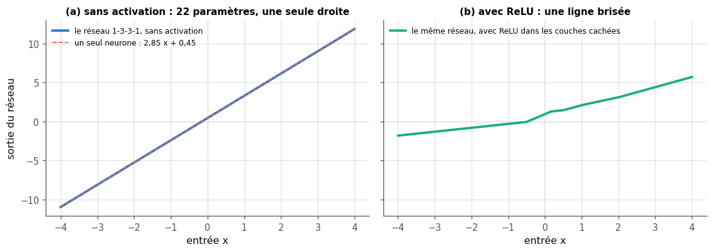
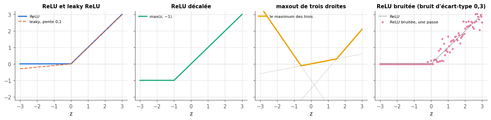
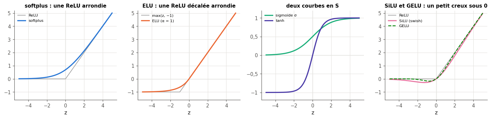
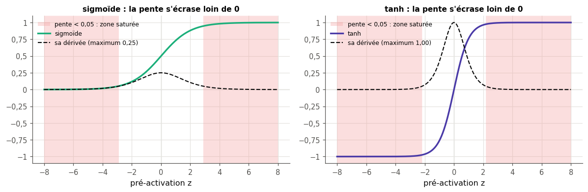
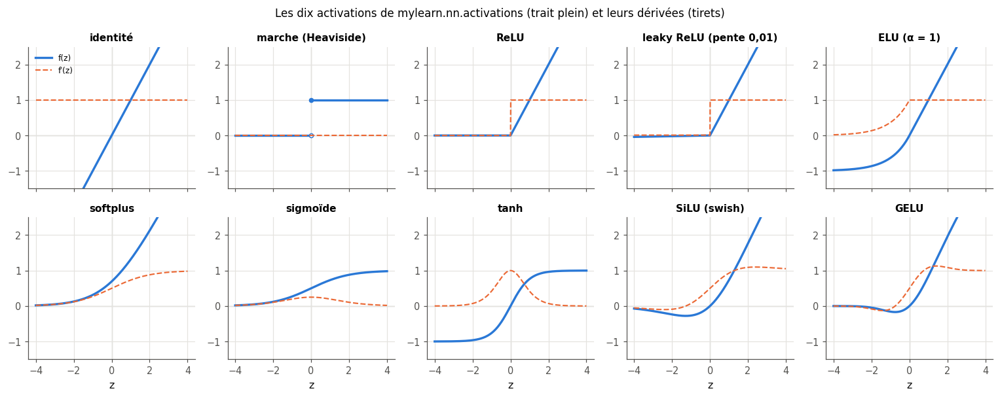
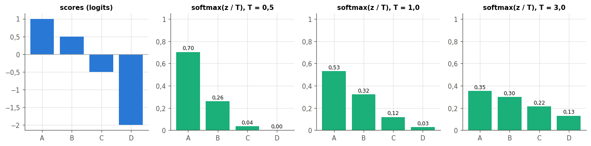

# 17 · Fonctions d'activation — fiche de cours

> Cette fiche accompagne le chapitre 17 du livre. Le chapitre ouvre la « boîte noire » que le ch. 16 passait en argument à `mlp_forward` : la **fonction d'activation**, le dernier geste de chaque neurone. Il montre d'abord pourquoi elle est indispensable (sans elle, un réseau de plusieurs couches **s'effondre** en un seul neurone), puis passe en revue, courbe par courbe, les marches, la ReLU et ses variantes (leaky, paramétrique, décalée, bruitée, maxout), les fonctions lisses (softplus, ELU, sigmoïde, tanh, swish), et finit par la **softmax**, qui transforme les scores de sortie d'un classifieur en probabilités. Le livre ne donne aucune formule : la fiche ajoute les définitions, les **dérivées** (dont la rétropropagation du ch. 18 aura besoin), la convention prise aux points anguleux, la **saturation** et les **neurones morts**, GELU et SiLU, qui ont remplacé ReLU dans les Transformers, la **température** de la softmax, sa **Jacobienne**, et la façon de calculer tout cela **sans débordement** en NumPy. Elle corrige aussi trois affirmations du livre. Les figures du livre ne sont que résumées : chaque section te dit où les lire.

| | |
|---|---|
| **Livre** | vol. 1, ch. 17 « Activation Functions », p. 672-702 (§17.1 à §17.8) |
| **Temps total estimé** | ≈ 15 h : lecture du livre et de la fiche ≈ 3,3 h, exercices ≈ 11 h, 22 flashcards ≈ 0,7 h |
| **Prérequis** | 0A (NumPy, broadcasting, `pytest.mark.parametrize`) · 0B (dérivée, règle de la chaîne, règle du quotient, exponentielle, tangente hyperbolique) · ch. 5 (continuité, point anguleux, dérivée numérique) · ch. 6 (distribution de probabilité, entropie, cross-entropy) · ch. 10 (neurone artificiel, perceptron et sa marche) · ch. 13 (sigmoïde stable, `logsumexp`) · ch. 16 (`mlp_forward`, initialisations LeCun, Glorot et He, variance des activations) |
| **Fichiers du chapitre** | `02_exercices.md` (quiz, rappels, papier, réflexion, entretien) · `03_notebook.ipynb` · `04_indices.md` · `05_solutions.md` et `05_solutions.ipynb` · `06_mes_reponses.md` · `flashcards.csv` |
| **mylearn** | `nn/activations.py` : dix activations et leurs dérivées (17.12 à 17.14), le registre `get_activation` (17.14), `softmax` et `log_softmax` (17.15), la Jacobienne `softmax_derivative` (17.16). Les fonctions se passent telles quelles à ton `mlp_forward` du ch. 16, et les couples `(f, f′)` de `get_activation` serviront à la rétropropagation du ch. 18 |

## Comment utiliser ce chapitre

Le livre avance en trois temps : à quoi sert une activation et quelle forme elle a (§17.1 et §17.2), le catalogue des courbes, des plus simples aux plus lisses (§17.3 à §17.7), puis la softmax (§17.8). Ses 31 pages sont faites pour moitié de figures pleine page ; avec cette fiche, plus détaillée que le livre, compte un peu plus de trois heures. La fiche suit le même plan, avec deux sections en plus à la fin : le calcul sans débordement, et le choix d'une activation avec les tests qui vont avec. Ses encadrés 🧮 donnent les maths et les outils qui manquent au livre : la composition d'applications affines, la convention de dérivée aux points anguleux, la fonction de répartition de la loi normale et `math.erf`, la Jacobienne, et les tests paramétrés de pytest.

**Ordre conseillé.**
1. Lis le livre §17.1 à §17.2.1, puis les sections correspondantes de la fiche. Fais les quiz Q1 et Q2, l'exercice 17.1 et l'oral 🗣️ 17.9.
2. Lis le livre §17.3 à §17.5, puis les sections 17.3 à 17.5 de la fiche. Fais les quiz Q3 à Q7, les rappels R1 et R3, la preuve ∂ 17.3 et l'exercice 17.5.
3. Lis le livre §17.6 et §17.7, puis les sections 17.6 et 17.7 de la fiche et celle sur le calcul sans débordement. Fais les quiz Q8 à Q10, l'exercice 17.2, la preuve ∂ 17.4, l'estimation 🧮 17.8 et la lecture 📄 17.10.
4. Lis le livre §17.8, puis la section 17.8 de la fiche et celle sur le choix d'une activation. Fais les quiz Q11 et Q12, le rappel R2, l'exercice 17.6 et la preuve ∂ 17.7. Vérifie tes réponses courtes dans la partie 0 du notebook.
5. Fais le notebook dans l'ordre : partie A (17.11 à 17.14 : un MLP sans activation, puis les activations élément par élément et leurs dérivées), partie B (17.15 à 17.17 : la softmax stable, sa Jacobienne, une chasse aux `nan`), partie C (17.18 à 17.21 : la galerie, la température, quatre activations de scikit-learn, la saturation), partie D (17.22 à 17.24 : une batterie de tests paramétrés, les dérivées sur 10 couches, le défi des spirales). Finis par les quatre questions d'entretien.

| Section | Quiz 🧠 et rappels 🔁 | Papier ✏️ ∂ 🧮 et réflexion | Notebook | Entretien 💼 |
|---|---|---|---|---|
| 17.1 Pourquoi ce chapitre | Q1 | | | |
| 17.2 Ce que fait une activation | Q1 | 17.1, 17.3, 17.9 | 17.11, 17.20 | E1 |
| 17.2.1 La forme d'une activation | Q2 | 17.8 | 17.12 | |
| 17.3 Les activations de base, 17.3.1, 17.3.2 | Q3, Q4 | 17.1, 17.3 | 17.11, 17.12 | |
| 17.4 Les marches | Q5, R3 | 17.2 | 17.12 | |
| 17.5 Les fonctions linéaires par morceaux | Q6, Q7, R1 | 17.2, 17.5 | 17.12, 17.20, 17.23, 17.24 | E1, E2 |
| 17.6 Les fonctions lisses | Q8, Q9 | 17.2, 17.4, 17.10 | 17.13, 17.14, 17.17, 17.20, 17.21, 17.23 | E1, E4 |
| 17.7 La galerie | Q8, Q9, Q10 | 17.10 | 17.14, 17.18, 17.24 | E4 |
| 17.8 La softmax | Q11, Q12, R2 | 17.6, 17.7 | 17.15, 17.16, 17.17, 17.19 | E3 |
| Au-delà du livre : calculer sans débordement | | 17.4, 17.6 | 17.13, 17.15, 17.17 | |
| Au-delà du livre : choisir et tester | | | 17.20, 17.22, 17.23, 17.24 | E1 à E4 |

**Lire les formules.** Un neurone reçoit une ligne d'entrées $\mathbf{x}$ et calcule sa **pré-activation** $z = \mathbf{x}\mathbf{w} + b$ (la somme pondérée plus le biais, convention du ch. 16, un exemple par ligne), puis son **activation** $a = f(z)$ ; $f$ est la **fonction d'activation** et $f'$ sa dérivée, toujours prise par rapport à $z$ et évaluée en $z$. Pour une couche, $\mathbf{Z} = \mathbf{X}\mathbf{W} + \mathbf{b}$ et $\mathbf{A} = f(\mathbf{Z})$, $f$ s'appliquant à chaque case. $\sigma(z) = 1/(1 + e^{-z})$ est la **sigmoïde** (ch. 13), $\tanh$ la tangente hyperbolique (0B), $\Phi$ la fonction de répartition de la loi normale $\mathcal{N}(0, 1)$ et $\varphi$ sa densité, $\mathrm{erf}$ la fonction d'erreur (encadré du §17.6). Pour une sortie à $K$ classes, $\mathbf{z} = (z_1, \dots, z_K)$ est le vecteur des **logits** (les scores bruts), $\mathbf{p} = \mathrm{softmax}(\mathbf{z})$ celui des probabilités, $T$ une **température**, $\delta_{ij}$ vaut 1 si $i = j$ et 0 sinon, et $\mathbf{J}$ est la Jacobienne de la softmax, de case $J_{ij} = \partial p_i / \partial z_j$. $\log$ est le logarithme naturel, comme partout dans le workbook.

## Objectifs d'apprentissage

À la fin du chapitre, tu sais :
- **démontrer** qu'un réseau sans non-linéarité se réduit à une seule couche affine, et **calculer** cette couche ;
- **définir**, **tracer** et **dériver** les activations usuelles (marches, ReLU et variantes, softplus, ELU, sigmoïde, tanh, SiLU, GELU), avec la convention des bibliothèques aux points anguleux ;
- les **implémenter** en NumPy sans débordement, ainsi que `softmax`, `log_softmax` (astuce log-sum-exp) et la Jacobienne de la softmax ;
- **comparer** les activations (saturation, neurones morts, sorties centrées, coût) et **choisir** celle de chaque couche, sortie comprise ;
- **expliquer** le rôle de la softmax en sortie d'un classifieur et l'effet d'une température ;
- **tester** systématiquement une famille de fonctions avec pytest : tests paramétrés et tests de propriétés.

## L'essentiel en 10 lignes

1. Un neurone calcule $z = \mathbf{x}\mathbf{w} + b$ puis $a = f(z)$ ; $f$, la **fonction d'activation**, prend un nombre et rend un nombre, appliqué case par case à toute une couche.
2. Sans $f$ (ou avec une $f$ affine), deux couches $\mathbf{X}\mathbf{W}_1 + \mathbf{b}_1$ puis $(\cdot)\mathbf{W}_2 + \mathbf{b}_2$ se **réduisent** à une seule, $\mathbf{X}(\mathbf{W}_1\mathbf{W}_2) + (\mathbf{b}_1\mathbf{W}_2 + \mathbf{b}_2)$ : un réseau linéaire profond ne vaut pas mieux qu'un neurone.
3. Les **marches** (unité, Heaviside, signe) sont non linéaires mais ont une dérivée nulle partout : aucun gradient ne les traverse.
4. **ReLU** $= \max(0, z)$ est le défaut des couches cachées des MLP et des CNN : simple, rapide, sans saturation à droite ; ses variantes (leaky, paramétrique, ELU) gardent une pente pour $z < 0$.
5. Une ReLU dont la pré-activation est négative pour **tous** les exemples sort toujours 0 et ne reçoit plus de gradient : c'est un **neurone mort**.
6. La **sigmoïde** écrase $\mathbb{R}$ dans $]0, 1[$, **tanh** dans $]-1, 1[$ ; loin de 0, elles **saturent** : leur dérivée tend vers 0, et l'apprentissage ralentit ou s'arrête. $\sigma' = \sigma(1 - \sigma) \le 1/4$, $\tanh' = 1 - \tanh^2 \le 1$.
7. **SiLU** $= z\,\sigma(z)$ (swish) et **GELU** $= z\,\Phi(z)$ sont des ReLU lissées, avec un petit creux sous 0 ; ce sont les activations des Transformers (GELU dans BERT et GPT-2, SiLU dans les blocs SwiGLU des LLaMA).
8. Aux points anguleux, les bibliothèques prennent une **valeur conventionnelle** de la dérivée : $\mathrm{ReLU}'(0) = 0$ en PyTorch.
9. La **softmax** $p_i = e^{z_i} / \sum_j e^{z_j}$ transforme $K$ scores en probabilités : elle garde leur ordre, ignore un décalage commun, et seuls les **écarts** de scores comptent ($p_i / p_j = e^{z_i - z_j}$) ; une **température** $T$ la rend plus pointue ($T < 1$) ou plus plate ($T > 1$).
10. On calcule $\exp$ seulement de nombres qui ne peuvent pas déborder (soustraire le maximum, prendre $e^{-|z|}$) et l'on prend `log_softmax` $= \mathbf{z} - \mathrm{logsumexp}(\mathbf{z})$, jamais `log(softmax(z))`.

## 17.1 · Pourquoi ce chapitre ?

Le neurone du ch. 10 calcule une somme pondérée de ses entrées, puis la transforme par une fonction : c'est elle, la **fonction d'activation**, qui est le sujet du chapitre (p. 674) ; ce qu'elle rend est ce que le neurone envoie à la couche suivante. Au ch. 16, tu l'as passée à `mlp_forward` sans l'ouvrir (`np.tanh`, ou `np.maximum(0, z)`) ; tu vas maintenant écrire toute la famille, dérivées comprises, dans `mylearn/nn/activations.py`. Le livre en fait un catalogue de courbes, sans équations ; la fiche donne une formule pour chacune, parce que la rétropropagation du ch. 18 aura besoin de les dériver.

> 💼 **En entreprise** — « Pourquoi ReLU plutôt que la sigmoïde dans les couches cachées ? », « Qu'est-ce qu'une ReLU morte ? », « Softmax ou sigmoïde en sortie ? » : ces questions reviennent dans presque tous les entretiens qui touchent au deep learning. Elles vérifient que tu sais relier une courbe à son comportement pendant l'entraînement (saturation, gradient nul, sorties normalisées), et choisir la sortie selon la tâche. Dans le travail de tous les jours, le choix d'activation est rarement le réglage le plus important ; en revanche, une erreur de sortie (une softmax en trop devant `nn.CrossEntropyLoss`, une sigmoïde sur une tâche multi-classe) fait partie des bugs silencieux les plus courants. Les questions d'entretien 💼 17.E1 à 17.E4 portent sur ces réflexes.

## 17.2 · Ce que fait une fonction d'activation ⏩

**L'effondrement.** Le livre compare les activations aux attelages articulés d'un train, sans lesquels les wagons formeraient un seul wagon rigide incapable de prendre un virage (p. 674-676, figures 17.1 et 17.2) ; 🗣️ 17.9 te fait exploiter cette image et en chercher les limites. Il déroule ensuite un réseau 3-3-3-1 sans activation ni biais, et trouve que sa sortie vaut $47A + 6B + 61C$ (p. 676-678, figures 17.3 à 17.5) : tout le réseau se ramène à un neurone. Ce neurone unique ne trace qu'une frontière droite (ch. 10) ; empiler des couches n'a servi à rien.

**Pourquoi ça s'effondre.** Une couche sans activation est une **application affine**, $\mathbf{x} \mapsto \mathbf{x}\mathbf{W} + \mathbf{b}$, et la composée de deux applications affines est encore affine (encadré ci-dessous). Quels que soient la profondeur et les largeurs, un réseau qui ne fait que multiplier par des poids et additionner calcule donc $\mathbf{x}\mathbf{W}_{\text{eq}} + \mathbf{b}_{\text{eq}}$. Une fonction qui n'est pas de ce type est dite **non linéaire** ; c'est pourquoi on appelle souvent l'activation « la non-linéarité » du neurone. Une non-linéarité après chaque couche cachée suffit à casser l'effondrement. ✏️ 17.1 te fait effondrer un réseau à la main, biais compris, puis voir ce qu'une ReLU y change ; ∂ 17.3 te fait démontrer le cas général.

> 🧮 **Rappel maths — composer des applications affines** — Une couche sans activation calcule $\mathbf{h} = \mathbf{x}\mathbf{W}_1 + \mathbf{b}_1$ (ligne $\mathbf{x}$ de taille $n_0$, $\mathbf{W}_1$ de forme $(n_0, n_1)$, $\mathbf{b}_1$ de taille $n_1$). La suivante calcule $\mathbf{h}\mathbf{W}_2 + \mathbf{b}_2$. En remplaçant $\mathbf{h}$ et en développant (le produit matriciel est distributif et associatif, 0B) :
> $$(\mathbf{x}\mathbf{W}_1 + \mathbf{b}_1)\mathbf{W}_2 + \mathbf{b}_2 = \mathbf{x}\,\underbrace{(\mathbf{W}_1\mathbf{W}_2)}_{\mathbf{W}_{\text{eq}}} + \underbrace{(\mathbf{b}_1\mathbf{W}_2 + \mathbf{b}_2)}_{\mathbf{b}_{\text{eq}}}.$$
> $\mathbf{W}_{\text{eq}}$ a la forme $(n_0, n_2)$ : la couche cachée a disparu. Avec $L$ couches, on recommence $L - 1$ fois : $\mathbf{W}_{\text{eq}} = \mathbf{W}_1 \mathbf{W}_2 \cdots \mathbf{W}_L$, et le biais équivalent accumule chaque biais multiplié par les matrices qui le suivent. *Mini-exemple :* une entrée $x$, deux neurones cachés $h = (2x + 1,\ -x + 3)$, une sortie $h_1 - 2h_2 + 0{,}5$ : la sortie vaut $2x + 1 + 2x - 6 + 0{,}5 = 4x - 4{,}5$, un seul neurone de poids 4 et de biais $-4{,}5$. Les mêmes formules valent dans la convention colonne du livre et de PyTorch ($\mathbf{W}\mathbf{x} + \mathbf{b}$) : $\mathbf{W}_2(\mathbf{W}_1\mathbf{x} + \mathbf{b}_1) + \mathbf{b}_2 = (\mathbf{W}_2\mathbf{W}_1)\mathbf{x} + (\mathbf{W}_2\mathbf{b}_1 + \mathbf{b}_2)$, les matrices s'écrivant alors dans l'ordre inverse.



**Ce qu'apporte la non-linéarité.** La figure ci-dessus montre le même petit réseau de 22 paramètres avec et sans ReLU. Sans activation, ses 22 paramètres ne font qu'une droite ; avec ReLU, la sortie est une **ligne brisée** : chaque neurone ReLU ajoute un coude là où sa pré-activation change de signe. En dimension plus grande, les coudes deviennent des plis, et un réseau ReLU découpe l'espace des entrées en régions où il est affine : avec assez de neurones, on approche n'importe quelle fonction continue sur un domaine borné (théorème d'approximation universelle, qu'on ne démontrera pas). 🔮 17.11 te fait prédire ce que devient un `MLPClassifier` de scikit-learn sans activation sur deux demi-lunes, comme au ch. 15.

**Pourquoi tant d'activations ?** Elles cassent toutes l'effondrement, mais ne se comportent pas de la même façon pendant l'entraînement (p. 678-679) : la saturation ou les neurones morts, présentés plus bas, peuvent freiner l'apprentissage, et chaque remède a son prix. D'où le catalogue des sections suivantes, et des critères de choix à la fin de la fiche.

## 17.2.1 · La forme d'une activation

**Un nombre en entrée, un nombre en sortie.** Mathématiquement, une activation (le livre l'appelle aussi **fonction de transfert**, *transfer function*, p. 679) est une fonction de $\mathbb{R}$ dans $\mathbb{R}$, et sa **courbe** la décrit entièrement. Sur une couche, elle agit **élément par élément** : `f(Z)` pour un tableau $\mathbf{Z}$ de forme $(n, n_{out})$ rend un tableau de même forme, dont chaque case ne dépend que de la case correspondante de $\mathbf{Z}$. Ton `mlp_forward` le suppose, et toutes les fonctions de `nn/activations.py` le respectent, sauf la softmax, qui a besoin de toute la ligne (§17.8).

**Une par couche.** On pourrait donner une activation différente à chaque neurone ; l'usage est d'en choisir une par couche (p. 679) : une ligne de NumPy (`np.maximum(0, Z)`) ou une couche PyTorch (`nn.ReLU()`). Elle coûte quelques opérations par neurone et par exemple, bien moins que le produit matriciel qui la précède (🧮 17.8 te le fait chiffrer).

## 17.3 · Les activations de base

Les figures du livre ne montrent chaque courbe qu'autour de 0 (p. 682) : c'est là qu'elles diffèrent, alors que loin de 0 elles deviennent presque toutes une droite ou un plateau. La fiche fait de même : ses figures montrent $z$ entre $-4$ et $4$ ou entre $-8$ et $8$.

## 17.3.1 · Les fonctions linéaires ⏩

**L'identité et les droites.** La plus simple des activations est l'**identité**, $f(z) = z$ (p. 680, figure 17.6), qui revient à ne rien faire. Le livre appelle **linéaire** toute courbe qui est **une seule droite**, $f(z) = cz + d$. Un mathématicien dirait *affine* quand $d \ne 0$, et réserverait *linéaire* au cas $d = 0$ ; ici la nuance est sans effet, car les deux se fondent dans la couche suivante. Une activation utile doit donc avoir un coude, une courbure ou plusieurs morceaux.

**Une seule valeur par entrée.** Une activation doit être une **fonction** au sens du ch. 5 (p. 680) : à chaque $z$, une seule valeur $f(z)$, ce qu'on vérifie en traçant des verticales, qui ne doivent couper la courbe qu'une fois au plus. Un cercle échoue à ce test : il proposerait deux sorties pour la même entrée. La continuité, elle, n'est pas exigée : des sauts sont permis.

**Où une activation linéaire est permise.** La couche de **sortie** est l'exception (p. 681-682) : rien ne vient après elle, et l'effondrement ne concerne que deux couches qui se suivent ; une sortie linéaire y est donc courante. Un régresseur, par exemple, sort l'identité, pour rendre n'importe quel réel.

## 17.3.2 · La fonction en escalier

**Des morceaux de droites.** L'**escalier** du livre (p. 681, figure 17.7) est constant par paliers et saute d'un palier au suivant. Il est discontinu mais reste une fonction (les points pleins et vides de la figure disent à quel palier appartient chaque bord), et il est non linéaire, puisqu'il n'est pas une droite unique. *Mini-exemple :* l'escalier $f(z) = \lfloor 4z \rfloor / 4$, de marches de largeur $0{,}25$, vaut $0{,}5$ en $z = 0{,}6$ et $0{,}75$ en $z = 0{,}8$.

**Non linéaire mais inutilisable.** Un escalier empêche l'effondrement, mais il a un défaut rédhibitoire pour l'entraînement : sur chaque palier, sa pente est **nulle**. Or la rétropropagation (ch. 18) corrige chaque poids en proportion de la dérivée de l'activation : une dérivée nulle ne dit jamais dans quel sens aller. C'est le sujet du paragraphe suivant.

## 17.4 · Les marches ⏩

**Un seuil, deux valeurs.** Une **marche** (*step function*) prend une valeur avant un **seuil** et une autre après (p. 682-683, figure 17.8). La valeur exactement au seuil est une affaire de convention : le livre prend celle de droite (le point plein de sa figure). Ta librairie aussi : `step(z, threshold, low, high)` rend `high` dès que $z \ge$ `threshold`, et `low` sinon.

**Trois noms à connaître** (p. 683-685, figures 17.9 et 17.10) :
- la **marche unité** vaut 0 à gauche du seuil et 1 à droite ;
- la **marche de Heaviside** $H(z)$ est la marche unité de seuil 0 (en NumPy, `np.heaviside(z, h0)` demande la valeur `h0` à prendre en 0) ;
- la **fonction signe** vaut $-1$ pour $z < 0$ et $+1$ pour $z > 0$ ; en 0, les conventions varient : $+1$ (la marche « de $-1$ à $+1$ », `step(z, low=-1)` dans ta librairie), 0 (la convention des mathématiciens et de `np.sign`), ou même $-1$ (le `sign_step` de ton perceptron du ch. 10). Quand la différence compte, il faut regarder laquelle est employée. Attention au nom : `torch.nn.Threshold(t, v)` n'est pas une marche, il garde $z$ quand $z > t$ et met `v` ailleurs.

**Pourquoi le perceptron ne s'entraîne pas par gradient.** La marche est l'activation du perceptron (ch. 10, p. 685). Sa dérivée est nulle partout, sauf au seuil, où elle n'existe pas : une petite variation d'un poids ne change la sortie que si elle fait franchir le seuil, et alors elle la fait sauter d'un coup. Le ch. 10 a contourné le problème avec une règle à part, qui corrige les poids d'après l'**erreur** commise, sans dérivée ; elle ne s'étend pas à plusieurs couches. Pour entraîner un réseau profond par descente de gradient, il faut une activation dont la dérivée est non nulle presque partout : c'est le cas de toutes celles qui suivent (sauf sur une demi-droite pour ReLU). 🔁 17.R3 te fait reprendre cet argument.

## 17.5 · Les fonctions linéaires par morceaux ⏩

**ReLU.** Une fonction faite de plusieurs morceaux de droites est **linéaire par morceaux** (p. 685) ; elle est non linéaire dès que ses morceaux ne forment pas une seule droite. La plus utilisée de toutes les activations est de cette famille : le **redresseur**, ou **unité linéaire rectifiée**, **ReLU** (*rectified linear unit*, p. 685-686, figure 17.11) :
$$\mathrm{ReLU}(z) = \max(0, z), \qquad \mathrm{ReLU}'(z) = \begin{cases} 1 & \text{si } z > 0, \\ 0 & \text{si } z < 0. \end{cases}$$
Son nom vient d'un composant électronique, le redresseur (une diode), qui bloque les tensions négatives : ReLU remplace de même les valeurs négatives par 0 et laisse passer les positives. Deux morceaux de droite et un coude en 0 suffisent à la rendre non linéaire. Elle est populaire parce qu'elle est simple et très rapide (une comparaison), qu'elle ne sature pas pour $z > 0$ (sa pente y vaut 1, quelle que soit la taille de $z$), et qu'elle produit des activations **creuses** : une bonne partie des neurones sortent exactement 0 pour un exemple donné (Glorot, Bordes et Bengio, 2011). Le livre la présente, avec la leaky ReLU, comme un premier choix sûr (p. 686) ; c'est toujours le défaut des couches cachées des MLP et des réseaux convolutifs, et celui du `MLPClassifier` de scikit-learn.

> 🧮 **Rappel maths — la dérivée en un point anguleux** — En $z = 0$, ReLU a une pente 0 à gauche et 1 à droite : sa dérivée n'existe pas (ch. 5). Toute valeur entre la pente de gauche et celle de droite est un **sous-gradient** : la pente d'une droite qui passe par le coude sans passer au-dessus de la courbe, pour une fonction convexe comme ReLU. Les bibliothèques **choisissent** une valeur et s'y tiennent : PyTorch prend $\mathrm{ReLU}'(0) = 0$, et, pour les variantes, la pente de **gauche** ($\mathrm{leaky}'(0) =$ la pente des négatifs, $\mathrm{ELU}'(0) = \alpha$). Ta librairie suit PyTorch, et ses tests le vérifient. Le choix n'a presque jamais d'effet : une pré-activation tombe rarement **exactement** sur 0 en virgule flottante, et les deux pentes voisines encadrent la bonne direction. *Mini-exemple :* $|z|$ a les pentes $-1$ et $+1$ de part et d'autre de 0 ; tout nombre de $[-1, 1]$ est un sous-gradient en 0, et `torch.abs` y prend 0.

> 🕰️ **Mise à jour (2026) — la dérivée aux points anguleux** — **Le livre :** dit qu'il existe des outils mathématiques standard pour « arrondir » les coins des fonctions linéaires par morceaux et en obtenir quand même une dérivée (p. 690-691, il cite un manuel de traitement du signal), et que ce besoin a guidé la conception de ces fonctions. · **Aujourd'hui :** rien de tel n'est fait dans les bibliothèques : la différentiation automatique (ch. 18) applique simplement une **valeur conventionnelle** de la dérivée au coude, et la descente de gradient s'en accommode très bien. Vérifié sur PyTorch 2.11 : `torch.autograd.grad` donne 0 pour `torch.relu` en 0, la pente des négatifs pour `leaky_relu`, et $\alpha$ pour `elu`. · **Faut-il quand même l'apprendre ?** Oui, en connaissant la convention : une dérivée de ReLU écrite avec `z >= 0` au lieu de `z > 0` donne 1 en 0, et une comparaison exacte à PyTorch échoue (tes tests l'attrapent). · *Source :* [I. Goodfellow, Y. Bengio et A. Courville, *Deep Learning*, MIT Press, 2016, §6.3 (les unités cachées, et ce que font les logiciels au point où ReLU n'est pas dérivable)](https://www.deeplearningbook.org/contents/mlp.html).

**Les neurones morts.** ReLU a un défaut, que le livre annonce pour le ch. 18 (p. 686) : pour $z < 0$, sa pente est **nulle**, exactement. Un neurone dont la pré-activation est négative pour **tous** les exemples sort toujours 0, ne reçoit aucun gradient, et ses poids ne changent plus jamais : c'est un **neurone mort** (*dying ReLU*). Les causes habituelles : un learning rate trop grand, dont un pas pousse les poids d'un neurone loin dans la zone négative ; une mauvaise initialisation (un biais très négatif, une échelle de poids inadaptée) ; des entrées non standardisées. Les remèdes : l'initialisation de He (ch. 16), un learning rate plus raisonnable, des entrées standardisées, ou une variante qui garde une pente pour $z < 0$. Au ch. 16, 🔬 16.23 te les a fait compter ; 💼 17.E2 te les fait expliquer.

**Leaky ReLU et ReLU paramétrique.** La **leaky ReLU** (p. 687, figure 17.12) remplace le 0 des négatifs par une petite fraction de $z$ :
$$\mathrm{leaky}(z) = \begin{cases} z & \text{si } z > 0, \\ \alpha z & \text{sinon,} \end{cases} \qquad 0 < \alpha < 1,$$
avec la pente $\alpha$ des négatifs : $0{,}1$ dans le livre, $0{,}01$ par défaut dans PyTorch (`negative_slope`) et dans ta librairie. Sa pente ne s'annule jamais, et un neurone ne peut plus mourir. La **ReLU paramétrique** (PReLU, figure 17.13) laisse $\alpha$ varier. Le livre met en garde contre $\alpha = 1$ (p. 688) : avec la même pente des deux côtés, il ne reste qu'une droite, l'identité, et l'on retombe dans l'effondrement. Note aussi qu'un $\alpha$ négatif donnerait une fonction non monotone (un V penché), qui n'est plus une ReLU au sens habituel.

> ⚠️ **Le livre, corrigé — la ReLU paramétrique** — Le livre présente la PReLU comme une leaky ReLU dont on **choisit** la pente (p. 687-688). Dans l'article qui l'a introduite (He, Zhang, Ren et Sun, 2015), la pente n'est pas choisie : c'est un **paramètre appris**, comme les poids, par rétropropagation (une pente par canal, ou une seule par couche, initialisée à 0,25) ; une pente fixée à la main, c'est une leaky ReLU. En PyTorch, `nn.PReLU()` crée ce paramètre et l'optimiseur le met à jour. · *Source :* [K. He, X. Zhang, S. Ren et J. Sun, « Delving Deep into Rectifiers: Surpassing Human-Level Performance on ImageNet Classification », ICCV 2015, §2.1 (arXiv:1502.01852)](https://arxiv.org/abs/1502.01852).

**ReLU décalée.** La **ReLU décalée** (*shifted ReLU*, p. 688-689, figure 17.14) déplace le coude vers le bas et vers la gauche : $\max(z, -c)$ avec $c > 0$ ($c = 1$ sur la figure du livre). Ses sorties peuvent être négatives, ce qui rapproche de 0 leur moyenne ; c'est l'idée que l'ELU reprendra en version lisse (§17.6).



**Maxout.** Le livre présente le **maxout** (Goodfellow, Warde-Farley, Mirza, Courville et Bengio, 2013) comme le maximum d'un ensemble de droites : on trace les droites, et la sortie est, pour chaque $z$, la plus haute d'entre elles (p. 689-690, figure 17.15, avec l'image d'une peinture versée d'en haut qui ne recouvre que le dessus) :
$$\mathrm{maxout}(z) = \max_{k = 1, \dots, m} (c_k z + d_k).$$
Deux droites bien choisies redonnent ReLU, une leaky ReLU, ou la valeur absolue ; plus de droites donnent des « cuvettes » de formes variées. Un maximum de droites ne peut pas prendre n'importe quelle forme : ✏️ 17.5 te fait découvrir laquelle lui est interdite, et comment la contourner avec plusieurs neurones. Précision importante : dans l'article d'origine, une unité maxout ne prend pas le maximum de droites d'une **seule** pré-activation $z$ ; elle calcule $m$ sommes pondérées **différentes** de ses entrées, $\mathbf{x}\mathbf{w}_k + b_k$, et en garde la plus grande. Elle a donc $m$ fois plus de poids qu'un neurone ordinaire, et ce n'est pas une fonction élément par élément de $z$ : c'est pourquoi ta librairie ne l'implémente pas, et pourquoi on la rencontre peu aujourd'hui.

**ReLU bruitée.** La **ReLU bruitée** (*noisy ReLU*, p. 690) ajoute un petit bruit aléatoire à l'entrée avant d'appliquer ReLU : deux passes du même exemple ne donnent pas la même sortie. Nair et Hinton (2010) l'ont introduite pour des machines de Boltzmann restreintes, avec un bruit gaussien dont la variance dépend de $z$. Le livre note qu'elle sert peu dans les réseaux ordinaires ; l'idée d'injecter du hasard pendant l'entraînement a survécu sous d'autres formes, comme le dropout (ch. 20).

## 17.6 · Les fonctions lisses ⏩

**Pourquoi lisser.** La rétropropagation (ch. 18) calcule la dérivée de chaque activation. Les fonctions de la section précédente ont des coudes, où la dérivée n'existe pas (p. 690-691) ; la convention de l'encadré ci-dessus suffit en pratique, mais on peut aussi prendre des fonctions **lisses**, dérivables partout. Le livre en présente cinq ; la fiche donne pour chacune sa formule et sa dérivée, que ∂ 17.4 te fait démontrer pour trois d'entre elles.



**Softplus.** C'est une ReLU arrondie (p. 691, figure 17.16) :
$$\mathrm{softplus}(z) = \log(1 + e^{z}), \qquad \mathrm{softplus}'(z) = \sigma(z).$$
Pour $z$ très négatif, elle tend vers 0 sans jamais l'atteindre ; pour $z$ très positif, elle vaut presque $z$ (l'écart est $\log(1 + e^{-z})$). Sa dérivée est la sigmoïde : elle ne s'annule jamais. PyTorch lui ajoute deux paramètres, que ta librairie reprend : une **raideur** $\beta$, $\mathrm{softplus}_\beta(z) = \log(1 + e^{\beta z})/\beta$ (plus $\beta$ est grand, plus la courbe colle à ReLU), et un **seuil** (`threshold = 20`) au-dessus duquel, quand $\beta z$ le dépasse, la fonction rend $z$ tel quel : la différence est sous $2 \times 10^{-9}$ pour $\beta = 1$, et l'exponentielle ne risque plus de déborder.

**ELU.** L'**unité linéaire exponentielle** (*exponential linear unit*, Clevert, Unterthiner et Hochreiter, 2016) arrondit la ReLU décalée (p. 691-692, figure 17.17) :
$$\mathrm{ELU}(z) = \begin{cases} z & \text{si } z > 0, \\ \alpha\,(e^{z} - 1) & \text{sinon,} \end{cases} \qquad \mathrm{ELU}'(z) = \begin{cases} 1 & \text{si } z > 0, \\ \alpha\,e^{z} & \text{sinon.} \end{cases}$$
Elle tend vers $-\alpha$ quand $z \to -\infty$ : ses sorties négatives rapprochent de 0 la moyenne des activations, ce que les auteurs présentaient comme un accélérateur de l'apprentissage. Elle n'est vraiment lisse (dérivée continue) que pour $\alpha = 1$ : sinon, sa pente saute de $\alpha$ à 1 en 0, et ta librairie suit la convention de PyTorch, $\mathrm{ELU}'(0) = \alpha$.

**Sigmoïde.** La **sigmoïde**, ou **fonction logistique** (*logistic function*, p. 692-693, figure 17.18), est la vieille connaissance du ch. 13 ; son nom vient de sa forme de S :
$$\sigma(z) = \frac{1}{1 + e^{-z}}, \qquad \sigma'(z) = \sigma(z)\,\big(1 - \sigma(z)\big) \le \tfrac{1}{4}.$$
Elle écrase toute la droite réelle dans $]0, 1[$ : proche de 0 pour $z$ très négatif, de 1 pour $z$ très positif, $\sigma(0) = 1/2$, avec la symétrie $\sigma(-z) = 1 - \sigma(z)$. Sa dérivée atteint son maximum, $1/4$, en 0. C'est la sortie naturelle d'un classifieur binaire : une probabilité (ch. 13).

**Tangente hyperbolique.** La **tangente hyperbolique** (p. 693-694, figure 17.19) a la même forme en S, entre $-1$ et $1$ :
$$\tanh(z) = \frac{e^{z} - e^{-z}}{e^{z} + e^{-z}} = 2\,\sigma(2z) - 1, \qquad \tanh'(z) = 1 - \tanh^2(z) \le 1.$$
C'est une sigmoïde étirée en hauteur et resserrée en largeur (le livre note que sa transition est plus étroite). Elle est **impaire** ($\tanh(-z) = -\tanh(z)$) et centrée en 0 : ses sorties sont de moyenne proche de 0 quand ses entrées le sont, contrairement à la sigmoïde, dont les sorties sont toutes positives. Sa pente maximale vaut 1 en 0 : près de 0, $\tanh(z) \approx z$. Le livre dit que ces deux fonctions « écrasent » (*squash*) leurs entrées, dans $[0, 1]$ et $[-1, 1]$ (p. 694) ; en toute rigueur, les bornes ne sont jamais atteintes, mais en `float64`, $\sigma(40)$ s'arrondit déjà à exactement 1.

> 🧮 **Rappel maths — dériver les activations lisses** — Trois règles du 0B suffisent : la dérivée de $e^{u}$ est $u' e^{u}$, celle de $\log u$ est $u'/u$, et celle d'un quotient ou d'une composée se calcule avec la règle du quotient ou de la chaîne. Les dérivées s'écrivent souvent avec la fonction elle-même : $\sigma' = \sigma(1 - \sigma)$, $\tanh' = 1 - \tanh^2$, $\mathrm{softplus}' = \sigma$. C'est pratique, et c'est un piège : dans une rétropropagation, on dispose à la fois de $z$ (la pré-activation) et de $a = f(z)$ (l'activation) ; la formule $a(1 - a)$ prend la **sortie**, la formule $\sigma(z)(1 - \sigma(z))$ prend l'**entrée**. Ta librairie a choisi une seule convention : toutes ses dérivées prennent $z$, comme l'attendra `mlp_backward` au ch. 18 ; appliquer `sigmoid_derivative` à $a$ au lieu de $z$ calcule $\sigma(a)(1 - \sigma(a))$, une erreur silencieuse. *Mini-exemple :* en $z = 0$, $\sigma(0) = 0{,}5$ et $\sigma'(0) = 0{,}25$ ; appliquée par erreur à $a = 0{,}5$, la formule en $z$ donne $\sigma(0{,}5)(1 - \sigma(0{,}5)) \approx 0{,}235$.

**La saturation.** Le revers des courbes lisses (p. 696) : la sigmoïde et tanh n'ont de pente appréciable que près de 0. Loin de 0 (le livre cite $|z| > 6$ environ ; tanh, plus raide, plafonne plus tôt), leur sortie est presque constante et leur dérivée presque nulle : on dit qu'elles **saturent**. Pour $|z|$ grand, $\sigma'(z) \approx e^{-|z|}$ et $\tanh'(z) \approx 4e^{-2|z|}$ : la pente décroît exponentiellement (en $z = 10$, $\sigma'(10) \approx 4{,}5 \times 10^{-5}$). Or la rétropropagation multiplie les dérivées des couches successives (ch. 18) : des neurones saturés font **s'évanouir** les gradients, et l'apprentissage ralentit ou s'arrête. Même sans saturer, la sigmoïde a une pente d'au plus $1/4$ : le facteur que ses dérivées apportent au gradient est au plus $4^{-L}$ sur $L$ couches, et seuls des poids de plus en plus grands pourraient le compenser, au risque de saturer davantage. Pour ReLU, le côté négatif est pire encore (une pente exactement nulle), mais le côté positif ne s'aplatit jamais : sa pente y vaut 1, aussi grand que soit $z$, et c'est l'une des raisons de son succès dans les réseaux profonds. 📈 17.21 te fait diagnostiquer la saturation sur des histogrammes, et 🔬 17.23 mesurer ce qu'il reste d'un gradient après 10 couches.



> 🕰️ **Mise à jour (2026) — la sigmoïde et tanh dans les couches cachées** — **Le livre :** ReLU est l'activation la plus populaire, mais quand un algorithme a besoin d'une « vraie » dérivée, la sigmoïde et tanh sont d'ordinaire les premiers choix (p. 696). · **Aujourd'hui :** dans les couches cachées des réseaux profonds, la sigmoïde et tanh ont été largement abandonnées au profit de ReLU et de ses successeurs (SiLU, GELU) : elles saturent sur la plus grande partie de leur domaine, et leur usage comme unités cachées des réseaux feed-forward est déconseillé depuis le début des années 2010. Elles restent indispensables ailleurs : la sigmoïde en **sortie** pour une probabilité binaire ou multi-étiquette, toutes les deux dans les **portes** des LSTM et des GRU (ch. 22 : `torch.nn.LSTM` calcule ses portes avec $\sigma$ et son état candidat avec $\tanh$), et tanh pour **borner** une valeur (une action d'un agent, un pixel entre $-1$ et $1$). · **Faut-il quand même l'apprendre ?** Oui : la saturation est la clé de presque toutes les difficultés d'entraînement des réseaux profonds, et ces deux fonctions vivent dans chaque LSTM et chaque sortie binaire. · *Sources :* [I. Goodfellow, Y. Bengio et A. Courville, *Deep Learning*, MIT Press, 2016, §6.3.2](https://www.deeplearningbook.org/contents/mlp.html) ; [PyTorch, `torch.nn.LSTM`](https://docs.pytorch.org/docs/2.11/generated/torch.nn.LSTM.html).

**Swish et SiLU.** La fonction **swish** (Ramachandran, Zoph et Le, 2017) combine ReLU et sigmoïde (p. 695-696, figure 17.21) : $\mathrm{swish}_\beta(z) = z\,\sigma(\beta z)$. Avec $\beta = 1$, c'est la **SiLU** (*sigmoid linear unit*), le nom qu'avaient donné Hendrycks et Gimpel (2016) à la même fonction, et celui de PyTorch (`nn.SiLU`) et de ta librairie :
$$\mathrm{SiLU}(z) = z\,\sigma(z), \qquad \mathrm{SiLU}'(z) = \sigma(z)\,\big(1 + z\,(1 - \sigma(z))\big).$$
On peut la lire comme une ReLU « douce » : l'entrée $z$ est multipliée par une porte $\sigma(z)$ qui vaut presque 0 pour $z$ très négatif et presque 1 pour $z$ très positif. Contrairement à ReLU, elle n'est pas **monotone** : elle descend un peu sous 0 pour $z$ négatif, avant de remonter vers 0 (le « petit creux » de la figure ; 🎨 17.18 te le fait mesurer). 

**GELU.** L'**unité linéaire à erreur gaussienne** (*Gaussian error linear unit*, Hendrycks et Gimpel, 2016) remplace la porte logistique par la fonction de répartition de la loi normale (encadré ci-dessous) :
$$\mathrm{GELU}(z) = z\,\Phi(z) = \frac{z}{2}\Big(1 + \mathrm{erf}\big(z/\sqrt{2}\big)\Big), \qquad \mathrm{GELU}'(z) = \Phi(z) + z\,\varphi(z).$$
Ses auteurs la motivent par un tirage : multiplier $z$ par un masque aléatoire qui vaut 1 avec la probabilité $\Phi(z)$ et 0 sinon (un dropout qui garde plus volontiers les grandes valeurs), et prendre l'espérance du résultat, $z\,\Phi(z)$. Sa courbe ressemble beaucoup à celle de SiLU, avec un creux moins profond et plus proche de 0. Comme `erf` coûtait cher, on utilise aussi une **approximation par tanh**, celle de l'article et de GPT-2 :
$$\mathrm{GELU}(z) \approx \frac{z}{2}\Big(1 + \tanh\Big(\sqrt{2/\pi}\,\big(z + 0{,}044715\,z^3\big)\Big)\Big),$$
que PyTorch propose avec `approximate="tanh"`, comme ta librairie ; l'écart avec la formule exacte reste sous $10^{-3}$. 📄 17.10 te fait lire l'article.

> 🧮 **Rappel maths — la fonction de répartition de la loi normale et `erf`** — Pour une variable $X$ de loi $\mathcal{N}(0, 1)$ (ch. 2), la **fonction de répartition** $\Phi(z) = P(X \le z)$ est l'aire sous la cloche $\varphi(t) = e^{-t^2/2}/\sqrt{2\pi}$ à gauche de $z$ : elle croît de 0 à 1, vaut $1/2$ en 0, et $\Phi(-z) = 1 - \Phi(z)$ ; sa dérivée est la densité, $\Phi' = \varphi$. Elle n'a pas de formule avec des fonctions usuelles ; on l'écrit avec la **fonction d'erreur** $\mathrm{erf}(u) = \frac{2}{\sqrt{\pi}}\int_0^u e^{-t^2}\,dt$, que fournissent les bibliothèques : $\Phi(z) = \frac{1}{2}\big(1 + \mathrm{erf}(z/\sqrt{2})\big)$. En Python, `math.erf(u)` calcule un nombre ; NumPy n'a **pas** d'`erf`, mais `np.vectorize(math.erf)` l'applique à un tableau (lentement, en Python), et `scipy.special.erf` le fait en code compilé. *Mini-exemple :* $\Phi(2) = \frac{1}{2}(1 + \mathrm{erf}(1{,}4142)) \approx \frac{1}{2}(1 + 0{,}9545) \approx 0{,}977$, et $\varphi(2) = e^{-2}/\sqrt{2\pi} \approx 0{,}054$.

> 🕰️ **Mise à jour (2026) — GELU et SiLU** — **Le livre :** présente swish (en citant l'article de 2017) parmi les fonctions lisses, et ReLU, ou la leaky ReLU, comme le premier choix pour un nouveau réseau (p. 686 et 695). · **Aujourd'hui :** ReLU reste le défaut des MLP et des CNN, mais les **Transformers** ont adopté les ReLU lissées : BERT et GPT utilisent GELU (BERT : « une activation gelu plutôt que la relu standard, comme OpenAI GPT » ; la configuration de GPT-2 dans la bibliothèque `transformers` emploie l'approximation par tanh, `gelu_new`). Beaucoup de grands modèles de langage récents (LLaMA et nombre de ses successeurs) remplacent le bloc feed-forward par un bloc **SwiGLU** (Shazeer, 2020) : deux projections de l'entrée, l'une passée dans SiLU, multipliées case par case, $\big(\mathrm{SiLU}(\mathbf{x}\mathbf{W}) \odot \mathbf{x}\mathbf{V}\big)\mathbf{W}_2$, avec une largeur cachée ramenée aux 2/3 de $4d$ pour garder le même nombre de paramètres (`hidden_act = "silu"` dans la configuration de LLaMA). Shazeer conclut d'ailleurs qu'il n'a pas d'explication à ce succès, et l'attribue, avec humour, à la « bienveillance divine ». · **Faut-il quand même l'apprendre ?** Oui : ReLU, GELU et SiLU sont la même idée (garder les grandes valeurs positives, écraser les négatives), et les critères de choix de ce chapitre s'appliquent à toutes. · *Sources :* [J. Devlin et coll., « BERT », NAACL 2019, annexe A.2 (arXiv:1810.04805)](https://arxiv.org/abs/1810.04805) ; [D. Hendrycks et K. Gimpel, « Gaussian Error Linear Units (GELUs) », 2016 (arXiv:1606.08415)](https://arxiv.org/abs/1606.08415) ; [N. Shazeer, « GLU Variants Improve Transformer », 2020 (arXiv:2002.05202)](https://arxiv.org/abs/2002.05202) ; [H. Touvron et coll., « LLaMA: Open and Efficient Foundation Language Models », 2023, §2.2 (arXiv:2302.13971)](https://arxiv.org/abs/2302.13971).

**Pas de théorie pour choisir.** Le livre le reconnaît (p. 697) : le choix se fait en essayant. L'expérience accumulée fournit tout de même des choix par défaut raisonnables, résumés à la fin de la fiche.

## 17.7 · La galerie des activations ⏩

Le livre rassemble les neuf courbes du chapitre sur une page (p. 698, figure 17.22). La figure ci-dessous fait de même pour les dix fonctions de ta librairie, avec leurs **dérivées** en tirets, que le livre ne montre pas ; 🎨 17.18 te la fait refaire avec ton code, et 🧠 17.Q10 te demande de reconnaître six courbes sans leur nom.



Le tableau suivant résume ce qui les distingue ; une dérivée « dans $[0, 1]$ » ne dépasse jamais 1, ce qui compte pour le produit des dérivées de la rétropropagation.

| Activation | Valeurs | Dérivée | Monotone | Sature | Usage courant aujourd'hui |
|---|---|---|---|---|---|
| identité | $\mathbb{R}$ | 1 | oui | non | sortie d'un régresseur |
| marche, signe | $\{0, 1\}$ ou $\{-1, 1\}$ | 0 | oui | partout | le perceptron (ch. 10), pas d'entraînement par gradient |
| ReLU | $[0, +\infty[$ | 0 ou 1 | oui | à gauche (pente nulle) | défaut des MLP et des CNN |
| leaky ReLU | $\mathbb{R}$ | $\alpha$ ou 1 | oui | non | contre les neurones morts |
| ELU | $]-\alpha, +\infty[$ | dans $]0, 1]$ pour $\alpha \le 1$ | oui | à gauche | variante lisse de ReLU |
| softplus | $]0, +\infty[$ | $\sigma(z)$, dans $]0, 1[$ | oui | à gauche | une sortie positive (un écart-type, une intensité) |
| sigmoïde | $]0, 1[$ | dans $]0, 1/4]$ | oui | des deux côtés | sortie binaire ou multi-étiquette, portes des LSTM |
| tanh | $]-1, 1[$ | dans $]0, 1]$ | oui | des deux côtés | portes et état des LSTM, une valeur bornée |
| SiLU (swish) | un minimum négatif, puis jusqu'à $+\infty$ | dépasse un peu 1 | non | à gauche | blocs SwiGLU des LLaMA, EfficientNet |
| GELU | un minimum négatif, puis jusqu'à $+\infty$ | dépasse un peu 1 | non | à gauche | BERT, GPT-2, ViT |

« Sature à gauche » veut dire ici que la dérivée tend vers 0 quand $z \to -\infty$ ; pour ReLU, elle y est **exactement** nulle.

## 17.8 · La softmax ⏩

**Une opération sur toute la couche de sortie.** La dernière section du chapitre (p. 699, figure 17.23) porte sur la **softmax**, réservée en général à la sortie d'un classifieur à au moins deux classes. Ce n'est **pas** une activation au sens du chapitre, précise le livre : elle prend toutes les sorties ensemble, et chaque probabilité dépend de tous les scores. Elle transforme les $K$ scores bruts du réseau, les **logits** $\mathbf{z}$, en probabilités :
$$p_i = \mathrm{softmax}(\mathbf{z})_i = \frac{e^{z_i}}{\sum_{j=1}^{K} e^{z_j}}, \qquad i = 1, \dots, K.$$
Chaque $p_i$ est positive, et leur somme vaut 1 : c'est une distribution de probabilité (ch. 6). Garantir cette somme oblige à regarder toutes les sorties à la fois (p. 700) : c'est pour cela que la softmax ne peut pas agir neurone par neurone.

> ⚠️ **Le livre, corrigé — « la softmax vue plus haut »** — Le livre écrit que la technique porte « le même nom que la fonction d'activation softmax vue plus haut » (p. 699). Aucune fonction d'activation softmax n'a été présentée dans le chapitre (ni dans les précédents) : c'est sa première apparition, et le livre lui-même explique aussitôt qu'elle n'est pas une activation. Il n'y a qu'**une** softmax, la fonction de cette section, qu'on peut placer comme dernière « couche » d'un réseau (c'est ce que fait Keras avec `activation="softmax"`).

**Des scores aux probabilités.** Le plus grand score désigne la classe préférée, mais deux scores ne se comparent pas comme deux probabilités (p. 700-701). Sur les six scores de sa figure 17.24, le livre montre qu'après la softmax l'ordre des barres est inchangé, alors que leurs hauteurs se rapprochent. Trois propriétés expliquent ce qu'on voit :
- l'**ordre est conservé** : si $z_i > z_j$, alors $p_i > p_j$, puisque l'exponentielle est croissante ;
- un **décalage commun ne change rien** : $\mathrm{softmax}(\mathbf{z} + c) = \mathrm{softmax}(\mathbf{z})$ pour toute constante $c$ (multiplie numérateur et dénominateur par $e^{c}$) ; seuls les **écarts** entre scores comptent ;
- un **rapport de probabilités** ne dépend que de l'écart de deux scores : $p_i / p_j = e^{z_i - z_j}$. *Mini-exemple :* deux scores 2 et 0 donnent $p = (0{,}881 ;\ 0{,}119)$ et un rapport $e^{2} \approx 7{,}4$ ; deux scores 102 et 100 donnent exactement les mêmes probabilités.

> ⚠️ **Le livre, corrigé — un rapport de probabilités mal estimé** — Sur l'exemple à six classes de la figure 17.24, le livre conclut, après la softmax, que l'entrée est « un peu moins de 2 fois » plus probable dans la classe C que dans la classe B (p. 701). L'ordre de grandeur est bon, mais pas le sens de l'écart : le rapport vaut exactement $e^{z_C - z_B}$, et ne dépend que de l'écart des deux scores lus sur la figure. ✏️ 17.6 te le fait calculer.

**Deux classes : la sigmoïde.** Avec $K = 2$, la softmax se ramène à la sigmoïde de l'écart des scores : $p_1 = e^{z_1}/(e^{z_1} + e^{z_2}) = \sigma(z_1 - z_2)$. Un classifieur binaire peut donc sortir un seul logit et une sigmoïde (la régression logistique du ch. 13), ou deux logits et une softmax : c'est le même modèle, le second ayant un vecteur de poids et un biais redondants (seul l'écart des deux logits compte). Une tâche **multi-étiquette** (plusieurs classes vraies à la fois, comme les sujets d'un article) prend une sigmoïde **par classe**, et des probabilités qui ne somment pas à 1 ; une tâche **multi-classe** (une seule classe vraie) prend une softmax (💼 17.E3).

**La température.** On divise souvent les logits par une **température** $T > 0$ avant la softmax : $\mathbf{p} = \mathrm{softmax}(\mathbf{z}/T)$. Avec $T < 1$, les écarts grandissent et la distribution devient plus **pointue** ; quand $T \to 0$, elle se concentre sur le plus grand score (un « argmax »). Avec $T > 1$, les écarts rétrécissent et la distribution s'**aplatit** ; quand $T \to +\infty$, elle tend vers la distribution uniforme. L'ordre des classes ne change pas tant que $T > 0$. La température sert à **calibrer** les probabilités d'un réseau trop sûr de lui (*temperature scaling* : la calibration des probabilités vue au ch. 3 et au ch. 15, appliquée aux logits d'un réseau), à régler le hasard d'un modèle de langage qui choisit son prochain token (ch. 24 et bonus B3), et à la distillation, où un petit modèle imite les probabilités « adoucies » d'un grand (Hinton et coll., 2015). 🔮 17.19 te fait prédire l'effet de plusieurs températures sur une même distribution.



**Log-softmax et cross-entropy.** Pour entraîner un classifieur, on minimise la **cross-entropy** du ch. 6 : pour un exemple de classe $y$, la loss est $-\log p_y$. Avec la softmax, elle se simplifie :
$$-\log p_y = -z_y + \log \sum_{j} e^{z_j} = -z_y + \mathrm{logsumexp}(\mathbf{z}).$$
On calcule donc directement le **logarithme de la softmax**, $\mathrm{log\_softmax}(\mathbf{z}) = \mathbf{z} - \mathrm{logsumexp}(\mathbf{z})$, sans jamais passer par les probabilités elles-mêmes : la section suivante montre pourquoi c'est indispensable numériquement. Le gradient de cette loss par rapport aux logits a une forme remarquablement simple, $\mathbf{p} - \mathbf{y}$ (avec $\mathbf{y}$ le vecteur one-hot de la classe) : ∂ 17.7 te le fait démontrer à partir de la Jacobienne, et le ch. 18 s'en servira.

> 🧮 **Rappel maths — la Jacobienne** — Une fonction $\mathbf{g} : \mathbb{R}^K \to \mathbb{R}^K$ a $K$ sorties qui dépendent chacune de $K$ entrées ; sa **Jacobienne** est la matrice $K \times K$ de toutes ses dérivées partielles, $J_{ij} = \partial g_i / \partial z_j$ : la ligne $i$ dit comment la sortie $i$ réagit à chaque entrée, la colonne $j$ comment toutes les sorties réagissent à l'entrée $j$. Pour une activation élément par élément, $g_i$ ne dépend que de $z_i$ : la Jacobienne est **diagonale**, de diagonale $f'(z_i)$, et l'on se contente de stocker cette diagonale (c'est ce que rendent les fonctions `..._derivative` de ta librairie). Pour la softmax, chaque $p_i$ dépend de tous les $z_j$ :
> $$J_{ij} = \frac{\partial p_i}{\partial z_j} = p_i\,(\delta_{ij} - p_j), \qquad \mathbf{J} = \mathrm{diag}(\mathbf{p}) - \mathbf{p}^\top\mathbf{p}$$
> ($\mathbf{p}$ en ligne, $\mathbf{p}^\top\mathbf{p}$ la matrice des produits $p_i p_j$). Elle est **symétrique**, et chacune de ses lignes somme à 0 : augmenter tous les logits de la même quantité ne change rien. Sa diagonale, $p_i(1 - p_i)$, ressemble à la dérivée de la sigmoïde. *Mini-exemple :* pour $\mathbf{p} = (0{,}1 ;\ 0{,}9)$, $\mathbf{J} = \begin{pmatrix} 0{,}09 & -0{,}09 \\ -0{,}09 & 0{,}09 \end{pmatrix}$. En pratique, on ne forme presque jamais cette matrice : la rétropropagation n'a besoin que du produit d'un vecteur par $\mathbf{J}$, qui se calcule en $O(K)$ opérations. ∂ 17.7 te fait établir la formule, et 🔨 17.16 l'écrire en NumPy pour un batch, sous la forme d'un tableau $(n, K, K)$.

> 🕰️ **Mise à jour (2026) — la softmax en sortie** — **Le livre :** fait souvent de la softmax l'étape finale d'un réseau de classification à plusieurs sorties, pour lire des probabilités (p. 699-701). · **Aujourd'hui :** dans PyTorch, un classifieur renvoie en général ses **logits**, sans softmax : `nn.CrossEntropyLoss` attend « les logits non normalisés de chaque classe » et équivaut à appliquer `LogSoftmax` puis `NLLLoss`, c'est-à-dire qu'elle calcule elle-même le log-softmax stable. Ajouter une softmax devant elle est un bug classique : la loss reçoit des probabilités comme si c'étaient des logits, l'apprentissage ralentit, et rien ne plante. La softmax ne sert plus qu'au moment de **lire** des probabilités (à l'inférence, pour un seuil ou une calibration) ; dans scikit-learn, le `predict_proba` d'un `MLPClassifier` l'applique pour toi (son attribut `out_activation_` vaut `"softmax"` à partir de trois classes). · **Faut-il quand même l'apprendre ?** Oui : la softmax reste la sortie de tout classifieur multi-classe ; il faut seulement savoir **où** elle se calcule. · *Source :* [PyTorch 2.11, `torch.nn.CrossEntropyLoss`](https://docs.pytorch.org/docs/2.11/generated/torch.nn.CrossEntropyLoss.html).

## Au-delà du livre : calculer sans débordement

Une formule juste peut donner `inf` ou `nan` sur ordinateur. Les activations sont pleines d'exponentielles, et l'exponentielle grandit très vite : en `float64`, $e^{z}$ **déborde** (devient `inf`, avec un `RuntimeWarning: overflow`) dès $z > 709{,}78$, et s'arrondit à 0 (**sous-dépassement**, sans avertissement) dès $z < -745$ ; en `float32`, le format des GPU, les limites sont $88{,}7$ et environ $-104$. Des logits de quelques centaines ne sont pas rares dans un réseau mal réglé. Quatre principes suffisent pour toutes les fonctions du chapitre ; 🔨 17.13 et 17.15 te les font appliquer, et 🐛 17.17 te fait réparer un code qui les ignore.

**1. Ne prendre l'exponentielle que d'un nombre négatif ou nul.** $1/(1 + e^{-z})$ déborde pour $z$ très négatif (car $e^{-z}$ explose), mais la forme équivalente $e^{z}/(1 + e^{z})$ ne déborde pas, puisque $e^{z} \le 1$ quand $z \le 0$. Une sigmoïde stable choisit la forme selon le signe de $z$ : avec $e = e^{-|z|}$, c'est $1/(1 + e)$ si $z \ge 0$ et $e/(1 + e)$ sinon. C'est l'astuce que ta `logistic.sigmoid` du ch. 13 utilisait déjà. La même idée donne une softplus stable, $\log(1 + e^{z}) = \max(z, 0) + \log(1 + e^{-|z|})$.

**2. Attention à `np.where`.** `np.where(z > 0, z, alpha * (np.exp(z) - 1))` calcule les **deux** branches sur **tout** le tableau, puis choisit : l'exponentielle de $z = 1000$ est calculée (et déborde) même si elle est ensuite écartée. On protège l'argument de la branche dangereuse, par exemple `np.exp(np.minimum(z, 0))` : sur les cases où cette branche sera retenue, rien ne change.

**3. Soustraire le maximum avant la softmax.** Comme $\mathrm{softmax}(\mathbf{z} - m) = \mathrm{softmax}(\mathbf{z})$, on prend $m = \max_j z_j$ : le plus grand terme devient $e^{0} = 1$, rien ne déborde, et la somme vaut au moins 1, si bien qu'on ne divise jamais par 0. Sans cela, des logits de l'ordre de 1 000 donnent `inf / inf = nan`, et des logits de l'ordre de $-1\,000$ donnent $0/0$ : `nan` aussi. Sur un batch, le maximum se prend **par ligne** (l'axe des classes), avec `keepdims=True` pour que la soustraction se diffuse sur la bonne dimension (0A).

**4. Calculer les logarithmes directement.** `np.log(softmax(z))` vaut `-inf` dès qu'une probabilité s'arrondit à 0, ce qui arrive pour un écart de scores de plus de 745 environ : une loss infinie, puis des `nan` partout. L'astuce **log-sum-exp** du ch. 13 l'évite :
$$\log \sum_j e^{z_j} = m + \log \sum_j e^{z_j - m}, \qquad m = \max_j z_j,$$
et $\mathrm{log\_softmax}(\mathbf{z}) = (\mathbf{z} - m) - \log \sum_j e^{z_j - m}$ ne calcule jamais $\log 0$. NumPy et SciPy offrent des outils précis pour les cas voisins : `np.log1p(u)` pour $\log(1 + u)$ quand $u$ est petit, `np.expm1(u)` pour $e^{u} - 1$ (l'ELU près de 0), `np.logaddexp(a, b)` pour $\log(e^{a} + e^{b})$, `scipy.special.logsumexp`, `expit`, `softmax` et `log_softmax`.

> 🧮 **Rappel outil — voir les avertissements de NumPy** — Un débordement ne lève pas d'erreur en NumPy : il rend `inf` et affiche un `RuntimeWarning` (une seule fois par ligne de code, par défaut). Pour le transformer en erreur pendant un test ou un débogage : `with np.errstate(over="raise", invalid="raise"):` (un `FloatingPointError` signale alors la première opération fautive) ; `np.isfinite(x).all()` vérifie qu'un tableau ne contient ni `inf` ni `nan`. Les tests de ta librairie font de même : aucune de tes fonctions ne doit émettre d'avertissement, ni rendre une valeur infinie, pour des entrées entre $-1\,000$ et $1\,000$. *Mini-exemple :* `np.exp(800.0)` rend `inf` avec un avertissement ; `np.exp(np.minimum(800.0, 0.0))` rend 1.0 sans rien dire, et c'est cette branche-là que `np.where` écartera.

**Calculer en `z`, pas en `a`.** Dernier principe, qui n'est pas numérique mais tout aussi silencieux : les dérivées de ta librairie prennent la **pré-activation** $z$ (encadré du §17.6). Une confusion entre $z$ et $a = f(z)$ ne lève aucune erreur, puisque les deux tableaux ont la même forme ; elle donne seulement des gradients faux. Pour la sigmoïde, `sigmoid_derivative(a)` calcule $\sigma(\sigma(z))(1 - \sigma(\sigma(z)))$ au lieu de $\sigma(z)(1 - \sigma(z))$ : environ $0{,}20$ au lieu de $0{,}045$ en $z = 3$.

## Au-delà du livre : choisir une activation, et tester une famille de fonctions

**Les couches cachées.** Pour un MLP ou un réseau convolutif, ReLU est le point de départ, avec l'initialisation de He (ch. 16) ; une leaky ReLU ou une ELU si des neurones meurent. Pour un Transformer, GELU ou un bloc SwiGLU (SiLU), comme les modèles publiés. La sigmoïde et tanh restent réservées aux portes des réseaux récurrents et aux valeurs à borner. Ces règles ne sont que des points de départ : sur un problème donné, le choix se vérifie par validation (ch. 8), et 📦 17.20 te fait comparer les quatre activations de scikit-learn sur deux problèmes. 🔬 17.23 te montre ce que chaque choix fait aux gradients d'un réseau profond.

**La couche de sortie.** Elle se choisit d'après la tâche, pas d'après les couches cachées :

| Tâche | Sortie | Probabilités | Loss (ch. 6 et 18) |
|---|---|---|---|
| régression | identité (un nombre réel) | — | erreur quadratique |
| régression d'une quantité positive | softplus ou exponentielle | — | selon le modèle |
| classification binaire | un logit, sigmoïde | $p$ et $1 - p$ | cross-entropy binaire |
| multi-classe (une classe vraie) | $K$ logits, softmax | somment à 1 | cross-entropy |
| multi-étiquette (plusieurs classes vraies) | $K$ logits, une sigmoïde par classe | indépendantes | une cross-entropy binaire par classe |

**Tester toute une famille.** Dix activations et dix dérivées partagent beaucoup de propriétés : même forme en sortie qu'en entrée, `float64`, entrée intacte, valeurs finies sans avertissement, dérivée égale à la pente numérique (ch. 5) loin des coudes. Écrire dix fois chaque test serait long et fragile ; pytest permet d'écrire **un** test et de l'exécuter sur toute la famille, avec `@pytest.mark.parametrize` (0A). Un **test de propriété** vérifie une relation qui doit être vraie pour beaucoup d'entrées, plutôt qu'une valeur précise : $\sigma(-z) = 1 - \sigma(z)$, $\tanh$ impaire, $\mathrm{softmax}(\mathbf{z} + c) = \mathrm{softmax}(\mathbf{z})$, des lignes de Jacobienne de somme nulle. Les tests de ta librairie sont écrits ainsi (leurs identifiants, comme `[relu]` ou `[softplus-beta2]`, désignent le cas), et 🛠️ 17.22 te fait écrire ta propre batterie.

> 🧮 **Rappel outil — `pytest.mark.parametrize` et les tests de propriétés** — Le décorateur `@pytest.mark.parametrize("noms", valeurs, ids=...)` exécute une fonction de test une fois par valeur ; `ids` donne à chaque cas un nom lisible dans le rapport, et `pytest.param(..., id="...")` nomme un cas isolé. Deux décorateurs empilés font le produit cartésien des cas. Un exemple de propriété, sur une fonction `f` à tester :
> ```python
> import numpy as np
> import pytest
>
> @pytest.mark.parametrize("z", [np.linspace(-5, 5, 11), np.array([[0.5, -2.0]])], ids=["line", "matrix"])
> @pytest.mark.parametrize("c", [1.0, -30.0], ids=["plus_one", "minus_thirty"])
> def test_shift_does_not_change_the_result(z, c):
>     assert np.allclose(f(z + c), f(z))
> ```
> pytest en fait quatre tests, nommés par exemple `test_shift_does_not_change_the_result[minus_thirty-line]`, et `pytest -k minus_thirty` ne lance que ceux-là. Une propriété bien choisie attrape des erreurs qu'un exemple isolé laisse passer, mais elle ne remplace pas une comparaison à un **oracle** de confiance (SciPy, PyTorch), qui vérifie les valeurs elles-mêmes. *Mini-exemple :* une GELU écrite avec $\mathrm{erf}(z/2)$ au lieu de $\mathrm{erf}(z/\sqrt{2})$ garde l'allure d'une GELU, passe par 0 et vérifie encore $\mathrm{GELU}(z) - \mathrm{GELU}(-z) = z$ ; seule une comparaison à un oracle (`scipy.special.erf`) l'attrape.

## Les pièges classiques ⚠️ (récapitulatif)

| Piège | Exemple | Ce qu'il faut faire |
|---|---|---|
| oublier l'activation dans les couches cachées | `mlp_forward(X, params)` sans `activation` : 10 couches qui calculent une seule application affine | une non-linéarité après chaque couche cachée ; l'identité seulement en sortie |
| croire qu'une activation affine suffit | $f(z) = 2z + 1$ « pour donner du relief » | une fonction qui n'est pas une droite unique |
| une leaky ReLU de pente 1 | une PReLU qu'on laisse dériver vers $\alpha = 1$ | une pente $0 < \alpha < 1$ ; surveiller la pente apprise |
| des ReLU mortes | après quelques pas d'un learning rate trop grand, 40 % des neurones sortent 0 sur tout le jeu d'entraînement | He, entrées standardisées, learning rate plus petit, leaky ReLU ; compter les neurones toujours nuls |
| des sigmoïdes empilées dans un réseau profond | 15 couches cachées sigmoïdes : les premières couches n'apprennent rien | ReLU ou GELU dans les couches cachées ; la sigmoïde en sortie seulement |
| une dérivée prise en `a` au lieu de `z` | `sigmoid_derivative(a)` dans une rétropropagation | une convention unique, écrite dans la docstring : ici, `z` |
| une dérivée de ReLU qui vaut 1 en 0 | `(z >= 0).astype(float)` | `z > 0` : la convention de PyTorch |
| une exponentielle qui déborde | `1 / (1 + np.exp(-z))` sur des logits de $-800$ | $e^{-|z|}$ et deux formes selon le signe ; `scipy.special.expit` |
| `np.where` qui calcule la branche dangereuse | `np.where(z > 0, z, np.exp(z) - 1)` sur $z = 1000$ | protéger l'argument : `np.exp(np.minimum(z, 0))` |
| une softmax sans soustraction du maximum | `np.exp(z) / np.exp(z).sum()` : `nan` pour des logits de 1 000 | `z - z.max(axis=-1, keepdims=True)` d'abord |
| une softmax sur le mauvais axe | `sum(axis=0)` sur un batch `(n, K)` : les colonnes somment à 1 | l'axe des classes, `axis=-1`, avec `keepdims=True` |
| `log(softmax(z))` | une loss `inf` dès qu'une probabilité s'arrondit à 0 | `log_softmax` par log-sum-exp |
| une softmax devant `nn.CrossEntropyLoss` | `loss(torch.softmax(logits, 1), y)` : l'entraînement traîne, sans erreur | passer les logits bruts : la loss applique `log_softmax` elle-même |
| lire des scores comme des probabilités | « le score de A est le double de celui de B, donc A est deux fois plus probable » | la softmax d'abord ; un rapport de probabilités vaut $e^{z_i - z_j}$ |
| une softmax pour une tâche multi-étiquette | des sujets d'articles « politique » et « économie » forcés à se partager une probabilité de 1 | une sigmoïde par classe |

## Liens avec les autres chapitres 🔗

- **0A** : NumPy, le broadcasting de `keepdims=True`, et `pytest.mark.parametrize` (0A.62).
- **0B** : la dérivée, la règle de la chaîne et celle du quotient, l'exponentielle, la tangente hyperbolique (0B.17).
- **Ch. 2** : la loi normale, sa densité et sa fonction de répartition, derrière GELU.
- **Ch. 5** : la continuité, le point anguleux sans dérivée, la dérivée numérique qui vérifie tes dérivées.
- **Ch. 6** : les distributions de probabilité, l'entropie et la cross-entropy, que la softmax et `log_softmax` servent.
- **Ch. 10** : le neurone artificiel et le perceptron, avec sa marche sans gradient (🔁 17.R3).
- **Ch. 13** : la sigmoïde stable de `mylearn.logistic` et le `logsumexp` de `mylearn.naive_bayes` ; la régression logistique, un neurone à sortie sigmoïde.
- **Ch. 14** : les probabilités d'une forêt aléatoire, une moyenne de distributions qui somme déjà à 1 (🔁 17.R2).
- **Ch. 15** : le `MLPClassifier` de scikit-learn et ses activations (`identity`, `logistic`, `tanh`, `relu`).
- **Ch. 16** : `mlp_forward`, qui reçoit tes activations ; l'initialisation de He pour ReLU et de Glorot pour tanh (🔁 17.R1) ; les neurones morts.
- **Ch. 18** : la rétropropagation, qui multiplie les dérivées de ce chapitre couche après couche et prend les couples `(f, f′)` de `get_activation` ; le gradient $\mathbf{p} - \mathbf{y}$ de la cross-entropy.
- **Ch. 19 et 20** : les optimiseurs, le dropout, la batchnorm, et les activations de PyTorch (`nn.ReLU`, `nn.GELU`, `nn.SiLU`, `nn.Softmax`, `nn.CrossEntropyLoss`) ; la distillation et la calibration par température.
- **Ch. 22** : les portes sigmoïdes et tanh des LSTM et des GRU.
- **Ch. 24 et bonus B3** : la température d'un modèle de langage, et le bloc SwiGLU des Transformers récents.

## Guide de lecture et de travail

**Lecture du livre.** Suis l'ordre conseillé en tête de fiche : un bloc de sections du livre (31 pages, dont une vingtaine de figures pleine page), puis les sections correspondantes de la fiche, qui portent les mêmes numéros et citent les pages. Les sections sur le calcul sans débordement et sur le choix d'une activation n'existent que dans la fiche. Le **parcours rapide** lit toute la fiche et les sections ⏩ du livre, soit environ 2 h 35 : il laisse de côté le §17.1, le §17.2.1, l'introduction du §17.3 et le §17.3.2 du livre (l'escalier), que la fiche résume.

**Travail.** Pour chaque bloc de sections :
1. **Lis** le livre et la fiche ; refais les mini-exemples sur papier, puis trace quelques courbes à la main.
2. Fais le **quiz** 🧠 correspondant sans la fiche ; vérifie les réponses courtes dans la partie 0 du notebook, et les explications avec `05_solutions.md`.
3. Fais les exercices **papier** ✏️ et ∂ dans `mon_travail/ch17_activations/06_mes_reponses.md`, et vérifie les réponses chiffrées dans la partie 0 du notebook.
4. Passe au **notebook** (ta copie : `python tools/start_chapter.py 17`) et complète `mylearn/nn/activations.py`, le deuxième module de ton sous-package `mylearn.nn`.
5. En fin de journée : 10 minutes de **flashcards**, et une ligne dans ton journal.

**Parcours rapide.** La fiche entière et les sections ⏩ du livre. Au programme : les quiz Q1, Q3, Q6, Q8, Q9, Q11 et Q12, les trois rappels, les exercices 17.1, 17.2 et 17.6, puis, dans le notebook, 🔮 17.11, les activations et leurs dérivées (17.12 à 17.14), la softmax stable (17.15), les quatre activations de scikit-learn (📦 17.20) et le produit des dérivées sur 10 couches (🔬 17.23), sans oublier les quatre questions d'entretien (`docs/PARCOURS.md`).

**Si tu bloques** : règle des 15 minutes, puis les indices de `04_indices.md`, un niveau à la fois.

## Pour aller plus loin

- D. Hendrycks et K. Gimpel, [« Gaussian Error Linear Units (GELUs) »](https://arxiv.org/abs/1606.08415), 2016 : GELU, sa motivation probabiliste, ses approximations, et l'histoire de la SiLU ; la lecture de 📄 17.10.
- P. Ramachandran, B. Zoph et Q. V. Le, [« Searching for Activation Functions »](https://arxiv.org/abs/1710.05941), 2017 : swish, trouvée par une recherche automatique parmi des milliers de formules.
- D.-A. Clevert, T. Unterthiner et S. Hochreiter, [« Fast and Accurate Deep Network Learning by Exponential Linear Units (ELUs) »](https://arxiv.org/abs/1511.07289), ICLR 2016 : l'ELU et l'argument des activations de moyenne proche de 0.
- X. Glorot, A. Bordes et Y. Bengio, [« Deep Sparse Rectifier Neural Networks »](https://proceedings.mlr.press/v15/glorot11a.html), AISTATS 2011 : pourquoi ReLU a pris le dessus sur la sigmoïde et tanh dans les réseaux profonds.
- I. Goodfellow, Y. Bengio et A. Courville, [*Deep Learning*](https://www.deeplearningbook.org/), MIT Press, 2016 (en ligne, gratuit), section 6.3 (les unités cachées) et section 6.2.2.3 (la softmax et sa stabilité).
