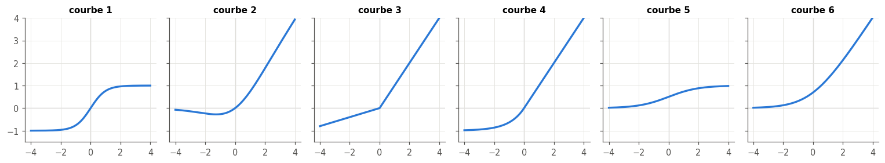

# 17 · Fonctions d'activation — quiz, rappels, exercices papier, réflexion et entretien

> Écris tes réponses dans **ta copie** `mon_travail/ch17_activations/06_mes_reponses.md` (créée par `python tools/start_chapter.py 17`), jamais dans ce fichier : il est mis à jour par Claude.
> Les réponses courtes des **quiz**, des **rappels**, des exercices ✏️ 17.1, 17.2, 17.5 et 17.6, des vérifications numériques de ∂ 17.4 et de l'estimation 🧮 17.8 se vérifient dans la **partie 0** du notebook (`wb.check`). Les questions marquées « dans ta copie », les preuves ∂ 17.3 et 17.7, les démonstrations de ∂ 17.4, la réflexion (🗣️ 📄) et l'entretien se corrigent avec `05_solutions.md`. Indices : `04_indices.md`. Calculatrice autorisée.
> Formats de réponse : un nombre (`0.25` ou `"0,25"`), `True` ou `False` pour un vrai ou faux, une lettre seule entre guillemets pour un choix (`"E"`), des lettres collées pour plusieurs choix (`"BD"`), une suite de codes, un caractère par élément et dans l'ordre (`"XYZ"`), une forme NumPy entre guillemets (`"(4, 7)"`), une liste pour plusieurs nombres (`[2, 5]`).

**Sommaire** : [🧠 Quiz](#quiz) · [🔁 Rappels](#rappels) · [✏️ ∂ 🧮 Papier-crayon](#papier) · [🗣️ 📄 Réflexion](#reflexion) · [💼 Entretien](#entretien) · [Exercices du notebook](#notebook)

Légende : ★ application directe · ★★ standard · ★★★ approfondi · ⏱️ durée indicative · parcours R = rapide, M = maths, C = code.

## 🧠 Quiz

Sans la fiche, en 3 minutes chacun. Réponds vite, vérifie les réponses courtes dans la partie 0 du notebook, puis lis les explications de `05_solutions.md`.

### 17.Q1 — À quoi sert la fonction d'activation ? 🧠 ⏱️ 3 min
*Fiche §17.1, §17.2 · livre §17.1, §17.2 · parcours R*

a) Un MLP 4-8-8-2 n'a **aucune** activation, ni dans ses couches cachées ni en sortie. Il calcule la même fonction qu'une seule couche dense : le nombre de paramètres (poids et biais) de cette couche unique.
b) Vrai ou faux : une activation affine, comme $f(z) = 3z + 1$, suffit à empêcher l'effondrement.
c) À quel moment du calcul d'un neurone s'applique la fonction d'activation ? (A) avant la multiplication des entrées par les poids ; (B) entre les multiplications et la somme ; (C) après la somme pondérée, biais compris ; (D) seulement dans la couche de sortie.
d) Vrai ou faux : pour éviter l'effondrement d'un réseau à trois couches cachées, il suffit d'une non-linéarité dans la couche de sortie.

### 17.Q2 — Un nombre en entrée, un nombre en sortie : la forme d'une activation 🧠 ⏱️ 3 min
*Fiche §17.2.1 · livre §17.2.1*

a) Une activation élément par élément est appliquée à un tableau `Z` de forme `(32, 10)`. La forme du résultat, entre guillemets.
b) Vrai ou faux : en pratique, on choisit en général une activation par couche, la même pour tous ses neurones.
c) Le livre donne un autre nom à la fonction d'activation : (A) fonction de transfert ; (B) noyau ; (C) logit ; (D) fonction de répartition.
d) Vrai ou faux : chaque case de `f(Z)` dépend de toute la ligne correspondante de `Z`.

### 17.Q3 — Linéaire ou non linéaire ? Classer six courbes 🧠 ⏱️ 3 min
*Fiche §17.3.1, §17.3.2 · livre §17.3 · parcours R*

Pour chaque fonction, écris `L` si elle est **linéaire au sens du livre** (sa courbe est une seule droite) et `N` sinon ; réponds par les six lettres collées, dans l'ordre (par exemple `"NNLLNL"`).
1. $f(z) = -2z$ ;
2. $f(z) = z/3 + 4$ ;
3. l'escalier $f(z) = \lfloor 5z \rfloor / 5$ ;
4. $f(z) = |z|$ ;
5. $f(z) = \max(0, z)$ ;
6. $f(z) = 0{,}5z$ pour $z < 0$ et $f(z) = 0{,}5z$ pour $z \ge 0$.

### 17.Q4 — Pourquoi une activation doit-elle donner une seule valeur par entrée ? 🧠 ⏱️ 3 min
*Fiche §17.3.1, §17.3.2 · livre §17.3.1*

a) Vrai ou faux : la courbe d'équation $z^2 + a^2 = 1$ (un cercle) peut servir de fonction d'activation $a = f(z)$.
b) Vrai ou faux : une fonction en escalier, discontinue, est une fonction d'activation valide au sens du livre (une seule valeur par entrée), même si elle ne s'entraîne pas par gradient.
c) Lesquelles de ces courbes, tracées avec $z$ en abscisse et $a$ en ordonnée, sont des **fonctions** de $z$ (lettres collées, dans l'ordre alphabétique) ? (A) la parabole $a = z^2$ ; (B) la parabole couchée $z = a^2$ ; (C) un cercle ; (D) une marche ; (E) la droite verticale $z = 1$.

### 17.Q5 — Marche unité, Heaviside, signe : les distinguer 🧠 ⏱️ 3 min
*Fiche §17.4 · livre §17.4*

a) La valeur de la marche de Heaviside en $z = -0{,}5$.
b) La valeur de la marche unité de seuil $1{,}5$, avec la convention du livre et de ta librairie, en $z = 1{,}5$.
c) La valeur que rend `np.sign(0.0)`.
d) La valeur de `step(z, low=-1)` en $z = 0$ (la marche de ta librairie, avec $-1$ au lieu de $0$ sous le seuil).
e) Vrai ou faux : la dérivée d'une marche vaut 0 partout où elle existe.

### 17.Q6 — ReLU, leaky, paramétrique, décalée : qui fait quoi ? 🧠 ⏱️ 3 min
*Fiche §17.5 · livre §17.5 · parcours R*

a) La valeur de la leaky ReLU de pente $0{,}1$ en $z = -3$.
b) Dans une ReLU paramétrique (PReLU), ce qui est appris pendant l'entraînement : (A) la pente des entrées négatives ; (B) la position du coude ; (C) la pente des entrées positives ; (D) rien : la pente est tirée au hasard à chaque passe.
c) La valeur de la ReLU décalée $\max(z, -2)$ en $z = -3$.
d) Vrai ou faux : une PReLU dont la pente apprise vaut exactement 1 reste non linéaire.
e) La valeur de la dérivée de ReLU en $z = 0$, avec la convention de PyTorch.

### 17.Q7 — Maxout et ReLU bruitée 🧠 ⏱️ 3 min
*Fiche §17.5 · livre §17.5*

a) La valeur en $z = -3$ du maxout des trois droites $0{,}5z$, $2z - 1$ et $-z - 2$.
b) La valeur du même maxout en $z = 2$.
c) Le plus petit nombre de droites d'un maxout qui reproduit exactement ReLU.
d) Vrai ou faux : avec une ReLU bruitée, deux passes avant du même exemple donnent toujours la même sortie.

### 17.Q8 — Saturation : quelles fonctions, et de quel côté ? 🧠 ⏱️ 3 min
*Fiche §17.6, §17.7 · livre §17.6 · parcours R*

a) Pour chaque fonction, écris `G` si sa dérivée tend vers 0 (ou est nulle) seulement du côté des $z$ négatifs, `D` seulement du côté des positifs, `2` des deux côtés, `0` jamais ; six caractères collés, dans l'ordre : sigmoïde, tanh, ReLU, leaky ReLU, ELU, identité (par exemple `"D20G2D"`).
b) La valeur de $\sigma'(6)$ (4 décimales).
c) La valeur de $\tanh'(3)$ (4 décimales).
d) La plus grande valeur de la dérivée de la sigmoïde (2 décimales).

### 17.Q9 — Swish, SiLU, GELU : des ReLU lissées 🧠 ⏱️ 3 min
*Fiche §17.6, §17.7 · livre §17.6, §17.7 · parcours R*

On donne $\Phi(1) = 0{,}8413$ (la fonction de répartition de $\mathcal{N}(0, 1)$, 4 décimales).

a) La valeur de $\mathrm{SiLU}(-0{,}5)$ (4 décimales).
b) Vrai ou faux : SiLU est croissante sur toute la droite réelle.
c) La valeur de $\mathrm{GELU}(1)$ (4 décimales).
d) On note $\mathrm{swish}_\beta(z) = z\,\sigma(\beta z)$. Quand $\beta \to +\infty$, $\mathrm{swish}_\beta$ tend vers : (A) ReLU ; (B) l'identité ; (C) la marche de Heaviside ; (D) $z \mapsto z/2$.
e) Pour $\beta = 0$, $\mathrm{swish}_\beta$ vaut (mêmes choix) : (A) ReLU ; (B) l'identité ; (C) la marche de Heaviside ; (D) $z \mapsto z/2$.

### 17.Q10 — Reconnaître les courbes de la figure 17.22 🧠 ⏱️ 3 min
*Fiche §17.7 · livre §17.7*

La figure ci-dessous montre six activations sans leur nom, sur les mêmes axes ($z$ de $-4$ à $4$). Associe à chaque courbe, dans l'ordre de 1 à 6, la lettre de son nom : (A) sigmoïde ; (B) tanh ; (C) softplus ; (D) ELU ($\alpha = 1$) ; (E) SiLU ; (F) leaky ReLU de pente $0{,}2$. Réponds par six lettres collées (par exemple `"FEDCBA"`).

### 17.Q11 — Softmax : somme à 1, ordre conservé, mais pas une activation 🧠 ⏱️ 3 min
*Fiche §17.8 · livre §17.8 · parcours R*

a) Vrai ou faux : la softmax conserve l'ordre des scores.
b) Vrai ou faux : $\mathrm{softmax}(1, 2, 3) = \mathrm{softmax}(11, 12, 13)$.
c) Vrai ou faux : $\mathrm{softmax}(1, 2, 3) = \mathrm{softmax}(2, 4, 6)$.
d) Pourquoi la softmax n'est-elle pas une activation au sens du chapitre ? (A) chaque probabilité dépend de tous les scores ; (B) elle n'est pas dérivable ; (C) elle ne rend pas de valeurs entre 0 et 1 ; (D) elle n'a pas de paramètre.

### 17.Q12 — Vrai ou faux : des scores 0,6 / 0,3 / 0,1 se lisent comme des probabilités 🧠 ⏱️ 3 min
*Fiche §17.8 · livre §17.8 · parcours R*

Un classifieur à trois classes A, B et C sort les scores $0{,}6$, $0{,}3$ et $0{,}1$.

a) Vrai ou faux : on peut conclure de ces scores bruts que A est deux fois plus probable que B.
b) Après la softmax, le rapport $p_A / p_B$ (2 décimales).
c) Après la softmax, la probabilité $p_A$ (3 décimales).
d) Vrai ou faux : si le classifieur sortait $6$, $3$ et $1$, la softmax donnerait les mêmes probabilités.

## 🔁 Rappels

Des questions sur les chapitres précédents, pour ne pas oublier.

### 17.R1 — Ch. 16 : quelle initialisation va avec ReLU, et pourquoi ? 🔁 ★ ⏱️ 5 min
*Ch. 16 (fiche §16.4.1, l'initialisation) · parcours R*

a) La variance des poids de l'initialisation de He pour une couche ReLU de 50 entrées.
b) L'écart-type correspondant.
c) D'où vient le facteur 2 de la règle de He ? (A) ReLU met à zéro environ la moitié des valeurs, et $\mathbb{E}[\mathrm{ReLU}(z)^2] = \mathrm{Var}(z)/2$ pour $z$ symétrique ; (B) on compte à la fois la passe avant et la passe arrière ; (C) une couche a deux fois plus de sorties que d'entrées ; (D) le biais double la variance.
d) Vrai ou faux : pour un réseau tanh, l'initialisation de Glorot convient mieux que celle de He.

### 17.R2 — Ch. 14 : d'où viennent les probabilités d'une forêt aléatoire ? 🔁 ★ ⏱️ 5 min
*Ch. 14 (fiche, les forêts aléatoires et le vote) · parcours R*

a) Comment le `predict_proba` d'un `RandomForestClassifier` de scikit-learn calcule-t-il ses probabilités ? (A) la moyenne des `predict_proba` de ses arbres ; (B) la proportion d'arbres qui votent pour chaque classe ; (C) une softmax des votes ; (D) une sigmoïde de la moyenne des votes.
b) Une forêt de trois arbres : pour un exemple, ils donnent à la classe 1 les probabilités $0{,}9$, $0{,}6$ et $0$. La probabilité de la classe 1 selon la forêt (2 décimales).
c) Vrai ou faux : les probabilités d'une forêt ont besoin d'une softmax pour sommer à 1.

Dans ta copie (le problème est binaire : classes 0 et 1) : pour l'exemple de b), quelle classe désigne le vote majoritaire des trois arbres ? Et la forêt de scikit-learn, qui prend la classe de plus grande probabilité moyenne ?

### 17.R3 — Ch. 10 : pourquoi un perceptron à seuil ne s'entraîne pas par gradient ? 🔁 ★ ⏱️ 5 min
*Ch. 10 (fiche, le perceptron et sa règle d'apprentissage) · parcours R, M*

a) La dérivée de la marche unité de seuil 0 en $z = 0{,}3$.
b) Vrai ou faux : la règle d'apprentissage du perceptron du ch. 10 se sert de la dérivée de la marche.
c) Lesquelles de ces fonctions ont une dérivée non nulle presque partout (lettres collées, dans l'ordre alphabétique) ? (A) sigmoïde ; (B) signe ; (C) tanh ; (D) Heaviside ; (E) leaky ReLU ; (F) ReLU.

## ✏️ ∂ 🧮 Papier-crayon

Calculatrice autorisée. Écris la démarche dans ta copie de `06_mes_reponses.md`, puis reporte les résultats dans la partie 0 du notebook. Garde les valeurs exactes pendant tes calculs et **n'arrondis qu'à la fin**.

### Ex 17.1 — Effondrer un réseau linéaire en un seul neurone ✏️ ★ ⏱️ 15 min
**Objectif :** calculer à la main la couche unique qui remplace un réseau sans activation, biais compris, puis voir ce qu'une ReLU y change.
**Prérequis :** 0B (produit matriciel) · ch. 16 (passe avant, $\mathbf{z} = \mathbf{x}\mathbf{W} + \mathbf{b}$) · fiche §17.2 (encadré sur la composition) · **Parcours :** R, M

Un réseau 3-2-2-1 n'a aucune activation. Dans la convention du ch. 16 (une ligne $\mathbf{x}$, $\mathbf{z} = \mathbf{x}\mathbf{W} + \mathbf{b}$), ses paramètres sont
$$\mathbf{W}_1 = \begin{pmatrix} 1 & -2 \\ 0 & 1 \\ 3 & 1 \end{pmatrix}, \quad \mathbf{b}_1 = (1 ;\ -1), \quad \mathbf{W}_2 = \begin{pmatrix} 2 & 1 \\ -1 & 3 \end{pmatrix}, \quad \mathbf{b}_2 = (0 ;\ 2), \quad \mathbf{W}_3 = \begin{pmatrix} 1 \\ -2 \end{pmatrix}, \quad b_3 = 0{,}5.$$

a) Les trois poids du neurone unique équivalent, $\mathbf{W}_1\mathbf{W}_2\mathbf{W}_3$ (une liste de trois nombres).
b) Son biais.
c) La sortie du réseau pour $\mathbf{x} = (1 ;\ 2 ;\ -1)$.
d) On ajoute ReLU après **chacune** des deux couches cachées (pas en sortie). La sortie pour le même $\mathbf{x}$.
e) Le nombre de paramètres du réseau 3-2-2-1.
f) Le nombre de paramètres du neurone équivalent.

Dans ta copie : vérifie c) en faisant passer $\mathbf{x}$ couche par couche. Pourquoi d) n'est-il pas égal à c) ? Pour quels exemples la sortie avec ReLU est-elle égale à celle du neurone équivalent ?

### Ex 17.2 — Tableau de valeurs de neuf activations ✏️ ★ ⏱️ 15 min
**Objectif :** calculer à la main les activations du chapitre en deux points, pour fixer leurs formules et leurs ordres de grandeur.
**Prérequis :** 0B (exponentielle, logarithme, tangente hyperbolique) · fiche §17.4 à §17.6 · **Parcours :** R, M

Dans l'ordre : ReLU, leaky ReLU de pente $0{,}1$, ReLU décalée $\max(z, -0{,}5)$, softplus, ELU ($\alpha = 1$), sigmoïde, tanh, SiLU, GELU. On donne $\Phi(-1) = 0{,}1587$ et $\Phi(1{,}5) = 0{,}9332$ (4 décimales).

a) Les neuf valeurs en $z = -1$, dans l'ordre (une liste, 4 décimales).
b) Les neuf valeurs en $z = 1{,}5$ (une liste, 4 décimales).
c) Combien de ces neuf fonctions sont négatives en $z = -1$ ?

Dans ta copie : quelles fonctions sont égales en $z = 1{,}5$, et pourquoi ? Laquelle s'en écarte le plus parmi celles qui ressemblent à ReLU pour $z > 0$ ?

### Ex 17.3 — Une composition d'affines reste affine ; une ReLU casse tout ∂ ★★ ⏱️ 20 min
**Objectif :** démontrer l'effondrement d'un réseau linéaire de n'importe quelle profondeur, puis décrire ce que calcule un réseau ReLU.
**Prérequis :** 0B (produit matriciel, distributivité) · Ex 17.1 · fiche §17.2 · **Parcours :** M

Une application $g : \mathbb{R}^{n} \to \mathbb{R}^{m}$ est **affine** s'il existe une matrice $\mathbf{W}$ de forme $(n, m)$ et un vecteur $\mathbf{b}$ de taille $m$ tels que $g(\mathbf{x}) = \mathbf{x}\mathbf{W} + \mathbf{b}$ pour toute ligne $\mathbf{x}$. Réponds dans ta copie.

1. Montre que la composée de deux applications affines $\mathbf{x} \mapsto \mathbf{x}\mathbf{W}_1 + \mathbf{b}_1$ puis $\mathbf{h} \mapsto \mathbf{h}\mathbf{W}_2 + \mathbf{b}_2$ est affine, et donne sa matrice et son vecteur, avec leurs formes.
2. Montre par récurrence qu'un réseau de $L$ couches sans activation est affine, et écris son biais équivalent en fonction des $\mathbf{b}_\ell$ et des $\mathbf{W}_\ell$.
3. Montre qu'une fonction $f : \mathbb{R} \to \mathbb{R}$ est affine si et seulement si $f(u + v) = f(u) + f(v) - f(0)$ pour tous $u, v$ et $f(\lambda u) - f(0) = \lambda\,(f(u) - f(0))$ pour tout réel $\lambda$. Trouve deux nombres $u$ et $v$ qui montrent que ReLU n'est pas affine.
4. Une leaky ReLU de pente $\alpha$ : pour quelles valeurs de $\alpha$ est-elle affine ?
5. Un réseau a une entrée $x$, une couche cachée de $k$ neurones ReLU et une sortie sans activation. Montre que sa sortie est une fonction continue de $x$, affine par morceaux, avec au plus $k + 1$ morceaux. Où sont les coudes ?
6. La composée de deux fonctions continues affines par morceaux est-elle continue et affine par morceaux ? Qu'en déduis-tu pour un réseau ReLU de plusieurs couches cachées, d'une entrée ? (Pense aux sommes pondérées : une combinaison linéaire de fonctions continues affines par morceaux l'est aussi.)

### Ex 17.4 — Dériver la sigmoïde, tanh et softplus ∂ ★★ ⏱️ 25 min
**Objectif :** établir les dérivées des activations lisses, sous la forme qu'utilisent les bibliothèques, et les calculer en des points simples.
**Prérequis :** 0B (règle du quotient, règle de la chaîne, dérivée de l'exponentielle et du logarithme) · fiche §17.6 · **Parcours :** M

Réponds dans ta copie.

1. Montre que $\sigma'(z) = \sigma(z)\,(1 - \sigma(z))$.
2. Montre que $\tanh(z) = 2\sigma(2z) - 1$, puis que $\tanh'(z) = 1 - \tanh^2(z)$ et que $\tanh'(z) = 4\,\sigma'(2z)$.
3. Montre que $\mathrm{softplus}'(z) = \sigma(z)$.
4. Montre que $\sigma''(z) = \sigma'(z)\,(1 - 2\sigma(z))$, et déduis-en où $\sigma'$ atteint son maximum, et sa valeur.
5. Montre que $\mathrm{SiLU}'(z) = \sigma(z)\,\big(1 + z\,(1 - \sigma(z))\big)$.

Vérifications numériques (les valeurs sont exactes ; $\sigma(\ln 3) = 3/4$, par exemple) :

a) $\sigma'(\ln 3)$.
b) $\tanh'(\ln 2)$.
c) $\mathrm{softplus}'(\ln 4)$.
d) $\sigma''(\ln 3)$ (5 décimales).
e) Le rapport entre la plus grande valeur de $\tanh'$ et la plus grande valeur de $\sigma'$.
f) $\mathrm{SiLU}'(\ln 3)$ (4 décimales).

### Ex 17.5 — Maxout et ReLU : construire |x|, une cuvette et une bosse ✏️ ★★ ⏱️ 20 min
**Objectif :** construire des fonctions avec un maxout et avec des ReLU, et découvrir ce qu'un maxout ne peut pas faire.
**Prérequis :** fiche §17.5 · **Parcours :** M

a) Le maxout des trois droites $-2z - 1$, $0{,}5z - 0{,}5$ et $3z - 4$ forme une cuvette penchée. Les abscisses de ses deux coudes, dans l'ordre croissant (une liste).
b) La valeur minimale de ce maxout.
c) La bosse « chapeau » $h(z) = \max(0,\ 1 - |z|)$ s'écrit $h(z) = a\,\mathrm{ReLU}(z + 1) + b\,\mathrm{ReLU}(z) + c\,\mathrm{ReLU}(z - 1)$. Les trois coefficients $[a, b, c]$ (une liste).
d) Vrai ou faux : un maxout d'une seule variable peut reproduire la bosse $h$.

Dans ta copie :
1. Donne deux droites dont le maxout est $|z|$, puis écris $|z|$ avec deux ReLU.
2. Trace la cuvette de a), en marquant ses trois morceaux et leurs coudes.
3. Montre qu'un maximum de fonctions affines est convexe (pour $0 \le t \le 1$, compare la valeur au point $tu + (1 - t)v$ avec $t\,f(u) + (1 - t)\,f(v)$), et déduis-en la réponse à d).
4. Avec quoi, dans un réseau, peut-on quand même obtenir une bosse ?

### Ex 17.6 — Softmax à la main : translation, température, rapports ✏️ ★★ ⏱️ 20 min
**Objectif :** calculer une softmax à la main et vérifier ses propriétés sur l'exemple de la figure 17.24 du livre.
**Prérequis :** ch. 6 (distribution de probabilité) · fiche §17.8 · **Parcours :** R, M

Un classifieur à six classes sort les scores de la figure 17.24 (colonne de gauche) : $z_A = 0{,}3$, $z_B = 0{,}1$, $z_C = 0{,}8$, $z_D = 0{,}4$, $z_E = 0{,}2$, $z_F = 0{,}6$.

a) Après la softmax, le rapport $p_C / p_B$ (2 décimales).
b) La probabilité $p_C$ (3 décimales).
c) On ajoute 5 à chacun des six scores. La nouvelle probabilité $p_C$ (3 décimales).
d) La probabilité $p_C$ avec la température $T = 0{,}1$, c'est-à-dire $\mathrm{softmax}(\mathbf{z}/0{,}1)$ (3 décimales).
e) La limite de $p_C$ quand $T \to +\infty$ (3 décimales).
f) On double les six scores (sans température). Le nouveau rapport $p_C / p_B$ (2 décimales).

Dans ta copie : compare a) avec la conclusion du livre (p. 701). Pourquoi les grands scores semblent-ils « beaucoup réduits » par la softmax, et les petits presque pas ?

### Ex 17.7 — La Jacobienne de la softmax ∂ ★★★ ⏱️ 30 min
**Objectif :** établir la Jacobienne de la softmax, ses propriétés, et le gradient de la cross-entropy par rapport aux logits.
**Prérequis :** Ex 17.6 · 0B (règle du quotient, règle de la chaîne) · ch. 6 (cross-entropy) · fiche §17.8 (encadré sur la Jacobienne) · **Parcours :** M

On note $\mathbf{p} = \mathrm{softmax}(\mathbf{z})$ pour $\mathbf{z} \in \mathbb{R}^K$, et $S = \sum_j e^{z_j}$. Réponds dans ta copie.

1. Avec la règle du quotient, montre que $\partial p_i / \partial z_i = p_i\,(1 - p_i)$ et que $\partial p_i / \partial z_j = -p_i\,p_j$ pour $j \ne i$.
2. Écris la Jacobienne sous la forme $\mathbf{J} = \mathrm{diag}(\mathbf{p}) - \mathbf{p}^\top\mathbf{p}$. Montre qu'elle est symétrique et que chacune de ses lignes somme à 0. Relie cette dernière propriété à l'invariance par décalage de la softmax. $\mathbf{J}$ est-elle inversible ?
3. Pour $K = 2$, montre que $p_1 = \sigma(z_1 - z_2)$, et relie $J_{11}$ à la dérivée de la sigmoïde.
4. La loss d'un exemple de classe $y$ est $\mathcal{L} = -\log p_y$. Montre de deux façons que $\partial \mathcal{L} / \partial z_j = p_j - \mathbb{1}[j = y]$ : avec la règle de la chaîne et $\mathbf{J}$, puis directement à partir de $\mathcal{L} = -z_y + \log S$.
5. Calcule $\mathbf{p}$ et $\mathbf{J}$ pour $\mathbf{z} = (0 ;\ \ln 2 ;\ \ln 3)$, en fractions.
6. Un modèle de langage a un vocabulaire de $K = 50\,000$ tokens. Combien de cases a $\mathbf{J}$ pour un seul exemple ? Combien d'opérations faut-il, à un facteur près, pour calculer le produit $\mathbf{g}\,\mathbf{J}$ d'un vecteur ligne $\mathbf{g}$ par $\mathbf{J}$, sans former $\mathbf{J}$ ? (Écris $\mathbf{g}\,\mathbf{J}$ avec $\mathbf{p}$ et le nombre $\mathbf{g}\cdot\mathbf{p}$.)

### Ex 17.8 — Fermi : une activation coûte-t-elle cher face au produit matriciel ? 🧮 ★★ ⏱️ 15 min
**Objectif :** estimer ce que coûtent une activation et le produit matriciel qui la précède, en opérations et en temps.
**Prérequis :** ch. 16 (coût d'une passe avant) · fiche §17.2.1 · **Parcours :** M

Une couche dense de 1 024 entrées et 1 024 neurones reçoit un batch de 256 exemples en `float32` (4 octets par nombre) ; un mégaoctet (Mo) vaut $10^6$ octets.

a) Le nombre de multiplications du produit matriciel $\mathbf{X}\mathbf{W}$, en millions (arrondi à l'entier).
b) Le nombre de valeurs que l'activation doit calculer, en milliers (arrondi à l'entier).
c) Le rapport de a) à b) : combien de multiplications par valeur d'activation (le nombre exact).
d) Une multiplication-addition compte pour 2 opérations, une activation (une exponentielle, une division…) pour 30. La part des activations dans les opérations de la couche, en % (1 décimale).
e) Une activation élément par élément lit chaque valeur de $\mathbf{Z}$ et écrit chaque valeur de $\mathbf{A}$, une fois chacune. Le nombre d'octets qu'elle déplace, en Mo (1 décimale).
f) Un GPU déplace 2 000 Go par seconde ($2 \times 10^{12}$ octets par seconde). La durée de l'activation, limitée par ces déplacements, en microsecondes (1 décimale).
g) Le même GPU calcule $5 \times 10^{13}$ opérations par seconde. La durée du produit matriciel, limitée par le calcul, en microsecondes (1 décimale).

Dans ta copie : compare la part de l'activation dans les opérations (d) et dans le temps (f et g). Pourquoi les bibliothèques « fusionnent »-elles l'activation avec le produit matriciel qui la précède ?

## 🗣️ 📄 Réflexion

### Ex 17.9 — Expliquer la non-linéarité avec un train articulé 🗣️ ★ ⏱️ 10 min
**Objectif :** expliquer à un débutant pourquoi un réseau a besoin d'activations, avec une image juste et ses limites.
**Prérequis :** fiche §17.2 · **Parcours :** complet seulement

Un ami qui ne connaît pas le machine learning te demande pourquoi chaque neurone « a besoin d'une petite fonction en plus ». Explique-le-lui en **cinq phrases** au plus, avec l'image du train du livre :
- ce que sont les wagons et les attelages articulés ;
- ce qui arrive à un train dont les attelages sont soudés, et ce qui arrive à un réseau sans activation ;
- pourquoi « articulé » correspond à « non linéaire » ;
- une limite de l'image (ce que l'attelage fait, et qu'une activation ne fait pas, ou l'inverse).

Enregistre-toi ou écris ta réponse, puis compare avec la réponse modèle de `05_solutions.md`.

### Ex 17.10 — Hendrycks & Gimpel (2016) : les GELU 📄 ★★★ ⏱️ 45 min
**Objectif :** lire l'article qui a introduit GELU, en tirer sa motivation, ses approximations et ses résultats, et ce qui a changé depuis.
**Prérequis :** Ex 17.4 · fiche §17.6 et §17.7 · **Parcours :** M

Lis l'article de D. Hendrycks et K. Gimpel, [« Gaussian Error Linear Units (GELUs) »](https://arxiv.org/abs/1606.08415) : le résumé, la formulation (section 2), les expériences (section 3), la discussion (section 4) et l'annexe sur l'histoire de GELU et de la SiLU. Réponds dans ta copie.

1. Comment les auteurs définissent-ils GELU ? Explique leur motivation probabiliste (le masque aléatoire et son espérance), et ce qui la rapproche du dropout et de ReLU.
2. Quelles approximations proposent-ils ? Calcule, avec la formule exacte et l'approximation par tanh, $\mathrm{GELU}(1)$ et l'écart entre les deux (prends $\Phi(1) = 0{,}841345$).
3. Sur quelles tâches comparent-ils GELU à ReLU et à ELU ? Que concluent-ils ? Quel conseil pratique donnent-ils sur l'optimiseur ?
4. Que dit l'article de la SiLU ($x\,\sigma(x)$), et de son histoire avec swish ?
5. Quelles limites vois-tu à ces expériences ? Qu'est-ce qui a fait de GELU l'activation des Transformers (l'encadré 🕰️ de la fiche t'aide à répondre) ?

## 💼 Entretien

Réponds **à voix haute**, en une minute, comme face à un recruteur ; puis compare avec la « réponse modèle en 60 secondes » de `05_solutions.md`.

### 17.E1 — Pourquoi ReLU plutôt que sigmoïde dans les couches cachées ? 💼 ★★ ⏱️ 10 min
*Fiche §17.5, §17.6 · parcours R*

« Pourquoi utilise-t-on ReLU plutôt que la sigmoïde dans les couches cachées d'un réseau profond ? La sigmoïde a-t-elle encore une place ? »

### 17.E2 — Qu'est-ce qu'une ReLU morte, et comment l'éviter ? 💼 ★★ ⏱️ 10 min
*Fiche §17.5 · parcours R*

« Qu'est-ce qu'un neurone ReLU “mort” ? Comment le détecter, et comment l'éviter ? »

### 17.E3 — Softmax ou sigmoïde en sortie : multi-classe contre multi-étiquette 💼 ★★ ⏱️ 10 min
*Fiche §17.8, section sur le choix d'une activation · parcours R*

« Votre modèle doit attribuer des sujets à des articles de presse ; un article peut avoir plusieurs sujets. Softmax ou sigmoïde en sortie ? Et pour reconnaître un chiffre manuscrit ? Où se calcule la softmax dans PyTorch ? »

### 17.E4 — Pourquoi GELU et SiLU dans les Transformers ? 💼 ★★ ⏱️ 10 min
*Fiche §17.6, §17.7 · parcours R*

« BERT et GPT-2 utilisent GELU, LLaMA un bloc SwiGLU. Qu'est-ce qui distingue ces activations de ReLU, et pourquoi les préférer dans ces modèles ? »

## Exercices du notebook

Les exercices suivants se font dans `03_notebook.ipynb` (ta copie : `mon_travail/ch17_activations/03_notebook.ipynb`) ; ceux marqués 🔨 complètent ta librairie (`mylearn/nn/activations.py`). La partie 0 du notebook vérifie tes réponses courtes aux quiz, aux rappels et aux exercices ✏️, ∂ et 🧮 ci-dessus.

| ID | Titre | Type | ★ | ⏱️ |
|---|---|---|---|---|
| 17.11 | Un MLP sans activation sur les lunes : quelle frontière ? | 🔮 | ★ | 15 |
| 17.12 | identity, step, relu, leaky_relu et leurs dérivées | 🔨 | ★ | 15 |
| 17.13 | Sigmoïde, tanh et softplus sans débordement | 🔨 | ★★ | 25 |
| 17.14 | ELU, SiLU, GELU et le registre get_activation | 🔨 | ★★ | 25 |
| 17.15 | Softmax et log_softmax stables (astuce log-sum-exp) | 🔨 | ★★ | 25 |
| 17.16 | La Jacobienne de la softmax en NumPy | 🔨 | ★★★ | 30 |
| 17.17 | Chasse au bug : nan, inf et mauvais axe | 🐛 | ★★ | 25 |
| 17.18 | Reproduire la galerie de la figure 17.22, dérivées comprises | 🎨 | ★★ | 25 |
| 17.19 | Softmax et température : prédire la distribution | 🔮 | ★★ | 15 |
| 17.20 | Quatre activations de scikit-learn sur les lunes et les spirales | 📦 | ★★ | 25 |
| 17.21 | Diagnostiquer la saturation sur des histogrammes de pré-activations | 📈 | ★★ | 20 |
| 17.22 | Une batterie de tests paramétrés pour toutes les activations | 🛠️ | ★★ | 25 |
| 17.23 | Produit des dérivées sur 10 couches : sigmoïde, tanh, ReLU, GELU | 🔬 | ★★★ | 45 |
| 17.24 | Défi spirales : au moins 97 % avec au plus 2 000 paramètres | 🏆 | ★★★ | 60 |
