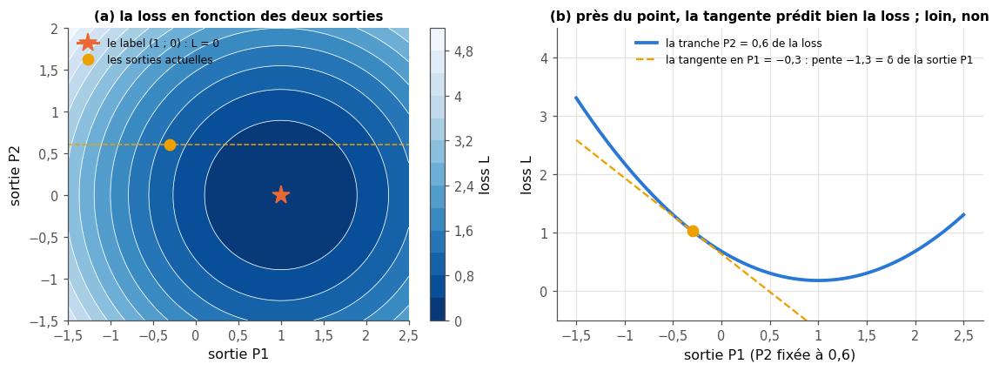
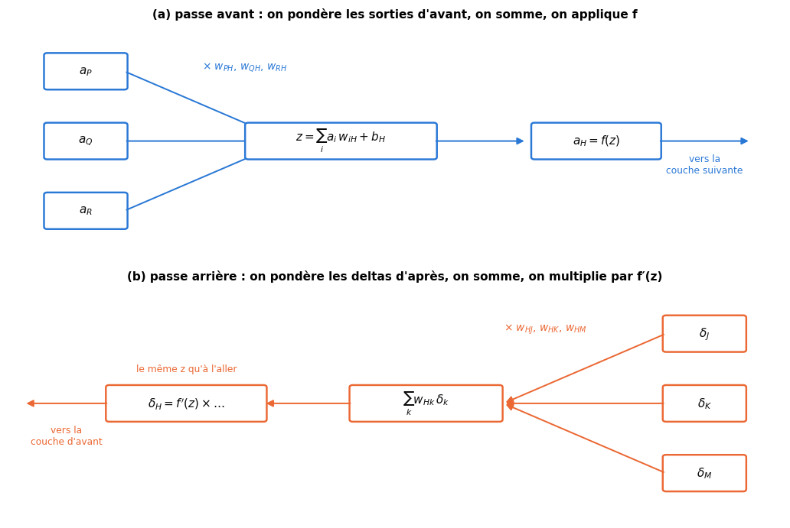
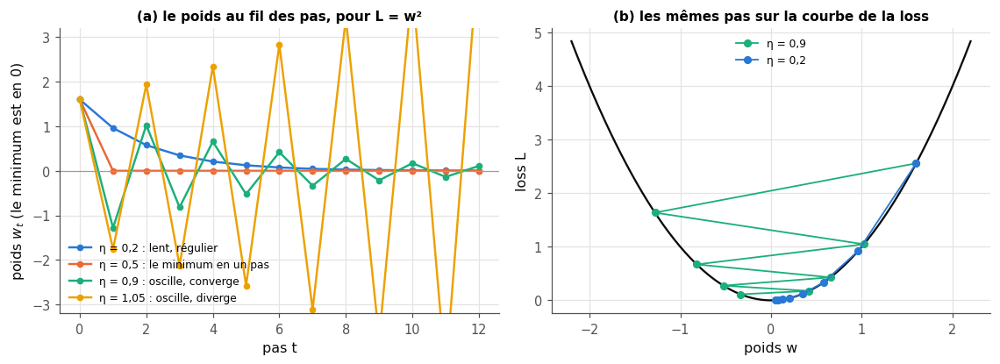
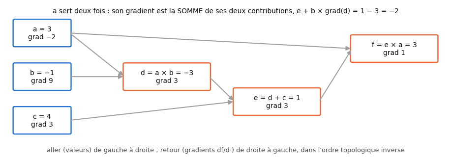

# 18 · Rétropropagation — fiche de cours

> Cette fiche accompagne le chapitre 18 du livre. Les chapitres 16 et 17 t'ont fait calculer la **passe avant** d'un réseau : des couches denses, des activations, une sortie. Celui-ci répond à la question qui restait ouverte : **comment le réseau apprend-il ?** La réponse tient en un algorithme, la **rétropropagation** (*backpropagation*, ou *backprop*), qui calcule en un seul aller-retour la dérivée de la loss par rapport à **chaque** poids du réseau, puis en une **mise à jour** qui déplace chaque poids d'un petit pas dans le sens qui fait baisser la loss. Le livre la construit sans équations, sur un réseau minuscule de quatre neurones, avec une seule idée : le **delta** d'un neurone, le facteur qui relie un petit changement de sa sortie au changement de la loss. La fiche ajoute ce que le livre laisse de côté et dont tu auras besoin pour coder : la **règle de la chaîne** qui justifie chaque étape, la **forme matricielle** pour un mini-batch ($\mathbf{X}^\top\boldsymbol{\Delta}$, $\boldsymbol{\Delta}\mathbf{W}^\top$), les **losses calculées sur les logits** (cross-entropy binaire et softmax) et leur gradient si simple, la **vérification numérique** d'un gradient, et un **micro-autograd**, une version miniature de ce que fait PyTorch. Elle corrige aussi huit affirmations du livre, dont le signe de son delta de sortie. Les figures du livre ne sont que résumées : chaque section te dit où les lire.

| | |
|---|---|
| **Livre** | vol. 1, ch. 18 « Backpropagation », p. 703-804 (§18.1 à §18.12.10) |
| **Temps total estimé** | ≈ 27 h : lecture du livre et de la fiche ≈ 8,2 h, exercices ≈ 17 h, 28 flashcards ≈ 0,9 h |
| **Prérequis** | 0A (classes, surcharge d'opérateurs, fermetures, récursivité, `iterate_minibatches`) · 0B (dérivées partielles, règle de la chaîne, règle de la chaîne à plusieurs chemins, produit matriciel, transposée) · ch. 5 (gradient, descente de gradient, dérivée numérique et choix du pas) · ch. 6 (cross-entropy, nats et bits) · ch. 8 (entraînement, validation, test) · ch. 9 (terme de régularisation) · ch. 12 (one-hot) · ch. 13 (régression logistique, log loss) · ch. 16 (`mlp_forward` et son cache, initialisations, ordre topologique) · ch. 17 (activations et dérivées en $z$, softmax, `log_softmax`, `get_activation`) |
| **Fichiers du chapitre** | `02_exercices.md` (quiz, rappels, papier, réflexion, entretien) · `03_notebook.ipynb` · `04_indices.md` · `05_solutions.md` et `05_solutions.ipynb` · `06_mes_reponses.md` · `flashcards.csv` |
| **mylearn** | `nn/backward.py` : les losses avec leur gradient (`mse_loss`, 18.12 ; `binary_cross_entropy_with_logits` et `softmax_cross_entropy`, 18.14), la passe arrière d'une couche (`dense_backward`, 18.15) et de tout un MLP (`mlp_backward`, 18.18, qui lit le cache de ton `mlp_forward` du ch. 16 et les dérivées du ch. 17), et `gradient_check` (18.16). `autograd_mini.py` : la classe `Value` (un micro-autograd, 18.26) et `MiniMLP`, un petit réseau fait de `Value` (18.28) |

## Comment utiliser ce chapitre

Le livre avance en quatre temps : pourquoi apprendre la rétropropagation et comment on pourrait apprendre sans elle (§18.1 à §18.3), le cœur de l'algorithme sur un réseau de quatre neurones sans activation (§18.4 à §18.9), les activations et le learning rate (§18.10 et §18.11), puis une longue discussion (§18.12). Ses 100 pages sont faites pour moitié de figures ; il répète beaucoup, et c'est voulu : l'idée est simple, mais **subtile**. Avec cette fiche, compte environ huit heures de lecture. La fiche suit le même plan, avec trois sections en plus à la fin : les losses calculées sur les logits, la vérification d'un gradient, et le micro-autograd. Ses encadrés 🧮 donnent les maths et les outils qui manquent au livre : la dérivée comme meilleure approximation linéaire, la règle de la chaîne à plusieurs chemins, la descente sur une parabole, les gradients matriciels, et la surcharge d'opérateurs de Python.

**Ordre conseillé.**
1. Lis le livre §18.1 à §18.4.1, puis les sections correspondantes de la fiche. Fais les quiz Q1 à Q4, le rappel R3 et l'exercice 18.1.
2. Lis le livre §18.5 à §18.9, puis les sections 18.5 à 18.9 de la fiche. Fais les quiz Q5 à Q7 (sauf Q7 c-d), et les exercices 18.2 et 18.4.
3. Lis le livre §18.10 à §18.11.1, puis les sections correspondantes de la fiche et celle sur les losses. Fais les quiz Q7 c-d et Q8, les rappels R1 et R2, les exercices 18.3 et 18.5, et les preuves ∂ 18.6 et ∂ 18.8.
4. Lis le livre §18.12 à §18.12.10, puis les sections correspondantes de la fiche, celle sur la vérification d'un gradient et celle sur le micro-autograd. Fais les quiz Q9 à Q12, la preuve ∂ 18.7, l'estimation 🧮 18.9, l'oral 🗣️ 18.10 et la lecture 📄 18.11. Vérifie tes réponses courtes dans la partie 0 du notebook.
5. Fais le notebook dans l'ordre : partie A (18.12 à 18.17 : les losses, la méthode très lente, la passe arrière d'une couche, la vérification d'un gradient, une chasse aux gradients faux), partie B (18.18 à 18.21 : la passe arrière d'un MLP, l'entraînement du réseau à 37 poids sur les lunes, la même expérience avec scikit-learn, les figures du learning rate), partie C (18.22 à 18.25 : lire des courbes de loss, balayer le learning rate, voir mourir des neurones, écrire un test de gradient), partie D (18.26 à 18.29 : le micro-autograd, quatre gradients comparés, `MiniMLP`, le défi MNIST). Finis par les cinq questions d'entretien.

| Section | Quiz 🧠 et rappels 🔁 | Papier ✏️ ∂ 🧮 et réflexion | Notebook | Entretien 💼 |
|---|---|---|---|---|
| 18.1 Pourquoi ce chapitre, 18.1.1 | Q1, R3 | | | |
| 18.2 Une façon très lente d'apprendre, 18.2.1, 18.2.2 | Q2, Q3 | 18.9 | 18.13 | E2 |
| 18.3 Sans activation pour l'instant | Q3 | | | |
| 18.4 Sorties et erreur, 18.4.1 | Q4 | 18.1 | 18.16 | |
| 18.5 Un réseau minuscule | Q5 | 18.4 | | |
| 18.6 Étape 1 : les deltas de sortie | Q5 | 18.2, 18.4, 18.8 | 18.12, 18.14, 18.17 | E5 |
| 18.7 Étape 2 : changer les poids | Q6 | 18.4 | 18.15 | |
| 18.8 Étape 3 : les autres deltas | Q6 | 18.4, 18.6 | 18.15, 18.18, 18.26 | |
| 18.9 La rétropropagation en action | Q7 | 18.4 | 18.18, 18.19, 18.28 | |
| 18.10 Avec les activations | Q7, R1 | 18.5, 18.6, 18.8 | 18.14, 18.18 | E5 |
| 18.11 Le learning rate, 18.11.1 | Q8, R2 | 18.3 | 18.19 à 18.23, 18.29 | |
| 18.12 Discussion, 18.12.1 à 18.12.3 | Q9 | 18.10 | 18.19, 18.26 à 18.28 | E1 |
| 18.12.4 Garder les neurones en vie | Q10 | | 18.24 | E3 |
| 18.12.5 à 18.12.7 Mini-batches, parallélisme, coût | Q11 | 18.7, 18.9 | 18.17, 18.19, 18.29 | E2 |
| 18.12.8 à 18.12.10 Garanties, histoire, maths | Q12 | 18.6, 18.7, 18.11 | 18.15 à 18.17, 18.22, 18.23, 18.25 à 18.27 | E4 |
| Au-delà du livre : les losses sur les logits | | 18.2, 18.8 | 18.12, 18.14 | E5 |
| Au-delà du livre : vérifier un gradient | | | 18.16, 18.17, 18.25, 18.27 | E4 |
| Au-delà du livre : un micro-autograd | | | 18.26 à 18.28 | E1 |

**Lire les formules.** Comme au ch. 16, un exemple est une **ligne** : une couche reçoit $\mathbf{x}$ (ou $\mathbf{a}_{\text{prev}}$, les sorties de la couche d'avant), calcule la **pré-activation** $\mathbf{z} = \mathbf{x}\mathbf{W} + \mathbf{b}$ avec $\mathbf{W}$ de forme $(n_{in}, n_{out})$, puis l'**activation** $\mathbf{a} = f(\mathbf{z})$ ; $w_{ij}$ relie le neurone $i$ d'une couche au neurone $j$ de la suivante, comme le nom « $AC$ » du livre relie $A$ à $C$. $L$ (ou $\mathcal{L}$ quand $L$ désigne aussi le nombre de couches) est la **loss**, $\hat{y}$ la prédiction et $y$ la cible, $\eta$ le **learning rate**. Le **delta** d'un neurone $j$ est $\delta_j = \partial L / \partial z_j$, la dérivée de la loss par rapport à sa pré-activation ; pour un batch, les deltas d'une couche forment la matrice $\boldsymbol{\Delta}$ de forme $(n, n_{out})$, une ligne par exemple. $\odot$ est le produit case par case, $\mathbf{1}$ un vecteur de uns, $\mathbb{1}[\cdot]$ vaut 1 si la condition est vraie et 0 sinon. $\log$ est le logarithme naturel : les losses de ce chapitre sont en **nats**, comme dans PyTorch.

## Objectifs d'apprentissage

À la fin du chapitre, tu sais :
- **calculer à la main** les deltas et les gradients d'un petit réseau, avec et sans activation, puis faire un pas de mise à jour ;
- **dériver** les équations de la rétropropagation avec la règle de la chaîne, pour un neurone, puis en **forme matricielle** pour un mini-batch ;
- **implémenter** en NumPy les losses et leurs gradients, la passe arrière d'un MLP et la **vérification numérique** d'un gradient ;
- **construire** un micro-autograd (une classe `Value`) et t'en servir pour entraîner un petit réseau ;
- **entraîner** un MLP from scratch et **diagnostiquer** l'effet du learning rate (divergence, lenteur, plateaux) ;
- **repérer** des neurones saturés et des ReLU mortes à partir des activations et des gradients ;
- **expliquer** la rétropropagation, son coût et ses limites en entretien.

## L'essentiel en 10 lignes

1. Entraîner un réseau, c'est faire baisser une **loss** en ajustant ses poids ; il faut pour cela savoir dans quel sens pousser **chaque** poids : c'est le signe de la dérivée $\partial L / \partial w$.
2. Essayer les poids un par un, au hasard, marcherait, mais il faudrait au moins une passe avant par essai et par poids : des millions de passes pour un seul pas.
3. Le **delta** d'un neurone, $\delta_j = \partial L / \partial z_j$, dit de combien la loss bouge quand sa pré-activation bouge un peu : $\Delta L \approx \delta_j\,\Delta z_j$. Un delta positif veut dire : « baisse-moi ».
4. Pour un neurone de sortie et la loss $\frac12\sum_k(\hat{y}_k - y_k)^2$ sans activation, $\delta_k = \hat{y}_k - y_k$ (la prédiction **moins** la cible).
5. Le gradient d'un poids est le produit de ce qui **entre** par le delta de ce qui **reçoit** : $\partial L / \partial w_{ij} = a_i\,\delta_j$ ; celui d'un biais est $\delta_j$.
6. Le delta d'un neurone caché se calcule à partir des deltas de la couche **suivante** : $\delta_j = f'(z_j) \sum_k w_{jk}\,\delta_k$. C'est la règle de la chaîne, couche par couche, de la sortie vers l'entrée : d'où le nom **rétro**propagation.
7. On met ensuite à jour tous les poids d'un coup : $w \leftarrow w - \eta\,\partial L / \partial w$. Trop grand, le **learning rate** $\eta$ fait diverger ; trop petit, il fait ramper ; il y a souvent des **plateaux**.
8. Pour un mini-batch, tout s'écrit en matrices : $d\mathbf{W} = \mathbf{A}_{\text{prev}}^\top\boldsymbol{\Delta}$, $d\mathbf{b} = \mathbf{1}^\top\boldsymbol{\Delta}$, et le gradient qui repart vers la couche d'avant vaut $\boldsymbol{\Delta}\mathbf{W}^\top$. La passe arrière coûte environ **deux** passes avant.
9. Une sortie softmax suivie de la cross-entropy a un gradient très simple par rapport aux logits : $\mathbf{p} - \mathbf{y}$ (divisé par $n$ pour une moyenne) ; on calcule toujours ces losses **sur les logits**, pour la stabilité et pour un gradient qui ne s'éteint pas.
10. Un gradient se **vérifie** par différences finies centrées ; et la rétropropagation est un cas de **différentiation automatique en mode inverse**, ce que font `torch.autograd` et ton micro-autograd `Value`.

## 18.1 · Pourquoi ce chapitre ?

Un classifieur du ch. 13 arrive avec sa propre méthode d'apprentissage : les k plus proches voisins rangent les exemples, un arbre cherche ses coupures. Un réseau de neurones, lui, n'est qu'un assemblage de petits calculs ; rien en lui ne dit comment changer ses poids quand il se trompe (p. 706). La rétropropagation est la méthode générale qui le dit, pour n'importe quel réseau, et c'est elle qui a rendu l'apprentissage profond praticable.

Pourquoi l'apprendre si les bibliothèques la font pour toi ? Le livre donne quatre raisons (p. 707-708) : connaître ses outils pour lire la littérature et en parler ; **diagnostiquer** un réseau qui apprend mal (un gradient qui s'éteint, une loss mal posée) ; comprendre les nombreuses idées qui s'appuient sur elle ; et l'élégance de l'algorithme, qui résout efficacement un problème autrement hors de portée. La deuxième est la plus utile au quotidien : A. Karpathy l'a résumée en un titre, « Yes you should understand backprop » (2016), que le livre cite.

> 💼 **En entreprise** — Personne n'écrit la rétropropagation d'un réseau à la main dans un projet : PyTorch ou JAX la font. Mais « explique-moi la rétropropagation », « pourquoi pas les différences finies ? », « comment vérifies-tu un gradient ? » et « qu'est-ce qu'un gradient qui s'évanouit ? » sont des questions d'entretien classiques, et un entraînement qui stagne se débogue en regardant les gradients. Les questions 💼 18.E1 à 18.E5 portent sur ces réflexes.

### 18.1.1 · Une affaire de subtilité

L'algorithme est **simple** : quelques multiplications et additions par connexion, ce qui le rend très rapide. Mais simple n'est pas facile : chaque étape du livre est une petite déduction, et il faut la refaire soi-même pour qu'elle tienne (p. 708). Prends le temps des exercices papier ✏️ 18.1 à 18.5 : ce sont eux qui transforment la lecture en compréhension.

## 18.2 · Une façon très lente d'apprendre

Avant l'algorithme, le livre rappelle le vocabulaire de l'erreur (p. 710-711). Pour un exemple, la **loss** (*erreur*) est un nombre qui dit à quel point la prédiction s'éloigne du label : 0 si elle est parfaite, d'autant plus grand qu'elle se trompe. Sur tout l'entraînement, sa moyenne est l'**erreur d'entraînement** ; sur la validation ou le test, l'erreur de validation ou de test ; sur les données de l'usage réel, l'**erreur de généralisation** (ch. 8). Idée importante : la loss est **ce que le réseau minimise**, et l'on peut y ajouter un terme pour tout ce qu'on veut décourager. C'est ainsi qu'on ajoute un **terme de régularisation** qui grandit avec la taille des poids (ch. 9) : le réseau, en baissant la loss, garde ses poids petits.

### 18.2.1 · Apprendre en tâtonnant ⏩

Le livre imagine d'abord un apprentissage sans aucune dérivée (p. 712-715). Pour un exemple mal classé :

```
répéter, tant que l'erreur de cet exemple ne baisse pas (ou jusqu'à épuisement de la patience) :
    choisir un poids w au hasard parmi tous les poids du réseau
    choisir un petit nombre m au hasard (positif ou négatif)
    w ← w + m ; refaire la passe avant ; mesurer la nouvelle erreur
    si l'erreur a baissé : garder ; sinon : remettre w à son ancienne valeur
passer à l'exemple suivant ; reprendre tout l'entraînement, encore et encore
```

Un changement de poids se propage : il change la sortie du neurone qui le reçoit, puis celle de tous les neurones en aval, jusqu'aux sorties du réseau (figure 18.2). La méthode finirait par marcher, dit le livre, mais « *eventually* » : chaque essai ne touche qu'un poids et coûte une passe avant complète, et améliorer un exemple peut en dégrader d'autres ; il ajoute un peu plus loin qu'en moyenne la moitié des essais partent dans le mauvais sens (p. 716). Avec des millions de poids, c'est sans espoir. Le 🔮 18.13 te fera mesurer cette lenteur, et l'estimation 🧮 18.9 la chiffrer.

Remarque du livre au passage : le **biais** n'a pas besoin d'un traitement à part. Avec l'**astuce du biais** du ch. 10, il devient le poids d'une entrée qui vaut toujours 1 ; tout ce qu'on dit des poids vaut pour lui (p. 715).

### 18.2.2 · Apprendre plus vite avec le gradient

La méthode lente gaspille deux choses, et le livre les récupère l'une après l'autre (p. 716-718). Le **sens** d'abord : inutile de le tirer au hasard, le signe de la dérivée de la loss par rapport au poids le donne. Positive, elle dit qu'augmenter le poids fait monter la loss : on le **diminue** ; négative, on l'augmente (figure 18.3). Le **nombre** de poids ensuite : si toutes ces dérivées s'obtiennent d'un coup et pour pas cher, rien n'oblige à traiter les poids un par un ; on les fait tous bouger en même temps, chacun dans son sens et selon sa propre dérivée. On reconnaît la descente de gradient du ch. 5, appliquée aux poids d'un réseau.

Bouger tous les poids ensemble n'a rien d'évident : chaque poids modifie ce que reçoivent les neurones en aval, donc l'effet des autres. Le pari est gagnant si chaque pas reste **petit**, car une dérivée ne renseigne que sur le voisinage immédiat du point. La suite du chapitre répond à une seule question : comment obtenir ce gradient **efficacement** ?

## 18.3 · Sans activation pour l'instant

Pour suivre le raisonnement sans se perdre, le livre retire d'abord les fonctions d'activation (p. 718-719) : chaque neurone rend simplement la somme pondérée de ses entrées, $a = z$. Tu sais depuis le ch. 17 qu'un tel réseau s'effondre en une seule couche ; ce n'est qu'un échafaudage, retiré au §18.10. Il revient à utiliser l'activation **identité**, dont la dérivée vaut 1.

## 18.4 · Sorties des neurones et erreur du réseau ⏩

L'apprentissage d'un exemple se fait en deux étapes (p. 719-720) : la rétropropagation proprement dite calcule et range un nombre, le **delta**, pour chaque neurone ; puis l'**étape de mise à jour** se sert des deltas et des sorties des neurones pour changer chaque poids. Beaucoup de gens appellent l'ensemble « rétropropagation » ; au sens strict, la mise à jour n'en fait pas partie, et c'est elle que les optimiseurs du ch. 19 changeront.

### 18.4.1 · L'erreur change proportionnellement ⏩

Dans un réseau fait seulement de produits et de sommes, l'effet sur la loss d'un petit changement de la sortie d'un neurone est **proportionnel** à ce changement (p. 720-725) : un changement deux fois plus grand a un effet deux fois plus grand. Ce coefficient est le **delta** du neurone :

$$\Delta L \approx \delta\,\Delta a .$$

Seul compte l'écart **absolu**, jamais l'écart relatif : une sortie qui passe de 7 à 7,5, ou de 700 à 700,5, fait bouger la loss du même $0{,}5\,\delta$ (p. 731). Le signe se lit d'un coup d'œil : si $\delta$ et $\Delta a$ ont le **même** signe, la loss monte ; s'ils ont des signes **opposés**, elle baisse. Mini-exemple : un neurone de delta $1{,}5$ dont la sortie monte de $0{,}2$ fait monter la loss d'environ $0{,}3$ ; pour la faire baisser, il fallait faire **baisser** sa sortie. Le même raisonnement vaut pour un **poids**, qui multiplie une sortie : connaître ce coefficient pour chaque poids, c'est savoir dans quel sens le corriger.

> 🧮 **Rappel maths — la dérivée, meilleure approximation linéaire** — Pour une fonction $L(a)$ dérivable, $L(a + h) = L(a) + L'(a)\,h + \text{(un reste négligeable devant } h\text{)}$ quand $h$ tend vers 0 (0B, ch. 5). Le delta du livre est exactement $L'(a)$ : la pente de la tangente. La prévision $\Delta L \approx L'(a)\,h$ est d'autant meilleure que $h$ est petit, et peut être très fausse pour un grand pas : c'est pour cela que la descente de gradient avance à petits pas. Avec plusieurs variables, $\Delta L \approx \sum_j \frac{\partial L}{\partial a_j}\,\Delta a_j$.

> ⚠️ **Le livre, corrigé — de quel delta parle-t-on ?** — Le livre définit le delta comme la dérivée de l'erreur (la loss) par rapport à la **sortie** $a$ du neurone ; au §18.10, il multiplie ce nombre par $f'(z)$ et continue à l'appeler « delta ». Ce sont deux quantités différentes dès qu'il y a une activation : $\partial L / \partial a$ et $\partial L / \partial z = f'(z)\,\partial L / \partial a$. La fiche, `mylearn`, Nielsen et la plupart des cours prennent $\delta_j = \partial L / \partial z_j$, la dérivée par rapport à la **pré-activation** ; sans activation, $a = z$ et les deux coïncident, ce qui explique que le livre puisse attendre le §18.10.

## 18.5 · Un réseau minuscule ⏩

Le livre déroule tout l'algorithme sur un réseau à deux entrées $X$ et $Y$ (les coordonnées d'un point), deux neurones cachés $A$ et $B$ et deux neurones de sortie $C$ et $D$, dont les sorties $P_1$ et $P_2$ disent à quel point le point ressemble à chacune des deux classes (p. 726-731, figures 18.8 à 18.11). Ce ne sont pas des probabilités : elles ne somment pas forcément à 1, et l'on prédit simplement la plus grande. Chaque poids porte le nom des deux neurones qu'il relie, celui de départ d'abord : $XA$, $YA$, $XB$, $YB$, $AC$, $BC$, $AD$, $BD$, huit poids, sans biais. Le livre note la sortie d'un neurone $A_o$ et son delta $A_\delta$.

Dans les conventions du ch. 16, ce réseau a deux couches (la couche d'entrée ne calcule rien et ne compte pas) et deux matrices de poids, une ligne par neurone de départ et une colonne par neurone d'arrivée :

$$\mathbf{W}_1 = \begin{pmatrix} XA & XB \\ YA & YB \end{pmatrix}, \qquad \mathbf{W}_2 = \begin{pmatrix} AC & AD \\ BC & BD \end{pmatrix}.$$

Tu feras toute sa rétropropagation à la main dans ✏️ 18.4, puis le notebook (🔮 18.27) comparera tes nombres à ceux de ton `mlp_backward`, de ton micro-autograd et des différences finies.

## 18.6 · Étape 1 : les deltas des neurones de sortie ⏩

On part de la fin (p. 732-744). Pour comparer les sorties $(P_1, P_2)$ au label, on code le label en **one-hot** (ch. 12) : $(1 ;\ 0)$ pour la première classe, $(0 ;\ 1)$ pour la seconde ; on parle aussi de **cible** (*target*). Une loss prend ces quatre nombres et en rend un seul, nul si les sorties valent le label, d'autant plus grand qu'elles s'en éloignent. Le label étant fixé, la loss est une surface au-dessus du plan $(P_1, P_2)$ : une cuvette dont le fond est posé sur le label (figure 18.14). En coupant la cuvette à $P_2$ fixé, on obtient une courbe en $P_1$ ; la pente de sa tangente au point actuel est le delta de $C$ (figures 18.15 à 18.19). Quand $P_1$ et $P_2$ sont tous les deux faux, chaque tranche a son propre minimum, qui n'est pas 0 : il faut bouger les deux sorties, et chaque mouvement change les tranches, d'où, encore, de **petits pas** (p. 742-743).



En pratique, on choisit une loss dont la dérivée s'écrit simplement. Pour l'**erreur quadratique**

$$L = \frac12 \sum_k (\hat{y}_k - y_k)^2, \qquad \frac{\partial L}{\partial \hat{y}_k} = \hat{y}_k - y_k ,$$

le delta d'un neurone de sortie sans activation est donc **la prédiction moins la cible**. Sur la figure, le label est $(1 ;\ 0)$ et les sorties valent $(-0{,}3 ;\ 0{,}6)$ : $\delta_C = -0{,}3 - 1 = -1{,}3$ (augmenter $P_1$ fait baisser la loss) et $\delta_D = 0{,}6 - 0 = 0{,}6$ (il faut baisser $P_2$). Le $\frac12$ n'est là que pour simplifier la dérivée ; sans lui, tous les deltas doublent. La **MSE** de scikit-learn et de PyTorch, $\frac{1}{n}\sum (\hat{y} - y)^2$, est une moyenne sans $\frac12$ : son gradient vaut $\frac{2}{n}(\hat{\mathbf{y}} - \mathbf{y})$, et c'est la convention de ton `mse_loss`.

> ⚠️ **Le livre, corrigé — le signe du delta de sortie** — La légende de la figure 18.20 (p. 743) et les p. 744 et 760 disent que, pour l'erreur quadratique, le delta d'un neurone de sortie est « le label moins la sortie ». C'est l'opposé de la pente : pour $L = \frac12(\hat{y} - y)^2$, la dérivée vaut $\hat{y} - y$. Sa propre figure 18.16 ne s'accorde d'ailleurs pas avec cette règle (✏️ 18.2 te demandera pourquoi). Comme sa règle de mise à jour **soustrait** ensuite le produit sortie × delta (§18.7), ses deux conventions réunies feraient **monter** la loss. De même, à la p. 744, une sortie qui dépasse le label ne donne pas un delta négatif : augmenter encore cette sortie fait monter la loss. Retiens une seule convention : $\delta = \partial L / \partial z$, ici $\hat{y} - y$, et $w \leftarrow w - \eta\,a\,\delta$. Tu le vérifieras sur une parabole dans ✏️ 18.2.

> 🕰️ **Mise à jour (2026) — la loss d'un classifieur** — **Le livre :** prend l'erreur quadratique sur des sorties « vraisemblances », sans softmax, pour garder les calculs simples (p. 726, 743). · **Aujourd'hui :** un classifieur sort des **logits**, et la loss est une cross-entropy calculée directement sur eux : `torch.nn.CrossEntropyLoss` (qui attend « *the unnormalized logits for each class* » et accepte des indices de classe ou des probabilités) ou `torch.nn.BCEWithLogitsLoss` pour une sortie binaire (qui s'appuie sur « *the log-sum-exp trick for numerical stability* ») ; l'erreur quadratique est réservée à la régression. La section « les losses calculées sur les logits » de la fiche dit pourquoi. · **Faut-il quand même l'apprendre ?** Oui : l'erreur quadratique rend les calculs à la main faciles, et c'est la loss de toute régression. · *Source :* [documentation de `CrossEntropyLoss`](https://docs.pytorch.org/docs/2.11/generated/torch.nn.CrossEntropyLoss.html), [de `BCEWithLogitsLoss`](https://docs.pytorch.org/docs/2.11/generated/torch.nn.BCEWithLogitsLoss.html)

## 18.7 · Étape 2 : utiliser les deltas pour changer les poids ⏩

Regarde maintenant le poids $AC$ (p. 745-750). La valeur qui arrive dans $C$ par ce fil est $A_o \times AC$. Si l'on ajoute $\Delta w$ au poids, cette valeur change de $A_o\,\Delta w$, la sortie de $C$ aussi (sans activation), et la loss de $A_o\,\Delta w\,\delta_C$. Autrement dit :

$$\frac{\partial L}{\partial w_{AC}} = A_o\,\delta_C \qquad \text{et, en général,} \qquad \frac{\partial L}{\partial w_{ij}} = a_i\,\delta_j, \qquad \frac{\partial L}{\partial b_j} = \delta_j .$$

Le gradient d'un poids est la sortie du neurone de **départ** multipliée par le delta du neurone d'**arrivée**. Pour faire baisser la loss, on retire au poids une petite fraction de ce produit : $w_{ij} \leftarrow w_{ij} - \eta\,a_i\,\delta_j$ (figure 18.25, avec $\eta$ au §18.11). Mini-exemple : une sortie $a_i = 0{,}8$ et un delta $\delta_j = -0{,}5$ donnent un gradient de $-0{,}4$ ; avec $\eta = 0{,}2$, le poids **augmente** de $0{,}08$. Les deux neurones de sortie ne dépendent pas l'un de l'autre, si bien qu'on peut corriger leurs poids en même temps.

> ⚠️ **Le livre, corrigé — de combien baisse l'erreur ?** — Le livre affirme qu'en retirant $A_o \times C_\delta$ au poids $AC$, on fait baisser l'erreur « de 1 » (p. 747-749, figure 18.23). C'est faux : la baisse dépend de la taille du gradient, et tu calculeras dans ∂ 18.6 ce qu'elle vaut vraiment, et quel pas la rendrait égale à 1. Ce qui reste vrai : un **petit** pas dans le sens opposé au gradient fait baisser la loss.

## 18.8 · Étape 3 : les deltas des autres neurones ⏩

Reste à trouver les deltas des neurones cachés, et c'est là le tour de force (p. 750-758). Si la sortie de $A$ monte de $\Delta a$, la valeur qui arrive dans $C$ monte de $AC\,\Delta a$, et la loss de $AC\,\delta_C\,\Delta a$ par ce chemin. Mais $A$ alimente aussi $D$ : par ce second chemin, la loss bouge encore de $AD\,\delta_D\,\Delta a$. Les deux effets s'ajoutent (figures 18.28 et 18.29), d'où

$$\delta_A = AC\,\delta_C + AD\,\delta_D \qquad \text{et, en général,} \qquad \delta_j = \sum_k w_{jk}\,\delta_k \ \ \text{(sans activation)}.$$

Mini-exemple : un neurone caché relié à deux neurones de sortie par des poids $2$ et $-1$, de deltas $0{,}5$ et $0{,}25$, a pour delta $2 \times 0{,}5 + (-1) \times 0{,}25 = 0{,}75$. Plus besoin de $C$ lui-même : son delta suffit. Il suffit, pour une couche, des deltas de la couche **suivante** et des poids qui y mènent, quelle que soit la profondeur du réseau. (Le livre écrit, p. 753, « $AC \times D_\delta$ » pour le chemin par $D$ : lis $AD \times D_\delta$.)

> 🧮 **Rappel maths — la règle de la chaîne à plusieurs chemins** — Si $L$ dépend de $a$ à travers plusieurs quantités intermédiaires $z_1, \dots, z_m$ (ici les pré-activations des neurones qui reçoivent $a$), alors $\dfrac{\partial L}{\partial a} = \sum_{k=1}^{m} \dfrac{\partial L}{\partial z_k}\,\dfrac{\partial z_k}{\partial a}$ (0B.29) : on **somme sur tous les chemins**. Avec $z_k = \sum_i a_i w_{ik} + b_k$, $\partial z_k / \partial a_j = w_{jk}$, et l'on retrouve la formule du livre. Tu la démontreras proprement dans ∂ 18.6.

La figure 18.31 montre une belle symétrie : à l'aller, un neurone **pondère les sorties** de la couche d'avant et les somme ; au retour, il **pondère les deltas** de la couche d'après et les somme. Même nombre de multiplications : calculer les deltas coûte à peu près autant que calculer les sorties. On le dessine avec des flèches dans les deux sens sur le même fil, qui porte le même poids.



## 18.9 · La rétropropagation en action ⏩

Le livre reprend tout sur un réseau plus grand, 2 → 2 → 4 → 3 → 2 (p. 758-765, figures 18.32 à 18.37) : on calcule d'abord les deltas de la couche de sortie, puis ceux de la couche de 3, puis de 4, puis de 2, chaque fois à partir de la couche qu'on vient de finir et des poids qui la relient. Les deltas remontent le réseau couche par couche : c'est la **propagation vers l'arrière**. Une fois tous les deltas connus, on met à jour tous les poids, et il faut **recalculer** les deltas avant le pas suivant, puisqu'ils dépendent des poids. Comme les neurones d'une même couche ne dépendent pas les uns des autres, tous les deltas d'une couche se calculent **en parallèle** : sur un GPU, une couche de 100 neurones prend le temps d'un seul (p. 764).

En pseudo-code, pour un exemple et un réseau sans activation :

```
passe avant : calculer et garder la sortie de chaque neurone
pour chaque neurone k de sortie : δ_k = ∂L/∂ŷ_k               (ŷ_k − y_k pour la loss quadratique)
pour chaque couche cachée, de la dernière à la première :
    pour chaque neurone j : δ_j = Σ_k w_jk δ_k               (k : les neurones de la couche suivante)
pour chaque poids w_ij : w_ij ← w_ij − η a_i δ_j ;   pour chaque biais : b_j ← b_j − η δ_j
```

## 18.10 · Avec les fonctions d'activation ⏩

Remettons les activations (p. 765-774). Un neurone calcule maintenant $z$, puis $a = f(z)$. Un petit changement de $z$ change la sortie de $f'(z)\,\Delta z$ : il passe d'autant mieux que la courbe est raide, et il est presque effacé sur une partie plate (figures 18.40 et 18.41). Il suffit donc de **multiplier** par la dérivée de l'activation, **évaluée au $z$ de la passe avant** :

$$\delta_j = f'(z_j) \sum_k w_{jk}\,\delta_k \quad \text{(neurone caché)}, \qquad \delta_k = f'(z_k)\,(\hat{y}_k - y_k) \quad \text{(sortie activée, loss quadratique)}.$$

C'est la figure 18.43, que ce chapitre a construite pièce par pièce : à l'aller, somme pondérée puis $f$ ; au retour, somme pondérée des deltas puis $\times f'(z)$, avec le même $z$. Tout est **local** : l'aller ne demande que les sorties de la couche d'avant, le retour que les deltas de la couche d'après, les poids et $f'$. Avec l'activation identité, $f' = 1$, et l'on retrouve tout ce qui précède. Mini-exemple : un neurone sigmoïde de pré-activation $z = 2$ multiplie son delta par $\sigma'(2) = \sigma(2)\,(1 - \sigma(2)) \approx 0{,}105$ : à peine un dixième passe. C'est pour cela que ton `mlp_forward` du ch. 16 garde dans son cache, pour chaque couche, l'entrée $\mathbf{a}_{\text{prev}}$ **et** la pré-activation $\mathbf{z}$ : la passe arrière en a besoin, et les fonctions `<nom>_derivative` du ch. 17 prennent $z$, jamais $a$.

> ⚠️ **Le livre, corrigé — une activation qui amplifie ?** — Sur une partie raide de la courbe, dit le livre, l'activation change un petit changement de poids en un changement de sortie plus grand que sans elle (p. 767-768, figure 18.40). Tout dépend de la pente : le changement est multiplié par $f'(z)$, et n'est amplifié que si $f'(z) > 1$. La dérivée de la sigmoïde ne dépasse jamais $\frac14$ : elle **atténue** toujours, même au plus raide. Celle de tanh atteint 1 en 0 sans le dépasser, et ReLU transmet tel quel du côté positif. Cette atténuation, couche après couche, est l'une des raisons pour lesquelles les gradients s'éteignent dans un réseau profond à sigmoïdes (ch. 17).

> ⚠️ **Le livre, corrigé — la dérivée de ReLU en 0** — Le livre dit que les bibliothèques « gèrent automatiquement » le saut de la dérivée de ReLU en 0, « de sorte que la dérivée est lisse partout » (p. 773-774, figure 18.45). Elles ne lissent rien : elles prennent une **valeur conventionnelle** au point anguleux ($\mathrm{ReLU}'(0) = 0$ dans PyTorch, ch. 17), et la dérivée reste une marche. Ce n'est pas grave, parce qu'une pré-activation tombe rarement exactement sur 0 ; mais une vérification de gradient faite **sur** un coude échoue presque toujours, par une fausse alarme (section sur la vérification d'un gradient).

## 18.11 · Le learning rate ⏩

Le produit $a_i\,\delta_j$ donne une pente, pas une distance : la dérivée ne vaut que près du point, et un pas égal au gradient brut peut largement dépasser le creux (l'encadré ci-dessous le chiffre sur une parabole). On le multiplie donc par un petit nombre, le **learning rate** $\eta$ (p. 774-776, figure 18.46 : la légende y écrit $\delta$ là où il faut lire $\eta$). Un $\eta$ minuscule rend chaque pas sûr mais l'apprentissage interminable ; un $\eta$ trop grand fait rebondir les poids d'un bord à l'autre du creux, ou les envoie vers l'infini. Comme point de départ, le livre propose 0,01, à corriger ensuite selon ce qu'on observe (p. 776).

> 🧮 **Rappel maths — la descente sur une parabole** — Le cas le plus simple dit tout : $L(w) = \frac{a}{2}(w - w^\star)^2$, de courbure $a > 0$ et de minimum $w^\star$. Sa dérivée vaut $a\,(w - w^\star)$, donc un pas de descente donne $w_{t+1} - w^\star = (w_t - w^\star) - \eta\,a\,(w_t - w^\star) = (1 - \eta a)\,(w_t - w^\star)$. L'écart au minimum est multiplié à chaque pas par le **même facteur** $1 - \eta a$ : la suite converge si ce facteur est strictement entre $-1$ et $1$, en oscillant autour de $w^\star$ s'il est négatif ; elle ne converge pas sinon, et diverge si $|1 - \eta a| > 1$. La bonne taille de pas dépend donc de la **courbure**. Pour un réseau, la loss a des courbures très différentes selon les directions, et c'est la plus forte qui limite $\eta$. Tu en tireras les seuils dans ✏️ 18.3.



> ⚠️ **Le livre, corrigé — « un nombre entre 0 et 1 »** — Le livre présente le learning rate comme un nombre entre 0 et 1, la fraction de la correction qu'on applique (p. 775). Ce n'est pas une règle : ✏️ 18.3 te fera voir de quoi dépend la limite au-delà de laquelle la descente diverge. Il est vrai qu'avec les réseaux et les losses usuels, les bonnes valeurs sont en général bien plus petites que 1.

> 🕰️ **Mise à jour (2026) — choisir le learning rate** — **Le livre :** partir de 0,01, entraîner un moment, puis monter ou baisser par essais (p. 776). · **Aujourd'hui :** on commence par un **balayage logarithmique** (0,001, 0,003, 0,01…), ou par le *LR range test* de L. N. Smith (arXiv, 2015 ; WACV, 2017) : un court entraînement pendant lequel le learning rate grandit, en regardant où l'accuracy commence à monter et où elle se dégrade (le *LR finder* de fastai, qui en dérive, regarde la loss). On garde rarement un $\eta$ fixe : les **plannings** (*warmup*, décroissance en cosinus) et les optimiseurs adaptatifs du ch. 19 le font varier ; Adam part de `lr=1e-3` par défaut dans PyTorch. · **Faut-il quand même l'apprendre ?** Oui : le balayage logarithmique reste le geste de base, et comprendre l'effet de $\eta$ sert à lire n'importe quelle courbe de loss. · *Source :* [L. N. Smith, « Cyclical Learning Rates for Training Neural Networks »](https://arxiv.org/abs/1506.01186), [documentation de `torch.optim`](https://docs.pytorch.org/docs/2.11/optim.html)

### 18.11.1 · Explorer le learning rate ⏩

Le livre entraîne ensuite un petit classifieur sur environ 1 500 points de **lunes** standardisés (p. 777-787) : deux entrées, deux couches cachées de 4 neurones ReLU, une sortie sigmoïde ; $2 \times 4 + 4 \times 4 + 4 = 28$ poids et 9 biais, soit 37 paramètres. Il compare trois learning rates, avec les mêmes poids de départ : à 0,5, le réseau met tout dans une seule classe (accuracy d'environ 0,5) et un poids de la couche de sortie saute d'un bord à l'autre ; à 0,05, il sépare parfaitement les lunes en une quinzaine d'epochs ; à 0,01, il plafonne longtemps vers 90 % d'accuracy avant de repartir et de finir lui aussi à 100 %, beaucoup plus tard (figures 18.49 à 18.57). Le livre résume : ni trop grand, ni trop petit, « juste ce qu'il faut ».

Le **plateau** du troisième essai est fréquent : les poids traversent une région presque plate de la surface de la loss, où le gradient est minuscule. Le livre rappelle, d'après Y. Dauphin et ses coauteurs (2014), qu'en grande dimension ces régions sont bien plus souvent des **points selles** (ch. 5) que des minima locaux ; un poids finit par trouver une pente, et les autres suivent. Le notebook refait cette expérience avec ton propre réseau (🔨 18.19, 🎨 18.21, 🔬 18.23) : ses chiffres dépendront de tes données et de ta graine, pas de ceux du livre.

## 18.12 · Discussion

Le livre termine par dix remarques, qui sont autant d'idées à retenir.

### 18.12.1 · La rétropropagation en un seul endroit ⏩

La figure 18.58 rassemble tout (p. 787-788) : (a) la passe avant, (b) les deltas de sortie, (c) les deltas des couches d'avant, l'une après l'autre, (d) la mise à jour de tous les poids. En forme matricielle, pour un mini-batch de $n$ exemples (les lignes de $\mathbf{X}$) et un réseau de $L$ couches :

```
A_0 = X
pour ℓ = 1 … L :   Z_ℓ = A_{ℓ−1} W_ℓ + b_ℓ ;   A_ℓ = f_ℓ(Z_ℓ)          # passe avant, garder (A_{ℓ−1}, Z_ℓ)
G = ∂L/∂A_L                                                         # donné par la loss, forme (n, n_L)
pour ℓ = L … 1 :
    Δ = G ⊙ f_ℓ'(Z_ℓ)                                               # deltas de la couche ℓ
    dW_ℓ = A_{ℓ−1}ᵀ Δ ;   db_ℓ = somme des lignes de Δ ;   G = Δ W_ℓᵀ   # gradients, puis on recule
pour ℓ = 1 … L :   W_ℓ ← W_ℓ − η dW_ℓ ;   b_ℓ ← b_ℓ − η db_ℓ
```

C'est exactement ce que feront ton `dense_backward` (les trois gradients d'une couche) et ton `mlp_backward` (la boucle sur les couches, à partir du cache de `mlp_forward`). Quand la loss se calcule sur les logits, la dernière couche n'a pas d'activation, et $G$ vaut directement le gradient rendu par la loss.

### 18.12.2 · Ce que la rétropropagation ne fait pas ⏩

On entend souvent que la rétropropagation « fait remonter l'erreur » vers l'entrée (p. 789). C'est trompeur : l'erreur elle-même ne sert qu'une fois, pour les deltas de sortie. Ce qui remonte, ce sont des **deltas**, des taux de variation de la loss.

### 18.12.3 · Ce qu'elle fait ⏩

Chaque delta est une composante d'un **gradient** : celui de la loss par rapport à la sortie (ou à la pré-activation) d'un neurone (p. 789-790). La rétropropagation fait remonter le gradient de la loss, couche par couche, en le modifiant selon la contribution de chaque neurone ; la mise à jour qui suit est une **descente de gradient**. Vu de plus haut, c'est un cas particulier d'une technique générale : la **différentiation automatique en mode inverse**, qui calcule le gradient d'un résultat par rapport à toutes les entrées d'un calcul en remontant le graphe des opérations. C'est ce que fait `torch.autograd`, et ce que fera ta classe `Value` (section sur le micro-autograd).

> 🕰️ **Mise à jour (2026) — la différentiation automatique** — **Le livre :** présente le calcul des deltas comme ce que les bibliothèques font en interne pour les réseaux (p. 707, 734). · **Aujourd'hui :** les bibliothèques (PyTorch, JAX, TensorFlow) construisent le **graphe de calcul** de n'importe quel programme numérique, au fil de son exécution, et en tirent le gradient en mode inverse : convolutions, attention, opérations maison, tout se dérive sans une ligne de calcul à la main. Les dérivations manuelles ne servent plus qu'à comprendre, à vérifier et à écrire une opération sur mesure. · **Faut-il quand même l'apprendre ?** Oui : on ne débogue bien que ce qu'on comprend (gradients qui s'éteignent, loss mal posée, `requires_grad` oublié), et la règle de la chaîne est la clé de tous les articles. · *Source :* [A. G. Baydin et coll., « Automatic Differentiation in Machine Learning: a Survey », *JMLR* 18 (2018)](https://arxiv.org/abs/1502.05767), [documentation de `torch.autograd`](https://docs.pytorch.org/docs/2.11/autograd.html)

### 18.12.4 · Garder les neurones en vie

Le livre revient sur la saturation (p. 790-795). Prends un neurone sigmoïde de pré-activation 6 : il sort environ 0,9975, et le pousser à 9 ne le ferait passer qu'à 0,9999 ; sa dérivée, $\sigma'(6) \approx 2{,}5 \cdot 10^{-3}$, écrase tout ce qui remonte par lui. Les petits pas de la descente ne déplacent alors presque plus ses poids d'entrée, ni sa sortie, ni la loss : le neurone **sature** et sort du jeu. Quand beaucoup de neurones en sont là, l'apprentissage ralentit, parfois jusqu'à s'arrêter. Le cas de ReLU est plus net encore : si sa pré-activation est négative pour tous les exemples, il sort 0 avec une dérivée nulle et ne reçoit **aucun** gradient. Ses poids d'entrée ne bougent plus, et seul un changement des couches d'avant, donc de ses entrées, peut le ranimer : on dit qu'il est **mort**. Le livre cite Karpathy : jusqu'à 40 % des neurones d'un réseau peuvent ne jamais s'activer sur tout le jeu d'entraînement (avec un learning rate trop grand, précise Karpathy).

Les remèdes sont ceux des ch. 16 et 17 : une **initialisation** qui garde les pré-activations près de 0 (He, Glorot), un **learning rate** qui ne projette pas les poids trop loin, une **régularisation** qui les garde petits (le livre la renvoie à ses ch. 23 et 24 ; le workbook la traite au ch. 20, avec la batchnorm), et des activations sans plateau du côté positif, comme ReLU, ou dont la pente ne s'annule nulle part, comme leaky ReLU. Quand un réseau apprend mal, regarde la distribution des pré-activations et la part de neurones saturés ou morts : 🔬 18.24 le fera pendant un entraînement sur MNIST.


### 18.12.5 · Les mini-batches ⏩

Plutôt que de corriger les poids après chaque exemple, on passe un **mini-batch** de 16, 32 ou 64 exemples dans le réseau, en parallèle, on calcule tous leurs gradients et l'on fait **une seule** mise à jour, avec leur **moyenne** (p. 795-796). C'est plus rapide sur du matériel parallèle, et la moyenne lisse l'effet d'un exemple aberrant. Le nombre de mises à jour d'une epoch est le nombre de mini-batches. En forme matricielle, tout est déjà là : si la loss du batch est la moyenne des losses des exemples, son gradient est la moyenne de leurs gradients, et le $\frac{1}{n}$ se retrouve dans $\boldsymbol{\Delta}$.

> ⚠️ **Le livre, corrigé — moyenner quels deltas ?** — Le livre propose de moyenner les « deltas » du mini-batch, puis de faire la mise à jour avec ces moyennes (p. 795). La phrase est ambiguë, parce que le livre appelle aussi « delta » la correction d'un poids (p. 725, 744). Moyenner ces corrections, c'est exactement ce qu'on fait : le gradient d'un poids est la **moyenne des produits** $a_i\,\delta_j$ sur les exemples, $\frac{1}{n}\sum_{\text{ex.}} a_i\,\delta_j$. Moyenner les deltas des **neurones**, puis les multiplier par la moyenne des sorties, ne donne pas en général le même nombre. La matrice $\mathbf{A}_{\text{prev}}^\top\boldsymbol{\Delta}$ fait le bon calcul toute seule ; tu compareras les deux dans ∂ 18.7.

> 🕰️ **Mise à jour (2026) — la moyenne d'un mini-batch** — **Le livre :** des mini-batches de 16 à 64 exemples, choisis selon le matériel (p. 795). · **Aujourd'hui :** la moyenne vient de la loss elle-même (`reduction="mean"`, le défaut des losses de PyTorch : son gradient porte déjà le $\frac{1}{n}$) ; les batches vont de 32 à plusieurs milliers d'exemples, et quand la mémoire manque, on **accumule** les gradients de plusieurs petits batches avant une mise à jour (les gradients de PyTorch s'ajoutent tant qu'on n'appelle pas `zero_grad()`). · **Faut-il quand même l'apprendre ?** Oui : confondre somme et moyenne change l'échelle du gradient, donc le bon learning rate. · *Source :* [documentation de `torch.nn.CrossEntropyLoss` (paramètre `reduction`)](https://docs.pytorch.org/docs/2.11/generated/torch.nn.CrossEntropyLoss.html)

### 18.12.6 · Mises à jour en parallèle

Pour corriger un poids, il suffit de deux nombres : la sortie du neurone d'où il part et le delta de celui où il arrive (p. 796-797). Aucune correction n'en attend donc une autre, et un GPU les fait toutes d'un coup. Le prix à payer : tous les gradients ont été calculés avec les **anciens** poids, alors que corriger un poids proche de l'entrée modifie ce que voient toutes les couches suivantes, donc leurs deltas. Avec de petits pas, cet écart reste négligeable : c'est l'argument du §18.2.2.

### 18.12.7 · Pourquoi la rétropropagation séduit ⏩

Son attrait tient en un chiffre : le gradient par rapport à **tous** les poids coûte un petit nombre fixe de passes avant, quel que soit le nombre de poids (p. 797 et l'encadré ci-dessous). Compare à la méthode « honnête » des différences finies (ch. 5) : pour $P$ poids, il faut $2P$ passes avant par gradient (deux par poids, en différence centrée). Pour un réseau d'un million de poids, c'est deux millions de passes contre environ trois. Aucune autre méthode connue ne fait mieux, et c'est pourquoi la rétropropagation est le moteur de tout l'apprentissage profond, malgré ses défauts (learning rate délicat, saturation, neurones morts).

> ⚠️ **Le livre, corrigé — « à peu près le temps d'une passe avant »** — Le livre dit que calculer tous les deltas prend à peu près le temps d'une passe avant (p. 797, en renvoyant à la figure 18.43). C'est juste pour les **deltas** seuls : à chaque couche, une somme pondérée par fil, comme à l'aller. Mais le gradient demande aussi les gradients des poids, $\mathbf{A}_{\text{prev}}^\top\boldsymbol{\Delta}$, un second produit matriciel de la même taille par couche : la passe arrière coûte environ **deux** passes avant, et un pas complet d'entraînement environ trois. C'est le principe du « gradient bon marché » de la différentiation automatique en mode inverse, que rappelle A. Griewank (2012) : le gradient coûte un **petit multiple**, indépendant du nombre de poids, du coût de la fonction ; une constante, et non $P$, c'est le point essentiel. Tu le compteras dans ∂ 18.7.

### 18.12.8 · Aucune garantie ⏩

Le perceptron du ch. 10 avait un théorème de convergence ; la rétropropagation n'en a aucun : rien n'assure qu'elle mènera à de bons poids (p. 797-798). En pratique, un réseau qu'on entraîne pour la première fois déçoit souvent : sa loss stagne, ou descend puis repart en flèche. Le livre recommande de commencer par **baisser fortement** le learning rate ; si la loss se met à baisser, même lentement, on pourra ensuite le remonter par petites touches. Si rien ne change, le problème est ailleurs, dans l'architecture (nombre de couches et de neurones, activations), et le résoudre demande de l'expérience. Le workbook ajoute un second réflexe : **vérifier le gradient** par différences finies (section sur la vérification d'un gradient), parce qu'un gradient faux donne exactement les mêmes symptômes. Le 📈 18.22 t'apprendra à lire ces symptômes sur des courbes de loss.

### 18.12.9 · Un peu d'histoire

La rétropropagation a été découverte plusieurs fois, sous plusieurs noms (p. 798-800). Le premier à l'écrire sous sa forme moderne semble être S. Linnainmaa, dans son mémoire de master de 1970 à Helsinki, pour estimer la propagation des erreurs d'arrondi d'un calcul : la **différentiation automatique en mode inverse**, sans lien avec les réseaux. A. Griewank (2012) signale qu'un chercheur en génie chimique, G. Ostrowski, l'a utilisée vers la même date (1971). P. Werbos en propose l'usage pour les réseaux de neurones dans sa thèse de 1974, mais ne le publie dans ce cadre qu'en 1982, quand les réseaux n'intéressaient plus grand monde (ch. 10). Ce sont les travaux de D. Rumelhart, G. Hinton et R. Williams en 1986 qui la rendent célèbre, en montrant que les neurones cachés y apprennent des représentations utiles : le livre cite leur chapitre du recueil *Parallel Distributed Processing*, et tu liras leur article de *Nature*, de la même année, dans 📄 18.11. N. Trefethen la compte parmi une trentaine de « grands algorithmes numériques » (cité par le livre).

### 18.12.10 · Les maths, pas à pas ⏩

Le livre finit par des conseils de lecture pour les présentations mathématiques (p. 800-802) : relever d'abord la notation de l'auteur (quel symbole pour quoi, quels indices) ; fixer les indices à des valeurs précises et réécrire l'équation pour **un** poids ; dessiner les objets en jeu ; reconnaître dans les équations la règle de la chaîne. Il note que la forme matricielle, très compacte, peut cacher le mécanisme à qui n'est pas à l'aise avec l'algèbre linéaire, et conseille de ne l'adopter qu'une fois l'algorithme compris.

Le workbook suit ce conseil : ✏️ 18.4 et ∂ 18.6 sur des neurones un à un, puis ∂ 18.7 en matrices. Une astuce sûre pour retrouver les formules matricielles : **les formes**. Le gradient d'un tableau a la forme de ce tableau ; pour $d\mathbf{W}$ de forme $(n_{in}, n_{out})$ à partir de $\mathbf{A}_{\text{prev}}$ $(n, n_{in})$ et $\boldsymbol{\Delta}$ $(n, n_{out})$, le seul produit possible est $\mathbf{A}_{\text{prev}}^\top\boldsymbol{\Delta}$ ; pour le gradient de $\mathbf{A}_{\text{prev}}$, forme $(n, n_{in})$, c'est $\boldsymbol{\Delta}\mathbf{W}^\top$.

> 🧮 **Rappel maths — gradients matriciels** — Pour une couche $\mathbf{Z} = \mathbf{X}\mathbf{W} + \mathbf{1}\mathbf{b}^\top$ (le biais ajouté à chaque ligne) et une loss scalaire, notons $\boldsymbol{\Delta} = \partial L / \partial \mathbf{Z}$, la matrice des $\partial L / \partial Z_{ik}$. Comme $Z_{ik} = \sum_j X_{ij} W_{jk} + b_k$, la règle de la chaîne donne $\dfrac{\partial L}{\partial W_{jk}} = \sum_i X_{ij}\,\Delta_{ik}$, soit $\dfrac{\partial L}{\partial \mathbf{W}} = \mathbf{X}^\top\boldsymbol{\Delta}$ ; de même $\dfrac{\partial L}{\partial \mathbf{X}} = \boldsymbol{\Delta}\mathbf{W}^\top$ et $\dfrac{\partial L}{\partial \mathbf{b}} = \mathbf{1}^\top\boldsymbol{\Delta}$, la somme des lignes. Pour une activation $\mathbf{A} = f(\mathbf{Z})$ case par case, $\partial L / \partial \mathbf{Z} = (\partial L / \partial \mathbf{A}) \odot f'(\mathbf{Z})$. Tu les démontreras dans ∂ 18.7.

## Au-delà du livre : les losses calculées sur les logits

Les losses de `mylearn.nn.backward` rendent leur valeur **et** leur gradient, moyennés sur le batch comme le `reduction="mean"` de PyTorch, et en nats.

- **Erreur quadratique moyenne** (régression) : $L = \frac{1}{m}\sum (\hat{y} - y)^2$ sur les $m$ cases du tableau, de gradient $\frac{2}{m}(\hat{\mathbf{y}} - \mathbf{y})$ (`mse_loss`).
- **Cross-entropy binaire sur le logit** (deux classes, une sortie) : avec $p = \sigma(z)$, $\ell = -[y \log p + (1 - y)\log(1 - p)]$. On ne calcule jamais $p$ puis son logarithme : pour $z = 40$, $1 - \sigma(z)$ s'arrondit à 0 et $\log 0 = -\infty$. On écrit directement $\ell = \max(z, 0) - y\,z + \log(1 + e^{-|z|})$, où l'exponentielle ne voit que des nombres négatifs, et le gradient est simplement $\partial \ell / \partial z = \sigma(z) - y$ (`binary_cross_entropy_with_logits`). Mini-exemple : pour $z = 3$ et $y = 1$, $\ell = \log(1 + e^{-3}) \approx 0{,}049$ et le gradient vaut $\sigma(3) - 1 \approx -0{,}047$.
- **Cross-entropy softmax** ($K$ classes) : $\ell = -\sum_k y_k \log p_k$ avec $\mathbf{p} = \mathrm{softmax}(\mathbf{z})$ et $\mathbf{y}$ en one-hot (ou des probabilités cibles). Avec `log_softmax` du ch. 17, $\log p_k = z_k - \mathrm{logsumexp}(\mathbf{z})$ ne déborde jamais, et le gradient vaut $\mathbf{p} - \mathbf{y}$ ; pour un batch, $(\mathbf{P} - \mathbf{Y})/n$ (`softmax_cross_entropy`). Mini-exemple : pour les logits $(2 ;\ 0 ;\ -1)$ et la classe d'indice 0, $\mathbf{p} \approx (0{,}844 ;\ 0{,}114 ;\ 0{,}042)$, $\ell \approx 0{,}170$ et le gradient vaut environ $(-0{,}156 ;\ 0{,}114 ;\ 0{,}042)$ : la bonne classe est poussée vers le haut, les autres vers le bas, d'autant plus qu'elles sont probables.

Pourquoi ce gradient si simple compte-t-il autant ? Comparé à l'erreur quadratique sur une sortie sigmoïde, $(\sigma(z) - y)\,\sigma'(z)$, il **ne s'éteint pas** quand la sortie se trompe avec assurance : sur la figure du §18.12.4 (label 1, logit très négatif), une sortie sûre d'elle et fausse reçoit avec la cross-entropy un gradient proche de $-1$, et avec l'erreur quadratique un gradient presque nul. Tu le démontreras dans ∂ 18.8. Rappel du ch. 6 : `mylearn.info.cross_entropy` compte en **bits** par défaut ; ici, on compte en nats.

## Au-delà du livre : vérifier un gradient

Une rétropropagation écrite à la main a toutes les chances de contenir une erreur au premier essai (un signe, une transposée, un $\frac{1}{n}$ oublié), et un gradient faux ne fait pas planter le programme : l'entraînement est juste plus lent, ou n'aboutit pas. On le vérifie donc par **différences finies centrées** (ch. 5), entrée par entrée :

$$g_{\text{num}} = \frac{L(w + \varepsilon) - L(w - \varepsilon)}{2\varepsilon}, \qquad \text{erreur relative} = \frac{|g_a - g_{\text{num}}|}{\max(|g_a| + |g_{\text{num}}|,\ 10^{-12})} .$$

L'erreur **relative** juge pareil un petit et un grand gradient ; le plancher $10^{-12}$ évite de diviser par 0 quand les deux gradients sont nuls. Ordres de grandeur, en `float64` avec $\varepsilon = 10^{-6}$ : sous $10^{-7}$, le gradient est juste ; au-dessus de $10^{-3}$, il y a presque sûrement un bug ; une erreur de signe donne 1, un facteur 2 oublié donne $\frac13$. Quatre précautions : calculer en `float64` (en `float32`, l'arrondi domine) ; remettre la valeur **exactement** (garder l'ancienne valeur et la remettre, jamais « $+\varepsilon$ puis $-\varepsilon$ ») ; éviter les **coudes** (une ReLU dont le $z$ est à moins de $\varepsilon$ de 0 donne une fausse alarme) ; sur un grand réseau, ne vérifier que quelques entrées tirées au hasard. Ton `gradient_check` (🔨 18.16) fait tout cela, et 🛠️ 18.25 en fera un test pytest. PyTorch a l'équivalent, `torch.autograd.gradcheck`, dont les tolérances par défaut sont, dit sa documentation, « *designed for input of double precision* ».

## Au-delà du livre : un micro-autograd

Comment PyTorch obtient-il le gradient de n'importe quel calcul ? En enregistrant chaque opération dans un **graphe de calcul**, puis en le parcourant à l'envers. Le principe tient dans une petite classe, à la manière de *micrograd* d'A. Karpathy (environ 100 lignes pour le moteur et 50 pour le réseau, licence MIT) : un objet `Value` contient un nombre (`data`), son gradient (`grad`, à 0 au départ), ses **parents** (les `Value` dont il est issu) et une petite fonction `_backward` qui sait propager son gradient à ses parents.

- `c = a * b` crée une nouvelle `Value` de parents `a` et `b`, et lui attache une fonction qui fait `a.grad += b.data * c.grad` et `b.grad += a.data * c.grad` : la règle de la chaîne pour un produit.
- `L.backward()` range le graphe dans un **ordre topologique** (chaque nœud après ceux dont il dépend, comme au ch. 16), met `L.grad` à 1, puis appelle les `_backward` dans l'ordre **inverse**.
- Les gradients **s'accumulent** (`+=`) : un nœud qui sert deux fois reçoit la somme de ses deux contributions. C'est la règle de la chaîne à plusieurs chemins, et c'est aussi pourquoi il faut remettre les gradients à 0 avant chaque nouvelle passe (le `zero_grad()` de PyTorch).



> 🧮 **Rappel outil — surcharge d'opérateurs et fermetures** — En Python, `a * b` appelle la méthode `a.__mul__(b)` ; si `a` est un nombre et ne sait pas multiplier une `Value`, Python essaie `b.__rmul__(a)` (le « r » de *right*). Définir `__add__`, `__radd__`, `__mul__`, `__rmul__`, `__neg__`, `__sub__`, `__truediv__`, `__pow__`… permet d'écrire `2 * x + 1` avec des `Value` (0A.48). Une **fermeture** (*closure*) est une fonction définie à l'intérieur d'une autre et qui garde accès à ses variables : la fonction `_backward` créée dans `__mul__` « se souvient » de `self`, `other` et `out` longtemps après la fin de l'appel (0A.42). Exemple : `def multiplier(k): return lambda x: k * x`, puis `double = multiplier(2)` ; `double(5)` vaut 10, parce que la `lambda` a gardé `k`.

Ton `Value` (🔨 18.26) sera lent (une `Value` par nombre, des boucles Python) ; sera-t-il exact ? 🔮 18.27 comparera ses gradients à ceux de ✏️ 18.4, de `mlp_backward` et des différences finies, et 🔨 18.28 assemblera des `Value` en un `MiniMLP` entraînable. PyTorch fait la même chose sur des **tenseurs** entiers, chaque nœud du graphe étant une opération matricielle avec sa propre formule de retour (celles de ∂ 18.7).

## Les pièges classiques ⚠️ (récapitulatif)

| Piège | Exemple | Ce qu'il faut faire |
|---|---|---|
| Se tromper de signe | delta de sortie pris comme « label − sortie », puis $w \leftarrow w - \eta a \delta$ : la loss monte | une seule convention, $\delta = \partial L / \partial z$ ($\hat{y} - y$ pour la loss quadratique), et l'on **soustrait** $\eta\,a\,\delta$ |
| Dériver par rapport à la sortie au lieu de $z$ | `sigmoid_derivative(a)` au lieu de `sigmoid_derivative(z)` | les dérivées du ch. 17 prennent $z$ : le cache garde $z$ pour cela |
| Oublier un chemin | delta d'un neurone caché calculé avec un seul des neurones qu'il alimente | sommer sur **tous** les neurones de la couche suivante (règle de la chaîne à plusieurs chemins) |
| Une transposée en trop ou en moins | `dW = delta.T @ x`, de forme $(n_{out}, n_{in})$ | vérifier les formes : le gradient a la forme du tableau, $d\mathbf{W} = \mathbf{X}^\top\boldsymbol{\Delta}$ |
| Somme ou moyenne ? | gradient sommé sur le batch, learning rate réglé pour une moyenne | décider une fois ; `mylearn` et PyTorch prennent la **moyenne** (`reduction="mean"`), le $\frac{1}{n}$ est dans $\boldsymbol{\Delta}$ |
| Moyenner les deltas | $\frac{1}{n}\sum a_i \cdot \frac{1}{n}\sum \delta_j$ au lieu de $\frac{1}{n}\sum a_i\delta_j$ | laisser $\mathbf{A}_{\text{prev}}^\top\boldsymbol{\Delta}$ faire la moyenne des produits |
| `log` d'une probabilité arrondie | `np.log(sigmoid(z))` pour $z = -800$, `np.log(softmax(z))` | calculer la loss sur les **logits** : forme stable, `log_softmax` |
| Une softmax en trop | softmax en sortie du réseau, puis `CrossEntropyLoss` | la loss attend les **logits** ; la softmax ne sert qu'à afficher des probabilités |
| Learning rate mal réglé | une loss qui oscille ou explose ; une loss qui baisse à peine | balayage logarithmique ; baisser d'abord fortement si rien ne marche |
| Gradients qui s'accumulent | `backward()` appelé à chaque pas sans remise à zéro : les pas grandissent | `zero_grad()` (ou `p.grad = 0`) avant chaque passe arrière |
| Vérification ratée | gradient numérique en `float32`, ou sur un coude de ReLU, ou poids remis à `w + ε − ε` | `float64`, points loin des coudes, remettre l'ancienne valeur exacte |
| Neurones saturés ou morts | apprentissage bloqué, beaucoup de dérivées nulles | regarder les pré-activations ; initialisation, learning rate, activation (ch. 16, 17, 20) |

## Liens avec les autres chapitres 🔗

- **0B** : dérivées partielles, règle de la chaîne, et surtout sa version à plusieurs chemins (0B.29) ; produit matriciel et transposée pour la forme matricielle.
- **Ch. 5** : gradient, descente de gradient, dérivée numérique et choix du pas $\varepsilon$ : la vérification d'un gradient, c'est `mylearn.calculus` appliqué aux poids d'un réseau ; les points selles des plateaux.
- **Ch. 6** : la cross-entropy (ici en nats) ; **ch. 13** : la régression logistique, dont la log loss est la cross-entropy binaire et dont le gradient $\sigma(z) - y$ est celui de la sortie d'un réseau binaire.
- **Ch. 10** : l'astuce du biais, et le perceptron, dont la règle a une preuve de convergence que la rétropropagation n'a pas.
- **Ch. 16** : `mlp_forward` et son cache $(\mathbf{a}_{\text{prev}}, \mathbf{z})$, que `mlp_backward` consomme ; l'ordre topologique d'un graphe, que `Value.backward` parcourt à l'envers ; les initialisations qui gardent les neurones en vie.
- **Ch. 17** : les dérivées `<nom>_derivative`, évaluées en $z$, et `get_activation` qui rend le couple $(f, f')$ ; `log_softmax` pour une cross-entropy stable.
- **Ch. 19** : les optimiseurs (momentum, RMSprop, Adam, plannings du learning rate) remplacent la mise à jour $w \leftarrow w - \eta\,g$ ; la rétropropagation, elle, ne change pas.
- **Ch. 20** : les mêmes calculs en PyTorch, avec `loss.backward()` et `torch.autograd` ; la régularisation et la normalisation qui gardent les neurones en vie ; **ch. 21 et 22** : la rétropropagation à travers une convolution et à travers le temps.

## Guide de lecture et de travail

**Lecture du livre.** Suis l'ordre conseillé en tête de fiche : un bloc de sections du livre, puis les sections correspondantes de la fiche, qui portent les mêmes numéros et citent les pages. Les trois sections sur les losses calculées sur les logits, la vérification d'un gradient et le micro-autograd n'existent que dans la fiche. Le **parcours rapide** lit toute la fiche et les sections ⏩ du livre, soit environ 6 h : il laisse de côté les §18.1, §18.1.1, §18.2, §18.2.2 et §18.3 du livre (le pourquoi, le vocabulaire de l'erreur et l'idée du gradient, que la fiche résume), l'introduction du §18.12, le §18.12.4 (la saturation, revue au ch. 17), le §18.12.6 (le parallélisme) et le §18.12.9 (l'histoire).

**Travail.** Les exercices papier ✏️ 18.1 à 18.5 sont le cœur du chapitre : fais-les avant d'écrire la moindre ligne de `backward.py`, et garde tes nombres de ✏️ 18.4, que le notebook réutilisera (🔮 18.27). Dans le notebook, écris et teste chaque fonction de `mylearn` avant de passer à la suivante : `mlp_backward` s'appuie sur `dense_backward`, l'entraînement de 18.19 sur `mlp_backward` et les losses. Les questions du notebook marquées « dans tes notes » se notent dans ta copie `06_mes_reponses.md`.

## Pour aller plus loin

- M. Nielsen, *Neural Networks and Deep Learning*, [chapitre 2 « How the backpropagation algorithm works »](http://neuralnetworksanddeeplearning.com/chap2.html) : les quatre équations de la rétropropagation (il en prouve deux et laisse les deux autres en exercice), avec la même convention $\delta = \partial L / \partial z$ que la fiche (en anglais, gratuit).
- A. Karpathy, [notes du cours CS231n sur la rétropropagation](https://cs231n.github.io/optimization-2/) : la règle de la chaîne sur des graphes de calcul, avec des « portes » et leurs gradients, et la forme matricielle ; et son dépôt [micrograd](https://github.com/karpathy/micrograd), le modèle de ta classe `Value`.
- A. G. Baydin, B. Pearlmutter, A. Radul, J. Siskind, [« Automatic Differentiation in Machine Learning: a Survey »](https://arxiv.org/abs/1502.05767), *JMLR* 18 (2018) : modes avant et inverse, et leur place dans l'apprentissage automatique.
- A. Griewank, [« Who Invented the Reverse Mode of Differentiation? »](https://emis.univie.ac.at/journals/DMJDMV/vol-ismp/52_griewank-andreas-b.html), *Documenta Mathematica* (2012) : l'histoire du mode inverse, de Linnainmaa à nos jours, en dix pages.
- La documentation de [`torch.autograd`](https://docs.pytorch.org/docs/2.11/autograd.html) : ce que fera `loss.backward()` au ch. 20.
