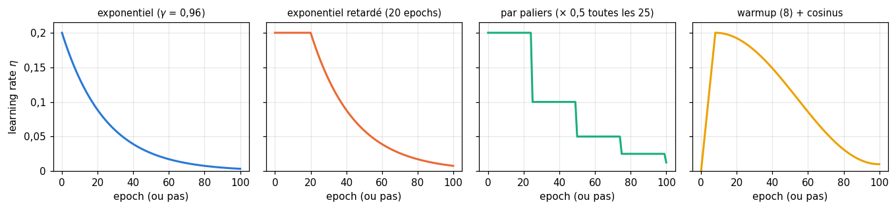
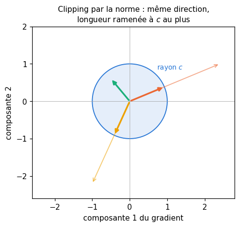

# 19 · Optimiseurs — fiche de cours

> Cette fiche accompagne le chapitre 19 du livre, le dernier du volume 1. Le ch. 18 t'a donné le gradient de la loss par rapport à chaque poids ; il restait à s'en servir, et la règle $w \leftarrow w - \eta\,g$ n'est que la plus simple des façons de le faire. Un **optimiseur** est une règle de mise à jour : il reçoit les gradients et décide de combien bouger chaque poids. Le livre en présente une famille, en partant de la géométrie de la surface d'erreur : faire varier le learning rate au fil de l'entraînement (les **plannings**, *schedules*), choisir combien d'exemples servent à chaque mise à jour (batch, stochastique, mini-batch), ajouter de l'**inertie** (momentum, Nesterov), puis donner à chaque poids son propre pas (Adagrad, Adadelta, RMSprop, Adam). La fiche ajoute les formules exactes que le livre ne donne pas, celles de `torch.optim`, que ta librairie suivra à la lettre, et trois pratiques devenues standard que le livre (2018) ne traite pas : **AdamW** (le weight decay découplé), le **warmup** (*échauffement*) suivi d'une décroissance en cosinus, et le **gradient clipping** (*écrêtage du gradient*). Elle corrige aussi plusieurs descriptions du livre, dont celles d'Adadelta et d'Adam. Les figures du livre ne sont que résumées : chaque section te dit où les lire.

| | |
|---|---|
| **Livre** | vol. 1, ch. 19 « Optimizers », p. 805-871 (§19.1 à §19.6) |
| **Temps total estimé** | ≈ 21 h : lecture du livre et de la fiche ≈ 5,8 h, exercices ≈ 15 h, 26 flashcards ≈ 0,9 h |
| **Prérequis** | 0B (suites géométriques, cosinus, norme d'un vecteur) · ch. 5 (gradient, descente de gradient, points critiques, fonction de Rosenbrock) · ch. 8 (batch, epoch, validation) · ch. 9 (régularisation L2) · ch. 11 (No Free Lunch) · ch. 12 (standardisation) · ch. 15 (recherche d'hyperparamètres) · ch. 16 (`init_mlp`, initialisation de He) · ch. 18 (rétropropagation, `mlp_backward`, boucle d'entraînement, learning rate sur une parabole) |
| **Fichiers du chapitre** | `02_exercices.md` (quiz, rappels, papier, réflexion, entretien) · `03_notebook.ipynb` · `04_indices.md` · `05_solutions.md` et `05_solutions.ipynb` · `06_mes_reponses.md` · `flashcards.csv` |
| **mylearn** | `optim.py` : une classe de base `Optimizer`, huit optimiseurs aux conventions exactes de `torch.optim` (`SGD`, `Momentum`, `Nesterov`, `Adagrad`, `RMSprop`, `Adadelta`, `Adam`, `AdamW`), quatre plannings (`exponential_decay_lr`, `step_decay_lr`, `bold_driver_lr`, `cosine_lr`) et `clip_grad_norm` |

## Comment utiliser ce chapitre

Le livre avance en quatre temps : la géométrie de l'erreur et la courbe qui servira d'exemple (§19.1 et §19.2), le learning rate et ses plannings (§19.3), les trois façons de grouper les exemples (§19.4), puis les variantes de la descente et le choix d'un optimiseur (§19.5 et §19.6). Ses 65 pages sont faites aux deux tiers de figures, presque sans équation : le livre décrit chaque optimiseur avec des flèches sur une courbe. Avec cette fiche, compte environ six heures de lecture. La fiche suit le même plan et donne, pour chaque optimiseur, la formule de mise à jour que tu coderas ; elle finit par trois sections que le livre n'a pas : AdamW, warmup et cosinus, gradient clipping. Ses encadrés 🧮 donnent la courbure et le conditionnement (la hessienne promise au ch. 5) et la moyenne mobile exponentielle, l'ingrédient commun à RMSprop et Adam.

**Ordre conseillé.**
1. Lis le livre §19.1 à §19.2.2, puis les sections correspondantes de la fiche. Fais les quiz Q1 à Q4 et le rappel R3.
2. Lis le livre §19.3 à §19.3.3, puis les sections 19.3 de la fiche. Fais les quiz Q5 à Q7 et l'exercice ✏️ 19.1.
3. Lis le livre §19.4 à §19.4.3, puis les sections 19.4 de la fiche. Fais le quiz Q8 et le rappel R1.
4. Lis le livre §19.5 à §19.5.2, puis les sections correspondantes de la fiche. Fais les quiz Q9 et Q10, les exercices ✏️ 19.2 et 19.3, la preuve ∂ 19.7 et l'oral 🗣️ 19.10.
5. Lis le livre §19.5.3 à §19.6, puis le reste de la fiche (avec les trois sections « au-delà du livre »). Fais les quiz Q11 et Q12, le rappel R2, les exercices ✏️ 19.4 à 19.6, la preuve ∂ 19.8, l'estimation 🧮 19.9, la réflexion ⚖️ 19.11, la lecture 📄 19.12 et la lecture de documentation 🛠️ 19.13. Vérifie tes réponses courtes dans la partie 0 du notebook.
6. Fais le notebook dans l'ordre : partie A (19.14 à 19.19 : un pas constant sur une vallée, puis toute ta librairie `optim.py`), partie B (19.20 à 19.22 : trop de momentum, les figures du chapitre, un Adam qui diverge), partie C (19.23 à 19.25 : lire des courbes de loss, les solveurs de scikit-learn, batch contre stochastique contre mini-batch), partie D (19.26 à 19.28 : une course sur la fonction de Rosenbrock, huit optimiseurs sur MNIST, le défi). Finis par les cinq questions d'entretien.

| Section | Quiz 🧠 et rappels 🔁 | Papier ✏️ ∂ 🧮 et réflexion | Notebook | Entretien 💼 |
|---|---|---|---|---|
| 19.1 Pourquoi ce chapitre | Q1, R1, R2 | | | |
| 19.2 L'erreur comme géométrie, 19.2.1 | Q1 à Q3, R3 | 19.7 | 19.26 | |
| 19.2.2 Une courbe d'erreur | Q4 | | 19.14 | |
| 19.3 Ajuster le learning rate, 19.3.1 | Q5 | 19.7 | 19.14, 19.21 | |
| 19.3.2 et 19.3.3 Plannings | Q6, Q7 | 19.1 | 19.15, 19.21, 19.24, 19.27 | E3 |
| 19.4 Stratégies de mise à jour, 19.4.1 à 19.4.3 | Q8 | | 19.23, 19.25 | E5 |
| 19.5 Variantes, 19.5.1 Momentum | Q9 | 19.2, 19.10, 19.13 | 19.16, 19.20, 19.21, 19.24 | E1 |
| 19.5.2 Nesterov | Q10 | 19.3, 19.13 | 19.16, 19.21 | |
| 19.5.3 Adagrad, 19.5.4 Adadelta et RMSprop | Q11 | 19.4, 19.8, 19.13 | 19.17, 19.23 | |
| 19.5.5 Adam | Q12 | 19.5, 19.6, 19.8, 19.9, 19.12 | 19.18, 19.22, 19.24 | E1, E2 |
| 19.6 Choisir un optimiseur | Q12 | 19.9, 19.11 | 19.23, 19.26 à 19.28 | E1 |
| AdamW, warmup et cosinus, clipping (fiche) | | 19.6 | 19.18, 19.19, 19.27 | E2 à E4 |

## Objectifs d'apprentissage

À la fin du chapitre, tu sais :
- **relier** la géométrie de la surface d'erreur (minima, selles, plateaux, vallées étroites) au comportement de la descente de gradient ;
- **comparer** batch, stochastique et mini-batch : bruit, coût d'une epoch, nombre de mises à jour ;
- **calculer à la main** les premiers pas d'un planning, du momentum, de Nesterov, d'Adagrad, de RMSprop et d'Adam ;
- **implémenter** SGD, Momentum, Nesterov, Adagrad, RMSprop, Adadelta, Adam et AdamW avec les conventions exactes de `torch.optim`, et le vérifier contre PyTorch ;
- **implémenter** des plannings de learning rate (exponentiel, par paliers, bold driver, warmup et cosinus) et le gradient clipping ;
- **choisir** un optimiseur et ses hyperparamètres de façon expérimentale et justifiée, et le défendre en entretien.

## L'essentiel en 10 lignes

1. Un **optimiseur** ne calcule pas le gradient (c'est la rétropropagation) : il décide comment s'en servir pour changer les poids.
2. La descente ralentit là où le gradient s'annule ou presque : minima, mais aussi **points selles** et **plateaux**, bien plus fréquents en grande dimension que les mauvais minima locaux.
3. Le bon pas dépend de la **courbure** : sur une parabole de courbure $a$, un pas constant converge si $0 < \eta < 2/a$, et c'est la direction la plus courbée qui limite $\eta$. Une vallée très étroite (mal conditionnée) fait zigzaguer la descente.
4. Un **planning** fait varier $\eta$ : grand au début pour avancer, petit à la fin pour se poser au fond. Exponentiel, retardé, par paliers, sur l'erreur, bold driver ; aujourd'hui, surtout **warmup puis cosinus**.
5. **Batch** : une mise à jour par epoch, lisse mais rare ; **stochastique** : une par exemple, bruitée ; **mini-batch** : le compromis, et ce qu'on appelle « SGD » en pratique. On compare des optimiseurs au nombre de mises à jour et au temps, pas seulement aux epochs.
6. Le **momentum** garde une vitesse : $b \leftarrow \mu b + g$, $w \leftarrow w - \eta b$. Il accélère dans les directions constantes, amortit les zigzags, aide à traverser un plateau ; il agrandit aussi le pas effectif, à surveiller quand on choisit $\eta$.
7. **Nesterov** évalue le gradient là où la vitesse va mener : il freine plus tôt avant de dépasser. Les bibliothèques le calculent au point courant, par un changement de variable.
8. **Adagrad** divise le pas de chaque poids par la racine de la somme de ses gradients au carré : un pas propre à chaque poids, qui ne fait que rétrécir. **RMSprop** remplace la somme par une **moyenne mobile exponentielle** ; **Adadelta** y ajoute une seconde moyenne, celle des pas, et se passe de learning rate.
9. **Adam** combine les deux : une moyenne mobile du gradient (le momentum) et une de son carré (l'échelle), **corrigées du biais** (*bias correction*) des premiers pas ; leur rapport donne des pas de l'ordre de $\eta$, peu sensibles à l'échelle des gradients.
10. Aucun optimiseur n'est le meilleur partout (**No Free Lunch**). La recette la plus répandue aujourd'hui : **AdamW** (weight decay découplé), **warmup puis cosinus**, **clipping** de la norme du gradient ; SGD avec momentum reste très bon, surtout en vision.

## 19.1 · Pourquoi ce chapitre ?

Au ch. 18, tout l'apprentissage tenait dans une ligne, $w \leftarrow w - \eta\,g$, et dans le réglage délicat de $\eta$. Ce chapitre remplace cette ligne par des règles plus malignes, les **optimiseurs** (p. 807) : l'enjeu pratique est de savoir ce que fait chaque option d'une bibliothèque, et quand la changer.

> 💼 **En entreprise** — Dans PyTorch, l'optimiseur est l'objet qu'on crée en une ligne (`torch.optim.AdamW(model.parameters(), lr=3e-4)`) et dont on appelle `step()` après chaque `loss.backward()`. Les questions d'entretien portent moins sur les formules que sur les choix : pourquoi Adam ici, pourquoi un warmup, que faire d'une loss qui explose. Ce chapitre te donne de quoi y répondre avec des arguments.

## 19.2 · L'erreur comme géométrie

Le livre propose de voir l'erreur comme un **paysage** : pour chaque réglage du réseau, une hauteur (p. 807-809, figure 19.1). Avec deux paramètres, c'est une surface qu'on peut dessiner ; avec des millions, on ne la dessine plus, mais les calculs du gradient sont les mêmes, et l'intuition construite en deux dimensions reste utile.

> ⚠️ **Le livre, corrigé — une surface sur quoi ?** — Le livre définit la surface d'erreur sur les **sorties des neurones** (p. 808 : « les sorties des neurones sont les entrées de la surface d'erreur »). Ce sont les **poids** (et les biais) que l'optimiseur fait bouger : la surface utile ici est $L(\mathbf{w})$, la loss en fonction de tous les paramètres. Les deltas du livre ($\partial L / \partial a$, ceux de la fiche du ch. 18 portant sur $z$) ne sont qu'une étape du calcul de $\partial L / \partial \mathbf{w}$.

### 19.2.1 · Minima, maxima, plateaux et points selles

Quatre formes reviennent dans tout paysage (p. 809-811, figure 19.2), et ce sont celles du ch. 5 : un **minimum** (le fond d'une cuvette ou d'une vallée : partout autour, ça monte), un **maximum** (un sommet, ou une crête), un **plateau** (plat dans toutes les directions) et un **point selle** (ça monte dans certaines directions et ça descend dans d'autres). Leur point commun : le gradient y est nul, ou presque. Un gradient nul donne une mise à jour nulle : la descente s'arrête, et elle se traîne partout où le gradient est minuscule.

Parmi plusieurs creux, le plus profond est le **minimum global**, les autres sont des **minima locaux** (p. 811-812, figure 19.3). La descente ne voit que la pente sous ses pieds : rien en elle ne sait qu'un creux plus profond existe ailleurs, et l'on vise en pratique un creux assez bas, pas le plus bas.

Le livre insiste, d'après Y. Dauphin et ses coauteurs (2014), sur un fait contre-intuitif : en grande dimension, le vrai piège est moins le mauvais minimum local que le **point selle** (p. 812-813, figure 19.4). Une raison simple : en un point où le gradient s'annule, chaque direction peut monter ou descendre ; pour un minimum, il faut qu'elles montent **toutes**, et avec des millions de directions, c'est rare. Pourquoi une selle ralentit-elle autant ? L'encadré ci-dessous donne la clé : les directions raides imposent un petit $\eta$ (sous $2/\lambda_{\max}$), et avec ce $\eta$, l'écart le long d'une direction qui descend doucement, de courbure $-|\lambda|$ petite, ne grandit que d'un facteur $1 + \eta|\lambda|$ par pas : on s'éloigne de la selle avec une lenteur désespérante. Les variantes du §19.5 s'attaquent à ces situations.

> 🧮 **Rappel maths — courbure, hessienne et conditionnement** — Près d'un point $\mathbf{w}^\star$ où le gradient s'annule, une loss lisse ressemble à une forme quadratique : $L(\mathbf{w}) \approx L(\mathbf{w}^\star) + \frac12(\mathbf{w} - \mathbf{w}^\star)^\top \mathbf{H}\,(\mathbf{w} - \mathbf{w}^\star)$, où $\mathbf{H}$ est la **hessienne**, la matrice des dérivées secondes $H_{ij} = \partial^2 L / \partial w_i \partial w_j$. Ses **valeurs propres** sont les **courbures** de la surface le long de directions perpendiculaires (ses vecteurs propres) : toutes positives, c'est un minimum ; de signes mélangés, un point selle ; toutes négatives, un maximum ; certaines nulles, une direction plate. Le long d'une direction de courbure $\lambda$, un pas de descente multiplie l'écart par $1 - \eta\lambda$, comme sur la parabole du ch. 18 (§18.11) : la plus grande courbure $\lambda_{\max}$ impose $\eta < 2/\lambda_{\max}$, et la plus petite, $\lambda_{\min}$, décide alors de la lenteur. Le rapport $\kappa = \lambda_{\max} / \lambda_{\min}$, le **conditionnement**, mesure l'étroitesse de la vallée : plus il est grand, plus la descente zigzague d'un bord à l'autre en avançant à peine le long du fond. C'est la raison profonde de la standardisation des features (ch. 12) et l'une des cibles des optimiseurs adaptatifs. Tu le démontreras dans ∂ 19.7.

*La figure anticipe : le momentum est au §19.5.1, Adam au §19.5.5 ; reviens-y après les avoir lus.*

### 19.2.2 · Une courbe d'erreur pour les exemples ⏩

Pour dessiner les optimiseurs, le livre passe en une dimension, avec une coupe de paysage (p. 814-817). Son point de départ est un classifieur réduit à un seuil sur une droite : à gauche d'un nombre, une classe ; à droite, l'autre (figures 19.5 et 19.6). Compter les exemples mal classés en fonction du seuil donne une fonction **en escalier**, dont la dérivée vaut 0 presque partout : aucun gradient ne dirait dans quel sens déplacer le seuil. On la **lisse** donc (figure 19.7) : c'est toute la raison d'être des losses du ch. 18, comme la cross-entropy, versions lisses de « compter les erreurs ».

Le livre rappelle ensuite le rôle de $\eta$ (figure 19.8) : trop grand, on saute par-dessus une vallée profonde ; trop petit, on descend lentement dans le premier creux venu. Pour illustrer les optimiseurs, il prend ensuite une seule vallée en forme de **gaussienne renversée** (livre §19.3, p. 817-819, figures 19.9 et 19.10) : le gradient y est négatif à gauche du fond, positif à droite, nul au fond. Le notebook la reprend (🔮 19.14, 🎨 19.21).

> ⚠️ **Le livre, corrigé — des valeurs « approchant 1 »** — Le livre parle de grands learning rates « approchant 1 », puis d'un $\eta$ « entre 0 et 1 » qui raccourcit forcément le gradient (p. 816, 821). Comme on l'a vu au ch. 18, l'échelle de $\eta$ est fixée par la courbure (le seuil $2/a$), pas par 1 ; sur une loss très plate, un pas de 5 peut être prudent, sur une loss très courbée, 0,01 peut faire diverger. Au passage, les renvois du §19.2 vers « le chapitre 8 » pour ces effets du learning rate visent le ch. 18 (§18.11), et le « chapitre 19 » du début du §19.4 vise le ch. 18 (§18.12.5, les mini-batches).

## 19.3 · Ajuster le learning rate

Idée commune à beaucoup d'optimiseurs : changer $\eta$ en cours de route, avec de grands pas au début, quand on cherche une bonne vallée, puis des pas de plus en plus petits pour se poser au fond (p. 817).

### 19.3.1 · Des pas de taille constante ⏩

La mise à jour de base, la descente « vanille », s'écrit pour chaque poids $w_{t+1} = w_t - \eta\,g_t$, où $g_t$ est le gradient au point courant (p. 819-821, figure 19.11). Sur sa vallée, avec $\eta = 1/8$, le livre montre une bille qui **rebondit** d'un bord à l'autre du fond (figures 19.12 à 19.14) ; avec d'autres valeurs, elle rampe ou rebondit plus fort, voire saute dans une autre vallée (figures 19.15 à 19.19).

Le rebond lui-même s'explique par la parabole du ch. 18 : au fond d'une vallée lisse, la courbe ressemble à $\frac{a}{2}(w - w^\star)^2$, et un pas multiplie l'écart au fond par $1 - \eta a$. Entre $1/a$ et $2/a$, ce facteur est négatif : la bille change de côté à chaque pas, en se rapprochant quand même du fond. Avec des gradients exacts, un pas constant assez petit **converge** ; c'est avec des gradients bruités (§19.4) qu'il ne se pose jamais tout à fait.

### 19.3.2 · Changer le learning rate au fil du temps ⏩

La façon la plus simple de commencer grand et de finir petit : multiplier $\eta$ par un nombre un peu inférieur à 1 après chaque pas (p. 829-832). Après $k$ multiplications par $\gamma$, on a $\eta_k = \eta_0\,\gamma^{k}$ : une **décroissance exponentielle** (figure 19.20), et $\gamma$ s'appelle le **paramètre de décroissance** (*decay parameter*). Par exemple, avec $\eta_0 = 0{,}4$ et $\gamma = 0{,}5$, on obtient 0,4, puis 0,2, puis 0,1 : ici une moitié à chaque pas, bien plus brutal que les valeurs habituelles, très proches de 1. Sur sa vallée, le livre prend $\eta_0 = 1/8$ et un $\gamma$ volontairement faible de 0,8 (figures 19.21 à 19.24) : la bille se pose au fond en quelques pas et y reste.

Revers de la médaille : une décroissance trop rapide arrête la bille avant le fond. Avec $\gamma < 1$, la somme de tous les learning rates est **bornée** (une série géométrique, 0B) ; si les gradients restent bornés, le chemin total des poids l'est aussi : un fond trop lointain ne sera jamais atteint.

### 19.3.3 · Les plannings de décroissance ⏩

Le choix de la façon dont $\eta$ change s'appelle un **planning** (*schedule*) ; le livre le compte en général en **epochs** (p. 832-836, figure 19.25) :
- **exponentiel** : $\eta$ multiplié par $\gamma$ après chaque epoch ;
- **exponentiel retardé** : $\eta$ constant pendant quelques epochs, le temps de s'éloigner des poids de départ, puis exponentiel ;
- **par paliers** (*step decay*, « par intervalles » dans le livre) : $\eta$ multiplié par $\gamma$ toutes les $s$ epochs, soit $\eta_k = \eta_0\,\gamma^{\lfloor k/s \rfloor}$ ;
- **sur l'erreur** : on ne baisse $\eta$ que quand l'erreur cesse de diminuer ;
- **bold driver** : après chaque epoch, on regarde la loss totale ; si elle a baissé, on augmente $\eta$ de 1 à 5 % ; si elle a monté de plus qu'une petite tolérance, on le divise par deux (d'après les notes de cours de G. Orr, que le livre cite).

Tous ont des réglages à fixer avant l'entraînement (ou à chercher, ch. 15).

Le livre finit par deux questions qui ouvrent la suite : peut-on régler $\eta$ automatiquement, en détectant qu'on rebondit ? Et faut-il le même $\eta$ pour **tous** les poids (p. 836) ? Le §19.5 y répond.

> 🕰️ **Mise à jour (2026) — les plannings de learning rate** — **Le livre :** décroissance exponentielle, retardée, par paliers, sur l'erreur, bold driver. · **Aujourd'hui :** le planning le plus répandu pour les grands modèles est un **warmup** linéaire, suivi d'une **décroissance en cosinus** (ou linéaire) vers une petite valeur ; LLaMA (Touvron et coll., 2023) prend 2 000 pas de warmup et finit à 10 % du learning rate maximal ; on voit aussi le *one-cycle* et, depuis 2024, le *warmup-stable-decay* (un long palier, puis une décroissance courte). La baisse « sur l'erreur » existe sous le nom `ReduceLROnPlateau` ; le bold driver a presque disparu. PyTorch fournit `ExponentialLR`, `StepLR`, `CosineAnnealingLR`, `LinearLR`, `SequentialLR`, `OneCycleLR` et `ReduceLROnPlateau` dans `torch.optim.lr_scheduler`, Hugging Face `get_cosine_schedule_with_warmup` et `get_wsd_schedule`. Ils se comptent souvent en **pas de mise à jour**, plus en epochs. · **Faut-il quand même l'apprendre ?** Oui : ce sont les mêmes idées (grand au début, petit à la fin), et la section sur le warmup et le cosinus, plus bas, te les fait coder. · *Source :* [documentation de `torch.optim.lr_scheduler`](https://docs.pytorch.org/docs/stable/optim.html#how-to-adjust-learning-rate), [plannings de Hugging Face](https://huggingface.co/docs/transformers/main_classes/optimizer_schedules), [Touvron et coll., « LLaMA » (§2.3)](https://arxiv.org/abs/2302.13971)

## 19.4 · Les stratégies de mise à jour

Le livre compare trois façons de grouper les exemples avant chaque mise à jour, déjà esquissées au ch. 18 (§18.12.5 ; livre p. 836-837). Son banc d'essai : 300 points de **lunes**, 150 par classe (figure 19.26), un réseau à trois couches cachées de 12, 13 et 13 neurones et une sortie à deux neurones, et un learning rate constant de 0,01 ; il trace l'erreur après chaque epoch, jusqu'à ce qu'elle atteigne 0 ou ne baisse plus.

### 19.4.1 · La descente de gradient par batch

On attend d'avoir évalué **tous** les exemples, puis on fait une seule mise à jour avec leur gradient moyen : c'est la **descente par batch** (p. 837-841). Le nom vient du *batch processing* des premiers ordinateurs, qui enchaînaient des programmes sans intervention humaine. La courbe d'erreur est lisse (figures 19.27 et 19.28) : une chute au début, un long passage presque plat (une selle très plate ou un quasi-plateau), puis une nouvelle chute jusqu'à 0, mais après environ **20 000 epochs**.

Le livre lui reproche deux choses : relire à chaque epoch un dataset trop grand pour la mémoire coûte cher, et l'algorithme exige de garder **tous** les exemples sous la main : c'est un algorithme **hors ligne** (*offline*). La première critique se nuance : rien n'empêche d'accumuler le gradient morceau par morceau. Le vrai défaut est ailleurs : une seule mise à jour par passage sur toutes les données, alors que quelques centaines d'exemples suffisent souvent à estimer la direction de la pente.

### 19.4.2 · La descente stochastique (SGD) ⏩

À l'autre extrême, on met à jour les poids après **chaque** exemple : c'est la **descente de gradient stochastique** (SGD, *stochastic gradient descent*) (p. 841-843). Chaque exemple tire les poids dans sa direction ; le gradient d'un seul exemple est une estimation **bruitée** de celui de tout le dataset, et l'ordre des exemples est tiré au hasard, d'où le mot « stochastique ». Sur les lunes, l'erreur par epoch est irrégulière, avec un pic spectaculaire vers l'epoch 225 (presque tout redevient faux, puis tout redevient juste), mais elle atteint 0 en environ **400 epochs** (figure 19.29).

Attention à la comparaison : 400 epochs de 300 mises à jour, cela fait 120 000 mises à jour, six fois plus que les 20 000 du batch. Le nombre d'epochs ne dit pas le temps passé ; il faut compter les mises à jour, et le temps de chacune. SGD est un algorithme **en ligne** (*online*) : il traite chaque exemple dès qu'il arrive, sans avoir besoin de les garder. Ce bruit est une arme à double tranchant, utile pour quitter une selle, gênant pour se poser et pour lire la courbe d'erreur.

### 19.4.3 · La descente par mini-batches

Le compromis : une mise à jour après un **mini-batch** de quelques dizaines à quelques centaines d'exemples (p. 844-846). Sur les lunes, avec des mini-batches de 32, l'erreur atteint 0 vers **5 000 epochs** (figures 19.30 et 19.31) : 300 exemples font 10 mini-batches par epoch (le dernier, incomplet, n'en a que 12), donc 50 000 mises à jour, entre les deux extrêmes. La courbe est presque lisse, et les calculs d'un mini-batch se font en parallèle. C'est la méthode de presque tous les entraînements, au point que « SGD » désigne d'habitude la descente **par mini-batches** (le livre le note d'après S. Ruder) (`torch.optim.SGD` ne sait même pas combien d'exemples ont servi au gradient qu'il reçoit).

> 🔗 **Lien avec le ch. 18** — Ta boucle de 18.19 faisait de la descente stochastique (`batch_size=1`) et le corrigé du défi MNIST de 18.29 des mini-batches de 64. Le gradient moyen d'un mini-batch, $\mathbf{A}_{\text{prev}}^\top\boldsymbol{\Delta}$ ($\boldsymbol{\Delta}$ porte déjà le $\frac1n$), est celui de `mlp_backward` ; l'optimiseur de ce chapitre reçoit ces gradients et ne change rien à leur calcul.

## 19.5 · Les variantes de la descente de gradient ⏩

Le livre fait le bilan des faiblesses de la descente par mini-batches, en suivant l'article de synthèse de S. Ruder (2016) (p. 846-847) : $\eta$ est difficile à choisir à l'avance, comme son planning ; le même $\eta$ s'applique à tous les poids, alors que chacun aurait peut-être besoin du sien ; et les selles presque plates ou les plateaux font ramper. Les variantes qui suivent attaquent ces trois problèmes. À partir d'ici, « SGD » veut dire « par mini-batches ».

Pour chacune, la fiche donne la **formule de PyTorch**, celle que ta librairie `optim.py` doit suivre exactement. Notation : pour un paramètre $w$ (un tableau, les opérations se font case par case), $g_t$ est son gradient au pas $t$ (en comptant à partir de 1), et l'optimiseur garde des **tampons** (*buffers*), ici $b$, $s$, $v$, $u$, $m$, créés au premier pas.

### 19.5.1 · Le momentum ⏩

Le ch. 5 a présenté la descente comme une bille qui roule sur le paysage (p. 847-849, figure 19.32). Une vraie bille a de l'**inertie** : lancée dans une direction, elle continue tant que rien ne la freine. C'est ce qui lui fait traverser un plateau après une descente, là où une descente « au gradient » s'arrêterait net (figures 19.33 et 19.34). Le livre emploie « momentum » dans ce sens courant d'élan.

Le **momentum** (d'après N. Qian, 1999, que le livre cite ; l'idée remonte à B. Polyak, 1964) ajoute à chaque pas une part du pas précédent (p. 850-856, figure 19.35). Ce que le livre décrit en flèches s'écrit avec le changement de poids $\Delta_t$ : $\Delta_t = \gamma\,\Delta_{t-1} - \eta\,g_t$, puis $w_{t+1} = w_t + \Delta_t$, avec un coefficient $\gamma$ entre 0 et 1, souvent 0,9 (0,7 dans ses figures). PyTorch range autrement les mêmes ingrédients : il garde une **vitesse** $b$, la somme amortie des gradients, et applique $\eta$ après coup :

$$b_t = \mu\, b_{t-1} + g_t \quad (b_1 = g_1), \qquad w_{t+1} = w_t - \eta\, b_t .$$

Le coefficient s'appelle `momentum` ($\mu$, le $\gamma$ du livre). Avec $\mu = 0$, on retrouve la descente vanille. Les deux écritures donnent les mêmes poids tant que $\eta$ est **constant** ; avec un planning, elles diffèrent (✏️ 19.2 te fait trouver pourquoi). Exemple avec un gradient constant $g = 1$ et $\mu = 0{,}5$ : $b$ vaut 1, puis 1,5, puis 1,75, et s'approche de 2 ; dans une direction où le gradient ne change pas, le pas finit plus grand que celui de la descente vanille.

Sur la vallée, la bille dépasse le fond et **continue de monter** de l'autre côté alors que le gradient la tire vers le bas (figures 19.36 et 19.37), comme une vraie bille, puis redescend en dépassant de moins en moins (figure 19.39). Bien dosé, le momentum traverse le plateau de la figure 19.33 et se pose quand même au fond (figure 19.38) ; trop fort, il dépasse le fond de plus en plus loin (jusqu'où ? c'est 🔮 19.20) ; trop faible, il ne traverse pas les plateaux. Sur une vallée étroite, il a un autre effet, que montre la figure de la vallée plus haut : les gradients qui changent de signe d'un pas à l'autre (le zigzag d'un bord à l'autre) s'annulent en partie dans $b$, ceux qui gardent leur signe (le long du fond) s'additionnent. Sur les lunes, il ramène les 5 000 epochs du mini-batch à un peu plus de 600, avec une courbe plus bruitée (figure 19.40). Le prix : un hyperparamètre de plus, à régler par expérience ou par recherche.

### 19.5.2 · Le momentum de Nesterov ⏩

Le **momentum de Nesterov** (*Nesterov accelerated gradient*, d'après Y. Nesterov, 1983) prend le gradient ailleurs qu'au point courant (p. 856-862, figure 19.41). Puisque l'élan va de toute façon nous déplacer de $\gamma\,\Delta_{t-1}$, on calcule le gradient au point **anticipé** $w_t + \gamma\,\Delta_{t-1}$ plutôt qu'au point courant :

$$\Delta_t = \gamma\,\Delta_{t-1} - \eta\,\nabla L(w_t + \gamma\,\Delta_{t-1}), \qquad w_{t+1} = w_t + \Delta_t .$$

Si l'élan s'apprête à faire dépasser le fond, le gradient du point anticipé pointe déjà en arrière et **freine** plus tôt : on dépasse moins (figures 19.42 à 19.44, où la bille se pose en sept pas environ). Aucun hyperparamètre de plus que le momentum. Sur les lunes, la courbe est moins bruitée et atteint 0 plus tôt (figure 19.45) ; le livre conseille de préférer Nesterov dès qu'on utilise du momentum.

Calculer un gradient en un point où le réseau n'est pas posé est malcommode : la passe arrière se fait aux poids courants. Les bibliothèques font donc un **changement de variable** qui permet de prendre le gradient au point courant (✏️ 19.3 te fait trouver lequel). PyTorch (`SGD(..., nesterov=True)`) écrit :

$$b_t = \mu\, b_{t-1} + g_t \quad (b_1 = g_1), \qquad w_{t+1} = w_t - \eta\,(g_t + \mu\, b_t).$$

Le pas combine le gradient du moment et la vitesse **déjà mise à jour** : c'est un « coup d'œil » en avant d'un pas.

> 🕰️ **Mise à jour (2026) — la formulation de Nesterov** — **Le livre :** gradient au point anticipé $w + \gamma\Delta$. · **Aujourd'hui :** PyTorch, TensorFlow et les autres prennent le gradient **au point courant**, grâce à un changement de variable (décrit par Y. Bengio, N. Boulanger-Lewandowski et R. Pascanu en 2013 ; I. Sutskever et ses coauteurs, la même année, écrivent Nesterov comme le livre) ; la documentation de `torch.optim.SGD` précise aussi que son momentum applique $\eta$ **après** la mise à jour de la vitesse, une convention qui ne coïncide avec celle de Sutskever et coll. qu'à $\eta$ constant. · **Faut-il quand même l'apprendre ?** Oui : l'intuition du livre (freiner avant de dépasser) est la bonne, et savoir qu'il existe deux conventions évite de mal recopier une formule. · *Source :* [documentation de `torch.optim.SGD` (note sur le momentum)](https://docs.pytorch.org/docs/stable/generated/torch.optim.SGD.html), [Sutskever et coll., « On the importance of initialization and momentum in deep learning », ICML 2013](https://proceedings.mlr.press/v28/sutskever13.html), [Bengio et coll., « Advances in Optimizing Recurrent Networks »](https://arxiv.org/abs/1212.0901)

### 19.5.3 · Adagrad ⏩

Jusqu'ici, tous les poids partagent le même $\eta$. Les algorithmes dont le nom commence par « Ada » (pour *adaptive*) donnent à chaque poids son **propre** pas effectif (p. 862-863). **Adagrad** (J. Duchi, E. Hazan et Y. Singer, 2011) garde, pour chaque poids, la somme de ses gradients au carré, et divise le gradient par la racine de cette somme :

$$s_t = s_{t-1} + g_t^2 \quad (s_0 = 0), \qquad w_{t+1} = w_t - \eta\,\frac{g_t}{\sqrt{s_t} + \epsilon}.$$

Le petit $\epsilon$ (`eps`, $10^{-10}$ par défaut dans PyTorch) évite une division par zéro et s'ajoute **après** la racine ; `initial_accumulator_value` donne la valeur de départ de $s$. Exemple : un poids reçoit les gradients 4 puis 3 ; $s$ vaut 16 puis 25, et ses deux pas valent $\eta \cdot 4/4 = \eta$, puis $\eta \cdot 3/5 = 0{,}6\,\eta$. Un poids qui reçoit souvent de grands gradients voit ses pas se réduire ; un poids rarement sollicité (une feature rare) garde de grands pas quand son tour vient. Mais la somme ne fait que **grandir** : tous les pas finissent par rétrécir, comme avec une décroissance du learning rate, mais poids par poids, selon l'histoire de chacun. Sur les lunes, Adagrad chute vite, puis met environ 8 000 epochs à effacer la dernière erreur (figure 19.46).

Le livre ajoute qu'Adagrad rend le choix de $\eta$ « moins critique » et qu'on peut le laisser à 0,01 (p. 863). C'est vrai en partie : diviser par $\sqrt{s}$ corrige les différences d'échelle entre les poids. Mais $\eta$ fixe toujours la taille de **tous** les pas : un $\eta$ dix fois trop grand reste dix fois trop grand.

### 19.5.4 · Adadelta et RMSprop ⏩

Pour que les pas ne rétrécissent pas indéfiniment, on remplace la somme par une **moyenne mobile exponentielle**, qui oublie peu à peu les vieux gradients (p. 864-866). **RMSprop**, proposé par G. Hinton dans un cours en ligne vers 2012 (une diapositive, jamais un article), écrit :

$$v_t = \alpha\, v_{t-1} + (1 - \alpha)\,g_t^2 \quad (v_0 = 0), \qquad w_{t+1} = w_t - \eta\,\frac{g_t}{\sqrt{v_t} + \epsilon}.$$

$\sqrt{v_t}$ est la **moyenne quadratique** récente (*root mean square*, RMS) des gradients : on divise chaque gradient par sa taille habituelle, si bien qu'un poids qui reçoit de grands gradients fait des pas modérés, et un poids aux petits gradients des pas plus grands. Le coefficient $\alpha$ (le $\gamma$ du livre, souvent 0,9 dans le cours de Hinton) dit la longueur de la mémoire ; dans PyTorch, c'est `alpha`, **0,99** par défaut, avec `lr=0.01` et `eps=1e-8`. Avec $\alpha = 0{,}99$, le gradient du jour ne pèse que pour 1 % dans la nouvelle moyenne.

> 🧮 **Rappel maths — la moyenne mobile exponentielle** — Une **moyenne mobile exponentielle** (EMA, *exponential moving average*) d'une suite $x_1, x_2, \dots$ se met à jour par $m_t = \beta\,m_{t-1} + (1 - \beta)\,x_t$, avec $0 \le \beta < 1$. En déroulant, $m_t = (1 - \beta)\,(x_t + \beta\,x_{t-1} + \beta^2\,x_{t-2} + \dots)$, plus $\beta^t m_0$ : chaque valeur passée compte, avec un poids qui décroît **géométriquement** avec son âge, sans jamais s'annuler tout à fait. Ce n'est pas une fenêtre de taille fixe, mais elle s'en approche : sa **mémoire effective** est d'environ $1/(1 - \beta)$ valeurs (une dizaine pour $\beta = 0{,}9$). Partie de $m_0 = 0$, elle **commence trop près de 0** : la somme des poids des $t$ premières valeurs vaut $1 - \beta^t$, et non 1 ; diviser par $1 - \beta^t$ corrige ce biais, c'est ce que fera Adam. Tu le démontreras dans ∂ 19.8.

**Adadelta** (M. Zeiler, 2012) va plus loin. Zeiler remarque que le pas $\eta\,g/\sqrt{v}$ n'a pas l'unité d'un poids (le gradient et $\sqrt{v}$ ont la même, ils s'annulent ; seul $\eta$ porte l'unité). Il remplace donc $\eta$ par la racine d'une **seconde** moyenne mobile, celle des **pas** eux-mêmes :

$$v_t = \rho\,v_{t-1} + (1 - \rho)\,g_t^2, \qquad \Delta w_t = -\frac{\sqrt{u_{t-1} + \epsilon}}{\sqrt{v_t + \epsilon}}\;g_t, \qquad u_t = \rho\,u_{t-1} + (1 - \rho)\,\Delta w_t^2,$$

avec $v_0 = u_0 = 0$, puis $w_{t+1} = w_t + \eta\,\Delta w_t$. Ici, $\epsilon$ est **sous** les deux racines : au départ, c'est lui qui fixe la taille des premiers pas (la racine de $u_0 + \epsilon$). L'algorithme d'origine n'a **pas de learning rate** ; PyTorch garde un multiplicateur `lr`, qui vaut 1,0 par défaut, avec `rho=0.9` et `eps=1e-6`. Sur les lunes, Adadelta atteint 0 vers 2 500 epochs (figure 19.47).

> ⚠️ **Le livre, corrigé — Adadelta, RMSprop et leurs paramètres** — Trois points du §19.5.4 sont à reprendre. (1) Le livre parle bien d'une somme qui décroît, mais l'illustre par une liste des gradients récents où l'on « ajoute le nouveau » et « retire le plus ancien » (p. 864), une fenêtre glissante, comme celle dont part l'article de Zeiler ; les algorithmes, eux, utilisent une moyenne mobile **exponentielle**, où toutes les valeurs passées comptent, de moins en moins. (2) Ce qu'il décrit sous le nom d'Adadelta (une moyenne des carrés des gradients pour diviser le pas) est en fait **RMSprop** ; ce qui définit Adadelta, la seconde moyenne, celle des pas, qui remplace le learning rate, n'y figure pas. D'où un conseil qui dépend de la bibliothèque : partir d'un learning rate d'environ 0,01 comme pour Adagrad (p. 864). L'Adadelta d'origine n'en a pas ; dans PyTorch, `lr` multiplie un pas déjà complet, et 0,01 serait cent fois plus lent que le réglage par défaut (1,0) ; Keras, lui, part de 0,001 et conseille 1,0 pour retrouver l'article. (3) Le « prop » de RMSprop ne vient pas de ce que l'ajustement serait « propagé » (p. 866) : Hinton l'a présenté comme une version par mini-batches de **Rprop** (*resilient backpropagation*, M. Riedmiller et H. Braun, 1993). Le livre a raison sur un point : $\epsilon$ se laisse d'habitude à sa valeur par défaut.

### 19.5.5 · Adam ⏩

Adagrad, RMSprop et Adadelta ne gardent, pour leur échelle, que les carrés des gradients, qui perdent leur **signe**. **Adam** (*adaptive moment estimation*, D. Kingma et J. Ba, 2014 ; ICLR 2015) garde en plus une moyenne mobile des gradients eux-mêmes (p. 866-867) : deux **moments**, une moyenne $m$ (le premier moment) et une moyenne des carrés $v$ (le second moment), toutes deux partant de 0 et corrigées de leur biais de départ.

$$m_t = \beta_1 m_{t-1} + (1 - \beta_1)\,g_t, \qquad v_t = \beta_2 v_{t-1} + (1 - \beta_2)\,g_t^2,$$
$$\hat m_t = \frac{m_t}{1 - \beta_1^t}, \qquad \hat v_t = \frac{v_t}{1 - \beta_2^t}, \qquad w_{t+1} = w_t - \eta\,\frac{\hat m_t}{\sqrt{\hat v_t} + \epsilon}.$$

Ses auteurs proposent $\beta_1 = 0{,}9$, $\beta_2 = 0{,}999$ et $\epsilon = 10^{-8}$, les valeurs par défaut de PyTorch, avec `lr=1e-3`. Lire la formule : $\hat m$ est un **momentum** (la direction, lissée), $\sqrt{\hat v}$ une **échelle** propre à chaque poids, comme dans RMSprop ; leur rapport est sans unité et, tant que les gradients gardent le même signe et la même taille, il vaut à peu près 1 : chaque poids bouge d'environ $\eta$ par pas. La correction de biais remet les deux moyennes au bon niveau dès le premier pas ; sans elle, elles partiraient de valeurs bien trop proches de 0, et pas dans la même proportion. ✏️ 19.5 te fait chiffrer ce que vaut alors le premier pas, ∂ 19.8 le démontrer. Sur les lunes, Adam atteint 0 vers 900 epochs (figure 19.48).

> ⚠️ **Le livre, corrigé — ce qu'Adam fait de ses deux moyennes** — Le livre explique qu'Adam garde une seconde liste, celle des gradients non élevés au carré, pour « en déduire le facteur d'échelle » avec la première (p. 866). Ce n'est pas le rôle de la moyenne des gradients : elle **remplace le gradient** dans la mise à jour (c'est un momentum), et seule la moyenne des carrés sert d'échelle. Le livre ne dit rien non plus de la **correction de biais**, qui fait partie de l'algorithme (§3 de l'article) et sans laquelle les premiers pas seraient faussés. Enfin, la légende de la figure 19.48 compare à « Adadelta » deux fois : 2 500 epochs pour Adadelta, 8 000 pour **Adagrad**. Autre coquille, la légende de la figure 19.45 donne 600 epochs pour Nesterov, le texte environ 425.

Le livre regrette qu'Adam ait deux paramètres de plus (p. 867) ; en pratique, on change rarement $\beta_1$ et $\beta_2$, et le learning rate reste l'hyperparamètre qui compte. Une exception fréquente : les grands modèles de langage prennent souvent $\beta_2 = 0{,}95$, pour une mémoire plus courte de l'échelle (LLaMA, par exemple).

## 19.6 · Choisir un optimiseur ⏩

Le livre ne prétend pas avoir tout couvert (p. 868-869). Son bilan sur les lunes (figure 19.49) : la descente par mini-batches avec Nesterov gagne de peu devant Adam ; sur des problèmes plus compliqués, dit-il, c'est souvent l'inverse, et Adadelta, RMSprop et Adam se valent souvent, Adam étant un bon point de départ.

Pourquoi tant d'optimiseurs ? Parce qu'il ne peut pas y en avoir un meilleur que tous les autres partout : c'est le **théorème No Free Lunch** (D. Wolpert et W. Macready, 1997), que le ch. 11 t'a présenté. Le livre précise bien que le théorème ne dit pas que tous se valent : sur un problème donné, ils diffèrent, et on peut chercher le meilleur, lui et ses paramètres, par une recherche d'hyperparamètres (ch. 15), en gardant en tête que le meilleur choix change d'un réseau et d'un dataset à l'autre.

> 🔗 **Lien avec le ch. 11 — ce que le No Free Lunch ne dit pas** — Le livre en tire, à juste titre, qu'un autre optimiseur fera toujours mieux dans une autre situation (p. 869). Le théorème lui-même dit que, **en moyenne sur toutes les fonctions possibles** (toutes également probables), tous les algorithmes de recherche ont les mêmes performances. Or les losses des réseaux ne sont pas des fonctions quelconques : elles sont lisses par morceaux, et leurs gradients disent quelque chose. Le théorème interdit un champion universel, pas des préférences fondées sur l'expérience pour une famille de problèmes : rien n'empêche qu'AdamW et SGD avec momentum dominent sur les problèmes réels. Et une comparaison d'optimiseurs dépend beaucoup de l'effort de réglage de chacun : D. Choi et ses coauteurs (2019) font remarquer qu'avec un effort de réglage suffisant, un optimiseur plus général (Adam, qui peut imiter le momentum) ne devrait jamais faire moins bien que ceux qu'il contient, et leurs expériences le confirment : bien des classements publiés tenaient surtout à un réglage inégal.

> 🕰️ **Mise à jour (2026) — des optimiseurs après Adam** — **Le livre :** Adam comme aboutissement. · **Aujourd'hui :** **AdamW** (section suivante) est le choix par défaut de la plupart des projets, des Transformers en particulier ; **SGD avec momentum** (et Nesterov) reste très compétitif en vision, où il généralise parfois mieux qu'Adam (A. Wilson et coll., 2017). Des nouveaux venus : **Lion** (X. Chen et coll., 2023), trouvé par une recherche automatique de programmes, qui ne garde qu'un moment et n'utilise que le signe de la mise à jour ; **Schedule-Free AdamW** (A. Defazio et coll., 2024), qui se passe de décroissance programmée (il garde un warmup) et a gagné l'épreuve « auto-réglée » du banc d'essai AlgoPerf de MLCommons, dont l'autre épreuve a été gagnée par **Distributed Shampoo** (qui multiplie le gradient par des matrices apprises, pour corriger les différences de courbure entre directions) ; **Muon** (K. Jordan, 2024), qui transforme la mise à jour de chaque matrice de poids en une matrice « orthogonale » (toutes les directions avec la même force), repris pour entraîner des grands modèles de langage (J. Liu et coll., Moonshot AI, 2025) et présent dans PyTorch depuis la version 2.9 (`torch.optim.Muon`). · **Faut-il quand même l'apprendre ?** Oui : tous ces optimiseurs reprennent les briques de ce chapitre (momentum, moyennes mobiles, normalisation du pas, weight decay découplé), et AdamW reste la référence. · *Source :* [Wilson et coll., « The Marginal Value of Adaptive Gradient Methods in Machine Learning »](https://arxiv.org/abs/1705.08292), [Chen et coll., « Symbolic Discovery of Optimization Algorithms »](https://arxiv.org/abs/2302.06675), [Defazio et coll., « The Road Less Scheduled »](https://arxiv.org/abs/2405.15682), [Kasimbeg et coll., « Accelerating Neural Network Training: An Analysis of the AlgoPerf Competition », ICLR 2025](https://arxiv.org/abs/2502.15015), [documentation de `torch.optim.Muon`](https://docs.pytorch.org/docs/stable/generated/torch.optim.Muon.html), [Liu et coll., « Muon is Scalable for LLM Training »](https://arxiv.org/abs/2502.16982)

> 🕰️ **Mise à jour (2026) — les valeurs par défaut des bibliothèques** — **Le livre :** RMSprop et Adadelta avec un coefficient de mémoire d'environ 0,9, et un learning rate de départ de 0,01 pour Adagrad et Adadelta. · **Aujourd'hui :** dans PyTorch 2.11, `SGD` a `lr=1e-3` ; `Adagrad`, `lr=1e-2` et `eps=1e-10` ; `RMSprop`, `lr=1e-2`, `alpha=0.99` et `eps=1e-8` ; `Adadelta`, `lr=1.0` (un multiplicateur), `rho=0.9` et `eps=1e-6` ; `Adam`, `lr=1e-3`, `betas=(0.9, 0.999)` et `eps=1e-8` ; `AdamW`, les mêmes avec `weight_decay=1e-2`. Keras et scikit-learn ont leurs propres valeurs (le `MLPClassifier` de scikit-learn prend par défaut, avec `solver="sgd"`, un momentum de 0,9 et `nesterovs_momentum=True`). · **Faut-il quand même l'apprendre ?** Oui, en lisant la documentation de **sa** bibliothèque : un même nom ne garantit ni les mêmes défauts ni la même formule (ε dans ou hors de la racine, $\eta$ avant ou après la vitesse). · *Source :* [documentation de `torch.optim`](https://docs.pytorch.org/docs/stable/optim.html) (signatures vérifiées sur torch 2.11), [`MLPClassifier`](https://scikit-learn.org/1.6/modules/generated/sklearn.neural_network.MLPClassifier.html)

## Au-delà du livre : AdamW, le weight decay découplé

Le ch. 9 a présenté la pénalité L2 ; écrite $\frac{\lambda}{2}\lVert\mathbf{w}\rVert^2$, elle ajoute $\lambda\,\mathbf{w}$ au gradient. Avec la descente vanille, la mise à jour devient $w \leftarrow w - \eta\,(g + \lambda w) = (1 - \eta\lambda)\,w - \eta\,g$ : à chaque pas, le poids est d'abord **rétréci** d'un facteur $1 - \eta\lambda$, puis poussé par le gradient. Rétrécir les poids à chaque pas s'appelle le **weight decay** (*décroissance des poids*).

Avec Adam, les deux ne coïncident plus, comme l'ont montré I. Loshchilov et F. Hutter (2019). Si l'on ajoute $\lambda w$ au gradient (le paramètre `weight_decay` de `torch.optim.Adam`), ce terme passe par les moyennes $m$ et $v$, donc par la division par $\sqrt{\hat v}$ : l'effet de $\lambda$ dépend alors de l'échelle des gradients de chaque poids (✏️ 19.6 te fait voir dans quel sens). **AdamW** **découple** les deux : il rétrécit d'abord le poids, puis fait le pas d'Adam sur le gradient **brut** :

$$w \leftarrow w\,(1 - \eta\lambda), \qquad \text{puis le pas d'Adam calculé sur } g_t \text{ seul.}$$

Dans PyTorch, `AdamW` prend `weight_decay=1e-2` par défaut ; depuis la version 2.7, `Adam(..., decoupled_weight_decay=True)` fait la même chose. Attention aux conventions : PyTorch multiplie $\lambda$ par le learning rate courant ($1 - \eta\lambda$), l'article le multiplie par le seul multiplicateur du planning, et le `alpha` de scikit-learn (ch. 9 et 13) est encore une autre échelle. ✏️ 19.6 te fait passer d'une convention à l'autre.

> 🕰️ **Mise à jour (2026) — AdamW** — **Le livre :** Adam est le dernier optimiseur présenté, et la régularisation passe par un terme de la loss (ch. 9). · **Aujourd'hui :** **AdamW** est l'optimiseur par défaut des Transformers et de la plupart des projets récents (LLaMA : AdamW, $\beta_2 = 0{,}95$, weight decay 0,1) ; PyTorch 2.11 propose `torch.optim.AdamW` (weight decay de 0,01 par défaut) et une option `decoupled_weight_decay=True` de `torch.optim.Adam`, qui le rend identique à AdamW. On n'applique en général pas le weight decay aux biais ni aux paramètres des normalisations (ch. 20). · **Faut-il quand même l'apprendre ?** Oui : Adam reste la base d'AdamW, et confondre les deux fait partie des erreurs classiques d'entretien. · *Source :* [Loshchilov et Hutter, « Decoupled Weight Decay Regularization », ICLR 2019](https://arxiv.org/abs/1711.05101), [documentation de `torch.optim.AdamW`](https://docs.pytorch.org/docs/stable/generated/torch.optim.AdamW.html), [documentation de `torch.optim.Adam`](https://docs.pytorch.org/docs/stable/generated/torch.optim.Adam.html)

## Au-delà du livre : warmup et décroissance en cosinus

Le planning le plus répandu aujourd'hui a deux temps. D'abord un **warmup** (*échauffement*) : $\eta$ monte linéairement de 0 à sa valeur maximale pendant $T_w$ pas. Au tout début, les poids sont aléatoires, les gradients grands et désordonnés, et les moyennes d'Adam pas encore fiables ; un grand pas à ce moment peut envoyer le réseau dans une mauvaise région, ou faire exploser la loss. P. Goyal et ses coauteurs (2017) l'ont rendu célèbre pour entraîner avec de très grands mini-batches. Ensuite une **décroissance en cosinus** (d'après le *SGDR* de Loshchilov et Hutter, 2017) : de $T_w$ au dernier pas $T$, $\eta$ suit une demi-arche de cosinus, de $\eta_{\max}$ à $\eta_{\min}$ :

$$\eta_t = \eta_{\max}\,\frac{t}{T_w} \ \ (t < T_w), \qquad \eta_t = \eta_{\min} + \tfrac12\,(\eta_{\max} - \eta_{\min})\left(1 + \cos\frac{\pi\,(t - T_w)}{T - T_w}\right) \ \ (T_w \le t < T).$$

La demi-arche descend doucement au début, vite au milieu, doucement à la fin : on profite longtemps d'un grand $\eta$, puis on se pose. Exemple : $\eta_{\max} = 0{,}1$, $\eta_{\min} = 0$, $T_w = 10$, $T = 110$ ; au pas 5, $\eta = 0{,}05$ ; au pas 60, à mi-chemin du cosinus, $\cos(\pi/2) = 0$ et $\eta = 0{,}05$ aussi. Ta fonction `cosine_lr` suit la convention de Hugging Face ($\eta = 0$ au pas 0) et reste à $\eta_{\min}$ après $T$, sans redémarrer (le *SGDR* d'origine redémarre, d'où les *warm restarts* de son titre).

## Au-delà du livre : le gradient clipping

Il arrive qu'un mini-batch produise un gradient énorme : une falaise dans le paysage, un exemple aberrant, et, surtout, les réseaux récurrents du ch. 22, où les gradients se multiplient d'un pas de temps au suivant et peuvent **exploser** (R. Pascanu, T. Mikolov et Y. Bengio, 2013). Un seul pas de cette taille peut ruiner des heures d'entraînement. Le **gradient clipping** par la norme borne la longueur du pas sans en changer la direction : on calcule la norme **globale** du gradient, celle de tous les gradients de tous les paramètres mis bout à bout, et, si elle dépasse un seuil $c$, on multiplie **tous** les gradients par le même facteur :

$$\mathbf{g} \leftarrow \mathbf{g}\cdot\min\!\left(1,\ \frac{c}{\lVert\mathbf{g}\rVert_2 + 10^{-6}}\right).$$

Exemple : un gradient $(6 ;\ 8)$, de norme 10, avec $c = 5$, devient environ $(3 ;\ 4)$. Un gradient déjà plus court que $c$ ne change pas. Dans PyTorch, `torch.nn.utils.clip_grad_norm_(model.parameters(), max_norm=1.0)`, appelé entre `loss.backward()` et `optimizer.step()`, le fait en place et rend la norme d'avant ; ta fonction `clip_grad_norm` fait de même. On voit aussi le clipping **par valeur** (chaque composante bornée à $[-c, c]$), qui change la direction : on lui préfère la norme.

> 🕰️ **Mise à jour (2026) — le gradient clipping** — **Le livre :** absent. · **Aujourd'hui :** `clip_grad_norm_` est systématique pour les réseaux récurrents et les Transformers ; un seuil de 1,0 est courant pour les grands modèles de langage (LLaMA, par exemple) ; on suit la norme renvoyée comme un signal d'alerte (des pics annoncent souvent une divergence). · **Faut-il quand même l'apprendre ?** Oui : c'est une ligne de code qui évite beaucoup d'entraînements perdus. · *Source :* [documentation de `torch.nn.utils.clip_grad_norm_`](https://docs.pytorch.org/docs/stable/generated/torch.nn.utils.clip_grad_norm_.html), [Pascanu et coll., « On the difficulty of training recurrent neural networks », ICML 2013](https://arxiv.org/abs/1211.5063)

> 💼 **En entreprise** — Une recette de départ très répandue pour un réseau moderne : AdamW (`lr` autour de $10^{-3}$ pour un petit réseau, $3 \times 10^{-4}$ ou moins pour un grand ; weight decay de 0,01 à 0,1, pas sur les biais), un warmup de quelques centaines à quelques milliers de pas, une décroissance en cosinus, et un clipping à 1,0 ; puis on règle d'abord le learning rate (balayage logarithmique, ch. 18). Pour un CNN de vision, SGD avec momentum 0,9 (et Nesterov) et une décroissance par paliers ou en cosinus reste un excellent choix. Note toujours l'optimiseur, ses hyperparamètres et le planning dans le compte rendu d'une expérience : ils changent le résultat autant que l'architecture.

## Les pièges classiques ⚠️ (récapitulatif)

| Piège | Exemple | Ce qu'il faut faire |
|---|---|---|
| Comparer au nombre d'epochs | « SGD converge en 400 epochs, le batch en 20 000 » | compter les **mises à jour** et le **temps** ; une epoch de SGD coûte autant de pas que d'exemples |
| Un $\eta$ trop grand pour la courbure | la loss oscille, puis vaut `nan` | baisser $\eta$ d'un facteur 3 à 10 ; standardiser les features ; un warmup |
| Un planning trop rapide | $\gamma = 0{,}9$ par pas pendant des milliers de pas : $\eta$ tombe à presque rien | compter en epochs, ou prendre $\gamma$ très proche de 1 ; vérifier la courbe de $\eta$ |
| Mélanger les conventions du momentum | la formule du livre ($\Delta = \gamma\Delta - \eta g$) codée avec un planning à la place de celle de PyTorch | une seule convention, celle de sa bibliothèque ; elles ne coïncident qu'à $\eta$ constant |
| Trop de momentum | $\mu = 0{,}99$ avec le $\eta$ qui marchait sans momentum : la loss oscille longtemps avant de se poser (ou ne se pose pas, sur une loss non quadratique) | le pas effectif vaut environ $\eta/(1 - \mu)$ : baisser $\eta$ quand on monte $\mu$ ; 0,9 est un bon départ |
| Oublier la correction de biais d'Adam | des premiers pas trop grands (ou trop petits) | diviser $m$ et $v$ par $1 - \beta^t$, avec le **nouveau** $t$ (1 au premier pas) |
| `eps` au mauvais endroit | $\sqrt{v + \epsilon}$ pour Adam, ou $\sqrt{v} + \epsilon$ pour Adadelta | lire le pseudo-code : hors de la racine pour Adagrad, RMSprop et Adam, dedans pour Adadelta |
| Adadelta avec `lr=0.01` | un entraînement cent fois trop lent | le `lr` d'Adadelta est un multiplicateur : laisser 1,0 |
| Adam + `weight_decay` pris pour AdamW | une régularisation faible et inégale | `AdamW`, ou `Adam(decoupled_weight_decay=True)` ; convertir $\lambda$ selon la convention |
| Un tampon recréé à chaque pas | `opt = Adam(params)` dans la boucle | créer l'optimiseur **une fois**, avant la boucle ; ses tampons portent la mémoire |
| Mise à jour hors place en NumPy | `p = p - lr * g` : le réseau ne change pas | `p -= lr * g` modifie le tableau que le réseau utilise |
| Clipper chaque tableau à part | une norme par couche au lieu de la norme globale | une seule norme sur tous les gradients, un seul facteur |

## Liens avec les autres chapitres 🔗

- **0B** : les suites géométriques ($\gamma^k$, $\beta^t$, la somme bornée d'une décroissance exponentielle), le cosinus du planning, la norme L2 du clipping.
- **Ch. 5** : minima, maxima, plateaux et points selles ; la descente de gradient et la fonction de Rosenbrock, sur laquelle tu feras courir tes optimiseurs (🔬 19.26) ; la hessienne promise y prend ici son sens, comme matrice des courbures.
- **Ch. 9** : la régularisation L2 et ses conventions ($\lambda$, `alpha`) : le weight decay en est la version « mise à jour » ; l'early stopping, l'autre frein à l'overfitting.
- **Ch. 11** : le théorème No Free Lunch ; **ch. 12** : la standardisation, qui réduit le conditionnement de la loss ; **ch. 15** : la recherche d'hyperparamètres, pour régler $\eta$, $\mu$ et le planning.
- **Ch. 16 et 18** : `init_mlp` et `mlp_backward` donnent les poids et les gradients que tes optimiseurs reçoivent ; le learning rate et la parabole du ch. 18 (§18.11) sont le point de départ de ce chapitre.
- **Ch. 20** : les mêmes optimiseurs dans PyTorch (`torch.optim`), avec `zero_grad()`, `step()`, les plannings de `lr_scheduler`, `ReduceLROnPlateau` et la batchnorm, qui change aussi la géométrie de la loss ; **ch. 22** : le clipping pour les réseaux récurrents ; **bonus B3 et B4** : AdamW, warmup et cosinus pour les Transformers.

## Guide de lecture et de travail

**Lecture du livre.** Suis l'ordre conseillé en tête de fiche : un bloc de sections du livre, puis les sections correspondantes de la fiche, qui portent les mêmes numéros et citent les pages. Les trois sections sur AdamW, le warmup et le cosinus, et le gradient clipping n'existent que dans la fiche. Le **parcours rapide** lit toute la fiche et les sections ⏩ du livre, soit environ 4 h : il laisse de côté les §19.1, §19.2, §19.2.1 et §19.3 du livre (le pourquoi et la géométrie de l'erreur, que la fiche résume avec la hessienne), le §19.4 et ses §19.4.1 et §19.4.3 (le banc d'essai, la descente par batch et les mini-batches, que la fiche résume), et lit le §19.4.2 (SGD) et tout le §19.5.

**Travail.** Les exercices ✏️ 19.2 à 19.5 sont le cœur du chapitre : fais-les avant d'écrire la moindre ligne d'`optim.py`, car les tests de ta librairie comparent tes optimiseurs à ceux de PyTorch au dixième de milliardième près, et une convention mal comprise ne se rattrape pas en tâtonnant. Dans le notebook, écris les optimiseurs dans l'ordre (SGD, Momentum et Nesterov, puis Adagrad, RMSprop et Adadelta, puis Adam et AdamW), en lançant leurs tests à chaque étape. Les questions du notebook marquées « dans tes notes » se notent dans ta copie `06_mes_reponses.md`.

## Pour aller plus loin

- S. Ruder, [« An overview of gradient descent optimization algorithms »](https://arxiv.org/abs/1609.04747) (2016) : la synthèse que suit le livre, avec toutes les formules ; un bon compagnon de ce chapitre (en anglais, gratuit).
- G. Goh, [« Why Momentum Really Works »](https://distill.pub/2017/momentum/), *Distill* (2017) : le momentum sur une parabole, avec des figures interactives où tu règles $\eta$ et $\mu$ ; tout ce que ∂ 19.7 démontre, en images.
- A. Karpathy, [notes du cours CS231n sur l'entraînement](https://cs231n.github.io/neural-networks-3/) : réglage du learning rate, plannings, momentum et optimiseurs adaptatifs, avec des conseils pratiques (et la page que cite le livre).
- I. Goodfellow, Y. Bengio et A. Courville, *Deep Learning*, [chapitre 8 « Optimization for Training Deep Models »](https://www.deeplearningbook.org/contents/optimization.html) : la version rigoureuse de ce chapitre, avec la hessienne, le conditionnement et les points selles.
- La documentation de [`torch.optim`](https://docs.pytorch.org/docs/stable/optim.html), dont chaque page donne le pseudo-code exact de l'optimiseur : c'est la référence de ta librairie (🛠️ 19.13).
