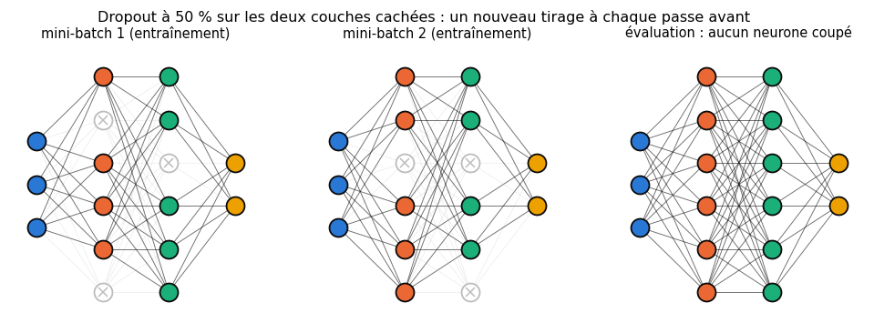
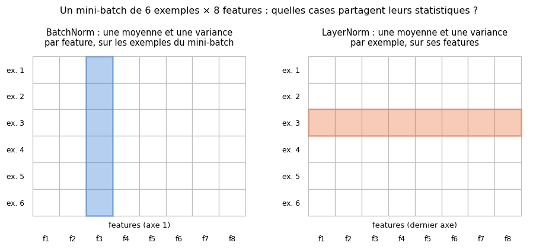
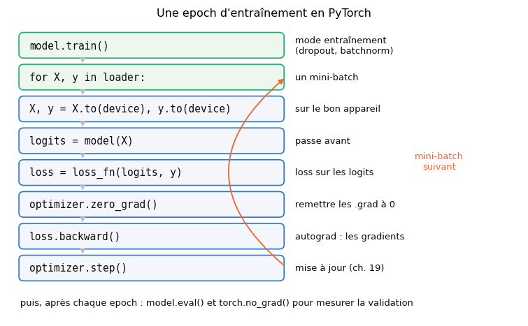

# 20 · Deep learning et premiers pas en PyTorch — fiche de cours

> Ce chapitre ouvre le volume 2. Les ch. 16 à 19 t'ont fait construire un réseau pièce par pièce, en NumPy : la passe avant, les activations, la rétropropagation, les optimiseurs. Le livre rassemble ici ces pièces sous le nom de **deep learning** : un réseau fait d'une **pile de couches**, dont il passe en revue les types les plus courants (dense, dropout, batchnorm, convolution, pooling, récurrente et couches utilitaires), avant un exemple célèbre, VGG16, des conseils pour construire son propre réseau et une réflexion sur l'explication de ses décisions. Le workbook en fait aussi ton **entrée dans PyTorch** : les tenseurs, l'autograd, `nn.Module`, `Dataset` et `DataLoader`, la boucle d'entraînement, l'appareil de calcul (*device*) et la sauvegarde, qui ne sont pas dans le livre (il passe par Keras aux ch. 23 et 24). Tu écris en NumPy, dans ta librairie, le dropout, la batchnorm, la layer norm, la pénalité L2 et l'early stopping, avant de les retrouver dans PyTorch. La fiche corrige deux descriptions du livre qui ne correspondent pas à ce que font les bibliothèques : le dropout et la batchnorm.

| | |
|---|---|
| **Livre** | vol. 2, ch. 20 « Deep Learning », p. 872-926 (§20.1 à §20.8) |
| **Temps total estimé** | ≈ 24 h : lecture du livre et de la fiche ≈ 5,2 h, exercices ≈ 18 h, 28 flashcards ≈ 0,9 h |
| **Prérequis** | 0A (classes, héritage, méthodes spéciales `__len__`, `__getitem__`, `__call__`) · ch. 2 (espérance d'une variable de Bernoulli) · ch. 9 (overfitting, early stopping, régularisation L2) · ch. 12 (standardisation) · ch. 13 (overfitting d'un arbre) · ch. 16 (couches denses, `count_parameters`) · ch. 17 (softmax, logits) · ch. 18 (rétropropagation, réseau minuscule de ✏️ 18.4) · ch. 19 (optimiseurs, AdamW, weight decay, moyenne mobile exponentielle) |
| **Fichiers du chapitre** | `02_exercices.md` (quiz, rappels, papier, réflexion, entretien) · `03_notebook.ipynb` · `04_indices.md` · `05_solutions.md` et `05_solutions.ipynb` · `06_mes_reponses.md` · `flashcards.csv` |
| **mylearn** | `nn/regularization.py` : `dropout_forward` et `dropout_backward`, `batchnorm_forward` et `batchnorm_backward` (formes `(N, D)` et `(N, C, H, W)`), `layer_norm`, `l2_penalty` et la classe `EarlyStopping` |

## Comment utiliser ce chapitre

Le livre avance en cinq temps : le vocabulaire du deep learning et des tenseurs (§20.1 et §20.2), les couches d'entrée et de sortie (§20.3), un tour d'horizon des couches (§20.4 et §20.5), des exemples, dont VGG16 (§20.6), puis la construction d'un réseau et l'interprétation de ses résultats (§20.7 et §20.8). C'est un chapitre court en équations : le livre décrit chaque couche en quelques paragraphes et un symbole de schéma. La fiche suit son plan et ajoute, pour chaque couche, son nom dans PyTorch, ses formules et ce qu'elle apprend. Elle insère après le §20.7 trois sections que le livre n'a pas : PyTorch en pratique (tenseurs, autograd, `nn.Module`, la boucle d'entraînement), la régularisation que tu programmes (L2, weight decay, early stopping), et les connexions résiduelles. Compte environ cinq heures de lecture, livre et fiche.

**Ordre conseillé.**
1. Lis le livre §20.1 à §20.3.2, puis les sections correspondantes de la fiche. Fais les quiz Q1 à Q3 et l'exercice ✏️ 20.2.
2. Lis le livre §20.4 à §20.4.4, puis les sections 20.4 à 20.4.4 de la fiche. Fais les quiz Q4 à Q6, les rappels R1 et R2, les exercices ✏️ 20.3 et 20.4 et la preuve ∂ 20.5.
3. Lis le livre §20.4.5 à §20.5, puis les sections correspondantes de la fiche. Fais les quiz Q7 à Q9 et l'exercice ✏️ 20.1.
4. Lis le livre §20.6 à §20.7.1, puis les sections de la fiche jusqu'aux connexions résiduelles. Fais les quiz Q10 et Q11, le rappel R3, les exercices ✏️ 20.6 et 20.7 et l'estimation 🧮 20.9.
5. Lis le livre §20.8 et §20.8.1, puis la fin de la fiche. Fais le quiz Q12, l'oral 🗣️ 20.10, la réflexion ⚖️ 20.11, la preuve ∂ 20.8 et la lecture 📄 20.12. Vérifie tes réponses courtes dans la partie 0 du notebook.
6. Fais le notebook dans l'ordre : tes premiers tenseurs et l'autograd, ta librairie `regularization.py`, puis une vraie boucle d'entraînement PyTorch, une chasse aux bugs, les courbes d'entraînement et de validation, un modèle pré-entraîné, la sauvegarde, et les expériences de régularisation sur Fashion-MNIST. Finis par les cinq questions d'entretien.

| Section | Quiz 🧠 et rappels 🔁 | Papier ✏️ ∂ 🧮 et réflexion | Notebook | Entretien 💼 |
|---|---|---|---|---|
| 20.1 et 20.2 Le deep learning | Q1 | 20.10 | 20.15 | |
| 20.2.1 Tenseurs | Q2 | 20.1 | 20.13 | |
| 20.3 Couches d'entrée et de sortie | Q3 | 20.2 | 20.19, 20.23 | |
| 20.4.1 et 20.4.2 Dense et activations | Q4, R2 | | 20.15, 20.18 | |
| 20.4.3 Dropout | Q5, R1, R3 | 20.3, 20.5 | 20.16, 20.24, 20.25, 20.28, 20.29 | E1, E4 |
| 20.4.4 Batchnorm | Q6 | 20.4, 20.8, 20.12 | 20.22, 20.24, 20.28, 20.29 | E2 |
| 20.4.5 à 20.4.7 Convolution, pooling, récurrentes | Q7, Q8 | 20.6 | 20.14, 20.20 | |
| 20.4.8 et 20.5 Couches utilitaires, résumé | Q9 | 20.1, 20.7 | 20.14, 20.17, 20.20, 20.21, 20.30 | E2, E5 |
| 20.6 Exemples, VGG16 | Q10 | 20.6, 20.9 | 20.18, 20.21, 20.26 | |
| 20.7 et 20.7.1 Construire un réseau | Q11 | 20.9 | 20.17, 20.19, 20.23, 20.27 à 20.31 | E3, E4, E5 |
| 20.8 et 20.8.1 Interpréter les résultats | Q12 | 20.10, 20.11 | 20.26 | |

## Objectifs d'apprentissage

À la fin du chapitre, tu sais :
- **décrire** l'architecture d'un réseau profond et **dimensionner** sa couche de sortie et sa loss selon le problème ;
- **manipuler** des tenseurs PyTorch (forme, dtype, device) et **utiliser** l'autograd ;
- **écrire** un `nn.Module`, un `Dataset` et un `DataLoader`, et une boucle d'entraînement complète (modes train et eval, device) ;
- **implémenter** le dropout, la batchnorm, la layer norm, la pénalité L2 et l'early stopping en NumPy, puis les utiliser dans PyTorch ;
- **prévoir** les formes produites par les couches usuelles (dense, convolution, pooling, récurrente, couches utilitaires) ;
- **mener** une ablation de régularisation et **interpréter** des courbes d'entraînement et de validation ;
- **discuter** l'explicabilité, la dérive des données et les biais des décisions automatisées.

## L'essentiel en 10 lignes

1. Le **deep learning** désigne les réseaux de neurones faits d'une pile de couches ; dans l'usage le plus courant, c'est une partie du machine learning. Chaque couche réutilise les résultats de la précédente : l'analyse est **hiérarchique**.
2. Un **tenseur** est un tableau de nombres à $k$ dimensions, toutes « pleines » ; sa **forme** (*shape*) donne la taille de chaque dimension. En PyTorch, un tenseur a aussi un **dtype** et un **device** (CPU ou GPU), et la première dimension est celle des exemples du mini-batch.
3. La **couche d'entrée** n'est que la mémoire des données ; la **couche de sortie** contient des neurones, et leur nombre dépend du problème : 1 pour une régression, 1 ou 2 pour un classifieur binaire, $K$ pour $K$ classes. La loss se calcule sur les **logits**.
4. Une couche **dense** (`nn.Linear`) relie chaque neurone à toutes les sorties de la couche précédente ; une activation peut être une couche à part (`nn.ReLU`).
5. Le **dropout** met à zéro chaque activation avec la probabilité $p$, **à chaque passe avant** (pas à chaque epoch, contrairement à ce que dit le livre), et multiplie les autres par $1/(1-p)$ ; en évaluation, il ne fait rien.
6. La **batchnorm** standardise chaque feature sur le mini-batch, puis applique une échelle $\gamma$ et un décalage $\beta$ **appris** ; elle garde des statistiques glissantes pour l'évaluation. La **layer norm** standardise chaque exemple sur ses features, la même chose en entraînement et en évaluation.
7. Convolution, pooling et couches récurrentes ont leurs chapitres (21 et 22) ; les couches **utilitaires** (flatten, reshape, crop, zero-padding, upsampling, bruit) changent la forme ou les valeurs d'un tenseur sans rien apprendre.
8. **VGG16** : 13 convolutions et 3 couches denses, environ 138 millions de paramètres, 1 000 classes ; aujourd'hui dépassé, mais simple à lire.
9. En PyTorch, un modèle est un `nn.Module` ; une epoch est une boucle sur les mini-batches d'un `DataLoader` : passe avant, loss, `zero_grad()`, `backward()`, `step()`. `model.train()` et `model.eval()` changent le comportement du dropout et de la batchnorm.
10. Une explication complète n'est pas forcément **satisfaisante** ; un modèle entraîné sur le passé ne voit pas que le monde change (**dérive**), et ses données peuvent porter des **biais**.

## 20.1 · Pourquoi ce chapitre ? ⏩

Le livre a posé, chapitre après chapitre, les briques d'un réseau de neurones : le neurone (ch. 10), la couche dense et son graphe (ch. 16), les activations (ch. 17), la rétropropagation (ch. 18), les optimiseurs (ch. 19). Il les assemble ici en **couches empilées** et prépare la suite du livre, où chaque grande famille de réseaux a son chapitre : convolutions (21), réseaux récurrents (22), autoencodeurs (25), GAN (27).

Le workbook profite de ce chapitre charnière pour passer à **PyTorch**. Jusqu'ici, ta librairie `mylearn` t'a fait écrire toi-même la passe avant, les gradients et la mise à jour : c'était le moyen de les comprendre. À partir d'ici, PyTorch les fait pour toi, des centaines de fois plus vite et sur GPU si tu en as un ; tu sais ce qu'il calcule, parce que tu l'as déjà calculé.

> 💼 **En entreprise** — PyTorch est le framework de deep learning le plus utilisé dans la recherche et dans une grande partie de l'industrie ; Hugging Face s'appuie surtout sur lui. Savoir écrire et déboguer une boucle d'entraînement PyTorch, avec ses modes `train` et `eval`, est attendu de tout poste de ML engineer ou de data scientist qui touche au deep learning.

## 20.2 · Le deep learning en bref ⏩

Le livre appelle **réseau profond** un réseau fait d'une pile de couches, et **deep learning** le fait d'entraîner de tels réseaux sur des données (p. 874-877). Il signale une ambiguïté de vocabulaire : pour la plupart des auteurs, le **machine learning** englobe le deep learning et les autres méthodes (les classifieurs du ch. 13, par exemple) ; pour d'autres, « machine learning » ne désigne que les méthodes **sans** réseaux de neurones. Avant de comparer deux livres ou deux offres d'emploi, vérifie dans quel sens chacun l'emploie.

Ce que la pile apporte, c'est une analyse **hiérarchique** : les premières couches travaillent sur les données brutes, les suivantes sur les résultats des précédentes, donc sur des motifs de plus en plus grands et abstraits. Sur une image, la première couche voit des pixels, une couche moyenne des groupes de pixels, une couche haute des parties d'objets, puis des objets entiers (figure 20.1).

Le livre fixe aussi le vocabulaire du schéma : les entrées en bas, les sorties en haut (même quand on dessine le réseau de gauche à droite, figure 20.2) ; une couche « plus haute » est plus proche de la sortie. Entre l'entrée et la sortie, les couches **cachées** (*hidden layers*) : on ne les voit pas « de l'extérieur », par les données ou par les prédictions.

## 20.2.1 · Les tenseurs ⏩

Le livre appelle **tenseur** (*tensor*) une liste de nombres organisée selon un nombre quelconque de dimensions, avec la même longueur dans toutes les lignes d'une même dimension (p. 878, figure 20.3) : un vecteur est un tenseur à une dimension, une matrice à deux, un « bloc » à trois. Un tenseur a un **nombre de dimensions** (*ndim*), une **taille** dans chacune, et l'ensemble des tailles forme sa **forme** (*shape*). Son **nombre d'éléments** est le produit des tailles. Le mot a un sens plus riche en mathématiques et en physique ; en deep learning, il veut seulement dire « tableau multidimensionnel ».

Ce sont les tableaux NumPy du ch. 0A. PyTorch leur ajoute deux choses : chaque tenseur vit sur un **appareil** (*device*, le CPU ou un GPU), et il peut garder la trace des calculs qui l'ont produit, pour en calculer les gradients (l'autograd, plus bas).

> 🧮 **Rappel outil — les tenseurs PyTorch** — `torch.tensor([[1.0, 2.0], [3.0, 4.0]])` crée un tenseur de forme `torch.Size([2, 2])` (`.shape`), de type `torch.float32` (`.dtype`) : c'est le type par défaut des réels dans PyTorch, alors que NumPy crée du `float64`. `torch.from_numpy(a)` convertit un tableau NumPy **sans copie** (les deux partagent la même mémoire, et le dtype `float64` est gardé) ; `.numpy()` fait l'inverse, sur CPU seulement. `x.float()`, `x.double()`, `x.long()` changent le dtype (les labels d'une classification sont des entiers `int64`) ; `x.to(device)` envoie le tenseur sur un appareil, avec `device = "cuda" if torch.cuda.is_available() else "cpu"`. Les opérations de NumPy existent presque toutes, sous le même nom ou un nom voisin : `x.reshape(...)`, `x.sum(dim=0)` (le paramètre s'appelle `dim`, pas `axis`), `x @ W`, la diffusion (*broadcasting*). `x.view(...)` remodèle sans copier, mais seulement si la mémoire s'y prête ; `x.reshape(...)` copie si besoin.

**Les conventions de forme.** Dans un réseau, la première dimension d'un tenseur est presque toujours celle des **exemples du mini-batch**. Un mini-batch de 64 vecteurs de 20 features a la forme `(64, 20)` ; un mini-batch de 64 images en couleur de 32 × 32 pixels a, dans PyTorch, la forme `(64, 3, 32, 32)` : exemples, canaux (*channels*), hauteur, largeur, l'ordre **NCHW**. Keras et TensorFlow rangent par défaut les canaux en dernier (NHWC) : en copiant un code d'une bibliothèque à l'autre, c'est une source classique d'erreurs de forme.

## 20.3 · Les couches d'entrée et de sortie

La plupart des réseaux ont une seule couche d'entrée et une seule couche de sortie, au début et à la fin de la pile (p. 879). Elles ne sont pas de même nature.

### 20.3.1 · La couche d'entrée ⏩

La **couche d'entrée** (*input layer*) ne contient pas de neurones : c'est seulement la mémoire où l'on place les données avant de les envoyer à la première couche de calcul (p. 879-880, figure 20.4). Les bibliothèques la créent pour nous ; en PyTorch, elle n'existe même pas comme objet, c'est le tenseur qu'on passe au modèle. On s'en soucie quand on veut transformer les données avant la première couche (les standardiser, les recadrer). Attention au vocabulaire : certains auteurs appellent « couche d'entrée » la première couche de neurones.

### 20.3.2 · La couche de sortie ⏩

La **couche de sortie** (*output layer*), elle, contient des neurones, et c'est nous qui fixons leur nombre selon le problème (p. 880-881) :
- une **régression** à une valeur : un neurone, dont la valeur est la prédiction ;
- un **classifieur binaire** : un neurone (sa sortie, passée dans une sigmoïde, est la probabilité d'une classe) ou deux neurones, un par classe ;
- un **classifieur à $K$ classes** : $K$ neurones, un score par classe (figure 20.5, avec les 26 lettres de l'alphabet), et la classe prédite est celle du plus grand score ; une softmax les transforme en probabilités (ch. 17).

Le livre ne dit pas ce que devient la loss ; PyTorch impose un choix précis, celui du ch. 18 : la dernière couche rend des **logits** (les scores bruts, sans softmax), et la loss fait elle-même la softmax ou la sigmoïde, de façon stable.

| Problème | Sorties | Dernière couche | Loss PyTorch | Labels attendus |
|---|---|---|---|---|
| régression (une valeur) | 1 | linéaire | `nn.MSELoss()` | réels, forme `(N, 1)` |
| binaire, un logit | 1 | linéaire | `nn.BCEWithLogitsLoss()` | 0. ou 1., réels, forme `(N, 1)` |
| $K$ classes exclusives | $K$ | linéaire | `nn.CrossEntropyLoss()` | entiers de 0 à $K - 1$, forme `(N,)` |
| plusieurs labels par exemple | $K$ | linéaire | `nn.BCEWithLogitsLoss()` | 0. ou 1. par label, forme `(N, K)` |

> ⚠️ **Piège classique — une softmax avant `CrossEntropyLoss`** — `nn.CrossEntropyLoss` attend des **logits** et applique elle-même `log_softmax` ; lui donner des probabilités (une `nn.Softmax` en dernière couche) fait une softmax de trop : l'entraînement marche encore, mais moins bien, et les gradients s'écrasent. Pour afficher des probabilités, applique `torch.softmax(logits, dim=1)` **après** le modèle, au moment de prédire.

## 20.4 · Un tour d'horizon des couches

Le livre fonde son tour d'horizon sur les couches de Keras, qu'il utilisera aux ch. 23 et 24 (p. 881-882). La plupart des couches ont des paramètres optionnels, avec des valeurs par défaut raisonnables ; beaucoup acceptent une fonction d'activation, appliquée à tous les neurones de la couche.

> 🕰️ **Mise à jour (2026) — de Keras à PyTorch** — **Le livre :** les couches de Keras (`Dense`, `Dropout`, `BatchNormalization`, `Conv2D`, `MaxPooling2D`, `Flatten`…), dans l'API de 2018, qui ne tourne plus telle quelle. · **Aujourd'hui :** Keras 3 est un framework **multi-backend** (JAX, TensorFlow ou PyTorch en dessous), toujours développé ; le workbook utilise PyTorch, où l'on écrit soi-même la boucle d'entraînement. Les couches sont les mêmes, sous d'autres noms : `Dense` ↔ `nn.Linear`, `Dropout` ↔ `nn.Dropout`, `BatchNormalization` ↔ `nn.BatchNorm1d` ou `nn.BatchNorm2d`, `Conv2D` ↔ `nn.Conv2d`, `MaxPooling2D` ↔ `nn.MaxPool2d`, `Flatten` ↔ `nn.Flatten`, `ZeroPadding2D` ↔ `nn.ZeroPad2d`, `UpSampling2D` ↔ `nn.Upsample`. · **Faut-il quand même l'apprendre ?** Oui : un schéma de couches se lit de la même façon dans toutes les bibliothèques, et un code Keras se traduit en PyTorch couche par couche. · *Source :* [Introducing Keras 3.0](https://keras.io/keras_3/), [guide de migration vers Keras 3](https://keras.io/guides/migrating_to_keras_3/), [documentation de `torch.nn`](https://docs.pytorch.org/docs/stable/nn.html)

### 20.4.1 · La couche dense ⏩

Une **couche dense** (*fully-connected layer*, FC) est un ensemble de neurones qui reçoivent chacun **toutes** les sorties de la couche précédente (p. 882-883, figure 20.6) : c'est la couche du ch. 16, $\mathbf{z} = \mathbf{x}\mathbf{W} + \mathbf{b}$. Entre une couche de $n_{in}$ neurones et une couche dense de $n_{out}$ neurones, il y a $n_{in} \times n_{out}$ connexions, donc autant de poids, plus $n_{out}$ biais. Un réseau fait seulement de couches denses est un **perceptron multicouche** (MLP).

En PyTorch, c'est `nn.Linear(n_in, n_out)`. Deux différences avec `mylearn` : sa matrice `weight` a la forme `(n_out, n_in)` (la transposée de ton `W`), et elle calcule $\mathbf{x}\mathbf{W}^\top + \mathbf{b}$ ; ses poids partent d'une loi uniforme proche de celle de He (ch. 16), et non de zéros.

### 20.4.2 · Les fonctions d'activation ⏩

On peut donner une activation à une couche, ou la placer dans une **couche d'activation** à part, juste après une couche de neurones sans activation : le résultat est le même, mais les deux étapes se voient (p. 883-884). En PyTorch, c'est la seule façon de faire : `nn.Linear` n'a pas d'activation, et l'on écrit `nn.Linear(784, 256), nn.ReLU()`. Pour un classifieur, le livre termine par une couche dense à $K$ sorties suivie d'une **softmax** (figure 20.7) ; en PyTorch, la softmax est dans la loss (20.3.2), pas dans le modèle.

### 20.4.3 · Le dropout ⏩

Toute technique qui **retarde l'overfitting** est une **régularisation** ; le livre présente le **dropout** comme l'une d'elles (p. 884-887, d'après N. Srivastava et ses coauteurs, 2014). Une couche de dropout ne contient pas de neurones : pendant l'entraînement, elle **coupe** une partie des neurones de la couche précédente, choisis au hasard, qui ne participent alors ni au calcul ni à la mise à jour (figure 20.8). Son paramètre est la proportion de neurones coupés, souvent 20 % à 50 %. En prédiction, le dropout ne fait rien.

L'idée : empêcher un neurone de se **spécialiser** sur un détail des données d'entraînement (les yeux d'un chat, dans l'exemple du livre). Puisque n'importe quel neurone peut disparaître à tout moment, les autres doivent apprendre à se passer de lui, et l'information se répartit entre plusieurs neurones : le réseau apprend des features plus robustes.

**La version qu'utilisent les bibliothèques** est le **dropout inversé** (*inverted dropout*). Pour chaque activation $a_i$, on tire un masque $m_i$ qui vaut 1 avec la probabilité $1 - p$ et 0 avec la probabilité $p$ (une variable de Bernoulli, ch. 2), puis :

$$\tilde a_i = \frac{a_i\,m_i}{1 - p}, \qquad \mathbb{E}[\tilde a_i] = \frac{a_i\,(1 - p)}{1 - p} = a_i .$$

La division par $1 - p$ garde l'**espérance** de chaque activation : la couche suivante reçoit en moyenne ce qu'elle recevrait sans dropout, et rien n'est à corriger en évaluation, où le dropout est l'identité. (L'article d'origine faisait l'inverse : rien pendant l'entraînement, et les poids multipliés par $1 - p$ au test ; ∂ 20.5 compare les deux.) Dans la passe arrière, le gradient passe par le **même** masque : $\partial L/\partial a_i = m_i/(1-p) \cdot \partial L/\partial \tilde a_i$.



> ⚠️ **Le livre, corrigé — un tirage par epoch** — Le livre tire les neurones coupés « au début de chaque epoch » et les rétablit à la fin (p. 885). Les bibliothèques, et l'article de Srivastava et coll., tirent un **nouveau masque à chaque passe avant**, donc à chaque mini-batch (et indépendamment pour chaque exemple du mini-batch) : sur une epoch de 1 000 mini-batches, chaque neurone est coupé environ $1\,000\,p$ fois, et non pas pendant toute l'epoch ou pas du tout. Le livre ne parle pas non plus du facteur $1/(1-p)$. Sa description du but, empêcher la spécialisation, reste juste.

> 🕰️ **Mise à jour (2026) — le dropout aujourd'hui** — **Le livre :** une couche qui coupe des neurones, présentée sans formule. · **Aujourd'hui :** `nn.Dropout(p)` de PyTorch met à zéro des éléments « choisis indépendamment à chaque passe avant », multiplie les autres par $1/(1-p)$ en entraînement, et calcule l'identité en évaluation (`model.eval()`). L'usage a changé : le dropout reste courant dans les couches denses des MLP et des Transformers (0,1 dans BERT, GPT-2 et T5), mais il a presque disparu des réseaux de convolution qui ont une batchnorm, et beaucoup de grands modèles de langage n'en utilisent pas pendant leur préentraînement (PaLM, 2022 : « entraîné sans dropout » ; LLaMA n'en mentionne aucun). · **Faut-il quand même l'apprendre ?** Oui : c'est une des régularisations les plus simples et une question d'entretien classique, surtout sur `model.eval()`. · *Source :* [documentation de `torch.nn.Dropout`](https://docs.pytorch.org/docs/stable/generated/torch.nn.Dropout.html), [Srivastava et coll., JMLR 2014](https://jmlr.org/papers/v15/srivastava14a.html), [Chowdhery et coll., « PaLM » (§5)](https://arxiv.org/abs/2204.02311), [Liu et coll., « Drop Dropout on Single-Epoch Language Model Pretraining » (2025)](https://arxiv.org/abs/2505.24788)

### 20.4.4 · La batchnorm ⏩

La **batchnorm** (*batch normalization*, S. Ioffe et C. Szegedy, 2015) modifie les valeurs qui sortent d'une couche de calcul (p. 887-890). Son intuition, dans le livre : s'il est bon de **standardiser** les données d'entrée (ch. 12), pourquoi ne pas standardiser aussi les valeurs à l'intérieur du réseau ? Pour chaque feature, la couche calcule la moyenne et la variance sur les exemples du **mini-batch** (d'où le « batch » du nom), puis ramène la feature à une moyenne de 0 et un écart-type de 1. Le livre la place entre une couche dense sans activation et sa ReLU (figure 20.9), et explique qu'elle garde les valeurs dans la zone où l'activation est la plus utile.

**Les formules des bibliothèques.** Pour une feature $j$ et un mini-batch de $m$ exemples, avec la moyenne $\mu_j$ et la variance **biaisée** $\sigma_j^2 = \frac1m\sum_i (x_{ij} - \mu_j)^2$ :

$$\hat x_{ij} = \frac{x_{ij} - \mu_j}{\sqrt{\sigma_j^2 + \epsilon}}, \qquad y_{ij} = \gamma_j\,\hat x_{ij} + \beta_j .$$

$\epsilon$ (`eps`, $10^{-5}$ par défaut dans PyTorch) évite une division par zéro. $\gamma_j$ et $\beta_j$ sont des **paramètres appris** par la rétropropagation, comme des poids : ils rendent au réseau la liberté de choisir l'échelle et la moyenne de chaque feature (avec $\gamma_j = \sigma_j$ et $\beta_j = \mu_j$, il peut même annuler la normalisation). Une couche de 64 features a donc 128 paramètres. Pour des images, `nn.BatchNorm2d` normalise **chaque canal** sur les exemples **et** sur tous les pixels : les statistiques portent sur tous les axes sauf celui des canaux.

**Entraînement et évaluation.** En évaluation, on ne veut pas que la prédiction d'une image dépende des autres images du mini-batch (ni qu'il faille un mini-batch). La couche tient donc à jour, pendant l'entraînement, une **moyenne mobile exponentielle** (ch. 19) des statistiques de chaque feature :

$$\mu^{\text{run}} \leftarrow (1 - m)\,\mu^{\text{run}} + m\,\mu_j, \qquad \sigma^{2,\text{run}} \leftarrow (1 - m)\,\sigma^{2,\text{run}} + m\,\tfrac{n}{n-1}\,\sigma_j^2,$$

où $m$ est le `momentum` de PyTorch (0,1 par défaut ; rien à voir avec le momentum des optimiseurs) et $n$ le nombre de valeurs par feature ; la variance glissante utilise la version **non biaisée** (le facteur $\frac{n}{n-1}$). En évaluation, la couche normalise avec ces statistiques glissantes, fixes. C'est pourquoi `model.train()` et `model.eval()` changent le comportement d'un réseau qui contient une batchnorm, et pourquoi la batchnorm refuse, en entraînement, un mini-batch d'un seul exemple (sa variance serait nulle).

> 🧮 **Rappel maths — variance biaisée et non biaisée** — Sur $n$ valeurs, la variance « de la population » divise la somme des carrés des écarts par $n$ ; la variance « de l'échantillon » divise par $n - 1$, ce qui la rend non biaisée comme estimation de la variance d'où viennent les valeurs (ch. 2). NumPy choisit $n$ par défaut (`np.var(x)`, `ddof=0`), PyTorch $n - 1$ (`torch.var(x)`, `correction=1`). La batchnorm de PyTorch utilise les deux : $n$ pour normaliser le mini-batch, $n - 1$ pour la statistique glissante. Sur $n = 4$ valeurs, l'écart entre les deux est un facteur $\frac43$ ; il disparaît quand $n$ grandit.

> ⚠️ **Le livre, corrigé — une couche « sans paramètres », qui « régularise »** — Le livre dit que la batchnorm calcule sans avoir « aucun paramètre » ni rien à régler (p. 887). Elle a deux vecteurs de **paramètres appris**, $\gamma$ et $\beta$, et deux vecteurs de **statistiques glissantes**, plus deux réglages (`momentum` et `eps`). Il la justifie ensuite comme une régularisation, en rapprochant « garder les valeurs petites » de la régularisation du ch. 9 : son effet régularisant existe (les statistiques d'un mini-batch ajoutent du bruit), mais il est faible ; son intérêt principal est de **faciliter l'optimisation** : elle permet des learning rates plus grands et un entraînement plus rapide (encadré suivant). Enfin, l'exemple de la division par 2 (p. 887-888) ne dit pas ce que fait la batchnorm : elle ne divise pas toutes les sorties par un même nombre, elle standardise **chaque feature** avec ses propres statistiques.

> 🕰️ **Mise à jour (2026) — la batchnorm et ses cousines** — **Le livre :** une normalisation sans paramètres, qui régularise. · **Aujourd'hui :** `nn.BatchNorm1d` et `nn.BatchNorm2d` ont $\gamma$ et $\beta$ (`affine=True`), des statistiques glissantes (`track_running_stats=True`, `momentum=0.1`, variance glissante non biaisée) et se comportent différemment en `train()` et en `eval()`. L'explication d'origine, réduire le « décalage de covariables interne », a été contestée : S. Santurkar et ses coauteurs (2018) montrent que la stabilité des distributions y est pour peu, et que la batchnorm rend le paysage de la loss plus **lisse** et ses gradients plus prévisibles. Les Transformers lui préfèrent la **layer norm** (J. Ba et coll., 2016), indépendante du mini-batch (section 20.4.8), ou sa version simplifiée **RMSNorm** (B. Zhang et R. Sennrich, 2019), utilisée par LLaMA et disponible dans PyTorch (`nn.RMSNorm`). · **Faut-il quand même l'apprendre ?** Oui : la batchnorm reste au cœur des réseaux de convolution (ResNet), et la différence avec la layer norm est une question d'entretien fréquente. · *Source :* [documentation de `torch.nn.BatchNorm1d`](https://docs.pytorch.org/docs/stable/generated/torch.nn.BatchNorm1d.html), [Ioffe et Szegedy, ICML 2015](https://arxiv.org/abs/1502.03167), [Santurkar et coll., NeurIPS 2018](https://arxiv.org/abs/1805.11604), [Zhang et Sennrich, NeurIPS 2019](https://arxiv.org/abs/1910.07467)

> ⚠️ **Piège classique — le momentum de Keras** — Keras a aussi un `momentum` de batchnorm, mais dans l'autre sens : `BatchNormalization(momentum=0.99)` garde 99 % de l'ancienne statistique, comme `nn.BatchNorm1d(momentum=0.01)` de PyTorch. En traduisant un code, convertis $m \leftrightarrow 1 - m$.

## 20.4.5 · La convolution (aperçu)

Le livre ne fait qu'esquisser la **convolution**, qui a son chapitre (21) (p. 890-892). Sur une image, on fait glisser une petite image, le **filtre** (*filter*, ou noyau, *kernel*), de 3 × 3 pixels par exemple ; en chaque position, on multiplie les valeurs du filtre par celles des pixels qu'il recouvre et l'on additionne : c'est la valeur d'un pixel de l'image de sortie. Chaque filtre produit sa propre image de sortie, et cherche un motif (un bord, une texture) **partout** dans l'image (figure 20.10). Quand le filtre déborde de l'image, le livre complète par des 0 : c'est le **zero-padding**, qui permet de garder la taille de l'image.

Le compte qui servira : un filtre $k \times k$ sur une entrée à $C_{in}$ canaux a $k^2 C_{in}$ poids, plus un biais ; une couche de $C_{out}$ filtres a donc $(k^2 C_{in} + 1)\,C_{out}$ paramètres, **quelle que soit la taille de l'image**. Par exemple, 32 filtres 5 × 5 sur une image en couleur ($C_{in} = 3$) : $(25 \times 3 + 1) \times 32 = 2\,432$ paramètres. En PyTorch : `nn.Conv2d(C_in, C_out, kernel_size=k, padding=...)`.

## 20.4.6 · Le pooling (aperçu)

Une couche de **pooling** réduit la taille d'une image (p. 892-894, figure 20.11) : on la découpe en petits blocs, de 2 × 2 par exemple, et l'on garde de chaque bloc soit la **plus grande** valeur (*max pooling*), soit la **moyenne** (*average pooling*). Avec des blocs $k \times k$ qui ne se recouvrent pas (un pas de $k$), une image $H \times W$ devient $\lfloor H/k \rfloor \times \lfloor W/k \rfloor$ : un bloc incomplet au bord est perdu. Le pooling n'apprend rien. En PyTorch : `nn.MaxPool2d(k)` et `nn.AvgPool2d(k)`.

> 🕰️ **Mise à jour (2026) — le pooling** — **Le livre :** un pooling « en perte de vitesse », que remplacent des convolutions qui réduisent elles-mêmes l'image. · **Aujourd'hui :** c'est encore plus net : beaucoup d'architectures réduisent l'image par des **convolutions à pas** (*strided convolutions*, ch. 21), et terminent par un **pooling moyen global** (*global average pooling*), qui résume chaque canal par une seule valeur avant la couche dense de sortie (ResNet, ConvNeXt). Le max pooling survit, par exemple au tout début de ResNet. · **Faut-il quand même l'apprendre ?** Oui : il apparaît dans des milliers de modèles et d'articles, et le pooling moyen global en est une forme. · *Source :* [documentation de `torchvision.models`](https://docs.pytorch.org/vision/stable/models.html), [He et coll., « Deep Residual Learning for Image Recognition »](https://arxiv.org/abs/1512.03385), [Liu et coll., « A ConvNet for the 2020s »](https://arxiv.org/abs/2201.03545)

## 20.4.7 · Les couches récurrentes (aperçu)

Beaucoup de données sont des **séquences** : des cours de bourse, des notes de musique, des mots (p. 894-896). Une couche dense n'a pas de **mémoire** : elle traite chaque entrée sans savoir ce qui précédait. Une **cellule récurrente** (*recurrent cell*) en a une : elle garde un état qu'elle met à jour à chaque élément de la séquence, et un réseau qui en contient est un **réseau récurrent** (RNN, ch. 22, figure 20.12). Le livre insiste sur un faux ami : la **récurrence** (répéter la même opération à chaque pas de temps) n'a rien à voir avec la **récursion** (une fonction qui s'appelle elle-même).

> 🔗 **Lien avec le ch. 22 et le bonus B3** — Les réseaux récurrents ont dominé le traitement du langage jusqu'en 2017 ; les **Transformers**, fondés sur l'attention, les ont remplacés pour le texte (bonus B3), et les RNN restent utiles sur des séries temporelles légères (ch. 22).

## 20.4.8 · Les autres couches utilitaires ⏩

Le livre range sous le nom de **couches utilitaires** des transformations sans neurones, que l'on empile comme des couches par commodité (p. 896-897) :
- une couche de **normalisation**, comme la batchnorm ;
- une couche de **bruit** (*noise*), qui ajoute des valeurs aléatoires aux données qui la traversent, pendant l'entraînement seulement : encore une régularisation ;
- une couche de **remodelage** (*reshape*), qui change la forme d'un tenseur sans changer ses valeurs ni leur nombre ; un **aplatissement** (*flatten*) en est un cas particulier, qui met tout un tenseur à plat, par exemple à la sortie des convolutions, avant les couches denses ;
- un **recadrage** (*cropping*), qui garde un rectangle de l'image et jette le bord ;
- un **zero-padding**, qui ajoute autour de l'image (ou du volume) une bordure de zéros, de l'épaisseur voulue ;
- un **suréchantillonnage** (*upsampling*), l'inverse du pooling : il agrandit le tenseur, en général en répétant chaque élément.

| Couche (livre) | En PyTorch | Paramètres appris | Effet sur la forme |
|---|---|---|---|
| flatten | `nn.Flatten()` (garde la dimension des exemples : `start_dim=1`) | non | tout sauf l'axe 0 mis à plat |
| reshape | `x.reshape(...)`, `nn.Unflatten` | non | au choix, même nombre d'éléments |
| cropping | une tranche `x[..., a:b, c:d]`, `torchvision.transforms.CenterCrop` | non | plus petite |
| zero-padding | `nn.ZeroPad2d(k)` | non | plus grande, d'une bordure de `k` |
| upsampling | `nn.Upsample(scale_factor=s)` (par défaut, `mode="nearest"` : la répétition) | non | multipliée par `s` |
| bruit | aucune couche toute faite : `x + sigma * torch.randn_like(x)` dans `forward`, si `self.training` | non | inchangée |
| batchnorm, layer norm | `nn.BatchNorm1d`, `nn.LayerNorm` | oui ($\gamma$, $\beta$) | inchangée |

> ⚠️ **Piège classique — `torch.flatten` et `nn.Flatten`** — La fonction `torch.flatten(x)` met **tout** à plat, la dimension des exemples comprise ; la couche `nn.Flatten()` garde la première dimension (`start_dim=1`). Dans un modèle, c'est presque toujours la seconde qu'il faut : sinon, le mini-batch entier devient un seul vecteur, et la couche dense suivante plante (ou, pire, ne plante pas).

**La layer norm.** Parmi les couches de normalisation, celle que le livre ne cite pas est devenue la plus utilisée : la **layer norm** (*layer normalization*, J. Ba, J. Kiros et G. Hinton, 2016). Elle applique la même formule que la batchnorm, mais calcule la moyenne et la variance **sur les features de chaque exemple**, et non sur les exemples de chaque feature :

$$\hat x_{ij} = \frac{x_{ij} - \mu_i}{\sqrt{\sigma_i^2 + \epsilon}}, \qquad \mu_i = \frac1D\sum_j x_{ij},\quad \sigma_i^2 = \frac1D\sum_j (x_{ij} - \mu_i)^2, \qquad y_{ij} = \gamma_j\,\hat x_{ij} + \beta_j .$$

Chaque exemple est normalisé seul : la couche ne dépend pas des autres exemples du mini-batch, n'a pas de statistiques glissantes, et fait **le même calcul en entraînement et en évaluation**, même sur un seul exemple. C'est la normalisation des Transformers et des réseaux récurrents. En PyTorch : `nn.LayerNorm(D)`.



## 20.5 · Le résumé des couches ⏩

Le livre rassemble ses symboles de schéma en une seule figure (p. 898, figure 20.13) et montre l'effet de quelques couches utilitaires sur un petit tenseur (figure 20.14) : prends le temps de la lire, 🔮 20.14 te fera prédire ces effets dans PyTorch. Le workbook ne reprend pas ces symboles ; il décrit un réseau par la liste de ses couches, comme le fait PyTorch quand on affiche un modèle (`print(model)`).

Une règle à retenir de ce résumé : seules les couches de **calcul** (dense, convolution, récurrente) et les **normalisations** ont des paramètres appris ; le dropout, le pooling, les activations et les couches utilitaires n'en ont pas, et ne changent rien au nombre de paramètres d'un réseau.

## 20.6 · Quelques exemples ⏩

Construire un réseau avec une bibliothèque, c'est souvent nommer ses couches dans l'ordre, avec leurs paramètres (p. 899-909). Le livre commence par deux réseaux denses à ReLU, 2-2-2 (figure 20.15) et 2-4-3-2 (figure 20.16), que 📦 20.18 te fera écrire en PyTorch.

Puis il passe à un réseau célèbre, **VGG16** (K. Simonyan et A. Zisserman, 2014), présenté au concours ILSVRC 2014 de classification d'images d'ImageNet : 13 couches de convolution 3 × 3 regroupées en 5 blocs, chacun suivi d'un max pooling 2 × 2 qui divise la largeur et la hauteur par 2, puis un aplatissement et 3 couches denses, dont les deux premières suivies de dropout, et une softmax sur **1 000 classes** (figure 20.17). Ses 16 couches de calcul lui donnent son nom, et environ **138 millions** de paramètres (✏️ 20.6 te les fait compter). Le livre souligne sa simplicité : l'architecture tient sur une figure, sans astuce cachée ; ce sont ses poids, longs à apprendre, qui ont de la valeur (« le plan d'un palais, et les joyaux qu'il contient »).

Le livre montre ensuite les prédictions de VGG16 sur des photos qu'il n'a jamais vues : il reconnaît très bien un ours brun, des chiens, un canard, des bananes (figures 20.18 à 20.20). Puis il lui donne des objets **hors** de ses 1 000 classes (un modèle de dinosaure, une truelle, une pomme de pin, des taches d'encre…) : le réseau ne peut répondre qu'avec ses 1 000 noms, et le livre commente ses scores (figures 20.21 à 20.23). 🔮 20.26 te fera prédire ce que fait un modèle moderne dans cette situation, avant de le mesurer : lis donc ces figures avec attention.

> ⚠️ **Le livre, corrigé — les 92,7 % de VGG16** — Le livre écrit que VGG16 a fait 7,3 % d'erreur à ILSVRC 2014, « c'est-à-dire qu'il a donné la bonne réponse 92,7 % du temps » (p. 902). C'est une erreur **top-5** : la bonne classe figurait parmi les 5 classes les plus probables 92,7 % du temps (et l'équipe VGG a fini 2ᵉ du classement de classification, derrière GoogLeNet, 6,67 %). Sa réponse la plus probable, le top-1, n'est juste qu'environ 7 fois sur 10 : 71,6 % pour les poids de VGG16 fournis par torchvision.

> 🕰️ **Mise à jour (2026) — VGG16 et ses successeurs** — **Le livre :** VGG16 comme exemple phare d'un réseau profond. · **Aujourd'hui :** VGG16 est dépassé, en précision comme en coût : ses poids pèsent 528 Mo et il fait 71,6 % top-1 sur ImageNet (torchvision), quand **ResNet-18** fait 69,8 % avec 45 Mo, **MobileNet V3 Small** 67,7 % avec 10 Mo, et des modèles plus récents (EfficientNet, ConvNeXt, les Vision Transformers) dépassent 85 %. Les connexions résiduelles (section plus bas), absentes de VGG16, sont partout. On télécharge ces modèles **pré-entraînés** avec leurs poids (`torchvision.models.resnet18(weights="DEFAULT")`) et on les adapte à son problème (bonus B1). · **Faut-il quand même l'apprendre ?** Oui pour l'architecture, la plus lisible de toutes, qui reste une référence pédagogique ; le notebook la construit sans ses poids (🎨 20.21) et utilise un petit modèle moderne pour prédire (🔮 20.26). · *Source :* [documentation de `torchvision.models.vgg16`](https://docs.pytorch.org/vision/stable/models/generated/torchvision.models.vgg16.html), [`resnet18`](https://docs.pytorch.org/vision/stable/models/generated/torchvision.models.resnet18.html), [`mobilenet_v3_small`](https://docs.pytorch.org/vision/stable/models/generated/torchvision.models.mobilenet_v3_small.html), [Szegedy et coll., « Going Deeper with Convolutions » (tableau 2)](https://arxiv.org/abs/1409.4842)

## 20.7 · Construire un réseau profond ⏩

Le livre décrit la démarche (p. 910-912), qui ne surprendra pas un lecteur des ch. 8, 12 et 15 :
1. **regarder les données** : leur nombre, leurs features, leurs plages, leurs valeurs aberrantes, des graphiques et des statistiques ;
2. **les préparer** : one-hot pour les catégories, éventuellement une PCA, et presque toujours une **standardisation** (ch. 12) ;
3. **choisir l'architecture** : la suite des couches, en s'aidant de l'expérience et de petits essais sur un sous-ensemble des données ;
4. **régler les paramètres des couches**, puis les **hyperparamètres** de l'ensemble, dont le plus important est le **learning rate** ;
5. **entraîner et évaluer**, puis, presque toujours, recommencer : essayer, mesurer, ajuster.

Il n'existe pas de recette garantie : on s'inspire des architectures publiées pour des problèmes voisins, des compétitions (Kaggle, le prix Netflix) et des poids partagés par d'autres. Une précision sur le vocabulaire : un **modèle**, c'est l'architecture **et** ses poids appris ; c'est une représentation utile de ce qu'on veut apprendre, pas la chose elle-même.

> ⚠️ **Le livre, corrigé — des renvois** — Le livre renvoie au « chapitre 8 » pour le learning rate (p. 911) : il est traité au ch. 18 (§18.11) et au ch. 19. Il écrit aussi que l'évaluation se fait « sur les données de test » : pendant les essais, c'est sur la **validation** qu'on juge (ch. 8), et le test ne sert qu'une fois, à la fin.

## Au-delà du livre : PyTorch en pratique

Le livre ne montre pas de code dans ce chapitre. Voici les cinq objets PyTorch que le notebook te fait écrire, dans l'ordre où tu en auras besoin ; chacun remplace une pièce de ta librairie.

**1. L'autograd.** Un tenseur créé avec `requires_grad=True` est une **feuille** du graphe de calcul : chaque opération faite avec lui est enregistrée, comme les `Value` de ton micro-autograd (ch. 18). `loss.backward()` remonte le graphe et **ajoute** à `w.grad` le gradient de `loss` par rapport à chaque feuille `w`. Ajoute : deux `backward()` de suite additionnent les gradients, d'où le `optimizer.zero_grad()` avant chaque passe arrière. `with torch.no_grad():` désactive l'enregistrement (pour mesurer, ou pour modifier des poids à la main), et `t.detach()` donne une version du tenseur sortie du graphe.

**2. `nn.Module`.** Un modèle est une classe qui hérite de `nn.Module` (0A, héritage). Son `__init__` appelle `super().__init__()`, puis crée ses couches comme **attributs** ; sa méthode `forward(x)` décrit la passe avant. On appelle `model(x)`, jamais `model.forward(x)` : `__call__` fait des choses en plus (les crochets, *hooks*). Toute couche rangée en attribut est enregistrée : `model.parameters()` les parcourt toutes (c'est ce qu'on donne à l'optimiseur), `sum(p.numel() for p in model.parameters())` compte les paramètres. Pour une simple pile, `nn.Sequential(nn.Linear(784, 128), nn.ReLU(), nn.Linear(128, 10))` suffit.

```python
class MLP(nn.Module):
    def __init__(self, n_in, n_hidden, n_out, p=0.2):
        super().__init__()
        self.hidden = nn.Linear(n_in, n_hidden)
        self.drop = nn.Dropout(p)
        self.out = nn.Linear(n_hidden, n_out)

    def forward(self, x):
        return self.out(self.drop(torch.relu(self.hidden(x))))   # the logits
```

**3. `Dataset` et `DataLoader`.** Un `Dataset` est un objet qui sait sa longueur (`__len__`) et rend l'exemple numéro `i` (`__getitem__`), sous la forme d'un couple `(x, y)` ; `TensorDataset(X, y)` en fait un à partir de deux tenseurs. Un `DataLoader(dataset, batch_size=64, shuffle=True)` le découpe en mini-batches, mélangés à chaque epoch : c'est ton `iterate_minibatches` du ch. 8, en plus général (il empile les exemples, peut charger en parallèle, et prend un générateur pour un mélange reproductible).

**4. La boucle d'entraînement.** Une epoch, c'est une boucle sur les mini-batches ; chaque mini-batch fait cinq gestes, toujours dans le même ordre : la passe avant, la loss, `optimizer.zero_grad()`, `loss.backward()`, `optimizer.step()`. Avant la boucle, `model.train()` ; pour mesurer la validation, `model.eval()` et `torch.no_grad()`, puis `model.train()` de nouveau. Le modèle et les données doivent être sur le **même appareil** : `model.to(device)` une fois, `X.to(device)` à chaque mini-batch. La boucle n'est pas cachée dans une méthode `fit` : c'est voulu, on y met ce qu'on veut (un planning, du clipping, des mesures).



**5. Sauvegarder.** `model.state_dict()` est un dictionnaire de tous les paramètres **et** des buffers (les statistiques glissantes d'une batchnorm) ; on le sauvegarde avec `torch.save(model.state_dict(), "model.pt")` et on le recharge dans un modèle de même architecture avec `model.load_state_dict(torch.load("model.pt"))`. Pour reprendre un entraînement, il faut aussi l'état de l'**optimiseur** (ses moyennes mobiles, ch. 19), l'epoch et, idéalement, l'état des générateurs aléatoires : c'est un **checkpoint**. Depuis PyTorch 2.6, `torch.load` ne lit par défaut que des tenseurs et des types simples (`weights_only=True`), par sécurité : un fichier `.pt` peut contenir du code Python.

> 🧮 **Rappel outil — la reproductibilité** — `torch.manual_seed(42)` fixe le générateur de PyTorch (sur CPU et GPU) ; `wb.setup(seed=42)` le fait avec ceux de NumPy et de Python. Un `DataLoader(..., shuffle=True, generator=torch.Generator().manual_seed(0))` mélange toujours dans le même ordre. Sur CPU, deux exécutions avec les mêmes graines donnent les mêmes nombres ; sur GPU, certaines opérations ne sont pas déterministes, sauf avec `torch.use_deterministic_algorithms(True)`, qui les remplace (ou refuse de les exécuter). Note toujours les graines, les versions et l'appareil dans le compte rendu d'une expérience.

> ⚠️ **Piège classique — oublier `model.eval()`** — Sans `model.eval()`, la validation est mesurée avec le dropout **actif** (des prédictions bruitées, une accuracy plus basse) et une batchnorm qui normalise avec les statistiques du mini-batch de validation, et **les met à jour** : la validation modifie le modèle. Sans `model.train()` ensuite, l'entraînement continue sans dropout. 📈 20.25 et 🐛 20.24 te feront reconnaître ces symptômes.

## 20.7.1 · Par où commencer ? ⏩

Les premières questions sont toujours les mêmes : combien de couches, combien de neurones par couche (p. 912-913) ? On cherche un réseau assez puissant pour apprendre ce qu'il faut, sans l'être trop, ce qui mène à l'overfitting et fait perdre du temps. Le livre rappelle aussi les noms usuels : un réseau fait surtout de couches denses est un **MLP**, surtout de convolutions un **CNN** (*convnet*), surtout de couches récurrentes un **RNN**.

Une démarche pratique, qui complète le livre : commencer **petit** et faire d'abord overfitter le réseau sur quelques centaines d'exemples (s'il n'y arrive pas, il y a un bug ou un learning rate mal réglé, ch. 18), puis grossir jusqu'à ce que l'erreur d'entraînement soit assez basse, et seulement ensuite régulariser pour faire baisser l'erreur de validation.

## Au-delà du livre : régulariser un réseau

Le ch. 9 a présenté trois façons de lutter contre l'overfitting d'un modèle linéaire ; elles se retrouvent toutes dans un réseau, avec le dropout et la batchnorm.

**La pénalité L2 et le weight decay.** Ajouter à la loss la pénalité $\frac{\lambda}{2}\sum \lVert\mathbf{W}\rVert^2$ ajoute $\lambda\mathbf{W}$ au gradient de chaque matrice de poids : avec SGD, c'est exactement le `weight_decay=λ` de `torch.optim.SGD` (ch. 19), qui rétrécit les poids à chaque pas. On ne pénalise d'habitude que les matrices de poids, pas les biais ni les $\gamma$, $\beta$ des normalisations. Avec Adam, la pénalité et le weight decay ne coïncident plus : c'est AdamW (ch. 19).

> ⚠️ **Piège classique — le facteur 1/2 et les conventions** — Ta fonction `l2_penalty` utilise $\frac{\lambda}{2}\sum w^2$, dont le gradient est $\lambda w$, la convention de PyTorch ; le `Ridge` de scikit-learn (ch. 9) pénalise $\alpha\lVert\mathbf{w}\rVert^2$, sans le $\frac12$, et l'`alpha` de `MLPClassifier` (ch. 19) est encore divisé par la taille du mini-batch. Avant de comparer deux valeurs de régularisation, vérifie la convention de chaque bibliothèque.

**L'early stopping.** On mesure la loss de validation après chaque epoch, on garde les poids de la meilleure epoch, et l'on s'arrête quand elle ne s'est pas améliorée pendant `patience` epochs (ch. 9) : c'est ta classe `EarlyStopping`. Avec PyTorch, on sauvegarde `model.state_dict()` à chaque amélioration (son attribut `improved_` te le dit), et on le recharge à la fin.

**L'ablation.** Pour savoir ce qu'apporte chaque technique, on mène une **ablation** : on part d'une configuration complète et l'on retire une technique à la fois (ou l'on part de rien et l'on en ajoute une à la fois), toutes choses égales par ailleurs, en comparant les courbes de validation. 🔬 20.29 t'en fera mener une sur Fashion-MNIST.

## Au-delà du livre : les connexions résiduelles

Le livre paraît en 2018, à peine deux ans après l'invention qui a rendu possibles les réseaux de centaines de couches : la **connexion résiduelle** (*residual connection*, K. He et ses coauteurs, ResNet, 2015 ; CVPR 2016). Au lieu de calculer $\mathbf{y} = F(\mathbf{x})$, un bloc résiduel calcule

$$\mathbf{y} = \mathbf{x} + F(\mathbf{x}),$$

où $F$ est un petit groupe de couches (deux couches denses ou deux convolutions, avec leurs normalisations et leurs activations). Le bloc n'a plus à apprendre la transformation entière, seulement sa **correction** (le « résidu ») ; et s'il n'a rien d'utile à faire, il lui suffit d'apprendre $F \approx 0$ pour laisser passer $\mathbf{x}$.

L'effet décisif est sur le gradient. Par la règle de la chaîne (ch. 18), $\frac{\partial \mathbf{y}}{\partial \mathbf{x}} = I + \frac{\partial F}{\partial \mathbf{x}}$ : le gradient qui remonte d'une couche à la précédente garde toujours une **voie directe**, le $I$, même quand la dérivée de $F$ est petite. Sans elle, le gradient qui traverse $L$ couches est un produit de $L$ facteurs, qui peut s'effondrer (ou exploser) très vite avec $L$ ; avec elle, chaque facteur reste proche de 1 tant que $F$ est petite. ✏️ 20.7 te fait chiffrer cet écart, et 🔬 20.30 le mesurer sur un réseau de 30 couches. On combine presque toujours la connexion résiduelle avec une normalisation (batchnorm dans ResNet, layer norm dans les Transformers).


> 🕰️ **Mise à jour (2026) — les connexions résiduelles** — **Le livre :** absentes. · **Aujourd'hui :** elles sont dans presque toutes les architectures profondes : ResNet et ses successeurs en vision, et chaque bloc d'un Transformer (une pour l'attention, une pour la partie dense), donc chaque grand modèle de langage. · **Faut-il quand même l'apprendre ?** C'est indispensable : sans elles, un réseau de plus d'une vingtaine de couches s'entraîne mal, et elles reviennent dans les ch. 21, 22 et le bonus B3. · *Source :* [He et coll., « Deep Residual Learning for Image Recognition »](https://arxiv.org/abs/1512.03385), [Vaswani et coll., « Attention Is All You Need »](https://arxiv.org/abs/1706.03762)

## 20.8 · Interpréter les résultats ⏩

Peut-on expliquer pourquoi un réseau prend une décision ? Le livre développe une analogie, celle d'une demande de prêt (p. 913-920). Un prêteur qui connaît l'emprunteur peut toujours dire pourquoi il refuse. Une banque qui standardise ses décisions établit un **score** : chaque élément du dossier ajoute ou retire des points, et un score positif accorde le prêt ; c'est un perceptron (figure 20.24). La banque grandit : cinq agents évaluent chacun le dossier à leur manière, et un directeur pondère leurs avis (un réseau à deux couches, figure 20.25) ; puis des superviseurs s'intercalent entre les agents et le directeur (trois couches, figure 20.26). Les superviseurs ne voient plus le dossier, seulement les avis des agents ; le directeur, seulement ceux des superviseurs. Chaque couche cherche des régularités dans les décisions de la précédente : c'est l'**apprentissage hiérarchique** de la section 20.2. Le système peut devenir très précis ; mais plus il a de couches, plus il est difficile de dire **pourquoi** il a refusé un dossier.

## 20.8.1 · Une explication satisfaisante ⏩

Supposons que la banque montre **tous** ses calculs, neurone par neurone : le système est entièrement transparent ; on parle d'**explicabilité** (*explainability*), et, quand on ne peut rien expliquer, de **boîte noire** (*black box*) (p. 920-923). Mais une telle explication peut être inutile : « les gens qui portent des chaussettes bleues et viennent un mercredi après-midi remboursent mal » est peut-être vrai statistiquement, et parfaitement inacceptable comme raison. Le livre distingue donc une explication **complète** d'une explication **satisfaisante** : celle-ci dit quels facteurs ont compté, écarte ou justifie ceux qui ne devraient pas compter, et indique ce que la personne pourrait changer pour obtenir le prêt la prochaine fois.

Il signale deux autres dangers des décisions apprises sur des statistiques :
- la **dérive** (*drift*) : un modèle entraîné il y a trois ans, dans une autre économie, ne voit pas que le monde a changé ; pire, en refusant les dossiers qu'il juge risqués, la banque n'observe jamais s'ils auraient remboursé, et ne peut pas corriger ses règles : on ne voit que les résultats des prêts qu'on a accordés (un **biais de sélection**) ;
- les **biais** : des données d'entraînement non représentatives, ou qui reflètent des discriminations passées, produisent des décisions systématiquement injustes pour certains groupes, d'autant plus graves que les décisions touchent des personnes.

> 🔗 **Lien avec le bonus B6** — Les méthodes d'explication modernes ont des noms : **SHAP** et **LIME** attribuent à chaque feature sa part d'une prédiction ; **Grad-CAM** montre quelles régions d'une image ont pesé dans la décision d'un CNN ; les **explications contrefactuelles** (S. Wachter et coll., 2017) répondent exactement à la demande du livre : « que faudrait-il changer pour obtenir le prêt ? ». Le bonus B6 te les fera utiliser, avec des mesures d'équité.

> 🕰️ **Mise à jour (2026) — explicabilité et régulation** — **Le livre :** l'explicabilité est difficile, les techniques progressent, il faut rester vigilant. · **Aujourd'hui :** le droit s'en est saisi en Europe. Le RGPD (art. 22) donne le droit de ne pas faire l'objet d'une décision **fondée exclusivement** sur un traitement automatisé qui produit des effets juridiques ou significatifs, et la Cour de justice de l'Union européenne a jugé, dans l'arrêt SCHUFA (C-634/21, 7 décembre 2023), qu'un score de crédit calculé automatiquement peut être une telle décision quand le prêteur s'y fie de façon déterminante. Le règlement européen sur l'IA (AI Act, règlement 2024/1689) classe les systèmes qui évaluent la **solvabilité** ou le score de crédit des personnes parmi les systèmes **à haut risque** (annexe III), avec des obligations de gestion des risques, de qualité des données, de documentation et de contrôle humain ; il donne aux personnes concernées un droit à des « explications claires et pertinentes » (art. 86). Le règlement « omnibus numérique » (2026/1744) a repoussé l'application de ces obligations au 2 décembre 2027. · **Faut-il quand même l'apprendre ?** Oui : un data scientist qui travaille sur le crédit, l'assurance, l'emploi ou la santé doit savoir expliquer et documenter un modèle, et en mesurer les biais. · *Source :* [règlement (UE) 2024/1689 (EUR-Lex)](https://eur-lex.europa.eu/eli/reg/2024/1689/oj), [considérant 58 de l'AI Act](https://artificialintelligenceact.eu/recital/58/), [CJUE, C-634/21, SCHUFA Holding](https://curia.europa.eu/juris/liste.jsf?num=C-634/21), [ActuIA, « AI Act : les reports de l'omnibus 2026/1744 »](https://www.actuia.com/en/news/ai-act-obligations-in-force-and-delays-under-omnibus-2026-1744/)

> ⚠️ **Le livre, corrigé — des exemples à manier avec précaution** — Pour montrer les dégâts de données biaisées, le livre cite deux études qui prétendaient déduire la criminalité ou l'orientation sexuelle d'une photo de visage (p. 923). Ces travaux ont été vivement critiqués, sur leur méthode comme sur leur principe (l'article d'Agüera y Arcas et coll. que le livre cite juste après en est une réfutation) : ils illustrent ce qu'il ne faut pas faire, pas une capacité des réseaux.

> 💼 **En entreprise** — Dans un domaine régulé, on garde une trace de tout : la version des données, le code, les hyperparamètres, les graines, les métriques par sous-groupe, et une fiche du modèle (*model card*, M. Mitchell et coll., 2019) qui dit pour quoi il a été conçu, sur quelles données, et où il ne faut pas l'utiliser. On surveille la dérive en production, en comparant la distribution des entrées et des prédictions à celle de l'entraînement.

## Les pièges classiques ⚠️ (récapitulatif)

| Piège | Exemple | Ce qu'il faut faire |
|---|---|---|
| Une softmax avant la loss | `nn.Softmax()` en dernière couche avec `nn.CrossEntropyLoss` | rendre des logits ; la loss fait la softmax |
| De mauvais labels pour la loss | des labels one-hot `float` pour `CrossEntropyLoss`, ou des entiers pour `BCEWithLogitsLoss` | entiers `int64` de forme `(N,)` pour l'une, réels de la forme des logits pour l'autre |
| Oublier `model.eval()` | une validation mesurée avec le dropout actif | `model.eval()` et `torch.no_grad()` pour mesurer, `model.train()` pour reprendre |
| Oublier `zero_grad()` | des gradients qui s'additionnent d'un mini-batch à l'autre | `optimizer.zero_grad()` avant chaque `backward()` |
| Un modèle et des données sur deux appareils | `RuntimeError: Expected all tensors to be on the same device` | `model.to(device)` une fois, `X.to(device)` à chaque mini-batch |
| `torch.flatten` dans `forward` | le mini-batch entier mis à plat | `nn.Flatten()` ou `x.flatten(start_dim=1)` |
| Un dropout tiré par epoch | un masque calculé une fois, réutilisé pour tous les mini-batches | un nouveau masque à chaque passe avant |
| Un dropout sans le $1/(1-p)$ | des activations plus faibles en entraînement qu'en évaluation | le dropout inversé, ou les poids multipliés par $1 - p$ en évaluation |
| Une batchnorm sur un mini-batch d'un exemple | `ValueError: Expected more than 1 value per channel` | des mini-batches plus grands (`drop_last=True`), ou une layer norm |
| Le `momentum` de Keras recopié | `BatchNormalization(momentum=0.99)` traduit en `nn.BatchNorm1d(momentum=0.99)` | $m_{\text{PyTorch}} = 1 - m_{\text{Keras}}$ |
| Pénaliser les biais et les normalisations | un weight decay sur tous les `model.parameters()` | des groupes de paramètres : decay sur les poids, 0 sur les biais et les $\gamma$, $\beta$ |
| Sauvegarder le modèle entier | `torch.save(model)` puis un chargement qui casse après un changement de code | sauver `model.state_dict()` (et l'optimiseur pour reprendre) |

## Liens avec les autres chapitres 🔗

- **0A** : les classes, l'héritage et `super()`, les méthodes spéciales `__len__`, `__getitem__` et `__call__`, sur lesquelles reposent `nn.Module` et `Dataset`.
- **Ch. 2** : la variable de Bernoulli et son espérance, au cœur du dropout ; la variance biaisée et non biaisée de la batchnorm.
- **Ch. 8 et 9** : validation, overfitting, early stopping et régularisation L2 ; **ch. 12** : la standardisation, que la batchnorm et la layer norm étendent à l'intérieur du réseau ; **ch. 13** : l'overfitting d'un arbre et ses remèdes (🔁 20.R3).
- **Ch. 16 à 19** : la couche dense, les activations et la softmax, la rétropropagation et le micro-autograd (que remplace l'autograd de PyTorch), les optimiseurs, le weight decay et AdamW.
- **Ch. 21 et 22** : la convolution, le pooling et les réseaux récurrents, ici seulement esquissés ; **ch. 23 et 24** : PyTorch en pratique, sur des projets plus grands.
- **Bonus B1** (modèles pré-entraînés), **B3** (Transformers, layer norm et connexions résiduelles), **B6** (explicabilité et équité).

## Guide de lecture et de travail

**Lecture du livre.** Suis l'ordre conseillé en tête de fiche : un bloc de sections du livre, puis les sections correspondantes de la fiche, qui portent les mêmes numéros et citent les pages. Les trois sections « au-delà du livre » (PyTorch en pratique, régulariser un réseau, les connexions résiduelles) n'existent que dans la fiche. Le **parcours rapide** lit toute la fiche et les sections ⏩ du livre, soit environ 4,2 h : il laisse de côté les introductions des §20.3 et §20.4, et les aperçus de la convolution, du pooling et des couches récurrentes (§20.4.5 à §20.4.7), que les ch. 21 et 22 reprennent en détail.

**Travail.** Les exercices ✏️ 20.3 et 20.4 sont le cœur de la partie « régularisation » : fais-les avant d'écrire `regularization.py`, car les tests comparent tes fonctions à PyTorch au milliardième près. Le notebook commence par les tenseurs et l'autograd : même si tu connais NumPy par cœur, fais-les, les différences (le dtype par défaut, `dim` au lieu de `axis`, le partage de mémoire) causent des bugs sournois. Les questions du notebook marquées « dans tes notes » se notent dans ta copie `06_mes_reponses.md`.

## Pour aller plus loin

- Le [tutoriel « Learn the Basics » de PyTorch](https://docs.pytorch.org/tutorials/beginner/basics/intro.html) : tenseurs, `Dataset` et `DataLoader`, `nn.Module`, autograd, boucle d'entraînement et sauvegarde, en neuf pages courtes, le meilleur complément de ce chapitre (en anglais).
- A. Zhang, Z. Lipton, M. Li et A. Smola, [*Dive into Deep Learning*](https://d2l.ai/), chapitres 5 (perceptrons multicouches, dropout), 8.5 (batchnorm) et 8.6 (ResNet) : du code PyTorch et les maths, gratuit en ligne.
- N. Srivastava et coll., [« Dropout: A Simple Way to Prevent Neural Networks from Overfitting »](https://jmlr.org/papers/v15/srivastava14a.html), JMLR 2014 : l'article de référence, très lisible, avec l'interprétation par les sous-réseaux (∂ 20.5).
- S. Ioffe et C. Szegedy, [« Batch Normalization »](https://arxiv.org/abs/1502.03167) (2015), puis S. Santurkar et coll., [« How Does Batch Normalization Help Optimization? »](https://arxiv.org/abs/1805.11604) (2018) : la proposition et sa remise en question (📄 20.12).
- C. Molnar, [*Interpretable Machine Learning*](https://christophm.github.io/interpretable-ml-book/) : les méthodes d'explication (SHAP, LIME, contrefactuels), avec leurs limites ; une bonne lecture avant le bonus B6.
