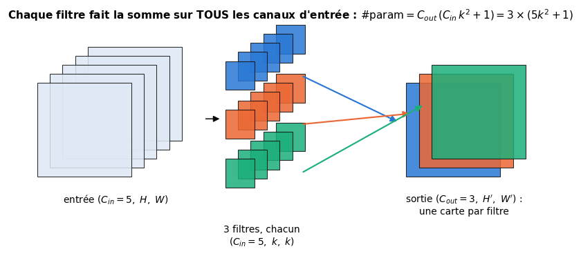

# 21 · Réseaux convolutifs (CNN) — fiche de cours

> Ce chapitre ouvre la partie V, consacrée aux grandes architectures. Au ch. 20, la convolution et le pooling n'étaient qu'esquissés ; le livre leur consacre ici un chapitre entier, sans formule, avec beaucoup de figures. Son idée centrale tient en une phrase : **un seul petit neurone, promené sur toute l'image avec les mêmes poids, devient un détecteur de motifs**. Le livre en tire le vocabulaire (noyau, champ récepteur, padding, stride, canaux, convolutions 1D et 1×1, convolution transposée), puis l'applique à deux réseaux : un petit convnet pour MNIST et VGG16, dont il regarde ce que « voient » les filtres, avant de montrer comment on les trompe avec des **exemples adversariaux**. La fiche suit son plan et ajoute ce qu'il laisse de côté : les **formules** (taille de sortie, nombre de paramètres, champ récepteur), la **rétropropagation** d'une convolution, l'attaque **FGSM**, et ce qui a remplacé VGG16. Elle corrige aussi plusieurs passages du livre, dont un calcul de tailles et un piège de vocabulaire sur la « convolution dilatée ».

| | |
|---|---|
| **Livre** | vol. 2, ch. 21 « Convolutional Neural Networks », p. 927-1022 (§21.1 à §21.10) |
| **Temps total estimé** | ≈ 27 h : lecture du livre et de la fiche ≈ 6,9 h, exercices ≈ 20 h, 25 flashcards ≈ 0,8 h |
| **Prérequis** | 0A (tableaux NumPy, indexation, `reshape`, diffusion) · 0B (produit scalaire, partie entière $\lfloor x \rfloor$, fonction signe) · ch. 3 (matrice de confusion) · ch. 12 (PCA) · ch. 16 (couche dense, compter les paramètres, initialisation de He) · ch. 17 (ReLU, softmax) · ch. 18 (rétropropagation, gradient d'un poids utilisé plusieurs fois) · ch. 19 (Adam) · ch. 20 (tenseurs, autograd, `nn.Module`, `DataLoader`, boucle d'entraînement, dropout, pooling) |
| **Fichiers du chapitre** | `02_exercices.md` (quiz, rappels, papier, réflexion, entretien) · `03_notebook.ipynb` · `04_indices.md` · `05_solutions.md` et `05_solutions.ipynb` · `06_mes_reponses.md` · `flashcards.csv` |
| **mylearn** | `conv.py` : `conv_output_size` et `pad2d` (21.12), `im2col` (21.14), `conv2d` (21.15), `max_pool2d` et `avg_pool2d` (21.18), `conv_transpose2d` (21.30), `conv2d_backward` (21.31), au format PyTorch `(N, C, H, W)` |

## Comment utiliser ce chapitre

Le livre avance en quatre temps : l'idée de la convolution, à partir d'un neurone qu'on fait glisser sur l'image (§21.1 à §21.3) ; les variantes de l'opération, avec plusieurs canaux, en une dimension, en 1 × 1 ou transposée (§21.4 à §21.8) ; deux exemples de réseaux et la visualisation de leurs filtres (§21.9) ; les exemples adversariaux (§21.10). Il ne donne aucune formule : la fiche les ajoute, parce que tu vas programmer ces opérations et les comparer à PyTorch au milliardième près. Compte environ sept heures de lecture, livre et fiche.

**Ordre conseillé.**
1. Lis le livre §21.1 à §21.2.5, puis les sections correspondantes de la fiche. Fais les quiz Q1 et Q2, le rappel R3 et l'exercice ✏️ 21.1.
2. Lis le livre §21.3 à §21.3.3, puis la fiche jusqu'au champ récepteur. Fais les quiz Q3 et Q4 et l'exercice ✏️ 21.2.
3. Lis le livre §21.3.4 à §21.4.2, puis la fiche. Fais les quiz Q5 et Q6, l'exercice ✏️ 21.3 a) à e), puis ✏️ 21.5 (champ récepteur).
4. Lis le livre §21.5 à §21.7.1, puis la fiche, et la section « Au-delà du livre : la rétropropagation d'une convolution ». Fais les quiz Q7 et Q8, le rappel R2, l'exercice ✏️ 21.4 et la preuve ∂ 21.7 (sauf sa question 5).
5. Lis le livre §21.8, puis la fiche. Fais le quiz Q9, la fin de l'exercice ✏️ 21.3 (f) à j)), l'exercice ✏️ 21.6 et la question 5 de ∂ 21.7.
6. Lis le livre §21.9 à §21.9.3, puis la fiche. Fais les quiz Q10 et Q12, le rappel R1, l'estimation 🧮 21.8, l'oral 🗣️ 21.9 et la lecture 📄 21.11.
7. Lis le livre §21.10, puis la fin de la fiche. Fais le quiz Q11 et la réflexion ⚖️ 21.10. Vérifie tes réponses courtes dans la partie 0 du notebook.
8. Fais le notebook dans l'ordre : ta librairie `conv.py` (tailles, padding, la vue « œil de mouche », la convolution, le pooling), des filtres faits main, puis de vrais CNN PyTorch sur Fashion-MNIST et CIFAR-10, les filtres d'un réseau pré-entraîné, une attaque adversariale, et pour finir la convolution transposée et la rétropropagation dans ta librairie. Termine par les cinq questions d'entretien.

| Section | Quiz 🧠 et rappels 🔁 | Papier ✏️ ∂ 🧮 et réflexion | Notebook | Entretien 💼 |
|---|---|---|---|---|
| 21.1 et 21.2 Introduction, profondeur | Q1 | 21.10 | | |
| 21.2.2 à 21.2.5 Somme pondérée, partage de poids, noyau | Q2, R2, R3 | 21.1, 21.4, 21.7 | 21.13 | E1 |
| 21.3 et 21.3.2 Convolution, vue « œil de mouche » | Q3 | 21.2, 21.9 | 21.14, 21.15 | |
| 21.3.1 et 21.3.3 Filtres, hiérarchie | Q4 | 21.2, 21.5 | 21.17, 21.18, 21.19, 21.21, 21.31 | E1 |
| 21.3.4 et 21.3.5 Padding, stride | Q5 | 21.3 | 21.12, 21.16 | E2 |
| 21.4 à 21.4.2 Plusieurs canaux, hiérarchies | Q6 | 21.3, 21.4, 21.5 | 21.15, 21.19, 21.24, 21.26 | |
| 21.5 et 21.6 Convolutions 1D et 1×1 | Q7 | | 21.13, 21.20 | E3 |
| 21.7 et 21.7.1 Couche de convolution, initialisation | Q8 | 21.4, 21.7 | 21.22, 21.24, 21.25, 21.31 | E2 |
| 21.8 Convolution transposée | Q9 | 21.3, 21.6 | 21.30 | |
| 21.9 Le convnet MNIST | Q10, R1 | 21.4, 21.11 | 21.18, 21.22, 21.23, 21.32 | |
| 21.9.1 VGG16 | Q10, Q12 | 21.8 | 21.26, 21.27 | E5 |
| 21.9.2 et 21.9.3 Regarder les filtres | Q10 | | 21.27, 21.28 | |
| 21.10 Adversaires | Q11 | 21.10 | 21.29 | E4 |

## Objectifs d'apprentissage

À la fin du chapitre, tu sais :
- **calculer** à la main la taille de sortie, le nombre de paramètres et le champ récepteur d'une pile de convolutions et de poolings ;
- **expliquer** le partage de poids, le rôle des canaux, du padding, du stride, de la dilatation et des convolutions 1D et 1 × 1 ;
- **implémenter** en NumPy la convolution, la vue « œil de mouche » (`im2col`), le pooling, la convolution transposée et la rétropropagation d'une convolution, et les **valider** contre `torch.nn.functional` ;
- **construire** et **entraîner** un CNN PyTorch, puis **diagnostiquer** ses courbes et ses erreurs ;
- **visualiser** les filtres et les cartes d'activation d'un réseau pré-entraîné, et **interpréter** ce qu'ils détectent ;
- **construire** une attaque FGSM et **discuter** la robustesse et l'éthique des systèmes de vision ;
- **situer** VGG16 face aux architectures actuelles (ResNet, ConvNeXt, Vision Transformers) et aux modèles pré-entraînés.

## L'essentiel en 10 lignes

1. Un **filtre** (ou **noyau**, *kernel*) est une petite grille de poids, de 3 × 3 par exemple. On le pose sur chaque position de l'image ; en chaque position, il fait le produit scalaire de ses poids et des pixels qu'il recouvre. Les mêmes poids servent partout : c'est le **partage de poids**.
2. Ce que calculent les bibliothèques sous le nom de « convolution » est une **corrélation croisée** (*cross-correlation*) : le noyau n'est pas retourné, contrairement à la convolution des mathématiciens.
3. Une sortie ne dépend que des pixels sous le filtre, son **champ récepteur local** ; en empilant les couches, le champ récepteur grandit, et les filtres des couches hautes cherchent des **motifs de motifs**.
4. Un filtre $k \times k$ sur une entrée à $C_{in}$ canaux a $C_{in}k^2$ poids et un biais, **quelle que soit la taille de l'image** ; une couche de $C_{out}$ filtres a $C_{out}(C_{in}k^2 + 1)$ paramètres et produit $C_{out}$ **cartes de caractéristiques** (*feature maps*).
5. Taille de sortie : $\left\lfloor \frac{H + 2p - d(k-1) - 1}{s} \right\rfloor + 1$, avec le **padding** $p$, le **stride** $s$ et la **dilatation** $d$. Un padding de $\frac{k-1}{2}$ (stride 1) garde la taille ; un stride de 2 la divise par 2.
6. Le **pooling** (maximum ou moyenne par bloc) réduit la taille sans rien apprendre ; aujourd'hui, on réduit plutôt par des convolutions à stride 2.
7. Une **convolution 1 × 1** mélange les canaux de chaque pixel, sans regarder ses voisins : elle réduit ou augmente le nombre de canaux à peu de frais. Une **convolution 1D** glisse le long d'une seule dimension (une séquence).
8. La **convolution transposée** agrandit l'image : on insère $s - 1$ zéros entre les pixels, puis on fait une convolution ordinaire ; elle peut laisser des **artefacts en damier**.
9. Rétropropagation : le gradient d'un poids partagé est la **somme** des contributions de toutes les positions ; le gradient par rapport à l'entrée est une convolution transposée du gradient de sortie.
10. Un **exemple adversarial** est une image modifiée de façon invisible qui trompe le réseau ; FGSM le construit d'un seul pas, $\mathbf{x} + \varepsilon\,\mathrm{sign}(\nabla_{\mathbf{x}} L)$.

## 21.1 · Pourquoi ce chapitre ? ⏩

Les images sont des données à part : des millions de pixels, mais une structure forte, où ce qui compte est la forme que dessinent des pixels **voisins**, à n'importe quel endroit de l'image. Le livre cite la reconnaissance des visages, la détection de cancers de la peau, la restauration de photos abîmées, et même l'estimation de l'âge et du genre d'une personne à partir d'une photo (p. 930), une application qui pose des questions éthiques sérieuses (⚖️ 21.10). Les **réseaux convolutifs** (*convolutional neural networks*, CNN, ou *convnets*) ont dominé la vision par ordinateur de 2012 à 2020, et ils restent partout, seuls ou à côté des Transformers. Leur ingrédient, la **couche de convolution**, sert aussi sur des sons, des séquences et du texte.

> 💼 **En entreprise** — Contrôle qualité sur une chaîne de production, lecture de documents, imagerie médicale, tri de photos, détection d'objets sur des caméras : l'essentiel de la vision industrielle passe par un réseau convolutif (ou un Transformer de vision), presque toujours **pré-entraîné** sur un grand dataset puis adapté au problème (bonus B1). Savoir lire l'architecture d'un CNN, calculer ses formes et ses paramètres, et entraîner une tête sur ses propres images est une compétence de base d'un ML engineer.

## 21.2 · Introduction

Le livre se limite aux images 2D (p. 931). Une image en niveaux de gris a **un** canal, une image en couleur en a **trois** (rouge, vert, bleu) : chaque pixel porte une valeur par canal. Ce qui sort d'une couche de convolution est un tenseur à autant de canaux qu'on veut, qu'on peut afficher tranche par tranche comme des images en niveaux de gris, mais qui n'est plus vraiment une image.

> ⚠️ **Le livre, corrigé — des features par pixel, pas par exemple** — Le livre écrit qu'une image en couleur a « trois features par exemple », une pour chaque couleur (p. 931). C'est trois valeurs **par pixel** : aplatie, une image de $H \times W$ pixels en couleur donne $3HW$ features, $3 \times 224 \times 224 = 150\,528$ pour une photo d'ImageNet. Le CNN ne l'aplatit justement pas : il garde la structure `(C, H, W)` pour profiter du voisinage des pixels.

### 21.2.1 · Les deux sens de « profondeur »

Le mot **profondeur** (*depth*) a deux sens, qu'il faut séparer (p. 932-933) :
- pour un **tenseur** (une image, une sortie de couche), c'est le nombre de **canaux** : une image RGB a une profondeur de 3, la sortie d'une couche de 64 filtres une profondeur de 64 ;
- pour un **réseau**, c'est son nombre de **couches** : « deep learning » parle de celle-là.

Certains auteurs disent « taille de fibre » (*fiber size*) pour la première, pour éviter la confusion ; le workbook dit simplement **canaux**. En PyTorch, un mini-batch d'images a la forme `(N, C, H, W)` : exemples, canaux, hauteur, largeur (ch. 20).

### 21.2.2 · Une somme de valeurs pondérées ⏩

Le livre part d'un seul pixel en couleur, et d'un neurone à trois entrées (R, G, B), sans activation (ou avec l'identité) : ses trois poids choisissent la couleur qu'il « aime » (p. 933-937). Avec des valeurs entre 0 et 1, un neurone de poids $(-1, +1, +1)$ calcule $-R + G + B$ : son score est grand pour un pixel **cyan** (vert et bleu sans rouge), $-0{,}1 + 0{,}8 + 0{,}9 = 1{,}6$ pour le pixel $(0{,}1 ;\ 0{,}8 ;\ 0{,}9)$, et négatif pour un rouge vif. Le livre construit de la même façon un détecteur de jaune (✏️ 21.1).

On applique ensuite ce neurone à **chaque pixel** de l'image, l'un après l'autre (le livre parle de « carotte » prélevée dans les trois canaux), et l'on range chaque score à la place du pixel : on obtient une nouvelle image d'**un seul canal**, la carte du « cyan » de l'image. Garde ce neurone en tête, qui regarde les trois canaux d'un seul pixel : le §21.6 lui donnera un nom.

### 21.2.3 · Le partage de poids ⏩

Le neurone qu'on promène emporte ses poids avec lui : chaque pixel est évalué **de la même façon**, par les mêmes poids ; seules ses entrées changent (p. 938-940). Le livre imagine une copie matérielle du neurone pour chaque pixel, toutes lisant leurs poids dans une même mémoire : c'est le **partage de poids** (*weight sharing*), et c'est ce que fait un GPU, qui calcule des milliers de positions en parallèle avec les mêmes poids. Pour détecter une autre couleur, il suffit de changer les poids partagés.

Le partage de poids a deux conséquences, que le reste du chapitre exploite :
- **peu de paramètres** : le nombre de poids d'un filtre ne dépend pas de la taille de l'image ;
- **un motif est cherché partout** : un filtre qui reconnaît un bord le reconnaît en haut à gauche comme en bas à droite (on dit que la convolution est *équivariante par translation* : déplacer le motif dans l'image déplace sa réponse dans la carte).

### 21.2.4 · Le champ récepteur local

Pour l'instant, le neurone ne lit qu'un pixel. On le relie maintenant à un petit carré de pixels, presque toujours de côté impair (1, 3, 5 ou 7), par exemple 3 × 3 : il reçoit 9 valeurs (en niveaux de gris), les multiplie par ses 9 poids et additionne (p. 940-943). Ce carré est son **champ récepteur local** (*local receptive field*), ou son **empreinte** (*footprint*). Une case du filtre sert d'**ancre** (*anchor*), en général celle du centre ; le pixel sous l'ancre est le **pixel focal** (*focus pixel*), et la sortie va à sa place dans l'image de sortie. Un côté impair donne un centre, d'où la préférence pour 3, 5, 7.

### 21.2.5 · Le noyau

Les poids du neurone qu'on promène s'appellent le **noyau** (*kernel*, mot venu des mathématiques) ou le **filtre** (*filter*, le neurone « filtre » l'image) (p. 943). On emploie aussi « filtre » pour le neurone lui-même, et « filtrer une image » pour lui appliquer un noyau. Le workbook garde l'anglais **kernel** dans le code (`kernel_size`) et dit « noyau » ou « filtre » dans la prose (BIBLE §22), comme pour le noyau d'un SVM au ch. 13.

## 21.3 · La convolution ⏩

Le livre définit l'opération en une phrase : deux listes de même longueur, des entrées et des poids, qu'on multiplie terme à terme avant d'additionner ; c'est ce que fait un neurone sans activation (p. 944-948). En deux dimensions, ce sont deux grilles de même forme, et l'on peut toujours les aplatir en listes. **Convoluer** un filtre avec une image, c'est le poser en chaque position et ranger chaque somme à sa place. Sans rien ajouter au bord, un filtre 3 × 3 ne peut se poser qu'aux positions où il tient entièrement : la sortie est plus petite que l'entrée, de $k - 1$ pixels dans chaque direction.

**La formule.** Pour une image $x$ d'un canal et un noyau $w$ de $k_h \times k_w$ poids, sans padding, la sortie $y$ en position $(i, j)$ est

$$y_{i,j} = b + \sum_{u=0}^{k_h-1}\sum_{v=0}^{k_w-1} w_{u,v}\; x_{i+u,\ j+v},$$

où $(i, j)$ est la position du **coin en haut à gauche** de la fenêtre (c'est la convention des bibliothèques : l'indice 0 de la sortie correspond à la première fenêtre entière). Avec une ancre au centre, c'est la même chose décalée de $\frac{k-1}{2}$.

> 🧮 **Rappel maths — corrélation croisée et convolution** — La convolution des mathématiciens **retourne** le noyau avant de le faire glisser : en une dimension, $(x * w)_i = \sum_u w_u\,x_{i-u}$, alors que la corrélation croisée calcule $\sum_u w_u\,x_{i+u}$. Sur un exemple : $x = (2, 0, 1, 3)$ et $w = (1, 2)$ donnent, en corrélation, $(2 \cdot 1 + 0 \cdot 2,\ 0 \cdot 1 + 1 \cdot 2,\ 1 \cdot 1 + 3 \cdot 2) = (2, 2, 7)$, et en convolution, avec le noyau retourné $(2, 1)$, $(2 \cdot 2 + 0 \cdot 1,\ 0 \cdot 2 + 1 \cdot 1,\ 1 \cdot 2 + 3 \cdot 1) = (4, 1, 5)$. Pour un noyau symétrique, les deux coïncident. Dans un réseau, la différence n'a pas d'importance : le noyau est **appris**, et l'apprentissage trouverait simplement le noyau retourné. Elle en a beaucoup quand on programme l'opération et sa rétropropagation, ou quand on compare un résultat à SciPy (`scipy.signal.convolve2d` retourne le noyau, `scipy.signal.correlate2d` non).

> 🕰️ **Mise à jour (2026) — « convolution » ou corrélation croisée** — **Le livre :** parle de convolution en laissant de côté « quelques détails » de la définition formelle (p. 944), qui ne changeraient rien. · **Aujourd'hui :** la documentation de PyTorch le dit en toutes lettres : `nn.Conv2d` calcule une **corrélation croisée** (son opérateur ⋆ est « l'opérateur de corrélation croisée 2D valide »). Le noyau n'est jamais retourné, et tous les frameworks de deep learning font de même. · **Faut-il quand même l'apprendre ?** Oui : c'est indispensable pour coder `conv2d`, sa rétropropagation (où le noyau retourné apparaît, lui) et la convolution transposée, et pour ne pas se tromper en comparant à une bibliothèque de traitement du signal. · *Source :* [documentation de `torch.nn.Conv2d`](https://docs.pytorch.org/docs/2.11/generated/torch.nn.Conv2d.html), [documentation de `scipy.signal.correlate2d`](https://docs.scipy.org/doc/scipy/reference/generated/scipy.signal.correlate2d.html)

### 21.3.1 · Les filtres ⏩

Pourquoi faire glisser un filtre ? Le livre s'inspire de la biologie (p. 948-953) : chez le crapaud, des cellules de la vision réagiraient d'elles-mêmes à des formes qui ressemblent à ses proies ; chez l'humain, une étude a trouvé des neurones qui réagissent à une personne précise (le neurone « Jennifer Aniston »). Ces hypothèses sont discutées, et le livre ne s'en sert que comme inspiration.

> ⚠️ **Piège classique — le « neurone grand-mère »** — Les neurones de l'étude citée par le livre (R. Quian Quiroga et coll., 2005) répondaient à plusieurs images d'une même personne, et parfois à son nom écrit : ce sont des cellules de **concept**, enregistrées chez quelques patients, parmi des milliards de neurones dont on n'a vu qu'une poignée. Personne ne conclut qu'il existe une cellule par personne connue. Dans un CNN aussi, une information est le plus souvent **répartie** entre beaucoup de filtres ; un filtre qui semble réagir à un seul concept est l'exception (§21.9.2).

L'idée utile : un filtre est un **détecteur de motif** (*feature detector*). Ses poids dessinent le motif qu'il cherche ; en chaque position, le produit scalaire est grand quand les pixels ressemblent au dessin. Attention au mot **feature** : jusqu'ici, c'était une colonne d'un tableau de données (ch. 1) ; dans un CNN, on l'emploie aussi pour la structure qu'un filtre cherche (« un filtre de rayures »). Un exemple : un filtre 3 × 3 dont la rangée du milieu vaut $+1$ et les deux autres $-1$, posé sur une image binaire (0 noir, 1 blanc), cherche un petit trait horizontal blanc sur fond noir. Chaque pixel blanc sous un $+1$ ajoute 1, chaque pixel blanc sous un $-1$ retire 1, les pixels noirs ne comptent pas : le score maximal, 3, n'est atteint que pour un trait de trois pixels exactement entouré de noir. Le livre fait la même chose avec un trait vertical (sa figure 21.14, que 🎨 21.17 te fait reproduire) et une diagonale.

Avec des filtres plus grands et des valeurs plus fines que $\pm 1$, on cherche des motifs plus subtils, et des filtres classiques font du traitement d'image : flou, netteté, détection de bords (📦 21.19). Surtout, **on ne dessine pas les filtres à la main** : un CNN les **apprend**. Chaque valeur d'un noyau est un poids comme un autre ; la rétropropagation (ch. 18) calcule son gradient et la descente de gradient le corrige, jusqu'à ce que les filtres trouvent les motifs qui aident à prédire les labels. C'est tout le secret : des centaines de filtres réglés en même temps, sans qu'on dise lesquels chercher.

### 21.3.2 · La vue « œil de mouche »

Une autre façon de voir la même opération (p. 953-955) : au lieu de faire glisser le filtre, on **découpe** l'image en petits morceaux qui se chevauchent, chacun de la taille du filtre (comme les facettes d'un œil de mouche), puis l'on applique le filtre à chaque morceau. Le résultat est identique.

C'est plus qu'une image : c'est la façon dont les bibliothèques calculent une convolution sur CPU. L'opération **im2col** (*image to columns*) range chaque morceau, aplati, dans une **colonne** d'une matrice ; la convolution devient alors **un seul produit matriciel** entre les filtres aplatis (une ligne par filtre) et cette matrice de colonnes. Pour une image d'un canal de $H \times W$ pixels et un filtre $k \times k$ sans padding, il y a $(H - k + 1)(W - k + 1)$ morceaux de $k^2$ valeurs : la matrice a $k^2$ lignes et une colonne par position de sortie. Avec $C$ canaux, chaque colonne a $Ck^2$ valeurs. Le prix : chaque pixel est recopié dans plusieurs colonnes (jusqu'à $k^2$ fois), d'où une grosse matrice. En PyTorch, c'est `torch.nn.functional.unfold` ; ta fonction `im2col` (🔨 21.14) produit le même rangement.

### 21.3.3 · Des hiérarchies de filtres

Les systèmes visuels réels semblent organisés en **couches** successives, chacune à un niveau d'abstraction plus élevé (p. 955-963). Le livre en fait un exemple complet : trouver un visage dans une image binaire de 27 × 27 pixels encombrée d'autres formes, avec trois niveaux de filtres 3 × 3 (figures 21.18 à 21.23). Au niveau 1, cinq filtres cherchent des briques élémentaires : trait horizontal, trait vertical, bloc plein, extrémités gauche et droite d'un trait. Un **max pooling** 3 × 3 réduit chaque carte de 27 × 27 à 9 × 9 (une case du résultat est noire si son bloc contient au moins une détection). Au niveau 2, trois filtres combinent ces briques en œil, nez et bouche, avec des cases « peu importe » (un joker) ; un second pooling réduit à 3 × 3. Au niveau 3, deux filtres reconnaissent un visage de face ou de profil. En tout, dix filtres 3 × 3, et chacun trouve son motif à **n'importe quelle position**. 🎨 21.21 te fera reconstruire ce détecteur avec ta librairie.

Le livre en tire deux leçons. D'abord, les couches hautes cherchent des **motifs de motifs** : on parle de **hiérarchie d'échelles** (*hierarchy of scales*). Ensuite, un petit filtre d'une couche haute « voit » une grande région de l'image d'origine, parce que l'image a été réduite entre-temps. Cette région s'appelle son **champ récepteur** (*receptive field*), et elle se calcule.

**Le champ récepteur.** Raisonnons sur une dimension. Une sortie de la couche 1 (noyau $k_1$) dépend de $k_1$ pixels. Une sortie de la couche 2 dépend de $k_2$ sorties consécutives de la couche 1 ; si la couche 1 avait un stride $s_1$, deux sorties voisines de la couche 1 sont espacées de $s_1$ pixels, et ces $k_2$ sorties couvrent $k_1 + (k_2 - 1)s_1$ pixels. En général, avec $r_0 = 1$ :

$$r_\ell = r_{\ell-1} + (k_\ell - 1)\prod_{i<\ell} s_i ,$$

où le produit des strides des couches précédentes (le « saut » entre deux sorties voisines, mesuré en pixels d'entrée) multiplie le débord de chaque nouveau noyau. Un pooling compte comme une couche (son $k$ et son $s$) ; une dilatation $d$ remplace $k$ par $d(k - 1) + 1$. Exemple : trois convolutions 3 × 3 de strides 2, 2 et 1 donnent $r_1 = 3$, $r_2 = 3 + 2 \times 2 = 7$, puis $r_3 = 7 + 2 \times (2 \times 2) = 15$ : un pixel de la troisième carte dépend d'un carré de 15 × 15 pixels de l'image.

> ⚠️ **Le livre, corrigé — un champ récepteur sous-estimé** — Le livre dit qu'un filtre 3 × 3 du niveau 2 de son détecteur « répond en fait à une région de 9 × 9 » (p. 963) : c'est la région que recouvrent les 3 × 3 cases du niveau réduit. Le compte est incomplet : le champ récepteur est plus grand. Il fait la même approximation au §21.4.2 (« un filtre 3 × 3 sur l'image de 300 × 300 vaut à peu près un filtre 6 × 6 sur celle de 600 × 600 »). La formule ci-dessus donne les vraies valeurs : ✏️ 21.5 te les fait calculer, et chercher ce que le livre oublie.

> 🔗 **Lien avec les ch. 10 et 20** — Le ch. 10 a rappelé ce que la vision artificielle doit au cortex visuel (D. Hubel et T. Wiesel, puis le Neocognitron de K. Fukushima, 1980) ; LeNet viendra ensuite (📄 21.11) ; le ch. 20 a montré l'apprentissage **hiérarchique** sur l'exemple de la banque. Une couche dense voit toute l'entrée d'un coup ; une couche de convolution n'en voit qu'un morceau, mais partout.

### 21.3.4 · Le padding ⏩

Que faire quand le filtre déborde de l'image (p. 963-966) ? Trois choix :
- **interdire** le débord (padding `"valid"`) : le filtre ne se pose que là où il tient, et la sortie rétrécit de $k - 1$ pixels par dimension ; après plusieurs couches, il ne reste presque rien ;
- **compléter** l'image par une bordure de valeurs fixes, presque toujours des zéros : le **zero-padding** ; avec $p = \frac{k - 1}{2}$ zéros de chaque côté (noyau impair, stride 1), la sortie garde la taille de l'entrée (padding `"same"`) ;
- plus rarement, recopier les bords ou les refléter (`padding_mode="replicate"` ou `"reflect"` dans PyTorch).

En pratique, on ne modifie pas les images : la couche de convolution gère elle-même la bordure de zéros. En PyTorch, `nn.Conv2d(C_in, C_out, k, padding=1)` met un zéro de chaque côté, et `padding="same"` calcule la bordure qu'il faut (seulement avec un stride de 1). Pour un noyau **pair**, la bordure totale $k - 1$ est impaire : PyTorch met la rangée et la colonne en trop **en bas et à droite**.

### 21.3.5 · Le stride ⏩

Le filtre visite les positions ligne par ligne, de gauche à droite (p. 966-971). Rien n'oblige à avancer d'un pixel à la fois : on peut sauter des positions, en avançant de $s$ pixels, le **stride** (*pas*). La sortie est plus petite d'un facteur proche de $s$ dans chaque direction ; on peut même choisir un stride différent selon l'axe. Avec un filtre $k \times k$ et un stride de $k$, les fenêtres ne se chevauchent plus et chaque pixel sert au plus une fois : c'est la façon la plus économique de réduire une image.

**La formule des tailles.** Avec une entrée de longueur $H$, un noyau $k$, un padding $p$ de chaque côté, un stride $s$ et une dilatation $d$ (les noyaux espacés, 21.8 plus bas ; $d = 1$ sinon), la longueur de sortie est

$$H_{out} = \left\lfloor \frac{H + 2p - d\,(k-1) - 1}{s} \right\rfloor + 1 .$$

On la lit ainsi : la fenêtre couvre $d(k - 1) + 1$ cases ; dans les $H + 2p$ cases de l'entrée complétée, elle peut se poser à la première case, puis tous les $s$ cases, tant qu'elle tient. La partie entière $\lfloor\cdot\rfloor$ (0B) dit qu'une fenêtre incomplète en fin de ligne est **perdue** : la dernière rangée ou colonne de l'image peut ne servir à rien. Exemples : une entrée de 32, un noyau de 5 et un padding de 2 donnent $\lfloor (32 + 4 - 5)/1 \rfloor + 1 = 32$ ; avec un stride de 2, $\lfloor 31/2 \rfloor + 1 = 16$. Cette formule est celle de PyTorch (documentation de `nn.Conv2d`) ; elle vaut aussi pour le pooling (avec $d = 1$). C'est ta fonction `conv_output_size` (🔨 21.12).

## 21.4 · La convolution en plusieurs dimensions

Une image en couleur a trois canaux (p. 971-975). On pourrait appliquer le même filtre 2D à chaque canal ; le livre préfère un filtre qui a **ses propres poids pour chaque canal** : un petit bloc de $3 \times 3 \times 3 = 27$ poids, qu'on pose sur un bloc de même forme de l'image (une « carotte » de 3 × 3 pixels sur 3 canaux). On multiplie terme à terme et l'on additionne les 27 produits : une **seule** valeur, donc une sortie d'un seul canal. C'est la convolution standard des bibliothèques.

Le livre montre aussi une autre possibilité : trois filtres 2D séparés, chacun appliqué à **son** canal, qui produisent trois sorties, une par canal (figure 21.35). Les bibliothèques l'appellent **convolution par canal** (*depthwise convolution*) : c'est le paramètre `groups` de `nn.Conv2d` avec `groups = C_in`. Entre les deux, `groups = g` coupe les canaux en $g$ groupes : chaque groupe de canaux d'entrée n'alimente que son groupe de canaux de sortie, et chaque filtre n'a que $C_{in}/g$ canaux. Les réseaux légers (MobileNet, ch. 20) enchaînent une convolution par canal et une convolution 1 × 1 (§21.6), pour beaucoup moins de paramètres qu'une convolution standard.

**La formule générale.** Pour un mini-batch $x$ de forme $(N, C_{in}, H, W)$, des poids $W$ de forme $(C_{out}, C_{in}, k_h, k_w)$ (l'ordre de PyTorch) et un biais $b$ par canal de sortie, avec un stride $s$ et un padding $p$ (l'entrée complétée de zéros est notée $x$ aussi) :

$$y_{n,o,i,j} = b_o + \sum_{c=0}^{C_{in}-1}\ \sum_{u=0}^{k_h-1}\ \sum_{v=0}^{k_w-1} W_{o,c,u,v}\; x_{n,\,c,\ s\,i+u,\ s\,j+v} .$$

Le filtre $o$ produit la carte $o$ de la sortie, en sommant sur **tous** les canaux d'entrée. Avec une dilatation $d$, les indices deviennent $s\,i + d\,u$ et $s\,j + d\,v$.

### 21.4.1 · Des filtres à plusieurs canaux ⏩

On peut appliquer plusieurs filtres à la même entrée : chacun produit sa carte, et les cartes s'empilent en un tenseur de sortie à autant de canaux que de filtres (p. 975-977). La règle qui ne souffre pas d'exception : **la profondeur d'un filtre est égale au nombre de canaux de son entrée**, et **le nombre de filtres est le nombre de canaux de sortie**. Une couche est donc décrite par $(C_{in}, C_{out}, k)$, et elle a

$$\#\text{param} = C_{out}\,(C_{in}\,k_h\,k_w + 1)$$

paramètres (un biais par filtre), quelle que soit la taille de l'image. Exemple : 16 filtres 5 × 5 sur une entrée à 8 canaux, $16 \times (8 \times 25 + 1) = 3\,216$ paramètres. La bibliothèque déduit $C_{in}$ de l'entrée (Keras) ou te le fait écrire (`nn.Conv2d(C_in, C_out, k)` de PyTorch, qui refuse un tenseur au mauvais nombre de canaux).

> ⚠️ **Le livre, corrigé — 6 ou 7 canaux** — Le texte du §21.4.1 décrit une entrée de 7 canaux et des filtres 3 × 3 × 7, la légende de la figure 21.37 une entrée et des filtres de 6 canaux, et la page suivante parle de filtres de profondeur 6 (54 poids chacun). Seule la règle compte : la profondeur des filtres est celle de l'entrée, quelle qu'elle soit.

### 21.4.2 · Le stride pour construire une hiérarchie ⏩

Un stride de 2 divise la taille par 2, un stride de 3 par 3 : c'est un moyen simple de réduire l'image d'une couche à l'autre, pour que les couches suivantes travaillent plus vite et cherchent des motifs plus grands (p. 977-979). Le livre construit une hiérarchie sur une image de 600 × 600 pixels en niveaux de gris : 8 filtres 5 × 5 avec un padding de 2 et un stride de 2, puis 4 filtres 3 × 3 avec un padding de 2 et un stride de 3, pour arriver à 100 × 100 × 4.

> ⚠️ **Le livre, corrigé — une hiérarchie qui ne tombe pas juste** — Deux détails de l'exemple 600 → 300 → 100 sont faux. Le nombre de canaux des filtres du second étage, tel que l'écrit le livre, ne respecte pas la règle du §21.4.1 (et la légende de la figure 21.38 parle de 5 filtres au premier étage). Et la formule des tailles ne donne pas 100 avec un padding de 2 et un stride de 3. ✏️ 21.3 te fait trouver la vraie taille et les paddings qui donnent 100.

**Pooling ou stride ?** On peut réduire l'image de deux façons : une convolution à stride 2, ou une convolution à stride 1 suivie d'une couche de **pooling** (ch. 20) qui ne garde, de chaque bloc $k \times k$, que le maximum (*max pooling*) ou la moyenne (*average pooling*). Le pooling n'apprend rien et traite chaque canal à part ; un max pooling 2 × 2 de stride 2 (le réglage habituel) divise la hauteur et la largeur par 2 et garde le nombre de canaux. Le livre note que la réduction par le stride est devenue plus courante, plus rapide et souvent aussi bonne (J. T. Springenberg et coll., 2015, qui remplacent tous les poolings d'un réseau par des convolutions à stride 2 sans perte d'accuracy), mais que beaucoup d'architectures encore utilisées ont des poolings. 🔬 21.26 te fera comparer les deux sur CIFAR-10.

> 🧮 **Rappel outil — le pooling dans PyTorch** — `nn.MaxPool2d(k)` et `nn.AvgPool2d(k)` prennent un stride égal à `k` par défaut (des blocs qui ne se recouvrent pas) ; leur taille de sortie suit la formule des tailles, avec une partie entière : un bloc incomplet est perdu (`ceil_mode=False`). Un `padding` y est permis, au plus la moitié de `k` ; pour le max pooling, les cases ajoutées ne gagnent jamais (elles comptent comme $-\infty$), pour le pooling moyen elles comptent comme des zéros dans la moyenne (`count_include_pad=True`, le défaut). Le **pooling moyen global** (`nn.AdaptiveAvgPool2d(1)`) résume chaque canal par une seule valeur, sa moyenne sur toute la carte, quelle que soit sa taille.

## 21.5 · La convolution 1D

On n'est pas obligé de faire glisser le filtre dans deux directions (p. 979-980). Dans une **convolution 1D**, le filtre glisse le long d'**une seule** dimension. L'exemple du livre est un texte : chaque mot est une ligne de nombres (un vecteur, son *embedding*, bonus B2), la phrase est une matrice d'une ligne par mot ; le filtre couvre toute la largeur d'une ligne et quelques mots consécutifs, et il descend d'un mot à la fois. Le nom vient de cette direction unique, pas de la forme du filtre.

En PyTorch, c'est `nn.Conv1d(C_in, C_out, k)` sur des tenseurs de forme `(N, C, L)` : la longueur $L$ est l'axe de glissement, et la largeur du filtre du livre devient le nombre de canaux $C_{in}$ (la taille de l'embedding). Un filtre a donc $C_{in}\,k$ poids. Les convolutions 1D servent aux sons, aux séries temporelles (ch. 22) et ont servi à classer des phrases.

## 21.6 · Les convolutions 1 × 1

Un filtre 1 × 1 ne regarde qu'**un pixel**, mais tous ses canaux : en chaque position, il fait la somme pondérée des $C_{in}$ valeurs du pixel (p. 980-982). C'est notre détecteur de cyan du §21.2.2, appliqué à un tenseur de profondeur quelconque. $C_{out}$ filtres 1 × 1 transforment un tenseur de $C_{in}$ canaux en un tenseur de $C_{out}$ canaux, **sans changer sa taille** ; c'est une couche dense appliquée séparément à chaque pixel, avec les mêmes poids partout, et elle a $C_{out}(C_{in} + 1)$ paramètres. Le livre souligne qu'il ne faut pas la confondre avec une convolution 1D : elles n'ont rien à voir.

Son usage principal : **réduire le nombre de canaux** avant une opération coûteuse. Dans l'exemple du livre, 300 canaux très corrélés passent à 175 grâce à des filtres 1 × 1, qui en gardent l'essentiel : la suite du réseau va presque deux fois plus vite. Le livre rapproche cette réduction de la PCA du ch. 12 : dans les deux cas, chaque nouvelle valeur est une combinaison linéaire des anciennes. La différence : la PCA choisit des directions orthogonales qui gardent le plus de variance, sans regarder la cible ; les poids d'une convolution 1 × 1 sont **appris** pour aider la loss, et suivis en général d'une activation. Les modules Inception (GoogLeNet, C. Szegedy et coll., 2015) et les blocs « goulot d'étranglement » (*bottleneck*) de ResNet reposent sur elles.

## 21.7 · Une couche de convolution ⏩

Dans une bibliothèque, on décrit une couche de convolution par le nombre de filtres, leur taille, et éventuellement le stride, le padding et l'activation ; la bibliothèque crée les filtres, les initialise, et les améliore par rétropropagation (p. 983-984). Sa sortie, une tranche par filtre, s'appelle une **carte de caractéristiques** (*feature map*) : elle dit où, dans l'entrée, chaque motif est présent. Par défaut, le stride vaut 1 et il n'y a pas de padding (dans Keras comme dans PyTorch).

> 🕰️ **Mise à jour (2026) — le format des images** — **Le livre :** les tenseurs de Keras, canaux en dernier (*channels last*) : `(N, H, W, C)`. · **Aujourd'hui :** PyTorch attend les canaux en premier, `(N, C, H, W)`, et ses poids de convolution ont la forme `(C_out, C_in/groups, k_h, k_w)` ; Keras et JAX gardent souvent les canaux en dernier. « Channels last » existe aussi dans PyTorch, mais seulement comme **format mémoire** (`x.to(memory_format=torch.channels_last)`), qui accélère les convolutions sur certains GPU sans changer la forme logique du tenseur. · **Faut-il quand même l'apprendre ?** Oui : en traduisant un code ou un modèle d'une bibliothèque à l'autre, c'est la source d'erreurs de forme la plus fréquente (🐛 21.24) ; `x.permute(0, 3, 1, 2)` passe de NHWC à NCHW. · *Source :* [documentation de `torch.nn.Conv2d`](https://docs.pytorch.org/docs/2.11/generated/torch.nn.Conv2d.html), [tutoriel « Channels Last Memory Format »](https://docs.pytorch.org/tutorials/intermediate/memory_format_tutorial.html)

### 21.7.1 · Initialiser les poids des filtres

Il faut bien donner des valeurs de départ aux noyaux (p. 984-985). Deux filtres identiques n'apportent rien de plus qu'un seul. Pire, si **tous** les poids (et les biais) d'un réseau partent de la même valeur, les filtres d'une couche reçoivent les mêmes gradients et restent identiques pour toujours : c'est le problème de **symétrie** (ch. 16). Des valeurs aléatoires le **brisent** (*symmetry breaking*). Le livre cite de petites valeurs uniformes, puis les initialisations de **Glorot** (ou Xavier) et de **He** (ch. 16), qu'il conseille de préférer quand la bibliothèque les propose.

Pour une convolution, le **fan-in** d'un neurone est le nombre de valeurs qu'il reçoit : $C_{in}\,k_h\,k_w$ (et le fan-out, $C_{out}\,k_h\,k_w$). L'initialisation de He tire les poids avec un écart-type $\sqrt{2/\text{fan-in}}$ ; pour un filtre 3 × 3 sur 32 canaux, $\sqrt{2/288} \approx 0{,}083$.

> ⚠️ **Le livre, corrigé — Glorot regarde aussi la sortie** — Le livre dit que Glorot et He choisissent leurs valeurs « d'après le nombre d'entrées du neurone » (p. 985). C'est vrai de He ; l'initialisation de Glorot équilibre l'entrée **et** la sortie, avec une variance $\frac{2}{\text{fan-in} + \text{fan-out}}$ (ch. 16).

> 🕰️ **Mise à jour (2026) — l'initialisation par défaut** — **Le livre :** Keras initialise ses convolutions avec Glorot ; préférer He si possible. · **Aujourd'hui :** `nn.Conv2d` de PyTorch tire ses poids avec `kaiming_uniform_(a=√5)`, c'est-à-dire uniformément entre $\pm 1/\sqrt{\text{fan-in}}$ (comme `nn.Linear`, ch. 20) : une variance de $1/(3\,\text{fan-in})$, six fois plus petite que celle de He. On voit souvent dans le code `nn.init.kaiming_normal_(conv.weight, nonlinearity="relu")` ; torchvision l'écrit pour ses ResNet avec `mode="fan_out"`. Avec une batchnorm après chaque convolution, le choix compte beaucoup moins. · **Faut-il quand même l'apprendre ?** Oui : un réseau profond sans normalisation peut ne pas apprendre du tout avec une mauvaise échelle (🔬 21.25). · *Source :* [code source de `torch.nn.modules.conv`](https://github.com/pytorch/pytorch/blob/v2.11.0/torch/nn/modules/conv.py), [documentation de `torch.nn.init`](https://docs.pytorch.org/docs/2.11/nn.init.html), [code source de `torchvision.models.resnet`](https://github.com/pytorch/vision/blob/v0.26.0/torchvision/models/resnet.py)

## Au-delà du livre : la rétropropagation d'une convolution

Le livre dit que la rétropropagation « apprend les filtres », sans montrer comment ; c'est pourtant la même rétropropagation qu'au ch. 18, avec une seule idée nouvelle : un poids **partagé** sert à toutes les positions.

Prenons une dimension, sans padding ni stride : $y_i = b + \sum_u w_u\,x_{i+u}$, et notons $g_i = \partial L/\partial y_i$ le gradient qui arrive de la couche suivante.
- **Le gradient d'un poids.** Le poids $w_u$ intervient dans **chaque** sortie $y_i$, avec le coefficient $x_{i+u}$. Comme au ch. 18 pour un nœud utilisé plusieurs fois, les contributions s'**additionnent** : $\frac{\partial L}{\partial w_u} = \sum_i g_i\,x_{i+u}$. C'est une corrélation de l'entrée par le gradient de sortie. Sur un mini-batch, on additionne aussi sur les exemples, et sur les deux dimensions pour une image. Le biais, utilisé partout avec le coefficient 1, reçoit $\sum_i g_i$.
- **Le gradient par rapport à l'entrée.** Un pixel $x_j$ intervient dans toutes les fenêtres qui le recouvrent, avec le poids $w_{j-i}$ dans la fenêtre $i$ : $\frac{\partial L}{\partial x_j} = \sum_i g_i\,w_{j-i}$. On reconnaît une convolution « pleine » (*full*, avec un padding de $k - 1$) de $g$ par le noyau **retourné** : le retournement que les bibliothèques évitent dans la passe avant réapparaît dans la passe arrière. C'est aussi, exactement, une **convolution transposée** de $g$ par $w$ (21.8 plus bas) : la passe arrière d'une convolution est une convolution transposée, et inversement.

Avec un stride, le gradient de sortie s'étale comme dans une convolution transposée (des zéros entre ses valeurs) ; avec un padding, on calcule le gradient de l'entrée complétée, puis on retire la bordure. ∂ 21.7 te fait dériver ces formules en une dimension, et 🔨 21.31 les programmer en deux dimensions dans `conv2d_backward`, vérifiées contre l'autograd de PyTorch.

> 🔗 **Lien avec le ch. 18** — Le principe est celui de tes tests de gradient : `gradient_check` (ch. 18) fonctionne sur n'importe quelle fonction, une convolution comprise, et c'est le premier réflexe pour vérifier une passe arrière écrite à la main.

## 21.8 · La convolution transposée ⏩

Les convolutions qu'on a vues gardent la taille de l'entrée ou la réduisent. Pour l'**agrandir** (*upsampling*), par exemple dans un réseau qui produit une image (autoencodeurs, ch. 25 ; segmentation, où il faut une sortie de la taille de l'image), on peut ajouter une couche de suréchantillonnage (ch. 20), ou faire l'agrandissement **pendant** la convolution : c'est la **convolution transposée** (*transposed convolution*), aussi appelée **convolution à pas fractionnaire** (*fractionally strided convolution*) (p. 985-991). « Transposée » vient de l'écriture matricielle : une convolution est une multiplication par une grande matrice creuse $\mathbf{C}$, et la convolution transposée est la multiplication par $\mathbf{C}^\top$. On évite le nom de **déconvolution**, déjà pris par une autre opération (l'inverse exact d'une convolution, en traitement du signal ; et les *deconvolutional networks* de M. Zeiler et coll., 2010).

**La recette du livre.** On sépare les pixels de l'entrée par des rangées et des colonnes de zéros, on complète le tout d'une bordure de zéros, puis on fait une convolution ordinaire. Insérer $s - 1$ zéros entre deux pixels, c'est faire « un pas de $1/s$ » dans l'entrée d'origine : d'où le pas fractionnaire. Avec un noyau $k$, un stride $s$ et un padding $p$ (au sens de PyTorch : ce qu'on retire de chaque côté de la sortie),

$$H_{out} = (H - 1)\,s - 2p + k .$$

Exemple : une entrée de 4, un noyau de 5, un stride de 2 et un padding de 1 donnent $3 \times 2 - 2 + 5 = 9$. Dans le détail, pour retrouver PyTorch, on insère $s - 1$ zéros entre les pixels, on ajoute $k - 1 - p$ zéros de chaque côté, et l'on corrèle avec le noyau **retourné** dans les deux directions (et ses deux axes de canaux échangés) ; c'est la recette de ta fonction `conv_transpose2d` (🔨 21.30).

**La vue « tampon ».** Une façon équivalente de calculer, souvent plus parlante : chaque pixel d'entrée $x_{i,j}$ dépose dans la sortie une copie du noyau multipliée par sa valeur, $x_{i,j}\,w$, avec son coin en $(s\,i, s\,j)$ ; là où les tampons se chevauchent, on additionne (puis on retire $p$ cases de chaque bord). Avec un stride de 1 et des noyaux qui se recouvrent, on étale ; avec un stride égal à la taille du noyau, les tampons ne se recouvrent pas.

> ⚠️ **Le livre, corrigé — la « convolution dilatée »** — Le livre appelle **convolution dilatée** l'insertion de zéros **entre les pixels de l'entrée** (p. 988). Dans les bibliothèques et les articles, la **dilatation** (*dilated* ou *atrous convolution*, « à trous ») est autre chose : ce sont les **poids du noyau** qu'on espace, en sautant $d - 1$ pixels entre deux poids (`nn.Conv2d(..., dilation=d)`), pour agrandir le champ récepteur sans ajouter de poids ni réduire l'image ; un noyau 3 × 3 de dilatation 2 couvre 5 × 5 pixels. L'insertion de zéros dans l'entrée, elle, est la convolution transposée. Le guide de V. Dumoulin et F. Visin (2016), que le livre cite, fait bien la distinction.

**Les artefacts en damier.** Le livre prévient : si l'on insère trop de zéros par rapport à la taille du noyau, des rangées entières de la sortie ne voient que des zéros ; et même sans cela, des motifs en damier peuvent apparaître. La cause est simple dans la vue « tampon » : quand $k$ n'est pas un multiple de $s$, certaines cases de sortie reçoivent plus de tampons que leurs voisines (A. Odena, V. Dumoulin et C. Olah, 2016). Le remède le plus courant : agrandir d'abord l'image par interpolation (`nn.Upsample`), puis faire une convolution ordinaire, ou choisir $k$ multiple de $s$.

## 21.9 · Un exemple de convnet ⏩

Le livre montre deux classifieurs : un petit réseau pour les chiffres de **MNIST**, et VGG16 pour les photos de mille catégories (p. 991-996). Le premier est un exemple fourni avec Keras (le fichier `mnist_cnn.py` de F. Chollet) :

| Couche | Réglages | Forme de sortie (PyTorch) |
|---|---|---|
| entrée | une image en niveaux de gris | `(1, 28, 28)` |
| convolution + ReLU | 32 filtres 3 × 3, sans padding | `(32, 26, 26)` |
| convolution + ReLU | 64 filtres 3 × 3, sans padding | `(64, 24, 24)` |
| max pooling | 2 × 2 | `(64, 12, 12)` |
| dropout | $p = 0{,}25$ | `(64, 12, 12)` |
| aplatissement | | `(9216,)` |
| dense + ReLU | 128 neurones | `(128,)` |
| dropout | $p = 0{,}5$ (voir l'encadré) | `(128,)` |
| dense | 10 neurones, puis softmax | `(10,)` |

Deux couches de convolution font l'essentiel du travail ; la fin du réseau, aplatissement et couches denses, est celle de presque tous les classifieurs de l'époque. Entraîné 12 epochs, il dépasse 99 % d'accuracy en entraînement comme en validation (figure 21.49). 📦 21.22 te fera l'écrire en PyTorch et l'entraîner sur Fashion-MNIST, plus difficile ; ✏️ 21.4 compter ses paramètres, et tu verras où ils se trouvent.

> ⚠️ **Le livre, corrigé — le dropout du convnet MNIST** — Le livre décrit encore un dropout qui coupe des neurones « à chaque epoch » (p. 993-994) : comme au ch. 20, le masque change à **chaque passe avant**. Il dit aussi que le dropout après la couche dense de 128 neurones en coupe un quart ; dans le fichier `mnist_cnn.py` qu'il cite, ce second dropout vaut 0,5 (le premier, après le pooling, vaut bien 0,25). Et le dropout après le pooling n'agit pas sur « les neurones de la dernière convolution » : il met à zéro des **valeurs** du tenseur `(64, 12, 12)`, une à une.

> 🕰️ **Mise à jour (2026) — de `mnist_cnn.py` à PyTorch** — **Le livre :** le script Keras de 2017 (Keras 2, `Conv2D`, `MaxPooling2D`, `Flatten`, optimiseur Adadelta). · **Aujourd'hui :** le dépôt de Keras 3 garde un exemple voisin (« Simple MNIST convnet »), et le même réseau s'écrit en PyTorch avec `nn.Conv2d(1, 32, 3)`, `nn.Conv2d(32, 64, 3)`, `nn.MaxPool2d(2)`, `nn.Dropout(0.25)`, `nn.Flatten()`, `nn.Linear(9216, 128)`, `nn.Dropout(0.5)` et `nn.Linear(128, 10)`, la softmax étant dans la loss (ch. 20). Les dépôts d'exemples de PyTorch contiennent presque exactement ce réseau (`examples/mnist`). · **Faut-il quand même l'apprendre ?** Oui : c'est le « Hello world » des CNN, et sa traduction couche par couche est l'exercice type du passage de Keras à PyTorch (ch. 23 et 24). · *Source :* [exemple Keras « Simple MNIST convnet »](https://keras.io/examples/vision/mnist_convnet/), [exemple PyTorch `examples/mnist`](https://github.com/pytorch/examples/blob/main/mnist/main.py)

### 21.9.1 · VGG16 ⏩

**VGG16** (K. Simonyan et A. Zisserman, 2014), déjà rencontré au ch. 20, a été présenté au concours ILSVRC 2014 de classification d'images d'ImageNet (1,2 million d'images d'entraînement, 1 000 catégories) (p. 996-1001). Ses auteurs ont publié les poids et le prétraitement, et son architecture, très régulière, se lit d'un coup d'œil : des blocs de **deux ou trois convolutions 3 × 3** (padding de 1, la taille est gardée), chacun suivi d'un **max pooling 2 × 2** de stride 2 qui divise la hauteur et la largeur par 2 ; 64 filtres par convolution dans le premier bloc, puis 128, 256, 512 et 512. L'entrée fait 224 × 224 × 3 ; après cinq poolings, il reste un tenseur 7 × 7 × 512, aplati puis envoyé dans deux couches denses de 4 096 neurones (chacune suivie d'un dropout de 50 %), et une couche de 1 000 neurones suivie d'une softmax.

Pourquoi des filtres 3 × 3 seulement ? Parce que deux ou trois convolutions 3 × 3 empilées voient une région aussi grande qu'un seul filtre plus large, avec moins de poids et une ReLU de plus entre chaque couche (✏️ 21.5 te fait compter laquelle, et combien de poids on économise). Avant d'utiliser le réseau, une image doit subir le prétraitement de l'entraînement : redimensionnée à 224 × 224, avec la moyenne de chaque canal retranchée (le prétraitement des poids de torchvision normalise aussi par l'écart-type). Le livre conclut que, reconstruit aujourd'hui, VGG16 remplacerait ses poolings par des convolutions à stride 2.

> ⚠️ **Le livre, corrigé — le classement de VGG16** — Le livre écrit que VGG16 a gagné « une des tâches de classification » d'ILSVRC 2014 (p. 996). L'équipe VGG a gagné la tâche de **localisation** (trouver l'objet et son cadre) et fini **deuxième** en classification, derrière GoogLeNet (ch. 20). Et les « 16 » couches comptent les couches de calcul : 13 convolutions et 3 couches denses.

> 🕰️ **Mise à jour (2026) — après VGG16** — **Le livre :** VGG16, avec ses poolings et ses deux couches denses de 4 096 neurones, comme exemple de grand réseau. · **Aujourd'hui :** trois idées l'ont remplacé. (1) Les **connexions résiduelles** (ResNet, K. He et coll., 2016 ; ch. 20) permettent des réseaux de 50 à 150 couches. (2) On réduit l'image par des **convolutions à stride 2** et l'on termine par un **pooling moyen global** suivi d'**une seule** couche dense : la tête de ResNet-18 a 513 000 paramètres, celle de VGG16 en a 123 millions. (3) Des architectures plus récentes : EfficientNet, ConvNeXt (Z. Liu et coll., 2022, un CNN modernisé qui rivalise avec les Transformers), et les **Vision Transformers** (ViT, A. Dosovitskiy et coll., 2021), qui découpent l'image en patchs de 16 × 16 pixels traités comme des tokens (bonus B3). Les CNN restent le choix courant sur de petits datasets et sur des appareils modestes. On ne les entraîne presque jamais de zéro : `torchvision.models.resnet18(weights="DEFAULT")` télécharge des poids pré-entraînés sur ImageNet (bonus B1). · **Faut-il quand même l'apprendre ?** Oui : VGG16 reste l'architecture la plus lisible, et ses blocs conv-conv-pool sont la base de tout ce qui a suivi. · *Source :* [documentation de `torchvision.models`](https://docs.pytorch.org/vision/0.26/models.html), [He et coll., « Deep Residual Learning for Image Recognition »](https://arxiv.org/abs/1512.03385), [Liu et coll., « A ConvNet for the 2020s »](https://arxiv.org/abs/2201.03545), [Dosovitskiy et coll., « An Image is Worth 16x16 Words »](https://arxiv.org/abs/2010.11929)

### 21.9.2 · Regarder les filtres (1) : ce qui les excite le plus

Les filtres d'un réseau entraîné sont la clé de son succès, mais un noyau 3 × 3 ne se lit pas à l'œil (p. 1001-1008). Le livre les regarde **indirectement** : on cherche l'image qui fait **le plus réagir** un filtre donné. La méthode part d'une image de bruit et l'améliore pas à pas par **montée de gradient** : on calcule le gradient de la sortie du filtre **par rapport aux pixels de l'image**, et l'on modifie les pixels dans le sens qui l'augmente, sans toucher aux poids du réseau. Après de nombreux pas, l'image obtenue est « ce que le filtre cherche ». Sur VGG16, les filtres du premier bloc cherchent des rayures et des bords de toutes les orientations ; ceux du troisième, des textures ; ceux du quatrième et du cinquième, des motifs entrelacés de plus en plus organiques, comme on l'attend d'une hiérarchie.

> 🧮 **Rappel maths — le gradient par rapport à l'entrée** — Jusqu'ici, on dérivait la loss par rapport aux **poids**, pour les corriger. Rien n'empêche de dériver une quantité du réseau (la sortie d'un filtre, le score d'une classe, la loss) par rapport à l'**entrée** $\mathbf{x}$ : $\nabla_{\mathbf{x}} a$ est une image de même forme que $\mathbf{x}$, qui dit, pixel par pixel, dans quel sens changer l'image pour augmenter $a$. La **montée de gradient** fait $\mathbf{x} \leftarrow \mathbf{x} + \eta\,\nabla_{\mathbf{x}} a$ (le signe plus : on cherche un maximum ; ch. 5 et glossaire). En PyTorch : une image avec `requires_grad=True`, un optimiseur qui ne contient qu'elle, les poids du réseau gelés (`requires_grad_(False)`) et `model.eval()`.

> ⚠️ **Le livre, corrigé — quelle méthode cite-t-il ?** — Le livre renvoie, pour cette montée de gradient, à l'article de M. Zeiler et R. Fergus (2014, « Visualizing and Understanding Convolutional Networks »). Leur méthode est différente : un **deconvnet** qui projette l'activation d'un filtre, pour une image **réelle**, vers les pixels qui l'ont causée. La maximisation d'activation à partir du bruit vient de D. Erhan et coll. (2009), et K. Simonyan, A. Vedaldi et A. Zisserman (2014) l'ont appliquée aux classes d'un CNN. Les deux familles sont utiles ; elles ne disent pas la même chose.

Sans précaution, l'image obtenue est souvent un bruit de haute fréquence sans forme reconnaissable : le gradient trouve des motifs que le réseau aime mais que l'œil ne voit pas (c'est déjà l'idée des exemples adversariaux, §21.10). On **régularise** donc l'image : on la floute un peu, on la décale au hasard à chaque pas (*jitter*), on pénalise ses grandes valeurs. 📦 21.28 te fera appliquer la méthode à ton propre CNN Fashion-MNIST.

### 21.9.3 · Regarder les filtres (2) : les cartes d'activation ⏩

L'autre façon de regarder un filtre : passer **une** image réelle dans le réseau, et afficher la carte que produit ce filtre (p. 1008-1012). Sur une photo de canard, un filtre du premier bloc de VGG16 répond aux bords verticaux, d'autres à l'orange des pattes, au bleu de l'eau ou à la neige ; plus loin dans le réseau, les cartes sont plus petites (chaque pooling divise leur côté par 2) et de moins en moins liées à la forme du canard ; d'autres cartes restent presque vides : le motif de leur filtre est absent de cette photo. En PyTorch, on récupère ces cartes avec un *hook* (ch. 20) ou en appelant les premières couches du modèle à la main ; 📦 21.27 le fera sur un ResNet-18 pré-entraîné.

> 🕰️ **Mise à jour (2026) — voir ce que regarde un CNN** — **Le livre :** la maximisation d'activation et les cartes de filtres. · **Aujourd'hui :** elles servent toujours, surtout pour comprendre et déboguer ; pour **expliquer une décision**, on utilise plutôt des cartes d'attribution, qui disent quelles régions de l'image ont pesé dans le score d'une classe : **Grad-CAM** (R. Selvaraju et coll., 2017) pondère les cartes d'une couche profonde par le gradient du score de la classe. Les meilleures visualisations de filtres combinent montée de gradient et régularisations soignées (C. Olah et coll., 2017). Ces méthodes ont leurs limites : une carte convaincante n'est pas une preuve que le modèle raisonne comme nous. · **Faut-il quand même l'apprendre ?** Oui : regarder les filtres et les cartes est le premier réflexe face à un CNN qui se trompe, et Grad-CAM est au programme du bonus B6. · *Source :* [Selvaraju et coll., « Grad-CAM »](https://arxiv.org/abs/1610.02391), [Olah, Mordvintsev et Schubert, « Feature Visualization », Distill](https://distill.pub/2017/feature-visualization/), [Zeiler et Fergus, « Visualizing and Understanding Convolutional Networks »](https://arxiv.org/abs/1311.2901)

## 21.10 · Les adversaires ⏩

Le chapitre finit sur une surprise (p. 1012-1017) : on peut fabriquer, à partir d'une photo correctement classée, une image qui paraît **identique** à nos yeux et que le réseau classe complètement de travers. On l'appelle un **exemple adversarial** (*adversarial example*) ; la différence avec l'image d'origine est une **perturbation adversariale**, qui ressemble à du bruit, avec des valeurs minuscules (de l'ordre de ±2 sur des pixels de 0 à 255, dans les exemples du livre). Une perturbation qui marche pour la plupart des images données à un classifieur (voire à plusieurs classifieurs) est dite **universelle**. Le livre montre un tigre qui n'est plus reconnu comme un animal, une perceuse devenue une seringue, un toucan devenu un paon.

Les algorithmes qui fabriquent ces images s'appellent des **attaques** ; on leur dit quel succès chercher : n'importe quelle erreur (attaque **non ciblée**) ou une classe choisie (attaque **ciblée**). Le livre les a calculées avec la bibliothèque Foolbox. Il conclut que ces perturbations sont peut-être une faiblesse inévitable des CNN, et qu'il reste beaucoup à comprendre.

> ⚠️ **Le livre, corrigé — « n'importe quel classifieur »** — Le livre écrit que l'astuce « perturbera les résultats de n'importe quel classifieur » (p. 1012). Elle concerne une très large classe de modèles appris (réseaux de neurones, mais aussi modèles linéaires), et une perturbation calculée pour un réseau en trompe souvent d'autres (on parle de **transférabilité**) ; mais elle n'est pas garantie pour tout classifieur, et des défenses (l'entraînement adversarial, encadré ci-dessous) réduisent fortement le problème, sans le supprimer. L'article sur les perturbations universelles (S.-M. Moosavi-Dezfooli et coll.) date de 2016 (CVPR 2017), pas de 2014 comme l'indique la bibliographie.

## Au-delà du livre : l'attaque FGSM

La plus simple des attaques tient en une ligne (I. Goodfellow, J. Shlens et C. Szegedy, 2015). Pour une image $\mathbf{x}$ de label $y$ et la loss $L(\mathbf{x}, y)$ du réseau, on calcule le gradient de la loss **par rapport à l'image**, et l'on fait un seul pas dans le sens qui l'**augmente**, de la même taille pour chaque pixel :

$$\mathbf{x}_{adv} = \mathbf{x} + \varepsilon\,\operatorname{sign}\!\big(\nabla_{\mathbf{x}} L(\mathbf{x}, y)\big),$$

où $\operatorname{sign}$ vaut $+1$, $0$ ou $-1$ (0B), puis l'on ramène les pixels dans leur plage (`clamp` entre 0 et 1). C'est la **Fast Gradient Sign Method** (FGSM). Chaque pixel bouge d'au plus $\varepsilon$, un ou deux pour cent de la plage des pixels : à peine visible. L'explication des auteurs : en grande dimension, même un modèle **linéaire** est vulnérable. Pour un score $\mathbf{w} \cdot \mathbf{x}$, la perturbation $\varepsilon\,\operatorname{sign}(\mathbf{w})$ change le score de $\varepsilon\sum_j \lvert w_j \rvert$, qui grandit avec le nombre de pixels, alors que chaque pixel ne bouge presque pas ; un réseau de ReLU est en grande partie linéaire par morceaux. 📦 21.29 te fera attaquer ton CNN Fashion-MNIST et mesurer son accuracy en fonction de $\varepsilon$.

> 🕰️ **Mise à jour (2026) — attaques et défenses** — **Le livre :** Foolbox 0.8 et les perturbations universelles, une curiosité de recherche. · **Aujourd'hui :** c'est un sujet de **sécurité** reconnu. L'attaque de référence est **PGD** (A. Madry et coll., 2018), un FGSM répété à petits pas, ramené à chaque pas dans la boule de rayon $\varepsilon$ ; la défense la plus solide reste l'**entraînement adversarial** (entraîner sur des exemples attaqués), qui coûte cher et fait un peu baisser l'accuracy sur les images propres. Des attaques marchent dans le monde physique (des autocollants sur un panneau stop, K. Eykholt et coll., 2018 ; un « patch » imprimé, T. Brown et coll., 2017). Des bibliothèques les implémentent : Foolbox 3, torchattacks, Adversarial Robustness Toolbox ; le classement RobustBench compare les défenses. · **Faut-il quand même l'apprendre ?** Oui : un modèle de vision déployé (voiture, contrôle d'accès, modération) doit être évalué face à ces attaques, et la question revient en entretien (💼 21.E4). · *Source :* [Goodfellow et coll., « Explaining and Harnessing Adversarial Examples »](https://arxiv.org/abs/1412.6572), [Madry et coll., « Towards Deep Learning Models Resistant to Adversarial Attacks »](https://arxiv.org/abs/1706.06083), [Moosavi-Dezfooli et coll., « Universal adversarial perturbations »](https://arxiv.org/abs/1610.08401), [RobustBench](https://robustbench.github.io/)

> 💼 **En entreprise** — Un modèle de vision n'est pas évalué seulement sur un jeu de test propre : on mesure aussi sa robustesse aux perturbations naturelles (flou, bruit, compression, luminosité) et, s'il a un adversaire possible, aux attaques. On documente ces limites dans sa fiche (*model card*, ch. 20), et l'on évite de le déployer seul là où une erreur provoquée a des conséquences graves.

## Les pièges classiques ⚠️ (récapitulatif)

| Piège | Exemple | Ce qu'il faut faire |
|---|---|---|
| Comparer à une convolution de traitement du signal | `scipy.signal.convolve2d` ne redonne pas la sortie de `nn.Conv2d` | utiliser `correlate2d`, ou retourner le noyau |
| Oublier la partie entière des tailles | une image de 7 avec un noyau 2 et un stride 2 donne 3, pas 3,5 ni 4 | appliquer $\lfloor (H + 2p - d(k-1) - 1)/s \rfloor + 1$ ; la dernière rangée peut être perdue |
| Croire qu'un padding garde toujours la taille | `nn.Conv2d(3, 16, 5, padding=1)` réduit 32 à 30 | $p = (k - 1)/2$ pour un noyau impair, ou `padding="same"` (stride 1) |
| Un filtre qui n'a pas la profondeur de l'entrée | `nn.Conv2d(3, 16, 3)` appliqué à des images en niveaux de gris : `RuntimeError` | `C_in` = nombre de canaux de l'entrée ; vérifier la forme `(N, C, H, W)` |
| Les canaux au mauvais endroit | des images `(N, H, W, C)` de Keras ou de PIL données à `nn.Conv2d` | `x.permute(0, 3, 1, 2)` |
| La taille de l'aplatissement calculée à la main, fausse | `nn.Linear(64 * 13 * 13, 128)` après une pile qui produit 12 × 12 | calculer les formes couche par couche, ou `nn.LazyLinear` |
| Confondre convolution 1D et 1 × 1 | une convolution 1 × 1 pour « regarder une séquence » | 1D : un axe de glissement ; 1 × 1 : un pixel, tous ses canaux |
| Appeler « dilatée » l'insertion de zéros | lire `dilation=2` comme un agrandissement de l'image | `dilation` espace les poids du noyau ; agrandir, c'est `ConvTranspose2d` |
| Une convolution transposée qui fait un damier | des motifs réguliers dans une image générée | $k$ multiple de $s$, ou `nn.Upsample` puis une convolution |
| Des visualisations de filtres sans régularisation | un bruit de haute fréquence en sortie de la montée de gradient | flou, *jitter*, pénalité sur les pixels ; quelques centaines de pas |
| Une attaque qui sort de la plage des pixels | `x + eps * grad.sign()` avec des valeurs hors de $[0, 1]$ | `clamp(0, 1)` après chaque pas ; travailler sur les pixels avant la normalisation |
| Évaluer un modèle uniquement sur des images propres | 99 % d'accuracy, et une perturbation invisible le fait tomber | mesurer aussi la robustesse (perturbations naturelles, FGSM, PGD) |

## Liens avec les autres chapitres 🔗

- **0A et 0B** : l'indexation et le `reshape` de NumPy (im2col), le produit scalaire (ce que calcule un filtre), la partie entière (tailles de sortie), la fonction signe (FGSM).
- **Ch. 5** : la montée de gradient, pour visualiser les filtres et fabriquer des adversaires.
- **Ch. 12** : la PCA, que le livre rapproche de la convolution 1 × 1.
- **Ch. 16 à 18** : la couche dense (une convolution 1 × 1 en est une, pixel par pixel), le comptage des paramètres, l'initialisation de He, la rétropropagation d'un poids partagé.
- **Ch. 20** : PyTorch, le pooling, VGG16, les connexions résiduelles ; **ch. 22** : les convolutions 1D sur des séries ; **ch. 23 et 24** : les CNN de Keras traduits en PyTorch, l'augmentation de données ; **ch. 25** : la convolution transposée dans les autoencodeurs ; **ch. 28** : les filtres d'un CNN au service de l'art (deep dream, transfert de style).
- **Bonus B1** (modèles pré-entraînés), **B3** (Vision Transformers), **B6** (Grad-CAM, équité des systèmes de vision).

## Guide de lecture et de travail

**Lecture du livre.** Suis l'ordre conseillé en tête de fiche : un bloc de sections du livre, puis les sections correspondantes de la fiche, qui portent les mêmes numéros et citent les pages. La table des matières et le texte du livre numérotent par erreur « 24.4.2 » à « 24.9.1 » les sections 21.4.2 à 21.9.1 ; la fiche les renumérote. Les deux sections « au-delà du livre » (la rétropropagation d'une convolution, l'attaque FGSM) n'existent que dans la fiche. Le **parcours rapide** lit toute la fiche et les sections ⏩ du livre, soit environ 4,2 h : il laisse de côté l'introduction (§21.2), les deux sens de la profondeur, le champ récepteur local et le noyau (§21.2.1, §21.2.4, §21.2.5, que la fiche résume), la vue « œil de mouche » et la hiérarchie de filtres (§21.3.2, §21.3.3), l'introduction des canaux (§21.4), les convolutions 1D et 1 × 1 (§21.5, §21.6), l'initialisation (§21.7.1) et les images qui excitent un filtre (§21.9.2).

**Travail.** La formule des tailles et celle du nombre de paramètres reviennent dans presque tous les exercices : fais ✏️ 21.3 et 21.4 avant le notebook. Les exercices ✏️ 21.2 et 21.6 sont la meilleure préparation à `conv2d` et `conv_transpose2d` : tes tests compareront tes fonctions à PyTorch, case par case. Les questions du notebook marquées « dans tes notes » se notent dans ta copie `06_mes_reponses.md`.

## Pour aller plus loin

- Les notes du cours [CS231n de Stanford sur les réseaux convolutifs](https://cs231n.github.io/convolutional-networks/) : tailles, paramètres, im2col, architectures, en une page dense et claire (en anglais).
- V. Dumoulin et F. Visin, [« A guide to convolution arithmetic for deep learning »](https://arxiv.org/abs/1603.07285) (2016) : toutes les tailles de sortie, la dilatation et la convolution transposée, en dessins.
- A. Zhang, Z. Lipton, M. Li et A. Smola, [*Dive into Deep Learning*](https://d2l.ai/), chapitres 7 (réseaux convolutifs) et 8 (architectures modernes, de LeNet à ResNet) : du code PyTorch et les maths, gratuit en ligne.
- C. Olah, A. Mordvintsev et L. Schubert, [« Feature Visualization »](https://distill.pub/2017/feature-visualization/) (Distill, 2017) : ce que voient vraiment les filtres d'un CNN, et comment obtenir de belles images.
- I. Goodfellow, J. Shlens et C. Szegedy, [« Explaining and Harnessing Adversarial Examples »](https://arxiv.org/abs/1412.6572) (2015) : l'article de FGSM, court et lisible.
