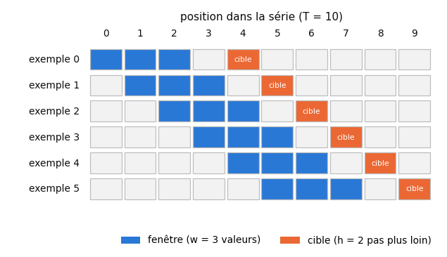
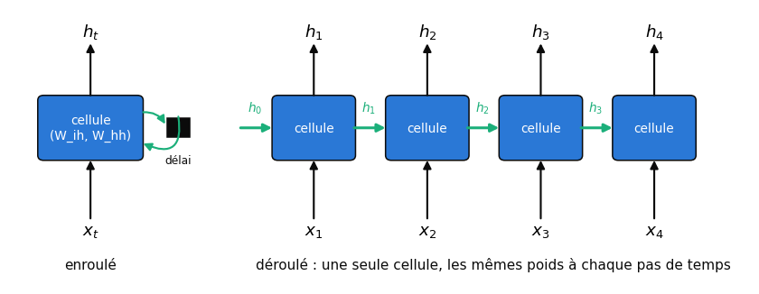
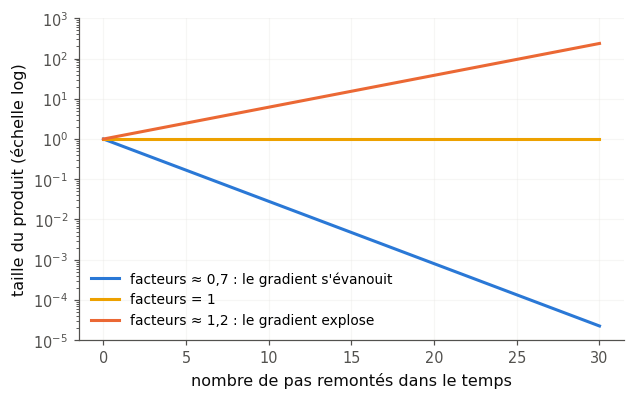
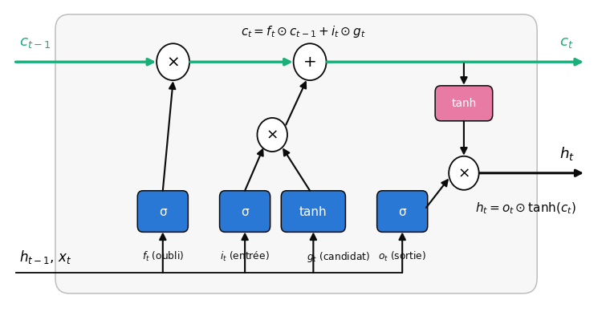
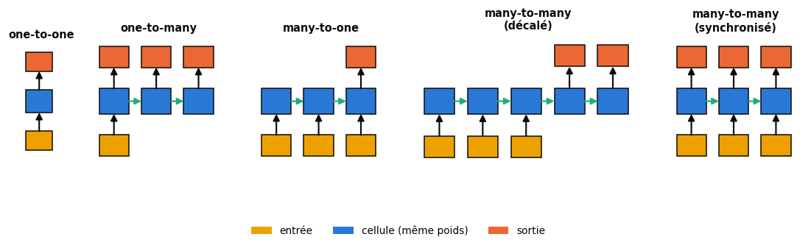
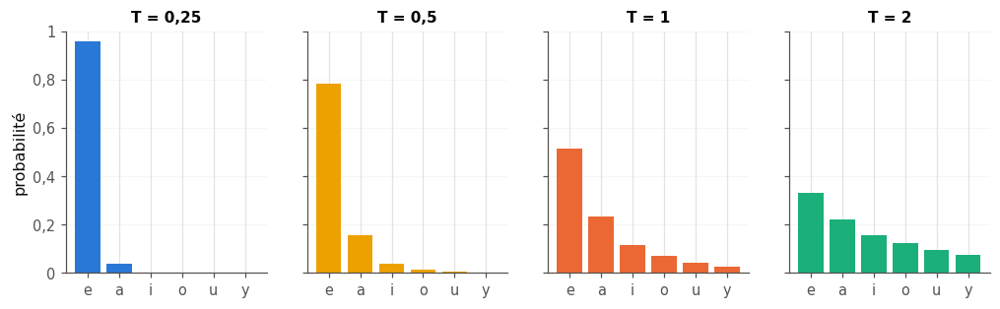

# 22 · Réseaux récurrents (RNN, LSTM, GRU) — fiche de cours

> Jusqu'ici, chaque exemple était traité seul : une image de chat est un chat, quelle que soit l'image d'avant. Ce chapitre s'occupe des données où **l'ordre compte** : une phrase, une série de mesures, une mélodie, une vidéo. Le livre y présente les **réseaux récurrents** (*recurrent neural networks*, RNN), qui lisent une séquence pas à pas en gardant un **état**, une petite mémoire qui change à chaque entrée. Il en explique le principe avec des schémas, sans aucune formule, montre pourquoi leur entraînement par rétropropagation bute sur le **gradient évanescent**, présente le **LSTM** et ses portes, les structures (une ou plusieurs entrées et sorties, réseaux profonds et bidirectionnels), puis un générateur de texte caractère par caractère entraîné sur Sherlock Holmes. La fiche suit son plan et ajoute ce qu'il faut pour programmer : les **équations** des cellules RNN, LSTM et GRU telles que les calcule PyTorch, le comptage des paramètres, le produit de jacobiennes qui fait disparaître le gradient, la **prévision d'une série temporelle** face à une baseline, et l'**échantillonnage avec température**. Elle corrige aussi l'explication que le livre donne du succès du LSTM, et situe les RNN face aux Transformers.

| | |
|---|---|
| **Livre** | vol. 2, ch. 22 « Recurrent Neural Networks », p. 1023-1089 (§22.1 à §22.9) |
| **Temps total estimé** | ≈ 23 h : lecture du livre et de la fiche ≈ 5,8 h, exercices ≈ 16 h, 25 flashcards ≈ 0,8 h |
| **Prérequis** | 0A (tableaux NumPy, `reshape`, tranches) · 0B (produit élément par élément $\odot$, suite géométrique) · ch. 6 (cross-entropy, perplexité) · ch. 8 (découpage train/test) · ch. 9 (MAE, RMSE) · ch. 12 (one-hot, scalers) · ch. 15 (ajuster le prétraitement sur le train seulement) · ch. 16 (couche dense, compter les paramètres) · ch. 17 (sigmoïde, tanh, softmax) · ch. 18 (rétropropagation, règle de la chaîne) · ch. 19 (RMSprop, Adam, gradient clipping) · ch. 20 (`nn.Module`, `DataLoader`, boucle d'entraînement) · ch. 21 (convolution 1D) |
| **Fichiers du chapitre** | `02_exercices.md` (quiz, rappels, papier, réflexion, entretien) · `03_notebook.ipynb` · `04_indices.md` · `05_solutions.md` et `05_solutions.ipynb` · `06_mes_reponses.md` · `flashcards.csv` |
| **mylearn** | `sequences.py` : `build_vocab`, `encode` et `decode` (22.12), `make_windows` et `make_sequence_pairs` (22.13), `temperature_softmax` et `sample_from_logits` (22.20) · `rnn.py` : `rnn_cell_forward` et `rnn_forward` (22.15), `lstm_cell_forward` et `lstm_forward` (22.16), `gru_cell_forward` (22.17), au format `(N, T, D)` de PyTorch avec `batch_first=True` |

## Comment utiliser ce chapitre

Le livre avance en trois temps : l'idée d'un état qu'une cellule lit et réécrit à chaque pas de temps (§22.1 à §22.5) ; l'entraînement et ses difficultés, puis les cellules à portes qui les contournent (§22.6, §22.7) ; les structures et un exemple complet (§22.8, §22.9). Ses schémas sont soignés, mais il n'écrit aucune équation : la fiche les ajoute, avec les conventions de PyTorch, car tu vas programmer ces cellules et les comparer à `torch.nn` au milliardième près. Compte environ six heures de lecture, livre et fiche.

**Ordre conseillé.**
1. Lis le livre §22.1 et §22.2, puis les sections correspondantes de la fiche. Fais les quiz Q1, le rappel R1 et l'exercice ✏️ 22.1 a) à b).
2. Lis le livre §22.3 et §22.4, puis la fiche. Fais les quiz Q2 et Q3, l'exercice ✏️ 22.2 et l'oral 🗣️ 22.9.
3. Lis le livre §22.4.1 à §22.5, puis la fiche. Fais les quiz Q4 et Q5, le rappel R3, la fin de ✏️ 22.1 et ✏️ 22.3 a) à f).
4. Lis le livre §22.6, puis la fiche. Fais le quiz Q6, le rappel R2 et la preuve ∂ 22.6.
5. Lis le livre §22.7 à §22.7.2, puis la fiche. Fais les quiz Q7 à Q9, ✏️ 22.3 g), l'exercice ✏️ 22.4, la preuve ∂ 22.7 et la lecture 📄 22.11.
6. Lis le livre §22.8 à §22.8.4, puis la fiche. Fais les quiz Q10 et Q11 et l'estimation 🧮 22.8.
7. Lis le livre §22.9, puis la fin de la fiche. Fais le quiz Q12, la fin de ✏️ 22.3 (h et i), l'exercice ✏️ 22.5 et la réflexion ⚖️ 22.10. Vérifie tes réponses courtes dans la partie 0 du notebook.
8. Fais le notebook dans l'ordre des ID : ta librairie `sequences.py` (vocabulaire, fenêtres) et un MLP sur des fenêtres mélangées, puis `rnn.py` (cellules RNN, LSTM et GRU contre PyTorch), un banc d'essai, la disparition du gradient mesurée, l'échantillonnage avec température, une série temporelle piégée, les formes des RNN profonds et bidirectionnels, la prévision des taches solaires face à la persistance, la génération de texte sur Holmes et Verne, un CNN-LSTM, et le défi. Termine par les cinq questions d'entretien.

| Section | Quiz 🧠 et rappels 🔁 | Papier ✏️ ∂ 🧮 et réflexion | Notebook | Entretien 💼 |
|---|---|---|---|---|
| 22.1 et 22.2 Séquences, fenêtres | Q1, Q12, R1 | 22.1, 22.10 | 22.13, 22.14 | E1 |
| 22.3 et 22.3.1 L'état | Q2 | 22.2, 22.9 | | |
| 22.4 à 22.4.2 La cellule RNN | Q3, Q4 | 22.2, 22.3 | 22.15 | |
| 22.5 Organiser les entrées | Q5, R3 | | 22.21 | E4 |
| 22.6 Entraîner un RNN | Q6, R2 | 22.6, 22.7 | 22.19 | E2 |
| 22.7 à 22.7.2 Portes, LSTM, GRU | Q7, Q8, Q9 | 22.3, 22.4, 22.7, 22.11 | 22.16, 22.17, 22.18 | E2, E3 |
| 22.8 à 22.8.4 Structures | Q10, Q11 | 22.8, 22.10 | 22.22, 22.28 | |
| 22.9 Un générateur de texte | Q12 | 22.1, 22.5, 22.10 | 22.12, 22.20, 22.24 à 22.27 | E5 |
| Au-delà du livre : séries temporelles | R3 | 22.1 | 22.21, 22.23, 22.29 | E4 |
| Au-delà du livre : après les RNN | Q12 | | | E1 |

## Objectifs d'apprentissage

À la fin du chapitre, tu sais :
- **organiser** des données séquentielles en tenseurs `(N, T, D)` et **construire** des fenêtres d'entraînement sans fuite de données ;
- **dérouler** à la main une cellule RNN et un pas de LSTM, et **compter** les poids d'une couche récurrente ;
- **expliquer** la rétropropagation dans le temps, la disparition et l'explosion du gradient, et le rôle des portes ;
- **implémenter** en NumPy les cellules RNN, LSTM et GRU dans l'ordre des portes de PyTorch, et les **valider** contre `torch.nn` ;
- **entraîner** un LSTM PyTorch pour prévoir une série temporelle et le **comparer** à une baseline de persistance ;
- **générer** du texte caractère par caractère et **régler** la température d'échantillonnage ;
- **choisir** une structure (many-to-one, many-to-many, profonde, bidirectionnelle) et **situer** les RNN face aux Transformers et aux modèles à espace d'états.

## L'essentiel en 10 lignes

1. Une **séquence** est une suite de valeurs dont l'ordre porte de l'information. Pour l'apprendre avec une couche dense, on la découpe en **fenêtres** de $w$ valeurs qui glissent : une série de $T$ valeurs donne $\left\lfloor \frac{T - w - h}{s} \right\rfloor + 1$ fenêtres pour une cible placée $h$ pas après chaque fenêtre, avec un pas $s$ entre deux départs.
2. Une couche dense donne un poids à chaque position de la fenêtre, mais ne sait pas que la position 3 suit la position 2 : un même ordre mélangé dans toutes les fenêtres lui est indifférent.
3. Un **RNN** applique la **même cellule** à chaque **pas de temps** et lui fait porter un **état** $h_t$, qui change à chaque entrée, même après l'entraînement : $h_t = \tanh(x_t W_{ih} + b_{ih} + h_{t-1} W_{hh} + b_{hh})$.
4. Le **schéma déroulé** dessine une copie de la cellule par pas de temps ; ces copies partagent les mêmes poids. Une couche `nn.RNN` qui lit $D$ valeurs par pas, avec un état de $H$ valeurs, a $H(D + H) + 2H$ paramètres (deux vecteurs de biais) ; un LSTM en a 4 fois plus. Ce nombre ne dépend pas de la longueur de la séquence.
5. Les données entrent en `(échantillons, pas de temps, features)` : `batch_first=True` dans PyTorch, dont le format par défaut est `(T, N, D)`.
6. On entraîne un RNN par **rétropropagation dans le temps** (*backpropagation through time*, BPTT) : la rétropropagation du réseau déroulé, où le gradient d'un poids partagé est la somme de ses contributions à tous les pas.
7. En remontant le temps, le gradient est multiplié à chaque pas par une jacobienne (ch. 17) $\operatorname{diag}(1 - h_k^2)\,W_{hh}^\top$ : il **s'évanouit** si ces facteurs sont petits, **explose** s'ils sont grands, et les **dépendances lointaines** deviennent difficiles à apprendre. Le **gradient clipping** limite l'explosion.
8. Une **porte** multiplie une valeur par un nombre entre 0 et 1, calculé par une sigmoïde. Le **LSTM** a une mémoire de cellule $c_t$ et trois portes (oubli $f$, entrée $i$, sortie $o$) : $c_t = f_t \odot c_{t-1} + i_t \odot g_t$ et $h_t = o_t \odot \tanh(c_t)$.
9. Le chemin $c_{t-1} \to c_t$ est **additif** : sa dérivée vaut $f_t$, sans poids ni tanh, et le gradient peut traverser des dizaines de pas si les portes d'oubli restent proches de 1. Le **GRU** obtient le même effet avec deux portes et sans mémoire séparée.
10. Pour générer du texte, on prédit le caractère suivant, on l'ajoute à la fenêtre et on recommence ; on le **tire au sort** dans une softmax divisée par une **température** $T$ (petite : prudent et répétitif, grande : varié puis incohérent), plutôt que de prendre toujours le plus probable.

## 22.1 · Pourquoi ce chapitre ?

Le livre ouvre sur des exemples où l'élément isolé ne suffit pas : une image dans un film, le pronom d'une phrase (« elle » renvoie à quelqu'un nommé plus tôt), la température de midi de jours successifs, le cours d'une action, et la traduction, qui doit tenir compte de toute la phrase (p. 1025-1026). Les réseaux qui lisent une séquence savent aussi en **produire** une : le livre cite des textes et des scripts « dans le style de », des mélodies et des paroles de chansons, la transcription de la parole et la description d'images (p. 1026).

> 🕰️ **Mise à jour (2026) — les Transformers ont pris le relais** — **Le livre :** présente les RNN, qu'on appelle souvent LSTM (p. 1026), comme l'outil qui « alimente presque toute approche » des séquences (p. 1029). · **Aujourd'hui :** depuis l'article de Vaswani et coll. (2017), les **Transformers**, fondés sur l'**attention**, dominent le texte, la traduction et la parole ; les grands modèles de langage en dérivent. Leur avantage décisif : pendant l'entraînement, tous les pas d'une séquence se calculent **en parallèle**, alors qu'un RNN doit attendre l'état du pas précédent. Les RNN gardent leur place là où l'on veut une mémoire de taille fixe et un coût constant par pas : du débruitage audio en temps réel sur un petit processeur (le GRU de RNNoise, J.-M. Valin, 2018), des prévisions en flux continu (TiRex, un modèle de fondation pour séries fondé sur xLSTM, 2025). · **Faut-il quand même l'apprendre ?** Oui : état, portes et BPTT sont la base pour comprendre les séquences, l'attention (bonus B3) et les modèles à espace d'états, qui reprennent une récurrence. · *Source :* [Vaswani et coll., « Attention Is All You Need », 2017](https://arxiv.org/abs/1706.03762).

## 22.2 · Introduction : des fenêtres pour une couche dense ⏩

Avant d'introduire un outil nouveau, le livre essaie l'ancien : une petite **couche dense** qui reçoit quelques mesures successives et prédit la suivante (p. 1027-1029). On fabrique pour cela un **dataset fenêtré** (*windowed dataset*) : chaque exemple est une **fenêtre** de $w$ valeurs consécutives, et sa cible est la valeur qui suit. Les fenêtres se **chevauchent** : la deuxième commence une valeur après la première.

**Combien de fenêtres ?** Une série de $T$ valeurs, des fenêtres de $w$ valeurs, une cible placée $h$ pas après la dernière valeur de sa fenêtre (l'**horizon** ; $h = 1$ : la valeur suivante) et un **pas** $s$ entre deux départs :
$$N = \left\lfloor \frac{T - w - h}{s} \right\rfloor + 1 .$$
La première fenêtre occupe les valeurs $0$ à $w - 1$ et sa cible la valeur $w - 1 + h$ ; la dernière doit garder sa cible dans la série. Exemple : 10 valeurs, des fenêtres de 3 et une cible 2 pas plus loin, $s = 1$ : $N = 10 - 3 - 2 + 1 = 6$ fenêtres, la dernière lisant les valeurs 5 à 7 pour prédire la valeur 9.

**Le défaut de la couche dense.** Chaque valeur de la fenêtre arrive sur une entrée qui a ses propres poids : le réseau peut tenir compte de la **position**, mais il ne sait pas que l'entrée 2 vient juste après l'entrée 1. Si l'on range les valeurs de **toutes** les fenêtres dans le même ordre mélangé, le réseau apprend exactement aussi bien : le livre l'affirme (p. 1029), et c'est facile à voir : il suffit de permuter les poids de sa première couche. Rien dans sa structure ne dit que les données forment une suite, ni qu'un même motif peut apparaître au début ou à la fin de la fenêtre ; et une fenêtre a une taille fixe.

> 🔗 **Lien avec le ch. 21** — Une **convolution 1D** glisse le même petit filtre le long de la séquence : elle sait qu'un motif est le même où qu'il soit, et elle se calcule en parallèle sur toutes les positions. Le livre la mentionne comme une piste « encore en développement » (p. 1029) ; il cite WaveNet (A. van den Oord et coll., 2016), et aujourd'hui les réseaux convolutifs temporels (TCN, S. Bai et coll., 2018), avec des convolutions **dilatées**, sont des concurrents sérieux des RNN pour l'audio et les séries (🔁 22.R1).

## 22.3 · L'état ⏩

L'idée nouvelle est une unité de calcul qui garde de l'information **d'une entrée à la suivante** : son **état**, ou **état caché** (*hidden state*, $h_t$), interne au réseau par opposition à ses sorties ; on dira simplement « l'état ». Le livre insiste sur la différence avec les poids (p. 1030-1032) : après l'entraînement, les poids sont **figés** ; l'état, lui, **change à chaque entrée**, en production comme à l'entraînement. Le réseau n'apprend pas *ce qu'il faut retenir* au moment où il lit une phrase : il a appris, une fois pour toutes, **comment** mettre à jour son état, et c'est cette mise à jour qui retient, au fil de la lecture, ce qui sert (qui est « elle », de quoi parle la phrase).

### 22.3.1 · Se servir de l'état ⏩

Le livre illustre l'état par un robot réparateur qui puise dans une boîte de pièces et la laisse dans un autre état pour la réparation suivante (p. 1032-1036). On peut penser aussi à un comptable qui tient **un seul carnet** : chaque facture qui arrive est traitée en tenant compte de ce que dit le carnet, puis le carnet est mis à jour avant la facture suivante. Deux conventions de dessin en découlent, qu'on retrouve dans tous les schémas du chapitre : une flèche simple pour l'information qui passe (la facture), une flèche creuse pour l'état, qui est **un seul objet** réutilisé et modifié au fil du temps ; et la mise à jour de l'état ne devient visible qu'**après** le traitement de l'entrée courante.

## 22.4 · La structure d'une cellule RNN ⏩

Le livre construit la cellule en deux temps (p. 1037-1042) : l'entrée et l'état courant sont **combinés** (une simple addition, après des poids), puis le résultat devient à la fois la **sortie** et le **nouvel état**. Un petit carré noir, le **délai** (*delay*), tient l'état entre deux pas : l'état calculé maintenant ne servira qu'à l'entrée suivante. Avec une activation, on obtient la cellule d'**Elman** (1990), la cellule RNN « simple » :
$$h_t = \tanh\!\big(x_t W_{ih} + b_{ih} + h_{t-1} W_{hh} + b_{hh}\big), \qquad t = 1, \dots, T,$$
avec un état de départ $h_0$ (des zéros, le plus souvent) ; vecteurs lignes et formes des matrices : voir l'encadré des conventions au §22.4.1. La sortie de la cellule au pas $t$ est $h_t$ lui-même ; si l'on veut autre chose (une prédiction, des probabilités), on ajoute une couche dense **après** la cellule. Mini-exemple à une valeur : $h_t = \tanh(0{,}7\,x_t + 0{,}3\,h_{t-1})$, $h_0 = 0$, deux entrées égales à 1 : $h_1 = \tanh(0{,}7) \approx 0{,}604$, puis $h_2 = \tanh(0{,}7 + 0{,}3 \times 0{,}604) \approx 0{,}707$. La même entrée donne deux sorties différentes : la seconde « se souvient » de la première.

**Enroulé et déroulé.** Le schéma **enroulé** (*rolled*) montre la cellule une fois, avec sa boucle ; le schéma **déroulé** (*unrolled*) dessine une copie par **pas de temps** (*time step*) : les valeurs successives d'une feature (p. 1041-1042). Ces copies sont **la même cellule**, avec **les mêmes poids** : déroulé, un RNN ressemble à un réseau profond de $T$ couches dont toutes les couches partageraient leurs poids. C'est ce partage qui lui permet de lire une séquence de n'importe quelle longueur avec un nombre fixe de paramètres.

> ⚠️ **Le livre, corrigé — des activations « linéaires »** — Le livre écrit que la plupart des neurones d'une cellule ont une activation linéaire (p. 1043), tout en prévenant que ses schémas simplifient (p. 1039, p. 1052). La simplification va plus loin qu'il ne le dit. Une cellule sans non-linéarité est un système linéaire : son état est une somme des entrées passées multipliées par des puissances de $W_{hh}$, et elle ne peut rien apprendre de plus qu'un filtre linéaire. Les cellules réelles ont une tanh (ou une ReLU) après la combinaison, comme dans l'équation ci-dessus, et c'est elle qui intervient dans le gradient (§22.6).

### 22.4.1 · Une cellule à plus d'état ⏩

En vrai, l'entrée, l'état et la sortie sont des vecteurs (p. 1042-1045). Le livre prend l'exemple d'un agent conversationnel au vocabulaire de 8 000 mots, chacun codé en **one-hot** (ch. 12) : un vecteur de 8 000 zéros avec un seul 1. L'état est un vecteur de $H$ nombres, la **taille de l'état** (*hidden size*), un hyperparamètre qu'on choisit, comme le nombre de neurones d'une couche dense : 3 ou 5 dans un exemple, plusieurs centaines dans un vrai système. Elle n'a aucune raison d'être égale à la taille de l'entrée.

**Compter les paramètres.** Avec une entrée de $D$ valeurs et un état de $H$ valeurs, $W_{ih}$ a la forme $(D, H)$, $W_{hh}$ la forme $(H, H)$, et PyTorch ajoute **deux** vecteurs de biais de $H$ valeurs, $b_{ih}$ et $b_{hh}$ (un seul suffirait mathématiquement : leur somme seule compte dans une cellule RNN ; PyTorch les garde pour la compatibilité avec la bibliothèque cuDNN de NVIDIA, et `mylearn` aussi, pour pouvoir copier ses poids ; dans le GRU, ils ne se fusionnent plus, §22.7.2). Une couche `nn.RNN` a donc
$$H(D + H) + 2H \text{ paramètres.}$$
Exemple : $D = 50$, $H = 20$ : $20 \times 70 + 40 = 1\,440$. La cellule du livre (figure 22.18 : 3 entrées, un état de 5 valeurs, 4 sorties, 69 poids) est organisée un peu autrement : trois groupes de neurones, dont un pour la sortie, et un seul vecteur de biais pour l'état ; ✏️ 22.3 te fait retrouver son compte, puis celui de PyTorch.

> 📐 **Conventions de la fiche** — On reprend les noms de PyTorch : $N$ exemples (notés $n$ ailleurs), $T$ pas de temps, $D$ features par pas (notées $p$ ailleurs), $H$ valeurs d'état ; et, comme dans le code, les vecteurs et les matrices ne sont pas en gras. Un vecteur d'entrée $x_t$ et un état $h_t$ sont des **lignes** ; un mini-batch empile $N$ lignes : $X_t$ de forme $(N, D)$, et la matrice des états, de forme $(N, H)$. Quelques lettres servent deux fois, comme dans les bibliothèques : $h$ est l'horizon d'une fenêtre (§22.2) et $h_t$ l'état ; $T$ est la longueur d'une séquence, et la température au §22.9 ; $z$ sont les logits au §22.9 et $z_t$ la porte du GRU ; $\sigma$ est la sigmoïde des portes, et $\sigma_{\max}(W)$, dans ∂ 22.6, la plus grande valeur singulière de $W$. Le contexte dit toujours laquelle. Les poids suivent la convention de `mylearn` pour les couches denses (ch. 16), $z = x W + b$ avec $W$ de forme $(n_{in}, n_{out})$ : la cellule calcule $X_t W_{ih} + H_{t-1} W_{hh}$. PyTorch range ses matrices dans l'autre sens, `weight_ih` de forme $(H, D)$ et calcule $x\,W^\top$ : nos $W_{ih}$ sont donc les `weight_ih.T` de PyTorch. Le symbole $\odot$ (0B) est le produit **élément par élément** de deux vecteurs de même taille : $(a \odot b)_j = a_j b_j$.

### 22.4.2 · Que représentent les valeurs de l'état ?

Personne ne décide ce que contient la 17ᵉ valeur de l'état : comme les poids d'une couche dense, c'est l'entraînement qui en fixe le sens (p. 1045-1046). On ne cherche pas, d'habitude, à l'interpréter ; quand on comprend bien le problème, on peut pourtant y trouver des valeurs lisibles. Sur des modèles de texte caractère par caractère, A. Karpathy, J. Johnson et L. Fei-Fei (2015) ont trouvé des valeurs d'état qui suivent la position dans la ligne, l'ouverture d'une parenthèse ou d'un guillemet, ou la profondeur d'indentation d'un code source.

## 22.5 · Organiser les entrées ⏩

Un dataset de séquences a **trois** axes : les exemples, les pas de temps et les features (p. 1046-1050). Le livre range un bloc de données en `(échantillons, pas de temps, features)`, la convention de Keras, et insiste sur ce piège : un tenseur mal rangé ne provoque aucune erreur, car seules les formes comptent pour la bibliothèque, alors que le sens des axes compte pour l'apprentissage. Son exemple : 8 températures horaires prises au sommet d'une montagne forment **un** exemple de **8 pas** et **une** feature, `(1, 8, 1)` ; rangées en `(1, 1, 8)`, elles deviennent un seul pas de 8 features différentes, et en `(8, 1, 1)`, huit exemples d'un seul pas, dont le réseau ne peut rien apprendre de séquentiel. Avec trois grandeurs mesurées huit fois par jour, d'heure en heure, pendant une semaine, chaque journée devient un exemple distinct (les nuits sans mesure coupent la série) : un tenseur `(7, 8, 3)`. Le livre fixe aussi le nombre de pas à la création du réseau, toutes les séquences ayant la même longueur (p. 1051) : c'est une contrainte de Keras. Un RNN de PyTorch lit des séquences de n'importe quelle longueur ; pour un batch de séquences de longueurs différentes, on complète les plus courtes par des zéros (*padding*) et l'on indique leurs vraies longueurs avec `nn.utils.rnn.pack_padded_sequence`, pour que les pas ajoutés ne comptent pas.

> 🕰️ **Mise à jour (2026) — l'ordre des axes dans PyTorch** — **Le livre :** `(échantillons, pas de temps, features)`, comme Keras. · **Aujourd'hui :** `nn.RNN`, `nn.LSTM` et `nn.GRU` attendent par défaut `(T, N, D)`, le temps d'abord ; avec `batch_first=True`, ils prennent `(N, T, D)`, l'ordre du livre et de `mylearn`. Les états finaux `h_n` (et `c_n`) gardent toujours la forme `(couches × directions, N, H)`, même avec `batch_first=True`. · **Faut-il quand même l'apprendre ?** Oui : c'est la source d'erreur la plus fréquente avec les RNN de PyTorch, et elle ne lève souvent aucune erreur. · *Source :* [documentation de `torch.nn.LSTM`](https://docs.pytorch.org/docs/2.11/generated/torch.nn.LSTM.html).

> ⚠️ **Piège classique — `reshape` au lieu de `permute`** — Pour passer de `(N, T, D)` à `(T, N, D)`, il faut **échanger** deux axes : `x.permute(1, 0, 2)` (ou `x.transpose(0, 1)`). Un `x.reshape(T, N, D)` donne la bonne forme, mais mélange les pas de temps de séquences différentes, sans aucune erreur ; le modèle apprend alors sur du bruit. Contrôle simple : `x_perm[t, n]` doit être égal à `x[n, t]`.

**Séquences et temps.** Les « pas de temps » ne sont pas forcément du temps : des mesures successives le long d'un tronc d'arbre, les étagères d'une bibliothèque, ou les caractères d'un texte sont aussi des séquences (p. 1046). Ce qui compte est l'ordre. Mais avec des séries **temporelles**, l'ordre impose aussi des règles de validation (voir « Au-delà du livre : prévoir une série temporelle »).

## 22.6 · Entraîner un RNN ⏩

Une fois déroulé sur $T$ pas, un RNN est un réseau ordinaire, à une particularité près : toutes ses couches ont les mêmes poids. On l'entraîne donc par rétropropagation (ch. 18), en faisant remonter les gradients de la loss à travers les $T$ copies : c'est la **rétropropagation dans le temps** (*backpropagation through time*, BPTT) (p. 1051-1052). Comme au ch. 21 pour un filtre de convolution, le gradient d'un **poids partagé** est la **somme** de ses contributions à tous les pas :
$$\frac{\partial L}{\partial W_{hh}} = \sum_{t=1}^{T} \frac{\partial L}{\partial W_{hh}}\bigg|_{\text{pas } t} .$$

**Le gradient qui s'évanouit.** Le problème vient de la façon dont le gradient remonte d'un pas à l'autre. Avec $h_k = \tanh(a_k)$ et $a_k = x_k W_{ih} + h_{k-1} W_{hh} + b$, la règle de la chaîne donne, d'un pas au précédent, la jacobienne (ch. 17) $J_k = \frac{\partial h_k}{\partial h_{k-1}} = \operatorname{diag}(1 - h_k^2)\,W_{hh}^\top$ (ses lignes sont les composantes de $h_k$, ses colonnes celles de $h_{k-1}$) ; d'un pas $t$ au pas $T$, on multiplie $T - t$ de ces matrices, dans l'ordre :
$$\frac{\partial h_T}{\partial h_t} = J_T\,J_{T-1} \cdots J_{t+1}, \qquad J_k = \operatorname{diag}\!\big(1 - h_k^2\big)\, W_{hh}^\top .$$
Le gradient de la loss, un vecteur ligne, remonte d'un pas en se multipliant à droite : $\frac{\partial L}{\partial h_{k-1}} = \frac{\partial L}{\partial h_k} J_k$, plus ce que la loss doit directement à $h_{k-1}$.
Chaque facteur $1 - h_k^2$ est entre 0 et 1 (la dérivée de tanh, ch. 17), plus petit encore quand la cellule sature. Si les facteurs ont une taille d'environ 0,7, le produit de 20 d'entre eux vaut à peu près $0{,}7^{20} \approx 8 \times 10^{-4}$ : une suite géométrique (0B). Ce que la sortie au pas $T$ doit à une entrée lointaine ne laisse plus qu'une trace infime dans le gradient : c'est le **gradient évanescent** (*vanishing gradient*). À l'inverse, des facteurs d'environ 1,2 donnent $1{,}2^{20} \approx 38$ : le gradient **explose** (*exploding gradient*), et un seul pas de descente peut projeter les poids très loin.

> 🧮 **Rappel maths — un produit de nombreux facteurs** — Si chaque facteur vaut $q$, le produit de $n$ facteurs vaut $q^n$ (0B, suites géométriques) : il tend vers 0 si $|q| < 1$, il explose si $|q| > 1$, et la frontière est très étroite (0,95 et 1,05 donnent, après 100 pas, environ 0,006 et 131). Pour des matrices, le rôle de $|q|$ est tenu par la plus grande **valeur singulière** de $W_{hh}$ (le facteur par lequel la matrice peut le plus allonger un vecteur) : si elle est inférieure à 1, une tanh ne pouvant que réduire, le gradient s'évanouit sûrement (R. Pascanu, T. Mikolov et Y. Bengio, 2013).

> ⚠️ **Le livre, corrigé — pourquoi le gradient s'évanouit** — Le livre l'explique en composant tanh avec elle-même (figure 22.23) : la courbe s'aplatit et sa zone de transition « se rétrécit » (p. 1052-1053). C'est une image de la passe **avant**, et elle ne suffit pas : la pente en 0 de tanh composée $n$ fois vaut 1 pour tout $n$, elle ne disparaît jamais (∂ 22.6). Le gradient remonte en **multipliant** des dérivées de tanh, $1 - h_k^2$, et des matrices $W_{hh}$ : c'est la taille de ces facteurs (petits poids, cellules saturées) qui le fait disparaître, ou exploser. Le livre écrit aussi que l'activation est « ReLU ou tanh » (p. 1052), puis compare au défaut de la « sigmoïde » (p. 1065) : il s'agit bien de tanh.

**Les dépendances à long terme.** Le livre présente ensuite le **problème des dépendances à long terme** (*long-term dependencies*) comme une question de mémoire : pour relier « deux chats » à un « ils » cinquante mots plus loin, il faudrait un état assez grand (p. 1053). La difficulté que nomment Y. Bengio, P. Simard et P. Frasconi (1994) est surtout celle de l'**apprentissage** : même avec un état assez grand, le gradient évanescent empêche la descente de gradient de découvrir qu'une sortie dépend d'une entrée lointaine. Un RNN simple apprend bien les dépendances de quelques pas, mal celles de quelques dizaines.

**Les remèdes.** Contre l'explosion, le **gradient clipping** (ch. 19) ramène la norme du gradient sous un seuil avant chaque pas, sans changer sa direction. Contre la disparition : des cellules à **portes** (LSTM, GRU, §22.7), une initialisation soignée de $W_{hh}$ (orthogonale, ou l'identité avec des ReLU, comme Q. Le et coll., 2015, que cite le livre), et des séquences plus courtes. En pratique, on coupe aussi les longues séquences en morceaux et l'on ne remonte le gradient que sur chacun (*truncated BPTT*), en passant l'état d'un morceau au suivant.

> 🕰️ **Mise à jour (2026) — le gradient explosif a un remède standard** — **Le livre :** mentionne le gradient explosif sans dire comment s'en protéger (p. 1053). · **Aujourd'hui :** on écrit `torch.nn.utils.clip_grad_norm_(model.parameters(), max_norm)` entre `loss.backward()` et `optimizer.step()` dans presque toute boucle d'entraînement d'un RNN ; la fonction rend la norme totale d'avant le clipping, qu'on peut surveiller. · **Faut-il quand même l'apprendre ?** Oui, c'est un réflexe : tu l'as écrit au ch. 19 (`clip_grad_norm`), tu t'en serviras dans le notebook. · *Source :* [documentation de `clip_grad_norm_`](https://docs.pytorch.org/docs/2.11/generated/torch.nn.utils.clip_grad_norm_.html) ; [Pascanu et coll., « On the difficulty of training recurrent neural networks », ICML 2013](https://proceedings.mlr.press/v28/pascanu13.html).

## 22.7 · LSTM et GRU

La réponse la plus répandue est une cellule plus élaborée, le **LSTM** (*Long Short-Term Memory*, S. Hochreiter et J. Schmidhuber, 1997), si courante qu'on dit souvent « LSTM » pour « RNN » (p. 1054). Le livre explique son nom par deux mémoires de la cellule, mais l'article d'origine l'entend autrement (encadré ci-dessous). Le LSTM gère sa mémoire avec une **mémoire de cellule** (*cell memory*) et des **portes**, réglées par des poids appris : une fois l'entraînement fini, les poids ne bougent plus, mais les portes s'ouvrent et se ferment différemment à chaque entrée.

> ⚠️ **Le livre, corrigé — d'où vient le nom « LSTM »** — Le livre appelle l'état une mémoire « à long terme » et les valeurs calculées pendant un pas une mémoire « à court terme », que le LSTM ferait durer (p. 1054). Chez Hochreiter et Schmidhuber (1997), la **mémoire à court terme** d'un réseau récurrent, ce sont ses activations, son état, par opposition à la **mémoire à long terme** que portent ses poids, qui changent lentement pendant l'entraînement. Le LSTM est une mémoire à court terme, l'état, qui sait durer longtemps : plus de 1 000 pas dans leurs expériences.

### 22.7.1 · Les portes

Une **porte** (*gate*) est une multiplication : la valeur qui la traverse est multipliée par un nombre $\gamma \in [0, 1]$ (p. 1055-1059). À 1, elle passe telle quelle ; à 0, elle est effacée ; entre les deux, elle est réduite. Une porte ne peut ni augmenter une valeur, ni changer son signe. Les valeurs $\gamma$ ne sont pas des poids : elles sont **calculées à chaque pas** par une couche de neurones suivie d'une **sigmoïde** (ch. 17), qui ramène tout nombre entre 0 et 1, à partir de l'entrée courante et de l'état précédent. Une porte agit élément par élément : un vecteur de portes $\gamma$ appliqué à une mémoire $c$ donne $\gamma \odot c$.

Le livre décrit trois usages. **Oublier** : multiplier la mémoire par une porte, pour en effacer une partie. **Se souvenir** : passer de nouvelles valeurs par une porte, puis les **ajouter** à la mémoire. **Sélectionner** : passer la mémoire par une porte pour choisir ce qu'on en montre en sortie. Dans la littérature et dans PyTorch, la porte « se souvenir » s'appelle **porte d'entrée** (*input gate*, $i$) et la porte « sélectionner », **porte de sortie** (*output gate*, $o$) ; la porte d'oubli est la *forget gate* ($f$).

### 22.7.2 · Le LSTM ⏩

Le livre décrit le LSTM d'après les schémas de C. Olah (2015), en trois étapes, avec quatre groupes de neurones A à D (p. 1060-1064). Les mêmes étapes, en équations et dans l'ordre de PyTorch, sont les suivantes. On calcule d'abord en une fois les quatre pré-activations, en $4H$ colonnes :
$$[\,a_i \mid a_f \mid a_g \mid a_o\,] = x_t W_{ih} + b_{ih} + h_{t-1} W_{hh} + b_{hh},$$
avec $W_{ih}$ de forme $(D, 4H)$ et $W_{hh}$ de forme $(H, 4H)$. Puis :
$$i_t = \sigma(a_i), \quad f_t = \sigma(a_f), \quad g_t = \tanh(a_g), \quad o_t = \sigma(a_o),$$
$$c_t = f_t \odot c_{t-1} + i_t \odot g_t, \qquad h_t = o_t \odot \tanh(c_t).$$
La porte d'oubli $f_t$ efface une partie de l'ancienne mémoire (les neurones A du livre) ; le **candidat** $g_t$ (les neurones B, avec une tanh) propose de nouvelles valeurs, que la porte d'entrée $i_t$ dose (les neurones C) avant qu'elles soient ajoutées ; la porte de sortie $o_t$ (les neurones D) choisit ce que l'on montre de $\tanh(c_t)$. La cellule a **deux** états qui passent au pas suivant : $c_t$ (la mémoire) et $h_t$ (la sortie, que lisent aussi les portes). Exemple à une valeur : une mémoire $c_{t-1} = 3$, une porte d'oubli de 0,9, une porte d'entrée de 0,2, un candidat de 1 : $c_t = 0{,}9 \times 3 + 0{,}2 \times 1 = 2{,}9$ ; avec une porte de sortie de 0,5, $h_t = 0{,}5 \tanh(2{,}9) \approx 0{,}497$.

**Ce que permettent les portes.** Les équations le disent directement : si $f_t = 1$ et $i_t = 0$, alors $c_t = c_{t-1}$, et une valeur de la mémoire peut être recopiée sur autant de pas qu'il le faut ; si $f_t = 0$, $c_t = i_t \odot g_t$ ne garde rien du passé ; toute valeur intermédiaire dose le mélange (le livre résume ces trois cas p. 1064). Le LSTM de 1997 n'avait que les portes d'entrée et de sortie ; la porte d'oubli a été ajoutée par F. Gers, J. Schmidhuber et F. Cummins (2000), et c'est cette version, avec quelques retouches, qu'utilisent les bibliothèques (p. 1065).

**Le chemin additif.** La mise à jour de la mémoire est une **somme**. Si l'on suit seulement le chemin direct $c_{t-1} \to c_t$ (les portes et le candidat étant fixés), sa dérivée est
$$\frac{\partial c_t}{\partial c_{t-1}} = \operatorname{diag}(f_t) :$$
ni matrice de poids, ni dérivée de tanh. Avec des portes d'oubli proches de 1, ce produit décroît lentement : $0{,}95^{50} \approx 0{,}077$ sur 50 pas, quand un RNN simple aux facteurs de 0,7 tombe sous $10^{-7}$. C'est pour cela qu'on initialise souvent le **biais de la porte d'oubli** à une valeur positive (1, recommandé par R. Jozefowicz, W. Zaremba et I. Sutskever, 2015) : au départ de l'entraînement, $f \approx \sigma(1) \approx 0{,}73$ plutôt que 0,5, et le gradient porte plus loin. ∂ 22.7 fait le calcul.

> ⚠️ **Le livre, corrigé — pourquoi le LSTM résiste au gradient évanescent** — Le livre l'attribue au fait que l'activation que la cellule « présente au monde » serait linéaire (l'identité), qui ne s'aplatit pas quand on la compose (p. 1065). Ce n'est pas le cas : la sortie est $h_t = o_t \odot \tanh(c_t)$, une tanh et une porte. Ce qui aide est le **chemin additif** de la mémoire de cellule, dont la dérivée vaut $f_t$, que le gradient emprunte sans traverser $W_{hh}$ ni la dérivée d'une tanh : c'est le « carrousel à erreur constante » (*constant error carousel*) de Hochreiter et Schmidhuber. Ce chemin ne supprime pas le problème pour autant : les autres chemins (par $h_{t-1}$ et les portes) se comportent comme ceux d'un RNN simple, et une porte d'oubli souvent fermée efface aussi le gradient. Le livre ajoute que le LSTM évite aussi l'explosion du gradient : ce n'est pas vrai non plus, et l'on clippe les gradients d'un LSTM comme ceux d'un RNN simple (l'exemple `word_language_model` de PyTorch le fait à 0,25).

> 🕰️ **Mise à jour (2026) — l'initialisation de la porte d'oubli** — **Le livre :** n'en parle pas. · **Aujourd'hui :** Jozefowicz et coll. (2015) conseillent d'initialiser le biais d'oubli à une valeur positive, 1 ou 2 (une idée qu'ils attribuent à Gers et coll., 2000), et le recommandent pour toute implémentation du LSTM ; PyTorch, lui, initialise tous ses poids et biais de façon uniforme, sans traitement particulier : on le fait soi-même après avoir créé la couche : la porte voit la somme $b_{ih} + b_{hh}$, donc on met à 1 la tranche `[H:2H]` de `bias_ih_l0` et à 0 celle de `bias_hh_l0`, et de même pour chaque couche. · **Faut-il quand même l'apprendre ?** Oui, c'est un détail qui compte sur de longues séquences. · *Source :* [Jozefowicz et coll., « An Empirical Exploration of Recurrent Network Architectures », ICML 2015](https://proceedings.mlr.press/v37/jozefowicz15.html).

**Le GRU.** Le **GRU** (*gated recurrent unit*) est une variante plus légère (p. 1065) : pas de mémoire séparée, deux portes, une porte de **mise à jour** $z_t$, qui joue à la fois l'oubli et l'entrée, et une porte de **réinitialisation** $r_t$. Dans l'ordre de PyTorch, avec trois blocs de $H$ colonnes $[\,r \mid z \mid n\,]$ :
$$r_t = \sigma(x_t W_{ir} + b_{ir} + h_{t-1} W_{hr} + b_{hr}), \qquad z_t = \sigma(x_t W_{iz} + b_{iz} + h_{t-1} W_{hz} + b_{hz}),$$
$$n_t = \tanh\!\big(x_t W_{in} + b_{in} + r_t \odot (h_{t-1} W_{hn} + b_{hn})\big), \qquad h_t = (1 - z_t) \odot n_t + z_t \odot h_{t-1}.$$
La porte $r_t$ multiplie le biais $b_{hn}$ avec le reste : dans le GRU, $b_{in}$ et $b_{hn}$ ne se fusionnent donc pas. Avec $z_t \approx 1$, l'état passe tel quel, comme la mémoire d'un LSTM dont la porte d'oubli reste ouverte ($f_t \approx 1$). Attention aux conventions : certains textes (Chung et coll., 2014) écrivent $h_t = z_t \odot n_t + (1 - z_t) \odot h_{t-1}$, le rôle de $z$ inversé ; et chez Cho et coll. (2014), $r_t$ multiplie $h_{t-1}$ **avant** $W_{hn}$, un écart que PyTorch a choisi pour aller plus vite.

> ⚠️ **Le livre, corrigé — qui a proposé le GRU ?** — Le livre attribue le GRU à J. Chung et coll. (2015, « Gated Feedback Recurrent Neural Networks ») (p. 1065). La cellule vient de K. Cho et coll. (2014), dans un article de traduction automatique ; le nom *gated recurrent unit* et la comparaison avec le LSTM viennent d'un autre article de Chung et coll. (2014), que le livre cite aussi. L'article de 2015 propose autre chose : des connexions entre les couches d'un RNN profond, contrôlées par des portes.

**Combien de paramètres ?** Une couche récurrente de PyTorch empile ses blocs de $H$ colonnes : un pour le RNN, quatre pour le LSTM, trois pour le GRU. Avec $D$ entrées et un état de $H$ valeurs :

| Couche | Blocs | Paramètres | $D = 50$, $H = 20$ |
|---|---|---|---|
| `nn.RNN` | 1 | $H(D + H) + 2H$ | 1 440 |
| `nn.GRU` | 3 | $3\,\big(H(D + H) + 2H\big)$ | 4 320 |
| `nn.LSTM` | 4 | $4\,\big(H(D + H) + 2H\big)$ | 5 760 |

**LSTM ou GRU ?** Les comparaisons empiriques (Chung et coll., 2014 ; Jozefowicz et coll., 2015) ne désignent pas de vainqueur général : les résultats sont souvent proches et dépendent de la tâche ; le GRU est un peu plus léger et un peu plus rapide ; un LSTM dont le biais d'oubli vaut 1 rattrape le GRU, et le dépasse en modélisation du langage dans l'étude de Jozefowicz et coll. Le conseil du livre reste juste : essayer les deux (p. 1065).

## 22.8 · Les structures de RNN

Les cellules récurrentes se combinent de bien des façons (p. 1066). Une **couche récurrente** (*recurrent layer*, RNN layer) est la cellule appliquée à toute la séquence ; elle rend, au choix, toute la séquence de ses états ou seulement le dernier.

### 22.8.1 · Une ou plusieurs entrées et sorties ⏩

Le livre reprend un schéma célèbre de A. Karpathy (2015), où « plusieurs » veut dire « une séquence » (p. 1066-1068) :

- **one-to-one** : une entrée, une sortie ; c'est un réseau ordinaire, et un RNN n'y sert à rien ;
- **one-to-many** : une entrée qui lance une séquence ; on donne une note de départ, le réseau compose la suite ;
- **many-to-one** : une séquence lue en entier, une seule sortie ; c'est la classification d'un texte (une critique de film positive ou négative), et c'est la structure du générateur du §22.9, qui lit 40 caractères pour prédire le suivant ;
- **many-to-many décalé** : la séquence d'entrée est lue d'abord, la séquence de sortie produite ensuite ; c'est la traduction, dont l'ordre des mots change d'une langue à l'autre (« une voiture rouge » et *a red car*) ;
- **many-to-many synchronisé** : une sortie par entrée ; étiqueter chaque image d'une vidéo, transformer une voix.

**Le CNN-LSTM.** Pour étiqueter la trajectoire d'une balle dans une vidéo (monte, descend, vole à plat, selon plusieurs pentes), une convolution trouve la balle dans chaque image, mais pas son sens de déplacement, qui demande les images précédentes. Le livre empile donc une convolution, une couche LSTM et une couche dense à softmax : un **CNN-LSTM** (p. 1068-1070). Son exemple (des images de 128 × 128, 8 filtres 5 × 5 de stride 2, une couche LSTM de 128, 9 classes) a « un peu moins de 17 millions » de poids, presque tous dans le LSTM, qui reçoit à chaque pas toute la carte de la convolution aplatie ; 🧮 22.8 fait l'estimation. On réduirait beaucoup ce nombre en résumant chaque carte avant le LSTM (un pooling global, par exemple).

### 22.8.2 · Le RNN profond ⏩

On peut empiler des couches récurrentes : c'est un **RNN profond** (*deep RNN*) (p. 1070-1071). Chaque couche a son propre état ; la couche $\ell$ reçoit à chaque pas l'état de la couche $\ell - 1$ au même pas. Les couches basses doivent donc rendre **toute leur séquence** d'états, pas seulement le dernier (`return_sequences=True` dans Keras, que le livre retrouvera au ch. 24, §24.5.8). Dans PyTorch, `nn.LSTM(..., num_layers=3)` empile trois couches et applique, si on le demande (`dropout=...`), un dropout entre elles, jamais après la dernière.

### 22.8.3 · Le RNN bidirectionnel ⏩

Pour comprendre « En disant “j'ai besoin de vacances”, Charles s'assit », mieux vaut lire aussi la phrase à l'envers : on saura qui est « je » (l'exemple du livre, p. 1072). Un **RNN bidirectionnel** (*bidirectional RNN*, BRNN, M. Schuster et K. Paliwal, 1997) fait tourner deux couches récurrentes, chacune avec ses poids : l'une lit la séquence du début à la fin, l'autre de la fin au début, et l'on **combine** leurs deux sorties à chaque position (somme, moyenne, produit ou concaténation, p. 1074). PyTorch (`bidirectional=True`) les **concatène** : la sortie a $2H$ valeurs par pas. Il faut avoir toute la séquence avant de commencer : un BRNN ne convient pas à un traitement en temps réel, mot après mot.

> ⚠️ **Le livre, corrigé — d'où vient le BRNN** — Le livre présente le BRNN comme issu de l'idée de donner une phrase à l'envers à un réseau, qu'il attribue à I. Sutskever, O. Vinyals et Q. Le (2014) (p. 1072). L'ordre est inverse : le BRNN de Schuster et Paliwal date de 1997, dix-sept ans plus tôt. Et l'astuce de Sutskever et coll. est autre chose : dans un traducteur *seq2seq*, ils inversent seulement l'ordre des mots de la phrase source, sans réseau bidirectionnel, ce qui rapproche le début de la phrase source du début de la traduction.

### 22.8.4 · Le RNN bidirectionnel profond ⏩

On combine les deux idées en empilant des couches bidirectionnelles (p. 1074-1076). La puissance de calcul grandit, le nombre de poids aussi, et avec lui le besoin de données : le livre annonce environ 37 500 poids pour trois couches bidirectionnelles de 25 valeurs d'état (sans donner la taille de l'entrée, si bien qu'on ne peut pas retrouver ce nombre exactement) ; 📦 22.22 te fera lire les formes de sortie et d'état de ces réseaux dans PyTorch. Ils ont servi à la reconnaissance de la parole, à la description d'images et à l'animation de visages qui parlent.

## 22.9 · Un exemple : générer du Holmes caractère par caractère ⏩

Le livre termine par un générateur de texte entraîné sur trois recueils de nouvelles de Sherlock Holmes, un peu plus de 300 000 mots (p. 1076-1083).

**Mots ou caractères ?** Prédire le mot suivant, c'est choisir parmi près de 29 000 mots distincts : long à apprendre. Le livre travaille donc **caractère par caractère** : son texte n'a que 89 caractères distincts (minuscules, majuscules, chiffres, ponctuation, quelques voyelles accentuées et l'espace), et le réseau n'a qu'une classe sur 89 à prédire (p. 1077). On construit un **vocabulaire** : chaque caractère reçoit un numéro (un *id*), et le texte devient une suite de numéros ; c'est ce que feront `build_vocab`, `encode` et `decode` de ta librairie.

> 🕰️ **Mise à jour (2026) — donner un numéro aux mots** — **Le livre :** propose word2vec pour « donner des numéros proches à des mots proches » (p. 1077). · **Aujourd'hui :** word2vec (T. Mikolov et coll., 2013) associe à chaque mot un **vecteur** de quelques centaines de nombres, pas un numéro ; dans un réseau, on apprend ces vecteurs avec le reste du modèle, par une couche `nn.Embedding` (une table de vecteurs indexée par les ids). Les modèles de langue modernes découpent le texte en **sous-mots** (*tokens* de BPE), entre le caractère et le mot. · **Faut-il quand même l'apprendre ?** Oui, en introduction : le numéro du vocabulaire n'est qu'un index, et le bonus B2 traite les embeddings et les tokenizers. · *Source :* [documentation de `nn.Embedding`](https://docs.pytorch.org/docs/2.11/generated/torch.nn.Embedding.html) ; [Mikolov et coll., 2013](https://arxiv.org/abs/1301.3781).

**Le réseau et ses données.** Chaque exemple est une fenêtre de 40 caractères, et sa cible le caractère suivant ; les fenêtres démarrent tous les 3 caractères, ce qui en fait environ un demi-million (p. 1079). Le réseau : deux couches LSTM de 128 valeurs d'état (la première rend toute sa séquence), puis une couche dense de 89 neurones à softmax, qui donne la probabilité de chaque caractère suivant ; un peu plus de 250 000 paramètres (p. 1083) ; RMSprop, learning rate de 0,01, mini-batches de 100 (p. 1079-1080). Une epoch prenait 30 minutes sur un ordinateur de 2014 sans GPU, 2 min 30 s sur un GPU loué. C'est une structure **many-to-one** ; un entraînement many-to-many, qui fait prédire à chaque position le caractère suivant (`make_sequence_pairs`), apprend la même chose avec beaucoup plus de cibles par fenêtre.

> ⚠️ **Le livre, corrigé — ce que mesure la loss** — Le livre écrit qu'on compare la prédiction la plus probable au vrai caractère suivant et qu'on compte une erreur quand ils diffèrent (p. 1078). Ce n'est pas ce qu'optimise le réseau : la loss est la **cross-entropy** (ch. 6), $-\ln p(\text{vrai caractère})$, qui pénalise aussi une bonne prédiction faite sans confiance, et c'est sa dérivée, non un « juste ou faux », qui entraîne les poids. Compter les erreurs, c'est l'accuracy, qu'on regarde à côté.

**Générer.** On choisit une **amorce** (*seed*) : 40 caractères pris dans le texte. Le réseau prédit le caractère suivant ; on l'ajoute à la fin de la fenêtre, on retire le premier, et l'on recommence, aussi longtemps qu'on veut (p. 1080-1081). Après une epoch, le texte ressemble à de l'anglais par la longueur de ses « mots » ; après 50, la plupart des mots existent et la ponctuation se place ; à 100 epochs, le progrès est faible, et la courbe de loss, qui baisse encore lentement, suggère qu'un entraînement plus long aiderait (p. 1081-1083).

**Toujours le plus probable ?** Le texte du livre prend à chaque pas le caractère le plus probable (légende de la figure 22.40), le **décodage glouton** (*greedy decoding*). Ce choix tourne souvent en boucle : une fois qu'une suite de caractères est la plus probable après elle-même, le texte la répète. On **tire au sort** plutôt le caractère suivant dans la distribution prédite, en la réglant par une **température** $T > 0$ :
$$p_i = \frac{e^{z_i / T}}{\sum_j e^{z_j / T}},$$
où $z$ sont les logits (les sorties de la couche dense avant la softmax). $T = 1$ redonne la softmax du modèle ; $T < 1$ accentue les écarts, jusqu'au choix glouton quand $T \to 0$ ; $T > 1$ les aplatit, jusqu'à l'uniforme quand $T \to \infty$. Exemple : les logits $(1, 2, 3)$ donnent au troisième caractère une probabilité de 0,665 avec $T = 1$, de 0,867 avec $T = 0{,}5$. Le **top-k** ne garde que les $k$ logits les plus grands avant de tirer, pour ne jamais choisir un caractère absurde.

> 🕰️ **Mise à jour (2026) — échantillonner la suite d'un texte** — **Le livre :** son texte prend le caractère le plus probable (légende de la figure 22.40, p. 1079) ; le notebook qui l'accompagne tire déjà au sort avec une température, que le livre présente au ch. 24 sous le nom de « chaleur ». · **Aujourd'hui :** les générateurs de texte libre échantillonnent avec une température, et souvent un **top-k** ou un **top-p** (*nucleus sampling*, A. Holtzman et coll., 2020 : on tire parmi les tokens les plus probables dont la probabilité cumulée atteint $p$) ; le décodage glouton et la recherche en faisceau donnent des textes répétitifs ; pour une tâche à réponse unique (extraire un champ, répondre par oui ou non), on règle au contraire la température près de 0. · **Faut-il quand même l'apprendre ?** Oui : ces réglages sont ceux de toute API de modèle de langue (`temperature`, `top_p`). · *Source :* [Holtzman et coll., « The Curious Case of Neural Text Degeneration », ICLR 2020](https://arxiv.org/abs/1904.09751).

**La perplexité.** La loss moyenne d'un modèle de langue est une cross-entropy en nats ; son exponentielle, la **perplexité** (ch. 6), se lit comme un nombre de choix :
$$\text{PPL} = \exp\Big(-\frac{1}{N}\sum_{t=1}^{N} \ln p(x_t \mid x_{<t})\Big).$$
Un modèle qui hésite en moyenne entre 4 caractères également probables a une perplexité de 4 ; un modèle qui tire au hasard parmi les 89 caractères du livre, de 89. Comparer deux perplexités n'a de sens qu'avec le même vocabulaire et le même texte de test (🔬 22.27 compare Holmes et Verne).

## Au-delà du livre : prévoir une série temporelle

Le livre prend des températures comme exemples (§22.2, §22.5) pour illustrer les fenêtres et la forme des données, mais ne mène aucune prévision jusqu'au bout. C'est pourtant un usage courant des RNN (et l'objet du défi 🏆 22.29, sur les taches solaires). Quatre règles évitent les résultats trompeurs.

1. **Une baseline d'abord.** La **persistance** (*naive forecast*) prédit que la valeur dans $h$ pas sera la dernière connue ; pour une série saisonnière, la valeur d'une saison plus tôt. Un modèle qui ne bat pas nettement la persistance n'a rien appris d'utile, même si ses courbes sont belles. On compare sur la même mesure d'erreur (MAE ou RMSE, ch. 9), sur le même test.
2. **Un découpage chronologique.** On entraîne sur le passé et l'on teste sur le futur, sans jamais mélanger les dates avant de couper (ch. 8). Aucune fenêtre d'entraînement ne contient de valeur de test, ni en entrée ni en cible : avec des fenêtres de $w$ valeurs et un horizon $h$, les fenêtres d'entraînement s'arrêtent, cible comprise, avant la première valeur de test. Une fenêtre de test peut, elle, lire en entrée la fin de la période d'entraînement : ce passé est connu au moment de prévoir.
3. **Un prétraitement appris sur le train.** Le scaler (ch. 12, 15) s'ajuste sur la partie d'entraînement seulement ; une valeur de test peut sortir de $[0, 1]$ après un min-max, et c'est normal.
4. **Une validation qui avance dans le temps.** Pour régler des hyperparamètres, on garde une validation **entre** l'entraînement et le test, ou l'on fait une validation croisée « en avançant » (`TimeSeriesSplit` de scikit-learn) : chaque fold entraîne sur le passé et valide sur la tranche qui suit.

> 🕰️ **Mise à jour (2026) — les RNN pour les séries** — **Le livre :** illustre les fenêtres par des températures, sans mener de prévision ni la comparer à une baseline. · **Aujourd'hui :** les LSTM et GRU restent de bonnes baselines sur de petites séries, en embarqué et en flux continu ; mais ils ne battent pas toujours des méthodes plus simples (persistance saisonnière, gradient boosting sur des valeurs retardées, modèles linéaires), et des **modèles de fondation** pour séries, pré-entraînés sur de très grands corpus de séries et utilisables sans entraînement (Chronos d'Amazon, TimesFM de Google), servent désormais de comparaison. Les baselines simples sont dures à battre : dans la compétition de prévision M5 (2020), seules 36 % des équipes ont fait mieux que la persistance saisonnière. · **Faut-il quand même l'apprendre ?** Oui : un LSTM bien validé contre la persistance est un exercice d'entretien classique. · *Source :* [Ansari et coll., « Chronos: Learning the Language of Time Series », 2024](https://arxiv.org/abs/2403.07815) ; [Das et coll., « A decoder-only foundation model for time-series forecasting », 2024](https://arxiv.org/abs/2310.10688) ; [Makridakis et coll., « M5 accuracy competition: Results, findings, and conclusions », 2022](https://doi.org/10.1016/j.ijforecast.2021.11.013).

> 💼 **En entreprise** — Prévoir la demande d'un produit, la charge d'un serveur ou la consommation électrique : la première question d'un relecteur sera « face à quelle baseline ? », la deuxième « avec quel découpage ? ». Un tableau qui donne la MAE de la persistance, du modèle et de son intervalle sur plusieurs tranches de test vaut mieux qu'une seule courbe de prédiction.

## Au-delà du livre : après les RNN, Transformers et modèles à espace d'états

Le livre date de 2018. Depuis, trois familles se partagent les séquences.

- Les **Transformers** (2017) remplacent la récurrence par l'**attention** : chaque position regarde directement toutes les autres, et l'entraînement se parallélise sur toute la séquence. Leur coût grandit comme le carré de la longueur, et ils doivent garder en mémoire tout le contexte pour générer.
- Les **modèles à espace d'états** (*state space models*, SSM), de S4 (A. Gu, K. Goel et C. Ré, 2022) à **Mamba** (A. Gu et T. Dao, 2023), reprennent une **récurrence**, mais **linéaire** : elle se calcule en parallèle pendant l'entraînement (par un balayage, *scan*, ou une convolution), et pas à pas avec une mémoire de taille fixe pour générer ; leur coût est linéaire en la longueur de la séquence.
- Des **RNN modernisés** : xLSTM (M. Beck et coll., 2024) change les portes (exponentielles) et la mémoire (une matrice, parallélisable, dans sa variante mLSTM) ; minLSTM et minGRU (L. Feng et coll., 2024) retirent la dépendance des portes à $h_{t-1}$, ce qui permet de tout calculer par un balayage parallèle.

> 🕰️ **Mise à jour (2026) — les modèles à espace d'états** — **Le livre :** — · **Aujourd'hui :** S4 puis Mamba montrent qu'une récurrence linéaire, à portes dépendantes de l'entrée dans Mamba, rivalise avec les Transformers sur de très longues séquences, en temps linéaire. · **Faut-il quand même l'apprendre ?** Non, pas dans ce chapitre : une mention pour situer les RNN ; l'idée d'un état qui résume le passé est la même. · *Source :* [Gu et Dao, « Mamba: Linear-Time Sequence Modeling with Selective State Spaces », 2023](https://arxiv.org/abs/2312.00752).

## Les pièges classiques ⚠️ (récapitulatif)

| Piège | Exemple | Ce qu'il faut faire |
|---|---|---|
| Mélanger une série avant de la couper | `train_test_split(X, y, shuffle=True)` sur des fenêtres d'une même série | découper par dates : le passé pour l'entraînement, le futur pour le test |
| Ajuster le scaler sur toute la série | `MinMaxScaler().fit(series)` avant le découpage | `fit` sur l'entraînement, `transform` sur le reste (ch. 15) |
| Des fenêtres qui débordent sur le test | des fenêtres d'entraînement dont la cible est déjà dans la période de test | arrêter les fenêtres d'entraînement, cible comprise, avant le test |
| Le mauvais ordre des axes | un tenseur `(N, T, D)` donné à `nn.LSTM` sans `batch_first=True` | `batch_first=True`, ou `x.permute(1, 0, 2)` ; jamais `reshape` |
| Confondre `output` et `h_n` | prendre `h_n` pour la séquence des états, ou `output` d'un réseau bidirectionnel pour le seul sens avant | `output` : tous les pas de la dernière couche ; `h_n` : le dernier pas de chaque couche et de chaque sens |
| Oublier de remettre l'état à zéro | l'état d'un batch de séquences indépendantes réutilisé pour le batch suivant | un état de départ nul (`h0=None`) par séquence, sauf si les séquences se suivent vraiment |
| Copier les poids de PyTorch sans les transposer | `W_ih = weight_ih` dans une implémentation `x @ W` | `W_ih = weight_ih.T` (forme `(D, kH)`) |
| Se tromper d'ordre de portes | lire les blocs de `weight_ih` comme $f, i, o, g$ | PyTorch range $i, f, g, o$ (LSTM) et $r, z, n$ (GRU) |
| Ne pas surveiller le gradient | la loss devient `nan` après quelques centaines de pas | `clip_grad_norm_`, et afficher la norme qu'il rend |
| Juger un générateur au décodage glouton | des boucles « the the the » ou « and and » | échantillonner avec une température, éventuellement un top-k |
| Comparer des perplexités sur des vocabulaires différents | caractères contre mots, ou deux langues aux alphabets différents | même vocabulaire et même texte de test ; des bits par caractère pour comparer un modèle de caractères et un modèle de mots sur **le même** texte ; deux langues restent difficiles à comparer |
| Croire un LSTM sur une série sans baseline | une jolie courbe qui suit la vraie avec un pas de retard | comparer à la persistance ; un modèle qui la recopie a le même score |

## Liens avec les autres chapitres 🔗

- **0A et 0B** : les tranches et le `reshape` de NumPy (fenêtres), le produit élément par élément $\odot$ et les suites géométriques (gradient évanescent).
- **Ch. 6** : la cross-entropy et la perplexité, la distribution des caractères de Holmes et de Verne.
- **Ch. 8 et 15** : le découpage, la fuite de données, le prétraitement appris sur le train seulement, ici dans le temps.
- **Ch. 12** : le one-hot (les entrées d'un RNN de caractères), les scalers.
- **Ch. 16 à 19** : la couche dense (les blocs de poids d'une cellule), la sigmoïde et la tanh, la rétropropagation, le gradient clipping et RMSprop.
- **Ch. 20 et 21** : la boucle d'entraînement PyTorch, la convolution 1D ; **ch. 23 et 24** : les RNN de Keras traduits en PyTorch, la génération mot par mot (avec le vocabulaire de `build_vocab`) ; **ch. 25** : les autoencodeurs ; **ch. 28** : la génération de texte créative.
- **Bonus B2** (tokenisation et embeddings), **B3** (attention et Transformers, mini-GPT), **B4** (grands modèles de langue).

## Guide de lecture et de travail

**Lecture du livre.** Suis l'ordre conseillé en tête de fiche : un bloc de sections du livre, puis les sections correspondantes de la fiche, qui portent les mêmes numéros et citent les pages. Les deux sections « au-delà du livre » (les séries temporelles, puis les Transformers et les modèles à espace d'états) n'existent que dans la fiche. Le **parcours rapide** lit toute la fiche et les sections ⏩ du livre, soit environ 4,6 h : il laisse de côté l'introduction (§22.1), l'interprétation de l'état (§22.4.2), l'introduction du LSTM et les portes (§22.7, §22.7.1, que la fiche résume) et l'introduction des structures (§22.8).

**Travail.** L'équation de la cellule et le compte des paramètres reviennent partout : fais ✏️ 22.2 et 22.3 avant le notebook. ✏️ 22.4 prépare `lstm_cell_forward`, ✏️ 22.5 `temperature_softmax`, et la preuve ∂ 22.6 l'expérience 🔬 22.19, qui mesure la disparition du gradient. Les questions du notebook marquées « dans tes notes » se notent dans ta copie `06_mes_reponses.md`.

## Pour aller plus loin

- C. Olah, [« Understanding LSTM Networks »](https://colah.github.io/posts/2015-08-Understanding-LSTMs/) (2015) : les schémas dont s'inspire le livre, avec les équations, et les variantes (GRU, connexions *peephole*).
- A. Karpathy, [« The Unreasonable Effectiveness of Recurrent Neural Networks »](https://karpathy.github.io/2015/05/21/rnn-effectiveness/) (2015) : des générateurs caractère par caractère sur Shakespeare, Wikipédia, du LaTeX et du C, et ce que contient leur état.
- A. Zhang, Z. Lipton, M. Li et A. Smola, [*Dive into Deep Learning*](https://d2l.ai/), chapitres 9 et 10 (RNN, BPTT, LSTM, GRU, réseaux profonds et bidirectionnels, encodeur-décodeur) : le code PyTorch et les dérivations.
- I. Goodfellow, Y. Bengio et A. Courville, [*Deep Learning*](https://www.deeplearningbook.org/), chapitre 10 (« Sequence Modeling: Recurrent and Recursive Nets ») : la théorie, dépendances à long terme comprises.
- R. Hyndman et G. Athanasopoulos, [*Forecasting: Principles and Practice*](https://otexts.com/fpp3/) (3ᵉ éd., en ligne) : prévoir une série sérieusement, baselines et validation comprises.
