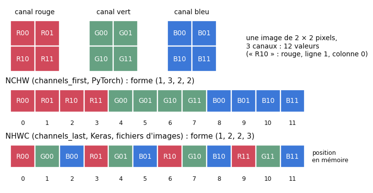
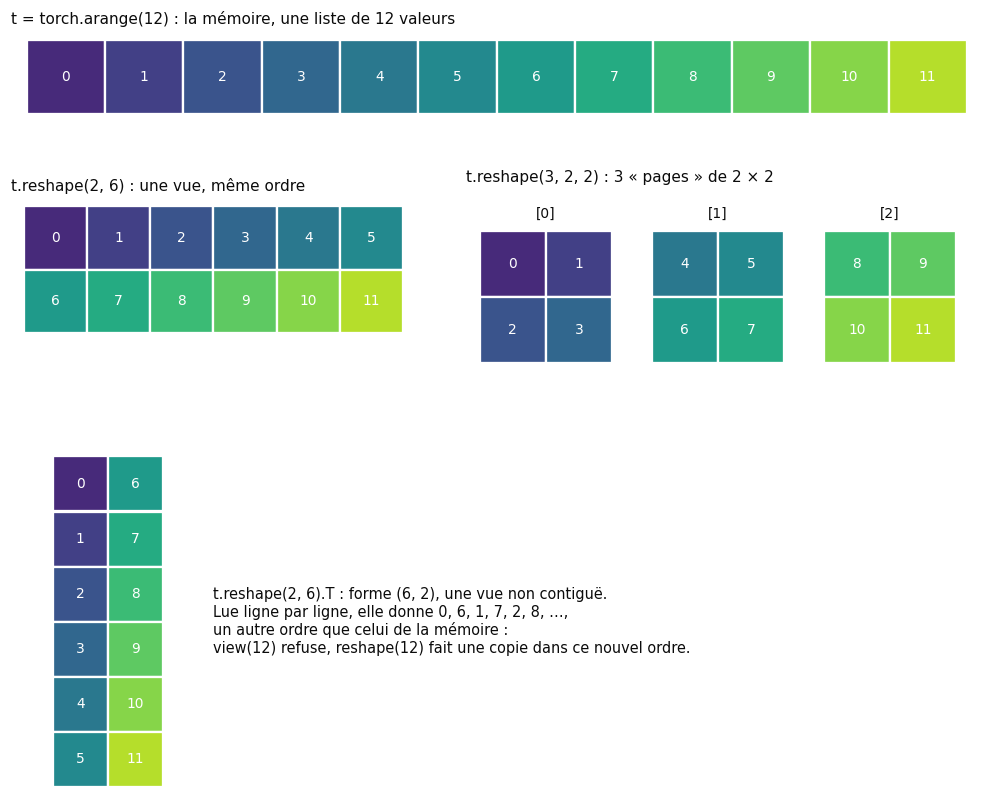
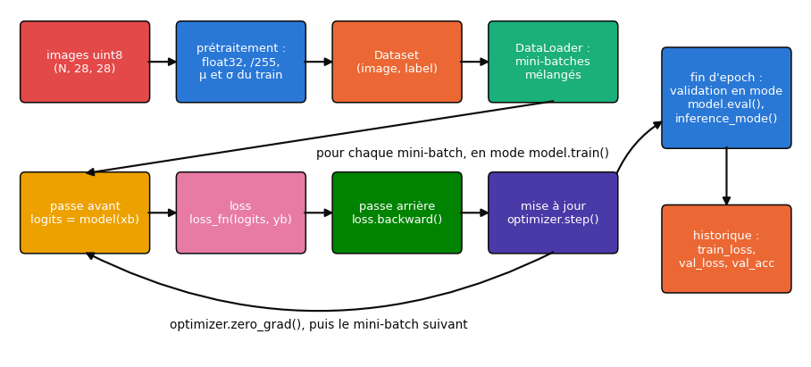
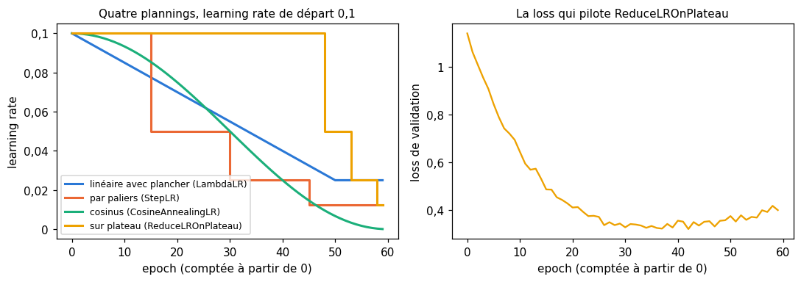
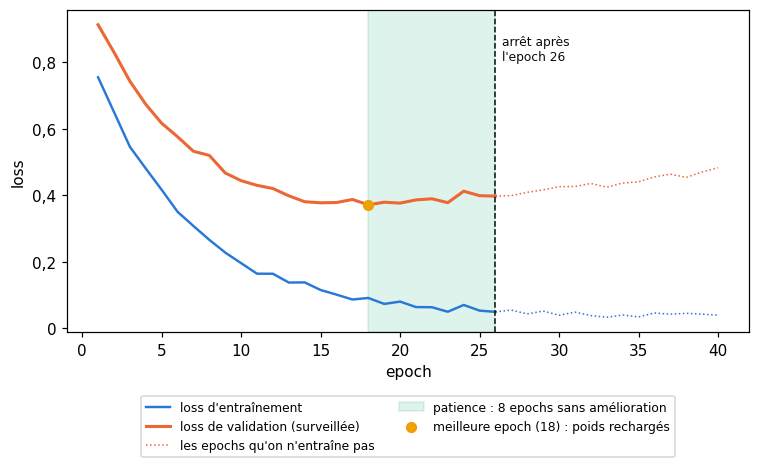

# 23 · PyTorch en pratique 1 : du dataset au modèle sauvegardé — fiche de cours

> Ce chapitre du livre est un tutoriel : il prend le dataset de chiffres manuscrits MNIST et le mène, pas à pas, jusqu'à un réseau entraîné, sauvegardé et surveillé. L'outil du livre est **Keras 2** (2017), qui ne tourne plus tel quel aujourd'hui ; le workbook a choisi **PyTorch** (BIBLE §4), que tu pratiques depuis le ch. 20. Cette fiche suit donc le plan du livre, section par section, et traduit chaque étape en PyTorch moderne, sur **Fashion-MNIST** (des photos de vêtements de même format que MNIST, plus difficiles à classer). Tu y retrouves la démarche du livre, qui n'a pas pris une ride : regarder les données, faire tout le prétraitement au même endroit, construire le modèle, choisir la loss et l'optimiseur, entraîner, lire l'historique, prédire, sauvegarder, surveiller l'entraînement. Ce qui a changé, ce sont les outils : chaque fois qu'une fonction de Keras n'a pas d'équivalent direct, un encadré 🕰️ dit ce qu'on fait en 2026.

| | |
|---|---|
| **Livre** | vol. 2, ch. 23 « Keras Part 1 », p. 1090-1208 (§23.1 à §23.10) |
| **Temps total estimé** | ≈ 20 h : lecture du livre et de la fiche ≈ 6,1 h, exercices ≈ 14 h, 22 flashcards ≈ 0,7 h |
| **Prérequis** | 0A (`pathlib`, `json`, `pickle`, fonctions passées en argument, `lambda`) · ch. 2 (moyenne, écart-type) · ch. 3 (accuracy, matrice de confusion) · ch. 6 (cross-entropy) · ch. 8 (train, validation, test ; découpage stratifié ; fuite de données) · ch. 9 (overfitting, early stopping) · ch. 12 (normalisation, one-hot, prétraitement appris sur le train) · ch. 16 (couche dense, nombre de paramètres) · ch. 17 (ReLU, softmax) · ch. 19 (SGD, Adam, plannings de learning rate) · ch. 20 (tenseurs, autograd, `nn.Module`, `DataLoader`, boucle d'entraînement, `EarlyStopping` de `mylearn`) · ch. 21 (CNN, ResNet) · ch. 22 (formes `(N, T, D)`) |
| **Fichiers du chapitre** | `02_exercices.md` (quiz, rappels, papier, réflexion, entretien) · `03_notebook.ipynb` · `04_indices.md` · `05_solutions.md` et `05_solutions.ipynb` · `06_mes_reponses.md` · `flashcards.csv` |
| **mylearn** | aucun nouveau module : c'est un chapitre de pratique de PyTorch ; le notebook réutilise `mylearn.metrics.confusion_matrix` (ch. 3) et `mylearn.nn.regularization.EarlyStopping` (ch. 20) |

## Comment utiliser ce chapitre

Le livre gravit « trois sommets » avant le dernier : préparer les données (§23.5), construire le modèle (§23.6), l'entraîner (§23.7) ; puis il s'en sert (§23.8), le sauvegarde (§23.9) et surveille ses entraînements par des *callbacks* (§23.10). Ses 68 listings sont du Keras de 2017 : lis-les en diagonale pour la démarche, sans chercher à les retenir ; la fiche donne pour chacun l'équivalent PyTorch, que tu écriras dans le notebook. Compte environ six heures de lecture, livre et fiche.

**Ordre conseillé.**
1. Lis le livre §23.1 à §23.2.2, puis les sections correspondantes de la fiche. Fais les quiz Q1 à Q3.
2. Lis le livre §23.3 à §23.3.5, puis la fiche. Fais les quiz Q4 à Q7 et le rappel R1.
3. Lis le livre §23.4 à §23.5.3, puis la fiche. Fais le quiz Q8 et les exercices ✏️ 23.1 et 23.2.
4. Lis le livre §23.5.4 à §23.5.8, puis la fiche. Fais le rappel R3.
5. Lis le livre §23.6 à §23.7, puis la fiche. Fais les quiz Q9 et Q10, le rappel R2, les exercices ✏️ 23.3, 23.4 et 23.5, et l'estimation 🧮 23.8 a) et b).
6. Lis le livre §23.8 à §23.8.3, puis la fiche.
7. Lis le livre §23.9 à §23.9.5, puis la fiche. Fais le quiz Q11, la fin de 🧮 23.8, l'oral 🗣️ 23.9 et la réflexion ⚖️ 23.10.
8. Lis le livre §23.10 à §23.10.3, puis la fin de la fiche. Fais le quiz Q12, les exercices ✏️ 23.6 et 23.7 et la lecture 📄 23.11. Vérifie tes réponses courtes dans la partie 0 du notebook.
9. Fais le notebook dans l'ordre des ID : environnement et tenseurs, Fashion-MNIST chargé et regardé, prétraitement au même endroit, le MLP du livre, ta fonction `fit()`, l'historique, l'analyse des erreurs, la prédiction, la reprise d'un entraînement, un modèle pré-entraîné, les callbacks, puis le défi. Termine par les cinq questions d'entretien.

| Section | Quiz 🧠 et rappels 🔁 | Papier ✏️ 🧮 et réflexion | Notebook | Entretien 💼 |
|---|---|---|---|---|
| 23.1 et 23.2 Pourquoi une bibliothèque | Q1, Q2, Q3, Q12 | | 23.12 | E5 |
| 23.3 Vue d'ensemble : modèle, tenseurs, configuration | Q4, Q5, Q12 | | 23.12 | E5 |
| 23.3.4 Formes des images | Q6, R1 | 23.2 | | |
| 23.3.5 GPU et autres accélérateurs | Q7 | 23.8, 23.11 | 23.12 | |
| 23.4 et 23.5.2 « Hello world » et chargement | Q8 | | 23.13 | |
| 23.5.1 Remodeler | Q6 | 23.1 | 23.12 | |
| 23.5.3 à 23.5.8 Regarder et préparer les données | Q5, Q9, R3 | 23.4 | 23.13, 23.14, 23.15 | |
| 23.6 Construire le modèle | Q9, Q10 | 23.3, 23.4 | 23.16, 23.18 | |
| 23.7 Entraîner | Q10, R2 | 23.5 | 23.18 | E1 |
| 23.8 Utiliser le modèle | Q10 | 23.5, 23.6 | 23.17, 23.19 à 23.22, 23.29 | E2, E4 |
| 23.9 Sauvegarder et charger | Q11 | 23.8, 23.9, 23.10, 23.11 | 23.17, 23.22 à 23.24, 23.28 | E3 |
| 23.10 Callbacks | | 23.6, 23.7, 23.11 | 23.25, 23.26, 23.27 | E3, E4 |

## Objectifs d'apprentissage

À la fin de ce chapitre, tu sais :
1. **Préparer** un dataset d'images pour PyTorch : type `float32`, normalisation apprise sur le train, découpage stratifié, `Dataset` et `DataLoader`, graines.
2. **Traduire** un modèle Keras (`Sequential`, `Dense`, `compile`, `fit`) en PyTorch (`nn.Sequential`, une loss et un optimiseur, une boucle).
3. **Écrire** une fonction `fit()` réutilisable, qui passe le modèle en mode entraînement ou évaluation, mesure la validation et garde l'historique.
4. **Analyser** un entraînement : courbes de loss et d'accuracy, overfitting, matrice de confusion, exemples mal classés.
5. **Sauvegarder et recharger** un modèle proprement (`state_dict`, checkpoint complet, prétraitement) et **réutiliser** un modèle pré-entraîné.
6. **Reproduire** en PyTorch les callbacks de Keras : meilleur checkpoint, planning de learning rate, early stopping.
7. **Expliquer** la place de Keras 3, multi-backend, face à PyTorch.

## L'essentiel en 10 lignes

1. Une bibliothèque de deep learning t'épargne des années de travail (GPU, stabilité numérique, optimiseurs) ; ce que tu as programmé dans `mylearn` sert à comprendre ce qu'elle fait, et à la déboguer.
2. Un projet passe toujours par les mêmes étapes : charger, **regarder**, préparer, construire, entraîner, évaluer, prédire, sauvegarder.
3. Les données d'images vivent dans des tenseurs `(N, C, H, W)` en PyTorch ; remodeler (`reshape`, `view`) ne bouge pas les valeurs, permuter les axes (`permute`) change l'ordre de lecture.
4. Le prétraitement se fait **à un seul endroit**, se décide sur le train seul (moyenne, écart-type) et s'applique tel quel à la validation, au test et à toute nouvelle image.
5. En PyTorch, la dernière couche d'un classifieur rend des **logits** ; `nn.CrossEntropyLoss` les attend avec des labels entiers : pas de softmax dans le modèle, pas de one-hot.
6. Le `compile()` de Keras devient deux objets, une loss et un optimiseur ; son `fit()` devient une boucle de quelques lignes, que tu écris une fois dans une fonction.
7. `model.train()` et `model.eval()` changent le comportement du dropout et de la batchnorm ; `torch.inference_mode()` coupe le calcul des gradients : à l'inférence, on fait les deux.
8. L'historique (loss et accuracy de train et de validation par epoch) se lit comme au ch. 9 : quand la loss de validation remonte, le modèle commence à apprendre le train par cœur.
9. On sauvegarde un `state_dict` (les tenseurs), pas un objet Python ; un checkpoint de reprise contient aussi l'optimiseur, l'epoch et les générateurs aléatoires ; le prétraitement voyage avec le modèle.
10. Les callbacks de Keras (meilleur checkpoint, planning du learning rate, early stopping) s'écrivent en quelques lignes dans la boucle de PyTorch.

> 📐 **Conventions de la fiche** : celles de PyTorch, comme aux ch. 21 et 22. Un mini-batch d'images a la forme $(N, C, H, W)$ : $N$ images, $C$ canaux, $H$ lignes, $W$ colonnes ; $N$ remplace le $n$ du §6 de la BIBLE, parce que c'est la lettre des messages d'erreur et de la documentation de PyTorch. Les positions se comptent à partir de 0 ; les epochs se comptent à partir de 1 dans la prose (« l'epoch 3 »), mais `LambdaLR` et les callbacks de Keras numérotent à partir de 0 : la fiche le précise à chaque fois.

## 23.1 · Pourquoi ce chapitre ?

Le livre (p. 1093-1094) annonce un chapitre de programmation, le premier de deux, et choisit une seule bibliothèque pour ne pas se disperser. Il prévient que le chemin ne sera pas en ligne droite : il s'arrêtera souvent pour poser une notion avant de s'en servir. La fiche suit le même plan.

### 23.1.1 · La structure du chapitre

Les étapes du livre forment le squelette de tout projet de deep learning, que tu retrouveras au B7 et dans le projet final : préparer, construire, entraîner, utiliser, sauvegarder, surveiller.

### 23.1.2 · Les notebooks

Le livre accompagne chaque section d'un notebook Keras (sur le dépôt GitHub de l'auteur). Ici, le notebook du chapitre est en PyTorch et suit le même ordre.

### 23.1.3 · Les avertissements de Python ⏩

Une bibliothèque évolue : un argument change de nom, un comportement par défaut change. Avant de casser le code des utilisateurs, elle prévient par un **avertissement** (*warning*) : `DeprecationWarning` ou `FutureWarning` annoncent qu'une API va changer ou disparaître ; `UserWarning` signale un usage douteux. Le programme continue. Une **erreur** (une exception non rattrapée, comme `RuntimeError` ou `ValueError`), elle, arrête la cellule.

Le livre conclut qu'on peut en général ignorer les avertissements venus de bibliothèques appelées par d'autres bibliothèques (p. 1095). C'est vrai pour ceux que tu ne peux pas corriger. Mais un avertissement qui vient de **ton** appel dit souvent quelque chose d'utile : PyTorch prévient quand on appelle `scheduler.step()` avant `optimizer.step()`, ou quand on donne à `nn.MSELoss` une cible d'une autre forme que la prédiction (le calcul serait diffusé en silence, et faux). Lis-le avant de le faire taire, et ne fais jamais taire tous les avertissements d'un notebook d'un coup (`warnings.filterwarnings("ignore")`) : tu perdrais ceux-là aussi.

## 23.2 · Bibliothèques et débogage

Pourquoi une bibliothèque, alors qu'écrire son propre code fait mieux comprendre ? Le livre (p. 1095-1096) répond par une analogie : on programme en Python plutôt qu'en code machine pour penser à son problème, pas aux registres du processeur ; de même, une bibliothèque de deep learning laisse penser en couches, en losses et en optimiseurs, et règle pour toi la stabilité numérique, les GPU, le parallélisme.

C'est exactement le chemin du workbook : tu as écrit dans `mylearn` une couche dense, une softmax stable, la rétropropagation, Adam, le dropout, une convolution et un LSTM, chaque fois comparés à PyTorch. Tu sais donc ce que fait chaque appel de ce chapitre. La bibliothèque apporte la vitesse et la robustesse ; ta librairie t'a donné la compréhension qui permet de lire ses messages d'erreur.

### 23.2.1 · Versions et style de programmation ⏩

Le livre utilise Python 3.5 et Keras 2.0.6 (p. 1097). Le workbook fige ses versions sur celles de Colab (BIBLE §21) : Python 3.13, PyTorch 2.11, torchvision 0.26. Un notebook qui doit donner les mêmes résultats dans un an note ses versions : `torch.__version__`, `torchvision.__version__`, et un `requirements.txt` avec des versions exactes.

Le livre écrit volontairement un code long et explicite, des noms de variables parlants, et construit ses programmes par petits morceaux. C'est aussi le style de ce workbook : le code d'un notebook est d'abord fait pour être relu.

> ⚠️ **Le livre, corrigé — Python 2.7 et Python 3** — Le livre date de 2008 un passage « de la version 2.7 à la version 3 » (p. 1097). Python 3.0 est sorti en décembre 2008, mais Python 2.7 n'est sorti qu'en juillet 2010 : les deux branches ont vécu en parallèle pendant onze ans, jusqu'à la fin de Python 2, le 1ᵉʳ janvier 2020.

### 23.2.2 · Programmer et déboguer en Python

Le code d'un livre ressemble à une maison finie ; il a été construit, cassé et reconstruit (p. 1098). Le livre conseille de développer **une ligne à la fois** dans Jupyter, en vérifiant chaque résultat, puis de rassembler le code dans une fonction. Quand une bibliothèque plante au fond d'une fonction inconnue, il propose une méthode en trois temps : **réduire** l'appel fautif jusqu'à ce que l'erreur disparaisse, **isoler** la partie qui la provoque, puis **reconstruire** pas à pas à partir d'un exemple qui marche.

En PyTorch, la plupart des erreurs de débutant sont des erreurs de **forme**, de **type** ou de **device**, et le message les nomme. Par exemple :

```text
RuntimeError: mat1 and mat2 shapes cannot be multiplied (64x784 and 512x10)
```

se lit ainsi : la couche reçoit un mini-batch de 64 lignes de 784 valeurs, mais sa matrice de poids attend 512 valeurs par ligne : la couche précédente n'a pas la sortie que tu crois. Le premier réflexe est d'afficher les formes (`print(x.shape)`) juste avant la ligne qui plante. Pour aller plus loin, `breakpoint()` (Python 3.7 et plus) arrête l'exécution et ouvre le débogueur `pdb` à l'endroit choisi ; VS Code et Jupyter ont aussi un débogueur graphique, avec des points d'arrêt et l'inspection des variables.

## 23.3 · Vue d'ensemble

Keras construit un réseau en empilant des couches paramétrées (p. 1100). Le livre compare cette liberté à la grammaire d'une langue : on peut écrire des phrases correctes qui ne veulent rien dire, et l'on peut empiler des couches compatibles qui n'apprendront rien d'utile. C'est vrai en PyTorch aussi : `nn.Sequential` vérifie que les formes s'enchaînent quand les données passent, jamais que le modèle a du sens.

### 23.3.1 · Qu'est-ce qu'un « modèle » ?

Le mot a trois sens, que le livre reprend de la documentation de Keras (p. 1101) :
- l'**architecture** : le plan des couches, sans poids appris ;
- l'architecture **avec ses poids** appris, prête à prédire ;
- l'**API**, l'ensemble des appels qui servent à construire et à entraîner.

En PyTorch, la distinction est nette. Un `nn.Module` (comme `nn.Sequential`) est un objet Python qui porte l'architecture **et** ses poids (tirés au hasard à la construction, appris ensuite). Son `state_dict()` ne contient que les **tenseurs** (poids et buffers), rangés par nom, sans l'architecture : pour s'en servir, il faut reconstruire le même module, puis y charger les tenseurs (§23.9). Et `torch.nn`, `torch.optim`, `torch.utils.data` forment l'API.

### 23.3.2 · Tenseurs et tableaux ⏩

Pour une bibliothèque de deep learning, un **tenseur** est simplement un tableau de nombres décrit par deux attributs : son nombre d'axes (`ndim` : 1 pour un vecteur, 2 pour une matrice, 4 pour un mini-batch d'images) et la taille de chaque axe (`shape`), toutes les lignes d'un même axe ayant la même longueur (p. 1102). En mathématiques et en physique, le mot désigne un objet plus riche, défini par la façon dont il change avec le repère ; ce sens-là ne sert pas ici.

NumPy appelle ses tenseurs des *arrays* (`np.ndarray`) ; PyTorch, des `torch.Tensor`. Les deux se convertissent l'un en l'autre : `torch.from_numpy(a)` **partage** la mémoire du tableau (modifier l'un modifie l'autre), `torch.tensor(a)` la **copie**, et `t.numpy()` fait le chemin inverse (pour un tenseur sur le CPU, sans gradient).

Deux différences comptent tout de suite (ch. 20). Le type des réels par défaut est `float64` en NumPy et **`float32`** en PyTorch : `torch.tensor([0.5])` est en `float32`, mais `torch.from_numpy(np.array([0.5]))` garde le `float64` de NumPy. Les couches de PyTorch ont des poids en `float32` et attendent des entrées du même type : une conversion explicite (`.float()`, `.astype(np.float32)`) fait partie du prétraitement.

### 23.3.3 · Installer et configurer la bibliothèque ⏩

Le livre (p. 1102-1107) décrit Keras 2 comme une couche au-dessus de trois « moteurs » au choix, ses *backends* (Theano, TensorFlow ou CNTK), choisis dans un fichier de configuration `keras.json`, avec aussi le type des réels (`floatx`), une petite constante numérique (`epsilon`) et l'ordre des axes des images (`image_data_format`).

En PyTorch, il n'y a ni backend à choisir ni fichier de configuration : la bibliothèque calcule elle-même, sur le CPU ou un accélérateur (§23.3.5). Ce que `keras.json` réglait se fait dans le code :

| Réglage du livre (Keras 2) | En PyTorch |
|---|---|
| `backend` : Theano, TensorFlow ou CNTK | rien à choisir |
| `floatx` : `float32` | `float32` par défaut ; `torch.set_default_dtype` existe mais sert rarement |
| `epsilon` | un argument de chaque fonction qui en a besoin (`eps` d'Adam, de la batchnorm) |
| `image_data_format` : `channels_last` | toujours `channels_first`, $(N, C, H, W)$ (§23.3.4) |

> 🕰️ **Mise à jour (2026) — Keras aujourd'hui** — **Le livre :** Keras 2.0 autonome, au-dessus de Theano, TensorFlow 1.x ou CNTK, réglé par `keras.json`. · **Aujourd'hui :** Theano n'est plus développé depuis sa version 1.0 (fin 2017, annoncée par Y. Bengio en septembre), ni CNTK depuis sa version 2.7 (2019). Keras 3 (depuis novembre 2023) est redevenu **multi-backend** : le même code tourne sur JAX, TensorFlow ou PyTorch. Le code du livre ne tourne pas tel quel : `predict_classes`, `to_yaml`, l'argument `lr` des optimiseurs ou `period` de `ModelCheckpoint` ont disparu. · **Faut-il quand même l'apprendre ?** La syntaxe du livre, non ; sa démarche, oui, et Keras reste un choix raisonnable, en particulier pour qui veut changer de backend sans réécrire son modèle. Ce workbook utilise PyTorch, majoritaire dans la recherche et dans les modèles publiés, et dont la boucle d'entraînement, écrite à la main, montre chaque étape. · *Sources :* [guide de migration vers Keras 3](https://keras.io/guides/migrating_to_keras_3/), [Keras sur PyPI](https://pypi.org/project/keras/), BIBLE §21.

### 23.3.4 · La forme des tenseurs d'images

Une image en couleur a trois **canaux** (rouge, vert, bleu), chacun une grille de pixels. On peut ranger les canaux devant, `(C, H, W)`, c'est l'ordre **channels_first** ; ou derrière, `(H, W, C)`, c'est **channels_last** (livre p. 1104-1106 et fig. 23.1). Avec l'axe des exemples en tête, on parle de **NCHW** et de **NHWC**.

| Convention | Forme d'un mini-batch | Qui l'utilise |
|---|---|---|
| channels_first, NCHW | $(N, C, H, W)$ | PyTorch (`nn.Conv2d`, `nn.BatchNorm2d`) |
| channels_last, NHWC | $(N, H, W, C)$ | Keras et TensorFlow par défaut, la plupart des fichiers d'images, `matplotlib.pyplot.imshow` |

Une image chargée par Pillow ou NumPy arrive en général en $(H, W, C)$ ; pour PyTorch, on **permute** les axes : `x.permute(2, 0, 1)` pour une image, `x.permute(0, 3, 1, 2)` pour un mini-batch. Une image en niveaux de gris comme celles de Fashion-MNIST n'a qu'un canal : `(28, 28)` devient `(1, 28, 28)` par `unsqueeze(0)` (ou `(N, 1, 28, 28)` pour un mini-batch).

Le danger, que le livre illustre (p. 1105), est la confusion silencieuse : un bloc `(H, W, C)` lu comme `(C, H, W)` donne $H$ « canaux » d'images de $W \times C$ pixels. Le plus souvent, une couche refuse la forme et tu as une erreur ; mais quand les tailles s'y prêtent, rien ne plante et le modèle apprend sur des pixels mélangés. Une image affichée (`plt.imshow`) après chaque conversion est le meilleur contrôle.



> 🧮 **Rappel outil — `channels_last` en PyTorch** — PyTorch accepte aussi un rangement **en mémoire** NHWC (`x.to(memory_format=torch.channels_last)`), plus rapide sur certains GPU pour les convolutions ; la **forme** affichée reste `(N, C, H, W)`. Ne le confonds pas avec l'ordre des axes : c'est une optimisation, pas une convention.

### 23.3.5 · GPU et autres accélérateurs ⏩

Les GPU, conçus pour le jeu vidéo, font un très grand nombre de calculs identiques en parallèle ; or la passe avant et la passe arrière d'un réseau sont surtout des produits de matrices, exactement ce qu'ils savent faire (p. 1108). Le livre décrit le paysage de 2018 : NVIDIA et CUDA dominent, OpenCL promet des GPU de toutes marques, les TPU de Google sont rares.

En PyTorch, l'endroit où vivent un tenseur et ses calculs est son **device** :

```python
import torch

if torch.cuda.is_available():
    device = "cuda"                          # NVIDIA (or AMD with the ROCm build of PyTorch)
elif torch.backends.mps.is_available():
    device = "mps"                           # Apple GPU (M1 and later)
else:
    device = "cpu"
model = model.to(device)                     # moves the parameters
xb = xb.to(device)                           # every mini-batch too
```

Un modèle et ses données doivent être sur le même device, sinon PyTorch lève une erreur qui le dit. Dans ce workbook, `wb.setup()` choisit `cuda` s'il existe, sinon `cpu` (BIBLE §4 : le GPU d'Apple seulement sur demande).

> 🕰️ **Mise à jour (2026) — les accélérateurs** — **Le livre :** CUDA pour les GPU NVIDIA, OpenCL encore en chantier, des TPU rares. · **Aujourd'hui :** CUDA reste dominant ; PyTorch a aussi une version pour les GPU AMD (ROCm) et un backend pour les GPU d'Apple (`mps`, depuis PyTorch 1.12, 2022) ; les TPU de Google sont accessibles sur Colab, mais PyTorch ne s'en sert qu'à travers une bibliothèque dédiée, pas avec `device="cuda"` : PyTorch/XLA, que Google remplace en 2026 par un nouveau projet, TorchTPU (le dépôt de PyTorch/XLA doit être archivé en novembre 2026). · **Faut-il quand même l'apprendre ?** Oui : le choix du device et le passage des données sur ce device sont les deux lignes que tout code PyTorch contient. · *Sources :* [documentation de `torch.backends.mps`](https://pytorch.org/docs/stable/notes/mps.html), [dépôt de PyTorch/XLA et son annonce d'archivage](https://github.com/pytorch/xla).

## 23.4 · Bien commencer

Une documentation de référence décrit chaque argument, rarement le choix à faire entre eux (p. 1109). Le livre promet de justifier chacun de ses réglages ; la fiche fait de même, et le notebook te fait lire la documentation de PyTorch pour les arguments dont le livre ne parle pas.

### 23.4.1 · Hello, world ⏩

Le premier programme d'un langage affiche « hello, world » ; en machine learning, le « hello world » est un petit dataset que tout le monde connaît (p. 1110-1113). Le livre en cite deux :
- **Iris** : 150 fleurs de 3 espèces, 4 mesures par fleur (longueur et largeur du **sépale** et du **pétale**) ;
- **MNIST** : 70 000 chiffres manuscrits en niveaux de gris de 28 × 28 pixels, 60 000 pour l'entraînement et 10 000 pour le test, avec leur label de 0 à 9.

Leurs avantages : connus, propres, petits, faciles à visualiser, avec des résultats publiés pour se comparer. Leur défaut, selon le livre : à force de servir, ils deviennent lassants. On peut ajouter qu'un score sur MNIST ne départage plus guère deux méthodes.

> ⚠️ **Le livre, corrigé — Iris dans Keras** — Le livre écrit que Keras a des fonctions qui chargent Iris et MNIST en une ligne (p. 1111) ; `keras.datasets` n'a jamais contenu Iris (on le charge avec scikit-learn, `sklearn.datasets.load_iris`). Il décrit aussi les quatre mesures d'Iris comme celles de « deux sortes de pétales » : ce sont le sépale et le pétale, comme le dit la légende de son listing.

> 🕰️ **Mise à jour (2026) — Fashion-MNIST, le nouveau hello world** — **Le livre :** MNIST et Iris. · **Aujourd'hui :** Fashion-MNIST (Xiao, Rasul et Vollgraf, 2017) a été conçu par Zalando comme remplaçant direct de MNIST : 70 000 images de vêtements en niveaux de gris de 28 × 28 pixels, 10 classes, le même découpage 60 000 / 10 000 et les mêmes formats de fichiers, pour trois raisons données par ses auteurs : MNIST est trop facile (un petit CNN dépasse 99 %), trop utilisé, et ne ressemble pas aux tâches modernes de vision. · **Faut-il quand même l'apprendre ?** Oui : un dataset qui se télécharge en une seconde reste le meilleur terrain pour mettre au point un pipeline. Ce chapitre utilise Fashion-MNIST, plus discriminant : un même MLP y fait une dizaine de points d'accuracy de moins que sur MNIST, et ses erreurs sont plus instructives. · *Source :* [Xiao et coll., 2017, arXiv:1708.07747](https://arxiv.org/abs/1708.07747).

## 23.5 · Préparer les données

Le livre (p. 1114) rappelle ce que ses auteurs ont déjà fait pour MNIST : des images centrées et mises à l'échelle, des chiffres droits. Les données « propres » ont coûté du travail ; sur un dataset à toi, c'est à toi de le faire, et c'est souvent la plus grande part d'un projet.

### 23.5.1 · Remodeler ⏩

Un tenseur est rangé en mémoire comme une seule **liste de valeurs**, lue dans un ordre fixé : en NumPy et en PyTorch, l'**ordre C**, ligne par ligne, où le **dernier** indice varie le plus vite. Sa **forme** dit seulement comment découper cette liste. Pour une forme $(D_1, D_2, D_3)$, l'élément $(i, j, k)$ est à la position

$$\text{indice plat}(i, j, k) = i\,D_2 D_3 + j\,D_3 + k.$$

Le livre le montre avec douze lettres rangées de différentes façons (p. 1115-1125) : une grille de 3 lignes et 4 colonnes, de 4 et 3, de 2 et 6, des blocs de $2 \times 3 \times 2$… L'image qu'il propose est celle d'un livre : la page (l'axe « au loin »), puis la ligne, puis la lettre dans la ligne. Exemple avec les nombres de 0 à 11 :

```python
import torch

t = torch.arange(12)          # 0, 1, ..., 11
a = t.reshape(2, 6)           # a[1, 2] is 1 * 6 + 2 = 8
b = t.reshape(3, 2, 2)        # b[2, 0, 1] is 2 * 4 + 0 * 2 + 1 = 9
t.reshape(7, 2)               # RuntimeError: shape '[7, 2]' is invalid for input of size 12
```

La seule règle : le **produit** des tailles ne change pas. Un `-1` laisse PyTorch calculer une taille : `t.reshape(4, -1)` a la forme `(4, 3)`.



Le livre insiste : remodeler ne déplace pas les données, c'est donc gratuit (p. 1121). C'est vrai d'une **vue** (*view*), un nouveau tenseur qui partage la mémoire de l'ancien avec une autre forme. Mais ce n'est pas toujours possible :
- `view` rend toujours une vue, et lève une erreur si la forme demandée ne correspond pas au rangement en mémoire ;
- `reshape` rend une vue quand c'est possible, sinon une **copie** ;
- `permute` (et `.T`, `transpose`) change l'**ordre des axes** : c'est une vue, mais l'ordre de lecture n'est plus celui de la mémoire. Le tenseur est alors **non contigu** (`is_contiguous()` rend `False`), `view` refuse de l'aplatir, et `reshape` en fait une copie, dans le nouvel ordre ; `.contiguous()` fait cette copie explicitement.

Retiens la différence de fond : `reshape` regroupe autrement les valeurs **dans le même ordre**, `permute` change **l'ordre** des valeurs. Pour passer de NHWC à NCHW, `reshape` donne la bonne forme mais mélange les pixels ; seul `permute` donne la bonne image (✏️ 23.2).

### 23.5.2 · Charger les données ⏩

Keras chargeait MNIST en une ligne (p. 1126) ; torchvision et ce workbook aussi :

```python
import wb

X_train, y_train = wb.datasets.load_fashion_mnist("train", seed=None)   # (60000, 28, 28) uint8, (60000,) int64
X_test, y_test = wb.datasets.load_fashion_mnist("test", seed=None)      # (10000, 28, 28), (10000,)
CLASSES = wb.datasets.FASHION_CLASSES                                    # 'T-shirt/top', 'Trouser', ...
```

Avec torchvision seul, `torchvision.datasets.FashionMNIST(root, train=True, download=True)` télécharge les fichiers dans `root` et rend un `Dataset` d'images Pillow. Comme chez Keras, un second chargement lit les fichiers déjà téléchargés.

Le livre prend l'habitude de nommer `X` les features et `y` les labels (p. 1128), une convention que tu suis depuis le ch. 8 ; la forme `(60000,)` est celle d'un tableau à un seul axe (la virgule distingue un tuple d'un seul élément d'un nombre entre parenthèses).

### 23.5.3 · Regarder les données ⏩

Avant tout, on **regarde** (p. 1129-1135). Le livre sépare deux familles de problèmes :
- les problèmes de **contenu** : des valeurs fausses ou bizarres. Sur MNIST, il trouve des chiffres qui touchent le bord, d'autres coupés, du bruit, des chiffres ambigus même pour un humain ; il décide de les garder, assez rares pour ne pas nuire, et utiles pour rendre le réseau robuste ;
- les problèmes de **structure** : des formes, des types ou des alignements inattendus. Il vérifie les formes, le type (`uint8`, des entiers de 0 à 255) et que les labels correspondent bien aux images, en affichant les 15 premières avec leur label.

Ces contrôles prennent cinq minutes et évitent des heures de débogage :

```python
print(X_train.shape, X_train.dtype, X_train.min(), X_train.max())
print(np.bincount(y_train))                     # how many images per class?
fig, axes = plt.subplots(2, 8, figsize=(10, 3))
for ax, image, label in zip(axes.flat, X_train, y_train):
    ax.imshow(image, cmap="gray_r")
    ax.set_title(CLASSES[label], fontsize=7)
    ax.axis("off")
```


Sur Fashion-MNIST, tu verras des classes faciles (pantalons, sacs) et des classes qui se ressemblent (chemises, T-shirts, pulls, manteaux) : ce sont elles qui feront la plupart des erreurs du modèle (§23.8.1).

### 23.5.4 · Découper en train et en test ⏩

MNIST et Fashion-MNIST arrivent déjà découpés en train et en test. Sur un dataset qui ne l'est pas, le livre utilise `train_test_split` de scikit-learn, avec un quart des données pour le test (p. 1136-1137). Il remarque au passage que deux bibliothèques ne rendent pas leurs résultats dans le même ordre (deux paires chez Keras, quatre tableaux chez scikit-learn) : encore une raison d'avancer ligne à ligne.

Ce dont le livre ne parle pas ici, et qui compte (ch. 8) : il faut **aussi** une validation, prise dans le train, pour choisir les réglages et l'epoch d'arrêt, sans toucher au test. On la tire en général **stratifiée**, pour garder les proportions des classes, et avec une graine :

```python
from sklearn.model_selection import train_test_split

X_tr, X_val, y_tr, y_val = train_test_split(X_train, y_train, test_size=0.1, stratify=y_train,
                                            random_state=0)   # 54000 + 6000, the same 10 % of each class
```

### 23.5.5 · Corriger le type des données ⏩

Les pixels arrivent en entiers `uint8` (0 à 255). Le livre explique que Keras attend des réels du type `floatx`, `float32`, et convertit avec une fonction de Keras (p. 1138). En PyTorch, les poids sont en `float32` et les entrées doivent l'être aussi : `X.astype(np.float32)` en NumPy, `x.float()` en PyTorch. Les labels, eux, restent des **entiers** : `int64` (`torch.long`), le type qu'attend `nn.CrossEntropyLoss` pour des indices de classe.

### 23.5.6 · Normaliser les données ⏩

La normalisation change les **valeurs**, pas la forme (p. 1139-1142). Le livre ramène les pixels de $[0, 255]$ à $[0, 1]$ en divisant par 255, après avoir montré que `np.interp` fait la même chose plus lentement. Il ajoute une remarque importante : une image nouvelle doit subir **exactement** la même transformation, la division par 255, et non une remise à l'échelle par ses propres minimum et maximum.

La pratique courante va un pas plus loin : après la division par 255, on **centre et réduit** avec la moyenne $\mu$ et l'écart-type $\sigma$ des pixels **du train**,

$$x' = \frac{x / 255 - \mu_{\text{train}}}{\sigma_{\text{train}}},$$

ce qui donne des entrées de moyenne 0 et d'écart-type 1 sur le train, et aide l'optimisation (ch. 12, ch. 16). Comme au ch. 12, $\mu$ et $\sigma$ s'apprennent sur le train seul ; la validation, le test et toute image future utilisent ces deux nombres-là, sans les recalculer. Pour des images, on prend une seule moyenne et un seul écart-type par canal (ici, un seul canal), pas un par pixel.

> ⚠️ **Le livre, corrigé — pourquoi normaliser** — Le livre justifie la normalisation par les « couches de convolution » du réseau de ce chapitre (p. 1139), qui n'en a pas : c'est un réseau dense. Il ajoute (p. 1140) qu'elle aide la régularisation et retarde l'overfitting. Ce que la normalisation fait vraiment, c'est mettre toutes les entrées à la même échelle, ce qui rend la descente de gradient plus facile (des pas adaptés à toutes les directions, ch. 12 et 19) ; c'est vrai pour toutes les couches, dense ou convolutive. Elle n'est pas, en elle-même, une régularisation.

### 23.5.7 · Corriger les labels ⏩

Pour Keras, le livre code chaque label en **one-hot** avec `to_categorical` : un vecteur de 10 valeurs, tout à 0 sauf un 1 à la place de la classe, qu'on compare aux 10 probabilités de la softmax de sortie (p. 1142-1148). Il signale un piège qu'il faut retenir, quelle que soit la bibliothèque : sans le nombre de classes, la fonction le **devine** d'après le plus grand label présent ; un jeu de test sans aucun 9 donnerait des vecteurs de 9 valeurs. D'où l'argument `num_classes`.

En PyTorch, ce codage est inutile : `nn.CrossEntropyLoss` prend directement les **indices de classe**, des entiers de 0 à $K - 1$ de forme `(N,)`. Quand tu as besoin du one-hot (pour un affichage, une loss à toi), `torch.nn.functional.one_hot(y, num_classes=10)` le fabrique, et le même piège existe sans `num_classes`. Pour revenir d'un one-hot (ou d'un vecteur de probabilités) à un indice, on prend l'argmax : `p.argmax(dim=1)`.

> 🕰️ **Mise à jour (2026) — labels et loss** — **Le livre :** `to_categorical`, une softmax dans la dernière couche et la loss `categorical_crossentropy`, qui compare des probabilités à des one-hot. · **Aujourd'hui :** en PyTorch, `nn.CrossEntropyLoss` prend des **logits** (la sortie de la dernière couche, sans softmax) et des indices de classe ; elle accepte aussi des probabilités cibles (depuis la version 1.10) et un `label_smoothing`. Keras avait déjà une loss pour des labels entiers (`sparse_categorical_crossentropy`) ; ses losses ont depuis gagné un argument `from_logits=True`. · **Faut-il quand même l'apprendre ?** Oui : ajouter une softmax avant `nn.CrossEntropyLoss` est l'erreur n° 1 des débutants en PyTorch, et elle ne plante pas (✏️ 23.4). · *Source :* [documentation de `torch.nn.CrossEntropyLoss`](https://pytorch.org/docs/stable/generated/torch.nn.CrossEntropyLoss.html).

### 23.5.8 · Tout le prétraitement au même endroit ⏩

Le livre réunit toutes ses étapes en un seul listing (p. 1148-1150), et y ajoute une **graine** pour que les tirages aléatoires soient les mêmes à chaque exécution. C'est la bonne habitude : une seule fonction de prétraitement, appelée sur le train, la validation, le test et toute image future. En PyTorch, elle produit des tenseurs, qu'un `Dataset` présente exemple par exemple et qu'un `DataLoader` regroupe en mini-batches (ch. 20) :

```python
import numpy as np
import torch
from torch.utils.data import DataLoader, TensorDataset

def preprocess(images, mean, std):
    """uint8 images (N, 28, 28) -> float32 tensor (N, 1, 28, 28), normalized with the TRAIN statistics."""
    x = (images.astype(np.float32) / 255.0 - mean) / std
    return torch.from_numpy(x.astype(np.float32)).unsqueeze(1)     # float32, like the weights

mean, std = float((X_tr / 255.0).mean()), float((X_tr / 255.0).std())   # learned on the training images only
train_ds = TensorDataset(preprocess(X_tr, mean, std), torch.from_numpy(y_tr))
val_ds = TensorDataset(preprocess(X_val, mean, std), torch.from_numpy(y_val))
generator = torch.Generator().manual_seed(0)                       # the order of the mini-batches
train_loader = DataLoader(train_ds, batch_size=256, shuffle=True, generator=generator)
val_loader = DataLoader(val_ds, batch_size=1024)                   # no shuffling for evaluation
```

torchvision propose aussi des **transformations** qui s'appliquent image par image, chaque fois qu'un exemple est lu : `v2.Compose([v2.ToImage(), v2.ToDtype(torch.float32, scale=True), v2.Normalize((mean,), (std,))])` fait la conversion, la division par 255 et la normalisation. Elles sont indispensables pour l'augmentation de données (des transformations aléatoires, ch. 24) ; pour un petit dataset qui tient en mémoire, préparer les tenseurs une fois pour toutes est plus simple et plus rapide.

> 💼 **En entreprise** — Le prétraitement est la première source de bugs en production : un modèle entraîné sur des pixels divisés par 255 qui reçoit des pixels bruts se trompe sans rien signaler. D'où une règle : **une** fonction de prétraitement, testée, versionnée avec le modèle, et ses paramètres ($\mu$, $\sigma$, la liste des classes) enregistrés à côté des poids (§23.9.5).

## 23.6 · Construire le modèle ⏩

Le modèle du livre est un perceptron multicouche minimal (p. 1150-1152) : une couche dense cachée de 784 neurones, un par pixel (un choix commode, pas une règle), avec une ReLU, puis une couche dense de 10 neurones, une par classe. Construire un modèle en Keras se fait en deux temps : le **spécifier** (la liste des couches), puis le **compiler** (choisir la loss, l'optimiseur et les mesures à suivre).

### 23.6.1 · Des grilles aux listes ⏩

Une couche dense reçoit un vecteur par exemple : il faut **aplatir** chaque image de 28 × 28 pixels en 784 valeurs (p. 1152-1154). Le livre le fait une fois pour toutes dans le prétraitement, avec `reshape`, pour éviter un remodelage à chaque passage d'un exemple. En PyTorch, on met plutôt une couche `nn.Flatten()` en tête du modèle : elle aplatit tout sauf l'axe des exemples, `(N, 1, 28, 28)` → `(N, 784)`, et c'est une vue, qui ne coûte presque rien. Le modèle accepte alors des images, ce qui simplifie la prédiction (§23.8.2) et le passage à un CNN (ch. 24).

> ⚠️ **Le livre, corrigé — le coût d'un remodelage** — Le livre préfère remodeler les données une fois, parce qu'une couche de remodelage « prendrait du temps » à chaque exemple (p. 1152) ; il a pourtant expliqué (p. 1121) qu'un remodelage ne déplace aucune donnée. Une vue coûte quelques opérations, quelle que soit la taille du tenseur : face aux 600 000 multiplications de la première couche, c'est invisible. On le met dans le modèle pour la clarté. (Il y a aussi une coquille p. 1153 : les images aplaties forment un tableau de 60 000 × 784, pas × 748.)

### 23.6.2 · Créer le modèle ⏩

Le `Sequential` de Keras devient `nn.Sequential` de PyTorch, qui applique ses couches dans l'ordre :

```python
import torch.nn as nn

def make_mlp(n_hidden=784, n_classes=10):
    return nn.Sequential(
        nn.Flatten(),                  # (N, 1, 28, 28) -> (N, 784)
        nn.Linear(784, n_hidden),      # Keras: Dense(784, input_shape=[784])
        nn.ReLU(),                     # Keras: activation='relu' inside Dense
        nn.Linear(n_hidden, n_classes) # logits: no softmax here (see 23.6.3)
    )

model = make_mlp()
print(model)                                                   # the layers, in order
print(sum(p.numel() for p in model.parameters()))              # the number of parameters
```

Trois différences avec Keras (p. 1154-1162) :
- PyTorch demande la taille d'**entrée** de chaque couche dense (`nn.Linear(784, 784)`), alors que Keras la déduit de la couche précédente et ne demande `input_shape` qu'à la première. Si tu ne veux pas la calculer, `nn.LazyLinear(784)` la découvre au premier passage des données ;
- l'activation est une **couche à part** (`nn.ReLU()`), pas un argument de la couche dense ;
- la dernière couche n'a **pas** de softmax.

Le `summary()` de Keras affiche, couche par couche, la forme de sortie et le nombre de paramètres. En PyTorch, `print(model)` liste les couches, et une ligne compte les paramètres ; la bibliothèque `torchinfo` (non utilisée ici) imite le tableau de Keras. Chaque couche dense a $(n_{in} + 1)\,n_{out}$ paramètres : un poids par couple (entrée, neurone) et un biais par neurone. Le livre détaille le calcul de son modèle : plus de 600 000 paramètres, presque tous dans la première couche (✏️ 23.3).

> 🧮 **Rappel maths — les paramètres d'une couche dense** — Une couche de $n_{in}$ entrées et $n_{out}$ neurones a une matrice de poids de $n_{in} \times n_{out}$ valeurs et $n_{out}$ biais : $(n_{in} + 1)\,n_{out}$ paramètres (ch. 16). Une ReLU, un `Flatten` ou un dropout n'en ont aucun. Exemple : une couche de 100 entrées et 20 neurones a $101 \times 20 = 2\,020$ paramètres.

Le livre rappelle au passage que l'entrée d'un réseau n'est pas une couche (on ne la dessine ni ne la compte), et que le `None` de la forme de sortie d'un `summary()` de Keras tient la place de la taille du mini-batch, inconnue à la construction. En PyTorch, la question ne se pose pas : la forme se lit quand les données passent.

### 23.6.3 · « Compiler » le modèle ⏩

En Keras, `compile()` reçoit la loss, l'optimiseur et les mesures à suivre (p. 1163-1167). Le livre fait de la loss le « pourquoi » d'un réseau : c'est elle qui dit ce que l'on cherche, l'architecture et l'optimiseur n'étant que le « quoi » et le « comment ». Il choisit la cross-entropy catégorielle (ch. 6), Adam (ch. 19) et l'accuracy.

En PyTorch, il n'y a rien à compiler : la loss et l'optimiseur sont deux **objets**, créés après le modèle, et l'accuracy se calcule dans la boucle.

```python
loss_fn = nn.CrossEntropyLoss()                               # Keras: loss='categorical_crossentropy'
optimizer = torch.optim.Adam(model.parameters(), lr=1e-3)     # Keras: optimizer='adam' (lr = 0.001 too)
```

L'optimiseur reçoit `model.parameters()` : c'est ainsi qu'il sait quels tenseurs mettre à jour. Ses réglages se donnent à la construction (`lr=1e-4` pour l'Adam « lent » du livre).

La cross-entropy d'un exemple de label $y$ et de logits $\mathbf{z} = (z_0, \dots, z_{K-1})$ vaut

$$L = -\ln \operatorname{softmax}(\mathbf{z})_y = -z_y + \ln \sum_{j} e^{z_j},$$

et `nn.CrossEntropyLoss` rend la **moyenne** de ces valeurs sur le mini-batch. Elle fait elle-même la softmax, de façon stable (le terme $\ln \sum_j e^{z_j}$, calculé sans débordement, comme au ch. 17). Si le modèle se termine déjà par une softmax, la loss en applique une **seconde** à des valeurs entre 0 et 1 : le calcul ne plante pas, mais la loss ne peut presque plus descendre et l'entraînement se traîne (✏️ 23.4 en calcule un exemple).

> 🕰️ **Mise à jour (2026) — `compile()` et `fit()`** — **Le livre :** `model.compile(loss, optimizer, metrics)`, puis `model.fit(...)`, qui fait tout l'entraînement. · **Aujourd'hui :** en PyTorch, la loss et l'optimiseur sont des objets et la boucle s'écrit à la main (§23.7), ou se confie à une bibliothèque comme Lightning, qui fournit `Trainer.fit()` et des callbacks. `torch.compile()` (PyTorch 2.0, 2023) n'a **rien à voir** avec le `compile()` de Keras : il transforme un modèle déjà écrit en code plus rapide, et il est facultatif. · **Faut-il quand même l'apprendre ?** Oui : écrire la boucle une fois montre chaque étape, et tu la retrouves sous le capot de toutes les bibliothèques. · *Sources :* [tutoriel PyTorch « Optimizing Model Parameters »](https://pytorch.org/tutorials/beginner/basics/optimization_tutorial.html), [documentation de `torch.compile`](https://pytorch.org/docs/stable/generated/torch.compile.html).

> 🕰️ **Mise à jour (2026) — des losses à réglages** — **Le livre :** les losses de Keras 2.0 sont de simples fonctions sans paramètres (p. 1167), et une pondération des classes passe par `fit(class_weight=...)`. · **Aujourd'hui :** les losses sont des objets réglables : `nn.CrossEntropyLoss` a `weight` (une pondération par classe, utile pour des classes déséquilibrées), `ignore_index`, `reduction` et `label_smoothing`, et `nn.HuberLoss` a son `delta` (ch. 9) ; Keras 3 a fait de même. · **Faut-il quand même l'apprendre ?** Oui : choisir la loss, c'est aussi choisir ses réglages. · *Source :* [documentation de `torch.nn.CrossEntropyLoss`](https://pytorch.org/docs/stable/generated/torch.nn.CrossEntropyLoss.html).

### 23.6.4 · Résumé de la création du modèle ⏩

Le livre enferme la construction et la compilation dans une fonction qui rend un modèle neuf (p. 1167-1169). C'est une bonne idée à garder : une fonction `make_mlp()` (et une autre qui crée l'optimiseur) permet de repartir d'un modèle neuf à chaque expérience, et de comparer des variantes en changeant un argument.

## 23.7 · Entraîner le modèle ⏩

Le `fit()` de Keras prend les données d'entraînement, les données de validation, la taille des mini-batches (*batch_size*, 32 par défaut ; le livre prend 256 sur un CPU), le nombre d'epochs et un niveau de bavardage, `verbose` (p. 1169-1172). Il rend un objet `History`, l'historique des mesures après chaque epoch. Le livre remarque que Keras appelle « batch » ce qui est un mini-batch, comme tout le monde aujourd'hui.

Une epoch voit chaque exemple une fois, par mini-batches de $B$ exemples ; avec $N$ exemples, elle compte

$$n_{\text{batches}} = \left\lceil \frac{N}{B} \right\rceil \quad \text{mini-batches, ou} \quad \left\lfloor \frac{N}{B} \right\rfloor \text{ avec } \texttt{drop\_last=True},$$

et chaque mini-batch donne **une** mise à jour des poids. Avec `drop_last=True`, le dernier mini-batch, incomplet, est laissé de côté ; sans, il est plus petit que les autres.

En PyTorch, une étape d'entraînement tient en cinq lignes (ch. 20), et une epoch, en une boucle sur le `DataLoader` :

```python
def train_one_epoch(model, loader, loss_fn, optimizer, device="cpu"):
    model.train()                                   # dropout and batchnorm in training mode
    total, count = 0.0, 0
    for xb, yb in loader:
        xb, yb = xb.to(device), yb.to(device)
        logits = model(xb)                          # forward pass
        loss = loss_fn(logits, yb)                  # mean loss of the mini-batch
        optimizer.zero_grad()                       # forget the gradients of the previous step
        loss.backward()                             # backward pass: gradients in p.grad
        optimizer.step()                            # update the weights
        total += loss.item() * len(xb)              # weighted by the size of the mini-batch
        count += len(xb)
    return total / count
```

`loss.item()` sort la valeur de la loss sous forme de nombre Python, détachée du graphe : additionner les tenseurs eux-mêmes garderait tous les graphes en mémoire. La loss d'entraînement d'une epoch est donc la **moyenne des loss des mini-batches pendant l'epoch**, pendant que les poids changent ; c'est ce qu'affiche Keras aussi, et c'est pourquoi elle est un peu plus haute que la loss du modèle de fin d'epoch sur le même train.

La validation se calcule à la fin de chaque epoch, en mode évaluation et sans gradient :

```python
@torch.inference_mode()
def evaluate(model, loader, loss_fn, device="cpu"):
    model.eval()                                    # dropout off, batchnorm on its running statistics
    total, correct, count = 0.0, 0, 0
    for xb, yb in loader:
        xb, yb = xb.to(device), yb.to(device)
        logits = model(xb)
        total += loss_fn(logits, yb).item() * len(xb)
        correct += (logits.argmax(dim=1) == yb).sum().item()
        count += len(xb)
    return total / count, correct / count
```

Une fonction `fit()` réunit les deux et garde l'historique, un dictionnaire de listes (`{"train_loss": [...], "val_loss": [...], "val_acc": [...]}`), l'équivalent du `History` de Keras : c'est elle que tu écris dans le notebook (📦 23.18).

> ⚠️ **Piège classique — `model.eval()` ne coupe pas les gradients** — `model.eval()` change seulement le comportement de certaines couches (le dropout ne coupe plus rien, la batchnorm utilise ses statistiques glissantes, ch. 20). Les gradients, eux, sont coupés par `torch.no_grad()` ou `torch.inference_mode()`. Oublier le premier fausse les prédictions d'un modèle qui a du dropout ou de la batchnorm ; oublier le second gaspille de la mémoire et du temps. À l'inférence, on fait les deux ; et l'on n'oublie pas de revenir à `model.train()` avant l'epoch suivante.

## 23.8 · Entraîner et utiliser un modèle ⏩

Le livre réunit ses trois listings en un seul programme d'une cinquantaine de lignes, qui charge, prépare, construit et entraîne (p. 1172-1174). Le même programme en PyTorch fait à peu près la même longueur : la boucle remplace le `fit()`.

### 23.8.1 · Lire la sortie ⏩

Pendant l'entraînement, Keras affiche une ligne par epoch : la durée, la loss et l'accuracy du train (sans préfixe), puis celles de la validation (préfixe `val_`) (p. 1174-1179). Le livre lance 3 epochs, puis 20 : le modèle atteint une accuracy de 100 % sur le train, et un peu plus de 98 % sur les 10 000 images de « validation ». Il regarde ensuite les images mal classées, rangées dans une grille (label réel en ligne, classe prédite en colonne), puis une **carte de chaleur** de leurs effectifs : c'est une **matrice de confusion** (ch. 3) dont on aurait retiré la diagonale. Sur MNIST, l'erreur la plus fréquente est un 4 pris pour un 9.

Cette analyse des erreurs est un réflexe à garder : un nombre (l'accuracy) dit **combien** le modèle se trompe, la matrice de confusion dit **où**, et les images mal classées disent souvent **pourquoi** (un label douteux, une image ambiguë, deux classes qui se ressemblent). Sur Fashion-MNIST, attends-toi à voir les chemises confondues avec les T-shirts, les pulls et les manteaux.

> ⚠️ **Le livre, corrigé — le test n'est pas une validation** — Le livre donne à `fit()` le **test** de MNIST comme données de validation (p. 1172), regarde ses scores à chaque epoch, puis choisit l'epoch d'arrêt et compte ses erreurs dessus. C'est la fuite du ch. 8 : un jeu qui a servi à choisir n'est plus une mesure honnête. Le livre écrit d'ailleurs lui-même (p. 1126) que le test ne doit servir qu'une fois. Dans ce chapitre, la validation est prise dans le train (§23.5.4) et le test ne sert qu'à la fin.

### 23.8.2 · Prédire ⏩

Le livre essaie son modèle sur 18 chiffres photographiés dans la rue (une vitrine, un chantier, une benne, un parking), recadrés et préparés comme MNIST (p. 1180-1186). Il insiste sur l'essentiel : appliquer exactement le même prétraitement qu'à l'entraînement, et ne tirer aucune conclusion statistique de 18 images. Il obtient 16 bonnes réponses sur 18, et regarde les probabilités des classes pour voir les hésitations.

Prédire en PyTorch :

```python
model.eval()
with torch.inference_mode():
    logits = model(preprocess(new_images, mean, std))    # the SAME preprocessing as for training
    probs = logits.softmax(dim=1)                        # (N, 10) probabilities, each row sums to 1
    classes = probs.argmax(dim=1)                        # (N,) the predicted classes
```

La softmax ne sert qu'à **lire** des probabilités ; l'argmax des logits et celui des probabilités donnent la même classe, puisque la softmax ne change pas l'ordre.

> 🕰️ **Mise à jour (2026) — prédire** — **Le livre :** `model.predict_classes()` et `model.predict_proba()`. · **Aujourd'hui :** les deux méthodes ont été retirées de Keras (TensorFlow 2.6, 2021) : on appelle `model.predict()` puis l'argmax. En PyTorch, on passe le modèle en mode évaluation, on coupe les gradients avec `torch.inference_mode()` (PyTorch 1.9, plus rapide que `torch.no_grad()`, dont il reste proche), puis softmax et argmax. · **Faut-il quand même l'apprendre ?** Oui : ces trois gestes sont ceux de toute inférence. · *Sources :* [notes de version de TensorFlow 2.6](https://github.com/tensorflow/tensorflow/releases/tag/v2.6.0), [documentation de `torch.inference_mode`](https://pytorch.org/docs/stable/generated/torch.autograd.grad_mode.inference_mode.html).

> ⚠️ **Le livre, corrigé — deux lectures de sortie** — La légende du listing 23.47 (p. 1183) dit que `predict_classes` rend « une valeur par classe » : elle rend une classe **par image**. Et pour le 4 de la vitrine, dont les probabilités sont environ 0,74 pour le 4 et 0,26 pour le 9, le texte (p. 1184) dit que le 4 l'emporte « d'un facteur 10 » ; le rapport est d'environ 2,8.

### 23.8.3 · Analyser l'historique ⏩

Sur 100 epochs, l'historique du livre montre ce que le ch. 9 a appris à reconnaître (p. 1186-1189) : la loss d'entraînement tombe presque à 0 vers la 20ᵉ epoch, pendant que la loss de validation, après un minimum, **remonte lentement**. Le modèle apprend les particularités du train : c'est l'**overfitting**. L'accuracy de validation, elle, ne baisse pas encore : elle est moins sensible, car elle ne regarde que l'argmax, alors que la loss punit aussi les erreurs commises avec trop d'assurance. C'est pourquoi on surveille la **loss** de validation pour décider d'arrêter, ce que fait le livre au §23.10.3.

Le livre note aussi quelques pics brefs sur les courbes, qu'il attribue sans le vérifier à un ordre malheureux des exemples (p. 1188). Une autre cause courante, quand la loss d'entraînement est presque nulle, est un pas d'Adam devenu trop grand pour des gradients minuscules (ch. 19) ; seule une expérience permettrait de trancher.



## 23.9 · Sauvegarder et charger ⏩

Le livre présente trois façons de sauvegarder avec Keras (p. 1190-1193) : tout dans un fichier HDF5 (architecture, poids et état de l'optimiseur), les poids seuls, ou l'architecture seule en texte (JSON ou YAML).

### 23.9.1 · Tout dans un fichier ⏩

En PyTorch, on pourrait sauvegarder l'objet `model` entier (`torch.save(model, ...)`), qui passe par le `pickle` de Python ; c'est déconseillé, car le fichier dépend du code exact des classes au moment de la sauvegarde. La pratique recommandée est de sauvegarder des **dictionnaires de tenseurs**. Pour **reprendre** un entraînement, il faut tout ce qui détermine la suite, réuni dans un **checkpoint** :

```python
checkpoint = {
    "model": model.state_dict(),                 # weights and buffers, by name
    "optimizer": optimizer.state_dict(),         # Adam's moments, the learning rate...
    "epoch": epoch,                              # where to restart
    "torch_rng": torch.get_rng_state(),          # the random generators, for an identical restart
    "loader_rng": generator.get_state(),
}
torch.save(checkpoint, "checkpoint.pt")
```

et l'on recharge ensuite chaque morceau dans des objets neufs, construits de la même façon (`model.load_state_dict(...)`, `optimizer.load_state_dict(...)`). Sans l'état de l'optimiseur, Adam repartirait de moments nuls, avec de grands pas ; sans les générateurs, l'ordre des mini-batches changerait.

### 23.9.2 · Les poids seuls ⏩

Pour **utiliser** un modèle entraîné, les poids suffisent :

```python
torch.save(model.state_dict(), "mlp_fashion.pt")

model = make_mlp()                                                     # the same architecture, rebuilt
model.load_state_dict(torch.load("mlp_fashion.pt", weights_only=True))
model.eval()
```

`load_state_dict` vérifie que les noms et les formes des tenseurs correspondent à ceux du modèle, et le dit sinon : c'est pourquoi l'architecture doit être reconstruite à l'identique.

> 🕰️ **Mise à jour (2026) — les formats de sauvegarde** — **Le livre :** HDF5 (`.h5`), `save_weights`, `to_json` et `to_yaml`. · **Aujourd'hui :** Keras 3 enregistre au format `.keras` (le `.h5` est un format ancien qu'il lit encore), et `to_yaml` a été retiré pour des raisons de sécurité. En PyTorch, on sauvegarde un `state_dict` avec `torch.save` ; depuis PyTorch 2.6, `torch.load` n'accepte par défaut que des tenseurs et des types simples (`weights_only=True`), parce qu'un fichier `pickle` peut exécuter du code arbitraire à son chargement. Pour partager des poids, le format **safetensors** (Hugging Face) ne contient que des tenseurs et se charge sans rien exécuter. · **Faut-il quand même l'apprendre ?** Oui : un fichier de poids téléchargé est un programme potentiel ; on ne le charge qu'avec `weights_only=True` ou en safetensors. · *Sources :* [documentation de `torch.load`](https://pytorch.org/docs/stable/generated/torch.load.html), [safetensors](https://huggingface.co/docs/safetensors/index), [format `.keras`](https://keras.io/guides/serialization_and_saving/).

### 23.9.3 · L'architecture seule ⏩

Keras savait écrire l'architecture seule en JSON ou en YAML, sans les poids, pour la reconstruire plus tard (p. 1192-1193). En PyTorch, l'architecture **est du code** : la fonction `make_mlp(n_hidden=784)` est sa description, et l'on sauvegarde ses arguments (un petit fichier JSON : `{"n_hidden": 784, "n_classes": 10}`) à côté des poids. Pour un déploiement sans Python, on exporte un modèle complet dans un format d'échange comme ONNX (`torch.onnx.export`) ou avec `torch.export` ; ce n'est pas l'objet de ce chapitre.

### 23.9.4 · Utiliser un modèle pré-entraîné

Des modèles entraînés pendant des jours sur des données que nous n'avons pas (ImageNet) sont publiés avec leurs poids (p. 1193-1194). Le livre décrit l'**apprentissage par transfert** (*transfer learning*) : on garde un tel modèle, on **gèle** ses couches (leurs poids ne bougent plus) et l'on entraîne seulement de nouvelles couches ajoutées à la fin ; ou bien on gèle tout sauf les dernières couches, que l'on continue d'entraîner sur ses données avec un très petit learning rate : c'est le **fine-tuning**, qui ajuste ces poids sans les bouleverser.

En PyTorch, torchvision fournit les modèles et leurs poids :

```python
from torchvision.models import ResNet18_Weights, resnet18

weights = ResNet18_Weights.DEFAULT               # the best available ImageNet weights
backbone = resnet18(weights=weights)             # downloaded once (about 45 MB)
preprocess_rn = weights.transforms()             # resize to 256, crop 224, ImageNet mean and std
for p in backbone.parameters():
    p.requires_grad_(False)                      # freeze every layer
backbone.fc = nn.Linear(backbone.fc.in_features, 10)   # a new head, trainable, for 10 classes
optimizer = torch.optim.Adam(backbone.fc.parameters(), lr=1e-3)
```

Les poids arrivent avec **leur** prétraitement (`weights.transforms()`) : redimensionnement, recadrage et normalisation par la moyenne et l'écart-type d'ImageNet. L'appliquer est obligatoire ; c'est précisément le « prétraitement qui voyage avec le modèle » du §23.9.5. Le notebook s'en sert pour extraire des features d'images de Fashion-MNIST (📦 23.24) ; le fine-tuning complet est au chapitre bonus B1.

> 🕰️ **Mise à jour (2026) — les modèles pré-entraînés** — **Le livre :** `keras.applications` (VGG16…). · **Aujourd'hui :** torchvision (`weights=...`, une énumération dont chaque valeur porte ses poids, son accuracy publiée et ses transformations ; l'ancien `pretrained=True` est déprécié depuis la version 0.13), le Hub de Hugging Face et la bibliothèque `timm` donnent accès à des milliers de modèles. Les poids ont souvent une **licence** et une histoire (les données qui ont servi à les entraîner), qu'on vérifie avant de s'en servir (⚖️ 23.10). · **Faut-il quand même l'apprendre ?** Oui : en pratique, on part presque toujours d'un modèle pré-entraîné (B1). · *Source :* [documentation des modèles de torchvision](https://pytorch.org/vision/stable/models.html).

### 23.9.5 · Sauvegarder le prétraitement ⏩

Le livre termine sur un problème qu'il juge « en désordre » (p. 1194-1195) : un modèle ne sert à rien sans le prétraitement de ses données d'entraînement, et Keras 2 n'avait aucun moyen standard de le sauvegarder. Sa solution : le documenter soigneusement et faire en sorte que la documentation suive le modèle.

En 2026, on fait mieux, de trois façons, qui se combinent :
- **le mettre dans le modèle** : une couche qui normalise en tête du réseau (Keras 3 a des couches de prétraitement ; en PyTorch, un petit `nn.Module` qui garde $\mu$ et $\sigma$ dans des buffers, sauvegardés avec le `state_dict`) ;
- **le sauvegarder à côté** : un fichier JSON avec $\mu$, $\sigma$, la taille des images, la liste des classes dans l'ordre, et la version des bibliothèques ;
- **le décrire** dans une **fiche modèle** (*model card*, Mitchell et coll., 2019, déjà rencontrée au MP3) : à quoi sert le modèle, sur quelles données il a été entraîné et évalué, avec quel prétraitement, quels résultats, quelles limites (🛠️ 23.28).

torchvision montre l'exemple : chaque jeu de poids publié porte ses transformations (`weights.transforms()`) et ses métadonnées (`weights.meta`, avec les noms des classes et l'accuracy mesurée).

## 23.10 · Callbacks ⏩

Un **callback** (*rappel*) de Keras est une fonction que `fit()` appelle à des moments précis, par exemple à la fin de chaque epoch, avec les mesures du moment (p. 1195-1196). Le livre en présente trois : sauvegarder des checkpoints, faire varier le learning rate, arrêter tôt. PyTorch n'a pas de callbacks : la boucle est à toi, et chacun devient quelques lignes à la fin de l'epoch, avec les mesures de la validation sous la main.

### 23.10.1 · Checkpoints ⏩

Le `ModelCheckpoint` de Keras écrit un fichier à chaque epoch (ou toutes les `period` epochs), avec un nom qui peut contenir l'epoch et une mesure, comme `weights-{epoch:02d}-{val_loss:.3f}.h5`, et peut ne garder que le meilleur selon une mesure choisie (`save_best_only=True`, `monitor="val_loss"`) (p. 1196-1200). En PyTorch :

```python
best_val = float("inf")
for epoch in range(1, n_epochs + 1):
    train_loss = train_one_epoch(model, train_loader, loss_fn, optimizer)
    val_loss, val_acc = evaluate(model, val_loader, loss_fn)
    if val_loss < best_val:                                         # keep only the best model
        best_val = val_loss
        torch.save(model.state_dict(), f"best_e{epoch:03d}_vl{val_loss:.3f}.pt")
```

Le nom formaté se lit comme en Keras : `{epoch:03d}` écrit l'epoch sur trois chiffres, `{val_loss:.3f}` la loss à trois décimales. En pratique, on écrase souvent un seul fichier `best.pt` et l'on garde l'epoch et la mesure à l'intérieur du checkpoint.

> ⚠️ **Le livre, corrigé — les noms des checkpoints** — Les noms de fichiers que le livre montre (listing 23.60) ne correspondent pas au format qu'il vient de définir (listing 23.59), et les mesures qu'il propose d'y mettre, `err` et `val_err`, n'existent pas dans Keras, qui enregistre `loss`, `acc`, `val_loss` et `val_acc` (p. 1197-1198). Coquille aussi p. 1200 : une accuracy de 0,9353 ou 0,9354 s'écrit 0,935 avec trois décimales, pas 0,953.

### 23.10.2 · Le learning rate ⏩

Le `LearningRateScheduler` de Keras appelle, à chaque epoch, une fonction que tu écris, qui reçoit le numéro de l'epoch et rend le learning rate (p. 1200-1201). Le livre l'utilise avec SGD et momentum, et un planning qui part de 1 et baisse de 0,01 par epoch jusqu'à un plancher de 0,1 :

$$\eta(e) = \max(0{,}1 ;\ 1 - 0{,}01\,e), \qquad e = 0, 1, 2, \dots$$

En PyTorch, ce sont les **plannings** de `torch.optim.lr_scheduler` (ch. 19). Le plus proche du callback de Keras est `LambdaLR`, avec une différence de taille : ta fonction rend un **facteur**, qui multiplie le learning rate de départ de l'optimiseur,

$$\eta_e = \eta_0 \cdot \lambda(e),$$

où $e$ compte les appels à `scheduler.step()` déjà faits. Pour retrouver le planning du livre, on crée l'optimiseur avec $\eta_0 = 1$ et l'on passe $\lambda(e) = \max(0{,}1 ;\ 1 - 0{,}01\,e)$ (✏️ 23.7). On appelle `scheduler.step()` **une fois par epoch**, **après** les `optimizer.step()` de l'epoch ; `scheduler.get_last_lr()` rend le learning rate en cours.

```python
optimizer = torch.optim.SGD(model.parameters(), lr=1.0, momentum=0.9)
scheduler = torch.optim.lr_scheduler.LambdaLR(optimizer, lambda e: max(0.1, 1 - 0.01 * e))
for epoch in range(n_epochs):
    train_one_epoch(model, train_loader, loss_fn, optimizer)     # many optimizer.step() calls
    scheduler.step()                                             # then one scheduler step per epoch
```

Les autres plannings courants : `StepLR` (multiplier par $\gamma$ toutes les $s$ epochs), `CosineAnnealingLR` (une demi-période de cosinus), `ReduceLROnPlateau` (diviser le learning rate quand une mesure de validation ne progresse plus ; son `step` reçoit cette mesure), et le warmup suivi d'un cosinus du ch. 19.



> ⚠️ **Le livre, corrigé — plannings et optimiseurs adaptatifs** — Le livre réserve les plannings à SGD, les optimiseurs « adaptatifs », « dont le nom commence en général par Ada », réglant seuls leur learning rate (p. 1200). Adam et RMSprop adaptent le pas **relatif** de chaque poids, pas le learning rate global, et ils profitent eux aussi d'un planning : le warmup suivi d'un cosinus avec AdamW est aujourd'hui la recette standard des grands modèles (ch. 19). Le livre décrit aussi l'argument de la fonction de planning comme l'epoch « qui vient de finir » ; Keras l'appelle au **début** de chaque epoch, avec le numéro (compté à partir de 0) de l'epoch qui commence.

### 23.10.3 · Early stopping ⏩

L'`EarlyStopping` de Keras surveille une mesure (`monitor`, en général `val_loss`) et arrête l'entraînement quand elle ne s'améliore plus depuis `patience` epochs ; une variation plus petite que `min_delta` ne compte pas comme une amélioration (p. 1201-1205). Le livre l'essaie avec une patience de 10 : la loss de validation cesse de s'améliorer vers la 13ᵉ epoch, et l'entraînement s'arrête une dizaine d'epochs plus tard. On peut alors demander un nombre d'epochs démesuré et laisser l'arrêt se faire seul.

La règle est celle du ch. 9 et de ton `EarlyStopping` du ch. 20 : une epoch est une **amélioration** si sa loss est **strictement** sous la meilleure, moins `min_delta` ; seule une amélioration met à jour la meilleure valeur et remet le compteur à 0 ; on s'arrête à la fin de l'epoch où le compteur atteint `patience` ; on **recharge** les poids de la dernière amélioration. En PyTorch, avec la classe de `mylearn` :

```python
from mylearn.nn.regularization import EarlyStopping

stopper = EarlyStopping(patience=10, min_delta=0.0)
for epoch in range(1, 1001):                                   # a huge number of epochs
    train_one_epoch(model, train_loader, loss_fn, optimizer)
    val_loss, val_acc = evaluate(model, val_loader, loss_fn)
    stop = stopper.step(val_loss)
    if stopper.improved_:
        torch.save(model.state_dict(), "best.pt")             # the best checkpoint (23.10.1)
    if stop:
        break
model.load_state_dict(torch.load("best.pt", weights_only=True))    # back to the best epoch
```



> ⚠️ **Le livre, corrigé — quels poids garde l'early stopping ?** — Le livre laisse croire qu'à l'arrêt on a le meilleur modèle. L'`EarlyStopping` de Keras 2.0 s'arrête, mais garde les poids de la **dernière** epoch entraînée, après le meilleur (et même une epoch de plus que sa patience : son compteur était testé avant d'être incrémenté, ce que Keras 2.1 a corrigé) ; pour retrouver le meilleur, il fallait un checkpoint `save_best_only` à côté (l'option `restore_best_weights` n'est arrivée qu'en 2018). Ses epochs sont aussi comptées tantôt à partir de 0, tantôt de 1 : le message « Epoch 00023: early stopping » suit la ligne « Epoch 24/100 » (p. 1204). Et `min_delta` ne sert pas à écrire moins de fichiers (p. 1202) : il dit seulement quelle variation compte comme une amélioration.

> 🕰️ **Mise à jour (2026) — les callbacks** — **Le livre :** `ModelCheckpoint(period=...)`, `LearningRateScheduler`, `EarlyStopping`, l'argument `lr` des optimiseurs. · **Aujourd'hui :** Keras a renommé `period` en `save_freq` et `lr` en `learning_rate`, et `EarlyStopping` a gagné `restore_best_weights` (2018) et `start_from_epoch`. PyTorch n'a pas de callbacks : on écrit ces quelques lignes dans la boucle, avec les plannings de `torch.optim.lr_scheduler` ; Lightning fournit des callbacks tout faits (`ModelCheckpoint`, `EarlyStopping`, `LearningRateMonitor`). · **Faut-il quand même l'apprendre ?** Oui : meilleur checkpoint, planning et early stopping sont dans presque tous les entraînements. · *Sources :* [callbacks de Keras](https://keras.io/api/callbacks/), [documentation de `torch.optim.lr_scheduler`](https://pytorch.org/docs/stable/optim.html#how-to-adjust-learning-rate).

> 🧮 **Rappel maths — combien de calculs par epoch ?** — Une passe avant d'une couche dense coûte environ 2 opérations (une multiplication, une addition) par poids et par exemple, et la passe arrière environ le double. D'où l'estimation courante : $\text{FLOP}_{\text{epoch}} \approx 6 \times P \times N$ pour $P$ paramètres et $N$ exemples. Exemple : un réseau de $10^5$ paramètres sur $10^4$ exemples demande environ $6 \times 10^9$ opérations par epoch, une seconde ou deux sur un CPU qui en fait quelques milliards par seconde (🧮 23.8).

## Au-delà du livre : la reproductibilité

Le livre fixe la graine de NumPy « pour faciliter le débogage » (p. 1148). En PyTorch, un entraînement tire au hasard à plusieurs endroits : l'initialisation des poids, l'ordre des mini-batches, le dropout. Pour qu'il se refasse à l'identique :
- fixe la graine de PyTorch au début (`torch.manual_seed(0)`) ; côté NumPy, crée un générateur à graine (`rng = np.random.default_rng(0)`) et tire tous tes nombres avec lui, et donne un `random_state` à scikit-learn ; `wb.setup(seed=42)` fixe les graines des notebooks du workbook ;
- donne au `DataLoader` son propre générateur (`generator=torch.Generator().manual_seed(0)`), pour que l'ordre des mini-batches ne dépende pas de ce qui a été tiré avant ;
- construis le modèle juste après avoir fixé la graine, pour qu'il ait toujours les mêmes poids de départ.

Même ainsi, deux machines différentes, ou un GPU, peuvent donner des résultats un peu différents : l'ordre des additions change, et les arrondis aussi (`torch.use_deterministic_algorithms(True)` force les algorithmes déterministes, au prix de la vitesse). La reproductibilité exacte se vérifie donc sur une même machine ; d'une machine à l'autre, on compare des moyennes et des écarts-types sur plusieurs graines. C'est l'objet du défi 🏆 23.29 : un modèle n'est vraiment bon que si sa performance ne dépend pas de la chance d'une graine.

## Les pièges classiques ⚠️ (récapitulatif)

| Piège | Exemple | Ce qu'il faut faire |
|---|---|---|
| Une softmax avant `nn.CrossEntropyLoss` | `nn.Sequential(..., nn.Linear(784, 10), nn.Softmax(dim=1))` | rendre des logits ; la softmax seulement pour lire des probabilités |
| Des labels one-hot ou réels pour `nn.CrossEntropyLoss` | `y` en `float32` de forme `(N, 10)` sans le vouloir | des indices de classe `int64` de forme `(N,)` |
| One-hot sans le nombre de classes | `F.one_hot(y_test)` sur un jeu sans la dernière classe | `num_classes=10` |
| Des pixels en entiers | des tenseurs `uint8` donnés au modèle | `.float()` (ou `astype(np.float32)`), puis la normalisation |
| Statistiques de normalisation recalculées | $\mu$ et $\sigma$ calculés sur le test ou sur une nouvelle image | les nombres du train, pour tout le reste |
| `reshape` au lieu de `permute` | passer de NHWC à NCHW avec `x.reshape(N, C, H, W)` | `x.permute(0, 3, 1, 2)` ; afficher une image pour vérifier |
| `view` sur un tenseur non contigu | `x.permute(...).view(-1)` | `reshape`, ou `.contiguous()` d'abord |
| Modèle et données sur deux devices | `model.to("cuda")` mais `xb` reste sur le CPU | `.to(device)` sur chaque mini-batch |
| `model.eval()` oublié à l'inférence | prédictions qui changent d'un appel à l'autre avec du dropout | `model.eval()` et `torch.inference_mode()` ; `model.train()` avant d'entraîner |
| Additionner les tenseurs de loss | `total += loss` dans la boucle | `total += loss.item() * len(xb)` |
| Le test comme validation | choisir l'epoch d'arrêt sur le test (livre, p. 1172) | une validation prise dans le train ; le test une seule fois, à la fin |
| Charger un fichier de poids inconnu sans précaution | `torch.load(path, weights_only=False)` sur un fichier téléchargé | `weights_only=True` (le défaut) ou safetensors |
| Recharger des poids dans une autre architecture | `load_state_dict` sur un modèle de 512 neurones cachés | reconstruire exactement le même modèle (ses arguments sauvés en JSON) |
| `LambdaLR` lu comme le callback de Keras | la fonction rend 0,05 en croyant fixer le learning rate | elle rend un facteur, multiplié par le learning rate de l'optimiseur |
| `scheduler.step()` à chaque mini-batch pour un planning par epoch | le planning avance d'un cran par mini-batch au lieu d'un par epoch | une fois par epoch, après les `optimizer.step()` |
| Garder les poids de la dernière epoch après un early stopping | arrêt 10 epochs après le meilleur, sans recharger | sauver le meilleur checkpoint et le recharger à la fin |

## Liens avec les autres chapitres 🔗

- **Ch. 3** : la matrice de confusion et l'accuracy servent à l'analyse des erreurs (§23.8.1), avec ta `mylearn.metrics.confusion_matrix`.
- **Ch. 6** : la cross-entropy, et le lien entre loss et perplexité ; ici, sa forme sur des logits.
- **Ch. 8** : le découpage train, validation et test, la stratification et la fuite que commet le livre en validant sur le test.
- **Ch. 9 et 20** : l'overfitting, l'early stopping, et ta classe `EarlyStopping`, reprise telle quelle au §23.10.3.
- **Ch. 12** : un prétraitement qui s'apprend sur le train ; ici, $\mu$ et $\sigma$ des pixels.
- **Ch. 16 et 17** : le MLP, son nombre de paramètres, la ReLU et la softmax.
- **Ch. 19** : Adam, SGD avec momentum, et les plannings de learning rate qui deviennent ici des objets de `torch.optim.lr_scheduler`.
- **Ch. 20** : les tenseurs, l'autograd, `nn.Module`, `Dataset` et `DataLoader` ; ce chapitre les met bout à bout dans un vrai projet.
- **Ch. 21 et 22** : les formes `(N, C, H, W)` et `(N, T, D)` ; ResNet-18, réutilisé ici comme modèle pré-entraîné.
- **Ch. 24** : la suite du livre (Keras 2) devient « PyTorch en pratique 2 » : CNN et RNN en PyTorch, augmentation de données, recherche d'hyperparamètres.
- **B1 et B7** : le fine-tuning de modèles pré-entraînés, puis le passage d'un notebook à un projet (scripts, configuration, suivi d'expériences).

## Guide de lecture et de travail

Le livre se lit vite dans ce chapitre : environ 120 pages, dont beaucoup de listings. Lis la prose pour la démarche et les conseils (regarder les données, tout préparer au même endroit, lire l'historique, sauvegarder le prétraitement), survole le code Keras, et relis à chaque fois la section de la fiche qui le traduit. Le **parcours rapide** lit toute la fiche et les sections ⏩ du livre, soit environ 5,0 h : il laisse de côté l'introduction et la structure du chapitre (§23.1 à §23.1.2), l'introduction aux bibliothèques et le débogage (§23.2, §23.2.2), la vue d'ensemble et les sens du mot « modèle » (§23.3, §23.3.1), la forme des tenseurs d'images (§23.3.4, que la fiche résume), les introductions des §23.4 et §23.5, et les modèles pré-entraînés (§23.9.4). Le notebook est le cœur du chapitre : à la fin, tu auras une fonction `fit()` à toi, que les chapitres suivants réutiliseront.

## Pour aller plus loin

- La documentation de PyTorch, en particulier les tutoriels « Learn the Basics » (données, modèle, boucle d'entraînement, sauvegarde) : [pytorch.org/tutorials/beginner/basics/intro.html](https://pytorch.org/tutorials/beginner/basics/intro.html).
- E. Stevens, L. Antiga et T. Viehmann, *Deep Learning with PyTorch*, Manning, 2020 (le chapitre sur les tenseurs et leurs vues, le chapitre sur les boucles d'entraînement).
- F. Chollet et M. Watson, *Deep Learning with Python*, 3ᵉ édition, Manning, 2025 : le même parcours avec Keras 3, par son créateur.
- H. Xiao, K. Rasul et R. Vollgraf, « Fashion-MNIST: a Novel Image Dataset for Benchmarking Machine Learning Algorithms », 2017, [arXiv:1708.07747](https://arxiv.org/abs/1708.07747).
- M. Mitchell et coll., « Model Cards for Model Reporting », FAT* 2019, [arXiv:1810.03993](https://arxiv.org/abs/1810.03993).
