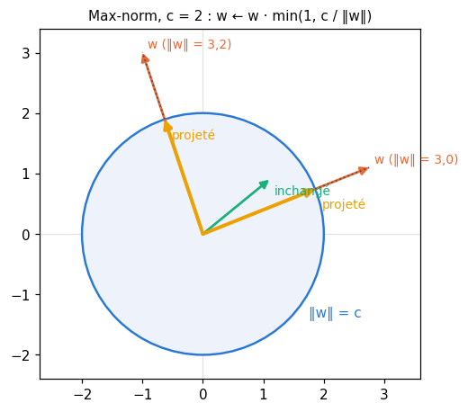
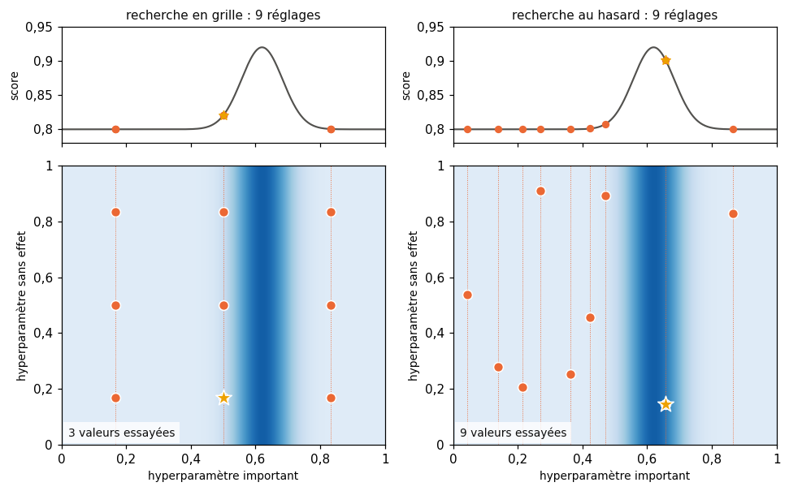
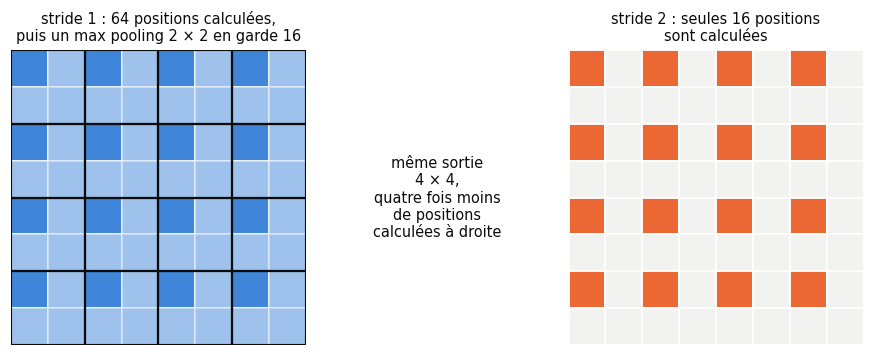
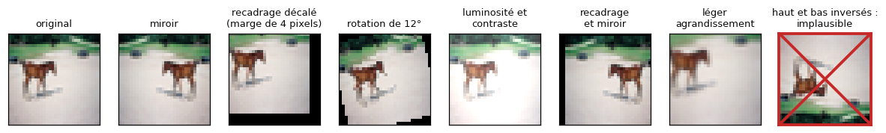
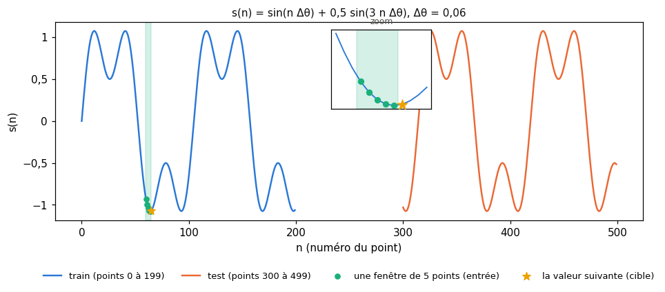
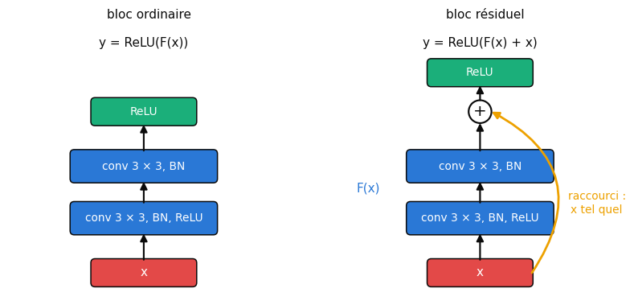

# 24 · PyTorch en pratique 2 : améliorer, chercher, CNN et RNN — fiche de cours

> Le plus long chapitre du livre (171 pages) prolonge le tutoriel Keras du ch. 23 dans cinq directions : améliorer un modèle à la main, confier la validation croisée et la recherche d'hyperparamètres à scikit-learn, construire des réseaux convolutifs, des réseaux récurrents, puis des modèles qui ne sont plus une simple pile de couches. L'outil du livre est **Keras 2** (2017) ; le workbook continue en **PyTorch** (BIBLE §4). Cette fiche suit le plan du livre, section par section, résume ses expériences et traduit chaque outil en PyTorch : l'estimateur scikit-learn qui enveloppe un réseau, `torchvision.transforms.v2` pour l'augmentation de données, les sorties de `nn.LSTM`, la méthode `forward()` pour les architectures à branches. Le livre fait ses expériences sur MNIST ; le workbook garde **Fashion-MNIST** pour les MLP (la suite du ch. 23) et passe à **CIFAR-10** pour les CNN, plus réaliste. Elle finit par ce que le livre n'a pas pu voir : la précision mixte et `torch.compile`.

| | |
|---|---|
| **Livre** | vol. 2, ch. 24 « Keras Part 2 », p. 1209-1379 (§24.1 à §24.6) |
| **Temps total estimé** | ≈ 29 h : lecture du livre et de la fiche ≈ 8,2 h, exercices ≈ 20 h, 25 flashcards ≈ 0,8 h |
| **Prérequis** | 0A (classes et héritage, `**kwargs`, générateurs et `yield`) · ch. 8 (validation croisée, stratification, fuite de données) · ch. 9 (RMSE, overfitting) · ch. 12 (`MinMaxScaler`, `inverse_transform`) · ch. 15 (`Pipeline`, `GridSearchCV`, `RandomizedSearchCV`, `étape__paramètre`, estimateurs maison) · ch. 17 (softmax, température) · ch. 19 (Adam, learning rate) · ch. 20 (dropout, batchnorm) · ch. 21 (convolution, pooling, stride, tailles de sortie) · ch. 22 (LSTM, `mylearn.sequences`) · ch. 23 (workflow PyTorch, `fit()`, checkpoints, early stopping) |
| **Fichiers du chapitre** | `02_exercices.md` (quiz, rappels, papier, réflexion, entretien) · `03_notebook.ipynb` · `04_indices.md` · `05_solutions.md` et `05_solutions.ipynb` · `06_mes_reponses.md` · `flashcards.csv` |
| **mylearn** | aucun nouveau module : le notebook réutilise `mylearn.sequences` (ch. 22 : fenêtres, vocabulaire, température) et `mylearn.preprocessing.MinMaxScaler` (ch. 12) |

## Comment utiliser ce chapitre

Le chapitre du livre est une suite d'ateliers, avec huit notebooks Keras : améliorer un MLP (§24.2), scikit-learn (§24.3), les CNN et les données synthétiques (§24.4), les RNN et leurs formes (§24.5, le plus long), la génération de texte (§24.5.11) ; l'API fonctionnelle (§24.6) n'en a pas. Ses 83 listings sont du Keras de 2017 : lis-les en diagonale pour la démarche, regarde surtout les courbes et les chiffres de fin d'entraînement, et relis la section de la fiche qui traduit chaque outil. Compte environ huit heures de lecture, livre et fiche.

**Ordre conseillé.**
1. Lis le livre §24.1 à §24.2.3, puis les sections correspondantes de la fiche. Fais les quiz Q1 et Q2 et le rappel R1.
2. Lis le livre §24.2.4 à §24.2.7, puis la fiche. Fais le quiz Q3 et la dérivation ∂ 24.6.
3. Lis le livre §24.3 à §24.3.4, puis la fiche. Fais les quiz Q4 et Q5, l'exercice ✏️ 24.1 et la réflexion ⚖️ 24.9.
4. Lis le livre §24.4 à §24.4.4, puis la fiche. Fais les quiz Q6 et Q7, le rappel R2 et les exercices ✏️ 24.2 et 24.3.
5. Lis le livre §24.4.5 à §24.4.8, puis la fiche. Fais les quiz Q8 et Q9 et l'oral 🗣️ 24.8.
6. Lis le livre §24.5 à §24.5.7, puis la fiche. Fais le quiz Q10 et l'exercice ✏️ 24.5.
7. Lis le livre §24.5.8 à §24.5.11, puis la fiche. Fais le quiz Q11, le rappel R3 et l'exercice ✏️ 24.4.
8. Lis le livre §24.6 à §24.6.2, puis la fin de la fiche (précision mixte et compilation comprises). Fais le quiz Q12, l'estimation 🧮 24.7 et la lecture 📄 24.10. Vérifie tes réponses courtes dans la partie 0 du notebook.
9. Fais le notebook dans l'ordre des ID : la taille de batch, quatre MLP à classer, le dropout et le learning rate trop grand, le journal d'expériences, l'estimateur scikit-learn, la validation croisée et la recherche ; puis les CNN sur CIFAR-10, l'augmentation, les images synthétiques ; puis les séries et le LSTM, les sorties de `nn.LSTM`, les branches et les blocs résiduels, la précision mixte, la génération de texte et le défi. Termine par les cinq questions d'entretien.

| Section | Quiz 🧠 et rappels 🔁 | Papier ✏️ ∂ 🧮 et réflexion | Notebook | Entretien 💼 |
|---|---|---|---|---|
| 24.1 et 24.2.1 Pourquoi, et combien d'hyperparamètres | Q1 | 24.1 | | E1 |
| 24.2.2 Un seul hyperparamètre : la taille de batch | Q1, Q2, R1 | | 24.11, 24.15 | E1 |
| 24.2.3 à 24.2.5 Capacité : plus ou moins de neurones | Q3 | | 24.12 | |
| 24.2.6 et 24.2.7 Dropout, max-norm, learning rate | Q3 | 24.6 | 24.12 à 24.15 | E3 |
| 24.3 et 24.3.1 scikit-learn et les adaptateurs | Q4, Q5 | 24.1 | 24.16 | |
| 24.3.2 et 24.3.3 Validation croisée et normalisation | Q4 | | 24.17 | E4 |
| 24.3.4 et 24.4.8 Recherche d'hyperparamètres | Q5 | 24.1, 24.7, 24.9 | 24.18 | E1 |
| 24.4 à 24.4.3 Couches, données et convolutions | Q6, Q7, R2 | 24.2 | 24.19, 24.20 | E5 |
| 24.4.4 et 24.4.5 Des CNN pour MNIST, des motifs | Q9 | 24.2, 24.3, 24.10 | 24.20, 24.21, 24.31 | E3, E5 |
| 24.4.6 et 24.4.7 Augmentation et données synthétiques | Q8 | 24.8 | 24.22, 24.23, 24.24, 24.31 | E2 |
| 24.5 à 24.5.5 Des séries pour un LSTM | Q10 | 24.5 | 24.25, 24.26 | |
| 24.5.6 et 24.5.7 RNN profonds, plus de données | | 24.4, 24.5 | 24.26 | |
| 24.5.8 à 24.5.10 Séquences, état porté, couche par pas de temps | Q11 | 24.4 | 24.27 | |
| 24.5.11 Générer du texte | R3 | | 24.30 | |
| 24.6 à 24.6.2 L'API fonctionnelle | Q12 | 24.10 | 24.28, 24.31 | |
| Au-delà du livre : précision mixte et compilation | | 24.7 | 24.29 | |

## Objectifs d'apprentissage

À la fin de ce chapitre, tu sais :
1. **Mener** une démarche d'amélioration expérimentale : un hyperparamètre à la fois, un objectif à la fois, un journal d'expériences, des courbes lues et comparées.
2. **Régulariser** un réseau (dropout, max-norm, batchnorm) et **reconnaître** un learning rate trop grand.
3. **Évaluer et régler** un réseau PyTorch avec scikit-learn : un estimateur maison, un `Pipeline` sans fuite, la validation croisée, les recherches en grille et au hasard.
4. **Construire et comparer** des CNN PyTorch sur CIFAR-10 : pooling ou stride, batchnorm, augmentation de données, blocs résiduels.
5. **Préparer** une série pour un LSTM (scaler, fenêtres, `inverse_transform`, RMSE), **interpréter** les sorties de `nn.LSTM` et **porter** l'état d'un batch à l'autre.
6. **Générer** du texte au niveau du caractère et du mot, avec des embeddings et une température.
7. **Écrire** dans `forward()` des modèles qui ne sont pas une simple pile : branches, addition, couches partagées ou gelées.
8. **Mesurer** l'effet réel de la précision mixte et de `torch.compile` avant d'y croire.

## L'essentiel en 10 lignes

1. Un petit MLP a déjà des dizaines d'hyperparamètres qui interagissent ; on améliore un modèle par petites étapes, un hyperparamètre et un objectif à la fois, en notant chaque essai.
2. La taille de batch règle le bruit de chaque pas (un batch de $B$ exemples estime le gradient avec un écart-type en $1/\sqrt{B}$), le nombre de pas par epoch ($\lceil N/B \rceil$) et le temps de calcul ; elle se règle avec le learning rate.
3. Plus de neurones n'est pas mieux : un réseau trop capable apprend les détails du train et se met plus vite en overfitting ; le dropout (un nouveau masque à chaque passe avant) et la max-norm le freinent.
4. Pour régler un réseau avec scikit-learn, on l'habille en **estimateur** : `__init__` range ses réglages, `fit` entraîne et rend `self`, `predict` prédit ; scikit-learn s'occupe des folds et de la recherche.
5. Tout prétraitement qui apprend quelque chose (min, max, moyenne) va **dans** le `Pipeline`, pour être réappris sur le train de chaque fold : sinon la validation voit déjà les données qu'elle évalue.
6. Une recherche en grille coûte le produit des nombres de valeurs, fois le nombre de folds ; une recherche au hasard essaie plus de valeurs de chaque hyperparamètre pour le même budget, et un zoom resserre ensuite autour des meilleurs réglages.
7. Un CNN PyTorch prend des tenseurs $(N, C, H, W)$ ; `nn.Conv2d` demande ses canaux d'entrée et n'a pas d'activation ; un stride de 2 remplace souvent le pooling, pour bien moins de calculs ; la batchnorm se place entre la convolution et l'activation.
8. L'augmentation de données transforme chaque image d'entraînement au hasard, à chaque epoch, sans changer son label ; elle ne s'applique qu'au train, et seulement avec des transformations plausibles.
9. Pour une série : scaler appris sur le train, fenêtres $(N, w, 1)$, prédiction remise à l'échelle par `inverse_transform`, RMSE en unités d'origine ; `nn.LSTM` rend la sortie de tous les pas (`output`) et l'état final de chaque couche (`h_n`, `c_n`).
10. En PyTorch, toute architecture s'écrit dans `forward()` : une couche appelée deux fois partage ses poids, deux branches se somment par `+`, et le bloc résiduel $y = F(x) + x$ permet des réseaux très profonds.

> 📐 **Conventions de la fiche** — celles de PyTorch, comme aux ch. 21 à 23 : un mini-batch d'images a la forme $(N, C, H, W)$, une séquence la forme $(N, T, D)$ avec `batch_first=True` ($N$ exemples, $T$ pas de temps, $D$ features par pas, $H$ valeurs d'état pour un RNN). Une convolution a $C_{in}$ canaux d'entrée, $C_{out}$ filtres et un noyau $k \times k$. Les epochs se comptent à partir de 1. Un « fold » est l'une des $K$ parts d'une validation croisée (ch. 8). Les durées citées par le livre ont été mesurées en 2017 sur un iMac de 2014 sans GPU : seuls leurs rapports ont un sens aujourd'hui.

## 24.1 · Pourquoi ce chapitre ?

Le ch. 23 a mené un MLP de bout en bout. Celui-ci apprend à le rendre meilleur, à automatiser cette amélioration, puis à construire les deux grandes familles d'architectures du livre, les CNN (ch. 21) et les RNN (ch. 22), avec la bibliothèque. Il sert aussi de pont vers la partie VI : les autoencodeurs du ch. 25 ont besoin d'architectures à branches, que le §24.6 introduit.

## 24.2 · Améliorer le modèle ⏩

Le point de départ du livre est le MLP du ch. 23 (une couche cachée de 784 neurones), qui atteint environ 98 % sur MNIST en une vingtaine d'epochs. Gagner encore quelques dixièmes de point est plus difficile qu'on ne croit : il y a beaucoup de choix possibles, et une amélioration est souvent l'addition de petits gains. Le workbook refait ces expériences sur Fashion-MNIST, où les écarts se voient mieux (≈ 88 % pour le même MLP au ch. 23).

### 24.2.1 · Compter les hyperparamètres ⏩

Un hyperparamètre est un réglage que l'on choisit, par opposition aux poids, que l'entraînement apprend (ch. 1). Le livre fait l'inventaire de ceux de son petit modèle, en comptant aussi les arguments laissés à leur valeur par défaut, puisque garder le défaut est aussi un choix : il arrive à **27** pour deux couches denses, la loss, Adam et `fit()` (p. 1213).

En PyTorch, l'inventaire est le même, en d'autres endroits :

| Où | Hyperparamètres (exemples) |
|---|---|
| l'architecture | nombre de couches, neurones par couche, activation, initialisation, biais ou non, taux de dropout |
| la loss | la fonction, et ses réglages (`label_smoothing`, `weight`…) |
| l'optimiseur | le choix (SGD, Adam…), `lr`, `betas`, `eps`, `weight_decay` |
| la boucle | taille de batch, nombre d'epochs (ou patience de l'early stopping), planning du learning rate, graine |
| les données | normalisation, augmentation, taille du train et de la validation |

Le livre compare cela à un tableau de bord couvert de curseurs (p. 1214). Deux difficultés s'ajoutent. D'abord le nombre : $k$ hyperparamètres à $v$ valeurs chacun donnent $v^k$ combinaisons (5 hyperparamètres à 4 valeurs : déjà $4^5 = 1\,024$ entraînements). Ensuite les **interactions** : l'effet d'un réglage dépend des autres (le meilleur learning rate dépend de la taille de batch, le meilleur taux de dropout de la taille du réseau). C'est pourquoi le livre insiste : seule la compréhension de ce que fait chaque réglage permet de choisir où chercher.

### 24.2.2 · Changer un seul hyperparamètre ⏩

La règle de toute expérimentation est de ne changer qu'une chose à la fois, pour savoir à quoi attribuer l'effet. Elle est exacte quand les réglages sont **découplés** (indépendants) ; ce n'est presque jamais le cas en deep learning, mais c'est un bon début : on règle un hyperparamètre, puis le suivant, et l'on revient sur le premier si besoin, en apprenant au passage lesquels interagissent.

Le livre commence par la **taille de batch**, en entraînant le même modèle avec des batches de 2 048, 512, 64 et 8 exemples (fig. 24.1 à 24.4, p. 1216). Il observe trois choses : les courbes sont d'autant plus agitées que le batch est petit ; l'accuracy d'entraînement finit vers 98 % dans tous les cas ; et l'écart entre la loss d'entraînement et celle de validation (l'overfitting) grandit quand le batch rapetisse. Sur son CPU, le temps total d'entraînement augmente quand le batch diminue (fig. 24.5), et il conclut que, pour ce modèle et ces données, les grands batches sont préférables.

Trois mécanismes expliquent ces courbes :
- **Le bruit.** Le gradient d'un mini-batch est une moyenne sur $B$ exemples : il estime le vrai gradient avec un écart-type proportionnel à $1/\sqrt{B}$ (encadré ci-dessous). Diviser le batch par 16 multiplie ce bruit par 4.
- **Le nombre de pas.** Une epoch de $N$ exemples fait $\lceil N/B \rceil$ mises à jour : un petit batch fait beaucoup plus de pas par epoch, chacun plus bruité ; à learning rate égal, il va donc plus loin en une epoch, et peut aussi apprendre le train plus vite.
- **Le temps.** Un pas a un coût fixe (lancer les calculs, mettre à jour tous les poids) : sur un CPU comme sur un GPU, beaucoup de petits pas coûtent plus cher que quelques gros, jusqu'à ce que le batch remplisse la machine.

> 🧮 **Rappel maths — le bruit d'une moyenne** — Si les gradients des exemples ont une variance $\sigma^2$ autour du vrai gradient $g$ et sont tirés indépendamment, leur moyenne sur $B$ exemples a pour espérance $g$ et pour variance $\sigma^2/B$ (ch. 2) : son écart-type vaut $\sigma/\sqrt{B}$. Passer de $B = 16$ à $B = 256$ divise le bruit par $\sqrt{16} = 4$, mais multiplie par 16 le calcul de chaque pas.

> 🕰️ **Mise à jour (2026) — taille de batch et learning rate** — **Le livre :** les petits batches surapprennent davantage sur son exemple, et les grands batches sont préférables. · **Aujourd'hui :** on sait que la taille de batch se règle **avec** le learning rate. La règle d'échelle linéaire (Goyal et coll., 2017) multiplie le learning rate par $k$ quand le batch est multiplié par $k$, avec un warmup au début ; Keskar et coll. (2017) ont observé que les très grands batches généralisent souvent moins bien (des minima « pointus » : des creux étroits de la loss, où un petit déplacement des poids la fait beaucoup monter), et Hoffer et coll. (2017) que cet écart se réduit en entraînant plus longtemps ; le rapport learning rate / taille de batch règle le niveau de bruit (Smith et Le, 2018), au point qu'augmenter la taille de batch peut remplacer une baisse du learning rate (Smith et coll., 2018). Le constat du livre vaut donc pour son learning rate et ses 100 epochs, pas en général. · **Faut-il quand même l'apprendre ?** Oui : changer la taille de batch sans retoucher le learning rate change deux choses à la fois. · *Sources :* [Goyal et coll., arXiv:1706.02677](https://arxiv.org/abs/1706.02677), [Keskar et coll., arXiv:1609.04836](https://arxiv.org/abs/1609.04836), [Hoffer et coll., arXiv:1705.08741](https://arxiv.org/abs/1705.08741), [Smith et Le, arXiv:1710.06451](https://arxiv.org/abs/1710.06451), [Smith et coll., arXiv:1711.00489](https://arxiv.org/abs/1711.00489).

Le 🔬 24.11 refait l'expérience sur Fashion-MNIST, en mesurant la loss, l'écart entre train et validation et le temps par epoch, et le 🛠️ 24.15 te fait noter chaque **run** (*exécution* : un entraînement complet, avec ses réglages et ses résultats) dans un journal.

### 24.2.3 · Autres façons d'améliorer ⏩

Deux conseils du livre sont à retenir. On ne cherchera pas **le** meilleur réglage, seulement un réglage assez bon. Et l'on poursuit **un objectif à la fois** : réduire l'overfitting, baisser la loss de test, monter l'accuracy, accélérer l'entraînement, tenir dans la mémoire du GPU… Ces objectifs se contredisent souvent ; on en choisit un ou deux, on règle ce qui les sert, puis on passe aux suivants. Pour MNIST, le livre vise l'accuracy et la réduction de l'overfitting, et, pour comparer ses modèles entre eux, il revient à des batches de 256 sans early stopping.

### 24.2.4 · Ajouter une deuxième couche dense ⏩

Premier essai : une deuxième couche cachée de 784 neurones (fig. 24.6). Le livre annonce le résultat avant de le montrer : le modèle d'une couche surapprenait déjà ; avec plus de neurones, il surapprendra plus vite. C'est ce qu'il observe sur 100 epochs : la loss de validation monte plus tôt et plus haut, et l'accuracy de validation ne gagne presque rien (fig. 24.7). En PyTorch, le modèle s'écrit en une ligne de plus dans `make_mlp` :

```python
def make_mlp(hidden=(784,), n_classes=10, p_drop=0.0):
    """Flatten, then one Linear + ReLU (+ Dropout) per hidden size, then the output logits."""
    layers, n_in = [nn.Flatten()], 28 * 28
    for n_out in hidden:
        layers += [nn.Linear(n_in, n_out), nn.ReLU()]
        if p_drop > 0:
            layers.append(nn.Dropout(p_drop))
        n_in = n_out
    layers.append(nn.Linear(n_in, n_classes))
    return nn.Sequential(*layers)

model = make_mlp(hidden=(784, 784))      # two hidden layers of 784 neurons
```

### 24.2.5 · Moins, c'est mieux ⏩

On cherche en général **le plus petit réseau** qui donne le résultat voulu : il entraîne et prédit plus vite, et il a moins de capacité inutile à consacrer aux détails du train. Le livre réduit donc la couche cachée à 64 neurones (fig. 24.8) : l'accuracy baisse un peu, et l'overfitting reste là (fig. 24.9). Il coupe alors ces 64 neurones en deux couches de 32 (fig. 24.10) : la validation recule encore légèrement (de 97,5 % à 97 % environ) et l'overfitting arrive plus vite (fig. 24.11). Ici, découper la couche n'a rien apporté ; on note l'essai et l'on passe au suivant. Le 🔮 24.12 te fait prédire, avant de les entraîner, comment ces quatre MLP se classent sur Fashion-MNIST.

### 24.2.6 · Ajouter du dropout ⏩

Le livre ajoute alors du dropout (ch. 20) après chacune des deux couches de 32 neurones, avec un taux de 0,2, et une contrainte de **max-norm** sur leurs poids (fig. 24.12, listing 24.3). Résultat : les deux losses ne divergent plus, et l'accuracy de validation dépasse même celle d'entraînement, avec un léger recul de la validation (≈ 95 %) par rapport au modèle sans dropout (fig. 24.13). Le 📈 24.14 te fait expliquer cette validation au-dessus du train.

En PyTorch, le dropout est un module `nn.Dropout(p)` placé **après** l'activation de la couche qu'il touche, et `p` est la fraction des valeurs mises à zéro (comme le `Dropout(0.2)` de Keras). C'est le dropout **inversé** du ch. 20 : pendant l'entraînement, chaque valeur est gardée avec la probabilité $1 - p$ et divisée par $1 - p$ ; en évaluation (`model.eval()`), le module ne fait rien.

$$\tilde{h}_i = \frac{m_i\, h_i}{1 - p}, \qquad m_i \sim \text{Bernoulli}(1 - p) \quad \text{(entraînement)} ; \qquad \tilde{h}_i = h_i \quad \text{(évaluation).}$$

> ⚠️ **Le livre, corrigé — quand le masque change-t-il ?** — Le livre écrit d'abord que le dropout retire des neurones « avant chaque epoch » et les remet à la fin (p. 1224), puis que la fraction est retirée « après chaque batch » (p. 1225). Ni l'un ni l'autre : un **nouveau masque est tiré à chaque passe avant**, indépendamment pour chaque exemple du mini-batch et pour chaque valeur. Un même neurone peut donc être éteint pour un exemple et actif pour son voisin dans le même mini-batch. Et un neurone éteint n'est pas « retiré du réseau » : sa sortie vaut zéro pour cet exemple, si bien qu'aucun gradient ne passe par lui pour cet exemple.

La **max-norm** limite la norme du vecteur des poids qui arrivent sur chaque neurone : après chaque mise à jour, si cette norme dépasse une constante $c$, on ramène le vecteur sur la sphère de rayon $c$, sans changer sa direction.

$$\mathbf{w} \leftarrow \mathbf{w} \cdot \min\!\left(1, \frac{c}{\lVert \mathbf{w} \rVert_2}\right)$$



Keras l'offre comme une contrainte de couche (`kernel_constraint=maxnorm(3)`). PyTorch n'a pas d'argument équivalent : on l'applique soi-même après `optimizer.step()`, sans gradient. Le poids d'un `nn.Linear` a la forme `(out_features, in_features)` : les poids qui arrivent sur le neurone $j$ forment la **ligne** $j$, et `torch.renorm` sur la dimension 0 ramène chaque ligne à une norme d'au plus $c$.

```python
optimizer.step()
with torch.no_grad():                                   # a projection, not a learning step
    for layer in model.modules():
        if isinstance(layer, nn.Linear) and layer.out_features != n_classes:
            layer.weight.copy_(torch.renorm(layer.weight, p=2, dim=0, maxnorm=3.0))
```

Le ∂ 24.6 te fait démontrer que le dropout inversé ne change pas l'espérance des activations et que cette formule est bien la projection sur la boule de rayon $c$.

> ⚠️ **Le livre, corrigé — ce que recommandent les auteurs du dropout** — Le livre attribue à Srivastava et coll. (2014) le conseil d'un taux de 0,2 en général (p. 1225). Leur article raisonne en probabilité de **garder** une valeur : de 0,5 à 0,8 pour les couches cachées (un taux de dropout de 0,5 à 0,2, 0,5 étant, selon eux, proche de l'optimum dans beaucoup de cas) et 0,8 pour les entrées. Un taux de 0,2 est donc le bas de la plage conseillée pour une couche cachée, pas une recommandation générale. Ils conseillent bien la max-norm (avec $c$ entre 3 et 4 en général), un learning rate 10 à 100 fois plus grand qu'à l'ordinaire et un momentum de 0,95 à 0,99, mais pour **SGD avec momentum**. Le livre applique le conseil du learning rate à Adam, dont le pas a déjà la taille du learning rate (ch. 19) : avec un learning rate de 0,1, l'accuracy d'entraînement tombe vers 0,18 (fig. 24.14) ; avec 0,01, elle remonte au-dessus de 90 %, en restant sous le résultat obtenu avec 0,001 (fig. 24.15).

> 🕰️ **Mise à jour (2026) — la max-norm** — **Le livre :** `kernel_constraint=maxnorm(3)` sur chaque couche suivie de dropout, « largement suivi ». · **Aujourd'hui :** la contrainte existe toujours dans Keras 3 (`keras.constraints.MaxNorm`, avec une valeur par défaut de 2), mais on l'emploie rarement : le weight decay (AdamW, ch. 19) et la batchnorm tiennent les poids en respect plus simplement. En PyTorch, on la code en deux lignes après `optimizer.step()` (`torch.renorm`), ou par une paramétrisation (`torch.nn.utils.parametrize`), qui n'est pas tout à fait la même chose : elle recalcule le poids à chaque utilisation au lieu de le projeter après le pas. · **Faut-il quand même l'apprendre ?** Oui, comme exemple de contrainte appliquée après chaque pas, et pour lire les articles de 2014 à 2016. · *Sources :* [Srivastava et coll., JMLR 2014](https://jmlr.org/papers/v15/srivastava14a.html), [documentation de `torch.renorm`](https://docs.pytorch.org/docs/2.11/generated/torch.renorm.html), [contraintes de Keras](https://keras.io/api/layers/constraints/).

Le 📦 24.13 te fait ajouter dropout et max-norm au MLP de 32 + 32 neurones, puis essayer des learning rates de 0,1 et 0,01 avec Adam.

### 24.2.7 · Observations ⏩

Le bilan du livre : une très grande couche cachée surapprend presque tout de suite ; une couche beaucoup plus petite surapprend moins mais perd de l'accuracy ; deux petites couches avec dropout ramènent l'accuracy sans overfitting. Le livre laisse les autres essais au lecteur (p. 1231) : régler soi-même un petit modèle forge l'intuition, qui servira quand chaque essai coûtera des heures.

> 💼 **En entreprise** — Le journal d'expériences : après une dizaine d'essais, plus personne ne sait quel run a donné quel chiffre. Une habitude professionnelle : **un run, une ligne** dans un fichier (CSV ou JSON lines), écrite automatiquement à la fin de l'entraînement, avec la date, le commit git du code, tous les hyperparamètres (y compris ceux laissés par défaut), la graine, les métriques finales et la meilleure epoch, la durée et la machine. Les outils de suivi d'expériences (MLflow, Weights & Biases, TensorBoard) font la même chose avec des graphiques ; le principe est le même. C'est le 🛠️ 24.15 ; le B7 y revient.

## 24.3 · Utiliser scikit-learn ⏩

Régler à la main éclaire, mais coûte cher en temps et en attention. Le ch. 15 a montré que scikit-learn sait faire la validation croisée (estimer la qualité d'un modèle) et la recherche d'hyperparamètres (trouver la meilleure combinaison). Le livre veut ces outils pour ses réseaux, et en chiffre d'abord le coût (p. 1231-1232) : chaque fold est un entraînement complet, et une recherche multiplie encore ce temps par son nombre de combinaisons.

La parade du livre : chercher d'abord sur un **petit sous-ensemble représentatif** des données, où chaque entraînement est rapide ; puis reprendre la recherche, resserrée, sur des sous-ensembles de plus en plus grands, jusqu'au dataset complet, où il ne reste presque plus rien à chercher. C'est aussi ce que fait le notebook (6 000 images de Fashion-MNIST en mode rapide).

### 24.3.1 · Habiller un réseau en estimateur ⏩

Pour scikit-learn, un modèle est un **estimateur** : un objet qui respecte quelques conventions (ch. 15). Il suffit donc d'habiller un réseau pour que `cross_val_score` ou `GridSearchCV` s'en servent sans savoir ce qu'il y a dedans. Keras 2 le faisait avec un **adaptateur** (ch. 15), `KerasClassifier`, qui recevait une **fonction de construction** du modèle (`build_fn`) plutôt qu'un modèle, et les réglages à lui passer. Le livre explique bien pourquoi : une recherche doit construire un modèle neuf pour chaque combinaison et chaque fold ; il lui faut donc la recette, pas un gâteau déjà cuit.

Le livre décrit les arguments de `KerasClassifier` comme une « bizarrerie » de Python (p. 1236) : ce sont simplement des arguments nommés, que l'adaptateur range et transmet à la fonction de construction ou à `fit()` selon leur nom, ce que Python permet avec `**kwargs` (0A).

> 🕰️ **Mise à jour (2026) — les adaptateurs scikit-learn** — **Le livre :** `keras.wrappers.scikit_learn.KerasClassifier(build_fn=..., epochs=..., batch_size=...)`. · **Aujourd'hui :** ce module a été déprécié dans Keras 2.7 (2021) et retiré dans Keras 2.13 (2023) ; la relève a d'abord été [SciKeras](https://adriangb.com/scikeras/) (dont la dernière version date de 2024), et depuis Keras 3.8 (2025), Keras a de nouveau ses propres adaptateurs, `keras.wrappers.SKLearnClassifier` et `SKLearnRegressor` (avec `model=` au lieu de `build_fn=`). Pour PyTorch, [skorch](https://skorch.readthedocs.io/) (`NeuralNetClassifier(module=...)`) fait d'un `nn.Module` un estimateur complet. Le workbook n'installe ni l'un ni l'autre : tu écris ton propre estimateur, ce qui montre ce que ces bibliothèques font pour toi. · **Faut-il quand même l'apprendre ?** Oui pour l'idée : un réseau, une recette de construction et ses réglages, rangés dans un objet que scikit-learn sait cloner. · *Sources :* [adaptateurs scikit-learn de Keras](https://keras.io/api/utils/sklearn_wrappers/), [documentation de SciKeras](https://adriangb.com/scikeras/stable/), [documentation de skorch](https://skorch.readthedocs.io/en/stable/).

Le contrat d'un estimateur, rappelé du ch. 15 :
- `__init__` **range** ses arguments dans des attributs de même nom, sans rien calculer ni vérifier : `clone` (que la validation croisée et la recherche appellent avant chaque entraînement) recrée l'objet à partir de `get_params()`, qui lit ces attributs ;
- `BaseEstimator` fournit `get_params()` et `set_params()` d'après la signature de `__init__` : pas de `*args` ni de `**kwargs` dans cette signature ;
- `fit(X, y)` construit un réseau **neuf**, l'entraîne, range ce qu'il a appris dans des attributs finis par `_` (`model_`, `classes_`, `history_`) et rend `self` ;
- `predict(X)` rend des labels de la même nature que `y` ; `predict_proba(X)` des probabilités dont les colonnes suivent `classes_` ;
- `ClassifierMixin`, placé **avant** `BaseEstimator` dans la liste des classes mères (ch. 15), apporte `score(X, y)`, l'accuracy, et le statut de classifieur, qui fait choisir à `cross_val_score` des folds stratifiés.

Le squelette tient en quelques lignes ; le 📦 24.16 te fait écrire `fit` et `predict` (avec ta boucle du ch. 23), et vérifier que `clone` et `set_params` marchent.

```python
from sklearn.base import BaseEstimator, ClassifierMixin

class TorchMLPClassifier(ClassifierMixin, BaseEstimator):
    """A small PyTorch MLP dressed as a scikit-learn classifier."""

    def __init__(self, hidden=(32, 32), p_drop=0.2, lr=1e-3, epochs=5, batch_size=256, seed=0):
        self.hidden = hidden          # store, nothing else: clone() rebuilds from get_params()
        self.p_drop = p_drop
        self.lr = lr
        self.epochs = epochs
        self.batch_size = batch_size
        self.seed = seed

    def fit(self, X, y): ...          # a fresh network for every call, learned attributes end with "_"
    def predict(self, X): ...
```

### 24.3.2 · La validation croisée ⏩

Pourquoi valider par folds quand MNIST fournit un grand jeu de validation ? Le livre répond par deux cas. Le jeu de validation peut **ne pas représenter** les données : son image est celle d'un paquet de cartes neuf, rangé par couleur, dont on garderait le dernier quart pour valider ; ce quart ne contient qu'une seule couleur, absente du reste. Le même accident arrive avec un fichier trié (Fashion-MNIST rangé par classe : les 10 % de la fin ne contiendraient que des bottines). Et le dataset peut être **trop petit** pour qu'on en sacrifie une part (ch. 8).

La validation croisée du livre (listings 24.8 à 24.11) prend son MLP de deux couches de 32 neurones avec dropout, enveloppé, et le passe à `cross_val_score` avec un `StratifiedKFold(n_splits=10, shuffle=True, random_state=...)`, sur les 60 000 images d'entraînement et les labels **entiers** (pas one-hot : scikit-learn veut un label par exemple). Elle trouve une accuracy moyenne de 0,955, proche de la validation de la fig. 24.13 : rassurant, mais dix fois plus long. En PyTorch, rien ne change côté scikit-learn, à un détail près : un estimateur de scikit-learn reçoit un tableau 2D, une ligne par exemple. Les images `(60 000, 28, 28)` du ch. 23 s'aplatissent donc d'abord en lignes de 784 pixels, comme celles du livre :

```python
from sklearn.model_selection import StratifiedKFold, cross_val_score

X_train = X_train.reshape(len(X_train), -1).astype(np.float32) / 255   # (60000, 784): one row per example
cv = StratifiedKFold(n_splits=5, shuffle=True, random_state=0)
scores = cross_val_score(TorchMLPClassifier(epochs=3), X_train, y_train, cv=cv)   # one fresh network per fold
print(scores.mean(), scores.std())
```

### 24.3.3 · La validation croisée avec normalisation ⏩

Le livre a « oublié » une étape et l'ajoute ensuite : la **normalisation dans chaque fold**. Si l'on normalise tout le train avant de découper, chaque fold de validation a influencé les statistiques qui le transforment : c'est une fuite de données (ch. 8 et 12). La règle : tout ce qui **apprend** sur les données (min et max, moyenne et écart-type, vocabulaire…) va dans un `Pipeline`, que scikit-learn réajuste sur la partie d'entraînement de chaque fold, puis applique tel quel à la partie de validation.

```python
from sklearn.pipeline import Pipeline, make_pipeline
from sklearn.preprocessing import MinMaxScaler

pipe_named = Pipeline([("scale", MinMaxScaler()), ("net", TorchMLPClassifier())])    # named steps
pipe = make_pipeline(MinMaxScaler(), TorchMLPClassifier())                      # names: lower-case class names
scores = cross_val_score(pipe, X_train, y_train, cv=cv)
```

`make_pipeline` nomme lui-même les étapes d'après le nom de leur classe, en minuscules (`"minmaxscaler"`, `"torchmlpclassifier"`) ; ces noms servent dès qu'une recherche doit régler un hyperparamètre d'une étape. Sur MNIST, déjà divisé par 255, le livre trouve le même score (≈ 0,955) : la normalisation ne changeait presque rien, mais c'est un réflexe à garder, car d'autres données ne pardonneront pas.

Il remarque aussi que `MinMaxScaler` est un choix discutable pour des images : il met chaque **pixel** à l'échelle séparément. Un pixel du bord, presque toujours noir dans le train, voit son maximum minuscule agrandi jusqu'à 1, et le moindre gris sur une image de validation y devient une valeur bien supérieure à 1. Pour des images, on préfère une mise à l'échelle **globale** (diviser par 255, ou une moyenne et un écart-type communs à tous les pixels, ch. 23), qui n'apprend rien par pixel.

### 24.3.4 · La recherche d'hyperparamètres ⏩

Chaque combinaison de réglages est un point d'un **espace de recherche**, qui a autant de dimensions que d'hyperparamètres ; chaque point a une valeur, le score de validation croisée du modèle entraîné avec ces réglages. Chercher, c'est se promener dans cet espace à la recherche des régions où le score est haut (fig. 24.16).

`GridSearchCV` essaie **toutes** les combinaisons d'une grille. Pour régler une étape d'un pipeline, chaque clé du dictionnaire s'écrit `étape__paramètre`, avec **deux** tirets bas (ch. 15) :

```python
from sklearn.model_selection import GridSearchCV

param_grid = {"net__hidden": [(32,), (32, 32), (64, 64)],
              "net__lr": [1e-3, 3e-3]}
search = GridSearchCV(pipe_named, param_grid, cv=3)          # pipe_named: steps "scale" and "net"
search.fit(X_train, y_train)
print(search.best_params_, search.best_score_)               # cv_results_ holds every candidate
```

Le coût se compte à l'avance : $K$ folds fois le produit des nombres de valeurs. Ici, $3 \times (3 \times 2) = 18$ entraînements, plus un dernier sur tout le train avec les meilleurs réglages (`refit=True`, le défaut). `cv_results_` range, pour chaque candidat, ses réglages (`"params"`), sa moyenne (`"mean_test_score"`) et son écart-type (`"std_test_score"`) sur les folds, et son rang (`"rank_test_score"`).

La première grille du livre croise le nombre de couches (2, 3, 4), le nombre de neurones par couche (20, 30, 40) et l'optimiseur (Adam, Adadelta) ; la meilleure combinaison est 2 couches de 40 neurones avec Adam (fig. 24.17). La lecture du graphique en dit plus que le meilleur point : Adam bat Adadelta partout, ajouter des couches fait plutôt baisser le score, ajouter des neurones le fait plutôt monter. Le livre resserre alors la recherche (1 ou 2 couches, 50 à 170 neurones, fig. 24.18), puis l'élargit vers le haut (180 à 580, fig. 24.19) : le meilleur réglage est autour de 2 couches de 280 neurones, et les écarts entre candidats sont devenus quinze fois plus petits qu'au départ (≈ 0,0035 contre ≈ 0,055) : on approche du plateau.

C'est la **recherche multirésolution** (*coarse-to-fine search*) : une grille large et grossière, puis des grilles plus fines autour des meilleures régions, comme on zoome sur une carte : le pays, la ville, puis la rue.

`RandomizedSearchCV` tire au hasard `n_iter` combinaisons : dans des listes, ou dans des **distributions**, ce qui permet de chercher un learning rate sur une échelle logarithmique (`scipy.stats.loguniform(1e-4, 1e-1)`) au lieu de trois valeurs choisies d'avance. Bergstra et Bengio (2012) ont montré pourquoi c'est souvent mieux qu'une grille : en général, seuls quelques hyperparamètres comptent vraiment. Une grille de $3 \times 3$ n'essaie que 3 valeurs de chacun ; 9 tirages au hasard en essaient 9 de chacun, pour le même coût (figure). Et le hasard donne une garantie simple : si une fraction $q$ des réglages possibles est « assez bonne », la probabilité qu'au moins un de $n$ tirages indépendants y tombe vaut $1 - (1 - q)^n$ (les $n$ tirages ratent tous avec la probabilité $(1 - q)^n$). Par exemple, pour viser les 10 % meilleurs réglages, 10 tirages réussissent avec la probabilité $1 - 0{,}9^{10} \approx 0{,}65$, quel que soit le nombre d'hyperparamètres (✏️ 24.1).



> ⚠️ **Le livre, corrigé — l'ordre d'une grille et le nom des étapes** — Le livre explique que l'ordre dans lequel la grille est parcourue est imprévisible, parce que les dictionnaires de Python ne garderaient pas l'ordre de leurs clés (p. 1252). Depuis Python 3.7, un dictionnaire garde l'ordre d'insertion ; et surtout, `ParameterGrid` de scikit-learn **trie les clés** par ordre alphabétique avant de faire le produit : la première clé dans l'ordre alphabétique varie le plus lentement, la dernière le plus vite, ce qui explique exactement l'ordre de sa liste 24.21 (neurones, puis couches, puis optimiseur). Ses listings mélangent aussi trois noms pour la même étape (`model__`, `model_step__`, et un pipeline construit par `make_pipeline`, dont l'étape s'appellerait `kerasclassifier`) : tel qu'imprimé, `GridSearchCV` lèverait une `ValueError` sur un paramètre invalide. Enfin, Keras ne « repose » pas sur scikit-learn (p. 1232) : l'adaptateur imitait seulement l'interface d'un estimateur.

> 🕰️ **Mise à jour (2026) — la recherche d'hyperparamètres** — **Le livre :** `GridSearchCV` avec 3 folds par défaut, `RandomizedSearchCV`, et le projet Spearmint pour aller plus vite sur les convnets. · **Aujourd'hui :** le `cv` par défaut de scikit-learn est passé à 5 folds (version 0.22, 2019) ; `HalvingGridSearchCV` et `HalvingRandomSearchCV` (*successive halving*, encore marqués expérimentaux) éliminent les mauvais candidats sur un petit budget avant d'en donner plus aux bons ; les recherches bayésiennes et par élimination se font avec [Optuna](https://optuna.org/) ou Ray Tune ; Spearmint n'est plus maintenu. · **Faut-il quand même l'apprendre ?** Oui : la grille, le hasard et le zoom restent la base, et les outils modernes en sont des versions plus économes. · *Sources :* [documentation de `GridSearchCV`](https://scikit-learn.org/1.6/modules/generated/sklearn.model_selection.GridSearchCV.html), [successive halving dans le guide de scikit-learn](https://scikit-learn.org/1.6/modules/grid_search.html#successive-halving-user-guide), [Bergstra et Bengio, JMLR 2012](https://jmlr.org/papers/v13/bergstra12a.html).

Le 📦 24.17 te fait valider ton estimateur par folds stratifiés avec la normalisation dans un pipeline, et le 📦 24.18 enchaîner une grille, une recherche au hasard et un zoom.

## 24.4 · Réseaux convolutifs ⏩

Le livre rappelle l'essentiel du ch. 21 : une couche de convolution porte des filtres (des noyaux de 3, 5 ou 7 de côté), chaque filtre balaie toute l'entrée et produit un canal de sortie. Après la première couche, ce qui circule n'est plus vraiment une image : c'est un tenseur à beaucoup de canaux, qu'il vaut mieux appeler ainsi. Il rappelle aussi qu'en pratique on part souvent d'un réseau déjà entraîné (le transfer learning, que tu as fait au ch. 23 avec un ResNet-18 gelé) ; savoir construire un CNN soi-même reste ce qui permet de modifier un réseau et de diagnostiquer ses problèmes.

### 24.4.1 · Les couches utilitaires ⏩

Keras range sous forme de couches des opérations utilitaires (remodeler, résumer, normaliser, bruiter), pour que le modèle reste une pile de couches. PyTorch fait de même avec des modules, et offre en plus les mêmes opérations en fonctions (`torch.nn.functional`, ch. 20) :

| Keras 2 (livre) | Ce que fait la couche | PyTorch |
|---|---|---|
| `Flatten` | aligne toutes les valeurs d'un exemple en un vecteur | `nn.Flatten()` (garde l'axe 0 des exemples) |
| `MaxPooling2D`, `AveragePooling2D` | résume chaque bloc par son maximum ou sa moyenne | `nn.MaxPool2d(2)`, `nn.AvgPool2d(2)` ; `nn.AdaptiveAvgPool2d(1)` pour une moyenne sur toute l'image |
| `Cropping2D` | retire des bords | une tranche, `x[..., 2:-2, 2:-2]`, ou `v2.CenterCrop` sur les données |
| `UpSampling2D` | répète chaque valeur pour agrandir | `nn.Upsample(scale_factor=2, mode="nearest")` |
| `BatchNormalization` | normalise chaque canal sur le mini-batch, puis applique $\gamma$ et $\beta$ appris | `nn.BatchNorm2d(C)` (ch. 20) |
| `GaussianNoise` | ajoute un bruit gaussien, à l'entraînement seulement | pas de module : `x + sigma * torch.randn_like(x)` si `self.training` |
| `ZeroPadding2D` | entoure de zéros | `nn.ZeroPad2d(1)`, ou l'argument `padding` de `nn.Conv2d` |
| `Dropout` | met des valeurs à zéro au hasard | `nn.Dropout(p)` ; `nn.Dropout2d(p)` éteint des canaux entiers |

Le livre rappelle aussi que le pooling perd du terrain au profit des convolutions à stride (ch. 21), et que la convolution transposée remplace souvent un agrandissement suivi d'une convolution (ch. 21 et 25).

> ⚠️ **Le livre, corrigé — ce que fait la batchnorm** — Le livre présente la batchnorm comme une « régularisation » qui ramène chaque batch à une moyenne nulle et un écart-type de 1, ce qui empêcherait les **poids** de trop grandir (p. 1262). Elle normalise les **activations** de chaque canal sur le mini-batch, puis leur applique un facteur $\gamma$ et un décalage $\beta$ appris : la sortie n'a donc pas forcément une moyenne nulle ni un écart-type de 1. Ioffe et Szegedy (2015) l'ont conçue pour accélérer et stabiliser l'entraînement ; l'effet régularisant (le bruit des statistiques d'un mini-batch) est un effet secondaire. En évaluation, elle utilise ses statistiques glissantes, accumulées pendant l'entraînement (ch. 20 et 💼 24.E5).

### 24.4.2 · Préparer les données pour un CNN ⏩

Un MLP voit chaque image comme une ligne de 784 nombres, et perd la notion de voisinage vertical entre pixels. Un CNN garde l'image en volume : canaux, lignes, colonnes. En PyTorch, un mini-batch a la forme $(N, C, H, W)$ : 1 canal pour MNIST et Fashion-MNIST, 3 pour une image en couleur (rouge, vert, bleu), une dizaine pour une image satellite. Un dataset de 50 000 images CIFAR-10 a donc la forme $(50\,000, 3, 32, 32)$.

> ⚠️ **Le livre, corrigé — `channels_last` ou `channels_first` ?** — Le livre annonce le format `channels_last` et le code en conséquence, `(60 000, 28, 28, 1)`, mais décrit et légende à plusieurs reprises un tenseur `60 000 × 1 × 28 × 28`, qui est le format `channels_first` (p. 1264-1266, puis « 4D channels-first » p. 1276). PyTorch tranche : les modules de convolution attendent $(N, C, H, W)$, le format `channels_first`. Pour passer d'un tableau NHWC (le format que rendent `wb.datasets.load_cifar10` et les images PIL) à NCHW, c'est `permute(0, 3, 1, 2)`, jamais un `reshape` (ch. 23).

Le livre ramène les pixels dans $[-1, 1]$ en citant les notes du cours CS231n de Stanford, avec `np.interp` (listing 24.26). La formule est simple : $x' = x / 127{,}5 - 1$ pour des pixels entre 0 et 255.

> 🕰️ **Mise à jour (2026) — mettre les images à l'échelle** — **Le livre :** les convnets marcheraient mieux avec des entrées dans $[-1, 1]$. · **Aujourd'hui :** on **standardise par canal**, avec la moyenne et l'écart-type de chaque canal calculés sur le train (CIFAR-10 : environ 0,49, 0,48 et 0,45 pour les moyennes de R, V et B, après division par 255), ou ceux d'ImageNet pour un réseau pré-entraîné ; c'est ce que fait `v2.Normalize(mean, std)` de torchvision. Les notes de CS231n que cite le livre conseillent surtout de centrer les données ; elles ajoutent que mettre chaque feature à la même échelle n'a de sens que si les features ont des échelles différentes, ce qui n'est pas le cas des pixels, et n'est donc pas indispensable pour des images. Avec la batchnorm, le réseau est de toute façon peu sensible à ce choix. · **Faut-il quand même l'apprendre ?** Oui : centrer et réduire les entrées reste indispensable ; seule la recette exacte a changé. · *Sources :* [documentation de `v2.Normalize`](https://docs.pytorch.org/vision/0.26/generated/torchvision.transforms.v2.Normalize.html), [notes de CS231n, « Data Preprocessing »](https://cs231n.github.io/neural-networks-2/).

Avec `torchvision.transforms.v2`, la préparation d'une image se décrit comme une suite de transformations, appliquée par le `Dataset` à chaque image :

```python
import torch
from torchvision.transforms import v2

MEAN, STD = (0.491, 0.482, 0.447), (0.247, 0.243, 0.262)       # CIFAR-10 train, per channel, after /255
to_input = v2.Compose([
    v2.ToImage(),                                # HWC uint8 array -> CHW tensor
    v2.ToDtype(torch.float32, scale=True),       # uint8 0..255 -> float32 0..1
    v2.Normalize(MEAN, STD),                     # per-channel standardisation
])
```

### 24.4.3 · Les couches de convolution ⏩

Une couche `Conv2D` de Keras prend le nombre de filtres et la taille du noyau, et devine le nombre de canaux d'entrée. `nn.Conv2d` de PyTorch demande les deux nombres de canaux, d'entrée et de sortie (`nn.LazyConv2d` devine le premier à la première passe, comme `nn.LazyLinear` au ch. 23) :

```python
nn.Conv2d(in_channels=3, out_channels=16, kernel_size=5, stride=1, padding="same")
```

Chaque filtre a autant de canaux que l'entrée (fig. 24.24) : un filtre $5 \times 5$ sur une image RVB porte $5 \times 5 \times 3 = 75$ poids, plus un biais, et le nombre de canaux de sortie est le nombre de filtres (fig. 24.23 et 24.25). D'où le nombre de paramètres d'une convolution et le nombre de multiplications-additions (MAC) qu'elle fait pour une image :

$$P_{\text{conv}} = C_{out}\,(C_{in}\, k_h\, k_w + 1), \qquad \text{MAC}_{\text{conv}} = H_{out}\, W_{out}\, C_{out}\, C_{in}\, k_h\, k_w .$$

Exemple : `nn.Conv2d(3, 8, 3, padding=1)` sur une image $32 \times 32$ a $8 \times (27 + 1) = 224$ paramètres et fait $32 \times 32 \times 8 \times 27 = 221\,184$ MAC par image. Une convolution est économe en paramètres (le filtre est partagé par toutes les positions) mais pas en calculs (il est appliqué à chaque position).

Trois différences avec Keras demandent de l'attention :
- **Le padding.** `padding="valid"` (le défaut de Keras ; `padding=0` en PyTorch) ne pose le filtre que là où il tient entier ; `padding="same"` complète de zéros pour garder la taille. En PyTorch, `padding="same"` n'est accepté qu'avec un stride de 1 ; pour un noyau impair $k$ avec un stride de 2, on écrit `padding=k // 2`, ce qui donne la même taille que le `"same"` de Keras, $\lceil H/s \rceil$ (🔁 R2). La taille de sortie suit la formule du ch. 21 : $H_{out} = \lfloor (H + 2p - k)/s \rfloor + 1$.
- **L'activation.** La `Conv2D` de Keras a un argument `activation` (linéaire par défaut) ; `nn.Conv2d` n'en a pas : on ajoute un `nn.ReLU()` après.
- **La forme de l'entrée.** Keras demande `input_shape` à la première couche (sans l'axe des exemples, `(28, 28, 1)`) ; PyTorch ne demande rien : les formes se lisent à l'appel.

### 24.4.4 · Des CNN pour MNIST ⏩

Le livre construit cinq CNN pour MNIST, entraînés chacun 100 epochs avec des batches de 256 et Adam :

| Modèle du livre | Couches | Validation après 100 epochs | Temps par epoch (CPU, 2017) |
|---|---|---|---|
| simple (fig. 24.27) | une convolution de 32 filtres $5 \times 5$, `Flatten`, `Dense(10)` | 0,9862, overfitting dès 10 epochs | 66 s |
| plus profond (fig. 24.29) | trois convolutions (16 filtres $5 \times 5$, puis deux fois 8 filtres $3 \times 3$), chacune suivie de dropout 0,2 et de max-norm | 0,9879, presque plus d'overfitting | 127 s |
| avec pooling (fig. 24.31) | convolution de 30 filtres $5 \times 5$, dropout, max pooling ; convolution de 16 filtres $3 \times 3$, dropout, max pooling ; trois couches denses (128, 64, 10) | 0,9939 | 147 s |
| avec stride (fig. 24.33) | le même, avec un stride de 2 dans les convolutions à la place du pooling | 0,9912 | 36 s |
| stride et batchnorm (fig. 24.35) | le précédent, la batchnorm à la place du dropout | 0,9911, un peu d'overfitting, des courbes bruitées | 45 s |

Trois leçons : un réseau plus profond, avec du dropout, surapprend moins ; réduire la taille de l'image au fil du réseau (pooling ou stride) aide chaque couche à voir de plus grandes zones ; et le stride fait presque aussi bien que le pooling pour **un quart du temps** : chaque convolution n'est calculée qu'à une position sur quatre (figure ci-dessous). Le ✏️ 24.3 compare ce gain de calcul aux durées mesurées. Avec des courbes aussi bruitées que celles du dernier modèle, le livre conseille de garder plusieurs checkpoints et de choisir sur les courbes (ch. 23).



> ⚠️ **Le livre, corrigé — combien de valeurs arrivent aux couches denses ?** — Pour justifier ses trois couches denses, le livre écrit qu'après les deux poolings il ne reste que $7 \times 7 = 49$ valeurs (p. 1282). Ce compte est faux : le ✏️ 24.2 te fait le refaire, et celui des paramètres du modèle.

La batchnorm du dernier modèle se place **entre la convolution et l'activation** (listing 24.44) ; c'est pourquoi la convolution y est écrite sans activation. En PyTorch :

```python
def conv_bn_relu(c_in, c_out, k, stride=1):
    """Conv (no bias: the batchnorm beta replaces it), then BatchNorm2d, then ReLU."""
    return nn.Sequential(
        nn.Conv2d(c_in, c_out, k, stride=stride, padding=k // 2, bias=False),
        nn.BatchNorm2d(c_out),
        nn.ReLU(),
    )
```

Le biais de la convolution est inutile avant une batchnorm : elle soustrait la moyenne de chaque canal, biais compris, et son $\beta$ joue ce rôle (`bias=False`, comme dans les ResNet de torchvision). Le livre remplace le dropout par la batchnorm « pour voir laquelle des deux régularise le mieux » ; le 🔬 24.21 refait la comparaison sur CIFAR-10 (dropout, batchnorm, les deux), en regardant l'accuracy et l'écart entre train et validation.

Le workbook passe à **CIFAR-10** (ch. 21) : des photos $32 \times 32$ en couleur de dix classes (avions, voitures, oiseaux, chats…), bien plus difficiles que MNIST, où un CNN simple plafonne vers 60 à 70 % et où l'augmentation et la profondeur font une vraie différence. Le 🐛 24.19 te fait réparer un CNN traduit trop littéralement du Keras, et le 📦 24.20 passer d'un CNN simple à un CNN profond.

### 24.4.5 · Des motifs d'architecture

Beaucoup de CNN classiques répètent un même **bloc** : quelques convolutions, puis un pooling $2 \times 2$ de stride 2 qui divise la hauteur et la largeur par deux ; on répète le bloc plusieurs fois en changeant ses réglages, puis on finit par des couches denses (fig. 24.37, une version simplifiée de VGG16, ch. 20). L'usage est de **doubler le nombre de canaux** quand on divise la taille par deux : le nombre de calculs par couche reste alors du même ordre (la surface est divisée par 4, le produit $C_{in} C_{out}$ multiplié par 4). Le livre essaie ce motif sur MNIST (99,0 % en validation, 339 s par epoch), puis remplace chaque pooling par un stride de 2 dans la dernière convolution du bloc (98,7 %, 186 s par epoch) : un résultat voisin, en moitié moins de temps.

Les architectures modernes ont gardé l'idée du bloc répété, avec trois changements : le stride remplace souvent le pooling (Springenberg et coll., 2015, ont montré qu'un réseau tout en convolutions fait aussi bien) ; la tête finit par un **pooling moyen global** (`nn.AdaptiveAvgPool2d(1)`, ch. 21) au lieu de grosses couches denses, ce qui économise l'essentiel des paramètres ; et les blocs sont **résiduels** (§24.6.2).

### 24.4.6 · L'augmentation de données ⏩

Le meilleur moyen d'améliorer un modèle est souvent de lui donner plus de données d'entraînement. Avec des images, on en fabrique en transformant celles qu'on a : décaler, agrandir un peu, tourner, retourner en miroir, changer la luminosité. C'est l'**augmentation de données** (*data augmentation*) : chaque image transformée garde le label de l'original.

La règle d'or du livre : une transformation doit produire une image **plausible**, que le modèle pourrait rencontrer. Un « 2 » retourné en miroir n'est plus un « 2 » (fig. 24.42) ; une rotation de 100° non plus. Une transformation implausible gaspille la capacité du réseau, et peut même lui apprendre à confondre des classes. Le choix dépend donc des données : la symétrie gauche-droite convient aux photos d'animaux et de véhicules, pas aux chiffres ni aux lettres ; le haut et le bas d'une photo ne s'échangent presque jamais.



Keras 2 faisait l'augmentation avec `ImageDataGenerator`, un **générateur** Python (0A) qui fabriquait les batches transformés à la demande, et `fit_generator`, qui devait savoir combien de batches composent une epoch (`steps_per_epoch`), puisqu'un générateur ne s'arrête jamais. Le listing 24.49 écrit encore `samples_per_epoch`, le nom de Keras 1, que Keras 2.0 convertissait en `samples_per_epoch // batch_size` avec un avertissement, et passe `seed=42` à `fit_generator`, qui le refuserait : la graine se donne à `flow()`. En PyTorch, l'augmentation est une transformation appliquée par le `Dataset` à chaque fois qu'il rend une image : à chaque epoch, chaque image du train est transformée **différemment**, sans rien stocker, et `DataLoader(num_workers=...)` prépare les batches suivants en parallèle pendant que le modèle calcule, dans des **workers** (*processus de chargement* : `num_workers` processus Python lancés à côté de l'entraînement). Sur Colab (Linux), les workers naissent par copie du processus (méthode `"fork"`) et `num_workers=2` marche directement. Sous Windows et macOS, ils sont lancés par la méthode `"spawn"`, repartent d'un interpréteur neuf et ne voient pas une classe définie dans une cellule de notebook (l'erreur dit `Can't get attribute ... on <module '__main__'>`) : on met alors cette classe dans un fichier `.py` que le notebook importe, ou l'on garde `num_workers=0`.

```python
train_tf = v2.Compose([
    v2.ToImage(),
    v2.RandomCrop(32, padding=4),                # shift by up to 4 pixels (zero padding, then crop)
    v2.RandomHorizontalFlip(p=0.5),              # mirror image: plausible for animals and vehicles
    v2.ToDtype(torch.float32, scale=True),
    v2.Normalize(MEAN, STD),
])
test_tf = to_input                               # validation and test: never augmented
```

Trois règles :
- l'augmentation ne s'applique **qu'au train** ; la validation et le test voient les images telles quelles (sinon on mesure autre chose que ce que verra le modèle) ;
- elle se règle comme un hyperparamètre : trop faible, elle ne sert à rien ; trop forte, le modèle n'apprend plus assez vite (on entraîne alors plus longtemps) ;
- une transformation aléatoire se reproduit avec une graine (dans Keras, `flow(..., seed=42)`), en PyTorch celle de `torch.manual_seed` et, avec plusieurs workers, celle de chaque worker.

> 🕰️ **Mise à jour (2026) — l'augmentation de données** — **Le livre :** `ImageDataGenerator` et `fit_generator`, avec le nombre d'exemples par epoch. · **Aujourd'hui :** `fit_generator` n'existe plus dans Keras 3 (`fit` accepte directement un générateur ou un dataset), et `ImageDataGenerator` n'est plus dans son API publique (il ne survit que comme code hérité de `tf.keras`) : on utilise des couches de prétraitement (`RandomFlip`, `RandomRotation`…) ; en PyTorch, on emploie `torchvision.transforms.v2` dans le `Dataset`. Des politiques toutes faites ont remplacé le réglage transformation par transformation : AutoAugment, RandAugment (Cubuk et coll., 2020 : deux réglages seulement, le nombre de transformations et leur force), TrivialAugment ; et des mélanges d'images, mixup et CutMix, qui mélangent aussi les labels. · **Faut-il quand même l'apprendre ?** Oui : l'augmentation est le premier régularisateur des modèles d'images, et la règle de plausibilité vaut pour toutes ces politiques. · *Sources :* [documentation de `torchvision.transforms.v2`](https://docs.pytorch.org/vision/0.26/transforms.html), [Cubuk et coll., arXiv:1909.13719](https://arxiv.org/abs/1909.13719).

Le 🔮 24.22 te fait prédire l'effet de plusieurs transformations sur un modèle déjà entraîné sans augmentation, et le 📦 24.23 entraîner un CNN sur CIFAR-10 avec et sans augmentation.

### 24.4.7 · Des données synthétiques

Pour expérimenter dans un cadre où l'on contrôle tout, rien ne vaut des **données synthétiques** (*synthetic data*), fabriquées par un programme (le ch. 15 a utilisé les lunes et les nuages gaussiens de scikit-learn). Le livre dessine à la volée, dans des images $64 \times 64$, cinq formes (un Z, un plus, trois barres, un U carré, un cercle), en bougeant un peu leurs points à chaque dessin, et entraîne un très petit convnet qui les reconnaît sans overfitting visible (fig. 24.43 à 24.45). Dans Keras, il a fallu détourner la méthode `flow()` d'`ImageDataGenerator`, une manœuvre que le livre juge délicate et peu documentée.

En PyTorch, c'est le rôle d'un `IterableDataset` : sa méthode `__iter__` est un générateur qui fabrique un exemple neuf à chaque `next`. Il n'a pas de longueur : c'est toi qui décides combien d'exemples font une epoch, en arrêtant le générateur.

```python
from torch.utils.data import DataLoader, IterableDataset, get_worker_info

class ShapeStream(IterableDataset):
    """A stream of freshly drawn (image, label) pairs; one epoch = n_per_epoch samples."""

    def __init__(self, draw, n_per_epoch):
        self.draw, self.n_per_epoch = draw, n_per_epoch

    def __iter__(self):
        rng = np.random.default_rng(torch.randint(2**31, ()).item())   # new draws every epoch and in every worker
        info = get_worker_info()                                        # None in the main process
        n = self.n_per_epoch if info is None else self.n_per_epoch // info.num_workers
        for _ in range(n):
            image, label = self.draw(rng)                               # a new random shape every time
            yield torch.from_numpy(image).unsqueeze(0), label

loader = DataLoader(ShapeStream(draw_shape, n_per_epoch=10_000), batch_size=64)
```

Deux pièges : un générateur qui repartirait de la même graine à chaque epoch redonnerait exactement les mêmes images, et, avec `num_workers > 1`, chaque worker exécute `__iter__` de son côté (d'où le partage du travail par `get_worker_info`). La graine tirée de `torch` rend le flux reproductible avec `torch.manual_seed`, et différent d'une epoch et d'un worker à l'autre. Comme les exemples ne se répètent pas, un modèle ne peut pas apprendre le train par cœur. Le 📦 24.24 te fait écrire un tel flux d'images.

### 24.4.8 · Chercher les hyperparamètres d'un convnet ⏩

Un CNN profond sur un grand dataset peut demander des heures par entraînement : une grille complète avec validation croisée devient hors de portée. Le livre renvoie au projet Spearmint, une recherche bayésienne (§24.3.4, encadré 🕰️). Les pratiques d'aujourd'hui pour un petit budget : chercher sur un sous-ensemble des données et peu d'epochs ; remplacer la validation croisée par un seul jeu de validation ; tirer au hasard plutôt qu'en grille, sur des échelles logarithmiques pour les learning rates ; éliminer tôt les candidats mauvais (successive halving, ou Hyperband, qui le relance avec plusieurs budgets de départ) ; et noter chaque essai dans le journal. Le 🧮 24.7 te fait chiffrer le budget d'une recherche, et le 💼 24.E1 l'organiser.

## 24.5 · Les RNN

Les données séquentielles ont un ordre : la consommation électrique heure par heure, les mots d'une phrase, les notes d'une mélodie. Les RNN (ch. 22) s'en servent pour prédire la suite. Le livre quitte MNIST, qui n'a pas d'ordre, pour une série qu'il fabrique lui-même, afin de pouvoir la tracer et la comprendre.

### 24.5.1 · Générer des séries

La série du livre est une **somme de sinus** : chaque onde a une fréquence $f_k$, une amplitude $a_k$ et une phase $\varphi_k$, et le $n$-ième point de la série, espacé du précédent d'un angle $\Delta\theta$, vaut

$$s(n) = \sum_k a_k \sin\!\big(f_k\,(\varphi_k + n\,\Delta\theta)\big).$$

Le livre construit deux séries de 200 points avec $\Delta\theta = 0{,}057$ : une « calme », somme de deux ondes, et une « agitée », de quatre ondes aux fréquences choisies pour que le motif ne se répète pas avant des dizaines de milliers de points. Pour chacune, le test est un autre morceau de 200 points, pris plus loin sur la même courbe (à partir du point 400). Le livre l'appelle « test » parce qu'il ne s'en sert qu'une fois, contrairement à une validation. Avec NumPy, la double boucle du listing 24.50 tient en une ligne : le broadcasting (0A) calcule d'un coup tous les angles, un par point et par onde :

```python
def sum_of_sines(n_steps, d_theta, start, freqs, amps, phases):
    """s(n) = sum_k amps[k] * sin(freqs[k] * (phases[k] + n * d_theta)), for n = start .. start + n_steps - 1."""
    n = np.arange(start, start + n_steps)
    f, a, ph = (np.asarray(v, dtype=float) for v in (freqs, amps, phases))
    return (a * np.sin(f * (ph + (n * d_theta)[:, None]))).sum(axis=1)     # (n_steps, K), then sum over k
```



*Une série d'exemple, plus simple que celles du livre, avec un test qui commence au point 300 (au point 400 dans le livre).*

### 24.5.2 · Préparer les données d'un RNN

Trois étapes, dans cet ordre :
1. **Mettre à l'échelle.** Le livre utilise `MinMaxScaler` (ch. 12), qui attend une colonne par feature : une série de forme `(T,)` devient une colonne de forme `(T, 1)` par `reshape(-1, 1)`. Le scaler apprend le minimum et le maximum **sur le train seul**, puis transforme le train et le test (un test hors de l'intervalle du train sort de $[0, 1]$, et c'est normal).
2. **Découper en fenêtres.** Chaque fenêtre de $w$ valeurs consécutives est un exemple, et la valeur qui la suit est sa cible. Des fenêtres qui commencent à chaque pas se chevauchent. Une série de $T$ points en donne $T - w$, ce que rend `make_windows` de ta librairie (ch. 22).
3. **Donner la bonne forme.** Un `nn.LSTM(batch_first=True)` attend un tenseur $(N, T, D)$ : $N$ fenêtres, $T = w$ pas de temps, $D = 1$ feature. `make_windows` rend déjà `X` de forme `(N, w, 1)` et `y` de forme `(N,)`.

```python
from mylearn.preprocessing import MinMaxScaler           # or sklearn.preprocessing.MinMaxScaler
from mylearn.sequences import make_windows

scaler = MinMaxScaler().fit(train_series.reshape(-1, 1))           # min and max of the train only
train_scaled = scaler.transform(train_series.reshape(-1, 1)).ravel()
test_scaled = scaler.transform(test_series.reshape(-1, 1)).ravel()
X_train, y_train = make_windows(train_scaled, window=w)            # (N, w, 1) and (N,)
X_test, y_test = make_windows(test_scaled, window=w)
```

> ⚠️ **Le livre, corrigé — un `return` dans la boucle** — Tel qu'il est imprimé, le listing 24.55 place le `return` de `samples_and_targets_from_sequence` **dans** la boucle (p. 1311) : la fonction rendrait une seule fenêtre. C'est peut-être un accident de mise en page, mais c'est le genre d'erreur qu'on ne voit qu'en **vérifiant la forme** de ce qu'on obtient : $T - w$ fenêtres attendues, une seule reçue. Sa légende dit aussi que chaque fenêtre contient $w - 1$ valeurs, alors que le code en prend $w$.

### 24.5.3 · Construire et entraîner un RNN

Le premier RNN du livre est minuscule : une couche LSTM à 3 valeurs d'état, suivie d'une couche dense d'un neurone, **sans activation** (une prédiction de valeur ne doit pas être écrasée dans un intervalle), entraînée avec Adam sur l'erreur quadratique moyenne, par batches d'**un** exemple (ses essais donnaient le meilleur résultat ainsi). En PyTorch, la couche dense lit la sortie du dernier pas :

```python
class TinyForecaster(nn.Module):
    """LSTM(1 -> hidden), then a linear read-out of the last time step: (N, w, 1) -> (N,)."""

    def __init__(self, hidden=3):
        super().__init__()
        self.lstm = nn.LSTM(input_size=1, hidden_size=hidden, batch_first=True)
        self.head = nn.Linear(hidden, 1)             # no activation: a value, not a class

    def forward(self, x):
        output, (h_n, c_n) = self.lstm(x)            # output: (N, w, hidden)
        return self.head(output[:, -1]).squeeze(-1)  # last step only

loss_fn = nn.MSELoss()
```

Un batch d'un exemple fait autant de pas d'optimisation par epoch qu'il y a de fenêtres : c'est lent, et bruité. Avec des batches de 16 ou 32 et un learning rate un peu plus grand, on obtient en général un résultat comparable bien plus vite (📦 24.25).

### 24.5.4 · Analyser les performances

Le réseau prédit dans l'échelle du scaler. Pour comparer à la série, on revient aux unités d'origine par `scaler.inverse_transform`, sur les prédictions **et** sur les cibles (le livre a mis à l'échelle la série entière avant de la découper, il n'a donc jamais eu de cibles d'origine sous la main). La mesure est la racine de l'erreur quadratique moyenne (RMSE, ch. 9), dans les unités de la série :

$$\text{RMSE} = \sqrt{\frac{1}{N} \sum_{i=1}^{N} (y_i - \hat{y}_i)^2}.$$

Le livre se perd un peu dans les formes (listings 24.63 et 24.65 : `[y_train]` donne une ligne `(1, N)`, `predict` une colonne `(N, 1)`, d'où des `[0]` et des `[:, 0]`). Une seule règle évite ces acrobaties : passer au scaler des colonnes `reshape(-1, 1)`, et ramener tout de suite le résultat à `(N,)` par `.ravel()`.

Les résultats du livre sur la série calme : avec une fenêtre de 3 points, la prédiction suit très bien la courbe, en ratant un peu les sommets et les creux (fig. 24.58 et 24.59) ; avec une fenêtre de 1 point, le réseau apprend surtout à associer chaque valeur à la suivante, et la prédiction du test se dégrade nettement (fig. 24.61) ; avec 5 points, rien de mieux qu'avec 3. Sur la série agitée, une fenêtre de 3 marche encore bien, et 5 fait plutôt moins bien (fig. 24.66 et 24.67). Retiens surtout la démarche : comparer les **RMSE de test** pour plusieurs fenêtres, pas seulement l'allure des courbes. Une référence à battre est la **persistance** du ch. 22 (prédire la dernière valeur connue), pour savoir si le réseau apprend vraiment quelque chose.

### 24.5.5 · Une série plus difficile

Pour mettre le petit réseau en difficulté, le livre rend la série agitée « toujours montante » : chaque fois qu'elle descend, il retourne le point (il change son signe), ce qui crée des sauts brusques (fig. 24.68, listing 24.66). Avec une fenêtre de 5, la loss baisse vite puis stagne, et la prédiction du test suit les portions régulières mais rate les pics et les creux (fig. 24.70) : le réseau de 3 valeurs d'état ne suffit plus.

### 24.5.6 · Les RNN profonds ⏩

On rend un RNN **profond** en empilant des couches récurrentes : chaque couche reçoit la **suite des sorties** de la précédente, une par pas de temps (ch. 22). Dans Keras, il faut le demander à chaque couche qui en nourrit une autre (`return_sequences=True`, §24.5.8). En PyTorch, deux écritures :

```python
deep_same = nn.LSTM(input_size=1, hidden_size=16, num_layers=2, batch_first=True)   # same size per layer

class Stacked(nn.Module):                              # different sizes, like the book's 9, 6, 3
    def __init__(self, sizes=(9, 6, 3)):
        super().__init__()
        ins = (1,) + tuple(sizes[:-1])
        self.layers = nn.ModuleList(nn.LSTM(i, h, batch_first=True) for i, h in zip(ins, sizes))
        self.head = nn.Linear(sizes[-1], 1)

    def forward(self, x):
        for lstm in self.layers:
            x, _ = lstm(x)                             # the whole sequence goes to the next layer
        return self.head(x[:, -1]).squeeze(-1)
```

Sur la série toujours montante, le livre essaie deux couches de 3, puis trois couches de 9, 6 et 3 valeurs d'état (fig. 24.71 à 24.76) : la loss finale reste vers 0,02 à 0,025 ; avec deux couches, la prédiction du test est même nettement moins bonne (fig. 24.73), avec trois guère meilleure, même si sa loss baisse encore à la 100ᵉ epoch. Sans réglage, ajouter des couches n'a rien apporté.

### 24.5.7 · La valeur de plus de données

Plutôt que de compliquer le réseau, le livre lui donne **plus de données**, ce que permet une série synthétique : 2 000 points au lieu de 200, avec une fenêtre de 13 au lieu de 5, puis 20 000 points. La loss passe d'environ 0,025 à 0,004, puis à 0,0015, et les prédictions du test deviennent bonnes (fig. 24.77 à 24.80). Le prix est le temps : la durée d'une epoch est à peu près proportionnelle au nombre d'exemples ; mais ce coût reste propre à l'entraînement, puisque le modèle, lui, ne change pas de taille : il prédit aussi vite qu'avant.

> ⚠️ **Le livre, corrigé — la durée annoncée** — Le livre donne un peu plus de 5 secondes par epoch pour les 20 000 points, et une durée totale d'entraînement qui ne colle pas avec ses 100 epochs (p. 1342). Le ✏️ 24.5 te fait trouver l'écart.

Le 🔬 24.26 te fait démêler les trois leviers (taille de fenêtre, profondeur, quantité de données) sur la série toujours montante, en mesurant la RMSE de test de chaque combinaison.

### 24.5.8 · Les séquences retournées ⏩

À chaque pas de temps, une couche récurrente reçoit les features de ce pas et produit une **sortie**, son état visible $h_t$, de $H$ valeurs. Pour prédire la valeur qui suit une fenêtre, seule la sortie du dernier pas compte : Keras ne rend que celle-là par défaut, de forme $(N, H)$. Pour nourrir une autre couche récurrente, il faut au contraire **toute la suite** des sorties, de forme $(N, T, H)$ : c'est `return_sequences=True` (fig. 24.84 et 24.85).

`nn.LSTM` de PyTorch rend toujours les deux, et l'état de mémoire en plus :

```python
lstm = nn.LSTM(input_size=D, hidden_size=H, num_layers=L, batch_first=True)
output, (h_n, c_n) = lstm(x)          # x: (N, T, D)
# output: (N, T, H)   the h_t of the LAST layer, at every time step
# h_n:    (L, N, H)   the h_T of EVERY layer, at the last time step only
# c_n:    (L, N, H)   the memory cell c_T of every layer
```

Trois détails à connaître :
- pour une couche à un seul sens, `output[:, -1]` est égal à `h_n[-1]` : deux façons de lire la sortie du dernier pas de la dernière couche ;
- `batch_first=True` change la forme de l'entrée et d'`output`, **pas** celle de `h_n` et `c_n`, dont l'axe des exemples reste au milieu ;
- avec `bidirectional=True`, la dernière dimension d'`output` double ($2H$ : les deux sens, côte à côte) et `h_n` a $2L$ lignes (les deux sens de chaque couche).


Le ✏️ 24.4 te fait lire ces formes sur un exemple chiffré, et le 📦 24.27 les vérifier sur les taches solaires.

### 24.5.9 · Les RNN « stateful »

Entre deux exemples, une couche récurrente repart d'un état nul : chaque fenêtre est une séquence indépendante, et les exemples d'un même mini-batch sont traités **en parallèle**, chacun avec son état. L'**état porté** (*stateful*, le mode « avec état » de Keras) change cela : l'état final de l'exemple numéro $i$ d'un mini-batch sert d'état initial à l'exemple numéro $i$ du mini-batch **suivant**. C'est utile quand une très longue série a été coupée en morceaux : le réseau garde la mémoire d'un morceau au suivant, sans devoir rétropropager sur toute la série. Keras impose alors une taille de batch fixe, qui fait partie du modèle (`batch_size` à la première couche, et un dataset de taille multiple de ce batch), pas de mélange (`shuffle=False`), et un `reset_states()` explicite, en général à chaque epoch (listings 24.69 et 24.70).

En PyTorch, rien de spécial : on garde le couple `(h, c)` rendu par un mini-batch et on le passe au suivant, en le **détachant** du graphe.

```python
state = None                                       # zero state at the start of each epoch
for xb, yb in stream_loader:                       # no shuffle: batch k+1 continues batch k, row by row
    if state is not None:
        state = tuple(s.detach() for s in state)   # keep the values, cut the graph (truncated BPTT)
    output, state = lstm(xb, state)
    loss = loss_fn(head(output), yb)
    optimizer.zero_grad()
    loss.backward()
    optimizer.step()
```

Sans `detach()`, le graphe de calcul s'allongerait d'un batch à l'autre : le deuxième `backward()` voudrait traverser le graphe du premier, déjà libéré, et PyTorch lèverait « Trying to backward through the graph a second time ». Détacher, c'est la **rétropropagation tronquée dans le temps** (*truncated BPTT*) : les valeurs de l'état passent d'un batch à l'autre, les gradients non.

> ⚠️ **Le livre, corrigé — ce qu'est l'état porté** — Le livre explique qu'un RNN « efface sa mémoire » au début de chaque batch, de peur que le batch suivant ne continue pas le précédent, et qu'avec des données non mélangées il suffit de ne plus l'effacer, ce qui accélérerait un peu l'entraînement (p. 1349-1350). Deux corrections. D'une part, un RNN sans état ne transmet rien d'un **exemple** à l'autre, même à l'intérieur d'un mini-batch : chaque fenêtre part d'un état nul. D'autre part, l'état porté relie la ligne $i$ d'un batch à la ligne $i$ du batch suivant, pas deux exemples consécutifs : il faut donc ranger les données en $B$ flux parallèles (la série coupée en $B$ tronçons, un par ligne du batch). Son intérêt n'est pas la vitesse, mais une mémoire plus longue que la fenêtre.

### 24.5.10 · Une couche appliquée à chaque pas de temps ⏩

Quand une couche récurrente rend toute sa séquence, on veut parfois appliquer la **même** couche dense à la sortie de chaque pas, par exemple pour prédire une valeur à chaque pas, et non une seule à la fin. Aplatir la séquence (`Flatten`) mélangerait tous les pas dans une seule couche dense, qui aurait $T$ fois plus de poids et dépendrait de la position. Le livre enveloppe la couche dense dans `TimeDistributed`, qui la fait agir pas par pas avec les mêmes poids (fig. 24.88 et 24.89). En fait, dans le Keras 2 du livre déjà, une couche `Dense` qui reçoit $(N, T, H)$ agit sur le dernier axe, pas à pas, malgré sa documentation de l'époque, qui annonçait un aplatissement : `TimeDistributed(Dense)` ne changeait rien.

En PyTorch, il n'y a rien à faire : `nn.Linear` agit sur la **dernière** dimension de son entrée, quelle que soit la forme du reste. Appliqué à `output` de forme $(N, T, H)$, `nn.Linear(H, 5)` rend $(N, T, 5)$, avec les mêmes poids à chaque pas.

```python
per_step = nn.Linear(H, 5)
y = per_step(output)               # (N, T, H) -> (N, T, 5): one shared Linear at every time step
```

> 🕰️ **Mise à jour (2026) — `return_sequences`, `stateful` et `TimeDistributed`** — **Le livre :** trois options de Keras 2, `return_sequences=True`, `stateful=True` avec `reset_states()`, et l'adaptateur `TimeDistributed(Dense(...))`. · **Aujourd'hui :** elles existent toujours dans Keras 3, sauf `Model.reset_states()` : on appelle `reset_state()` sur chaque couche récurrente ; `TimeDistributed(Dense)` reste inutile, et cet adaptateur sert surtout à appliquer une couche plus complexe (une convolution) à chaque image d'une vidéo. En PyTorch, `nn.LSTM` rend la séquence et les états finaux, on porte l'état soi-même avec `detach()`, et `nn.Linear` agit sur la dernière dimension. · **Faut-il quand même l'apprendre ?** Oui : ces trois idées (la séquence ou le dernier pas, l'état porté, une couche partagée par tous les pas) se retrouvent dans tous les modèles de séquences, Transformers compris. · *Sources :* [documentation de `torch.nn.LSTM`](https://docs.pytorch.org/docs/2.11/generated/torch.nn.LSTM.html), [documentation de `torch.nn.Linear`](https://docs.pytorch.org/docs/2.11/generated/torch.nn.Linear.html), [couche LSTM de Keras](https://keras.io/api/layers/recurrent_layers/lstm/).

### 24.5.11 · Générer du texte

Le livre reprend le générateur de texte du ch. 22, entraîné sur les aventures de Sherlock Holmes. Au niveau du **caractère** : le texte, sans retours à la ligne, est découpé en fragments de 40 caractères qui commencent tous les 3 caractères ; chaque caractère est codé en one-hot (89 caractères différents) ; le modèle empile deux LSTM de 128 valeurs d'état et une couche dense à softmax qui donne la probabilité du caractère suivant ; l'optimiseur est RMSprop avec un learning rate de 0,01. Après chaque epoch, il génère 1 000 caractères à partir d'un fragment du texte, à trois températures (0,5, 1 et 1,5) : la plus basse répète les mêmes mots, la plus haute invente beaucoup de non-mots. Une epoch prenait plus de 20 minutes sur son CPU ; après 100 epochs (sur un serveur loué chez Amazon Web Services), la loss est passée d'environ 2,6 à 1,1, et le texte ressemble à de l'anglais sans en être.

Au niveau du **mot** : les 8 000 mots les plus fréquents forment le vocabulaire, les autres sont remplacés par un même mot inconnu (le livre l'appelle GLORP), et la ponctuation compte comme des mots. Chaque epoch prenait 15 minutes sur un GPU ; en 10 epochs, la loss d'entraînement passe d'environ 6,8 à 5,3, et le texte généré n'est encore qu'une suite de mots fréquents.

Deux améliorations par rapport au livre, que le 📦 24.30 met en œuvre :
- **Entraîner sur toutes les positions.** Le livre prédit un seul caractère par fragment (*many-to-one*). On peut prédire le suivant **à chaque pas** (*many-to-many*) : l'entrée est la séquence `ids[i : i+T]` et la cible la même séquence décalée d'un cran, `ids[i+1 : i+T+1]` (`make_sequence_pairs` de ta librairie, ch. 22) ; une seule passe donne $T$ termes de loss au lieu d'un.
- **Remplacer le one-hot par un embedding.** Avec 8 000 mots, un vecteur one-hot de 8 000 valeurs par mot gaspille de la mémoire et du calcul ; `nn.Embedding` range un vecteur appris par mot, et le lit directement (encadré).

> 🧮 **Rappel maths — un embedding est une lecture de table** — Soit $V$ mots et une matrice $\mathbf{E}$ de forme $(V, d)$. Le vecteur one-hot $\mathbf{o}_j$ du mot numéro $j$ a un 1 en position $j$ et des 0 ailleurs ; le produit $\mathbf{o}_j^\top \mathbf{E}$ vaut $\sum_i o_{j,i}\, \mathbf{E}_{i,:} = \mathbf{E}_{j,:}$ : c'est la **ligne** $j$ de $\mathbf{E}$. Une couche dense sans biais appliquée à un one-hot revient donc à lire une ligne de sa matrice de poids, et `nn.Embedding(V, d)` fait exactement cela, sans construire le one-hot : il reçoit des indices entiers de forme $(N, T)$ et rend des vecteurs de forme $(N, T, d)$. Exemple : avec $V = 4$ et $d = 2$, si la ligne 2 de $\mathbf{E}$ vaut $(0{,}5 ;\ -1)$, l'indice 2 donne $(0{,}5 ;\ -1)$ ; le gradient ne touche que les lignes des mots présents dans le batch.

```python
class WordLM(nn.Module):
    """ids (N, T) -> logits (N, T, V): embedding, LSTM, one shared Linear at every step."""

    def __init__(self, vocab_size, emb_dim=64, hidden=256):
        super().__init__()
        self.emb = nn.Embedding(vocab_size, emb_dim)
        self.lstm = nn.LSTM(emb_dim, hidden, batch_first=True)
        self.head = nn.Linear(hidden, vocab_size)

    def forward(self, ids, state=None):
        output, state = self.lstm(self.emb(ids), state)
        return self.head(output), state              # cross-entropy on logits.reshape(-1, V)
```

Une loss moyenne de $L$ nats par token correspond à une **perplexité** $e^{L}$ (ch. 6) : le modèle hésite, en moyenne, comme s'il choisissait au hasard parmi $e^{L}$ tokens. On ne compare des perplexités qu'à vocabulaire égal : celle d'un modèle de mots et celle d'un modèle de caractères ne se comparent pas directement. La génération tire chaque token suivant dans la softmax des logits divisés par une **température** (🔁 R3), avec `sample_from_logits` de ta librairie.

> 🕰️ **Mise à jour (2026) — le mot inconnu** — **Le livre :** un vocabulaire des 8 000 mots les plus fréquents, et un même mot pour tous les autres. · **Aujourd'hui :** les modèles de langage découpent le texte en **sous-mots** (BPE, Sennrich et coll., 2016 ; WordPiece) : un mot rare devient une suite de morceaux connus, et il n'y a plus de mot inconnu ; le B2 y est consacré. · **Faut-il quand même l'apprendre ?** Oui : le compromis entre la taille du vocabulaire et la longueur des séquences est au cœur de toute tokenisation. · *Sources :* [Sennrich et coll., ACL 2016](https://aclanthology.org/P16-1162/), [documentation de Hugging Face Tokenizers](https://huggingface.co/docs/tokenizers/index).

## 24.6 · L'API fonctionnelle ⏩

Le `Sequential` de Keras, comme le `nn.Sequential` de PyTorch, empile des couches dont chacune reçoit la sortie de la précédente. Certains modèles ne sont pas des piles : le VAE du ch. 25 se sépare en deux branches qui lisent la même couche, puis les recombine (fig. 24.93). Keras offre pour cela une deuxième façon d'écrire un modèle, l'**API fonctionnelle** : on crée d'abord les couches, chacune un objet avec ses poids, puis on les **relie** en appelant chaque couche sur la sortie d'une autre ; le modèle est défini par son entrée et sa sortie, et Keras retrouve le chemin entre les deux.

Comme chaque couche est un objet, on peut s'en servir **plusieurs fois**. Une couche utilisée dans deux modèles n'est pas copiée : ses poids sont **partagés**, et entraîner l'un des modèles modifie l'autre (fig. 24.94 et 24.95). Le livre en tire deux usages : le **pré-entraînement** (entraîner d'abord une partie du réseau seule, puis l'intégrer au modèle complet) et l'imbrication d'un modèle dans un autre, comme une couche. On peut aussi **geler** une couche (`trainable=False` en Keras) pour qu'un entraînement ne la modifie plus.

En PyTorch, il n'y a pas deux API : `nn.Module` est déjà « fonctionnel ». Les couches sont créées dans `__init__`, et `forward()` dit, en Python ordinaire, comment les données circulent ; une couche appelée deux fois partage ses poids, une branche est une variable, une fusion est une opération sur des tenseurs (`+` pour la couche `Add` de Keras, `torch.cat(dim=1)` pour `Concatenate`).

| Keras (API fonctionnelle) | PyTorch |
|---|---|
| `inp = Input(shape=(784,))` | rien : la forme se lit à l'appel |
| `h = dense_1(inp)` | `h = self.dense_1(x)` dans `forward()` |
| deux couches lisent la même sortie | deux variables calculées à partir du même tenseur |
| `Add()([a, b])`, `Concatenate()([a, b])` | `a + b`, `torch.cat([a, b], dim=1)` |
| `Model(inp, out)` | la classe `nn.Module` elle-même |
| un modèle utilisé comme une couche | un module rangé comme attribut d'un autre |
| `layer.trainable = False` | `layer.requires_grad_(False)` (et `layer.eval()` s'il contient une batchnorm ou du dropout) |

> ⚠️ **Piège classique — geler une batchnorm** — `requires_grad_(False)` arrête les gradients, donc la mise à jour de $\gamma$ et $\beta$, mais pas celle des **statistiques glissantes**, qui changent à chaque passe avant en mode entraînement. Pour figer vraiment une partie qui contient de la batchnorm, il faut aussi la mettre en mode évaluation (`module.eval()`), et la remettre en évaluation après chaque `model.train()`. Et pour ne pas gaspiller de calcul, on ne passe à l'optimiseur que les paramètres qui apprennent : `[p for p in model.parameters() if p.requires_grad]`.

> 🕰️ **Mise à jour (2026) — l'API fonctionnelle** — **Le livre :** `Input`, des couches appelées comme des fonctions, `Model(inputs, outputs)`, des couches de fusion. · **Aujourd'hui :** l'API fonctionnelle est toujours au cœur de Keras 3 (`keras.Input`, `keras.Model(inputs, outputs)`, `keras.layers.Add`), à côté des sous-classes de `keras.Model` avec une méthode `call`, qui ressemblent au `forward()` de PyTorch. La structure à branches la plus utilisée est devenue la **connexion résiduelle** (He et coll., 2016), présente dans presque tous les réseaux profonds, Transformers compris. · **Faut-il quand même l'apprendre ?** Oui : savoir écrire un graphe de couches qui n'est pas une pile est indispensable dès le ch. 25. · *Sources :* [guide de l'API fonctionnelle de Keras](https://keras.io/guides/functional_api/), [He et coll., arXiv:1512.03385](https://arxiv.org/abs/1512.03385).

### 24.6.1 · Les couches d'entrée ⏩

Dans un `Sequential` de Keras, l'entrée est implicite : on donne `input_shape` à la première couche. L'API fonctionnelle demande une couche `Input(shape=...)` explicite, qui ne calcule rien et décrit la forme d'**un** exemple (`shape=(784,)` pour une image aplatie, `(28, 28, 1)` pour une image en `channels_last` ; la virgule de `(784,)` fait un tuple d'un élément). Le livre regrette que l'argument ne s'appelle pas `input_shape` comme ailleurs. En PyTorch, pas de couche d'entrée : le premier module reçoit le tenseur, et un appel sur un tenseur factice (`model(torch.zeros(1, 3, 32, 32)).shape`) vérifie les formes.

### 24.6.2 · Construire un modèle fonctionnel ⏩

Le livre construit un petit réseau dense (une entrée de 784 valeurs, deux couches de 1 000 et 500 neurones, puis une sortie sigmoïde qui dit si l'entrée ressemble à un chiffre de MNIST), en reliant ses couches une à une, puis un second modèle qui réutilise la première et la dernière couche du premier et remplace la deuxième par une convolution et un `Flatten`, et enfin une architecture où deux convolutions lisent la même couche et se somment par une couche `Add` (fig. 24.96 à 24.99). Ses « couches de connexion » sont les tenseurs que rend chaque appel de couche.

> ⚠️ **Le livre, corrigé — une convolution après une couche dense** — Le second modèle du livre branche une `Conv2D` sur la sortie d'une couche dense de 1 000 neurones (listing 24.83). Une convolution 2D attend un tenseur d'images, à hauteur, largeur et canaux ; un vecteur de 1 000 valeurs n'en est pas un, et Keras refuserait de construire le modèle. Il faudrait d'abord remodeler ce vecteur (une couche `Reshape`, par exemple en $(10, 10, 10)$), et la forme de sortie de la convolution changerait aussi la taille d'entrée de la dernière couche, réutilisée telle quelle.

En PyTorch, une architecture à branches s'écrit directement. Le **bloc résiduel** de He et coll. (2016) en est l'exemple le plus important : deux convolutions calculent une correction $F(\mathbf{x})$, et l'on ajoute l'entrée telle quelle,

$$\mathbf{y} = F(\mathbf{x}) + \mathbf{x}.$$

```python
class ResidualBlock(nn.Module):
    """y = relu(F(x) + shortcut(x)); the shortcut is the identity, or a 1x1 conv when the shape changes."""

    def __init__(self, c_in, c_out, stride=1):
        super().__init__()
        self.f = nn.Sequential(
            nn.Conv2d(c_in, c_out, 3, stride=stride, padding=1, bias=False), nn.BatchNorm2d(c_out), nn.ReLU(),
            nn.Conv2d(c_out, c_out, 3, padding=1, bias=False), nn.BatchNorm2d(c_out),
        )
        self.shortcut = nn.Identity()
        if stride != 1 or c_in != c_out:              # match the shapes before adding
            self.shortcut = nn.Sequential(nn.Conv2d(c_in, c_out, 1, stride=stride, bias=False),
                                          nn.BatchNorm2d(c_out))

    def forward(self, x):
        return torch.relu(self.f(x) + self.shortcut(x))   # the branch and the shortcut are summed
```



Le raccourci donne au gradient un chemin direct vers les premières couches, ce qui permet d'entraîner des réseaux de dizaines, voire de centaines de couches. Le 📄 24.10 te fait lire ce que He et coll. ont observé sans raccourcis. Le 📦 24.28 te fait écrire des branches, une couche partagée, un bloc résiduel et un gel, et le défi 🏆 24.31 les assembler en un petit réseau frugal.

## Au-delà du livre : précision mixte et compilation

Deux outils de PyTorch 2 accélèrent un entraînement sans changer le modèle. Ils ne font gagner que sur certains matériels : on les **mesure** avant de les adopter.

**La précision mixte** (*mixed precision*). Les calculs se font en 16 bits (`float16` ou `bfloat16`) là où c'est sans danger (les produits de matrices et les convolutions), et en 32 bits là où la précision compte (les sommes de la loss, les normalisations, les poids eux-mêmes). Sur un GPU récent, les cœurs spécialisés (*tensor cores*) calculent en 16 bits plusieurs fois plus vite, et la mémoire des activations est divisée par deux. Le `float16` ne représente pas les nombres plus petits qu'environ $6 \times 10^{-8}$ : de petits gradients s'arrondissent à zéro. Micikevicius et coll. (2018) ont donc ajouté une **mise à l'échelle de la loss** (multiplier la loss avant `backward()`, diviser les gradients avant le pas), que fait `torch.amp.GradScaler`. Le `bfloat16` a l'exposant du `float32` et n'en a pas besoin ; c'est celui qu'on utilise sur CPU.

```python
device_type = "cuda" if torch.cuda.is_available() else "cpu"
dtype = torch.float16 if device_type == "cuda" else torch.bfloat16
scaler = torch.amp.GradScaler(device_type, enabled=(dtype == torch.float16))
for xb, yb in loader:
    with torch.autocast(device_type=device_type, dtype=dtype):   # matmuls and convs in 16 bits
        loss = loss_fn(model(xb), yb)
    optimizer.zero_grad()
    scaler.scale(loss).backward()                                # loss scaling (identity if disabled)
    scaler.step(optimizer)
    scaler.update()
```

**La compilation.** `model = torch.compile(model)` (PyTorch 2.0, 2023) transforme le modèle en code optimisé la première fois qu'il est appelé : les opérations successives sont fusionnées, ce qui évite des allers-retours en mémoire. La première passe est donc **lente** (plusieurs secondes à quelques minutes), les suivantes plus rapides ; un changement de forme des entrées peut déclencher une nouvelle compilation. Sur CPU, il a besoin d'un compilateur C++ installé (sous Windows, celui de Microsoft, MSVC ; sans lui, la compilation échoue) : le notebook le rend facultatif.

**Mesurer honnêtement.** Pour comparer deux réglages : chauffer d'abord (quelques pas non comptés, compilation comprise), mesurer plusieurs pas et garder la médiane, synchroniser le GPU avant de lire l'horloge (`torch.cuda.synchronize()`, les calculs y sont asynchrones), et vérifier que la loss et l'accuracy ne se dégradent pas. Sur un petit CNN et un CPU, il n'est pas rare que la précision mixte ne gagne rien, voire ralentisse : c'est l'objet du 📦 24.29.

> 🕰️ **Mise à jour (2026) — précision mixte et `torch.compile`** — **Le livre :** — (tous ses calculs sont en `float32`, sur un CPU). · **Aujourd'hui :** `torch.autocast` (en `float16` sur GPU, avec `torch.amp.GradScaler`, présent depuis PyTorch 2.3, l'ancien `torch.cuda.amp.GradScaler` étant déprécié depuis la 2.4 ; en `bfloat16` sur CPU et sur les GPU récents, sans mise à l'échelle) et `torch.compile` sont les deux accélérations standard de PyTorch 2 ; Keras 3 a l'équivalent (`keras.mixed_precision`, `jit_compile`). Les gains sont nets sur GPU, incertains sur CPU. · **Faut-il quand même l'apprendre ?** Oui : c'est souvent un facteur 2 sur GPU pour deux lignes de code, et une source classique de résultats faux quand on oublie le `GradScaler` en `float16`. · *Sources :* [documentation de `torch.amp`](https://docs.pytorch.org/docs/2.11/amp.html), [tutoriel de `torch.compile`](https://pytorch.org/tutorials/intermediate/torch_compile_tutorial.html), [Micikevicius et coll., arXiv:1710.03740](https://arxiv.org/abs/1710.03740).

## Les pièges classiques ⚠️ (récapitulatif)

| Piège | Exemple | Ce qu'il faut faire |
|---|---|---|
| Changer deux choses à la fois | réduire le batch de 256 à 32 sans toucher au learning rate, puis conclure sur « la taille de batch » | un seul changement par run, ou un plan qui sépare les effets ; le noter dans le journal |
| Conclure sur une seule graine | 0,912 contre 0,907 avec une graine chacun | plusieurs graines, la moyenne et l'écart-type |
| Le dropout tiré « une fois par epoch » | un masque gardé pour tout un batch ou toute une epoch | `nn.Dropout` : un masque neuf à chaque passe avant ; `model.eval()` pour l'évaluation |
| Un estimateur qui calcule dans `__init__` | `self.model = make_mlp(hidden)` dans `__init__` | `__init__` range ses arguments ; `fit` construit un réseau neuf |
| Normaliser avant la validation croisée | `MinMaxScaler().fit(X)` sur tout le train, puis `cross_val_score` | le scaler dans un `Pipeline` |
| Une grille mal nommée | `"model__lr"` pour une étape nommée `"net"` | `étape__paramètre` avec le vrai nom (`pipe.get_params().keys()`) |
| Une grille qui explose | 5 hyperparamètres × 5 valeurs × 5 folds | compter avant de lancer ; hasard, sous-ensemble, zoom |
| `padding="same"` avec un stride de 2 en PyTorch | `nn.Conv2d(3, 16, 3, stride=2, padding="same")` lève une erreur | `padding=k // 2` |
| Oublier l'activation d'une convolution | `nn.Sequential(nn.Conv2d(...), nn.Conv2d(...))` : deux convolutions linéaires | un `nn.ReLU()` après chaque convolution (ou batchnorm puis ReLU) |
| `reshape` au lieu de `permute` pour des images NHWC | `x.reshape(N, 3, 32, 32)` sur des images `(N, 32, 32, 3)` | `x.permute(0, 3, 1, 2)` ; afficher une image pour vérifier |
| Augmenter la validation ou le test | la même `train_tf` pour tous les `Dataset` | une transformation aléatoire pour le train, une fixe pour le reste |
| Une augmentation implausible | un miroir sur des chiffres, une rotation de 180° sur des photos | des transformations qui gardent le label et le réalisme |
| Scaler appris sur toute la série | `MinMaxScaler().fit(series)` avant le découpage | `fit` sur le train seul, `transform` sur le reste |
| Comparer des RMSE dans l'échelle du scaler | une RMSE de 0,03 « excellente » sur des valeurs entre 0 et 1 | `inverse_transform`, puis RMSE dans les unités de la série ; comparer à la persistance |
| Lire `h_n` dans le mauvais sens | `h_n[0]` pour la sortie finale d'un LSTM à 2 couches | `h_n[-1]` (la dernière couche), ou `output[:, -1]` |
| Croire que `batch_first` change `h_n` | `h_n` lu comme `(N, L, H)` | `h_n` est toujours `(L, N, H)` (fois 2 en bidirectionnel) |
| Porter l'état sans `detach()` | « Trying to backward through the graph a second time » au 2ᵉ batch | `state = tuple(s.detach() for s in state)` |
| Geler une batchnorm avec `requires_grad_(False)` seulement | ses statistiques glissantes changent encore | `module.eval()` en plus, après chaque `model.train()` |
| Additionner deux branches de formes différentes | un raccourci $(N, 16, 32, 32)$ + une branche $(N, 32, 16, 16)$ | une convolution $1 \times 1$ de stride 2 sur le raccourci |
| Mesurer la première passe d'un `torch.compile` | « le modèle compilé est 50 fois plus lent » | chauffer, puis la médiane de plusieurs mesures |
| `float16` sans `GradScaler` | des gradients nuls, une loss qui ne baisse plus | `torch.amp.GradScaler`, ou `bfloat16` |

## Liens avec les autres chapitres 🔗

- **Ch. 2 et 9** : la variance d'une moyenne (le bruit d'un mini-batch), l'overfitting et la RMSE.
- **Ch. 8 et 15** : validation croisée, stratification, fuite de données, `Pipeline`, `GridSearchCV`, `RandomizedSearchCV`, et l'estimateur maison que tu as écrit au ch. 15 pour le kNN de `mylearn`.
- **Ch. 12** : `MinMaxScaler` et `inverse_transform`, appris sur le train seul.
- **Ch. 17 et 6** : la softmax avec température, la cross-entropy et la perplexité du générateur de texte.
- **Ch. 19** : Adam, le learning rate, AdamW (le weight decay qui remplace la max-norm), le warmup de la règle d'échelle linéaire.
- **Ch. 20** : le dropout inversé, la batchnorm et leurs deux modes, `train()` et `eval()`.
- **Ch. 21** : la convolution, le pooling, le stride, les tailles de sortie ; ResNet-18 et le pooling moyen global.
- **Ch. 22** : le LSTM, les fenêtres (`make_windows`), le vocabulaire, la température et la persistance ; les taches solaires.
- **Ch. 23** : la boucle PyTorch, ta fonction `fit()`, les checkpoints et l'early stopping, la reproductibilité.
- **Ch. 25** : les autoencodeurs et le VAE, qui ont besoin de modèles à branches.
- **B1, B2 et B7** : le transfer learning, la tokenisation en sous-mots, le suivi d'expériences et la reproductibilité d'un projet.

## Guide de lecture et de travail

Le chapitre du livre est long (171 pages), mais beaucoup de pages sont des listings et des figures : lis la prose pour la démarche et les résultats, regarde les courbes, survole le code Keras. Le **parcours rapide** lit toute la fiche et les sections ⏩ du livre, soit environ 6,3 h : il laisse de côté l'introduction (§24.1), les motifs d'architecture et les données synthétiques (§24.4.5, §24.4.7), et la plus grande partie de l'atelier sur les séries (§24.5 à §24.5.5, §24.5.7), l'état porté (§24.5.9) et la génération de texte (§24.5.11), que la fiche résume. Le notebook est le cœur du chapitre : à la fin, tu auras un estimateur scikit-learn à toi, un CNN CIFAR-10 entraîné avec augmentation et blocs résiduels, et un journal de tous tes essais.

## Pour aller plus loin

- La documentation de torchvision sur les transformations v2, avec ses exemples d'augmentation (y compris mixup et CutMix) : [docs.pytorch.org/vision/0.26/transforms.html](https://docs.pytorch.org/vision/0.26/transforms.html).
- J. Bergstra et Y. Bengio, « Random Search for Hyper-Parameter Optimization », *JMLR* 13, 2012, [jmlr.org/papers/v13/bergstra12a.html](https://jmlr.org/papers/v13/bergstra12a.html).
- K. He, X. Zhang, S. Ren et J. Sun, « Deep Residual Learning for Image Recognition », CVPR 2016, [arXiv:1512.03385](https://arxiv.org/abs/1512.03385).
- Le « Deep Learning Tuning Playbook » de Google : une méthode pour régler les hyperparamètres d'un réseau, un objectif à la fois, [github.com/google-research/tuning_playbook](https://github.com/google-research/tuning_playbook).
- A. Karpathy, « A Recipe for Training Neural Networks », 2019 : la démarche pas à pas, des données jusqu'aux derniers réglages, [karpathy.github.io/2019/04/25/recipe](https://karpathy.github.io/2019/04/25/recipe/).
