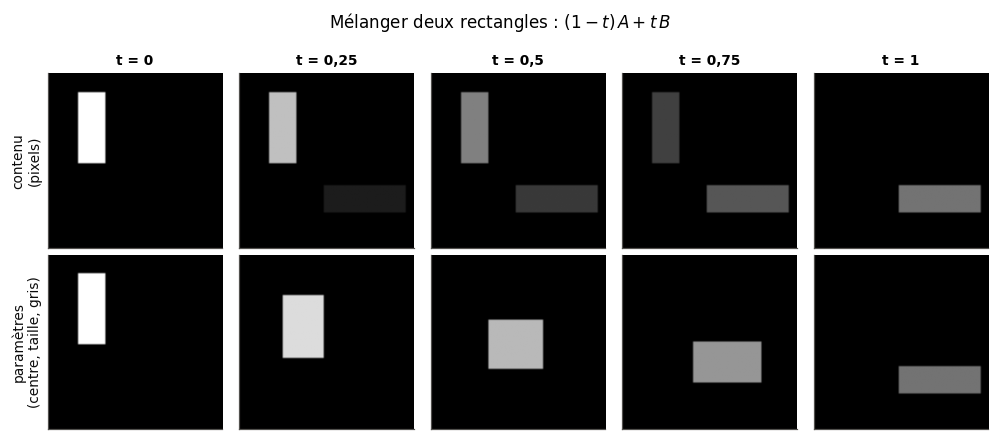
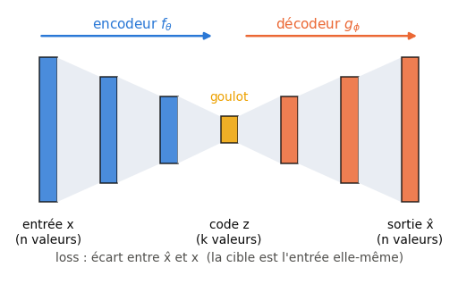
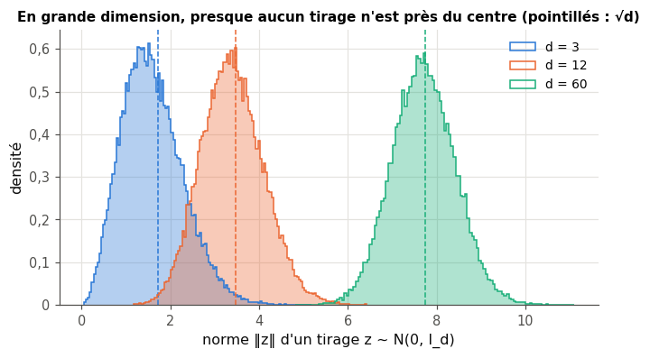
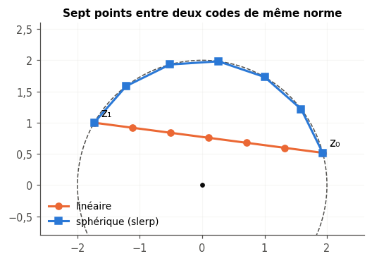
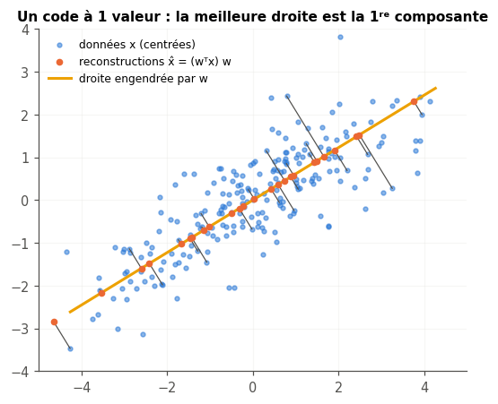
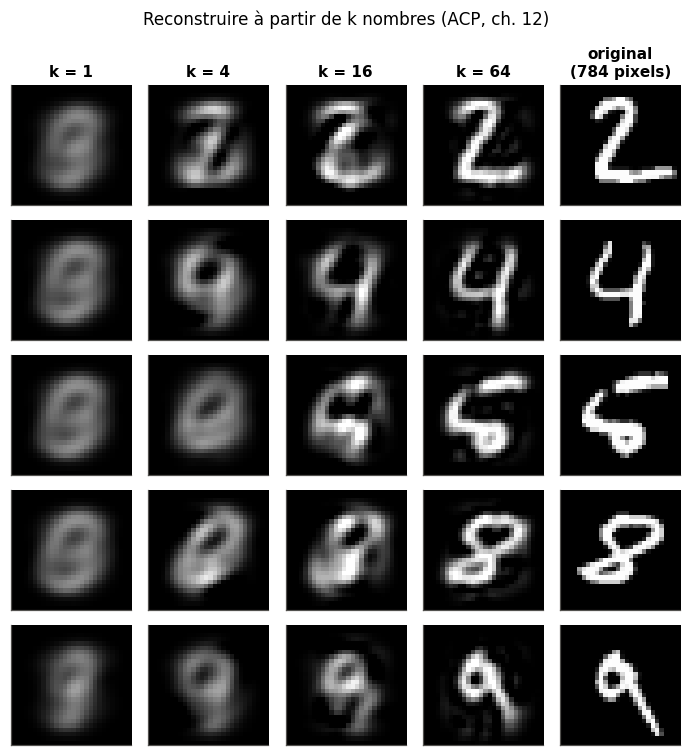
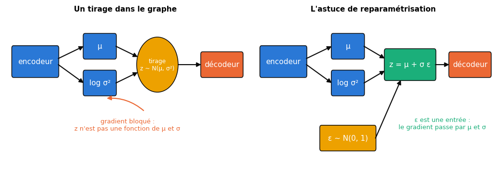

# 25 · Autoencodeurs et VAE — fiche de cours

> Ce chapitre ouvre la partie VI, consacrée aux modèles qui **produisent** des données au lieu de les classer. Un autoencodeur est un réseau qu'on entraîne à recopier son entrée en la faisant passer par un **goulot** : obligé de tout résumer en quelques nombres, il invente son propre code, l'**espace latent**. Le livre part de la compression (avec ou sans perte, JPEG et MP3), construit des autoencodeurs de plus en plus capables sur MNIST (denses, profonds, convolutifs, débruiteurs), explore leur espace latent, puis montre pourquoi on ne sait pas s'en servir pour générer, et comment le **VAE** (*variational autoencoder*) y remédie. Il le fait sans maths ; la fiche ajoute ce qu'il laisse de côté et dont tu auras besoin : l'astuce de reparamétrisation écrite et dérivée, la divergence KL entre gaussiennes, la loss du VAE (l'ELBO), le lien exact avec l'ACP, l'interpolation sphérique, la mesure du débruitage (PSNR). Elle traduit chaque réseau en PyTorch, corrige une demi-douzaine de passages du livre et finit par ce qu'il n'a pas pu voir : le compromis β, la détection d'anomalies, et la place des autoencodeurs aujourd'hui, devenus le premier étage des générateurs d'images.

| | |
|---|---|
| **Livre** | vol. 2, ch. 25 « Autoencoders », p. 1380-1457 (§25.1 à §25.10) |
| **Temps total estimé** | ≈ 29 h : lecture du livre et de la fiche ≈ 6,5 h, exercices ≈ 22 h, 25 flashcards ≈ 0,8 h |
| **Prérequis** | ch. 2 (loi normale, écart-type, règle des 68 %) · ch. 3 (ROC-AUC) · ch. 6 (divergence KL, bits et nats) · ch. 12 (ACP, variance expliquée, vecteurs propres) · ch. 16 à 19 (couches denses, sigmoïde et ReLU, cross-entropy binaire, rétropropagation, Adam) · ch. 20 (PyTorch, `nn.Module`, boucle d'entraînement) · ch. 21 (convolution, pooling, stride, convolution transposée) · ch. 23 et 24 (`DataLoader`, `state_dict`, augmentation) |
| **Fichiers du chapitre** | `02_exercices.md` (quiz, rappels, papier, réflexion, entretien) · `03_notebook.ipynb` · `04_indices.md` · `05_solutions.md` et `05_solutions.ipynb` · `06_mes_reponses.md` · `flashcards.csv` |
| **mylearn** | `vae.py` : la reparamétrisation (passes avant et arrière), la divergence KL gaussienne et son gradient, l'interpolation linéaire et sphérique entre deux codes |

## Comment utiliser ce chapitre

Le chapitre du livre est fait de figures : des rangées de chiffres d'entrée et de sortie, des cartes de points colorés, des grilles d'images décodées. Il n'a ni formule ni code. Lis-le en regardant chaque figure assez longtemps pour dire ce qui a changé d'une rangée à l'autre ; la fiche donne ensuite la version précise de ce que le livre décrit avec des mots. Compte un peu moins de six heures de lecture, livre et fiche.

**Ordre conseillé.**
1. Lis le livre §25.1 à §25.2.3, puis les sections correspondantes de la fiche. Fais les quiz Q1, Q2 et Q3, le rappel R3 et l'exercice ✏️ 25.2.
2. Lis le livre §25.3 et §25.4, puis la fiche. Fais les quiz Q4, Q5 et Q6, les rappels R1 et R2, et les exercices ✏️ 25.1 et 🧮 25.9.
3. Lis le livre §25.5 à §25.5.4, puis la fiche. Fais les quiz Q7, Q8 et Q11 et l'exercice ✏️ 25.6.
4. Lis le livre §25.6, puis la fiche. Fais le quiz Q9 et la démonstration ∂ 25.8.
5. Lis le livre §25.7 à §25.8, puis la fiche. Fais le quiz Q10 et les exercices ✏️ 25.3 et 25.4.
6. Lis le livre §25.9 à §25.10, puis la fin de la fiche (le compromis β et les anomalies compris). Fais le quiz Q12, les dérivations ∂ 25.5 et 25.7, l'estimation 🧮 25.10, la réflexion (🗣️ 25.11, ⚖️ 25.12) et la lecture 📄 25.13. Vérifie tes réponses courtes dans la partie 0 du notebook.
7. Fais le notebook dans l'ordre des ID : trois phases, des autoencodeurs denses (une seule image, MNIST, l'espace latent, l'ACP), puis convolutifs et débruiteurs, puis le VAE (ta librairie `vae.py`, un VAE PyTorch, le compromis β, les anomalies, un VAE entièrement en NumPy) et le défi de débruitage. Termine par les cinq questions d'entretien.

| Section | Quiz 🧠 et rappels 🔁 | Papier ✏️ ∂ 🧮 et réflexion | Notebook | Entretien 💼 |
|---|---|---|---|---|
| 25.1 et 25.2.1 Pourquoi, avec ou sans perte | Q1 | 25.9 | 25.37 | |
| 25.2.2 Un encodage taillé pour son domaine | Q2 | | | |
| 25.2.3 Mélanger deux représentations | Q3 | 25.2 | 25.21 | |
| 25.3 Le plus simple des autoencodeurs | Q4, Q5, R1 | 25.1, 25.9 | 25.14, 25.15 | |
| 25.4 Un meilleur autoencodeur | Q6, R2 | 25.1 | 25.15, 25.16, 25.22 | |
| 25.5 et 25.5.1 Les variables latentes | Q7 | | 25.19 | |
| 25.5.2 et 25.5.3 L'espace latent, mélanger | Q8 | 25.6 | 25.18, 25.20, 25.21 | |
| 25.5.4 et 25.7.2 Une entrée jamais vue | Q11 | | 25.17, 25.24, 25.37 | E4 |
| 25.6 L'autoencodeur et l'ACP | Q9 | 25.8 | 25.23 | E1 |
| 25.7 et 25.7.1 Autoencodeurs convolutifs | Q10 | 25.3, 25.12 | 25.24 | |
| 25.8 Débruiter | Q10 | 25.3, 25.4 | 25.25 à 25.27, 25.39 | |
| 25.9 et 25.9.1 Le VAE, la distribution des latents | Q12 | 25.6, 25.7, 25.11, 25.12 | 25.29, 25.31, 25.33, 25.36 | E2 |
| 25.9.2 La structure d'un VAE | Q12, R3 | 25.5, 25.13 | 25.28, 25.30, 25.38 | E3 |
| 25.10 Explorer le VAE | Q12 | 25.6, 25.7, 25.10, 25.13 | 25.29 à 25.36, 25.38 | E5 |

## Objectifs d'apprentissage

À la fin de ce chapitre, tu sais :
1. **Expliquer** ce qu'est une compression avec ou sans perte, et le rôle du goulot dans un autoencodeur.
2. **Construire et entraîner** en PyTorch des autoencodeurs denses, convolutifs et débruiteurs.
3. **Analyser** un espace latent : carte à deux dimensions, perturbations, interpolation linéaire et sphérique.
4. **Relier** un autoencodeur linéaire à l'ACP, par le calcul puis par l'expérience.
5. **Dériver** l'astuce de reparamétrisation et la divergence KL gaussienne, puis les **implémenter** en NumPy.
6. **Entraîner** un VAE, **régler** le compromis entre reconstruction et KL (β) et l'**utiliser** comme générateur.
7. **Détecter** des anomalies grâce à l'erreur de reconstruction, et en connaître les limites.
8. **Situer** les autoencodeurs aujourd'hui : espaces latents des modèles de diffusion, latents discrets, autoencodeurs parcimonieux.

## L'essentiel en 10 lignes

1. Une compression est **sans perte** si l'on peut retrouver exactement l'original, **avec perte** sinon ; JPEG et MP3 jettent beaucoup d'information, mais choisie pour que l'œil ou l'oreille la remarquent peu.
2. Un **autoencodeur** est un réseau entraîné à recopier son entrée : un **encodeur** $f_\theta$ réduit $\mathbf{x}$ à un **code** $\mathbf{z}$ de quelques nombres (le **goulot**), un **décodeur** $g_\phi$ reconstruit $\hat{\mathbf{x}} = g_\phi(\mathbf{z})$, et la loss mesure l'écart entre $\hat{\mathbf{x}}$ et $\mathbf{x}$.
3. La cible est l'entrée elle-même : aucun label n'est nécessaire. C'est de l'apprentissage **auto-supervisé** (le livre dit « semi-supervisé », à tort).
4. Un code n'est utile que si le réseau ne peut pas tricher : entraîné sur une seule image, un autoencodeur la range dans ses biais et la ressort quelle que soit l'entrée.
5. La qualité dépend à la fois du nombre de latents (ce que le code peut porter) et de la capacité de l'encodeur et du décodeur (ce qu'ils savent calculer) ; un autoencodeur ne comprime bien que le genre de données qu'il a vu.
6. L'espace latent d'un autoencodeur classique est mal rangé : des régions vides, d'autres où les classes se mélangent ; décoder un point au hasard, ou le milieu de deux codes, donne souvent une forme sans signification.
7. Un autoencodeur **linéaire** entraîné à l'erreur quadratique apprend le même sous-espace que l'ACP ; les couches non linéaires et les convolutions lui permettent d'aller au-delà.
8. Un autoencodeur **débruiteur** reçoit une image bruitée et doit rendre l'image propre : il apprend ce qu'est une image plausible.
9. Un **VAE** fait sortir de l'encodeur une moyenne $\boldsymbol{\mu}$ et une log-variance $\log\boldsymbol{\sigma}^2$ par latent, tire $\mathbf{z} = \boldsymbol{\mu} + \boldsymbol{\sigma} \odot \boldsymbol{\varepsilon}$ avec $\boldsymbol{\varepsilon} \sim \mathcal{N}(\mathbf{0}, \mathbf{I})$ (l'**astuce de reparamétrisation**, qui laisse passer le gradient), et ajoute à la loss une **divergence KL** qui rapproche chaque code du prior $\mathcal{N}(\mathbf{0}, \mathbf{I})$.
10. Une fois entraîné, le décodeur d'un VAE seul est un **générateur** : on lui donne des tirages de $\mathcal{N}(\mathbf{0}, \mathbf{I})$, il rend des images nouvelles et plausibles. Aujourd'hui, ce rôle est surtout celui d'un premier étage : les générateurs d'images travaillent dans l'espace latent d'un autoencodeur de ce type.

> 📐 **Conventions de la fiche** — Une entrée $\mathbf{x}$ a $p$ valeurs (les $784$ pixels d'une image MNIST, ramenés dans $[0, 1]$), un code $\mathbf{z}$ en a $d$ : $d$ est la dimension de l'**espace latent**, comme dans `mylearn.vae` (BIBLE §6 : $d$ est une dimension géométrique). Les mini-batches d'images sont en $(N, C, H, W)$, comme aux ch. 21 à 24. Le livre écrit ses tenseurs « largeur par hauteur par canaux » ($14 \times 14 \times 16$) ; la fiche les traduit en $(C, H, W)$. $\odot$ est le produit élément par élément, $\log$ le logarithme népérien (les KL sont en **nats**, sauf mention contraire), $\mathcal{N}(\mu, \sigma^2)$ la loi normale de moyenne $\mu$ et de **variance** $\sigma^2$.

## 25.1 · Pourquoi ce chapitre ? ⏩

Jusqu'ici, tous les réseaux du workbook recevaient une entrée et rendaient une réponse à son sujet : une classe, un nombre, la lettre suivante. Un autoencodeur rend **l'entrée elle-même**, après l'avoir fait passer par un passage étroit. Ce détour apparemment inutile oblige le réseau à découvrir ce qui compte dans ses données. Le livre lui donne deux usages pratiques, réduire la dimension d'un dataset (un résumé de quelques nombres par exemple, plus rapide à traiter ensuite) et retirer le bruit d'images, puis un troisième pour la variante **variationnelle** : fabriquer de nouvelles données qui ressemblent aux anciennes sans en copier aucune (livre §25.1).

Le livre met en garde dès la première page : l'autoencodeur n'est pas un concurrent des formats de compression. Il apprend un code adapté à **son** dataset ; entraîné sur des chansons de trois minutes, il compresserait mal une symphonie. La fiche ajoute un quatrième usage, devenu courant : repérer ce qui ne ressemble pas aux données d'entraînement, parce que le réseau le reconstruit mal (section « au-delà du livre »).

## 25.2 · Introduction : comprimer

La compression a rendu possible la musique et les images numériques à grande échelle : un MP3 tient dans environ un dixième de la place d'un enregistrement brut, une photo JPEG dans un quinzième ou un vingtième, souvent sans différence visible (livre §25.2). Les deux suivent le même schéma que l'autoencodeur : un **encodeur** produit une forme compacte, un **décodeur** reconstruit à partir d'elle une version de l'original.

### 25.2.1 · Avec ou sans perte

Le livre rappelle que le mot *loss*, qui désignait jusqu'ici l'erreur d'un réseau, a ici un sens voisin : ce qui manque à la version décompressée. Une transformation est **sans perte** quand elle est **inversible** : on retrouve exactement l'entrée à partir de la sortie, comme le code Morse du ch. 6, qui change la forme d'un message sans rien en retirer. Elle est **avec perte** quand une partie de l'information disparaît pour de bon : on peut deviner ce qui manquait, sans garantie. L'exemple du livre est un message de vœux envoyé par signaux de miroir d'une montagne à l'autre, dont on retire les voyelles pour gagner du temps ; selon le contexte, le message reste clair ou devient ambigu (deux prénoms qui ne diffèrent que par leurs voyelles, livre p. 1384-1385).

Ce qui compte, c'est donc le **test de l'inversibilité**, pas la taille : une transformation peut raccourcir un message sans perte (le ZIP), ou garder sa taille et perdre de l'information (arrondir chaque nombre).

> 🔗 **Lien avec le ch. 6** — Un compresseur sans perte ne peut pas raccourcir tous les messages : il y a moins de messages courts que de messages longs. Il gagne sur les messages fréquents en perdant un peu sur les rares (Huffman). Un compresseur avec perte n'a pas cette limite, puisqu'il accepte de confondre des messages différents.

### 25.2.2 · Un encodage taillé pour son domaine

MP3 et JPEG jettent souvent la grande majorité de l'information, mais pas n'importe laquelle : leurs concepteurs ont étudié la perception humaine, l'oreille pour l'un, l'œil pour l'autre, et retirent d'abord ce qu'on remarque le moins. Plus le fichier est petit, plus la reconstruction s'éloigne de l'original : c'est un compromis entre la taille et la **fidélité**. Pour s'amuser, le livre transforme la photo d'un tigre en son (une ligne de pixels après l'autre), la comprime en MP3, et la retransforme en image ; le résultat est étonnamment correct, avec des stries horizontales qui trahissent l'hypothèse d'un signal sonore, là où JPEG laisse ses petits blocs carrés (livre p. 1386-1388).

La leçon pour la suite : un algorithme conçu par des spécialistes pour un type de données bat un autoencodeur généraliste sur ce type de données ; l'autoencodeur, lui, s'adapte tout seul à des données pour lesquelles personne n'a écrit d'algorithme.

### 25.2.3 · Mélanger deux représentations ⏩

Le livre prépare une idée qui reviendra tout le chapitre : on peut mélanger deux objets de deux façons.
- Le **mélange de contenu** combine les données brutes : superposer deux photos à 50 % chacune donne deux images transparentes l'une sur l'autre, pas un animal intermédiaire.
- Le **mélange paramétrique** (*parametric blending*) combine les nombres qui **décrivent** les objets : pour deux formes décrites par leur position, leur taille et leur teinte, mélanger ces paramètres donne une forme intermédiaire, à mi-chemin sur chaque paramètre.



Le mélange paramétrique ne marche que si les paramètres ont une structure qui s'y prête. Les codes compressés n'en ont souvent aucune : le livre écrit deux noms de fruits lettre par lettre, prend pour chaque position la lettre « du milieu » dans l'alphabet entre les deux, et obtient une suite de lettres qui ne se prononce pas et ne veut rien dire (livre p. 1391-1392). L'espoir du chapitre est qu'un autoencodeur, et surtout un VAE, apprenne un code où le milieu de deux codes se décode en un objet intermédiaire sensé.

## 25.3 · Le plus simple des autoencodeurs ⏩

Pour comprimer, il suffit de forcer les données à passer par un endroit du réseau qui a moins de nombres que l'entrée. Le livre prend des photos de $100 \times 100$ pixels en niveaux de gris, soit $10\,000$ valeurs, et deux couches denses : la première, de 20 neurones, est l'**encodeur** ; la seconde, de $10\,000$ neurones (un par pixel), est le **décodeur**. Le passage étroit s'appelle le **goulot** (*bottleneck*), et ses 20 valeurs le **code**, ou les **variables latentes** (du latin *lateo*, « être caché »). On entraîne le réseau à rendre son entrée : chaque image est à la fois l'entrée et la cible.



$$\mathbf{z} = f_\theta(\mathbf{x}), \qquad \hat{\mathbf{x}} = g_\phi(\mathbf{z}), \qquad L_{\text{rec}} = \frac{1}{n}\sum_{i=1}^{n} \lVert \mathbf{x}_i - \hat{\mathbf{x}}_i \rVert^2$$

L'erreur quadratique (la MSE, ch. 9) est le choix le plus simple. Pour des pixels dans $[0, 1]$, on emploie souvent la **cross-entropy binaire** pixel par pixel (ch. 18), qui traite chaque pixel comme une probabilité d'être allumé :

$$L_{\text{BCE}} = -\sum_{j=1}^{p} \left[x_j \ln \hat{x}_j + (1 - x_j) \ln (1 - \hat{x}_j)\right]$$

> ⚠️ **Le livre, corrigé — « semi-supervisé »** — Le livre classe l'autoencodeur dans l'apprentissage « semi-supervisé », parce qu'il a une cible sans avoir de labels (p. 1395). Le terme désigne autre chose : un apprentissage qui mêle quelques données étiquetées et beaucoup de données sans label. Quand la cible est fabriquée à partir de l'entrée elle-même, on parle d'apprentissage **auto-supervisé** (*self-supervised*).

> 🕰️ **Mise à jour (2026) — l'apprentissage auto-supervisé** — **Le livre :** l'autoencodeur est un cas un peu à part, « semi-supervisé ». · **Aujourd'hui :** l'apprentissage **auto-supervisé** est devenu la façon normale de pré-entraîner les grands modèles : prédire le mot suivant pour un LLM, reconstruire les morceaux masqués d'une image pour un *masked autoencoder*. L'autoencodeur en est l'ancêtre le plus simple. · **Faut-il quand même l'apprendre ?** Oui : l'idée d'une cible tirée de l'entrée est au cœur des modèles actuels, seul le nom a changé. · *Sources :* Y. LeCun et I. Misra, « Self-supervised learning: the dark matter of intelligence », Meta AI, 2021, [ai.meta.com/blog/self-supervised-learning-the-dark-matter-of-intelligence](https://ai.meta.com/blog/self-supervised-learning-the-dark-matter-of-intelligence/) ; K. He et coll., « Masked Autoencoders Are Scalable Vision Learners », CVPR 2022, [arXiv:2111.06377](https://arxiv.org/abs/2111.06377).

**L'autoencodeur qui ne savait redessiner qu'une image.** Le livre entraîne son réseau sur une seule photo, celle du tigre, longtemps. La reconstruction est presque parfaite, moustaches comprises, avec une erreur d'au plus un centième sur chaque pixel : 20 nombres suffiraient-ils pour $10\,000$ pixels ? Non : le réseau a **mémorisé** l'image. Le livre l'explique par les **biais** : ses $10\,000$ neurones de sortie en ont chacun un, et ces biais suffisent à ranger toute l'image ; le code ne sert presque à rien. Les tests du livre le montrent : présenté à une photo d'escalier, le réseau rend le tigre ; présenté à une image entièrement noire, où seuls les biais agissent, il rend encore un tigre reconnaissable, moins net (livre p. 1395-1398). Où un réseau range-t-il ainsi une image, dans les biais ou ailleurs ? Le 🔮 25.14 te le fera chercher. Quoi qu'il en soit, un réseau de plusieurs centaines de milliers de paramètres pour ranger $10\,000$ nombres n'a rien comprimé du tout.

Le vrai test est d'entraîner le réseau sur **beaucoup** d'images : avec une centaine de photos (25 photos et leurs rotations), il ne peut plus tricher, et sa reconstruction du tigre devient une tache floue sans rapport, où l'on devine seulement une symétrie due aux rotations (livre p. 1399-1400). Augmenter le goulot aiderait, mais irait contre le but : on veut le plus petit code possible.

> 💼 **En entreprise — l'erreur d'entraînement ne prouve rien** — Une reconstruction parfaite des images d'entraînement peut cacher une mémorisation. On juge un autoencodeur comme tout modèle : sur des données qu'il n'a pas vues, avec un jeu de validation et un jeu de test (ch. 8).

## 25.4 · Un meilleur autoencodeur ⏩

Le livre passe à MNIST : des images de $28 \times 28 = 784$ pixels, $60\,000$ pour l'entraînement. Le même autoencodeur à deux couches denses, avec un goulot de 20, entraîné 50 epochs, rend des chiffres flous mais reconnaissables. Avec 10 latents, les chiffres se déforment (un 4 tourne au 9) ; avec 3, ce sont des taches qui rappellent vaguement des chiffres (livre p. 1400-1403). Le livre en tire la leçon du chapitre : un autoencodeur a besoin de deux choses, **assez de latents** pour porter l'information, et **assez de capacité** (de poids, de couches) pour calculer un bon code et le décoder.

Il essaie donc un **autoencodeur profond** : plusieurs couches denses de plus en plus étroites jusqu'au goulot, puis de plus en plus larges jusqu'à la sortie, souvent en divisant la largeur par deux d'une couche à l'autre (une habitude, pas une règle). Toujours avec 20 latents, les reconstructions deviennent bien plus nettes (livre p. 1403-1405).

En PyTorch, un autoencodeur est un `nn.Module` qui contient deux sous-modules, ce qui permet d'appeler l'encodeur ou le décodeur seul. Voici un modèle plus petit que ceux du livre et du notebook, pour la structure :

```python
import torch
from torch import nn

class TinyAE(nn.Module):
    def __init__(self, d=8):
        super().__init__()
        self.encoder = nn.Sequential(nn.Flatten(), nn.Linear(784, 64), nn.ReLU(), nn.Linear(64, d))
        self.decoder = nn.Sequential(nn.Linear(d, 64), nn.ReLU(), nn.Linear(64, 784),
                                     nn.Unflatten(1, (1, 28, 28)))

    def forward(self, x):                  # x: (N, 1, 28, 28), pixels in [0, 1]
        return self.decoder(self.encoder(x))   # logits, one per pixel

model = TinyAE()
loss_fn = nn.BCEWithLogitsLoss()           # sigmoid + binary cross-entropy, in one stable function
for x, _ in loader:                        # the labels are ignored
    loss = loss_fn(model(x), x)            # the target is the input itself
    optimizer.zero_grad(); loss.backward(); optimizer.step()
```

Deux détails comptent. Le code `z` n'a **pas d'activation** : un latent peut être négatif ou grand. Et la sortie est faite de **logits** : `BCEWithLogitsLoss` y applique la sigmoïde à l'intérieur, de façon stable, et l'on écrit `torch.sigmoid(model(x))` pour obtenir l'image reconstruite.

> 🕰️ **Mise à jour (2026) — les couches d'un autoencodeur en PyTorch** — **Le livre :** Keras 2, `Dense`, `Conv2D`, `UpSampling2D`, sortie sigmoïde et loss `binary_crossentropy`. · **Aujourd'hui :** `nn.Linear`, `nn.Conv2d`, `nn.Upsample` ou `nn.ConvTranspose2d`, et `nn.BCEWithLogitsLoss` sur des logits, que la documentation de PyTorch recommande plutôt que `nn.Sigmoid` suivi de `nn.BCELoss`, pour la stabilité numérique. · **Faut-il quand même l'apprendre ?** Oui : les architectures du livre se traduisent couche pour couche. · *Sources :* [BCEWithLogitsLoss](https://docs.pytorch.org/docs/2.11/generated/torch.nn.BCEWithLogitsLoss.html), [ConvTranspose2d](https://docs.pytorch.org/docs/2.11/generated/torch.nn.ConvTranspose2d.html), [Upsample](https://docs.pytorch.org/docs/2.11/generated/torch.nn.Upsample.html).

## 25.5 · Explorer l'autoencodeur

Le livre regarde ensuite à quoi ressemble le code de son autoencodeur profond à 20 latents, et ce que le décodeur fait de codes modifiés.

### 25.5.1 · Les variables latentes de près

Les 20 latents de chaque chiffre sont des nombres positifs qui montent jusqu'à quelques centaines (sans doute une ReLU au goulot). Le livre leur ajoute du bruit uniforme, de plus en plus fort : entre −1 et 1, rien ne change ; entre −10 et 10, les traits s'abîment mais les chiffres restent lisibles ; entre −100 et 100, on ne reconnaît plus rien. Ajouter ±100 à **un seul** latent abîme certains chiffres et presque pas d'autres : ceux qui dépendaient peu de ce latent. Enfin, des latents tirés au hasard entre 0 et 25 se décodent en taches blanches qui ne sont pas des chiffres (livre p. 1405-1409).

La conclusion est importante pour la suite : dans un autoencodeur classique, **rien n'indique où sont les codes valides**. Un bruit ne se juge qu'en proportion de l'échelle des latents, et un code tiré au hasard tombe presque toujours dans une région que le décodeur n'a jamais reçue.

### 25.5.2 · L'espace des paramètres

Pour voir l'espace latent, le livre réduit le goulot à **2** latents, au prix de reconstructions très floues, et place en points colorés les codes de $10\,000$ images (livre fig. 25.29). La carte est structurée : les 0, les 1 et les 3 ont leurs régions, les 4, 7 et 9 se chevauchent, et un coin rassemble plusieurs classes en vrac ; à l'intérieur d'une région, des styles proches (des 1 droits, puis des 1 penchés) ont des codes proches. Décoder une grille de points de la carte montre des chiffres qui se transforment d'une région à l'autre (fig. 25.30 à 25.33). Mais la carte a aussi de grands **espaces vides**, et ses classes s'étalent en longues traînées qui partent d'un même coin (les latents sont positifs).

### 25.5.3 · Mélanger des variables latentes ⏩

Revenu à 20 latents, le livre fait ce que la section 25.2.3 annonçait : un **mélange paramétrique** où les paramètres sont les latents. Il fait la moyenne des codes de deux chiffres, latent par latent, et la décode. Le résultat n'est pas une superposition des deux images : le réseau cherche une forme qui a quelque chose des deux, parfois un troisième chiffre (un mélange de 2 et de 4 qui ressemble à un 8). Avec six étapes entre deux codes, les formes intermédiaires deviennent vite étranges, même entre deux 5 : la ligne droite traverse des régions vides de l'espace latent, où le décodeur n'a jamais appris à quoi correspond un code (livre p. 1415-1417).

L'interpolation **linéaire** entre deux codes $\mathbf{z}_0$ et $\mathbf{z}_1$ s'écrit $\mathbf{z}(t) = (1 - t)\,\mathbf{z}_0 + t\,\mathbf{z}_1$, pour $t$ de 0 à 1. Pour les espaces latents gaussiens du VAE, on lui préfère souvent l'interpolation **sphérique**.

> 🧮 **Rappel maths — la norme d'un tirage gaussien en grande dimension** — Si $\mathbf{z} \sim \mathcal{N}(\mathbf{0}, \mathbf{I}_d)$, ses $d$ coordonnées sont des gaussiennes indépendantes de moyenne 0 et de variance 1, donc $\mathbb{E}[z_j^2] = 1$ et $\mathbb{E}\lVert \mathbf{z} \rVert^2 = \sum_{j} \mathbb{E}[z_j^2] = d$. Quand $d$ grandit, $\lVert\mathbf{z}\rVert$ se concentre autour de $\sqrt{d}$ : presque aucun tirage ne tombe près du centre, alors que la densité y est la plus forte (il y a très peu de place près du centre en grande dimension). En deux dimensions, la loi de la distance au centre se calcule : $P(\lVert\mathbf{z}\rVert \le r) = 1 - e^{-r^2/2}$. Le milieu de deux tirages indépendants, lui, a une norme typique plus petite que celle des tirages : la ligne droite entre deux codes typiques passe par une zone où presque aucun code n'existe.



> 🧮 **Rappel maths — l'interpolation sphérique (slerp)** — Soit $\Omega$ l'angle entre $\mathbf{z}_0$ et $\mathbf{z}_1$, avec $\cos\Omega = \frac{\mathbf{z}_0 \cdot \mathbf{z}_1}{\lVert\mathbf{z}_0\rVert\,\lVert\mathbf{z}_1\rVert}$. L'interpolation sphérique est
> $$\text{slerp}(\mathbf{z}_0, \mathbf{z}_1; t) = \frac{\sin((1 - t)\,\Omega)}{\sin\Omega}\,\mathbf{z}_0 + \frac{\sin(t\,\Omega)}{\sin\Omega}\,\mathbf{z}_1, \qquad 0 \le t \le 1.$$
> Pour $t = 0$ elle vaut $\mathbf{z}_0$, pour $t = 1$ elle vaut $\mathbf{z}_1$. Entre deux vecteurs de même norme, elle reste sur la sphère de cette norme et avance d'un angle constant : elle suit l'arc de grand cercle au lieu de couper par l'intérieur. Quand $\sin\Omega$ est presque nul (vecteurs parallèles ou opposés), la formule ne s'applique plus et l'on revient à la ligne droite. Ken Shoemake l'a introduite en 1985 pour animer des rotations ; T. White l'a proposée pour les espaces latents gaussiens en 2016.



### 25.5.4 · Une entrée jamais vue ⏩

Le livre réduit le tigre à $28 \times 28$ pixels et le donne à son autoencodeur de chiffres. Le réseau n'a aucun moyen de le représenter : il « voit » un chiffre là où il n'y en a pas, et rend un assemblage de morceaux de chiffres, avec le cadre noir que presque toutes les images MNIST ont sur leurs bords (livre p. 1418-1419). C'est attendu : le code n'a de sens que pour le genre de données qui l'a construit. Cette faiblesse devient un outil, la **détection d'anomalies** (section « au-delà du livre »), à condition d'en connaître les limites.

## 25.6 · Discussion : l'autoencodeur et l'ACP

Le livre rapproche l'autoencodeur de l'**ACP** (ch. 12), qui garde les directions où les données varient le plus, et affirme qu'en écrivant les deux, « ils produisent les mêmes résultats » ; un autoencodeur plus complexe ferait davantage (livre p. 1419). C'est vrai d'un autoencodeur bien précis, et c'est un résultat ancien (Bourlard et Kamp 1988, Baldi et Hornik 1989).

> 🧮 **Rappel maths — projection orthogonale et ACP** — Pour un vecteur unitaire $\mathbf{w}$ ($\lVert\mathbf{w}\rVert = 1$), la projection orthogonale de $\mathbf{x}$ sur la droite engendrée par $\mathbf{w}$ est $(\mathbf{w}^\top\mathbf{x})\,\mathbf{w}$ : le nombre $\mathbf{w}^\top\mathbf{x}$ est sa coordonnée sur la droite. Pour des données centrées de matrice de covariance $\mathbf{C}$, la variance des coordonnées vaut $\mathbf{w}^\top\mathbf{C}\,\mathbf{w}$, et, par Pythagore, l'erreur moyenne de projection vaut la variance totale moins cette quantité. Minimiser l'erreur de projection, c'est donc maximiser la variance projetée : la meilleure droite est celle du premier vecteur propre de $\mathbf{C}$, la première composante principale (ch. 12). Avec $d$ directions, $\mathbf{X}\mathbf{W}\mathbf{W}^\top$ projette sur le sous-espace des colonnes d'une matrice $\mathbf{W}$ aux colonnes orthonormées, et
> $$\min_{\mathbf{W}} \lVert \mathbf{X} - \mathbf{X}\mathbf{W}\mathbf{W}^\top \rVert_F^2$$
> est atteint quand ces colonnes engendrent le sous-espace des $d$ premières composantes principales.

Un **autoencodeur linéaire** (des couches sans activation, sans biais, sur des données centrées), entraîné à l'erreur quadratique avec un code de $d$ valeurs, calcule exactement une reconstruction de ce type : son code est $\mathbf{z} = \mathbf{W}_e^\top\mathbf{x}$, sa sortie $\hat{\mathbf{x}} = \mathbf{W}_d\,\mathbf{z}$. À l'optimum, sa sortie est la projection sur le sous-espace des $d$ premières composantes principales. Il en retrouve le **sous-espace**, pas les axes eux-mêmes : une rotation du code, par exemple, compensée par le décodeur, donne la même reconstruction, et rien ne force ses latents à être orthogonaux ni rangés par variance. La démonstration ∂ 25.8 le fait dans le plan, l'expérience 🔬 25.23 le vérifie sur MNIST.





> ⚠️ **Le livre, corrigé — un autoencodeur profond n'est pas une ACP** — Le livre parle d'un autoencodeur « comme celui de la figure 25.21 », qui est profond et non linéaire. Le résultat d'équivalence ne vaut que pour l'autoencodeur **linéaire** entraîné à l'erreur quadratique. Avec des ReLU, l'encodeur peut suivre une surface courbe (une **variété**) que l'ACP ne peut approcher qu'avec plus de dimensions ; c'est justement pour cela qu'on l'utilise (Hinton et Salakhutdinov, 2006).

> 💼 **En entreprise — ACP d'abord** — Sur des données tabulaires, essaie l'ACP avant un autoencodeur : elle est exacte, sans hyperparamètres, rapide, et ses composantes s'interprètent. L'autoencodeur se justifie quand les données ont une structure non linéaire (images, sons) ou quand on veut aussi débruiter ou générer.

## 25.7 · Autoencodeurs convolutifs ⏩

Pour des images, les convolutions s'imposent (ch. 21). L'autoencodeur convolutif du livre réduit une image de $28 \times 28$ à un bloc de $7 \times 7$ par deux max poolings, avec des convolutions $3 \times 3$ de 16, puis 8, puis 3 filtres : son code est un petit tenseur à 3 canaux. Le décodeur fait le chemin inverse avec deux **sur-échantillonnages** (*upsampling*), qui doublent la hauteur et la largeur en répétant chaque valeur, chacun suivi d'une convolution, la seconde à un seul filtre, qui rend l'image (livre p. 1420-1421). En PyTorch, le sur-échantillonnage est `nn.Upsample(scale_factor=2)` ; une convolution de `padding=1` garde la taille, un `MaxPool2d(2)` la divise par deux.

> ⚠️ **Le livre, corrigé — les canaux après le second pooling** — Le livre donne un tenseur de « 7 par 7 par 7 » après la deuxième convolution et son pooling (p. 1420). Un pooling ne change pas le nombre de canaux : ce nombre est celui des filtres de la convolution qui précède. L'exercice ✏️ 25.3 te fait suivre toutes les formes.

Entraîné 50 epochs, cet autoencodeur rend des chiffres presque identiques aux entrées, bien meilleurs que ceux des autoencodeurs denses, avec un code pourtant plus grand qu'eux (livre p. 1421). Les expériences de bruit donnent la même histoire qu'en 25.5.1 : un bruit léger passe, un bruit fort détruit les chiffres, et un code entièrement aléatoire se décode en taches qui ne ressemblent à rien (p. 1421-1424).

> 🧮 **Rappel maths — la taille de sortie d'une convolution transposée** — Au ch. 21, la convolution transposée sert à agrandir une image en apprenant comment. Pour une entrée de hauteur $H_{in}$, un noyau $k$, un stride $s$, un padding $p$ et un `output_padding` $p_{out}$ :
> $$H_{out} = (H_{in} - 1)\,s - 2p + k + p_{out}.$$
> Plusieurs tailles d'entrée d'une convolution de stride 2 donnent la même taille de sortie (on arrondit vers le bas) ; `output_padding` (strictement plus petit que le stride) choisit laquelle retrouver au retour. Les poids de `nn.ConvTranspose2d(C_in, C_out, k)` ont la forme `(C_in, C_out, k, k)`, l'inverse de ceux de `nn.Conv2d`.

### 25.7.1 · Mélanger les variables latentes ⏩

Les moyennes de codes du convolutif ressemblent davantage à des fondus enchaînés : la transition d'un 1 à un 0 superpose les deux traits plus qu'elle ne transforme l'un en l'autre, et un 4 passe par une forme intermédiaire entre 4 et 8. Entre deux 5, en revanche, toutes les étapes sont des 5 lisibles, mieux qu'avec l'autoencodeur dense (livre p. 1424-1426).

### 25.7.2 · Une entrée jamais vue ⏩

Le tigre réduit passe un peu mieux dans le convolutif : vu de loin, ses grandes masses sombres se placent à peu près là où le tigre a les siennes (livre p. 1426). Le réseau cherche toujours le tigre dans un espace de chiffres, mais ses filtres locaux conservent un peu de la structure de l'image.

## 25.8 · Débruiter ⏩

Un usage très répandu des autoencodeurs est le **débruitage** : on veut retirer des points trop clairs ou trop sombres d'une image, comme les grains parasites d'une photo prise de nuit ou d'un rendu 3D arrêté trop tôt. On fabrique des paires (image bruitée, image propre) : à chaque pixel d'une image MNIST, on ajoute un tirage gaussien, puis on **écrête** dans $[0, 1]$. L'autoencodeur reçoit l'image **bruitée** en entrée et l'image **propre** comme cible (livre p. 1427).

```python
noisy = (clean + sigma * torch.randn_like(clean)).clamp(0.0, 1.0)   # new noise at every batch
loss = loss_fn(model(noisy), clean)                                # the target is the clean image
```

Le livre reprend l'architecture d'un billet de blog de F. Chollet (2016) : deux convolutions de 32 filtres suivies chacune d'un pooling, puis deux convolutions suivies chacune d'un sur-échantillonnage, et une convolution finale à un filtre (livre fig. 25.47). Son « code » a **plus** de valeurs que l'image : ce n'est plus de la compression, et ce n'est pas un problème, puisque le but est de retirer le bruit. Entraîné sur les $60\,000$ images, le réseau rend des chiffres propres. Une seconde version remplace pooling et sur-échantillonnage par des convolutions de stride 2 et des convolutions transposées, pour un résultat très proche et un entraînement plus rapide (livre p. 1428-1430).

> ⚠️ **Le livre, corrigé — numéros et durées** — Le livre numérote cette section « 26.8 » et le §25.10 « 29.10 ». Plusieurs renvois de figures sont décalés : les chiffres bruités, appelés figure 25.44 puis 25.45, sont la figure 25.46, et le débruiteur, appelé figure 25.45, est la figure 25.47. Dans sa comparaison des deux débruiteurs, le livre écrit que le modèle à pooling et sur-échantillonnage explicites prend environ 300 s par epoch, puis attribue le temps le plus court au modèle de la figure 25.47, qui est ce même modèle : le plus rapide est la version à convolutions de stride 2 (figure 25.49), qui gagne environ un tiers. Et quand il parle du tenseur « à la fin du décodage », il s'agit de la fin de l'**encodage**, après le second pooling.

> 🧮 **Rappel maths — le PSNR** — Pour mesurer un débruitage, on compare l'image rendue à l'image propre par le **PSNR** (*peak signal-to-noise ratio*), en décibels. Pour des pixels dans $[0, 1]$ (la valeur maximale vaut 1) :
> $$\text{PSNR} = 10 \log_{10} \frac{1}{\text{MSE}}.$$
> Diviser la MSE par 10 ajoute 10 dB ; une MSE de 0,01 donne 20 dB. Plus le PSNR est grand, plus l'image est proche de l'originale. Il ne dit pas tout : deux images de même PSNR peuvent paraître très différentes à l'œil (on complète par des mesures de structure, comme le SSIM, ou par l'œil).

> 🕰️ **Mise à jour (2026) — le débruitage** — **Le livre :** un autoencodeur convolutif sur MNIST bruité ; il cite des travaux de 2017 sur le débruitage des images de synthèse. · **Aujourd'hui :** les moteurs de rendu embarquent des débruiteurs neuronaux (Intel Open Image Denoise, le débruiteur de NVIDIA OptiX) ; surtout, l'idée de débruiter pour apprendre est au cœur des **modèles de diffusion**, qui génèrent une image en débruitant un bruit pur, étape par étape. · **Faut-il quand même l'apprendre ?** Oui : le débruiteur du chapitre est l'ancêtre direct du réseau qui fait le travail dans une diffusion (bonus B5). · *Sources :* J. Ho, A. Jain et P. Abbeel, « Denoising Diffusion Probabilistic Models », NeurIPS 2020, [arXiv:2006.11239](https://arxiv.org/abs/2006.11239) ; [Intel Open Image Denoise](https://www.openimagedenoise.org/) ; [NVIDIA OptiX](https://developer.nvidia.com/optix-denoiser).

## 25.9 · Les autoencodeurs variationnels ⏩

Les autoencodeurs vus jusqu'ici cherchent le code le plus efficace pour reconstruire. Le **VAE** (*variational autoencoder*) garde la même forme générale, mais vise autre chose : une fois entraîné, il doit pouvoir **générer** autant de nouvelles données qu'on veut, semblables à celles du dataset sans en copier aucune, comme un peintre qui aurait tant peint de cerisiers qu'il en invente de nouveaux, plausibles (livre p. 1430-1431). On a vu que donner des nombres au hasard au décodeur d'un autoencodeur classique ne donne que des taches : il faut un espace latent organisé autrement.

Autre différence : un autoencodeur entraîné est **déterministe** (la même entrée donne toujours le même code et la même sortie) ; un VAE tire un nombre au hasard dans son encodeur, et rend une sortie un peu différente à chaque passage de la même entrée.

### 25.9.1 · La distribution des variables latentes ⏩

La carte à deux latents de l'autoencodeur classique a deux défauts pour générer : des **zones vides**, où un code tiré au hasard ne correspond à rien, et des **zones mêlées**, où plusieurs chiffres se partagent les mêmes codes (livre p. 1432-1433). Le livre fixe trois exigences pour un espace latent dont on puisse tirer des codes (livre p. 1433-1434) :
1. tous les codes sont **rassemblés dans une région connue**, pour savoir où tirer ;
2. des entrées semblables ont des **codes proches** ;
3. il y a **le moins de trous possible**.

Pour la première, le VAE impose que les codes suivent, latent par latent, une **gaussienne centrée réduite** : moyenne 0, écart-type 1, soit environ 68 % des valeurs entre −1 et 1 (ch. 2). C'est le **prior** $p(\mathbf{z}) = \mathcal{N}(\mathbf{0}, \mathbf{I})$ : en dimension $d$, $d$ gaussiennes indépendantes, une bosse en forme de pissenlit, dense au centre. Une fois l'entraînement fini, on tire des codes de cette loi pour générer. L'idéal n'est jamais atteint : il y a un compromis entre la ressemblance des codes à cette gaussienne et la précision des reconstructions, que l'entraînement règle de lui-même (p. 1434-1436).

> 🧮 **Rappel maths — densité et espérance d'une gaussienne** — Une variable continue $z$ a une **densité** $q(z)$ : la probabilité qu'elle tombe dans un petit intervalle autour de $z$ vaut à peu près $q(z)$ fois la largeur de l'intervalle (ch. 2). Pour la loi $\mathcal{N}(\mu, \sigma^2)$,
> $$q(z) = \frac{1}{\sqrt{2\pi\sigma^2}}\,\exp\!\left(-\frac{(z - \mu)^2}{2\sigma^2}\right), \qquad \ln q(z) = -\tfrac{1}{2}\ln(2\pi\sigma^2) - \frac{(z - \mu)^2}{2\sigma^2}.$$
> L'**espérance** d'une fonction $h(z)$ est la moyenne de $h$ pondérée par la densité, $\mathbb{E}[h(z)] = \int h(z)\,q(z)\,dz$ : la valeur moyenne de $h(z)$ sur un très grand nombre de tirages. Deux espérances servent tout le chapitre : $\mathbb{E}[(z - \mu)^2] = \sigma^2$ (c'est la définition de la variance) et $\mathbb{E}[z^2] = \mu^2 + \sigma^2$. En dimension $d$, une loi $\mathcal{N}(\boldsymbol{\mu}, \text{diag}(\boldsymbol{\sigma}^2))$ a des coordonnées indépendantes, et sa densité est le produit des $d$ densités.

Pour les deux autres exigences, le livre raisonne à l'envers : supposons que des entrées semblables aient déjà des codes proches ; alors on peut ajouter un peu de hasard au code d'une entrée avant de le décoder, et l'image produite ressemblera encore à l'entrée. Si l'on **impose** ce hasard pendant l'entraînement, en punissant les sorties qui s'éloignent de l'entrée, le réseau n'a pas d'autre choix que de ranger les codes de cette façon : les voisins d'un code doivent se décoder en images semblables, ce qui remplit les trous et sépare les classes (p. 1436-1439).

### 25.9.2 · La structure d'un VAE ⏩

Le VAE a été proposé au même moment par deux équipes (Kingma et Welling ; Rezende, Mohamed et Wierstra). Le livre en donne une description sans maths ; la voici avec.

**Un encodeur probabiliste.** Pour chaque entrée $\mathbf{x}$, l'encodeur ne rend plus un code mais les paramètres d'une gaussienne : une moyenne $\mu_j$ et une variance $\sigma_j^2$ pour chacun des $d$ latents. Cette loi, notée $q(\mathbf{z} \mid \mathbf{x})$, est le **posterior approché** : là où le VAE pense que le code de $\mathbf{x}$ se trouve. En pratique, la seconde tête rend $\log\sigma_j^2$ plutôt que $\sigma_j$ : n'importe quel réel convient, alors qu'un écart-type doit être positif, et l'on calcule $\sigma_j = \exp\left(\tfrac{1}{2}\log\sigma_j^2\right)$.

**L'astuce de reparamétrisation.** On tire ensuite le code dans cette gaussienne. Mais un tirage « $\mathbf{z} \sim \mathcal{N}(\boldsymbol{\mu}, \boldsymbol{\sigma}^2)$ » ne se dérive pas : le nombre obtenu n'est pas une fonction de $\boldsymbol{\mu}$ et $\boldsymbol{\sigma}$, et la rétropropagation (ch. 18) n'a rien à remonter. L'astuce consiste à sortir le hasard du chemin : on tire $\boldsymbol{\varepsilon} \sim \mathcal{N}(\mathbf{0}, \mathbf{I})$, qui ne dépend d'aucun poids, et l'on calcule

$$\mathbf{z} = \boldsymbol{\mu} + \boldsymbol{\sigma} \odot \boldsymbol{\varepsilon}, \qquad \boldsymbol{\sigma} = e^{\frac{1}{2}\log \boldsymbol{\sigma}^2}.$$

Le code a la même loi qu'avant, mais il est maintenant une fonction dérivable de $\boldsymbol{\mu}$ et de $\log\boldsymbol{\sigma}^2$, avec $\boldsymbol{\varepsilon}$ comme une entrée de plus : $\partial z_j/\partial \mu_j = 1$, et la dérivée par rapport à $\log\sigma_j^2$ se calcule par la règle de la chaîne (∂ 25.5). Le gradient atteint l'encodeur, jamais le bruit.



**Une loss en deux termes.** La loss du VAE ajoute à l'erreur de reconstruction une **divergence KL** entre le posterior approché et le prior :

$$L_{\text{VAE}} = \underbrace{\mathbb{E}_{q(\mathbf{z} \mid \mathbf{x})}\left[-\ln p(\mathbf{x} \mid \mathbf{z})\right]}_{\text{reconstruction}} + \beta\;\underbrace{\mathrm{KL}\left(q(\mathbf{z} \mid \mathbf{x}) \,\|\, \mathcal{N}(\mathbf{0}, \mathbf{I})\right)}_{\text{régularisation}}, \qquad \beta = 1.$$

Le premier terme est l'erreur de reconstruction calculée sur le code tiré : une cross-entropy binaire sommée sur les pixels si l'on modélise chaque pixel comme une probabilité, une erreur quadratique si l'on suppose un bruit gaussien. On l'estime avec **un seul** tirage de $\boldsymbol{\varepsilon}$ par exemple et par pas. Le second terme pousse chaque $q(\mathbf{z} \mid \mathbf{x})$ vers le prior : des moyennes près de 0 et des variances près de 1. Il empêche l'encodeur de réduire $\sigma$ à presque rien (ce qui reviendrait à un autoencodeur classique) et de disperser les codes loin les uns des autres. Les deux termes tirent en sens contraire, et c'est leur équilibre qui range l'espace latent. Le coefficient $\beta$ vaut 1 dans le VAE standard ; la section « au-delà du livre » montre ce qui change quand on le règle.

Avec un prior gaussien et un posterior gaussien de covariance diagonale, la KL a une forme fermée, latent par latent :

$$\mathrm{KL}\left(\mathcal{N}(\mu, \sigma^2)\,\|\,\mathcal{N}(0, 1)\right) = \tfrac{1}{2}\left(\mu^2 + \sigma^2 - 1 - \ln \sigma^2\right),$$

et l'on somme sur les $d$ latents (les dimensions sont indépendantes, ch. 6). Elle est toujours positive ou nulle, et nulle exactement pour $\mu = 0$ et $\sigma = 1$. La dérivation ∂ 25.7 part des deux espérances du rappel ci-dessus ; en NumPy, ta fonction `gaussian_kl` la calcule pour chaque exemple.

> 🧮 **Rappel maths — l'ELBO** — Pourquoi cette loss ? Le VAE veut maximiser la probabilité $p(\mathbf{x})$ que son décodeur donne aux images du dataset, une intégrale sur tous les codes possibles qu'on ne sait pas calculer. On montre que $\ln p(\mathbf{x})$ est toujours au moins égal à $\mathbb{E}_{q}[\ln p(\mathbf{x} \mid \mathbf{z})] - \mathrm{KL}(q(\mathbf{z} \mid \mathbf{x}) \,\|\, p(\mathbf{z}))$, une **borne inférieure** appelée **ELBO** (*evidence lower bound*). La loss du VAE est l'opposé de l'ELBO : la minimiser, c'est pousser la borne vers le haut. L'article de Kingma et Welling (📄 25.13) en donne la démonstration.

> ⚠️ **Le livre, corrigé — ce que mesure le terme KL** — Le livre écrit que la KL mesure à quel point l'encodeur et le décodeur sont différents, et que la réduire les rend « miroirs » l'un de l'autre (p. 1442-1443). Ce n'est pas cela : la KL compare la loi des codes d'une entrée, $q(\mathbf{z} \mid \mathbf{x})$, au prior $\mathcal{N}(\mathbf{0}, \mathbf{I})$ ; le décodeur n'y apparaît pas. C'est l'erreur de reconstruction qui oblige le décodeur à défaire ce que fait l'encodeur.

> 🕰️ **Mise à jour (2026) — le VAE expliqué avec ses maths** — **Le livre :** une approche « approximative et conceptuelle », sans formule, et une interprétation erronée du terme KL. · **Aujourd'hui :** le VAE est enseigné avec sa loss exacte (l'opposé de l'ELBO), l'astuce de reparamétrisation et la KL en forme fermée, comme dans l'introduction de Kingma et Welling (2019). · **Faut-il quand même l'apprendre ?** Oui, et avec les maths : c'est la base des modèles génératifs à variables latentes, jusqu'à la diffusion. · *Sources :* D. P. Kingma et M. Welling, « Auto-Encoding Variational Bayes », ICLR 2014, [arXiv:1312.6114](https://arxiv.org/abs/1312.6114) ; D. P. Kingma et M. Welling, « An Introduction to Variational Autoencoders », 2019, [arXiv:1906.02691](https://arxiv.org/abs/1906.02691).

En PyTorch, l'encodeur se termine par deux têtes, et la loss s'écrit en quelques lignes (le notebook te fait écrire le modèle complet en 📦 25.30) :

```python
h = self.body(x)                                   # shared layers of the encoder
mu, log_var = self.to_mu(h), self.to_log_var(h)    # two heads, (N, d) each
z = mu + torch.exp(0.5 * log_var) * torch.randn_like(mu)          # reparameterization
logits = self.decoder(z)
rec = F.binary_cross_entropy_with_logits(logits, x, reduction="sum") / len(x)
kl = 0.5 * (mu**2 + log_var.exp() - 1 - log_var).sum() / len(x)
loss = rec + beta * kl                              # per example, beta = 1 for a VAE
```

Attention aux échelles : la reconstruction est **sommée** sur les 784 pixels, comme la KL sur les $d$ latents. Une reconstruction moyennée sur les pixels serait 784 fois plus petite, et la KL écraserait tout : c'est un $\beta$ caché.

## 25.10 · Explorer le VAE ⏩

Le livre reprend son autoencodeur dense profond à 20 latents en y ajoutant le tirage au bout de l'encodeur et la nouvelle loss (livre fig. 25.59). Les reconstructions sont bonnes. Passée huit fois dans le réseau, la même image de 2 donne huit sorties voisines mais différentes, surtout vers la fin du trait. Ajouter aux latents un bruit de 10 % de leur valeur ne change presque rien, et même avec 30 %, les sorties restent des chiffres, parfois d'une autre forme mais jamais une tache : l'espace latent s'est rangé (livre p. 1443-1446). Les moyennes de codes de deux chiffres ressemblent à des chiffres ; les interpolations en six étapes restent mieux formées qu'avant, même si certaines étapes ne sont pas des chiffres (p. 1446-1447). Le tigre, lui, ressort cette fois comme un tracé fermé, qui a l'allure d'un chiffre et non d'une tache sans forme (p. 1447).

Avec 2 latents seulement, le nuage des codes de $10\,000$ images remplit à peu près le disque où la gaussienne est dense, et les chiffres y sont mieux regroupés ; une grille de codes de −3 à 3 sur chaque axe se décode en chiffres presque partout (livre fig. 25.67 et 25.68). Puis le livre retire l'encodeur et donne au décodeur des codes tirés de $\mathcal{N}(\mathbf{0}, \mathbf{I})$ : sur 80 tirages pris au hasard, la plupart sont des chiffres reconnaissables, un peu flous ; un VAE plus profond, à 50 latents, inspiré d'un exemple de la bibliothèque Caffe, donne des chiffres plus nets (p. 1450-1454). Une fois entraîné, on peut jeter l'encodeur et ne garder que le décodeur : c'est un **générateur**.

> ⚠️ **Le livre, corrigé — quelques renvois** — Plusieurs renvois de figures sont décalés : « la figure 25.49 » des zones vides et mêlées est la figure 25.51, l'ajout de nombres au hasard à la sortie de l'encodeur, renvoyé « à la figure 25.54 » (une gaussienne), est la figure 25.56, et le VAE « de la figure 25.57 » dont on montre les prédictions est celui de la figure 25.59. La légende de la figure 25.69 parle de 20 nombres au hasard pour le VAE à 2 latents (il en faut 2), et les chiffres du VAE profond se comparent plus logiquement à la figure 25.70 qu'à la figure 25.68. Il dit enfin avoir mélangé deux latents « dans la figure 25.31 » pour les trajets de la figure 25.33. Et MLP signifie *multilayer perceptron*, perceptron multicouche (le livre écrit « Multi-Level Perceptron »). Deux références enfin : l'article de Rezende, Mohamed et Wierstra a paru à ICML 2014 (pas à ICLR), et le billet de F. Chollet sur les autoencodeurs Keras date de mai 2016.

> 🕰️ **Mise à jour (2026) — le VAE dans les générateurs d'images** — **Le livre :** le VAE est présenté comme un générateur d'images. · **Aujourd'hui :** ses images restent floues, et d'autres modèles génèrent bien mieux (les GAN au ch. 27, la diffusion en B5). Mais le VAE est devenu un **composant** : les modèles de diffusion latente (Stable Diffusion et ses successeurs) commencent par un autoencodeur régularisé par une petite KL, qui transforme une image de $512 \times 512 \times 3$ en un latent de $64 \times 64 \times 4$, diffusent dans cet espace, puis décodent ; les modèles plus récents utilisent des latents à 16 canaux. · **Faut-il quand même l'apprendre ?** Oui : sans le VAE, on ne comprend pas d'où viennent les latents d'un générateur d'images, ni pourquoi on y travaille (🧮 25.10). · *Sources :* R. Rombach et coll., « High-Resolution Image Synthesis with Latent Diffusion Models », CVPR 2022, [arXiv:2112.10752](https://arxiv.org/abs/2112.10752) ; documentation de diffusers, [AutoencoderKL](https://huggingface.co/docs/diffusers/api/models/autoencoderkl).

## Au-delà du livre : le compromis β, les anomalies, et les autoencodeurs aujourd'hui

**Le compromis β et l'effondrement du posterior.** Multiplier la KL par $\beta \ne 1$ déplace l'équilibre. Avec $\beta > 1$ (le **β-VAE** de Higgins et coll., 2017), les codes collent davantage au prior : l'espace latent est plus régulier, les tirages plus souvent valides, et chaque latent tend à porter un facteur de variation séparé (l'épaisseur, l'inclinaison), mais les reconstructions sont plus floues. Avec $\beta < 1$, on se rapproche d'un autoencodeur classique : des reconstructions nettes, un espace latent moins bien rangé. Poussé trop loin vers le prior, le VAE peut ignorer certains latents, voire tous : leur $q(z_j \mid \mathbf{x})$ devient égal au prior, quelle que soit l'entrée, et leur KL tombe à 0. C'est l'**effondrement du posterior** (*posterior collapse*). Il se voit sur les courbes d'entraînement : une KL qui s'écrase vers 0 pendant que la reconstruction stagne, et des sorties qui ne dépendent plus de l'entrée (📈 25.34). Le remède le plus connu est de faire monter $\beta$ progressivement de 0 à sa valeur finale, le *KL annealing* (Bowman et coll., 2016). On mesure le nombre de latents actifs en regardant la KL de chaque latent, moyennée sur les données.

**Détecter des anomalies.** Un autoencodeur entraîné sur des données normales reconstruit mal ce qui ne leur ressemble pas : l'erreur de reconstruction sert de **score d'anomalie**. On fixe un seuil sur un jeu de validation de données normales (par exemple le 99ᵉ centile de leurs erreurs), et l'on évalue le score comme un classifieur, avec la ROC-AUC (ch. 3), sur des exemples des deux sortes. C'est simple et utile (pièces défectueuses sur une chaîne, transactions inhabituelles, capteurs), avec trois pièges. Un autoencodeur trop capable reconstruit bien **tout**, anomalies comprises. Une anomalie « simple » (une image presque vide) peut être mieux reconstruite que les données normales. Et un modèle génératif peut donner une **vraisemblance** plus haute à des données d'un autre domaine qu'aux siennes : des modèles entraînés sur CIFAR-10 trouvent les chiffres de SVHN plus probables que les images de CIFAR-10 (Nalisnick et coll., 2019). On valide donc toujours sur de vraies anomalies, ou des anomalies réalistes, avant d'y croire (🔬 25.37).

**Les autoencodeurs aujourd'hui.** L'idée s'est diversifiée bien au-delà du livre.

> 🕰️ **Mise à jour (2026) — latents discrets, masques et dictionnaires** — **Le livre :** des latents continus, pour réduire la dimension, débruiter et générer. · **Aujourd'hui :** le **VQ-VAE** (van den Oord et coll., 2017) et le **VQGAN** (Esser et coll., 2021) arrondissent chaque latent au plus proche d'un dictionnaire appris : une image devient une suite de « mots » (des tokens d'image), que des modèles de type Transformer savent générer. Pour apprendre des représentations d'images, les **masked autoencoders** (He et coll., 2022) masquent la plupart des morceaux d'une image et entraînent le réseau à les reconstruire. Et des **autoencodeurs parcimonieux** (*sparse autoencoders*), dont le code est très large mais presque toujours nul, servent à décomposer les activations internes des grands modèles de langage en caractéristiques interprétables (Bricken et coll., 2023 ; bonus B6). · **Faut-il quand même l'apprendre ?** Oui : tous reprennent le schéma encodeur, goulot ou code contraint, décodeur, et la loss de reconstruction de ce chapitre. · *Sources :* [arXiv:1711.00937](https://arxiv.org/abs/1711.00937) (VQ-VAE) ; [arXiv:2012.09841](https://arxiv.org/abs/2012.09841) (VQGAN) ; [arXiv:2111.06377](https://arxiv.org/abs/2111.06377) (MAE) ; T. Bricken et coll., « Towards Monosemanticity », 2023, [transformer-circuits.pub/2023/monosemantic-features](https://transformer-circuits.pub/2023/monosemantic-features).

> ⚖️ **Usages détournés** — Les premiers *deepfakes* de visages (fin 2017) reposaient sur des autoencodeurs : un encodeur commun à deux visages, et un décodeur par visage ; on encode une vidéo du premier visage et on la décode avec le décodeur du second. La même technique sert au doublage de films et aux effets spéciaux, et à fabriquer des vidéos trompeuses de personnes réelles sans leur accord. La réflexion ⚖️ 25.12 te fait examiner le mécanisme, les usages et ce qu'en disent les lois.

## Les pièges classiques ⚠️ (récapitulatif)

| Piège | Exemple | Ce qu'il faut faire |
|---|---|---|
| Juger un autoencodeur sur ses images d'entraînement | une reconstruction parfaite d'une seule image, qui cache une mémorisation dans les biais | mesurer l'erreur de reconstruction sur une validation, et regarder des entrées très différentes |
| Une activation au goulot sans raison | une ReLU ou une sigmoïde sur le code, qui interdit les latents négatifs ou les écrase | un code linéaire (sans activation), sauf choix délibéré |
| Une sigmoïde suivie de `BCELoss` | des `nan` ou des gradients nuls quand une sortie sature | `BCEWithLogitsLoss` sur des logits ; `torch.sigmoid` seulement pour afficher |
| Bruiter la cible d'un débruiteur | `loss_fn(model(noisy), noisy)` : le réseau apprend à recopier le bruit | l'entrée bruitée, la cible propre |
| Un bruit tiré une seule fois | `noisy = clean + noise` calculé avant la boucle, le même à chaque epoch | un bruit neuf à chaque mini-batch |
| Oublier d'écrêter | des pixels bruités hors de $[0, 1]$ face à une sortie sigmoïde | `.clamp(0, 1)` après le bruit |
| Décoder des codes au hasard avec un autoencodeur classique | des tirages uniformes ou gaussiens donnés au décodeur | un VAE, dont le prior dit où tirer ; ou des codes proches de codes réels |
| Prendre $\sigma$ au lieu de $\log\sigma^2$ en sortie de l'encodeur | une tête linéaire qui rend des écarts-types négatifs | une tête qui rend $\log\sigma^2$, et $\sigma = e^{\frac{1}{2}\log\sigma^2}$ |
| Confondre $e^{\log\sigma^2}$ et $e^{\frac{1}{2}\log\sigma^2}$ | `z = mu + torch.exp(log_var) * eps` : on tire avec la variance au lieu de l'écart-type | `torch.exp(0.5 * log_var)` |
| Moyenner la reconstruction sur les pixels, sommer la KL | `F.binary_cross_entropy(..., reduction="mean") + kl.sum(dim=1).mean()` : un β caché de 784 | les deux termes à la même échelle (sommés par exemple, puis moyennés sur le batch) |
| Un tirage aléatoire en évaluation | des reconstructions et des scores qui changent d'un appel à l'autre | utiliser $\boldsymbol{\mu}$ comme code pour reconstruire ou noter ; tirer seulement pour générer |
| Conclure trop vite à l'effondrement ou à son absence | une KL totale correcte, mais la plupart des latents inutilisés | regarder la KL par latent (latents actifs) |
| Un score d'anomalie validé sur une seule sorte d'anomalie | un seuil réglé sur MNIST contre Fashion-MNIST, appliqué à des défauts réels | valider sur des anomalies réalistes, avec la ROC-AUC |
| Interpoler en ligne droite dans un espace gaussien de grande dimension | des étapes intermédiaires de norme trop petite, floues | `slerp`, ou au moins comparer les deux |
| Une sortie de taille 27 au lieu de 28 | `ConvTranspose2d(…, kernel_size=3, stride=2, padding=1)` sans `output_padding` | appliquer la formule de taille, ou vérifier la forme sur `torch.zeros(1, C, H, W)` |

## Liens avec les autres chapitres 🔗

- **Ch. 2** : la loi normale, la règle des 68 %, l'espérance et la variance.
- **Ch. 3** : la ROC-AUC, pour évaluer un score d'anomalie.
- **Ch. 6** : la divergence KL (ici entre deux gaussiennes), les nats et les bits, la compression sans perte.
- **Ch. 9 et 18** : l'erreur quadratique et la cross-entropy binaire, la règle de la chaîne qui fait passer le gradient par $\boldsymbol{\mu}$ et $\boldsymbol{\sigma}$.
- **Ch. 12** : l'ACP, que l'autoencodeur linéaire retrouve ; t-SNE et UMAP pour visualiser un espace latent de grande dimension.
- **Ch. 16, 19 et 20** : couches denses, Adam, la boucle d'entraînement PyTorch ; `mylearn.nn` et `mylearn.optim` servent au VAE entièrement en NumPy (🔨 25.38).
- **Ch. 21** : convolution, pooling, stride, convolution transposée, au cœur des autoencodeurs convolutifs.
- **Ch. 23 et 24** : sauvegarder un sous-modèle (`state_dict` du décodeur), l'augmentation de données.
- **Ch. 27** : les GAN, l'autre grande famille de générateurs, et l'interpolation dans leur espace latent (ta fonction `interpolate_latents` resservira).
- **B5 et B6** : la diffusion latente, qui travaille dans l'espace d'un autoencodeur, et les autoencodeurs parcimonieux pour l'interprétabilité.

## Guide de lecture et de travail

Le chapitre du livre se lit vite, mais ses figures demandent du temps. Le **parcours rapide** lit toute la fiche et les sections ⏩ du livre, soit environ 4,8 h : il laisse de côté l'introduction sur la compression (§25.2 à §25.2.2), l'exploration de l'espace latent de l'autoencodeur dense (§25.5 à §25.5.2) et la discussion sur l'ACP (§25.6), que la fiche résume. Le notebook avance en trois phases : des autoencodeurs denses, puis convolutifs et débruiteurs, puis le VAE, avec ta librairie `vae.py` au milieu de la troisième. À la fin, tu auras un générateur de chiffres que tu peux exporter seul, et un VAE que tu auras entièrement écrit en NumPy.

## Pour aller plus loin

- D. P. Kingma et M. Welling, « An Introduction to Variational Autoencoders », *Foundations and Trends in Machine Learning*, 2019, [arXiv:1906.02691](https://arxiv.org/abs/1906.02691) : le VAE par ses auteurs, avec toutes les maths.
- C. Doersch, « Tutorial on Variational Autoencoders », 2016, [arXiv:1606.05908](https://arxiv.org/abs/1606.05908) : une introduction pas à pas, citée par le livre.
- G. E. Hinton et R. R. Salakhutdinov, « Reducing the Dimensionality of Data with Neural Networks », *Science* 313, 2006, [doi:10.1126/science.1127647](https://doi.org/10.1126/science.1127647) : des autoencodeurs profonds qui battent l'ACP.
- I. Higgins et coll., « β-VAE: Learning Basic Visual Concepts with a Constrained Variational Framework », ICLR 2017, [openreview.net/forum?id=Sy2fzU9gl](https://openreview.net/forum?id=Sy2fzU9gl).
- Le chapitre 14 (« Autoencoders ») de I. Goodfellow, Y. Bengio et A. Courville, *Deep Learning*, MIT Press, 2016, [deeplearningbook.org/contents/autoencoders.html](https://www.deeplearningbook.org/contents/autoencoders.html).
