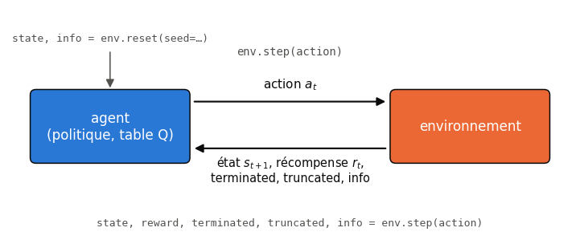
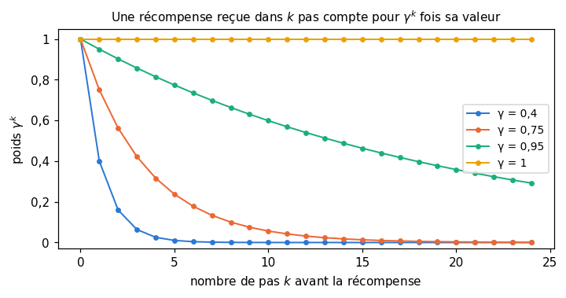
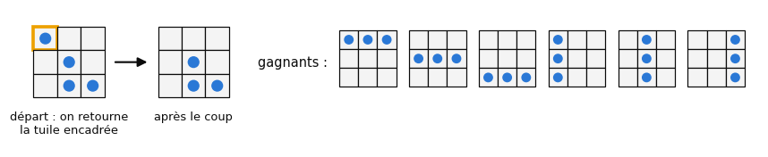
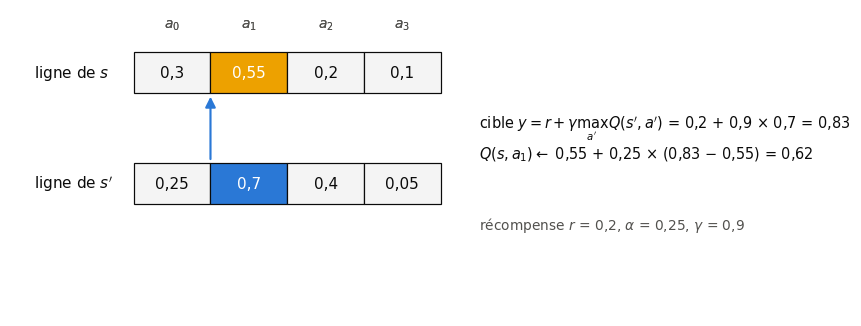
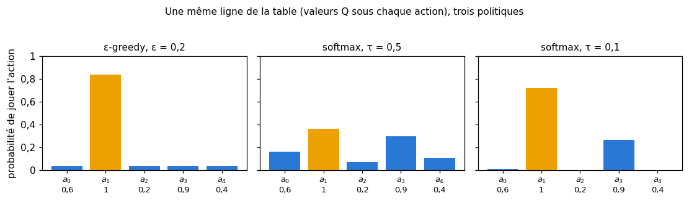

# 26 · Apprentissage par renforcement — fiche de cours

> Les chapitres précédents apprenaient à partir d'exemples corrigés : une image et son label, une phrase et sa suite. Ici, personne ne donne la bonne réponse. Un **agent** agit dans un **environnement**, reçoit de temps en temps une **récompense**, et doit découvrir seul quelles actions mènent aux meilleures. Le livre construit l'idée pas à pas sur un petit jeu solitaire, Flippers : un algorithme naïf qui échoue dès qu'un hasard s'en mêle, puis le **Q-learning** et **SARSA**, les deux algorithmes tabulaires de référence. La fiche y ajoute ce que le livre ne dit pas : les équations, l'API Gymnasium avec laquelle tu travailleras, et ce que sont devenus ces algorithmes (DQN, PPO, le RLHF des modèles de langage).

| | |
|---|---|
| **Livre** | vol. 2, ch. 26 « Reinforcement Learning », p. 1458-1557 (§26.1 à §26.10) |
| **Temps total estimé** | ≈ 29 h : lecture du livre et de la fiche ≈ 7,2 h, exercices ≈ 20 h, 30 flashcards ≈ 1,0 h |
| **Prérequis** | 0A (classes, dictionnaires, générateur aléatoire de NumPy) · 0B (sommes, suite géométrique, espérance) · ch. 2 (intervalle de confiance bootstrap) · ch. 11 (bandit à bras multiples, ε-greedy, UCB, conditionnement opérant) · ch. 16 (un réseau comme approximateur de fonction) · ch. 17 (softmax et température) · ch. 19 (moyenne mobile) · ch. 23 (sauvegarder et reprendre un entraînement) |
| **Fichiers du chapitre** | `02_exercices.md` (quiz, rappels, papier, réflexion, entretien) · `03_notebook.ipynb` · `04_indices.md` · `05_solutions.md` et `05_solutions.ipynb` · `06_mes_reponses.md` · `flashcards.csv` |
| **mylearn** | `rl.py` : retours, politiques gloutonne et softmax, mises à jour du Q-learning et de SARSA, boucle d'entraînement tabulaire, évaluation d'une politique, itération sur les valeurs, mémoire de rejeu ; il réutilise `bandit.py` (ch. 11) |

## Comment utiliser ce chapitre

Le chapitre du livre est long (100 pages) mais sans une équation : tout passe par des schémas et des tableaux de nombres. Lis-le avec la fiche à côté : elle donne pour chaque idée la formule et la notation qu'on trouve partout ailleurs (celles de Sutton et Barto). Le livre prend aussi des libertés avec les définitions standard (ε-greedy, softmax, rôle de γ) : les encadrés ⚠️ les signalent, et les exercices utilisent les définitions standard.

**Ordre conseillé.**
1. Lis le livre §26.1 à §26.3.4, puis les sections correspondantes de la fiche. Fais les quiz Q1 à Q4 et le rappel R1.
2. Lis le livre §26.3.5 à §26.3.7, puis la fiche (avec l'encadré 🧮 sur la suite géométrique). Fais les quiz Q5 et Q6, le rappel R2, les exercices ✏️ 26.1 et ∂ 26.7, et l'explication 🗣️ 26.10.
3. Lis le livre §26.4 à §26.5.1, puis la fiche. Fais le quiz Q7 et l'exercice ✏️ 26.2 (a à d).
4. Lis le livre §26.6 à §26.6.5, puis la fiche. Fais les quiz Q8 à Q10, le rappel R3, les exercices ✏️ 26.3, 26.5 et 26.6 et la démonstration ∂ 26.8.
5. Lis le livre §26.7 à §26.7.2, puis la fiche. Fais le quiz Q11 et l'exercice ✏️ 26.4.
6. Lis le livre §26.8 à §26.10, puis la fin de la fiche (le RL aujourd'hui). Fais le quiz Q12, la fin de l'exercice ✏️ 26.2, l'estimation 🧮 26.9, la réflexion ⚖️ 26.11 et la lecture 📄 26.12.
7. Fais le notebook dans l'ordre des ID : la boucle et Gymnasium, le L-learning sur Flippers, ta librairie `rl.py`, le Q-learning en action, SARSA, le rejeu et la conception des récompenses, puis le morpion, CartPole et l'auto-apprentissage.

| Section | Quiz 🧠 et rappels 🔁 | Papier ✏️ ∂ 🧮 et réflexion | Notebook | Entretien 💼 |
|---|---|---|---|---|
| 26.1 et 26.2 Pourquoi, les objectifs | Q1 | 26.11 | | |
| 26.2.1 Apprendre un nouveau jeu | Q2 | | 26.35 | |
| 26.3 à 26.3.4 La boucle agent-environnement | Q3, Q4, R1 | | 26.13 | |
| 26.3.5 La vue d'ensemble | Q5 | 26.10 | 26.26 | E3 |
| 26.3.6 Garder l'expérience | R2 | | 26.18 | |
| 26.3.7 Les récompenses | Q6 | 26.1, 26.7, 26.11 | 26.14, 26.15, 26.32 | E2 |
| 26.4 Flippers | Q7 | 26.2 | 26.17 | |
| 26.5 et 26.5.1 Le L-learning | Q7 | 26.8 | 26.16, 26.18 | |
| 26.6 à 26.6.3 Le Q-learning | Q8, Q9, R3 | 26.3, 26.5, 26.8 | 26.19 à 26.22 | E3 |
| 26.6.4 et 26.6.5 La convergence, le Q-learning en action | Q10 | 26.6, 26.8 | 26.22 à 26.27 | |
| 26.7 à 26.7.2 SARSA, la comparaison | Q11 | 26.4 | 26.28 à 26.30 | E1 |
| 26.8 La vue d'ensemble, les grandes tables | Q12 | 26.2, 26.9, 26.12 | 26.36, 26.38 | E4 |
| 26.9 Le rejeu d'expérience | Q12 | 26.12 | 26.31, 26.33 | E4 |
| 26.10 Deux applications | Q12 | | 26.37 | E5 |

## Objectifs d'apprentissage

À la fin de ce chapitre, tu sais :
1. **Décrire** la boucle agent-environnement (état, action, récompense, épisode, politique) et la **manipuler** avec l'API Gymnasium.
2. **Calculer** des retours totaux et actualisés, et **interpréter** le facteur d'actualisation $\gamma$.
3. **Dériver** et **appliquer à la main** les mises à jour du Q-learning et de SARSA.
4. **Implémenter** un agent tabulaire complet : politiques, mises à jour, boucle d'entraînement, itération sur les valeurs, mémoire de rejeu.
5. **Comparer** expérimentalement le Q-learning et SARSA, et **régler** $\alpha$, $\gamma$ et $\varepsilon$.
6. **Traiter** un état continu par discrétisation, et **reconnaître** les limites des tables.
7. **Mener** une expérience de RL reproductible et **rapporter** un résultat sur plusieurs graines.
8. **Situer** les méthodes d'aujourd'hui : DQN, PPO, RLHF.

## L'essentiel en 10 lignes

1. En **apprentissage par renforcement** (*reinforcement learning*, RL), un agent observe un **état**, choisit une **action**, et l'environnement lui renvoie une **récompense** et un nouvel état ; une partie complète est un **épisode**.
2. L'agent cherche une **politique** (*policy*), une règle qui choisit l'action dans chaque état, qui maximise la somme des récompenses à venir, pas la récompense immédiate.
3. Le **retour actualisé** $G_t = r_t + \gamma r_{t+1} + \gamma^2 r_{t+2} + \dots$ pondère les récompenses lointaines par $\gamma^k$ ; avec $\gamma = 1$, c'est le retour total ; l'horizon effectif est d'environ $1/(1-\gamma)$ pas.
4. Une **table Q** donne, pour chaque état et chaque action, une estimation $Q(s, a)$ du retour qu'on peut espérer en jouant $a$ dans $s$, puis en jouant au mieux.
5. Le **Q-learning** corrige $Q(s, a)$ après chaque pas : $Q(s, a) \leftarrow Q(s, a) + \alpha\,[r + \gamma \max_{a'} Q(s', a') - Q(s, a)]$, sans attendre la fin de l'épisode ; un état terminal ne vaut rien au-delà de sa récompense.
6. **SARSA** fait la même chose avec $Q(s', a')$, la valeur de l'action **réellement** choisie ensuite, au lieu du maximum : il apprend la valeur de sa politique exploratoire (*on-policy*), là où le Q-learning apprend celle de la politique optimale (*off-policy*).
7. Il faut **explorer** (essayer des actions mal connues) autant qu'**exploiter** (jouer la meilleure connue) : ε-greedy choisit une action au hasard avec la probabilité $\varepsilon$, softmax tire chaque action selon $e^{Q/\tau}$.
8. Le learning rate $\alpha$ règle la part du nouveau dans chaque mise à jour : proche de 1, la table oublie tout à chaque surprise (c'est l'échec du L-learning du livre) ; petit ou décroissant, elle fait la moyenne du hasard.
9. Une table ne passe pas à l'échelle : déjà $3^{16}$ codages de plateau au morpion 4 × 4, et plus de configurations que d'atomes dans l'univers au go ; le **deep RL** remplace la table par un réseau, et stabilise l'apprentissage par une **mémoire de rejeu** (*replay buffer*) et un réseau cible (DQN).
10. Aujourd'hui, le RL entraîne des agents de jeux (AlphaZero), des robots et surtout des modèles de langage : le **RLHF** les ajuste sur des préférences humaines, et des méthodes plus récentes, sur des récompenses vérifiables.

> 📐 **Conventions de la fiche** — On note $s$ l'état, $a$ l'action, $r$ la récompense, $s'$ l'état suivant, $t$ le numéro du pas, $\gamma$ le facteur d'actualisation, $\alpha$ le learning rate et $\varepsilon$ le taux d'exploration, comme Sutton et Barto et la bibliothèque Gymnasium. Le livre n'écrit aucune formule ; il appelle la récompense reçue après l'action du pas $t$ la récompense « immédiate » de ce coup. $\pi(a \mid s)$ est la probabilité qu'une politique choisisse $a$ dans $s$.

---

## 26.1 · Pourquoi ce chapitre ?

L'apprentissage supervisé a besoin de la bonne réponse pour chaque exemple, l'apprentissage non supervisé n'en a besoin pour aucun. Entre les deux, beaucoup de problèmes n'ont pas de bonne réponse connue, mais on sait dire si un résultat est meilleur ou pire qu'un autre. Le livre prend l'exemple d'un robot humanoïde qui apprend à marcher : on ne sait pas écrire la suite parfaite de commandes de ses moteurs, mais on sait encourager tout ce qui le fait avancer debout et décourager le reste (livre p. 1461).

Le RL n'est pas un algorithme : c'est un cadre, une façon de poser le problème, que des dizaines d'algorithmes savent résoudre. Il apprend par essais et erreurs, comme un animal qu'on dresse par récompenses (le conditionnement opérant du ch. 11).

## 26.2 · Les objectifs ⏩

Le RL convient quand on ne connaît pas la meilleure action, mais qu'on sait mesurer le résultat. Les exemples du livre : les ascenseurs d'une tour de bureaux, qui doivent attendre au bon étage selon l'heure (le matin en bas, en fin d'après-midi plus haut), avec pour mesure l'attente des usagers ; ou des cultures, qu'on plante plus ou moins tôt, profond et espacé (p. 1462-1463). Trois traits reviennent :
- il n'y a souvent pas de réponse objectivement juste, seulement des réponses meilleures que d'autres pour le critère choisi ;
- la récompense peut n'arriver qu'à la fin, après des dizaines d'actions (une partie gagnée ou perdue) ;
- l'environnement est incertain : un adversaire qui surprend, une demande qui varie, une pluie qui manque.

> 💼 **En entreprise** — Le critère qu'on récompense **est** le problème qu'on résout. Un système d'ascenseurs récompensé sur l'attente moyenne peut laisser quelques usagers attendre très longtemps ; une recommandation récompensée sur les clics apprend le piège à clics. Avant tout algorithme, on écrit la récompense, on se demande ce qu'un agent malin pourrait faire pour la gonfler sans faire ce qu'on veut, et on surveille plusieurs mesures en plus de celle qu'on récompense (⚖️ 26.11, 🔬 26.32).

### 26.2.1 · Apprendre un nouveau jeu

Le livre imagine une amie à qui l'on apprend le morpion sans lui dire que c'est un jeu : elle joue les croix, « nous » jouons les ronds et tenons le rôle de l'environnement (p. 1463-1469). À chaque tour, elle reçoit quatre choses : le plateau, la liste des coups permis, un nombre qui récompense son dernier coup (0 pour un coup interdit ou une défaite, 1 pour un coup gagnant, une valeur intermédiaire sinon), et la consigne de chercher les plus grandes récompenses. Elle garde pour elle ses propres notes : ses **informations privées**. Une variante lui laisse proposer les neuf cases, même occupées, pour qu'elle apprenne seule à éviter les coups interdits ; c'est l'une des deux façons de traiter les coups illégaux que le notebook comparera (📦 26.35).

## 26.3 · La structure du RL ⏩

Toute la suite tient dans une boucle en trois temps (fig. 26.4 du livre, p. 1470) :
1. l'agent choisit une action, d'après l'état ;
2. l'environnement l'exécute, change d'état et renvoie une récompense ;
3. l'agent se met à jour avec ce qu'il vient d'apprendre.

Le processus part d'un **état initial** ; une partie complète, du premier état au dernier, est un **épisode** ; l'entraînement enchaîne des centaines ou des milliers d'épisodes.

### 26.3.1 · Premier temps : l'agent choisit une action ⏩

L'**état** est l'ensemble des nombres qui décrivent l'environnement (dans un jeu de plateau : la position des pièces, l'argent de chacun, les cartes cachées). Pour choisir, l'agent se sert de sa **politique**, une règle qui associe une action à chaque état, et de ses informations privées, qui lui servent à améliorer cette politique (p. 1471-1473). C'est l'**environnement** qui exécute l'action : le monde peut réagir pendant l'exécution, comme le robot à qui l'on dit d'avancer le pied droit : il baisse la tête pour garder l'équilibre, la relève, aperçoit un obstacle et tend la main.

### 26.3.2 · Deuxième temps : l'environnement répond ⏩

L'environnement remplace son état et la liste des actions possibles, et envoie une **récompense** (*reward*) : un nombre, d'autant plus grand que l'action était bonne pour le critère choisi (p. 1473-1475).

### 26.3.3 · Troisième temps : l'agent se met à jour ⏩

L'agent révise ses informations privées et sa politique, puis attend le tour suivant ou réfléchit d'avance. La récompense finale termine l'épisode (p. 1475-1476).

> 🕰️ **Mise à jour (2026) — Gym, puis Gymnasium** — **Le livre :** il décrit la boucle de façon abstraite ; à l'époque, la bibliothèque de référence était Gym d'OpenAI. · **Aujourd'hui :** Gym n'est plus maintenu ; son successeur est **Gymnasium**, de la Farama Foundation. Un environnement s'utilise en deux appels : `state, info = env.reset(seed=…)` démarre un épisode ; `state, reward, terminated, truncated, info = env.step(action)` joue un pas. `terminated` dit que l'épisode s'est **vraiment** fini (but atteint, chute dans un trou) ; `truncated`, qu'on l'a coupé de l'extérieur (une limite de temps). La différence compte pour l'apprentissage (encadré 🧮 du §26.6.1). · **Faut-il quand même l'apprendre ?** Oui : la boucle du livre est exactement celle de Gymnasium, et `env.observation_space.n` et `env.action_space.n` donnent la taille de la table Q. · *Source :* [documentation de Gymnasium, Basic Usage](https://gymnasium.farama.org/introduction/basic_usage/).

### 26.3.4 · Des variantes de la version simple ⏩

Un agent ou un environnement peut être **libre** (il agit et change sans arrêt, de lui-même) ou **déclenché** (il attend qu'on le sollicite). Le livre range quatre exemples dans un tableau (p. 1476-1478) : des cultures (agent et environnement libres : la plante pousse pendant que le fermier agit), un peintre en bâtiment (l'agent libre, le mur déclenché), un cuisinier et son minuteur (l'agent déclenché par la sonnerie, le minuteur libre), le backgammon (les deux déclenchés, chacun son tour). Le cas « tour à tour » est le plus simple à simuler, et c'est celui de tous les exercices.

### 26.3.5 · La vue d'ensemble ⏩

Les actions font passer l'environnement d'un état à un autre. Des états, des actions, des probabilités de transition $P(s' \mid s, a)$ et des récompenses forment un **processus de décision markovien** (*Markov decision process*, MDP). « Markovien » veut dire que l'état présent suffit pour prédire la suite : connaître le passé n'apprend rien de plus. Cette propriété est ce qui permet au Q-learning de raisonner pas à pas (∂ 26.8).

> ⚠️ **Le livre, corrigé — MDP et observabilité** — Le livre appelle les actions des « transitions » et ajoute qu'on n'aura pas besoin des MDP (p. 1478). Une **transition** est le passage d'un état à un autre, que l'action provoque avec une certaine probabilité ; et le cadre du MDP est justement celui où le Q-learning est garanti de marcher. Le livre motive aussi l'**observabilité partielle** par l'envie de cacher des variables coûteuses à calculer : en RL, un environnement est **partiellement observable** quand l'agent ne peut pas voir tout l'état (des cartes cachées, un capteur bruité), pas quand on choisit de lui cacher des variables.

Deux difficultés traversent tout le chapitre (p. 1479-1480) :
- l'**attribution du crédit** (*credit assignment*) : quand une partie est gagnée au 40ᵉ coup, lesquels des 40 coups ont mérité la victoire ?
- le **dilemme exploration-exploitation** : jouer le coup qu'on sait bon, ou essayer un coup mal connu qui pourrait être meilleur ? On n'a jamais le temps de tout essayer. C'est le dilemme du bandit à bras multiples du ch. 11, mais avec des états.

### 26.3.6 · Garder l'expérience

Le livre propose de garder la trace de chaque coup de chaque partie, avec un **score** par coup qui estime son intérêt dans cette situation, et de marquer les coups jamais essayés (p. 1480-1481). C'est l'idée de la table qui viendra : une case par état et par action.

### 26.3.7 · Les récompenses ⏩

Une récompense **immédiate** suit chaque action ; la récompense à **long terme** est l'objectif (gagner). La **récompense totale** d'un épisode est la somme de toutes ses récompenses. Le livre appelle **TFR** (*total future reward*) d'un coup la somme de sa récompense et de toutes celles qui suivent, et **DFR** (*discounted future reward*) la même somme pondérée par les puissances de $\gamma$ (p. 1481-1489). Dans les notations standard, c'est le **retour** (*return*) :

$$G_t = r_t + \gamma\, r_{t+1} + \gamma^2\, r_{t+2} + \dots + \gamma^{T-1-t}\, r_{T-1} = \sum_{k=0}^{T-1-t} \gamma^k\, r_{t+k},$$

pour un épisode de $T$ pas, avec $0 \le \gamma \le 1$ le **facteur d'actualisation** (*discount factor*). Avec $\gamma = 1$, $G_t$ est le TFR ; avec $\gamma = 0$, il ne reste que $r_t$. Le retour se calcule à rebours, en un seul passage : $G_{T-1} = r_{T-1}$, puis

$$G_t = r_t + \gamma\, G_{t+1}.$$

C'est le principe de toute la suite : la valeur d'un coup, c'est ce qu'il rapporte tout de suite, plus la valeur actualisée de ce qui vient après. Exemple : des récompenses $(0, 0, 1)$ avec $\gamma = 0{,}9$ donnent $G_2 = 1$, $G_1 = 0 + 0{,}9 \times 1 = 0{,}9$, $G_0 = 0{,}81$. Le livre montre une partie de 10 coups dont les récompenses immédiates, toutes entre 0,6 et 0,9, sont pondérées par $\gamma^k$ pour sept valeurs de $\gamma$ : le DFR du premier coup passe d'environ 7,6 avec $\gamma = 1$ à 0,7 avec $\gamma = 0$ (fig. 26.12 à 26.14, p. 1487-1489 ; 🎨 26.15 les reproduit).

> 🧮 **Rappel maths — la somme d'une suite géométrique** — Pour $0 \le \gamma < 1$, $1 + \gamma + \gamma^2 + \dots + \gamma^{n-1} = \frac{1 - \gamma^n}{1 - \gamma}$, et la somme infinie vaut $\frac{1}{1-\gamma}$ (0B, Ex 0B.13 et 0B.14). Conséquence pratique : avec des récompenses bornées par $r_{\max}$, un retour actualisé reste fini même pour une tâche sans fin, et ne dépasse pas $\frac{r_{\max}}{1-\gamma}$. On appelle **horizon effectif** ce nombre $\frac{1}{1-\gamma}$ : à peu près le nombre de pas que l'agent « regarde » devant lui (∂ 26.7).

> ⚠️ **Le livre, corrigé — ce que mesure γ** — Le livre présente $\gamma$ comme notre confiance dans la régularité de l'environnement : proche de 1 s'il est presque déterministe, proche de 0 s'il est chaotique (p. 1485). Ce n'est pas l'interprétation standard. $\gamma$ fait partie de l'**objectif** : il dit combien on préfère une récompense proche à une récompense lointaine, et rend finie la somme d'une tâche sans fin. Le hasard de l'environnement se traite autrement, par des **moyennes** (le learning rate $\alpha$, les espérances de l'équation de Bellman). Un petit $\gamma$ rend l'agent myope même dans un monde parfaitement prévisible : avec $\gamma = 0{,}2$, la valeur du livre pour Flippers, une victoire reçue trois pas plus tard ne pèse plus que $0{,}2^3 = 0{,}008$ fois sa valeur. Le conseil pratique du livre, commencer vers $\gamma = 0{,}8$ ou $0{,}9$, reste raisonnable ; on prend souvent $0{,}99$.

Le livre distingue aussi une récompense donnée **avant** que l'environnement réagisse (elle ne juge que l'action) d'une récompense donnée **après** (elle juge le résultat) : appuyer cent fois sur la même télécommande mérite la même note, mais la cent-unième pression, quand la pile est morte, n'allume plus rien (p. 1484). En RL, on récompense le résultat. Un environnement **déterministe** répond toujours de la même façon à la même action dans le même état ; un environnement **stochastique** répond avec une part de hasard.

## 26.4 · Flippers ⏩

Pour garder l'attention sur les algorithmes, le livre invente un jeu solitaire minuscule (p. 1490-1491). Neuf tuiles sur une grille 3 × 3 ; chacune est vide d'un côté et marquée d'un point de l'autre. Un coup consiste à **retourner une tuile**. On part d'un plateau tiré au hasard, et on gagne quand le plateau a **exactement trois points** qui forment une ligne ou une colonne complète, toutes les autres tuiles vides : il y a donc six plateaux gagnants (trois lignes, trois colonnes ; les diagonales ne comptent pas). Le but : gagner en retournant le moins de tuiles possible.

Un plateau est un motif de 9 bits : il y en a $2^9$. Le nombre minimal de coups pour gagner depuis un plateau est sa distance de Hamming au plus proche des six plateaux gagnants (le nombre de tuiles qui diffèrent) : jamais plus de 6, dit le livre (🔬 26.17 calcule toute la répartition).

## 26.5 · Le L-learning

Le livre construit d'abord un algorithme volontairement naïf, qu'il appelle **L-learning**, « L » pour *lousy*, médiocre (p. 1492-1505). Il garde une **table L** : une ligne par plateau, une colonne par tuile à retourner, une valeur par case, toutes à 0 au départ. Pendant une partie, l'agent joue dans chaque état l'action de plus grande valeur (au hasard entre les ex æquo) et note chaque pas sous forme d'un quadruplet (état, action, récompense, nouvel état). Toutes les récompenses valent 0, sauf celle du coup gagnant, d'autant plus grande que la partie est courte (1 pour une victoire en un coup ; les valeurs du livre semblent suivre $1/\sqrt{n}$ pour une victoire en $n$ coups, mais il dit lui-même que la formule importe peu, et les valeurs de ses tables d'exemple sont illustratives). À la fin de la partie, chaque coup joué reçoit son TFR, qui **remplace** la valeur de sa case. Comme toutes les récompenses intermédiaires sont nulles, tous les coups d'une partie reçoivent la même valeur.

Dans un monde parfaitement prévisible, ça marche : après 3 000 parties, l'agent joue encore en six coups des plateaux qui en demandent deux ; après 6 000, il les joue en deux (fig. 26.23 à 26.26 du livre).

> 🔗 **Lien avec la suite** — Le L-learning est un cas particulier d'une méthode connue, le contrôle de **Monte-Carlo** : on attend la fin de l'épisode et on donne à chaque coup le retour réellement obtenu. Avec un learning rate $\alpha = 1$ (on remplace au lieu de faire la moyenne), il hérite de tous les défauts du hasard. Le livre dit qu'il n'existe pas dans la littérature : son nom, non ; son principe, si.

### 26.5.1 · L'imprévu ⏩

Ajoutons du hasard : de temps en temps, un gros camion passe, la table tremble, et une ou plusieurs tuiles se retournent seules (p. 1505-1509). Le L-learning s'effondre. Le livre suit un plateau dont la meilleure case vaut 0,6 : joué au mieux, il est gagné en deux coups, et la case reçoit 0,7. Mais si le camion retourne une tuile juste après, la partie dure cinq coups, et la case reçoit 0,44, qui **efface** la bonne valeur ; deux autres cases du même état valent maintenant plus, et l'agent oublie son meilleur coup jusqu'à ce qu'un autre hasard le répare (fig. 26.27 et 26.28). Une seule malchance suffit à défaire ce que des centaines de parties avaient appris.

Le remède tient en une idée : au lieu de remplacer, faire la **moyenne**. Une case qui a vu cent bonnes parties et une mauvaise doit rester proche de la bonne valeur ; c'est le rôle du learning rate $\alpha$ (§26.6.1).

## 26.6 · Le Q-learning

Le **Q-learning** (« Q » pour *quality*, la qualité d'une action dans un état ; C. Watkins, 1989) garde une **table Q** de même forme que la table L, mais change trois choses : la façon de calculer la nouvelle valeur, la façon de la combiner avec l'ancienne, et la politique (p. 1509-1510). Surtout, il met à jour la table **après chaque pas**, sans attendre la fin de l'épisode : il marche donc aussi pour des tâches très longues ou sans fin. Le livre change aussi les récompenses : au lieu de 0 partout sauf à la fin, l'environnement rendrait après chaque action une récompense qui estime sa qualité (p. 1510), sans jamais dire laquelle ses expériences utilisent.

### 26.6.1 · Les valeurs Q et leur mise à jour ⏩

$Q(s, a)$ estime le retour qu'on obtiendra en jouant $a$ dans $s$, puis en jouant au mieux ensuite. Pour estimer cette suite sans l'attendre, le Q-learning regarde l'état suivant $s'$ dans sa propre table : la meilleure valeur de cette ligne, $\max_{a'} Q(s', a')$, résume tout ce qui viendra. La **cible** de la mise à jour est donc

$$y = r + \gamma \max_{a'} Q(s', a'),$$

ce qu'on gagne tout de suite plus la valeur actualisée de la suite. Le livre compare cela à un compte en banque (p. 1511) : connaître ce qu'on dépose aujourd'hui et ce qui arrivera d'ici la fin du mois, c'est déjà connaître le solde de fin de mois. On appelle **amorçage** (*bootstrapping*) cette façon d'estimer une valeur à partir d'une autre estimation.

Puis on **mélange** la cible avec l'ancienne valeur, dans la proportion $\alpha$, le **learning rate** (le pas de la mise à jour) :

$$Q(s, a) \leftarrow (1 - \alpha)\, Q(s, a) + \alpha\, y = Q(s, a) + \alpha\, \delta, \qquad \delta = y - Q(s, a).$$

$\delta$ est l'**erreur de différence temporelle** (*TD error*) : l'écart entre ce que la table prévoyait et ce qu'elle apprend en un pas. C'est exactement la mise à jour incrémentale du bandit (ch. 11), avec la cible $y$ au lieu d'un gain observé : `incremental_update(Q[s, a], y, alpha)`. Avec $\alpha = 0$, rien ne change ; avec $\alpha = 1$, on remplace, comme le L-learning.

Exemple, avec des nombres à nous : $Q(s, a) = 0{,}4$, $r = 0{,}1$, $\gamma = 0{,}8$, et la ligne de $s'$ a pour maximum 0,5. La cible vaut $0{,}1 + 0{,}8 \times 0{,}5 = 0{,}5$, l'erreur $\delta = 0{,}1$ ; avec $\alpha = 0{,}5$, la case devient $0{,}45$.

> 🧮 **Rappel maths — état terminal ou épisode coupé** — Si $s'$ est **terminal** (la partie est finie), il n'y a pas de suite : la cible est $y = r$, sans le terme $\gamma \max_{a'} Q(s', a')$, quelle que soit la ligne de $s'$ dans la table. Si l'épisode a seulement été **coupé** (une limite de temps, le `truncated` de Gymnasium), l'état $s'$ avait encore un avenir : on garde l'amorçage. Confondre les deux est une erreur classique (🐛 26.24) : un agent qui traite la limite de temps comme une fin apprend que le dernier état ne vaut rien.

> ⚠️ **Le livre, corrigé — α proche de 1** — Le livre conseille un $\alpha$ « proche de 1 », 0,9 ou même 0,99 (p. 1513), et l'utilise dans toutes ses expériences ($\alpha = 0{,}95$). Avec un tel $\alpha$, chaque mise à jour remplace presque la valeur : on retrouve le défaut du L-learning dès que l'environnement est stochastique. Dans un environnement aléatoire, on prend un $\alpha$ petit (autour de 0,1) ou qui décroît au fil des visites ; les preuves de convergence du Q-learning supposent que $\sum_t \alpha_t$ diverge et que $\sum_t \alpha_t^2$ converge (comme $\alpha = 1/n(s, a)$, où $n(s, a)$ compte les visites de la case). Un $\alpha$ proche de 1 ne convient qu'à un environnement déterministe. Le notebook le vérifie (🔬 26.27).

### 26.6.2 · La politique du Q-learning ⏩

Une politique purement **gloutonne** (*greedy*), qui joue toujours la meilleure action connue, n'explore jamais : une action sous-estimée au début ne sera plus jamais essayée. Deux politiques standard mêlent exploration et exploitation (p. 1514-1517).

**ε-greedy.** Avec la probabilité $1 - \varepsilon$, on joue l'action de plus grande valeur ; avec la probabilité $\varepsilon$, on joue une action tirée au hasard **parmi toutes** les actions. Avec $|\mathcal{A}|$ actions, l'action gloutonne est donc jouée avec la probabilité $1 - \varepsilon + \frac{\varepsilon}{|\mathcal{A}|}$, et chacune des autres avec $\frac{\varepsilon}{|\mathcal{A}|}$. Ta fonction `epsilon_greedy_action` du ch. 11 fait exactement cela, et départage les ex æquo au hasard. On fait souvent **décroître** $\varepsilon$ : beaucoup d'exploration au début, presque plus à la fin.

**Softmax** (ou politique de **Boltzmann**). Chaque action est tirée avec une probabilité qui croît avec sa valeur :

$$\pi(a \mid s) = \frac{e^{Q(s, a)/\tau}}{\sum_b e^{Q(s, b)/\tau}},$$

où la **température** $\tau > 0$ règle l'exploration : grande, presque uniforme ; petite, presque gloutonne. C'est la softmax du ch. 17 ; on soustrait le maximum des $Q/\tau$ avant l'exponentielle pour éviter les dépassements. Contrairement à ε-greedy, softmax explore surtout les **bonnes** actions : une action très mauvaise n'est presque jamais tirée.

> ⚠️ **Le livre, corrigé — ε-greedy et softmax** — Pour le livre, ε-greedy explore en tirant une action parmi les **autres** actions que la meilleure, avec un $\varepsilon$ « de 0,01 ou moins » (p. 1515) ; la définition standard tire parmi **toutes** les actions (✏️ 26.5 calcule l'écart entre les deux), et $\varepsilon = 0{,}1$ est courant (le livre l'utilise d'ailleurs). Ce qu'il appelle softmax consiste à diviser les valeurs par leur somme, $Q / \sum Q$ (p. 1516) : ce n'est pas une softmax, et cela ne marche ni pour une ligne de zéros (le début de tout apprentissage), ni pour des valeurs négatives. La vraie softmax passe par l'exponentielle et une température. Le livre présente enfin « ε-soft » comme une variante presque identique d'ε-greedy, sans dire en quoi elle diffère : c'est la famille des politiques qui donnent à chaque action au moins la probabilité $\varepsilon / |\mathcal{A}|$, dont ε-greedy fait partie.

> 🕰️ **Mise à jour (2026) — ε-greedy et softmax standard** — **Le livre :** ε-greedy parmi les autres actions, « softmax » par normalisation. · **Aujourd'hui :** les définitions de Sutton et Barto, données ci-dessus, sont celles de toutes les bibliothèques ; on y ajoute souvent un $\varepsilon$ qui décroît (de 1 à 0,1 sur le premier million d'images dans DQN ; de 1 à 0,05 sur les premiers 10 % de l'entraînement par défaut dans Stable-Baselines3). · **Faut-il quand même l'apprendre ?** Oui, avec les définitions standard ; la version du livre ne se trouve nulle part ailleurs. · *Source :* R. S. Sutton et A. G. Barto, *Reinforcement Learning: An Introduction*, 2ᵉ éd., MIT Press, 2018, §2.2 et §5.4 (ε-greedy, ε-soft), [incompleteideas.net/book/the-book-2nd.html](http://incompleteideas.net/book/the-book-2nd.html) ; la softmax à température $e^{Q/\tau}$ est celle du §2.3 de la 1ʳᵉ édition (1998), la 2ᵉ la donne sur des préférences (§2.8).

### 26.6.3 · Tout assembler ⏩

Un pas du Q-learning, dans l'ordre (p. 1518-1519) :
1. dans l'état $s$, choisir une action $a$ avec la politique (ε-greedy ou softmax) ;
2. la jouer, recevoir $r$ et $s'$ (et savoir si $s'$ est terminal) ;
3. calculer la cible $y = r + \gamma \max_{a'} Q(s', a')$ (ou $y = r$ si $s'$ est terminal) ;
4. mélanger : $Q(s, a) \leftarrow Q(s, a) + \alpha\,(y - Q(s, a))$ ;
5. passer à $s'$, et recommencer jusqu'à la fin de l'épisode.

$\alpha$, $\gamma$ et $\varepsilon$ se règlent par l'expérience : ils dépendent de l'environnement et de la tâche.

### 26.6.4 · L'éléphant dans la pièce ⏩

Tout cela suppose que les valeurs de l'état suivant soient justes. D'où viendraient-elles, puisque la table part de zéros (p. 1519-1521) ? La réponse du livre : on ne s'en préoccupe pas. Au début, l'agent joue presque au hasard ; si les récompenses sont nulles sauf à la victoire, toutes les cibles valent 0. Puis une victoire arrive par chance : la dernière action reçoit une valeur positive. La prochaine fois qu'une action mène à l'état qui précède la victoire, sa cible contient cette valeur, multipliée par $\gamma$ : l'information **remonte** la chaîne des états, un pas par épisode (✏️ 26.6). Grâce à l'exploration, chaque case finit par être visitée assez souvent, et la table **converge** vers les bonnes valeurs.

> 🧮 **Rappel maths — l'équation de Bellman** — Les « bonnes valeurs » ont un nom : $Q^*(s, a)$, le meilleur retour moyen qu'on puisse espérer en jouant $a$ dans $s$. Elles vérifient l'**équation d'optimalité de Bellman** :
> $$Q^*(s, a) = \sum_{s'} P(s' \mid s, a)\,\Big[r(s, a, s') + \gamma \max_{a'} Q^*(s', a')\Big],$$
> où la somme est une **espérance** sur les états suivants possibles (0B, ch. 2), et où le terme $\max$ vaut 0 quand $s'$ est terminal. La cible du Q-learning est un échantillon de cette espérance : au lieu de connaître $P$, on observe une seule transition, et le taux $\alpha$ fait la moyenne de ces échantillons au fil des visites. Quand on **connaît** $P$, on peut résoudre l'équation directement, en répétant la mise à jour de Bellman sur toute la table jusqu'à ce qu'elle ne bouge plus : c'est l'**itération sur les valeurs** (*value iteration*, 🔨 26.26), la référence exacte des exercices. ∂ 26.8 montre que $Q^*$ est le point fixe de cette mise à jour.

> ⚠️ **Le livre, corrigé — la convergence** — Le livre affirme que la table s'améliore « graduellement » à coup sûr (p. 1520). Les preuves (C. Watkins et P. Dayan, 1992) demandent que chaque case soit visitée une infinité de fois, et un $\alpha$ qui décroît ; la convergence est asymptotique, pas monotone. Avec un $\alpha$ constant de 0,95 et un camion qui passe, les valeurs ne se stabilisent jamais tout à fait : elles fluctuent autour des bonnes.

Le Q-learning répond ainsi aux deux difficultés du §26.3.5 : l'attribution du crédit, par la remontée des valeurs, et l'exploration, par sa politique.

### 26.6.5 · Le Q-learning en action ⏩

Le livre entraîne le Q-learning sur Flippers avec camion : à chaque coup, une chance sur dix qu'une tuile au hasard se retourne ; $\alpha = 0{,}95$, $\gamma = 0{,}2$, ε-greedy avec $\varepsilon = 0{,}1$ ; parties coupées à 100 coups ; chacun des 512 plateaux joué 10 fois pour mesurer (p. 1521-1531). Après 300 parties d'entraînement, les parties durent jusqu'à 36 coups ; après 3 000, jusqu'à 20, la plupart dix ou moins ; après 6 000, jusqu'à 18, et l'agent joue au minimum de coups des plateaux qu'il jouait en huit. Les valeurs de la table se répartissent en bandes, et beaucoup de cases restent à 0.

> ⚠️ **Le livre, corrigé — Flippers en chiffres** — Le livre dit que la plupart des plateaux se gagnent en 3 ou 4 coups (p. 1521). C'est vrai de justesse : en comptant les 512 plateaux (🔬 26.17), 3 coups est le cas le plus fréquent, mais 2 coups l'est plus que 4, et une partie optimale est en moyenne plus courte que 3 coups. Il justifie $\gamma = 0{,}2$ par « 20 % de confiance que l'avenir se répète » ; même dans sa propre logique, une tuile retournée une fois sur dix laisserait 90 % de pas sans surprise. Enfin, ses figures montrent des valeurs Q jusqu'à environ 1,85 : si les récompenses restent d'au plus 1, comme au L-learning, avec $\gamma = 0{,}2$ aucune valeur ne peut dépasser $\frac{1}{1-0{,}2} = 1{,}25$ (🧮 du §26.3.7) ; la récompense réellement utilisée dans ces expériences n'est pas donnée.

## 26.7 · SARSA ⏩

Le Q-learning met à jour $Q(s, a)$ comme si l'action suivante allait être la meilleure de $s'$. Or la politique ε-greedy jouera parfois une autre action. **SARSA** (pour *State, Action, Reward, State, Action* : le quadruplet du L-learning plus l'action suivante ; G. Rummery et M. Niranjan, 1994 ; le nom vient de R. Sutton, 1996) choisit l'action suivante $a'$ **avant** la mise à jour, s'en sert, puis la joue vraiment au pas suivant (p. 1532-1535) :

$$Q(s, a) \leftarrow Q(s, a) + \alpha\,\big[r + \gamma\, Q(s', a') - Q(s, a)\big].$$

La seule différence avec le Q-learning est $Q(s', a')$ au lieu de $\max_{a'} Q(s', a')$. Quand $a'$ est l'action gloutonne, les deux mises à jour sont identiques.

> ⚠️ **Le livre, corrigé — un « défaut » du Q-learning ?** — Le livre présente le max du Q-learning comme un défaut, une « erreur » que SARSA corrigerait, avec un meilleur regard vers l'avant (p. 1532 et 1546). Ce sont deux objectifs différents, et chacun est juste pour le sien. Le Q-learning est **hors politique** (*off-policy*) : il apprend $Q^*$, la valeur de la politique gloutonne optimale, quelle que soit la politique exploratoire qui produit les données. SARSA est **sur politique** (*on-policy*) : il apprend la valeur de la politique qu'il suit, exploration comprise. Les deux regardent un seul pas en avant. Quand l'exploration coûte cher, SARSA apprend un chemin plus prudent, qui tient compte de ses propres faux pas ; le Q-learning apprend le chemin optimal, qui n'est le meilleur qu'une fois l'exploration arrêtée (🔮 26.28 et 🔬 26.29, au bord d'une falaise).

### 26.7.1 · SARSA en action

Avec les mêmes réglages, SARSA joue après 3 000 parties des parties plus courtes que le Q-learning, et après 6 000, des parties de 14 coups au plus, beaucoup en 3 ou 4 (p. 1535-1543).

### 26.7.2 · Comparer Q-learning et SARSA

Le livre entraîne les deux jusqu'à 100 000 parties : la longueur moyenne d'une partie se stabilise vers 3,2 coups pour le Q-learning et 2,8 pour SARSA, dont les valeurs moyennes et la part de cases non nulles restent un peu plus basses (fig. 26.58 à 26.60, p. 1545-1547). Il en conclut que SARSA est meilleur.

> ⚠️ **Le livre, corrigé — les chiffres de la comparaison** — Plusieurs nombres du livre ne s'accordent pas : la plus longue partie de SARSA après 3 000 parties vaut 11 dans le texte et 15 sur la figure, puis 12 ou 11 selon qu'on lit le texte ou la légende de la comparaison. Les courbes de la figure 26.58 se croisent au début (vers 3 000 parties, le Q-learning est devant), et l'écart final est d'environ un tiers de coup, pas « presque un demi ». Surtout, les parties de mesure sont jouées avec le camion (p. 1522), et rien n'indique que l'exploration y était coupée : si elle ne l'était pas, on compare ce que chaque agent obtient **en explorant**, le terrain de SARSA. Une table de SARSA a des valeurs plus basses parce que sa cible utilise l'action tirée au lieu du maximum (le maximum du Q-learning a même tendance à surestimer), pas parce qu'il visiterait moins de cases.

## 26.8 · La vue d'ensemble ⏩

Vu de loin, le RL n'est qu'un échange de nombres : deux listes entrent (l'état, les actions possibles), un nombre sort (l'action), puis reviennent un nombre (la récompense) et deux nouvelles listes. L'agent n'a besoin ni des règles ni même de savoir qu'il joue (p. 1548-1549). Mais la table grandit vite : $2^9 = 512$ lignes et 9 colonnes pour Flippers ; au morpion, chaque case peut être vide, une croix ou un rond, ce qui fait au plus $3^9$ codages de plateau, dont seulement 5 478 réellement atteignables en jouant ; le morpion 4 × 4 compte déjà $3^{16}$ codages, et le go 19 × 19 un nombre de codages astronomique (✏️ 26.2 et 🧮 26.9 les comptent).

> ⚠️ **Le livre, corrigé — des tables mal comptées** — Pour le morpion 4 × 4, le livre compte 43 millions de lignes et 9 colonnes, « un peu moins de 390 millions de cases » (p. 1548) : un plateau de 16 cases a 16 actions, soit 16 colonnes. Il écrit aussi que le morpion 13 × 13 a autant d'états que d'atomes dans « un milliard d'univers » : $3^{169} \approx 4 \times 10^{80}$, soit quelques univers seulement (environ $10^{80}$ atomes chacun). L'ordre de grandeur général reste juste : ces tables sont impossibles à remplir.

La solution : ne plus ranger les valeurs dans une table, mais les **calculer** avec une fonction apprise, un réseau de neurones qui reçoit l'état et rend une valeur par action. C'est le **deep RL**. Le premier succès marquant est le DQN (*Deep Q-Network*) de DeepMind, qui a appris des dizaines de jeux Atari à partir des pixels de l'écran (V. Mnih et coll., 2013 puis 2015 ; 📄 26.12).

> ⚠️ **Le livre, corrigé — ce que rend un DQN, et AlphaGo** — Le livre décrit un réseau qui rendrait « un numéro de coup et sa valeur Q » (p. 1549) : un DQN rend un **vecteur** de valeurs, une par action, et l'agent prend le maximum. Il ajoute qu'AlphaGo utilisait « cette stratégie de base » : AlphaGo n'approchait aucune table Q ; il combinait un réseau de politique, un réseau de valeur et une recherche arborescente de Monte-Carlo (MCTS).

## 26.9 · Le rejeu d'expérience ⏩

Un agent peut tourner en rond, ou oublier une bonne stratégie qu'il n'a pas jouée depuis longtemps. Le livre compare le remède à un musicien qui reprend son instrument après des années et refait ses vieux exercices (p. 1550-1551) : le **rejeu d'expérience** (*experience replay*). Dans sa version, on enregistre des suites d'états et d'actions, et quand l'entraînement retombe sur l'état de départ de l'une d'elles, on débranche l'environnement et on fait rejouer la suite enregistrée à l'agent.

> 🕰️ **Mise à jour (2026) — la mémoire de rejeu de DQN** — **Le livre :** un mécanisme de séquences rejouées depuis leur état de départ, qui donnerait à chaque action rejouée un petit coup de pouce (p. 1551) ; en fait, une mise à jour rejouée peut aussi bien baisser une valeur. · **Aujourd'hui :** l'idée de rejouer l'expérience vient de L.-J. Lin (1992), qui rejouait des épisodes entiers à rebours, assez proche du livre ; le rejeu standard, celui de DQN (2013-2015), garde dans une **mémoire de rejeu** (*replay buffer*) les dernières transitions $(s, a, r, s', \text{fin})$, jusqu'à une capacité fixe (la plus ancienne est effacée), et apprend sur des mini-batches **tirés au hasard** dans cette mémoire : chaque transition sert plusieurs fois, et des transitions qui se suivent, très corrélées, ne se retrouvent plus côte à côte dans un mini-batch. Des variantes tirent plus souvent les transitions où l'erreur $\delta$ est grande (rejeu prioritaire, T. Schaul et coll., 2016). La version de 2015 de DQN (*Nature*) ajoute un **réseau cible**, une copie figée du réseau qu'on recopie de temps en temps, pour calculer les cibles. · **Faut-il quand même l'apprendre ?** Oui : tu écris une mémoire de rejeu dans `rl.py` (🔨 26.31), et elle resservira au DQN du bonus B8. · *Sources :* V. Mnih et coll., « Human-level control through deep reinforcement learning », *Nature* 518, 2015, [doi:10.1038/nature14236](https://doi.org/10.1038/nature14236) ; T. Schaul et coll., « Prioritized Experience Replay », ICLR 2016, [arXiv:1511.05952](https://arxiv.org/abs/1511.05952).

## 26.10 · Deux applications

**Le go.** Longtemps jugé hors de portée des machines, il a été dominé par AlphaGo (DeepMind, 2016), qui apprenait d'abord sur des parties humaines, puis par **AlphaGo Zero** (2017), qui n'a reçu que les règles et a tout appris en jouant contre lui-même, en près de cinq millions de parties pour la version de trois jours (p. 1551-1552). Pendant l'**auto-apprentissage** (*self-play*), l'adversaire fait partie de l'environnement de chaque joueur, et les deux s'améliorent ensemble (🔬 26.37 le fait au morpion).

**L'image de synthèse.** Pour calculer une image réaliste, on suit des millions de rayons de lumière d'un point de la scène à un autre (le lancer de rayons). L'équation qui décrit ce transport de la lumière a presque la même structure que l'équation de Bellman ; des chercheurs s'en sont servis pour apprendre où envoyer les rayons utiles, et obtenir de bonnes images plus vite (K. Dahm et A. Keller, 2017 ; p. 1552-1554). L'analogie est plus proche d'une **espérance** (on intègre la lumière sur toutes les directions) que du maximum du Q-learning.

> 🕰️ **Mise à jour (2026) — le RL après le livre** — **Le livre :** des méthodes tabulaires de valeur, puis DQN et AlphaGo. · **Aujourd'hui :** AlphaGo Zero a été suivi d'AlphaZero (go, échecs et shogi, 2018) puis de MuZero (2020), qui apprend aussi le modèle du jeu. Les méthodes de **gradient de politique**, qui apprennent directement la politique, dominent hors des jeux de plateau : **PPO** (*Proximal Policy Optimization*, 2017) et SAC (2018), disponibles dans des bibliothèques comme Stable-Baselines3 et CleanRL (bonus B8). · **Faut-il quand même l'apprendre ?** Oui : la valeur d'une action, la cible amorcée, l'exploration et la mémoire de rejeu sont au cœur de toutes ces méthodes. · *Sources :* J. Schulman et coll., « Proximal Policy Optimization Algorithms », 2017, [arXiv:1707.06347](https://arxiv.org/abs/1707.06347) ; J. Schrittwieser et coll., « Mastering Atari, Go, Chess and Shogi by Planning with a Learned Model », *Nature* 588, 2020, [arXiv:1911.08265](https://arxiv.org/abs/1911.08265).

> ⚠️ **Le livre, corrigé — références** — Le livre cite « Sutton et Baro, 2017 » : c'est A. G. **Barto**, et la 2ᵉ édition a paru en **2018**. L'article de K. Dahm et A. Keller sur le transport de la lumière a pour identifiant arXiv 1701.07403 (pas 1712.07403), et celui de A. Levinovitz sur le go dans *Wired* date de 2014, pas de 2017.

## Au-delà du livre : le RL et les modèles de langage

Le livre s'arrête en 2018, avant l'usage le plus visible du RL aujourd'hui : l'entraînement des grands modèles de langage (ch. B4).

**Le RLHF** (*reinforcement learning from human feedback*). Un modèle de langage pré-entraîné sait prolonger un texte, pas forcément répondre utilement. On l'ajuste d'abord sur des réponses écrites par des personnes ; on leur demande ensuite de classer plusieurs réponses (4 à 9) à une même question ; on entraîne sur ces classements un **modèle de récompense**, qui note une réponse ; puis on ajuste le modèle de langage par RL (avec PPO) pour maximiser cette note, en le gardant proche du modèle ajusté par une pénalité de divergence KL à chaque token (le terme du VAE au ch. 25). C'est la méthode d'InstructGPT (L. Ouyang et coll., 2022), à l'origine des assistants conversationnels. Dans le vocabulaire de ce chapitre : l'état est la conversation, l'action le token suivant, l'épisode une réponse entière, et la récompense n'arrive qu'à la fin.

**Sans RL explicite, puis avec des récompenses vérifiables.** La méthode **DPO** (R. Rafailov et coll., 2023) obtient un effet voisin directement à partir des paires de préférences, sans modèle de récompense ni boucle de RL. Pour les modèles qui raisonnent (mathématiques, code), on revient au RL, avec des récompenses **vérifiables** : la réponse est-elle juste, le programme passe-t-il ses tests ? La méthode GRPO (Z. Shao et coll., 2024, introduite avec un modèle de récompense appris) compare plusieurs réponses à une même question pour estimer leur avantage, sans réseau de valeur ; DeepSeek-R1 (2025) l'a appliquée à des récompenses vérifiables.

> 🕰️ **Mise à jour (2026) — le RL et les LLM** — **Le livre :** absent (2018). · **Aujourd'hui :** RLHF avec PPO (InstructGPT, 2022), DPO (2023) sans boucle de RL, et RL à récompenses vérifiables pour les modèles de raisonnement (GRPO, 2024 ; DeepSeek-R1, 2025). · **Faut-il quand même l'apprendre ?** Oui : c'est une question d'entretien fréquente (💼 26.E5), et les notions de récompense, de politique et de pénalité KL sont celles de ce chapitre et du précédent. · *Sources :* L. Ouyang et coll., « Training language models to follow instructions with human feedback », NeurIPS 2022, [arXiv:2203.02155](https://arxiv.org/abs/2203.02155) ; R. Rafailov et coll., « Direct Preference Optimization », NeurIPS 2023, [arXiv:2305.18290](https://arxiv.org/abs/2305.18290) ; Z. Shao et coll., « DeepSeekMath », 2024, [arXiv:2402.03300](https://arxiv.org/abs/2402.03300) ; DeepSeek-AI, « DeepSeek-R1 », 2025, [arXiv:2501.12948](https://arxiv.org/abs/2501.12948).

**Le piratage de la récompense** (*reward hacking*). Un agent optimise ce qu'on récompense, pas ce qu'on voulait. Exemple célèbre : un bateau de course virtuel, récompensé pour les bonus ramassés, a appris à tourner en rond dans une lagune en ramassant les mêmes bonus, sans jamais finir la course (OpenAI, 2016). Un modèle de langage ajusté sur un modèle de récompense peut de même apprendre à flatter l'évaluateur plutôt qu'à répondre juste. D'où la pénalité KL, et la surveillance de mesures qu'on ne récompense pas (⚖️ 26.11).

**Rapporter un résultat de RL.** Deux entraînements qui ne diffèrent que par la graine peuvent donner des courbes très différentes. Un résultat sérieux se donne sur **plusieurs graines** (au moins cinq, souvent davantage : deux groupes de cinq graines peuvent déjà donner des courbes significativement différentes), avec une moyenne et un intervalle (le bootstrap du ch. 2), la configuration complète enregistrée, et les mêmes graines d'évaluation pour toutes les méthodes comparées (P. Henderson et coll., 2018 ; 🛠️ 26.34).

## Les pièges classiques ⚠️ (récapitulatif)

| Piège | Exemple | Ce qu'il faut faire |
|---|---|---|
| Amorcer sur un état terminal | `target = r + gamma * Q[s_next].max()` même quand la partie est finie | `target = r` si `terminated` |
| Traiter une coupure comme une fin | `done = terminated or truncated`, puis aucune valeur pour l'état suivant | n'arrêter l'amorçage que sur `terminated` ; `truncated` termine l'épisode, pas sa valeur |
| Prendre le max sur la mauvaise ligne | `Q[s].max()` au lieu de `Q[s_next].max()` | la cible regarde l'état **suivant** |
| Départager les ex æquo toujours vers la même action | `np.argmax(Q[s])` sur une table de zéros : l'agent joue toujours l'action 0 | un tirage au hasard parmi les ex æquo (`argmax_random_tie`, ch. 11) |
| Ne jamais explorer | une politique purement gloutonne | ε-greedy ou softmax, souvent avec un $\varepsilon$ qui décroît |
| Un $\alpha$ proche de 1 dans un environnement aléatoire | la table oublie tout à chaque malchance | $\alpha$ petit (≈ 0,1) ou décroissant |
| Un $\gamma$ trop petit | l'agent ne voit pas une victoire reçue cinq pas plus tard ($0{,}2^5 \approx 0{,}0003$) | $\gamma$ proche de 1 (0,9 à 0,99), sauf raison précise |
| Évaluer avec l'exploration | une politique jugée sur ses coups aléatoires, ou deux méthodes comparées avec des $\varepsilon$ différents | évaluer la politique gloutonne, à part, sur des graines fixées |
| Conclure sur une seule graine | « SARSA bat le Q-learning » après un seul entraînement | plusieurs graines, une moyenne et un intervalle |
| Des coups illégaux joués ou appris | l'agent du morpion propose une case occupée | un masque d'actions (`info["action_mask"]`) dans le choix et dans le max |
| Une récompense mal conçue | une pénalité trop forte par coup qui pousse à perdre vite, un bonus qu'on peut ramasser en boucle | récompenser le but, tester la récompense sur des comportements extrêmes |
| Comparer des valeurs Q entre méthodes | « la table de SARSA a des valeurs plus basses, donc il apprend moins » | comparer les politiques sur leurs retours, pas les tables |

## Liens avec les autres chapitres 🔗

- **0B et ch. 2** : la suite géométrique, l'espérance ; l'intervalle de confiance bootstrap pour rapporter un résultat sur plusieurs graines.
- **Ch. 11** : le bandit à bras multiples est un RL à un seul état ; `epsilon_greedy_action`, `argmax_random_tie` et `incremental_update` de ta librairie servent directement dans `rl.py`.
- **Ch. 16 et 17** : un réseau comme approximateur de fonction (le deep RL), la softmax et sa température.
- **Ch. 19** : la moyenne mobile exponentielle, qui est exactement la mise à jour à $\alpha$ constant.
- **Ch. 23** : sauvegarder et reprendre un entraînement, une configuration en JSON, la reproductibilité.
- **Ch. 25** : la pénalité KL, qu'on retrouve dans le RLHF.
- **Ch. 27** : les GAN, un autre jeu à deux joueurs qui apprennent l'un contre l'autre.
- **B4 et B8** : le RLHF des modèles de langage ; DQN, gradient de politique et PPO, où ta mémoire de rejeu resservira.

## Guide de lecture et de travail

Le chapitre du livre est long et sans formule : lis-le pour les idées et les exemples, et prends les formules dans la fiche. Le **parcours rapide** lit toute la fiche et les sections ⏩ du livre, soit environ 5,1 h : il laisse de côté la motivation (§26.1), le morpion de l'amie (§26.2.1), la mémoire d'expérience (§26.3.6), la construction du L-learning (§26.5) et l'introduction du Q-learning (§26.6), que la fiche résume, ainsi que les expériences détaillées de SARSA (§26.7.1, §26.7.2) et les deux applications (§26.10). Le notebook suit les six phases du livre : la boucle et le L-learning, le cœur de ta librairie `rl.py`, le Q-learning en action, SARSA, le rejeu et les récompenses, puis le morpion, CartPole et l'auto-apprentissage.

## Pour aller plus loin

- R. S. Sutton et A. G. Barto, *Reinforcement Learning: An Introduction*, 2ᵉ éd., MIT Press, 2018, en libre accès sur [incompleteideas.net/book/the-book-2nd.html](http://incompleteideas.net/book/the-book-2nd.html) : la référence, chapitres 2, 3 et 6 pour ce chapitre.
- C. J. C. H. Watkins et P. Dayan, « Q-learning », *Machine Learning* 8, 1992, [doi:10.1007/BF00992698](https://doi.org/10.1007/BF00992698) : l'article fondateur, avec la preuve de convergence.
- La documentation de Gymnasium, [gymnasium.farama.org](https://gymnasium.farama.org/), et ses environnements FrozenLake, CliffWalking et CartPole, ceux du notebook.
- OpenAI, *Spinning Up in Deep RL*, [spinningup.openai.com](https://spinningup.openai.com/) : une introduction claire au deep RL (DQN, gradient de politique, PPO).
- P. Henderson et coll., « Deep Reinforcement Learning that Matters », AAAI 2018, [arXiv:1709.06560](https://arxiv.org/abs/1709.06560) : pourquoi une seule graine ne prouve rien en RL.
