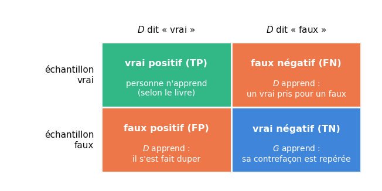
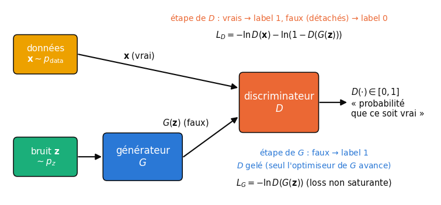
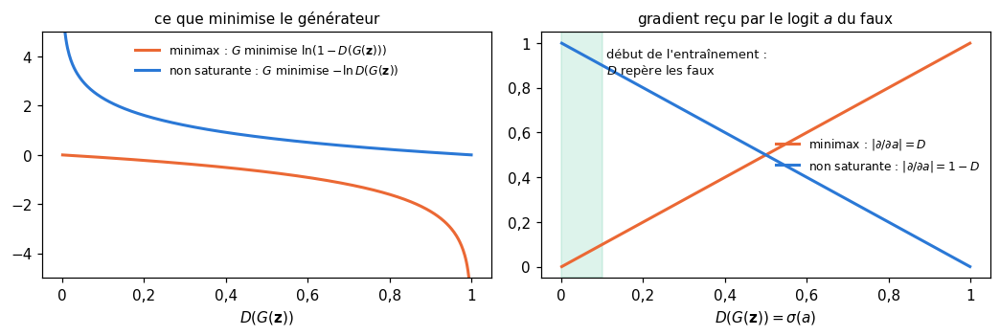
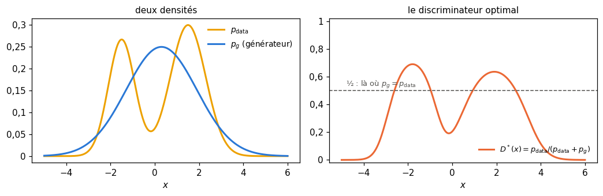
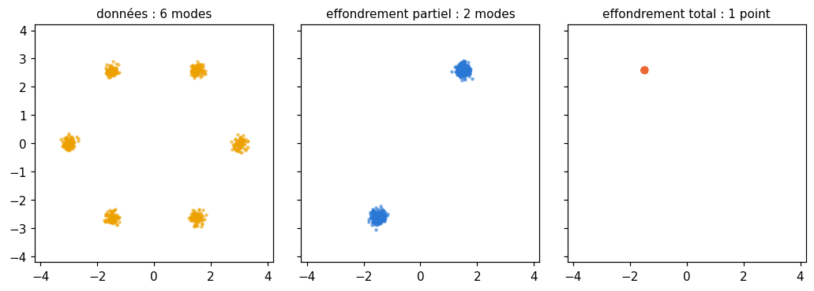
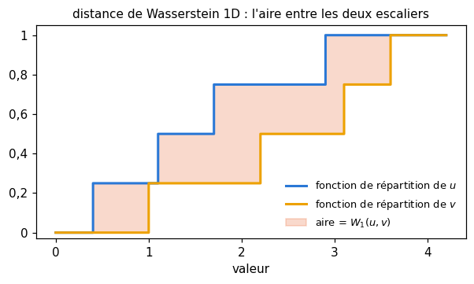

# 27 · Réseaux antagonistes génératifs (GAN) — fiche de cours

> Au ch. 25, un VAE apprenait à générer en encodant puis en décodant des données réelles. Un **GAN** s'y prend tout autrement : un **générateur** fabrique des échantillons à partir de bruit, sans jamais voir de donnée réelle, et un **discriminateur** apprend à distinguer ses faux des vrais ; chacun progresse en exploitant les faiblesses de l'autre. Le livre raconte l'idée avec un faussaire et une inspectrice, puis l'applique à un nuage de points 2D et aux chiffres de MNIST. La fiche y ajoute ce qu'il ne dit pas : les losses et leur valeur à l'équilibre, le discriminateur optimal, la boucle d'entraînement en PyTorch, les vraies règles de Radford, la façon de **mesurer** un générateur (distances de Wasserstein et de Fréchet), le GAN conditionnel, et la place des GAN depuis l'arrivée de la diffusion.

| | |
|---|---|
| **Livre** | vol. 2, ch. 27 « Generative Adversarial Networks », p. 1558-1602 (§27.1 à §27.7.2) |
| **Temps total estimé** | ≈ 21 h : lecture du livre et de la fiche ≈ 4,1 h, exercices ≈ 16 h, 22 flashcards ≈ 0,7 h |
| **Prérequis** | 0B (dérivée nulle, logarithme) · ch. 2 (moyenne, écart-type, covariance) · ch. 3 (precision et recall) · ch. 6 (cross-entropy, divergence KL) · ch. 12 (matrice de covariance, valeurs propres) · ch. 17 (sigmoïde, tanh, Leaky ReLU) · ch. 19 (Adam) · ch. 20 (batchnorm, autograd, optimiseurs) · ch. 21 (convolution à pas) · ch. 23 (checkpoint complet) · ch. 24 (classifieur CNN, gel des poids) · ch. 25 (convolution transposée, interpolation latente) · ch. 26 (auto-apprentissage) |
| **Fichiers du chapitre** | `02_exercices.md` (quiz, rappels, papier, réflexion, entretien) · `03_notebook.ipynb` · `04_indices.md` · `05_solutions.md` et `05_solutions.ipynb` · `06_mes_reponses.md` · `flashcards.csv` |
| **mylearn** | `gen_metrics.py` : distance de Wasserstein 1D, distance de Fréchet entre deux gaussiennes (la formule du FID) et à partir de features ; NumPy seulement |

## Comment utiliser ce chapitre

Le chapitre du livre est court (45 pages) et, comme le précédent, sans équation. Il donne l'intuition juste mais plusieurs détails faux ou datés : la valeur « idéale » des losses, les règles de Radford, le round d'entraînement, le nom même de la méthode. Les encadrés ⚠️ les corrigent, et le notebook suit la pratique standard, en PyTorch.

**Ordre conseillé.**
1. Lis le livre §27.1 à §27.2.3, puis les sections correspondantes de la fiche. Fais les quiz Q1 à Q4 et l'explication 🗣️ 27.8.
2. Lis le livre §27.3 à §27.4.4, puis la fiche (avec les encadrés 🧮 sur la cross-entropy et sur le minimax). Fais les quiz Q5 et Q6, le rappel R1, les exercices ✏️ 27.2 à 27.4, les dérivations ∂ 27.5 et 27.6, et la lecture 📄 27.10.
3. Lis le livre §27.5 à §27.6.1, puis la fiche. Fais les quiz Q7 et Q8, le rappel R3 et l'exercice ✏️ 27.1.
4. Lis le livre §27.7 à §27.7.2, puis la fin de la fiche (mesurer un générateur, le GAN conditionnel, les GAN aujourd'hui). Fais les quiz Q9 et Q10, le rappel R2, l'estimation 🧮 27.7 et la réflexion ⚖️ 27.9.
5. Fais le notebook dans l'ordre des ID : d'abord les GAN jouets (gaussienne 1D, nuage 2D, débogage, losses, round du livre), puis les DCGAN sur MNIST, leur évaluation, l'effondrement de mode, le GAN conditionnel, l'espace latent, le checkpoint et le défi Fashion-MNIST.

| Section | Quiz 🧠 et rappels 🔁 | Papier ✏️ ∂ 🧮 et réflexion | Notebook | Entretien 💼 |
|---|---|---|---|---|
| 27.1 Pourquoi ce chapitre | Q1 | 27.9 | | E3 |
| 27.2 à 27.2.3 La fausse monnaie, le round | Q2, Q3, Q4 | 27.8 | 27.19 | E1 |
| 27.3 Pourquoi « antagonistes » | Q5, R1 | 27.2 | | |
| 27.4 à 27.4.3 Implémenter et entraîner | Q6 | 27.3, 27.6 | 27.12, 27.16, 27.18 | E1 |
| 27.4.4 Le jeu | Q5 | 27.2, 27.4, 27.5, 27.10 | 27.13, 27.14 | |
| 27.5 Un GAN en action | Q7 | 27.4 | 27.13 à 27.15, 27.17 | E5 |
| 27.6 DCGAN | R3 | 27.1 | 27.20, 27.26 | |
| 27.6.1 Les règles empiriques | Q8 | 27.1 | 27.20, 27.21 | |
| 27.7 Les difficultés | | 27.6 | 27.17, 27.18 | E5 |
| 27.7.1 Les grandes images | Q9 | 27.7 | | |
| 27.7.2 L'effondrement de mode | Q10, R2 | | 27.24 | E2 |
| Au-delà : mesurer un générateur | R2 | | 27.11, 27.22, 27.23, 27.28 | E4 |
| Au-delà : le GAN conditionnel, les GAN aujourd'hui | | 27.9 | 27.25, 27.27 | E3 |

## Objectifs d'apprentissage

À la fin de ce chapitre, tu sais :
1. **Expliquer** le jeu entre le générateur et le discriminateur, et ce que chacun apprend.
2. **Écrire** en PyTorch la boucle d'entraînement alternée d'un GAN : deux optimiseurs, `detach`, discriminateur gelé à l'étape du générateur.
3. **Dériver** le discriminateur optimal et la valeur des losses à l'équilibre ($2 \ln 2$ et $\ln 2$, pas 0,5).
4. **Construire** un DCGAN et un GAN conditionnel en suivant des règles d'architecture éprouvées.
5. **Diagnostiquer** l'instabilité et l'effondrement de mode à partir de courbes et d'échantillons.
6. **Implémenter** et **utiliser** des mesures quantitatives : distance de Wasserstein 1D, distance de Fréchet (FID).
7. **Comparer** GAN, VAE et diffusion, et **discuter** des usages des images générées (deepfakes, transparence).

## L'essentiel en 10 lignes

1. Un **GAN** (*Generative Adversarial Network*, réseau antagoniste génératif) met face à face deux réseaux : un **générateur** $G$ qui transforme un bruit $\mathbf{z}$ en un échantillon $G(\mathbf{z})$, et un **discriminateur** $D$ qui rend la probabilité que son entrée soit une vraie donnée.
2. $D$ est un classifieur binaire ordinaire : label 1 pour les vrais, 0 pour les faux, cross-entropy binaire. $G$ ne voit jamais de donnée réelle : il apprend par le gradient qui lui revient **à travers** $D$.
3. Le jeu s'écrit $\min_G \max_D V(D, G)$ avec $V = \mathbb{E}_{\mathbf{x}}[\ln D(\mathbf{x})] + \mathbb{E}_{\mathbf{z}}[\ln(1 - D(G(\mathbf{z})))]$ ; en pratique, $G$ minimise plutôt $-\ln D(G(\mathbf{z}))$, la loss **non saturante**, qui garde un gradient quand $D$ repère facilement les faux.
4. On alterne : un pas de $D$ sur un mini-batch de vrais et de faux (les faux **détachés** de $G$), puis un pas de $G$ à travers $D$, avec le label « vrai » ; deux optimiseurs, un par réseau.
5. Pour un $G$ fixé, le meilleur discriminateur est $D^* = p_{\text{data}} / (p_{\text{data}} + p_g)$ ; le jeu atteint son optimum quand $p_g = p_{\text{data}}$, où $D = \frac{1}{2}$ partout.
6. À cet équilibre, chaque terme de cross-entropy vaut $\ln 2 \approx 0{,}693$ : la loss de $D$ (vrais + faux) vaut $2 \ln 2 \approx 1{,}386$, celle de $G$, $\ln 2$ ; ni l'une ni l'autre ne mesure la qualité des images.
7. Un **DCGAN** est un GAN convolutif construit selon les règles de Radford : convolutions à pas au lieu du pooling, convolutions transposées pour agrandir, batchnorm, ReLU et tanh dans $G$, Leaky ReLU dans $D$, Adam avec un learning rate de $2 \cdot 10^{-4}$ et $\beta_1 = 0{,}5$.
8. Le GAN n'a aucune garantie de converger en pratique ; il est sensible aux hyperparamètres, et sujet à l'**effondrement de mode** (*mode collapse*) : le générateur ne produit plus qu'une partie de la variété des données.
9. On mesure un générateur par des distances entre distributions : la distance de **Wasserstein** en 1D, la distance de **Fréchet** entre deux gaussiennes ajustées sur des features (le **FID**), ou une precision et un recall génératifs.
10. Depuis 2021, la **diffusion** a supplanté les GAN pour l'essentiel de la génération d'images ; l'idée adversariale survit comme loss d'appoint, pour la super-résolution, et pour distiller un modèle de diffusion en quelques pas.

> 📐 **Conventions de la fiche** — On note $G$ le générateur, $D$ le discriminateur, $\mathbf{z} \sim p_z$ le bruit d'entrée (souvent une gaussienne $\mathcal{N}(\mathbf{0}, \mathbf{I})$ de dimension 64 à 128), $\mathbf{x} \sim p_{\text{data}}$ une vraie donnée, $p_g$ la distribution des échantillons $G(\mathbf{z})$. $D(\cdot) \in [0, 1]$ est la probabilité, selon $D$, que l'entrée soit **vraie** ; on appelle **logit** la valeur $a$ avant la sigmoïde, $D = \sigma(a)$. $\ln$ est le logarithme népérien, celui des losses de PyTorch. Le livre n'écrit aucune formule.

---

## 27.1 · Pourquoi ce chapitre ? ⏩

Générer, c'est produire de **nouveaux** échantillons qui ressemblent aux données sans les copier : un visage qui n'existe pas, un plan de jardin, un meuble assorti à un salon. Le livre donne deux usages : fabriquer des données d'entraînement supplémentaires pour d'autres réseaux, et proposer des pistes à un humain qui choisira. Après l'entraînement, on jette le plus souvent le discriminateur et on garde le générateur : chaque nouveau bruit donne un nouvel échantillon.

> ⚠️ **Le livre, corrigé — des données « autant qu'on veut »** — Les échantillons d'un GAN ne contiennent pas plus d'information que les données qui l'ont entraîné. Un classifieur entraîné seulement sur des images générées fait nettement moins bien que sur autant d'images réelles (S. Ravuri et O. Vinyals, « Classification Accuracy Score for Conditional Generative Models », NeurIPS 2019, [arXiv:1905.10887](https://arxiv.org/abs/1905.10887)). Les données générées servent surtout à **compléter** un jeu réel, par exemple pour une classe rare.

## 27.2 · Une métaphore : la fausse monnaie ⏩

Le livre adapte l'histoire classique du faussaire. Glenn (le générateur) fabrique de faux billets, sans avoir jamais vu de vrai billet ; Dawn (la discriminatrice) reçoit une pile mélangée de vrais et de faux, et doit dire pour chacun « vrai » ou « faux ». Avec « vrai » pour positif, ses verdicts tombent dans les quatre cases d'une matrice de confusion (ch. 3) :



- **vrai positif** : un vrai billet reconnu ;
- **faux négatif** : un vrai billet pris pour un faux ; Dawn doit mieux connaître les vrais ;
- **faux positif** : un faux qui passe ; Dawn s'est fait duper ;
- **vrai négatif** : un faux repéré ; Glenn doit trouver ce qui l'a trahi.

### 27.2.1 · Apprendre de l'expérience

Pourquoi ne pas montrer de vrais billets à Glenn ? Parce que le livre veut une méthode qui marche même quand on ne sait pas décrire ce qui fait un vrai : on essaie, on reçoit un verdict, on corrige. C'est la même opposition qu'au ch. 1 entre des features écrites à la main et des features apprises.

> ⚠️ **Le livre, corrigé — ce qu'il faut pour être un générateur** — Le livre illustre l'idée par un faux vin, des circuits scellés ou un tableau de maître, fabriqués par essais et erreurs. Mais un GAN ne marche pas par essais aveugles : le générateur reçoit un **gradient** qui traverse le discriminateur. Il doit donc être une fonction dérivable de ses poids, un réseau de neurones ; un procédé chimique dont on ne connaît pas la dérivée ne s'entraîne pas ainsi. Et dire que le générateur « n'a jamais vu les données » n'est vrai qu'à la lettre : ce qu'il en sait lui arrive par le gradient de $D$, qui, lui, les a vues.

### 27.2.2 · Faussaire et inspectrice deviennent des réseaux

Le discriminateur devient un classifieur binaire (vrai ou faux), d'architecture quelconque ; le générateur, un réseau qui transforme des nombres aléatoires en une image, d'architecture quelconque lui aussi. Dans la version du livre, chaque verdict déclenche ou non un apprentissage : rien ne se passe pour un vrai positif, $D$ apprend de ses faux négatifs et de ses faux positifs, $G$ de ses vrais négatifs.

### 27.2.3 · Un round d'apprentissage

Le livre organise l'entraînement en **rounds de quatre étapes** : un vrai montré à $D$ (qui apprend s'il se trompe), un faux montré à $D$ (G apprend s'il est repéré), un autre faux (D apprend s'il est dupé), puis de nouveau l'étape du générateur, pour que les deux apprennent « au même rythme ».

> ⚠️ **Le livre, corrigé — le round en quatre temps** — Ce n'est pas l'algorithme qu'on utilise, ni celui du code que cite le livre. Dans la boucle standard (Goodfellow et coll., 2014, algorithme 1), le discriminateur fait un pas de gradient sur **tout** un mini-batch de vrais et de faux, puis le générateur fait un pas sur un mini-batch de faux, **quel que soit le verdict** : un vrai bien reconnu avec $D(\mathbf{x}) = 0{,}9$ a encore une loss $-\ln 0{,}9 > 0$, donc un gradient, et un faux qui passe avec $D(G(\mathbf{z})) = 0{,}7$ donne encore un gradient à $G$. Aucun seuil ne décide qui apprend. Quant au « même rythme », la pratique fait souvent l'inverse : le WGAN fait cinq pas du critique par pas du générateur, et TTUR donne à chaque réseau son propre learning rate (🔬 27.19 compare le round du livre à la boucle standard).

## 27.3 · Pourquoi « antagonistes » ? ⏩

Le livre raconte d'abord un Glenn et une Dawn complices, puis propose de les voir en adversaires : un faussaire contre une policière. C'est en fait la formulation d'origine, et la seule exacte : $D$ et $G$ jouent sur la **même** fonction de valeur, l'un pour la faire monter, l'autre pour la faire baisser. L'idée vient de la **théorie des jeux**, l'étude mathématique des situations où des joueurs ont des intérêts opposés ou mêlés.

> ⚠️ **Le livre, corrigé — Antagonistic, non : Adversarial** — Le livre écrit « Generative **Antagonistic** Network » et en tire une explication du nom. L'article fondateur s'intitule « Generative **Adversarial** Nets » (I. Goodfellow et coll., 2014, [arXiv:1406.2661](https://arxiv.org/abs/1406.2661)) et parle d'un processus *adversarial*, d'un jeu minimax à deux joueurs. En français, on dit **réseau antagoniste génératif** ou simplement GAN.

## 27.4 · Implémenter un GAN ⏩

Le livre construit **trois modèles** : le générateur, le discriminateur, et un modèle combiné qui enchaîne les deux ($\mathbf{z} \to G \to D \to$ probabilité). Ce dernier ne contient pas de copies : ce sont les **mêmes** couches, les mêmes poids, partagés (le partage de couches du ch. 24).



### 27.4.1 · Le discriminateur ⏩

N'importe quel classifieur binaire : une entrée de la forme des données, une sortie dans $[0, 1]$, 1 pour « vrai », 0 pour « faux », $\frac{1}{2}$ pour « je ne sais pas ». En PyTorch, on lui fait rendre le **logit** (pas de sigmoïde en sortie) et on utilise `nn.BCEWithLogitsLoss`, plus stable numériquement.

### 27.4.2 · Le générateur ⏩

Une entrée de bruit $\mathbf{z}$ (le livre : 4 nombres uniformes sur $[0, 1]$ ; aujourd'hui, le plus souvent, une gaussienne de dimension 64 à 512), une sortie de la forme des données. Le générateur est **déterministe** : un même $\mathbf{z}$ donne toujours le même échantillon, et les composantes de $\mathbf{z}$ jouent le rôle de **variables latentes**. Contrairement au VAE, aucun encodeur ne relie une donnée réelle à son code : l'espace latent n'est appris que par ce que le générateur en fait.

> ⚠️ **Le livre, corrigé — le VAE est au ch. 25** — Le livre renvoie deux fois au « ch. 24 » pour le VAE. Il est au ch. 25 (Autoencoders), comme l'indique d'ailleurs sa première page. De même, les mini-batchs ne sont pas au « ch. 8 » mais aux ch. 18 et 19 (§18.12.5, §19.4.3).

### 27.4.3 · Entraîner le GAN ⏩

Chaque itération fait deux étapes, sur un mini-batch de $m$ vrais et de $m$ bruits.

**Étape du discriminateur.** On calcule les faux $G(\mathbf{z})$ et on entraîne $D$ comme un classifieur : label 1 pour les vrais, 0 pour les faux,
$$L_D = -\frac{1}{m}\sum_i \ln D(\mathbf{x}_i) \;-\; \frac{1}{m}\sum_i \ln\bigl(1 - D(G(\mathbf{z}_i))\bigr).$$
Les faux sont **détachés** (`fake.detach()`) : la loss de $D$ ne doit pas remonter dans $G$.

**Étape du générateur.** On repasse les faux dans $D$ (mis à jour) avec le label **1** : le générateur veut que $D$ les prenne pour des vrais,
$$L_G = -\frac{1}{m}\sum_i \ln D(G(\mathbf{z}_i)).$$
Le gradient traverse $D$ jusqu'aux poids de $G$, mais seul l'optimiseur de $G$ fait un pas : $D$ est « gelé » pour cette étape.

```python
bce = nn.BCEWithLogitsLoss()
opt_d = torch.optim.Adam(D.parameters(), lr=2e-4, betas=(0.5, 0.999))
opt_g = torch.optim.Adam(G.parameters(), lr=2e-4, betas=(0.5, 0.999))
for real in loader:
    z = torch.randn(len(real), nz)
    fake = G(z)
    # 1) discriminator step: reals -> 1, fakes -> 0, fakes detached from G
    logits_real, logits_fake = D(real), D(fake.detach())
    loss_d = bce(logits_real, torch.ones_like(logits_real)) + bce(logits_fake, torch.zeros_like(logits_fake))
    opt_d.zero_grad()
    loss_d.backward()
    opt_d.step()
    # 2) generator step: fakes -> 1 through the updated D; only opt_g steps
    logits = D(fake)
    loss_g = bce(logits, torch.ones_like(logits))
    opt_g.zero_grad()
    loss_g.backward()
    opt_g.step()
```

> 🧮 **Rappel outil — `.detach()`, `requires_grad_(False)` et les deux optimiseurs** — `fake.detach()` rend le même tenseur, mais coupé du graphe de calcul : un `backward()` qui part de là s'arrête et ne touche pas $G$. Sans lui, `loss_d.backward()` déposerait des gradients dans $G$ (inutiles, et ajoutés à ceux de l'étape suivante si l'on oublie `opt_g.zero_grad()`). À l'étape de $G$, `loss_g.backward()` dépose aussi des gradients dans $D$ : c'est sans danger tant que seul `opt_g.step()` est appelé et que `opt_d.zero_grad()` les efface avant le pas suivant de $D$. Pour économiser ce calcul, ou pour geler $D$ de façon explicite, on peut écrire `D.requires_grad_(False)` avant l'étape de $G$ et `D.requires_grad_(True)` après : c'est l'équivalent PyTorch du `trainable = False` de Keras qu'utilise le livre (🐛 27.16).

> 🧮 **Rappel maths — la cross-entropy binaire et ses logits** — Pour une probabilité prédite $p$ et un label $y \in \{0, 1\}$, la cross-entropy binaire (ch. 6, ch. 18) vaut $-[y \ln p + (1 - y)\ln(1 - p)]$ : $-\ln p$ pour un vrai, $-\ln(1 - p)$ pour un faux. Avec un logit $a$ et $p = \sigma(a)$ : $-\ln \sigma(a) = \ln(1 + e^{-a})$ et $-\ln(1 - \sigma(a)) = \ln(1 + e^{a})$, que `BCEWithLogitsLoss` calcule sans jamais former $\sigma(a)$, donc sans $\ln 0$ (✏️ 27.3).

**La loss non saturante.** Dans le jeu d'origine, le générateur minimise $\ln(1 - D(G(\mathbf{z})))$. Au début, ses faux sont mauvais et $D$ les repère sans peine : $D(G(\mathbf{z})) \approx 0$, et cette fonction est presque plate, son gradient s'éteint (elle **sature**). Minimiser plutôt $-\ln D(G(\mathbf{z}))$ vise le même but (rendre $D(G(\mathbf{z}))$ grand) avec un gradient fort justement quand $D(G(\mathbf{z}))$ est petit. Par rapport au logit $a$ du faux, les dérivées valent $-D$ et $-(1 - D)$ : pour $D = 0{,}01$, la seconde est 99 fois plus grande (∂ 27.6, 🔬 27.18). C'est ce que calcule la boucle ci-dessus avec le label 1.



> 🕰️ **Mise à jour (2026) — de Keras à PyTorch** — **Le livre :** trois modèles Keras, le discriminateur gelé par `trainable = False` dans le modèle combiné. · **Aujourd'hui :** en PyTorch, pas de modèle combiné : deux optimiseurs, `fake.detach()` à l'étape de $D$, le calcul `D(G(z))` écrit à la volée à l'étape de $G$, `nn.BCEWithLogitsLoss` sur des logits ; c'est la structure de la boucle du tutoriel officiel (qui garde, lui, une sigmoïde en sortie de $D$ et `nn.BCELoss`). En Keras, le drapeau `trainable` ne prenait effet qu'à la compilation du modèle, un piège classique. · **Faut-il quand même l'apprendre ?** Oui pour l'idée : un modèle combiné à couches partagées, c'est exactement le graphe que PyTorch construit à la volée. · *Source :* [tutoriel DCGAN de PyTorch](https://docs.pytorch.org/tutorials/beginner/dcgan_faces_tutorial.html).

### 27.4.4 · Le jeu ⏩

Le livre décrit un jeu de territoires : chaque coup possible laisse à l'adversaire une meilleure réponse qui lui rapporte 5, 10 ou 20 territoires ; en supposant qu'il joue toujours au mieux, on choisit le coup qui ne lui laisse que 5. C'est le raisonnement **minimax**.

> 🧮 **Rappel maths — somme nulle, minimax et équilibre de Nash** — Un jeu est **à somme nulle** quand ce que gagne un joueur, l'autre le perd, quelle que soit l'issue : les gains s'additionnent à zéro. Avec une matrice des gains du joueur Ligne (lignes : ses coups ; colonnes : ceux de Colonne), Ligne joue prudemment le coup dont le **pire** gain est le meilleur (le **maximin**, $\max_i \min_j g_{ij}$) ; Colonne, le coup dont le **plus grand** gain laissé à Ligne est le plus petit (le **minimax**, $\min_j \max_i g_{ij}$). On a toujours maximin $\le$ minimax ; s'ils sont égaux, le couple de coups est un **point selle**. Exemple : $\begin{pmatrix} 2 & 4 \\ 1 & 0 \end{pmatrix}$ : maximin $= \max(2, 0) = 2$, minimax $= \min(2, 4) = 2$, point selle en (ligne 1, colonne 1). Un **équilibre de Nash** est un couple de stratégies où **aucun** joueur ne gagne à changer seul la sienne ; dans un jeu à somme nulle, c'est un point selle (au besoin entre stratégies tirées au hasard). L'ordre compte : $\max_D \min_G$ n'est pas $\min_G \max_D$, et la descente de gradient alternée ne sait pas toujours lequel elle résout (✏️ 27.2).

Le GAN est un tel jeu, sur des réseaux plutôt que sur une matrice :
$$\min_G \max_D \; V(D, G) = \mathbb{E}_{\mathbf{x} \sim p_{\text{data}}}[\ln D(\mathbf{x})] + \mathbb{E}_{\mathbf{z} \sim p_z}[\ln(1 - D(G(\mathbf{z})))].$$
$D$ veut $V$ grand (dire « vrai » aux vrais, « faux » aux faux), $G$ veut $V$ petit. $L_D$ ci-dessus est exactement $-V$ estimé sur un mini-batch.

**Le discriminateur optimal.** Pour un générateur fixé, on peut maximiser $V$ point par point. En un $\mathbf{x}$ donné, avec $a = p_{\text{data}}(\mathbf{x})$ et $b = p_g(\mathbf{x})$, il faut maximiser $a \ln y + b \ln(1 - y)$ sur $y \in\, ]0, 1[$ : la dérivée $\frac{a}{y} - \frac{b}{1-y}$ s'annule en $y = \frac{a}{a+b}$ (∂ 27.5). D'où
$$D^*(\mathbf{x}) = \frac{p_{\text{data}}(\mathbf{x})}{p_{\text{data}}(\mathbf{x}) + p_g(\mathbf{x})}.$$
Là où le générateur produit trop, $D^* < \frac{1}{2}$ ; là où il ne produit rien, $D^* = 1$ ; là où les deux densités sont égales, $D^* = \frac{1}{2}$.



En remplaçant $D$ par $D^*$, la valeur du jeu devient $V(D^*, G) = -\ln 4 + 2\,\mathrm{JS}(p_{\text{data}} \,\|\, p_g)$, où $\mathrm{JS}$ est la **divergence de Jensen-Shannon** (`js_divergence` de ta librairie, ch. 6) : la moyenne des divergences KL de chaque distribution à leur mélange $m = \frac{1}{2}(p_{\text{data}} + p_g)$. Elle est positive, nulle seulement si $p_g = p_{\text{data}}$. Le meilleur générateur est donc celui qui reproduit **exactement** les données, et la valeur du jeu y vaut $-\ln 4$ (théorème 1 de Goodfellow et coll., 📄 27.10).

> ⚠️ **Le livre, corrigé — le poker n'est pas un jeu à ressources illimitées** — Le livre oppose le poker, où le pot peut grossir sans limite, aux jeux à somme nulle. Mais le poker sans commission est l'exemple type du jeu à somme nulle : chaque euro gagné par l'un est perdu par un autre, quelle que soit la taille du pot. Somme nulle ne veut pas dire « ressources en quantité fixe », mais « gains qui s'annulent ». Et un GAN entraîné avec la loss non saturante n'est plus, à la lettre, un jeu à somme nulle : $G$ ne minimise plus exactement ce que $D$ maximise.

L'**équilibre de Nash** du GAN, $p_g = p_{\text{data}}$ et $D = \frac{1}{2}$, existe pour des réseaux de capacité infinie entraînés jusqu'au bout. Des réseaux réels, entraînés par petits pas alternés, peuvent osciller autour de lui sans l'atteindre (§27.7).

## 27.5 · Un GAN en action ⏩

L'expérience du livre : un nuage de 10 000 points tirés d'une gaussienne 2D de centre $(5, 5)$ et d'écart-type 1, des mini-batchs de 32 points. Le générateur reçoit 4 nombres uniformes, passe par une couche dense de 16 neurones (Leaky ReLU de pente 0,1) et une couche dense de 2 neurones sans activation ; le discriminateur a deux couches denses de 16 neurones et une sortie sigmoïde. Au fil des epochs, le nuage généré part d'une traînée près de l'origine, rejoint le centre, le dépasse, s'allonge, puis revient se caler sur la cible (🎨 27.15).

Pourquoi des mini-batchs ? Le livre explique qu'un point seul ne dit presque rien, alors qu'un mini-batch de 30 points trop serrés, ou décalés, se repère d'un coup d'œil.

> ⚠️ **Le livre, corrigé — le discriminateur ne voit pas le mini-batch** — Le discriminateur du livre reçoit **un** point et rend **une** probabilité ; le mini-batch ne fait que moyenner les gradients. Il ne peut donc pas remarquer qu'un mini-batch est trop serré. Donner à $D$ une statistique du mini-batch entier, c'est ce qu'ont ajouté plus tard la discrimination par mini-batch (T. Salimans et coll., 2016, [arXiv:1606.03498](https://arxiv.org/abs/1606.03498)) et la couche d'écart-type par mini-batch de ProGAN (Karras et coll., 2018) : un remède contre l'effondrement de mode (🔬 27.24).

> ⚠️ **Le livre, corrigé — 68 % dans un cercle de rayon 1** — La règle des 68 % vaut pour **une** dimension. Pour une gaussienne 2D d'écart-type 1 dans chaque direction, la distance au centre suit une loi de Rayleigh : $P(r \le 1) = 1 - e^{-1/2} \approx 39{,}3\,\%$, et il faut un rayon d'environ 1,52 pour contenir 68 % des points (Q7).

> ⚠️ **Le livre, corrigé — la loss « idéale » vaut ln 2, pas 0,5** — Le livre dit que les deux losses devraient idéalement se stabiliser à 0,5, et que ses courbes restent « un peu au-dessus ». C'est la **sortie** de $D$ qui vaut idéalement $\frac{1}{2}$. Chaque terme de cross-entropy vaut alors $-\ln \frac{1}{2} = \ln 2 \approx 0{,}693$ : c'est exactement le palier des courbes du livre, qui sont donc à l'équilibre. La loss de $D$ qui additionne vrais et faux vaut $2 \ln 2 \approx 1{,}386$ (✏️ 27.4, 📈 27.14). Et une loss à l'équilibre ne garantit pas de bonnes images : un GAN se juge sur ses échantillons et des mesures comme le FID.

## 27.6 · DCGAN ⏩

Pour des images, on prend des couches convolutives (ch. 21) : on parle de **DCGAN** (*Deep Convolutional GAN*). Le livre reprend le modèle MNIST d'un dépôt GitHub (Gildenblat, 2016) : un générateur qui part de 100 nombres, passe par une couche dense de 1 024 neurones puis de **6 272** neurones, remet le tout en forme $7 \times 7 \times 128$, puis double deux fois la taille par un sur-échantillonnage suivi d'une convolution ; un discriminateur à deux convolutions suivies de max-pooling, puis deux couches denses. Toutes les activations sont des tanh, sauf la sigmoïde de sortie de $D$ ; la batchnorm du générateur est placée, comme au ch. 20, entre la sortie de la couche et son activation. Après une epoch, des taches ; après cent, des chiffres reconnaissables.

Pourquoi 6 272 ? Deux agrandissements par 2 doivent mener à 28 : on part de 7, et $7 \times 7 \times 128 = 6\,272$. Les tailles se suivent avec les formules du ch. 21 et du ch. 25 :
$$H_{\text{out}} = \left\lfloor \frac{H_{\text{in}} + 2p - k}{s} \right\rfloor + 1 \quad\text{(convolution)}, \qquad H_{\text{out}} = (H_{\text{in}} - 1)s - 2p + k + p_{\text{out}} \quad\text{(transposée)}.$$
Avec $k = 4$, $s = 2$, $p = 1$ : une convolution divise la taille par deux ($28 \to 14 \to 7$), une convolution transposée la double ($7 \to 14 \to 28$) (✏️ 27.1).

> ⚠️ **Le livre, corrigé — la légende de la fig. 27.22** — Elle annonce le générateur en haut et le discriminateur en bas ; le dessin montre l'inverse.

### 27.6.1 · Des règles empiriques ⏩

L'article de Radford, Metz et Chintala (2016) a dégagé des règles qui rendent l'entraînement d'un GAN convolutif bien plus fiable. Les voici, telles que les donne l'article (la place de la batchnorm, avant l'activation, vient de son code et de l'usage) :
- **pas de pooling** : des convolutions de pas 2 dans $D$ pour réduire, des **convolutions transposées** de pas 2 dans $G$ pour agrandir ;
- **pas de couches denses cachées** : la première couche de $G$ (une multiplication de matrice remise en forme) et la sortie de $D$ (aplatie vers une seule valeur) sont les seules ;
- **batchnorm** partout, sauf sur la sortie de $G$ et sur l'entrée de $D$, entre la convolution et son activation ;
- **ReLU** dans $G$, **tanh** en sortie (donc des images ramenées dans $[-1, 1]$) ; **Leaky ReLU** de pente 0,2 dans **$D$** ;
- **Adam** avec un learning rate de $2 \cdot 10^{-4}$ et $\beta_1 = 0{,}5$ pour les deux réseaux, des mini-batchs de 128, des poids initialisés selon $\mathcal{N}(0;\, 0{,}02^2)$.

> ⚠️ **Le livre, corrigé — les règles de Radford** — Le livre conseille Adam avec $10^{-3}$ pour le générateur et $10^{-4}$ pour le discriminateur : l'article utilise $2 \cdot 10^{-4}$ pour les deux, avec $\beta_1 = 0{,}5$ (il juge $10^{-3}$ trop grand et $\beta_1 = 0{,}9$ instable). Le livre écrit aussi « Leaky ReLU dans le générateur » : c'est dans le **discriminateur**. Enfin, il explique qu'une convolution transposée « place l'agrandissement après la convolution » : c'est l'inverse, une convolution transposée de pas 2 revient à intercaler des zéros (agrandir) **puis** à convoluer. Sa différence avec un sur-échantillonnage suivi d'une convolution tient à la façon d'agrandir (des zéros contre des copies), pas à l'ordre (A. Radford et coll., [arXiv:1511.06434](https://arxiv.org/abs/1511.06434)).

Le livre rapporte qu'appliquer ces règles mécaniquement au modèle de Gildenblat, déjà réglé, l'a rendu bien moins bon. La leçon est juste : un modèle réglé se garde tel quel, et les règles servent de point de départ pour un modèle neuf (🔬 27.21).

> 🕰️ **Mise à jour (2026) — agrandir sans damier** — **Le livre :** préférer les convolutions transposées au sur-échantillonnage. · **Aujourd'hui :** les convolutions transposées dont le noyau n'est pas un multiple du pas produisent souvent des motifs en **damier** ; on agrandit plutôt par un sur-échantillonnage (au plus proche voisin, le choix qui a le mieux marché pour les auteurs) suivi d'une convolution ; un noyau multiple du pas ($k = 4$, $s = 2$) supprime le chevauchement inégal et aide, sans empêcher le réseau d'apprendre un damier. Les GAN récents (ProGAN, StyleGAN) agrandissent puis convoluent. · **Faut-il quand même l'apprendre ?** Oui : la convolution transposée reste partout (décodeurs, U-Net), et savoir d'où vient le damier aide à le corriger. · *Source :* A. Odena, V. Dumoulin et C. Olah, « Deconvolution and Checkerboard Artifacts », *Distill*, 2016, [doi:10.23915/distill.00003](https://doi.org/10.23915/distill.00003).

> 💼 **En entreprise** — Un GAN se règle à deux réseaux à la fois : chaque essai coûte deux fois plus, et une loss qui baisse ne dit rien de la qualité. On part d'une architecture publiée qui marche (le DCGAN du tutoriel PyTorch, StyleGAN2), on change une chose à la fois, et l'on suit à chaque epoch une **grille d'échantillons pour un bruit fixé** et une mesure (FID) sur un jeu de validation, en gardant un checkpoint complet (🛠️ 27.27).

## 27.7 · Les difficultés

Un GAN est un équilibre fragile : si l'un des deux réseaux prend trop d'avance, l'autre ne rattrape plus. Avec la loss minimax, un discriminateur trop fort renvoie au générateur des gradients presque nuls (la saturation, 🔬 27.18) ; un générateur trop rapide face à un discriminateur trop lent produit de mauvais échantillons que personne ne corrige (📈 27.14). Les hyperparamètres (learning rates, architecture, taille du bruit) changent tout, et il faut les chercher pour deux réseaux à la fois.

> ⚠️ **Le livre, corrigé — « aucune preuve de convergence »** — Le livre affirme qu'on ne sait rien prouver. C'est trop court. Goodfellow et coll. (2014) prouvent que $p_g$ converge vers $p_{\text{data}}$ si, à chaque étape, $D$ est entraîné jusqu'à son optimum et si les réseaux ont une capacité infinie. Heusel et coll. (2017) prouvent qu'en donnant aux deux réseaux des learning rates d'échelles différentes (TTUR), l'entraînement converge vers un équilibre de Nash **local**, sous des hypothèses de petits pas. Mescheder et coll. (2018) montrent qu'un GAN non régularisé ne converge pas toujours, même localement, et qu'une pénalité sur le gradient de $D$ aux données réelles (R1) l'y aide. Il n'existe toujours pas de garantie globale pour des réseaux réels ([arXiv:1801.04406](https://arxiv.org/abs/1801.04406)).

> ⚠️ **Le livre, corrigé — un discriminateur « plus puissant »** — Le livre conseille un discriminateur plus puissant que le générateur (§27.5), puis exige que les deux restent « à égalité » (§27.7). La seconde consigne est la bonne : avec la loss minimax, un discriminateur trop bon éteint le gradient du générateur. Les architectures de référence (DCGAN, StyleGAN) donnent aux deux réseaux des tailles voisines.

> 🕰️ **Mise à jour (2026) — stabiliser l'entraînement** — **Le livre :** des règles d'architecture, et un renvoi au WGAN. · **Aujourd'hui :** le **WGAN-GP** remplace la cross-entropy par une estimation de la distance de Wasserstein, avec une pénalité de gradient (I. Gulrajani et coll., 2017, [arXiv:1704.00028](https://arxiv.org/abs/1704.00028)) ; la **normalisation spectrale** borne la pente du discriminateur couche par couche (T. Miyato et coll., 2018, [arXiv:1802.05957](https://arxiv.org/abs/1802.05957)) ; la **pénalité R1** (Mescheder et coll., 2018) est celle de StyleGAN2 ; TTUR donne à chaque réseau son learning rate. · **Faut-il quand même l'apprendre ?** Oui : ces techniques réparent les défauts que tu vas provoquer dans le notebook ; elles se comprennent une fois la boucle de base maîtrisée. · *Source :* les articles cités.

### 27.7.1 · Les grandes images ⏩

Sur des images de $1\,000 \times 1\,000$ pixels (3 millions de nombres en couleur), le discriminateur repère trop facilement les faux et les gradients qu'il renvoie poussent le générateur dans des directions presque aléatoires ; le calcul et la mémoire explosent aussi. La **croissance progressive** (*progressive growing*, T. Karras et coll., 2018) commence à $4 \times 4$, puis double la résolution par étapes jusqu'à $1\,024 \times 1\,024$ : chaque étape ajoute des couches au générateur (côté sortie) et au discriminateur (côté entrée), et réutilise tout ce qui a été appris aux résolutions plus petites. La plus grande partie de l'entraînement se fait ainsi sur de petites images, beaucoup moins chères (🧮 27.7).

> ⚠️ **Le livre, corrigé — la croissance progressive** — Le livre ajoute les couches « à la fin de chaque réseau » et saute de 512 à 128 dans son échelle de tailles. Dans l'article, les nouvelles couches arrivent du côté haute résolution (la sortie de $G$, l'entrée de $D$), et surtout elles sont introduites **en fondu** : un poids $\alpha$ passe de 0 à 1 pour mélanger l'ancienne sortie agrandie et la nouvelle, sans à-coup ; la résolution double à chaque étape (4, 8, 16, …, 512, 1 024). Les auteurs rapportent un entraînement jusqu'à 2 à 6 fois plus rapide, selon la résolution finale ([arXiv:1710.10196](https://arxiv.org/abs/1710.10196)).

> 🕰️ **Mise à jour (2026) — après la croissance progressive** — **Le livre :** la croissance progressive comme solution aux grandes images. · **Aujourd'hui :** StyleGAN2 l'abandonne au profit d'une architecture de taille fixe (des connexions qui sautent vers la sortie dans le générateur, des connexions résiduelles dans le discriminateur), où le réseau déplace de lui-même son attention des basses vers les hautes résolutions pendant l'entraînement ; la croissance progressive laissait des détails « collés » à l'écran (T. Karras et coll., 2020, [arXiv:1912.04958](https://arxiv.org/abs/1912.04958)) ; les modèles de diffusion récents travaillent souvent dans l'espace latent d'un autoencodeur, plus petit que l'image. · **Faut-il quand même l'apprendre ?** Oui : l'idée d'apprendre du grossier vers le fin revient partout (pyramides, diffusion en cascade). · *Source :* l'article cité.

### 27.7.2 · L'effondrement de mode

Un générateur peut trouver **un** échantillon que le discriminateur accepte, et ne plus produire que lui, quel que soit le bruit : il a fait ce qu'on lui demandait (tromper $D$), pas ce qu'on voulait (imiter toute la variété des données). On parle d'**effondrement de mode** (*mode collapse*) **total** quand tous les échantillons se ressemblent, **partiel** quand le générateur ne couvre que quelques-uns des groupes de données, le cas le plus fréquent. Le livre montre un DCGAN mal réglé qui, après trois epochs, ne dessine presque que des 1.



> ⚠️ **Le livre, corrigé — « modal collapse » et ce qui se passe ensuite** — Le livre écrit *modal collapse* et explique que *mode* y signifie « une manière de fonctionner ». Le terme usuel est **mode collapse**, et le mode est celui des statistiques : un **pic** de la distribution des données (un chiffre de MNIST, une gaussienne d'un mélange). Le générateur ne couvre que certains pics. Le livre ajoute qu'un générateur effondré « cesse d'apprendre » : en pratique, $D$ apprend vite à rejeter le mode surreprésenté, $G$ saute vers un autre, et l'entraînement peut **tourner en rond** d'un mode à l'autre. Le nom de « scénario Helvetica » vient de l'article de Goodfellow et coll. lui-même. Enfin, le remède qu'il décrit, un terme qui mesure la diversité du mini-batch, est la **discrimination par mini-batch** de Salimans et coll. (2016), pas le WGAN auquel il l'attribue.

Comment le voir ? Sur des données jouets, en comptant les groupes couverts (🔬 27.24, avec un anneau de huit gaussiennes) ; sur des images, avec un classifieur qui donne la classe de chaque échantillon (l'histogramme des chiffres générés), ou un recall génératif bas. Les remèdes : donner à $D$ une statistique du mini-batch (écart-type par mini-batch), une loss de Wasserstein avec pénalité de gradient, un bruit plus riche, des learning rates mieux équilibrés.

## Au-delà du livre : mesurer un générateur

Le livre juge ses GAN à l'œil. On veut des nombres : comparer deux réglages, suivre l'entraînement, savoir quand s'arrêter. On compare alors deux **distributions**, celle des données et celle des échantillons.

**La distance de Wasserstein en 1D.** Imagine chaque échantillon comme un tas de sable sur une droite : la distance de Wasserstein-1 (*earth mover's distance*) est le travail minimal pour déplacer un tas sur l'autre. En 1D, elle vaut l'aire entre les deux fonctions de répartition, et, pour deux échantillons de même taille $n$, le plus simple des calculs : trier, apparier dans l'ordre, moyenner les écarts,
$$W_1(u, v) = \frac{1}{n}\sum_{i=1}^{n} \bigl| u_{(i)} - v_{(i)} \bigr|.$$
Exemple : $u = (4, 1)$ et $v = (2, 2)$ donnent, triés, $(1, 4)$ et $(2, 2)$, d'où $W_1 = \frac{1 + 2}{2} = 1{,}5$. Contrairement à la loss du GAN, elle mesure **où** sont les échantillons, et elle reste informative même quand les deux distributions ne se recouvrent pas (🔨 27.11).



**La distance de Fréchet et le FID.** En grande dimension, on résume chaque ensemble par une gaussienne : sa moyenne $\boldsymbol{\mu}$ et sa matrice de covariance $\boldsymbol{\Sigma}$ (ch. 2, ch. 12). La distance de Fréchet (ou de Wasserstein-2) entre deux gaussiennes a une formule fermée :
$$d_F^2 = \lVert \boldsymbol{\mu}_1 - \boldsymbol{\mu}_2 \rVert^2 + \operatorname{Tr}\Bigl(\boldsymbol{\Sigma}_1 + \boldsymbol{\Sigma}_2 - 2\bigl(\boldsymbol{\Sigma}_1 \boldsymbol{\Sigma}_2\bigr)^{1/2}\Bigr).$$
Le premier terme compare les centres, le second les étalements et les orientations. Le **FID** (*Fréchet Inception Distance*, M. Heusel et coll., 2017, [arXiv:1706.08500](https://arxiv.org/abs/1706.08500)) applique cette formule non aux pixels mais aux **features** d'un réseau entraîné (les 2 048 valeurs de l'avant-dernière couche d'Inception v3) : deux images proches pour ce réseau ont des features proches. Plus le FID est petit, mieux c'est ; 0 pour deux échantillons de la même distribution, à l'aléa près. Dans le notebook, faute d'Inception, tu prendras les features d'un petit CNN entraîné sur MNIST (🔨 27.22, 📦 27.23).

> 🧮 **Rappel maths — la trace et la racine carrée d'une matrice** — La **trace** $\operatorname{Tr}(\mathbf{A})$ est la somme des éléments diagonaux d'une matrice carrée ; c'est aussi la somme de ses valeurs propres. Une matrice de covariance est symétrique et à valeurs propres positives ou nulles (ch. 12) : elle s'écrit $\boldsymbol{\Sigma} = \mathbf{Q}\boldsymbol{\Lambda}\mathbf{Q}^\top$, et sa **racine carrée** $\boldsymbol{\Sigma}^{1/2} = \mathbf{Q}\boldsymbol{\Lambda}^{1/2}\mathbf{Q}^\top$ est la matrice dont le carré redonne $\boldsymbol{\Sigma}$. Le produit $\boldsymbol{\Sigma}_1\boldsymbol{\Sigma}_2$ n'est pas symétrique en général, mais il a les mêmes valeurs propres que la matrice symétrique $\boldsymbol{\Sigma}_1^{1/2}\boldsymbol{\Sigma}_2\boldsymbol{\Sigma}_1^{1/2}$ : elles sont réelles et positives ou nulles, et $\operatorname{Tr}\bigl((\boldsymbol{\Sigma}_1\boldsymbol{\Sigma}_2)^{1/2}\bigr) = \sum_i \sqrt{\lambda_i(\boldsymbol{\Sigma}_1\boldsymbol{\Sigma}_2)}$. Pas besoin de calculer la racine elle-même : les valeurs propres suffisent (les arrondis peuvent en rendre de minuscules négatives, ou des parties imaginaires infimes, qu'on ramène à 0). Pour des covariances **diagonales**, tout se simplifie : $d_F^2 = \lVert \boldsymbol{\mu}_1 - \boldsymbol{\mu}_2 \rVert^2 + \sum_j (\sigma_{1j} - \sigma_{2j})^2$, avec $\sigma_{1j}$ et $\sigma_{2j}$ les écarts-types. Exemple : $\boldsymbol{\Sigma}_1 = \operatorname{diag}(9, 1)$ et $\boldsymbol{\Sigma}_2 = \operatorname{diag}(1, 1)$, mêmes moyennes : $9 + 1 + 1 + 1 - 2(3 + 1) = 4 = (3 - 1)^2 + (1 - 1)^2$.

**Precision et recall génératifs.** Un seul nombre mêle deux qualités différentes : la **fidélité** (chaque échantillon ressemble-t-il à une vraie donnée ?) et la **diversité** (le générateur couvre-t-il toute la variété des données ?). T. Kynkäänniemi et coll. (2019, [arXiv:1904.06991](https://arxiv.org/abs/1904.06991)) les séparent en une **precision** (la part des échantillons qui tombent près de vraies données) et un **recall** (la part des vraies données qui ont un échantillon près d'elles), dans un espace de features. Un générateur effondré sur un seul chiffre parfait a une precision haute et un recall bas (🔁 R2).

> 🕰️ **Mise à jour (2026) — évaluer un générateur** — **Le livre :** le jugement visuel. · **Aujourd'hui :** le FID est la mesure standard depuis 2017, complété par la precision et le recall génératifs ; il a des limites connues : il dépend du nombre d'échantillons (biaisé vers le haut pour de petits mini-batchs, d'où des comparaisons toujours au même nombre, souvent 50 000), des features d'Inception (entraîné sur ImageNet), et il juge mal des images loin d'ImageNet. G. Stein et coll. (2023) recommandent des features auto-supervisées comme celles de DINOv2 (FD-DINOv2). · **Faut-il quand même l'apprendre ?** Oui : coder la formule oblige à comprendre ce qu'elle compare, et le FID reste le nombre qu'on te demandera en entretien. · *Source :* M. Heusel et coll., [arXiv:1706.08500](https://arxiv.org/abs/1706.08500) ; G. Stein et coll., « Exposing flaws of generative model evaluation metrics… », [arXiv:2306.04675](https://arxiv.org/abs/2306.04675).

## Au-delà du livre : le GAN conditionnel

Les usages du livre (un jardin pour **cet** endroit, un fauteuil pour **ce** salon) demandent de choisir ce que l'on génère. Un **GAN conditionnel** (M. Mirza et S. Osindero, 2014, [arXiv:1411.1784](https://arxiv.org/abs/1411.1784)) donne la même information $y$ (un label, un texte, une image) aux deux réseaux : le générateur reçoit $(\mathbf{z}, y)$, le discriminateur juge des couples $(\mathbf{x}, y)$, et un vrai 7 présenté avec le label 3 devient un « faux ». Le moyen le plus simple d'injecter un label : un **embedding** (ch. 24) appris, concaténé au bruit dans $G$, et transformé en un canal supplémentaire de l'image dans $D$ (📦 27.25). C'est l'ancêtre direct du conditionnement par le texte des modèles d'images actuels. Le livre cite aussi CycleGAN (J.-Y. Zhu et coll., 2017), qui transforme une photo en tableau sans paires d'exemples : deux GAN, et une contrainte de **cohérence cyclique** (aller puis revenir doit redonner l'image de départ).

## Au-delà du livre : les GAN aujourd'hui

> 🕰️ **Mise à jour (2026) — la place des GAN** — **Le livre :** les GAN, méthode phare de génération, qui « dépasse de loin » le VAE. · **Aujourd'hui :** depuis 2021, les modèles de **diffusion** battent les GAN sur ImageNet (P. Dhariwal et A. Nichol, « Diffusion Models Beat GANs on Image Synthesis », [arXiv:2105.05233](https://arxiv.org/abs/2105.05233)), avec une meilleure diversité, un entraînement stable et un conditionnement par le texte naturel ; ils dominent la génération d'images et de vidéos. Les GAN restent utiles quand il faut aller **vite** (super-résolution, génération en temps réel) ; leur idée survit comme **loss adversariale** d'appoint (les autoencodeurs de VQGAN et des modèles de diffusion latente sont entraînés avec un discriminateur), et pour **distiller** un modèle de diffusion en un à quatre pas (A. Sauer et coll., « Adversarial Diffusion Distillation », [arXiv:2311.17042](https://arxiv.org/abs/2311.17042)). · **Faut-il quand même l'apprendre ?** Oui : la boucle à deux réseaux, la loss adversariale et les mesures de distance entre distributions servent bien au-delà des GAN ; la diffusion est le sujet du bonus B5. · *Source :* les articles cités.

| | GAN | VAE (ch. 25) | Diffusion (B5) |
|---|---|---|---|
| Ce qu'on entraîne | deux réseaux en compétition | un encodeur et un décodeur, une seule loss | un réseau qui retire du bruit, une seule loss |
| Génération | un passage, très rapide | un passage, très rapide | des dizaines de passages (moins après distillation) |
| Qualité des images | nette | souvent floue | nette |
| Diversité | risque d'effondrement de mode | bonne | très bonne |
| Stabilité de l'entraînement | délicate | bonne | bonne |
| Encodeur (image → code) | non | oui | pas directement |

> 🕰️ **Mise à jour (2026) — signaler les contenus générés** — **Le livre :** absent. · **Aujourd'hui :** dans l'Union européenne, le règlement sur l'IA (AI Act, art. 50) impose aux fournisseurs de systèmes qui génèrent des images, du son, de la vidéo ou du texte de **marquer** leurs sorties de façon détectable par une machine, et aux déployeurs qui diffusent un *deepfake* dans un cadre professionnel de le **signaler**, avec des obligations allégées pour une œuvre manifestement artistique, satirique ou fictive. Ces obligations s'appliquent depuis le 2 août 2026, avec un délai jusqu'au 2 décembre 2026 pour le marquage des systèmes déjà sur le marché (règlement (UE) 2026/1744, dit « omnibus numérique ») ; des lignes directrices de la Commission et un code de bonnes pratiques volontaire les accompagnent. Côté technique, la norme **C2PA** (*Content Credentials*) attache à un fichier des métadonnées de provenance signées, et des filigranes invisibles sont intégrés par plusieurs générateurs. · **Faut-il quand même l'apprendre ?** Oui : qui entraîne ou déploie un générateur doit savoir ce qu'il doit signaler (⚖️ 27.9). · *Source :* [règlement (UE) 2024/1689, art. 50](https://eur-lex.europa.eu/eli/reg/2024/1689/oj) ; [c2pa.org](https://c2pa.org/).

## Les pièges classiques ⚠️ (récapitulatif)

| Piège | Exemple | Ce qu'il faut faire |
|---|---|---|
| Oublier `detach()` à l'étape de $D$ | `D(fake)` dans `loss_d` : son `backward()` remplit les gradients de $G$, qui s'ajoutent à ceux de l'étape suivante | `D(fake.detach())` à l'étape de $D$, `D(fake)` à l'étape de $G$ |
| Entraîner $G$ avec le label « faux » | `bce(D(fake), zeros)` minimisé par $G$ : il apprend à être **repéré** | le label 1 pour l'étape de $G$ (loss non saturante) |
| Oublier un `zero_grad()` | les gradients s'accumulent d'une itération à l'autre ; $D$ reçoit aussi ceux de l'étape de $G$ | `opt_d.zero_grad()` avant `loss_d.backward()`, `opt_g.zero_grad()` avant `loss_g.backward()` |
| Une sigmoïde en sortie de $D$ et `BCEWithLogitsLoss` | la sigmoïde est appliquée deux fois ; la loss ne descend jamais sous un plancher | un logit en sortie de $D$ et `BCEWithLogitsLoss`, ou une sigmoïde et `BCELoss` |
| Des images dans $[0, 1]$ et une tanh en sortie de $G$ | $D$ distingue les faux à leurs pixels négatifs | ramener les images dans $[-1, 1]$ : `x * 2 - 1` |
| Attendre une loss de 0,5 | « la loss de $D$ vaut 1,39, l'entraînement a raté » | à l'équilibre, $\ln 2$ par terme, $2 \ln 2$ pour la somme ; juger sur les images et le FID |
| Juger un GAN à sa loss | une loss de $G$ qui baisse pendant un effondrement de mode | une grille d'échantillons pour un bruit fixé, et une mesure (FID, modes couverts) |
| Une loss du générateur qui sature | loss minimax et SGD : $D(G(\mathbf{z})) \to 0$ dès le début, le générateur ne bouge plus | loss non saturante ; un optimiseur comme Adam ; des learning rates équilibrés |
| Générer en mode `train()` | les batchnorms utilisent les statistiques du mini-batch : l'image d'un $\mathbf{z}$ dépend des autres | `G.eval()` et `torch.no_grad()` pour générer |
| Comparer des FID calculés différemment | deux nombres de 50 000 et de 1 000 échantillons, ou des features différentes | même extracteur, même nombre d'échantillons, même jeu de référence |
| Un checkpoint incomplet | reprendre avec les seuls poids : les moments d'Adam et les générateurs aléatoires repartent de zéro | sauver $G$, $D$, les deux optimiseurs, l'epoch et les états aléatoires |

## Liens avec les autres chapitres 🔗

- **Ch. 3** : la matrice de confusion des verdicts du discriminateur ; la precision et le recall, réutilisés pour juger un générateur.
- **Ch. 6** : la cross-entropy binaire, la divergence KL et la divergence de Jensen-Shannon, qui est la valeur du jeu au discriminateur optimal.
- **Ch. 12** : la matrice de covariance et ses valeurs propres, dans la distance de Fréchet.
- **Ch. 17 à 20** : sigmoïde, tanh, Leaky ReLU, Adam, batchnorm ; `train()` et `eval()`.
- **Ch. 21 et 25** : convolutions à pas et convolutions transposées ; le VAE, l'autre générateur, et l'interpolation latente (`interpolate_latents`).
- **Ch. 23 et 24** : le checkpoint complet ; le partage et le gel des couches ; le classifieur CNN qui fournit les features du FID.
- **Ch. 26** : l'auto-apprentissage, un autre jeu où l'adversaire évolue avec soi.
- **Mini-projet MP6 et bonus B5** : ta distance de Fréchet comparera le DCGAN, le VAE et un modèle de diffusion sur MNIST.

## Guide de lecture et de travail

Le chapitre du livre est court et sans formule : lis-le pour l'intuition et les exemples, et prends les formules, la boucle PyTorch et les corrections dans la fiche. Le **parcours rapide** lit toute la fiche et les sections ⏩ du livre, soit environ 3,2 h : il laisse de côté l'apprentissage par l'expérience, la mise en réseaux du faussaire et le round en quatre temps (§27.2.1 à §27.2.3), l'introduction des difficultés (§27.7) et l'effondrement de mode (§27.7.2), que la fiche résume et corrige. Le notebook suit deux phases : les GAN jouets (1D, 2D), où tout s'entraîne en quelques secondes, puis les DCGAN sur MNIST et Fashion-MNIST, avec leur évaluation.

## Pour aller plus loin

- I. Goodfellow, « NIPS 2016 Tutorial: Generative Adversarial Networks », [arXiv:1701.00160](https://arxiv.org/abs/1701.00160) : le tutoriel de l'inventeur, avec la loss non saturante, l'effondrement de mode et les astuces d'entraînement.
- Le tutoriel officiel [DCGAN de PyTorch](https://docs.pytorch.org/tutorials/beginner/dcgan_faces_tutorial.html) : la boucle de la fiche (avec une sigmoïde et `BCELoss`), sur des visages.
- A. Radford, L. Metz et S. Chintala, « Unsupervised Representation Learning with Deep Convolutional Generative Adversarial Networks », ICLR 2016, [arXiv:1511.06434](https://arxiv.org/abs/1511.06434) : les règles du DCGAN, et l'arithmétique dans l'espace latent.
- M. Heusel et coll., « GANs Trained by a Two Time-Scale Update Rule Converge to a Local Nash Equilibrium », NeurIPS 2017, [arXiv:1706.08500](https://arxiv.org/abs/1706.08500) : TTUR et la définition du FID.
- T. Karras et coll., « Analyzing and Improving the Image Quality of StyleGAN », CVPR 2020, [arXiv:1912.04958](https://arxiv.org/abs/1912.04958) : l'état de l'art des GAN d'images, et ce qui a remplacé la croissance progressive.
