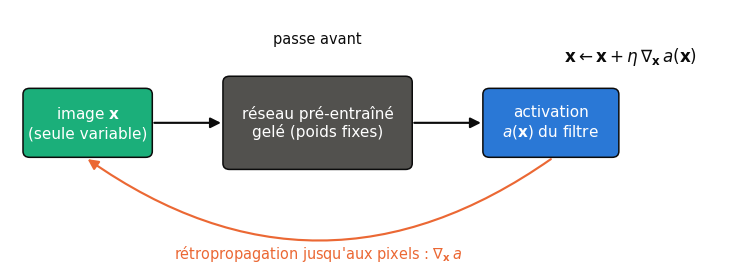
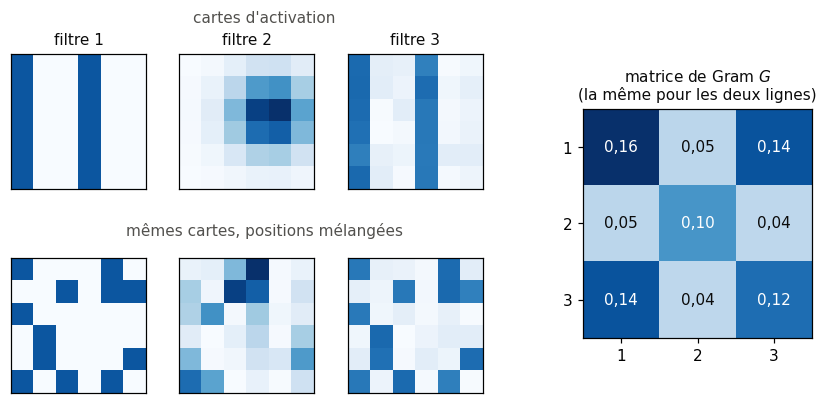
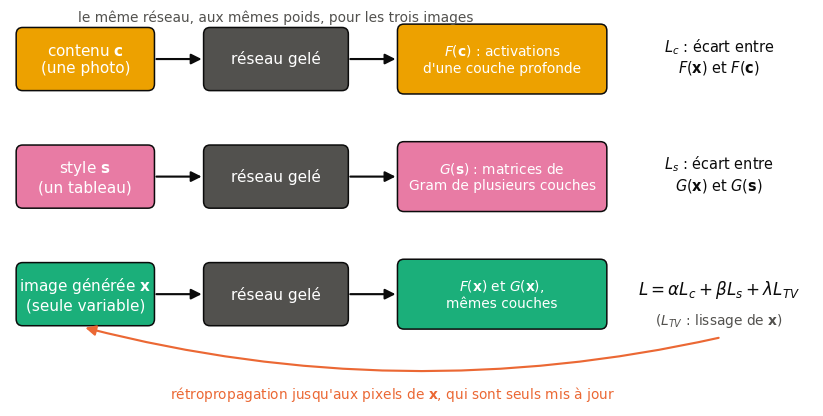
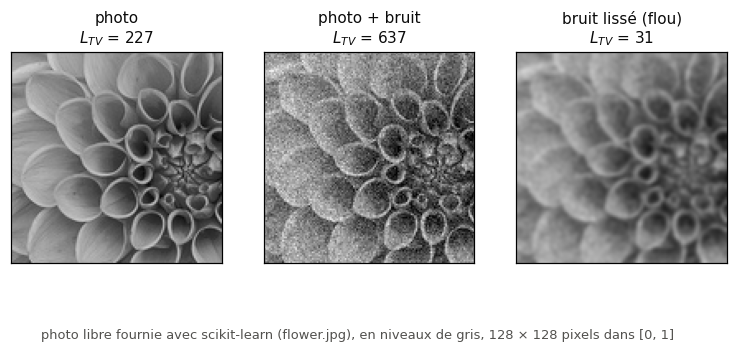
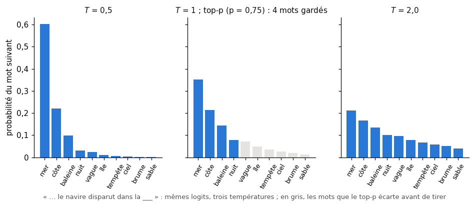

# 28 · Applications créatives — fiche de cours

> Depuis le ch. 16, on dérive la loss par rapport aux **poids** pour entraîner un réseau. Ce chapitre garde un réseau déjà entraîné, le **gèle**, et dérive par rapport à l'**image d'entrée**. Trois usages en découlent : voir ce qu'un filtre ou une couche cherche (la visualisation), faire « rêver » le réseau sur une photo (le **deep dream**), et repeindre une photo dans le style d'un tableau (le **transfert de style neuronal**), grâce aux **matrices de Gram**. Le livre termine par un clin d'œil : un LSTM qui écrit la suite du livre, mot à mot. La fiche y ajoute les formules que le livre ne donne pas (les losses, leur normalisation, le gradient de la loss de style), les outils de PyTorch qui rendent tout cela court (les *hooks*, `requires_grad` sur une image), les stratégies de décodage d'un texte, et ce qui a remplacé ces techniques : la diffusion, les adaptateurs de style, les modèles de langue. Elle parle aussi de droit d'auteur, car le livre utilise des œuvres qui ne sont pas toutes libres.

| | |
|---|---|
| **Livre** | vol. 2, ch. 28 « Creative Applications », p. 1603-1647 (§28.1 à §28.5) |
| **Temps total estimé** | ≈ 19 h : lecture du livre et de la fiche ≈ 3,4 h, exercices ≈ 15 h, 20 flashcards ≈ 0,7 h |
| **Prérequis** | 0B (produit matriciel, transposée) · ch. 5 (descente de gradient) · ch. 6 (cross-entropy, perplexité) · ch. 12 (normalisation des entrées) · ch. 18 (règle de la chaîne sur des sommes indexées) · ch. 20 (autograd, `requires_grad`, optimiseurs) · ch. 21 (VGG16, cartes d'activation, montée de gradient sur un petit CNN) · ch. 22 (LSTM, température, `sample_from_logits`) · ch. 23 (modèles pré-entraînés de torchvision) · ch. 24 (génération mot à mot sur Holmes, token inconnu) |
| **Fichiers du chapitre** | `02_exercices.md` (quiz, rappels, papier, réflexion, entretien) · `03_notebook.ipynb` · `04_indices.md` · `05_solutions.md` et `05_solutions.ipynb` · `06_mes_reponses.md` · `flashcards.csv` |
| **mylearn** | aucun module : la matrice de Gram et les losses tiennent en une ligne chacune ; tu les écris à la main (✏️ 28.2, 28.4) puis en PyTorch, vérifiées contre NumPy (📦 28.18) |

## Comment utiliser ce chapitre

Le chapitre du livre est court, très illustré et sans formule. Il donne l'intuition juste, mais il compte mal la taille d'ImageNet, décrit des losses qui, prises au mot, ne marcheraient pas (des différences additionnées sans carré), et présente comme un mystère ce qu'un article qu'il cite explique. Il utilise aussi comme références de style des œuvres encore protégées. Les encadrés ⚠️ corrigent ces points ; le notebook suit la pratique de PyTorch, sur CPU.

**Ordre conseillé.**
1. Lis le livre §28.1 à §28.2.3, puis les sections correspondantes de la fiche (avec les encadrés 🧮 sur les *hooks* et le gradient par rapport à l'image). Fais les quiz Q1 à Q3, le rappel R3 et l'exercice ✏️ 28.1.
2. Lis le livre §28.3 (le deep dream), puis la fiche. Fais les quiz Q4 et Q5 et l'entretien E1.
3. Lis le livre §28.4 à §28.4.2, puis la fiche (avec l'encadré 🧮 sur la matrice de Gram). Fais les quiz Q6 et Q7, les rappels R1 et R2, l'exercice ✏️ 28.2 et la preuve ∂ 28.3.
4. Lis le livre §28.4.3 à §28.4.6, puis la fiche (avec les encadrés 🧮 sur la norme de Frobenius et la variation totale). Fais les quiz Q8 et Q9, les exercices ✏️ 28.4, ∂ 28.5 et 🧮 28.6, l'explication 🗣️ 28.8, la réflexion ⚖️ 28.9 et la lecture 📄 28.10.
5. Lis le livre §28.5, puis la fin de la fiche (avec l'encadré 🧮 sur le top-k et le top-p). Fais le quiz Q10, l'estimation 🧮 28.7 et les entretiens E2 à E4.
6. Fais le notebook dans l'ordre des ID : la visualisation des filtres et des couches, le deep dream, le transfert de style (matrice de Gram, débogage, transfert complet, réglages, galerie documentée, défi), puis la génération de texte sur Verne.

| Section | Quiz 🧠 et rappels 🔁 | Papier ✏️ ∂ 🧮 et réflexion | Notebook | Entretien 💼 |
|---|---|---|---|---|
| 28.1 Pourquoi ce chapitre | Q1 | | 28.26 | E4 |
| 28.2 et 28.2.1 Visualiser, choisir un réseau | Q1, R3 | 28.1 | 28.11 | E1 |
| 28.2.2 Visualiser un filtre | Q2 | | 28.12, 28.13, 28.15 | E1 |
| 28.2.3 Visualiser une couche | Q3 | | 28.14, 28.15 | E1 |
| 28.3 Le deep dream | Q4, Q5 | | 28.16, 28.17 | E4 |
| 28.4 et 28.4.2 Le transfert de style, vue d'ensemble | Q6, R1, R2 | 28.9, 28.10 | 28.23 | E2 |
| 28.4.1 Le style dans une matrice | Q7 | 28.2, 28.3, 28.10 | 28.18 | E2 |
| 28.4.3 La loss de contenu | Q8 | 28.4 | 28.19, 28.22 | |
| 28.4.4 La loss de style | Q9 | 28.1, 28.4, 28.5 | 28.19, 28.22 | E2 |
| 28.4.5 Réaliser le transfert | Q9 | 28.4, 28.6 | 28.20, 28.21, 28.23, 28.24, 28.26, 28.29 | |
| 28.4.6 Discussion | Q7 | 28.3, 28.8, 28.9 | 28.24, 28.25 | E4 |
| 28.5 Générer la suite du livre | Q10 | 28.7 | 28.27, 28.28 | E3 |
| Au-delà : la génération aujourd'hui, le droit d'auteur | | 28.9 | 28.26 | E4 |

## Objectifs d'apprentissage

À la fin de ce chapitre, tu sais :
1. **Extraire** les activations de plusieurs couches d'un CNN pré-entraîné avec des *hooks*, et **prévoir** leurs formes.
2. **Visualiser** un filtre ou une couche par montée de gradient sur l'image d'entrée, et **régulariser** cette visualisation.
3. **Produire** une image deep dream en combinant plusieurs couches pondérées.
4. **Calculer** une matrice de Gram et les losses de contenu, de style et de variation totale, et **dériver** le gradient de la loss de style.
5. **Réaliser** un transfert de style neuronal sous contrainte de CPU et **régler** ses poids.
6. **Générer** du texte mot à mot et **comparer** les stratégies de décodage (glouton, température, top-k, top-p).
7. **Discuter** du droit d'auteur, du domaine public et du crédit dû aux œuvres utilisées ou produites.

## L'essentiel en 10 lignes

1. Tout le chapitre repose sur une idée : un réseau pré-entraîné **gelé** sert d'instrument de mesure, et l'on modifie les **pixels** de l'image d'entrée par descente ou montée de gradient ; les poids ne bougent jamais.
2. **Visualiser un filtre** : partir d'un bruit et faire monter l'activation moyenne (au carré) du filtre, $\mathbf{x} \leftarrow \mathbf{x} + \eta\,\nabla_{\mathbf{x}}\, a(\mathbf{x})$ ; pour une **couche**, on additionne les activations de tous ses filtres, éventuellement pondérées.
3. Les premières couches répondent à des traits, des couleurs, des textures fines ; les couches profondes, à des motifs organiques et à des parties d'objets : c'est la hiérarchie du ch. 21, rendue visible.
4. Le **deep dream** part d'une **photo** et fait monter une somme pondérée des activations de plusieurs couches : le réseau amplifie ce qu'il croit y voir, et l'on retrouve l'écho de ses données d'entraînement (des yeux, des chiens).
5. Le **transfert de style** cherche une image $\mathbf{x}$ qui a le contenu d'une photo $\mathbf{c}$ et le style d'un tableau $\mathbf{s}$ ; il **minimise** $L = \alpha L_c + \beta L_s + \lambda L_{TV}$.
6. La **loss de contenu** compare les activations de $\mathbf{x}$ et de $\mathbf{c}$ à une couche : précoce, elle impose presque les pixels ; profonde, seulement la structure.
7. Le style se résume par la **matrice de Gram** de chaque couche, $G = \frac{1}{CHW} F F^\top$ : $G_{ij}$ mesure à quel point les filtres $i$ et $j$ s'activent **ensemble**, quelle que soit leur position.
8. La **loss de style** additionne, sur plusieurs couches, les écarts au carré entre les matrices de Gram de $\mathbf{x}$ et de $\mathbf{s}$ ; la **variation totale** $L_{TV}$ lisse le bruit de pixel à pixel ; les poids $\alpha$, $\beta$, $\lambda$ se règlent à l'essai.
9. Pour le texte, un LSTM mot à mot donne une distribution sur le mot suivant ; le choix du plus probable (glouton) tourne en boucle, on **échantillonne** plutôt avec une température, un top-k ou un top-p.
10. Ces techniques sont historiques : la génération d'images passe aujourd'hui par la **diffusion**, guidée par du texte, des adaptateurs de style ou des contrôles ; mais le gradient par rapport à l'entrée et les losses perceptuelles servent toujours.

> 📐 **Conventions de la fiche** — L'image générée (celle que l'on optimise) est $\mathbf{x}$, l'image de contenu (l'« image de base » du livre) $\mathbf{c}$, la référence de style $\mathbf{s}$. À la couche $\ell$, l'activation $A^\ell$ a $C_\ell$ canaux (un par filtre) de $H_\ell \times W_\ell$ ; $F^\ell \in \mathbb{R}^{C_\ell \times H_\ell W_\ell}$ est la même activation, chaque carte mise à plat en une ligne. On omet l'indice $\ell$ quand une seule couche est en jeu. Les couches de VGG16 se nomment comme dans le livre : « bloc 3, conv 1 » est la première convolution du troisième bloc (`block3_conv1` dans Keras, `features[10]` dans torchvision). $\lVert M \rVert_F$ est la norme de Frobenius (encadré 🧮 du §28.4.4). Le livre n'écrit aucune formule.

---

## 28.1 · Pourquoi ce chapitre ?

Le livre se détend à la fin d'un long parcours : il propose d'utiliser des réseaux pour faire de l'art. Derrière le jeu, une leçon sérieuse : un réseau entraîné est une **fonction dérivable de son entrée**, et l'on peut s'en servir comme d'un critère à optimiser. Les mêmes calculs servent à comprendre un réseau (que détecte ce filtre ?), à le tromper (les exemples adversariaux du ch. 21) et à mesurer la ressemblance entre deux images (les losses perceptuelles, encore utilisées partout).

## 28.2 · Visualiser les filtres

Au ch. 21, tu as visualisé les filtres d'un petit CNN par montée de gradient. Le livre reprend la méthode plus en détail, sur un grand réseau, pour la transformer ensuite en outil de création.

### 28.2.1 · Choisir un réseau ⏩

Le livre prend **VGG16** (K. Simonyan et A. Zisserman, 2014), déjà rencontré au ch. 21 : cinq blocs de convolutions 3 × 3 (padding 1, la taille est gardée), de 2, 2, 3, 3 et 3 convolutions, à 64, 128, 256, 512 et 512 filtres ; chaque bloc se termine par un max-pooling 2 × 2 de pas 2, qui divise le côté par 2. Pour une entrée de 224 × 224 × 3, la première convolution sort 64 cartes de 224 × 224, la dernière 512 cartes de 14 × 14. Les couches denses de la fin ne servent à rien ici : on ne regarde pas les prédictions, seulement les activations. N'importe quel CNN entraîné ferait l'affaire ; le notebook prend, en mode rapide, **SqueezeNet 1.1** (F. Iandola et coll., 2016), un réseau de 1,2 million de paramètres et 5 Mo de poids, entraîné sur la même base.

> ⚠️ **Le livre, corrigé — la taille d'ImageNet** — Le livre dit VGG16 entraîné sur « environ un demi-million de photographies » d'ILSVRC-2014. Le jeu d'entraînement de la tâche de classification d'ILSVRC (le même de 2012 à 2014, dit aussi ImageNet-1k) compte environ **1,28 million** d'images, réparties en 1 000 classes, plus 50 000 images de validation et 100 000 de test (O. Russakovsky et coll., « ImageNet Large Scale Visual Recognition Challenge », IJCV 2015, [arXiv:1409.0575](https://arxiv.org/abs/1409.0575)). Les « 14 millions d'images » que l'on lit aussi désignent la base ImageNet complète, de plus de 21 000 catégories.

Pour récupérer les activations de plusieurs couches en une seule passe, PyTorch offre un mécanisme précis : les *hooks*.

> 🧮 **Rappel outil — les *hooks* de PyTorch** — Un *hook* est une fonction que l'on accroche à un module et que PyTorch appelle à chaque passe avant : `handle = module.register_forward_hook(fn)`, où `fn(module, inputs, output)` reçoit la sortie du module. Pour enregistrer les activations de plusieurs couches : un dictionnaire `acts = {}`, et pour chaque couche choisie `layer.register_forward_hook(lambda m, i, o, name=name: acts.__setitem__(name, o))` ; après `model(x)`, `acts["block3_conv1"]` contient le tenseur, **avec** son graphe de calcul (pas de `detach()` si l'on veut rétropropager). `handle.remove()` décroche le hook : oublier de le faire en relançant une cellule empile les hooks. Deux pièges : les ReLU de torchvision sont créées avec `inplace=True`, et la sortie d'une convolution peut alors être écrasée par la ReLU qui suit (accrocher le hook à la ReLU, ou remplacer les ReLU par `nn.ReLU(inplace=False)`) ; et une passe complète calcule aussi les couches inutiles (on peut couper le réseau après la dernière couche utile, `model.features[:k]`). `torchvision.models.feature_extraction.create_feature_extractor` fait la même chose sans hooks, en réécrivant le graphe.

> 🕰️ **Mise à jour (2026) — charger un réseau pré-entraîné** — **Le livre :** `keras.applications.VGG16(weights='imagenet')`. · **Aujourd'hui :** en PyTorch, `torchvision.models.vgg16(weights=VGG16_Weights.IMAGENET1K_V1)` (ou `weights="DEFAULT"`) ; l'argument `pretrained=True` est déprécié depuis torchvision 0.13 ; `weights.transforms()` donne le prétraitement attendu, dont la normalisation de chaque canal par la moyenne $(0{,}485 ; 0{,}456 ; 0{,}406)$ et l'écart-type $(0{,}229 ; 0{,}224 ; 0{,}225)$ d'ImageNet. Le fichier des poids de VGG16 pèse 553 Mo (528 Mio), dont 90 % pour ses trois couches denses, inutiles ici. Il est dépassé en classification (ResNet, ConvNeXt, ViT), mais reste l'un des réseaux des losses perceptuelles, dont LPIPS (sa variante VGG est celle que ses auteurs recommandent pour optimiser une image). · **Faut-il quand même l'apprendre ?** Oui : charger des poids, retrouver leur prétraitement et geler le réseau sont les gestes de tout transfer learning (bonus B1). · *Source :* [documentation de torchvision, *Models and pre-trained weights*](https://docs.pytorch.org/vision/stable/models.html) ; R. Zhang et coll., « The Unreasonable Effectiveness of Deep Features as a Perceptual Metric », CVPR 2018, [arXiv:1801.03924](https://arxiv.org/abs/1801.03924).

### 28.2.2 · Visualiser un filtre ⏩

On choisit un **filtre cible**, par exemple le filtre 17 de la première convolution du bloc 2. On part d'une image de bruit uniforme (le livre tire chaque valeur entre −1 et 1), on la passe dans le réseau, et l'on résume la réponse du filtre par un seul nombre, son **activation** : la somme de sa carte, ou mieux, la moyenne de ses carrés,
$$a(\mathbf{x}) = \frac{1}{HW}\sum_{h, w} A_{c, h, w}(\mathbf{x})^2 .$$
Plus le filtre trouve son motif à de nombreux endroits, plus $a$ est grand. Le livre justifie le carré par le besoin d'additionner des nombres positifs ; mais après la ReLU d'une convolution, les activations le sont déjà. Le carré change l'objectif : il favorise quelques réponses très fortes plutôt que beaucoup de réponses moyennes (la moyenne simple marche aussi, et c'est ce que fait le code de visualisation de Chollet). On rétropropage alors **jusqu'aux pixels**, sans toucher aux poids, et l'on fait un pas de **montée de gradient** :
$$\mathbf{x} \leftarrow \mathbf{x} + \eta\, \nabla_{\mathbf{x}}\, a(\mathbf{x}).$$
Après quelques centaines de pas, l'image montre « ce que cherche » le filtre.

> 🧮 **Rappel outil — dériver par rapport à une image en PyTorch** — L'image devient le paramètre : `x = torch.rand(1, 3, H, W, requires_grad=True)` (ou `x = img.clone().requires_grad_(True)`), et l'optimiseur ne reçoit qu'elle, `torch.optim.Adam([x], lr=0.05)`. Le réseau est gelé (`for p in model.parameters(): p.requires_grad_(False)`) et en mode `model.eval()` (les batchnorms et le dropout se comportent comme à l'inférence). Pour une montée, on **minimise l'opposé** : `loss = -a`, puis `opt.zero_grad()`, `loss.backward()`, `opt.step()`. Deux détails comptent. (1) Le réseau attend des images **normalisées** comme pendant son entraînement : on optimise l'image en $[0, 1]$ et l'on normalise dans la passe avant, `model((x - mean) / std)`. (2) Les pixels doivent rester dans la plage valide : après chaque pas, `with torch.no_grad(): x.clamp_(0, 1)`. Le livre normalise aussi le gradient par sa valeur absolue moyenne, une astuce qui rend le pas indépendant de l'échelle de l'activation (Adam le fait de lui-même, à sa façon).

> ⚠️ **Le livre, corrigé — l'« erreur » qu'on maximise** — Le livre garde les mots « erreur » et « loss » pour l'activation qu'il veut rendre **grande**, et décrit une rétropropagation « sans l'étape de mise à jour ». Les deux sont trompeurs dans un code PyTorch : il y a bien une mise à jour, celle des **pixels**, par un optimiseur ; et un optimiseur minimise toujours. On écrit donc la montée comme la descente de $-a(\mathbf{x})$, et l'on garde le nom « loss » pour la quantité que l'optimiseur fait **baisser**.

Sans précaution, l'image obtenue est un bruit de haute fréquence, à peine lisible : le gradient trouve plus facilement des motifs de quelques pixels, que l'œil ne voit pas, qu'une forme cohérente. Les visualisations réussies **régularisent** : elles décalent l'image au hasard de quelques pixels à chaque pas (*jitter*), la floutent légèrement, pénalisent la variation totale, ou travaillent à plusieurs échelles (des **octaves** : on optimise une petite image, on l'agrandit, et l'on continue).

> 🕰️ **Mise à jour (2026) — visualiser ce qu'un réseau a appris** — **Le livre :** la montée de gradient brute, sur un bruit. · **Aujourd'hui :** les visualisations de référence combinent montée de gradient et régularisations soignées (transformations aléatoires, paramétrage de l'image dans l'espace de Fourier, octaves) ; C. Olah, A. Mordvintsev et L. Schubert en font le tour dans Distill (2017). Pour **expliquer une décision**, on préfère les cartes d'attribution comme Grad-CAM (bonus B6) ; l'interprétabilité mécaniste cherche, elle, les circuits que forment les neurones. · **Faut-il quand même l'apprendre ?** Oui : c'est le premier outil pour regarder dans un CNN, et le même gradient par rapport à l'entrée sert aux exemples adversariaux et aux cartes de saillance. · *Source :* C. Olah, A. Mordvintsev, L. Schubert, « Feature Visualization », [Distill, 2017](https://distill.pub/2017/feature-visualization/).

### 28.2.3 · Visualiser une couche

Pour voir ce que cherche une couche entière, on additionne les activations de **tous** ses filtres, puis on fait la même montée de gradient. Le livre montre une image par couche de VGG16 (sa fig. 28.7) : rayures et couleurs dans le bloc 1, textures dans les blocs 2 et 3, puis des cercles concentriques, des spirales, des morceaux de tubes dans le bloc 4, et des motifs plus organiques ensuite. Comme on part d'un bruit, chaque essai donne une image différente, mais du même genre (🎨 28.14).

On peut aussi **pondérer** les filtres : multiplier l'activation de chacun par un poids avant de les additionner, pour privilégier certains motifs ; un poids négatif cherche au contraire une image qui **éteint** le filtre.

> ⚠️ **Le livre, corrigé — des filtres ou des couches ?** — Après la fig. 28.7, le livre parle des « deuxième et troisième filtres du bloc 4 », qui montrent des cercles et des tubes. La figure montre des **couches** entières : il s'agit des couches bloc 4, conv 2 et bloc 4, conv 3, dont chacune compte 512 filtres.

## 28.3 · Le deep dream

Le **deep dream** (*inceptionism*, A. Mordvintsev, C. Olah et M. Tyka, billet du blog de Google Research, juin 2015 ; le nom vient du réseau utilisé, GoogLeNet, dit aussi Inception) change deux choses à la visualisation d'une couche : il part d'une **photo**, et il fait monter une somme **pondérée** des activations de **plusieurs** couches,
$$L_{\text{dream}}(\mathbf{x}) = \sum_\ell w_\ell\, \frac{\lVert A^\ell(\mathbf{x}) \rVert^2}{C_\ell H_\ell W_\ell}.$$
Les poids $w_\ell$ sont des hyperparamètres, choisis à l'essai. Partout où la photo ressemble un peu à un motif qu'une de ces couches détecte, le gradient renforce la ressemblance : le réseau amplifie ce qu'il croit voir. Avec des couches précoces, la photo se couvre de traits et de textures ; avec des couches profondes, des yeux, des museaux, des pattes apparaissent dans les nuages et les feuillages.

> ⚠️ **Le livre, corrigé — la numérotation et les renvois** — La section du deep dream est imprimée « 23.3 », dans le texte comme dans la table des matières. C'est la section 28.3. Deux renvois sont faux aussi : VGG16 et son chargement ne sont pas au « ch. 24 » mais aux §21.9.1 (l'architecture) et §23.9.4 (les modèles pré-entraînés) ; la génération de texte mot à mot n'est pas au « ch. 22 », qui travaille par caractères, mais au §24.5.11.

La version de Google ajoute des ingrédients que le livre ne détaille pas : un gradient **normalisé** à chaque pas, des décalages aléatoires (le *jitter* du §28.2.2), et surtout des **octaves** : on rêve d'abord sur une version réduite de la photo, on agrandit le résultat, on y réinjecte les détails perdus à la réduction, et l'on continue. Les grandes structures naissent à petite échelle, les détails à grande échelle. On peut aussi **masquer** : multiplier le gradient par un masque avant la mise à jour, pour ne rêver que dans une zone (le ciel, pas le visage), ou appliquer des couches différentes à des régions différentes (🔬 28.17).

Pourquoi tant d'yeux et de chiens ? Parce qu'un réseau ne rêve que de ce qu'il a appris. ImageNet-1k contient beaucoup d'animaux, et plus d'une centaine de ses 1 000 classes sont des races de chiens : le réseau a développé de nombreux détecteurs d'yeux, de truffes et de fourrure. Un réseau entraîné sur des fournitures de bureau ferait surgir des agrafeuses. Ces « hallucinations » sont une leçon d'interprétation : ce qu'un réseau voit dans une image dit autant sur ses données que sur l'image.

## 28.4 · Le transfert de style ⏩

Le **transfert de style neuronal** (L. Gatys, A. Ecker et M. Bethge, 2015) part de deux images : une photo $\mathbf{c}$, dont on veut garder le **contenu** (le livre l'appelle l'« image de base »), et un tableau $\mathbf{s}$, la **référence de style**. Il fabrique une troisième image $\mathbf{x}$, l'**image générée**, qui montre le contenu de la photo peint « à la manière » du tableau. Ce n'est pas un mélange de pixels (la moyenne des deux images donnerait une superposition en transparence, comme la moyenne de deux chiffres MNIST au ch. 25) : on mélange des **représentations**, la structure d'une image et des statistiques de l'autre.

Le style, au sens où on l'entend ici, se limite à l'apparence : des couleurs, des textures, des formes de touches et de traits, et la façon dont elles se répartissent sur la toile. L'idée de Gatys est que ces statistiques se lisent dans les activations d'un CNN, à condition de les résumer d'une certaine façon : par des matrices de Gram.

### 28.4.1 · Le style dans une matrice ⏩

On prend une couche de $C$ filtres et ses cartes de $H \times W$. Pour chaque **paire** de filtres $(i, j)$, on multiplie leurs cartes case par case et l'on additionne : le nombre obtenu est grand si les deux filtres s'activent fortement **aux mêmes endroits**. Rangés dans un tableau $C \times C$, ces nombres forment la **matrice de Gram** de la couche. Avec les cartes mises à plat en lignes ($F \in \mathbb{R}^{C \times HW}$), c'est un simple produit matriciel :
$$G_{ij} = \frac{1}{CHW}\sum_{k=1}^{HW} F_{ik}\, F_{jk}, \qquad G = \frac{1}{CHW}\, F F^\top .$$
Exemple : deux filtres, deux positions, $F = \begin{pmatrix} 3 & 1 \\ 0 & 2 \end{pmatrix}$. Alors $F F^\top = \begin{pmatrix} 10 & 2 \\ 2 & 4 \end{pmatrix}$ et, avec $CHW = 4$, $G = \begin{pmatrix} 2{,}5 & 0{,}5 \\ 0{,}5 & 1 \end{pmatrix}$ : les filtres 1 et 2 ne s'activent ensemble qu'à la seconde position, d'où un petit $G_{12}$.

Ce que la matrice de Gram **garde** : pour chaque filtre, l'énergie de ses activations (la diagonale $G_{ii}$, proportionnelle à la moyenne de ses carrés), et pour chaque paire, leur tendance à s'allumer ensemble. Ce qu'elle **oublie** : **où** cela se passe. La somme porte sur toutes les positions, et mélanger les positions (de la même façon pour tous les filtres) ne change rien (∂ 28.3). C'est exactement ce qu'on attend d'une description du style : des coups de pinceau courts et colorés, partout sur la toile, quelle que soit la scène.

> 🧮 **Rappel maths — matrice de Gram, symétrie et taille** — Pour des vecteurs $\mathbf{f}_1, \dots, \mathbf{f}_C$ (les lignes de $F$), la matrice de Gram rassemble tous leurs produits scalaires, $(F F^\top)_{ij} = \mathbf{f}_i \cdot \mathbf{f}_j$. Elle est **symétrique** ($\mathbf{f}_i \cdot \mathbf{f}_j = \mathbf{f}_j \cdot \mathbf{f}_i$) et sa diagonale est positive ou nulle ($\mathbf{f}_i \cdot \mathbf{f}_i = \lVert \mathbf{f}_i \rVert^2$). Sa taille, $C \times C$, ne dépend que du **nombre de filtres**, pas de la taille de l'image : on peut comparer les matrices de Gram d'une photo et d'un tableau de tailles différentes. Divisée par les normes, elle donne la similarité cosinus des filtres, $\frac{G_{ij}}{\sqrt{G_{ii}\,G_{jj}}} \in [-1, 1]$ (positive ici, car les activations, après une ReLU, sont positives ou nulles). En PyTorch : `F = A.reshape(C, H * W)` puis `G = F @ F.T / (C * H * W)`, ou `torch.einsum("chw,dhw->cd", A, A) / A.numel()` (📦 28.18).

> ⚠️ **Le livre, corrigé — ce qui entre dans la matrice** — Le livre construit la matrice en parcourant « les paires de cartes 0 et 1, 0 et 2… jusqu'à 4 et 5 », puis place la valeur de ses exemples en $(1, 2)$ : il mélange une numérotation à partir de 0 et une à partir de 1, et sa liste oublie la **diagonale**, chaque carte avec elle-même, qui fait partie de la matrice et porte l'énergie de chaque filtre. Ses exemples (une valeur de 10,90 pour deux cartes de 8 × 8) ne sont pas normalisés : sans division par $CHW$, un coefficient croît avec la taille des cartes, et la loss de style change d'échelle d'une couche à l'autre (✏️ 28.4, 🐛 28.21).

### 28.4.2 · Vue d'ensemble ⏩

Comme pour la visualisation, on part d'un bruit (ou de la photo) et l'on modifie les pixels de $\mathbf{x}$ par gradient ; mais cette fois on **minimise**. Les cibles se calculent une fois pour toutes, avant la boucle : les activations de $\mathbf{c}$ aux couches de contenu, les matrices de Gram de $\mathbf{s}$ aux couches de style. À chaque pas, une seule image passe dans le réseau, $\mathbf{x}$, et l'on calcule
$$L(\mathbf{x}) = \alpha\, L_c(\mathbf{x}) + \beta\, L_s(\mathbf{x}) + \lambda\, L_{TV}(\mathbf{x}),$$
un compromis entre ressembler à la photo par le contenu, au tableau par le style, et rester lisse.

Le réseau joue ici le rôle du discriminateur d'un GAN (ch. 27) : une fonction dérivable qui dit « à quel point l'image est bonne », et dont le gradient guide ce qu'on optimise. Mais il est **gelé** et fixé à l'avance, et ce qu'on optimise est une image, pas un générateur. Une loss calculée sur les activations d'un réseau pré-entraîné plutôt que sur les pixels s'appelle une **loss perceptuelle**.

### 28.4.3 · La loss de contenu

La loss de contenu compare, case par case, les activations de $\mathbf{x}$ et de $\mathbf{c}$ à une ou plusieurs couches $\mathcal{C}$ :
$$L_c(\mathbf{x}) = \sum_{\ell \in \mathcal{C}} \bigl\lVert F^\ell(\mathbf{x}) - F^\ell(\mathbf{c}) \bigr\rVert^2 .$$
Pour voir ce qu'une couche retient, le livre reconstruit la photo à partir d'un bruit avec la loss de contenu d'une **seule** couche (sa fig. 28.19). Avec une couche précoce, on retrouve la photo presque au pixel près ; plus la couche est profonde, plus la reconstruction perd les couleurs et les détails fins, et ne garde que la disposition et les formes. C'est ce qui rend une couche **profonde** intéressante pour le transfert : elle fixe la structure et laisse les textures libres pour le style.

> ⚠️ **Le livre, corrigé — des différences, au carré** — Le livre décrit la loss de contenu comme « la somme de toutes ces différences », et de même pour la loss de style. Prises au mot, des différences signées se compensent : une activation trop forte ici et trop faible là donneraient une loss nulle. Toutes les implémentations, dont celles qu'il cite, additionnent des **carrés** de différences ; en PyTorch, `F.mse_loss` en prend la **moyenne**, ce qui divise la loss par le nombre de valeurs (✏️ 28.4).

> ⚠️ **Le livre, corrigé — quelle couche pour le contenu ?** — Pour ses images finales, le livre prend la loss de contenu sur la **deuxième convolution du bloc 1**. Gatys et coll. prennent une couche profonde, `conv4_2` de VGG19, et le code de F. Chollet qu'il dit adapter (sur VGG19, lui aussi), `block5_conv2`. Une couche si précoce impose presque les pixels de la photo : le style ne peut alors passer que par un poids $\beta$ très fort (le livre lui donne 40 fois celui du contenu), et les deux réglages ne se comparent pas (🔬 28.24).

### 28.4.4 · La loss de style ⏩

On passe d'abord la référence de style dans le réseau et l'on garde la matrice de Gram de chaque couche de style $\mathcal{S}$. À chaque pas, on calcule les matrices de Gram de $\mathbf{x}$ aux mêmes couches, et l'on additionne les écarts au carré, couche par couche, avec un poids $w_\ell$ par couche :
$$L_s(\mathbf{x}) = \sum_{\ell \in \mathcal{S}} w_\ell\, \bigl\lVert G^\ell(\mathbf{x}) - G^\ell(\mathbf{s}) \bigr\rVert_F^2 .$$
Reconstruire depuis un bruit avec le style d'une seule couche (fig. 28.23 du livre) donne des textures sans aucune scène : des taches de couleur au bloc 1, des aplats cernés de noir et des touches au bloc 3, qui ressemblent le plus au tableau ; les blocs 4 et 5 ajoutent peu. En additionnant les couches jusqu'à une profondeur donnée (fig. 28.24), les textures gagnent en échelle : chaque couche capte des motifs de la taille de son champ récepteur. Gatys et coll. prennent la première convolution de chacun des cinq blocs, avec le même poids $w_\ell = \frac{1}{5}$.

> 🧮 **Rappel maths — la norme de Frobenius et son gradient** — La **norme de Frobenius** d'une matrice est la norme euclidienne de tous ses coefficients mis bout à bout : $\lVert M \rVert_F^2 = \sum_{i,j} M_{ij}^2$ ; c'est aussi $\operatorname{Tr}(M^\top M)$. La loss de style est donc une somme de carrés, comme une MSE non moyennée. Son gradient par rapport aux activations se calcule avec la règle de la chaîne sur des sommes indexées (ch. 18) : pour $S$ symétrique, $\frac{\partial}{\partial F}\lVert F F^\top - S \rVert_F^2 = 4\,(F F^\top - S)\, F$ (∂ 28.5). Deux lectures de cette formule : le gradient est nul quand les matrices de Gram coïncident, et il est **proportionnel à $F$** : une couche entièrement éteinte ne reçoit aucun gradient de style. Autograd fait ce calcul pour toi ; le dériver une fois montre pourquoi l'on part d'un bruit ou de la photo, qui allument beaucoup de filtres, plutôt que d'une image uniforme, sur laquelle les détecteurs de bords et de textures restent éteints.

Les échelles des couches diffèrent beaucoup : une matrice de Gram de 512 × 512 au bloc 4 contre 64 × 64 au bloc 1, et des activations de tailles différentes. La normalisation par $CHW$ dans $G$ (ou le facteur $\frac{1}{4 C^2 (HW)^2}$ de l'article de Gatys, qui revient au même à un facteur 4 près) évite qu'une couche écrase les autres, et les poids $w_\ell$ affinent le dosage.

### 28.4.5 · Réaliser le transfert ⏩

On a tous les morceaux. Le livre prend VGG16, la loss de contenu sur la couche bloc 1, conv 2, la loss de style sur **toutes** les couches de convolution, et les poids $\alpha = 0{,}025$ pour le contenu, $\beta = 1$ pour le style (40 fois plus), avec une troisième loss, la **variation totale**, de poids $\lambda \approx 10^{-4}$, qui atténue le bruit de pixel à pixel. Il part d'un bruit, réduit chaque image à 224 × 224, et obtient des grenouilles peintes à la manière de neuf tableaux : la palette passe, mais aussi les touches, les contours et les aplats.

> 🧮 **Rappel maths — la variation totale** — Pour une image d'un canal $x_{i,j}$, la variation totale additionne les carrés des écarts entre pixels voisins, horizontalement et verticalement :
> $$L_{TV}(\mathbf{x}) = \sum_{i,j} (x_{i+1,j} - x_{i,j})^2 + (x_{i,j+1} - x_{i,j})^2 ,$$
> chaque somme portant sur les paires de pixels qui existent (on additionne aussi sur les canaux d'une image couleur). Une image lisse a une petite variation totale ; un bruit de haute fréquence, une grande. La minimiser **lisse** l'image, comme un flou, mais en gardant mieux les contours nets si l'on prend la norme du gradient plutôt que son carré, $\sum \lVert \nabla x \rVert$ (la variation totale de L. Rudin, S. Osher et E. Fatemi, 1992, en débruitage). Le code de Chollet, que le livre adapte, élève chaque terme $(\Delta_v^2 + \Delta_h^2)$ à la puissance 1,25 ; la variation totale ne figure pas dans l'article de Gatys, elle vient des implémentations qui ont suivi, dont celle de Johnson et coll. (2016). En PyTorch : `((x[..., 1:, :] - x[..., :-1, :]) ** 2).sum() + ((x[..., :, 1:] - x[..., :, :-1]) ** 2).sum()`.

Quatre remarques pratiques, que le livre laisse de côté.

- **Les poids ne se recopient pas.** Le bon rapport $\alpha / \beta$ dépend de la normalisation des matrices de Gram, du nombre de couches, de la moyenne ou de la somme dans chaque loss, et de l'échelle des pixels : un code qui divise par $CHW$ et un autre qui ne le fait pas diffèrent de plusieurs ordres de grandeur. Le livre le dit à sa façon : ses paramètres ont été trouvés « par essais et erreurs ». Pour la même raison, dire que le style a « 40 fois plus d'influence » que le contenu parce que $\beta / \alpha = 40$ n'a pas de sens : l'influence dépend aussi de l'échelle de chaque loss. Le bon réflexe est de suivre, au début, la **valeur** de chaque terme pondéré, et de les équilibrer (📈 28.20).
- **La taille de l'image.** Le livre réduit chaque image à 224 × 224, puis agrandit le résultat. Sans ses couches denses, un CNN accepte n'importe quelle taille : on garde les proportions de la photo (en réduisant seulement le grand côté, pour le temps de calcul), sinon l'image est déformée puis floutée.
- **Le point de départ compte.** Le livre dit que toutes ses images partent d'un bruit ; les deux codes qu'il cite partent par défaut de la photo de contenu. Partir de la photo de contenu (ou d'un mélange de la photo et d'un bruit) converge en beaucoup moins de pas qu'un bruit et garde mieux la scène ; partir d'un bruit donne des résultats plus libres, différents à chaque essai.
- **L'optimiseur.** Gatys et coll. (dans la version CVPR 2016 de leur article) et le code de Chollet utilisent L-BFGS, une méthode de quasi-Newton, sur l'image entière ; Adam, avec un learning rate de l'ordre de 0,01 à 0,05 pour des pixels dans $[0, 1]$, marche bien aussi et se règle plus simplement (le notebook l'utilise).

Sur CPU, le coût est réel : chaque pas fait une passe avant et une rétropropagation complètes dans le réseau, et il en faut quelques centaines (🧮 28.6). Le notebook travaille donc en mode rapide avec SqueezeNet sur des images de 128 à 192 pixels de côté, et réserve VGG16 et les grandes images au mode complet 🚀.

> ⚠️ **Le livre, corrigé — des tableaux qui ne sont pas libres** — Le livre les dit toutes « du domaine public » dans ses crédits. Or, parmi les neuf références de style de la fig. 28.26 figurent deux œuvres de **Picasso** (mort en 1973) et *Nighthawks* de **Hopper** (mort en 1967). Dans l'Union européenne, une œuvre entre dans le domaine public le 1ᵉʳ janvier qui suit les 70 ans de la mort de son auteur : Picasso y est protégé jusqu'à la fin de 2043, et Hopper, en principe, jusqu'à la fin de 2037 ; le statut de *Nighthawks* (1942) est discuté (aux États-Unis, ses droits n'auraient pas été renouvelés, et dans l'Union une œuvre américaine n'est en général pas protégée plus longtemps que dans son pays d'origine) : dans le doute, on la traite comme protégée. Munch et Kandinsky (morts en 1944) n'y sont libres que depuis 2015 ; Van Gogh, Turner et Monet le sont depuis longtemps (le Turner, au passage, s'intitule pour son musée, la fondation Gulbenkian de Lisbonne, *Le Naufrage d'un navire de transport*, vers 1810 ; *Le Naufrage du Minotaure* est un ancien titre d'usage, tiré d'un rapprochement aujourd'hui écarté avec le naufrage du HMS *Minotaur*). Les reproduire dans un livre ou s'en servir pour fabriquer des images demande une autorisation, ou une exception (citation, recherche) selon le pays. Le notebook n'utilise que des œuvres du domaine public et des photos libres, avec leurs crédits (⚖️ 28.9, 🛠️ 28.26).

### 28.4.6 · Discussion ⏩

L'algorithme de Gatys a eu une descendance nombreuse : contrôle des couleurs et de l'échelle des touches, transfert sur des zones choisies, vidéo sans scintillement d'une image à l'autre, images sphériques (Y. Jing et coll. en ont fait la revue en 2017, M. Ruder et coll. l'ont adapté à la vidéo). Mais il reste lent : des centaines de pas d'optimisation pour **chaque** image.

> 🕰️ **Mise à jour (2026) — le transfert de style rapide** — **Le livre :** l'optimisation des pixels, image par image (Gatys). · **Aujourd'hui :** dès 2016, J. Johnson, A. Alahi et L. Fei-Fei entraînent **une fois** un réseau qui transforme n'importe quelle photo dans **un** style donné, en une seule passe avant, avec les mêmes losses perceptuelles : trois ordres de grandeur plus rapide. En 2017, X. Huang et S. Belongie (AdaIN) traitent **n'importe quel** style en temps réel : ils alignent, canal par canal, la **moyenne** et l'**écart-type** des activations du contenu sur ceux du style, puis un décodeur, entraîné une fois, en refait une image (🔬 28.25). · **Faut-il quand même l'apprendre ?** Oui : la méthode de Gatys est la plus simple pour comprendre ce que les losses mesurent, et ses losses perceptuelles servent encore à entraîner ces réseaux rapides. · *Source :* J. Johnson et coll., « Perceptual Losses for Real-Time Style Transfer and Super-Resolution », ECCV 2016, [arXiv:1603.08155](https://arxiv.org/abs/1603.08155) ; X. Huang, S. Belongie, « Arbitrary Style Transfer in Real-time with Adaptive Instance Normalization », ICCV 2017, [arXiv:1703.06868](https://arxiv.org/abs/1703.06868).

Reste la question de fond : **pourquoi** la matrice de Gram capture-t-elle le style ? Le livre propose une intuition (un style serait l'usage répété de deux façons de structurer l'image, que l'on repère quand deux filtres s'allument ensemble) et suggère d'aller plus loin avec des tableaux à trois ou quatre filtres.

> ⚠️ **Le livre, corrigé — « personne ne sait vraiment »** — Le livre affirme que personne ne sait pourquoi les matrices de Gram capturent le style, et qu'aucun des deux articles de Gatys ne dit d'où vient l'idée. Elle vient de leur modèle de **textures** de la même année (L. Gatys, A. Ecker, M. Bethge, « Texture Synthesis Using Convolutional Neural Networks », NeurIPS 2015, [arXiv:1505.07376](https://arxiv.org/abs/1505.07376)), qui prolonge les modèles de textures par statistiques résumées (J. Portilla et E. Simoncelli, 2000), et l'article de 2015 le dit. Le livre cite aussi Y. Li et coll. (2017). Cet article dit précisément le contraire de « on ne sait pas » : il montre qu'égaler les matrices de Gram revient à minimiser une distance entre les **distributions** des features des deux images, une MMD (*maximum mean discrepancy*) avec un noyau polynomial du second degré, où chaque position de la carte est un échantillon. Le style est alors vu comme une distribution de features, et d'autres choix de noyau, ou le simple alignement des moyennes et des écarts-types des canaux, marchent aussi (Y. Li, N. Wang, J. Liu, X. Hou, « Demystifying Neural Style Transfer », IJCAI 2017, [arXiv:1701.01036](https://arxiv.org/abs/1701.01036)). Ce que l'on ignore encore, c'est pourquoi ces statistiques coïncident aussi bien avec ce que **nous** appelons un style. Quant aux tableaux à trois filtres, ce sont des statistiques d'ordre 3 : elles existent, mais leur taille ($C^3$, plus de 134 millions de coefficients pour 512 filtres) les rend peu pratiques.

## 28.5 · Générer la suite du livre

Pour finir, l'auteur fait écrire un réseau : deux couches de LSTM de 128 cellules (ch. 22), entraînées sur le texte du livre, environ 427 000 mots pour un vocabulaire d'environ 10 300 mots. Le modèle est **mot à mot** : son entrée est une suite de mots (des indices, souvent passés dans un embedding, ch. 24), sa sortie une distribution de probabilité sur tout le vocabulaire, par une couche dense suivie d'une softmax. Un tel modèle ne peut pas inventer de mot : il ne fait que choisir parmi ceux qu'il connaît, et les mots rares se regroupent souvent sous un token inconnu `<unk>`. Le livre choisit chaque fois le mot **le plus probable**, compare le procédé aux suggestions d'un clavier de téléphone, et cite des phrases tirées de ses sorties, presque sensées.

> ⚠️ **Le livre, corrigé — itérations ou epochs ?** — Le livre présente ses meilleures phrases comme obtenues « après 250 itérations » et ses premiers fragments « après seulement 10 epochs ». Avec 427 000 mots, une epoch compte des milliers de mini-batchs : 250 itérations (des pas de gradient) feraient moins d'une epoch, donc **avant** les 10 epochs des fragments. Il faut sans doute lire 250 epochs. Quant aux phrases, elles ont été **choisies à la main** parmi les sorties : elles disent ce dont le modèle est capable au mieux, pas ce qu'il produit en moyenne.

> ⚠️ **Le livre, corrigé — le mot le plus probable** — Choisir à chaque pas le mot le plus probable (le décodage **glouton**) est **déterministe** : un même début donne toujours la même suite, et en pratique cette suite tombe vite dans une boucle (« de la de la de la », ou une phrase entière qui revient). Pour obtenir des sorties variées comme celles que cite le livre, il faut **échantillonner** : tirer le mot suivant au hasard, selon les probabilités du modèle, éventuellement modifiées par une température (ch. 22). C'est ce que font les exemples de génération de texte de Keras, et ce que le livre lui-même faisait au §24.5.11, où il montrait que le mot le plus probable donne beaucoup de répétitions.

> 🧮 **Rappel maths — température, top-k et top-p** — Le modèle rend des logits $z_i$ ; la **température** $T$ les divise avant la softmax, $p_i = \frac{e^{z_i / T}}{\sum_j e^{z_j / T}}$ : $T < 1$ accentue les écarts (jusqu'au glouton quand $T \to 0$), $T > 1$ les aplatit (jusqu'à l'uniforme). Le **top-k** ne garde que les $k$ mots les plus probables, renormalise, puis tire. Le **top-p** (*nucleus sampling*, A. Holtzman et coll.) garde le plus petit ensemble des mots les plus probables dont la probabilité cumulée atteint $p$ : quand le modèle hésite, l'ensemble est grand ; quand il est sûr, il se réduit à un ou deux mots. Exemple : des probabilités triées $(0{,}5 ; 0{,}2 ; 0{,}15 ; 0{,}1 ; 0{,}05)$ avec $p = 0{,}8$ gardent les trois premiers mots (cumul $0{,}85$), renormalisés en $(0{,}588 ; 0{,}235 ; 0{,}176)$. La qualité d'un modèle se mesure, elle, sans décodage, par la **perplexité** $e^{L_{CE}}$ (ch. 6) : le nombre de mots entre lesquels il « hésite » en moyenne ; un modèle uniforme sur 10 300 mots a une perplexité de 10 300.

> 🕰️ **Mise à jour (2026) — générer du texte** — **Le livre :** un LSTM mot à mot, et le mot le plus probable. · **Aujourd'hui :** les modèles de langue sont des **Transformers** (bonus B2 à B4), entraînés sur des milliers de milliards de tokens découpés en **sous-mots** (BPE et ses variantes : un mot rare se découpe en morceaux connus, et le problème du mot inconnu disparaît). Pour un texte libre, on échantillonne avec une température et un top-p ; Holtzman et coll. montrent que le décodage glouton et la recherche en faisceau produisent des textes répétitifs et fades, alors que le texte humain n'est presque jamais la suite la plus probable. Pour une tâche à réponse unique, on règle au contraire la température près de 0. · **Faut-il quand même l'apprendre ?** Oui : ces réglages sont ceux de la plupart des API de modèle de langue (`temperature`, `top_p`, et `top_k` chez certaines ; les modèles de raisonnement en fixent souvent la valeur), et le LSTM mot à mot est le plus petit modèle où l'on voit leurs effets. · *Source :* A. Holtzman et coll., « The Curious Case of Neural Text Degeneration », ICLR 2020, [arXiv:1904.09751](https://arxiv.org/abs/1904.09751).

## Au-delà du livre : la génération d'images aujourd'hui

> 🕰️ **Mise à jour (2026) — de Gatys à la diffusion** — **Le livre :** le deep dream et le transfert de style comme outils de création. · **Aujourd'hui :** ce sont des techniques historiques. La génération d'images passe par les modèles de **diffusion** (bonus B5), le plus souvent **latents** : un autoencodeur compresse l'image, et un réseau apprend à retirer le bruit dans cet espace compressé, guidé par un texte (R. Rombach et coll., 2022, la base de Stable Diffusion) ; les modèles plus récents remplacent souvent son réseau par un Transformer entraîné par *flow matching* (Stable Diffusion 3, FLUX), et des générateurs multimodaux acceptent directement une image de référence et une consigne de retouche. Pour un style, on ne repeint plus une image par optimisation : on décrit le style dans le texte, on ajuste le modèle sur quelques images avec **LoRA** (des matrices de rang faible ajoutées aux poids, E. Hu et coll., 2021), on donne une image de référence à un **IP-Adapter** (H. Ye et coll., 2023), et l'on garde la structure de la photo avec **ControlNet** (L. Zhang, A. Rao, M. Agrawala, 2023), qui conditionne la génération par des contours, une carte de profondeur ou une pose. · **Faut-il quand même l'apprendre ?** Oui : le gradient par rapport à l'entrée, les losses perceptuelles et l'idée de résumer un style par des statistiques de features sont toujours là (les losses perceptuelles entraînent des autoencodeurs d'images, les statistiques de canaux servent dans les normalisations adaptatives). · *Source :* R. Rombach et coll., « High-Resolution Image Synthesis with Latent Diffusion Models », CVPR 2022, [arXiv:2112.10752](https://arxiv.org/abs/2112.10752) ; L. Zhang, A. Rao, M. Agrawala, « Adding Conditional Control to Text-to-Image Diffusion Models », ICCV 2023, [arXiv:2302.05543](https://arxiv.org/abs/2302.05543) ; E. Hu et coll., « LoRA », [arXiv:2106.09685](https://arxiv.org/abs/2106.09685) ; H. Ye et coll., « IP-Adapter », [arXiv:2308.06721](https://arxiv.org/abs/2308.06721).

| | Deep dream | Transfert de style (Gatys) | Transfert rapide (Johnson, AdaIN) | Diffusion guidée |
|---|---|---|---|---|
| Ce qu'on optimise | les pixels d'une photo | les pixels d'une image | les poids d'un réseau, une fois | les poids d'un débruiteur, une fois |
| Coût par image | des centaines de pas | des centaines de pas | une passe avant | des dizaines de passes (moins après distillation) |
| Ce qu'on contrôle | les couches et leurs poids | une photo, un tableau, trois poids | une photo, un style | un texte, une image de référence, des contours |
| Ce qu'il faut | un CNN pré-entraîné | un CNN pré-entraîné | un CNN pré-entraîné et une base de photos | des centaines de millions d'images légendées |

> 🕰️ **Mise à jour (2026) — le droit d'auteur et les générateurs** — **Le livre :** des tableaux, dont certains encore protégés, utilisés librement comme références de style. · **Aujourd'hui :** le droit d'auteur protège une **œuvre** (une expression précise), pas un style ; mais copier une œuvre pour s'en servir, l'entraînement compris, est une reproduction. Dans l'Union européenne, l'exception de **fouille de textes et de données** (directive 2019/790, art. 4) autorise ces copies, sauf si le titulaire des droits s'y est opposé de manière appropriée, par exemple par des moyens lisibles par machine (l'*opt-out*). Le règlement sur l'IA (règlement 2024/1689, art. 53) impose aux fournisseurs de modèles à usage général, depuis le 2 août 2025 (le 2 août 2027 pour les modèles déjà sur le marché à cette date), une politique de respect du droit d'auteur, qui identifie et respecte ces *opt-out*, et la publication d'un résumé suffisamment détaillé des contenus d'entraînement. L'article 14 de la même directive précise qu'une reproduction fidèle d'une œuvre d'art visuel tombée dans le domaine public n'est pas protégée, sauf si elle est elle-même originale : une photo fidèle de *La Nuit étoilée* est libre. Des procès opposent artistes, photographes et éditeurs aux fournisseurs de générateurs, aux États-Unis comme en Europe. · **Faut-il quand même l'apprendre ?** Oui : qui publie des images générées doit savoir d'où viennent ses références et ce qu'il doit à leurs auteurs (⚖️ 28.9, 🛠️ 28.26). · *Source :* [directive (UE) 2019/790, art. 4 et 14](https://eur-lex.europa.eu/eli/dir/2019/790/oj) ; [règlement (UE) 2024/1689, art. 53](https://eur-lex.europa.eu/eli/reg/2024/1689/oj).

> 💼 **En entreprise** — Les techniques de ce chapitre servent rarement telles quelles, mais leurs briques sont partout. Les losses perceptuelles (sur les features de VGG ou LPIPS) entraînent la super-résolution, le débruitage et les autoencodeurs des modèles de diffusion. La visualisation et les cartes d'attribution servent à déboguer un classifieur (« il regarde le filigrane, pas l'objet »). Et toute équipe qui publie des images ou des textes générés tient un registre de leur provenance : modèle, version, réglages, références utilisées et leurs licences.

## Les pièges classiques ⚠️ (récapitulatif)

| Piège | Exemple | Ce qu'il faut faire |
|---|---|---|
| Donner `model.parameters()` à l'optimiseur | les poids de VGG16 bougent, l'image presque pas, et la loss baisse « pour rien » | l'optimiseur ne reçoit que l'image, `Adam([x])` ; geler les poids avec `requires_grad_(False)` |
| Oublier la normalisation d'ImageNet | l'image en $[0, 1]$ passe telle quelle dans un réseau qui attend des pixels centrés réduits : activations faussées, couleurs délavées | normaliser dans la passe avant, `model((x - mean) / std)`, avec les valeurs de `weights.transforms()` |
| Ne pas ramener les pixels dans la plage valide | des pixels à −3 ou à 4 qui excitent les filtres mais ne s'affichent pas : une image saturée ou grise | `x.clamp_(0, 1)` sous `torch.no_grad()` après chaque pas |
| Oublier `model.eval()` | un réseau avec batchnorm ou dropout donne des activations aléatoires d'un pas à l'autre | `model.eval()` avant de commencer |
| Une matrice de Gram non normalisée | la loss de style vaut $10^{9}$ et écrase tout : l'image perd la scène | diviser par $CHW$ (ou par le nombre de positions), et suivre la valeur de chaque terme pondéré |
| Additionner des différences sans carré | des écarts positifs et négatifs se compensent, la loss est faussement nulle | des carrés : `((A - B) ** 2).sum()` ou `F.mse_loss` |
| Un hook sur une convolution suivie d'une ReLU `inplace` | l'activation enregistrée est déjà passée par la ReLU, ou un gradient échoue | accrocher le hook à la ReLU, ou désactiver `inplace` |
| Des hooks empilés | relancer la cellule ajoute un hook de plus : les activations sont enregistrées deux fois | garder les `handle` et appeler `handle.remove()`, ou un extracteur créé une seule fois |
| Recopier les poids $\alpha$, $\beta$ d'un autre code | rien ne change, ou tout est style : les normalisations diffèrent | afficher la valeur de chaque terme, puis équilibrer |
| Décoder un texte en glouton | « le capitaine le capitaine le capitaine » | échantillonner avec une température, un top-k ou un top-p ; juger le modèle à sa perplexité |
| Publier sans crédits | une galerie dont on ne sait ni les tableaux d'origine, ni leurs licences, ni les réglages | un README par galerie : sources, licences, auteurs, réseau, couches, poids, nombre de pas, graine |

## Liens avec les autres chapitres 🔗

- **Ch. 5 et 20** : la descente de gradient et les optimiseurs, appliqués ici aux pixels d'une image.
- **Ch. 6** : la cross-entropy et la perplexité d'un modèle de langue.
- **Ch. 12** : la normalisation des entrées, ici celle d'ImageNet, sans laquelle un réseau pré-entraîné voit mal.
- **Ch. 18** : la règle de la chaîne sur des sommes indexées, pour le gradient de la loss de style.
- **Ch. 21** : VGG16, le champ récepteur, les cartes d'activation, la montée de gradient sur un petit CNN et les exemples adversariaux, qui utilisent le même gradient par rapport à l'entrée.
- **Ch. 22 et 24** : le LSTM, la température et `sample_from_logits`, la génération mot à mot sur Holmes, reprise ici sur Verne.
- **Ch. 23** : les modèles pré-entraînés de torchvision.
- **Ch. 25 et 27** : mélanger des représentations plutôt que des pixels ; un réseau qui sert de loss (le discriminateur).
- **Bonus B1, B4, B5, B6** : le transfer learning, les modèles de langue, la diffusion, Grad-CAM.

## Guide de lecture et de travail

Le chapitre du livre est court et se lit pour ses images : la fiche donne les formules, le code PyTorch et les corrections. Le **parcours rapide** lit toute la fiche et les sections ⏩ du livre, soit environ 2,2 h : il laisse de côté l'introduction (§28.1 et §28.2), la visualisation d'une couche entière (§28.2.3), le deep dream (§28.3), la loss de contenu (§28.4.3) et la génération de texte (§28.5), que la fiche résume et corrige. Le notebook suit quatre phases, chacune de difficulté croissante : la visualisation, le deep dream, le transfert de style (où tu lis des courbes et corriges un script fourni avant d'écrire le tien), puis la génération de texte sur Verne.

## Pour aller plus loin

- L. A. Gatys, A. S. Ecker, M. Bethge, « A Neural Algorithm of Artistic Style », [arXiv:1508.06576](https://arxiv.org/abs/1508.06576), et sa version longue, « Image Style Transfer Using Convolutional Neural Networks », CVPR 2016 : l'article fondateur (📄 28.10).
- A. Mordvintsev, C. Olah, M. Tyka, « Inceptionism: Going Deeper into Neural Networks », billet du blog de Google Research, 2015 : la naissance du deep dream, avec les octaves.
- C. Olah, A. Mordvintsev, L. Schubert, « Feature Visualization », [Distill, 2017](https://distill.pub/2017/feature-visualization/) : pourquoi la montée de gradient brute donne du bruit, et comment la régulariser.
- Le tutoriel [*Neural Transfer Using PyTorch*](https://docs.pytorch.org/tutorials/advanced/neural_style_tutorial.html) : un transfert de style complet, avec VGG19 et L-BFGS.
- Y. Li, N. Wang, J. Liu, X. Hou, « Demystifying Neural Style Transfer », IJCAI 2017, [arXiv:1701.01036](https://arxiv.org/abs/1701.01036) : la matrice de Gram comme distance entre distributions.
- A. Holtzman et coll., « The Curious Case of Neural Text Degeneration », ICLR 2020, [arXiv:1904.09751](https://arxiv.org/abs/1904.09751) : pourquoi le glouton dégénère, et le top-p.
