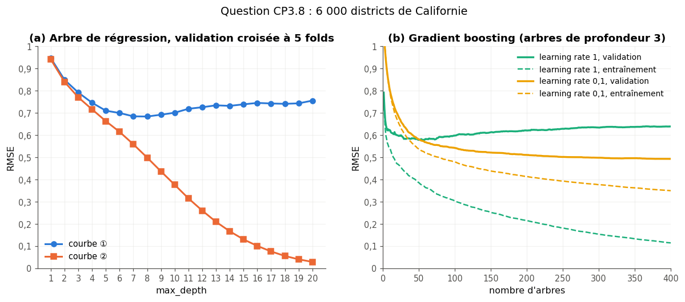

# Checkpoint III · Examen blanc de la partie III — ML classique

| | |
|---|---|
| **Durée** | 111 minutes (2 h au plus), d'une traite |
| **Note** | sur 20 points ; 2 points (10 %) portent sur les parties I et II (CP3.11) |
| **Chapitres** | 12 à 15 (préparation des données, classifieurs, ensembles, scikit-learn), plus les chapitres 3 et 8 |
| **Ta copie** | `04_mes_reponses.md` (ou une feuille de papier) ; les deux questions de code se font dans `02_examen_notebook.ipynb`, partie A |
| **Après** | la partie B du notebook vérifie tes réponses chiffrées ; `03_examen_corrige.md` donne le corrigé détaillé, le barème et la remédiation |

## Règles

- **Livre, fiches, notes, flashcards et corrigés fermés.** Pas d'assistant IA, pas de recherche sur le web.
- **Calculatrice autorisée** pour les questions papier, ou Python comme simple calculatrice (`+`, `*`, `**`, `math.sqrt`, `math.log`, `math.log2`), sans NumPy, sans scikit-learn et sans exécuter les extraits de CP3.1.
- **Questions de code** (CP3.6 et CP3.7), dans le notebook de l'examen : `help()` et la documentation officielle sont permis, ni `mylearn`, ni `mylearn_ref`, ni les notebooks des chapitres. CP3.6 se fait avec scikit-learn ; CP3.7 avec NumPy seulement.
- Donne le nombre de décimales demandé, et **n'arrondis qu'à la fin** du calcul. Quand une question dit « justifie » ou « montre », une réponse sans justification ne rapporte qu'une partie des points.
- Les durées sont indicatives : commence par ce que tu sais faire ; si tu bloques, passe à la question suivante et reviens-y à la fin.

| Question | Type | Sujet | Points | ⏱️ |
|---|---|---|---|---|
| CP3.1 | 🔮 | Prédire la sortie de six extraits scikit-learn (formes, scores, avertissements) | 1 | 7 min |
| CP3.2 | ✏️ | Standardiser et encoder un mini-tableau, puis transformer une ligne de test | 1,5 | 7 min |
| CP3.3 | ✏️ | Gini et meilleur seuil sur six points | 1,5 | 7 min |
| CP3.4 | ✏️ | kNN à la main avant et après standardisation | 1,5 | 7 min |
| CP3.5 | ✏️ | Une itération d'AdaBoost et une de gradient boosting | 2 | 10 min |
| CP3.6 | 🐛 | Trouver trois fuites dans un script d'entraînement (notebook) | 2 | 12 min |
| CP3.7 | 🔨 | Coder le seuil de décision de coût minimal et le comparer au seuil théorique (notebook) | 2 | 14 min |
| CP3.8 | 📈 | Lire une courbe de validation (`max_depth`) et une courbe de boosting | 1 | 6 min |
| CP3.9 | 🗣️ | Expliquer l'astuce du noyau en 5 lignes à un débutant | 1 | 4 min |
| CP3.10 | 💼 | Comme en entretien : `predict_proba` vaut 0,9, est-ce fiable, et comment déployer ce pipeline ? | 1 | 5 min |
| CP3.11 | ✏️ | Parties I et II : precision, recall et F1 d'une matrice de confusion ; folds d'une validation croisée stratifiée | 2 | 8 min |
| CP3.12 | 🧠 | Vrai ou faux justifiés : six affirmations sur la partie III | 1,5 | 10 min |
| CP3.13 | ∂ | Variance d'une moyenne de modèles corrélés : la démontrer, puis la chiffrer | 1,5 | 10 min |
| CP3.14 | 🧮 | Combien d'entraînements et de minutes pour une recherche en grille ? | 0,5 | 4 min |
| | | **Total** | **20** | **111 min** |

---

### CP3.1 — Prédire la sortie de six extraits scikit-learn 🔮 ★ ⏱️ 7 min · 1 point

**Sans rien exécuter**, prédis ce que fait chaque extrait : une lettre par extrait (les imports de scikit-learn sont omis). Tous partent de ces données :

```python
import numpy as np
import pandas as pd

rng = np.random.default_rng(0)
X = rng.normal(size=(100, 4))              # 100 examples, 4 features
y = (rng.random(100) < 0.3).astype(int)    # two classes, 0 and 1
y3 = rng.integers(0, 3, 100)               # three classes, 0, 1 and 2
```

a) `LogisticRegression().fit(X, y).decision_function(X[:5]).shape` **[0,15]**
(A) `(5,)` · (B) `(5, 2)` · (C) `(5, 1)` · (D) `(2, 5)`

b) `RandomForestClassifier(random_state=0).fit(X, y3).predict_proba(X[:5]).sum(axis=1)` **[0,15]**
(A) cinq valeurs entre 0 et 1, qui ne valent pas 1 · (B) cinq valeurs égales à 3 · (C) cinq valeurs égales à 1 · (D) une erreur : une forêt n'a pas de `predict_proba`

c) **[0,15]**
```python
islands = pd.DataFrame({"island": ["Biscoe", "Dream", "Torgersen", "Dream"]})
encoder = OneHotEncoder().fit(islands)
encoder.transform(pd.DataFrame({"island": ["Anvers"]}))
```
(A) une ligne de trois zéros · (B) une `ValueError`, pour une catégorie inconnue · (C) une ligne de quatre colonnes, dont une pour « Anvers » · (D) une ligne de `NaN`

d) **[0,15]**
```python
X_train, X_test = train_test_split(X, random_state=0)
Z = StandardScaler().fit(X_train).transform(X_test)
Z.mean(axis=0)
```
(A) quatre zéros exacts · (B) quatre valeurs égales à 1 · (C) une erreur, car `X_test` n'a pas autant de lignes que `X_train` · (D) quatre valeurs proches de 0, mais pas nulles

e) Dans `pipe = Pipeline([("scale", StandardScaler()), ("knn", KNeighborsClassifier())])`, la clé de la grille de `GridSearchCV(pipe, grille)` qui règle le nombre de voisins : **[0,2]**
(A) `"knn__n_neighbors"` · (B) `"n_neighbors"` · (C) `"knn_n_neighbors"` · (D) `"KNeighborsClassifier__n_neighbors"`

f) `RandomizedSearchCV(SVC(), {"C": [0.1, 1, 10]}, n_iter=10, cv=3, random_state=0).fit(X, y)` **[0,2]**
(A) dix candidats, dont des répétitions · (B) une `ValueError`, car `n_iter` dépasse le nombre de combinaisons · (C) dix valeurs de `C` tirées uniformément entre 0,1 et 10 · (D) un `UserWarning`, puis trois candidats seulement

### CP3.2 — Standardiser et encoder un mini-tableau, puis transformer une ligne de test ✏️ ★ ⏱️ 7 min · 1,5 point

Quatre manchots d'entraînement, décrits par la longueur du bec et l'île :

| Manchot | Bec (mm) | Île |
|---|---|---|
| 1 | 38 | Dream |
| 2 | 46 | Biscoe |
| 3 | 42 | Dream |
| 4 | 50 | Torgersen |

Deux manchots nouveaux : $T_1$ (bec 54 mm, Biscoe) et $T_2$ (bec 41 mm, Cuverville, une île absente de l'entraînement). La préparation est celle de scikit-learn : `StandardScaler` (écart-type calculé en divisant par $n$), `MinMaxScaler` et `OneHotEncoder(handle_unknown="ignore")`, appris sur les quatre manchots d'entraînement ; les catégories du one-hot sont rangées dans l'ordre alphabétique.

a) La moyenne et l'écart-type d'entraînement du bec, $[\mu, \sigma]$ (4 décimales). **[0,3]**
b) Le z-score du manchot 2 (3 décimales). **[0,15]**
c) Le z-score de $T_1$ (3 décimales). **[0,2]**
d) Le min-max de $T_1$ (3 décimales). **[0,2]**
e) Le vecteur one-hot du manchot 3, dans l'ordre des catégories apprises (une liste). **[0,2]**
f) Le vecteur one-hot de $T_2$ (une liste). **[0,15]**
g) La ligne que produit, pour $T_2$, un `ColumnTransformer` qui met le z-score du bec, puis le one-hot de l'île (une liste, 3 décimales). **[0,2]**
h) Pourquoi $T_1$ sort-il de $[0 ; 1]$ après le min-max, et pourquoi n'est-ce pas une erreur ? **[0,1]**

### CP3.3 — Gini et meilleur seuil sur six points ✏️ ★ ⏱️ 7 min · 1,5 point

Six exemples d'une seule feature $x$, de classes A ou B :

| $x$ | 1 | 2 | 3 | 5 | 6 | 8 |
|---|---|---|---|---|---|---|
| classe | A | A | B | B | A | B |

Un nœud d'arbre teste « $x \le s$ », avec un seuil $s$ au milieu de deux abscisses consécutives. Le Gini d'un nœud vaut $1 - \sum_k p_k^2$ ; le Gini pondéré d'un seuil est la moyenne des Gini de ses deux enfants, pondérée par leurs nombres d'exemples.

a) Le Gini de la racine. **[0,2]**
b) Le nombre de seuils candidats. **[0,1]**
c) Le Gini pondéré du seuil $s = 4$ (3 décimales). **[0,3]**
d) Le meilleur seuil (celui de plus petit Gini pondéré). **[0,3]**
e) Son Gini pondéré et le gain d'impureté par rapport à la racine, $[\text{Gini pondéré}, \text{gain}]$ (3 décimales). **[0,3]**
f) L'entropie, en bits, de l'enfant droit ($x > s$) de ce meilleur seuil (3 décimales). **[0,3]**

### CP3.4 — kNN à la main avant et après standardisation ✏️ ★★ ⏱️ 7 min · 1,5 point

Cinq manchots d'entraînement, décrits par leur masse et la longueur de leur bec :

| Manchot | Masse (g) | Bec (mm) | Espèce |
|---|---|---|---|
| $P_1$ | 4 000 | 42 | Adélie |
| $P_2$ | 3 900 | 48 | Chinstrap |
| $P_3$ | 4 300 | 39 | Adélie |
| $P_4$ | 4 400 | 46 | Chinstrap |
| $P_5$ | 4 450 | 50 | Chinstrap |

Un manchot nouveau, $Q$ : masse 3 800 g, bec 46 mm. On le classe par un kNN à $k = 3$ voisins, distance euclidienne, vote à la majorité.

a) Sur les mesures brutes, les numéros des trois plus proches voisins de $Q$, du plus proche au moins proche (une liste, par exemple `[5, 4, 3]` pour $P_5$, $P_4$, $P_3$). **[0,3]**
b) L'espèce prédite sur les mesures brutes. **[0,2]**
c) On standardise maintenant les deux mesures. Les statistiques d'entraînement sont : masse, moyenne 4 210 g et écart-type 220 g ; bec, moyenne 45 mm et écart-type 4 mm. Les z-scores de $Q$, $[z_{\text{masse}}, z_{\text{bec}}]$ (3 décimales). **[0,3]**
d) Après standardisation, les numéros des trois plus proches voisins de $Q$, du plus proche au moins proche. **[0,3]**
e) L'espèce prédite après standardisation. **[0,2]**
f) Pourquoi la standardisation change-t-elle la réponse ? Avec quelles statistiques standardise-t-on $Q$, et pourquoi pas les siennes ? **[0,2]**

### CP3.5 — Une itération d'AdaBoost et une de gradient boosting ✏️ ★★ ⏱️ 10 min · 2 points

**AdaBoost**, avec les règles de la fiche du ch. 14 : erreur pondérée $\varepsilon = \frac{\sum_i w_i\,\mathbb{1}[\text{mal classé}]}{\sum_i w_i}$, poids du membre $\alpha = \eta\left(\ln\frac{1 - \varepsilon}{\varepsilon} + \ln(K - 1)\right)$, mise à jour $w_i \leftarrow w_i\,e^{\alpha\,\mathbb{1}[\text{mal classé}]}$, puis normalisation des poids. Dix exemples de poids $0{,}1$, deux classes, `learning_rate` $\eta = 1$ ; la première souche classe mal trois exemples.

a) L'erreur pondérée $\varepsilon$. **[0,15]**
b) Le poids $\alpha$ de la souche (3 décimales). **[0,2]**
c) Après la mise à jour et la normalisation, le poids d'un exemple mal classé (4 décimales). **[0,2]**
d) Après la mise à jour et la normalisation, le poids d'un exemple bien classé (4 décimales). **[0,2]**
e) Avec $K = 4$ classes et la même erreur pondérée, le poids $\alpha$ de la souche (SAMME, 3 décimales). **[0,25]**

**Gradient boosting** de régression, loss quadratique, souches de régression (un seuil au milieu de deux abscisses ; chaque feuille prédit la moyenne des résidus des exemples qui y tombent ; le seuil minimise la somme des carrés des écarts dans les deux feuilles), learning rate $\eta = 0{,}1$. Quatre exemples :

| $x$ | 1 | 2 | 3 | 4 |
|---|---|---|---|---|
| $y$ | 2 | 4 | 9 | 11 |

f) La prédiction initiale $F_0$. **[0,1]**
g) Les résidus $r_i = y_i - F_0$, dans l'ordre (une liste). **[0,15]**
h) La première souche, ajustée aux résidus : $[s, \text{valeur gauche}, \text{valeur droite}]$. **[0,25]**
i) $F_1(1)$, la prédiction de l'exemple $x = 1$ après cette étape (2 décimales). **[0,2]**
j) La MSE d'entraînement après cette étape (4 décimales). **[0,2]**
k) Pourquoi un learning rate de 0,1 demande-t-il plus d'arbres qu'un learning rate de 1, et pourquoi l'accepte-t-on quand même ? **[0,1]**

### CP3.6 — Trouver trois fuites dans un script d'entraînement 🐛 ★★ ⏱️ 12 min · 2 points

**Dans le notebook de l'examen, partie A.** Un collègue prédit la valeur médiane des logements de 4 000 districts de Californie (`X`, `y` : les huit mesures et la cible du recensement de 1990, `y` en centaines de milliers de dollars) avec un kNN de régression, dont il choisit le nombre de voisins dans `K_GRID = [1, 3, 5, 10, 20, 40]`. Sa fonction `colleague_report(X, y)`, dont les lignes sont marquées (A) à (F) (son code est dans le notebook), annonce un $R^2$ de test de 0,93 au client. Exécute-la.

a) Trois de ses lignes contiennent une fuite de données : leurs lettres (par exemple `"BDF"`). **[0,6]**
b) Laquelle de ces fuites fausse vraiment son score, et pourquoi ? Pourquoi les deux autres ne le changent-elles presque pas ici, et pourquoi faut-il quand même les corriger ? **[0,4]**
c) Écris `honest_report(X, y)`, qui fait le même travail **sans fuite** et renvoie `(best_k, test_r2)` : garde la transformation de la ligne (B) telle quelle (la valeur attendue à la question d est calculée avec elle) et retire les fuites ; découpe d'abord, avec le même `train_test_split(..., test_size=0.25, random_state=0)` ; choisis le nombre de voisins par une `GridSearchCV` à 5 folds (`cv=5`, score $R^2$ par défaut) sur l'entraînement seul, avec un `Pipeline` qui standardise puis applique le kNN ; mesure enfin le $R^2$ de test, une seule fois. La fonction ne modifie pas `X`. **[0,6]**
d) Les valeurs que renvoie ta fonction : $[\text{best\_k}, R^2_{\text{test}}]$ (3 décimales, sur ta feuille). **[0,2]**
e) Que dis-tu au client ? **[0,2]**

### CP3.7 — Coder le seuil de décision de coût minimal et le comparer au seuil théorique 🔨 ★★ ⏱️ 14 min · 2 points

**Dans le notebook de l'examen, partie A, avec NumPy seulement.** Un classifieur binaire donne une probabilité d'être positif (`PROBA_VAL` pour 600 exemples de validation, `Y_VAL` leurs labels ; `PROBA_TEST`, `Y_TEST` pour 600 exemples de test). Un faux négatif coûte $C_{FN} = 5$, un faux positif $C_{FP} = 1$. La règle de décision : classe 1 quand la probabilité est **supérieure ou égale** au seuil $t$.

a) Écris `total_cost(y_true, y_pred, cost_fn, cost_fp)`, qui renvoie le coût total (un `int`) de décisions 0/1. **[0,3]**
b) Écris `min_cost_threshold(proba, y_true, cost_fn, cost_fp, thresholds)`, qui renvoie le couple `(t, coût)` du seuil de plus petit coût parmi `thresholds` (le premier dans l'ordre de `thresholds` en cas d'égalité). Les deux fonctions ne modifient pas leurs arguments. **[0,5]**
c) Avec `THRESHOLDS` (0,01 ; 0,02 ; … ; 0,99), le seuil et le coût que donne ta fonction sur la validation : $[t, \text{coût}]$ (sur ta feuille). **[0,3]**
d) Le seuil théorique de coût moyen minimal, si les probabilités sont calibrées (4 décimales). Montre-le en comparant le coût moyen des deux décisions pour un exemple de probabilité $p$. **[0,3]**
e) Les coûts sur le test, avec le seuil de c), puis avec le seuil 0,5 : $[\text{coût}(t), \text{coût}(0{,}5)]$ (sur ta feuille). **[0,3]**
f) Pourquoi c) et d) ne donnent-ils pas le même seuil ? Lequel déploierais-tu, et pourquoi ? **[0,3]**

### CP3.8 — Lire une courbe de validation et une courbe de boosting 📈 ★ ⏱️ 6 min · 1 point

La figure (`figures/cp3_8_courbes.png`, reproduite ci-dessous) porte sur 6 000 districts de Californie. **(a)** Un `DecisionTreeRegressor` : les RMSE moyennes d'entraînement et de validation d'une validation croisée à 5 folds, selon `max_depth` (de 1 à 20) ; les deux courbes sont numérotées ① et ②. **(b)** Deux `GradientBoostingRegressor` d'arbres de profondeur 3, de learning rates 1 et 0,1 : les RMSE d'entraînement et de validation selon le nombre d'arbres (de 1 à 400).



a) Le numéro de la courbe d'entraînement en (a) (1 ou 2). **[0,1]**
b) L'intervalle de la profondeur de plus petite erreur de validation : (A) de 1 à 4 · (B) de 5 à 9 · (C) de 10 à 14 · (D) de 15 à 20. **[0,2]**
c) Le diagnostic à `max_depth=2` : (A) underfitting · (B) overfitting · (C) un bon compromis. **[0,15]**
d) Le diagnostic à `max_depth=18`, avec les mêmes lettres. **[0,15]**
e) Le learning rate dont l'erreur de validation remonte avant 400 arbres (1 ou 0,1). **[0,15]**
f) Pour ce learning rate, l'intervalle du nombre d'arbres de plus petite erreur de validation : (A) de 1 à 20 · (B) de 21 à 100 · (C) de 101 à 250 · (D) de 251 à 400. **[0,15]**
g) Vrai ou faux : avec le learning rate 0,1, plus de 400 arbres pourraient encore faire baisser l'erreur de validation. **[0,1]**

### CP3.9 — Expliquer l'astuce du noyau en 5 lignes à un débutant 🗣️ ★ ⏱️ 4 min · 1 point

Un ami qui débute te demande ce qu'est « l'astuce du noyau » d'un SVM. Explique-la en cinq lignes au plus, sans formule, avec une image ou un exemple : pourquoi des données qu'aucune droite ne sépare peuvent devenir séparables, et ce que l'astuce évite de calculer. **[1]**

### CP3.10 — Comme en entretien : `predict_proba` vaut 0,9, est-ce fiable, et comment déployer ce pipeline ? 💼 ★ ⏱️ 5 min · 1 point

Le recruteur : « Votre modèle donne `predict_proba = 0.9` pour un client. Peut-on dire qu'il a 90 % de chances d'être positif ? Et comment mettriez-vous ce pipeline en production ? » Réponds comme à l'oral, en quelques phrases : ce que vaut cette probabilité et comment le vérifier ; puis trois précautions de déploiement. **[1]**

### CP3.11 — Parties I et II : precision, recall et F1 ; folds d'une validation croisée stratifiée ✏️ ★ ⏱️ 8 min · 2 points

**Partie I (ch. 3).** Un détecteur de fraude examine 500 transactions, dont 75 sont des fraudes. Il en signale 60, dont 45 sont des fraudes.

a) La matrice de confusion, sous la forme $[TP, FP, FN, TN]$. **[0,2]**
b) La precision (3 décimales). **[0,25]**
c) Le recall (3 décimales). **[0,25]**
d) Le F1 (3 décimales). **[0,3]**
e) L'accuracy (3 décimales). **[0,2]**

**Partie II (ch. 8).** Un dataset de 240 exemples, dont 60 de la classe 1, est découpé par une validation croisée **stratifiée** à 5 folds (`StratifiedKFold(n_splits=5)`).

f) La taille d'un fold de validation et son nombre d'exemples de la classe 1 : $[\text{taille}, \text{classe 1}]$. **[0,3]**
g) La taille de l'entraînement d'un tour et son nombre d'exemples de la classe 1 : $[\text{taille}, \text{classe 1}]$. **[0,2]**
h) Le nombre de modèles qu'entraîne `cross_val_score(model, X, y, cv=RepeatedStratifiedKFold(n_splits=5, n_repeats=3))`. **[0,3]**

### CP3.12 — Vrai ou faux justifiés : six affirmations sur la partie III 🧠 ★ ⏱️ 10 min · 1,5 point

Pour chaque affirmation, réponds **Vrai** ou **Faux**, puis justifie en une ou deux phrases (un argument, un calcul ou un contre-exemple). Le verdict vaut 0,1 point ; la justification, 0,15 point.

a) Standardiser les features change les prédictions d'un arbre de décision. **[0,25]**
b) Dans un `Pipeline` passé à `cross_val_score`, le `StandardScaler` est réappris sur l'entraînement de chaque fold. **[0,25]**
c) Un gradient boosting entraîne ses arbres indépendamment les uns des autres : on peut les entraîner en parallèle, comme ceux d'une forêt aléatoire. **[0,25]**
d) Si l'on donne à un Naïve Bayes gaussien, entraîné sur deux classes de même effectif, deux copies identiques d'une même feature, ses probabilités deviennent plus extrêmes (plus proches de 0 ou de 1) qu'avec une seule copie. **[0,25]**
e) Le score out-of-bag d'une forêt aléatoire évalue chaque exemple avec les arbres qui l'ont vu à l'entraînement. **[0,25]**
f) Sur des données de 40 features, dont 2 seulement sont informatives, un kNN est en général plus gêné par les 38 autres qu'un arbre de décision. **[0,25]**

### CP3.13 — Variance d'une moyenne de modèles corrélés : la démontrer, puis la chiffrer ∂ ★★ ⏱️ 10 min · 1,5 point

Un ensemble fait la moyenne de $M$ modèles. En un point donné, leurs prédictions $h_1, \dots, h_M$ ont toutes la même variance $\sigma^2$ (d'un jeu d'entraînement à l'autre), et chaque paire a la même corrélation $\rho$.

a) Montre que la variance de leur moyenne vaut $\rho\,\sigma^2 + \frac{1 - \rho}{M}\,\sigma^2$. Tu peux utiliser $\operatorname{Var}\big(\sum_m h_m\big) = \sum_m \sum_{m'} \operatorname{Cov}(h_m, h_{m'})$. **[0,5]**

Un bagging d'arbres : $\sigma^2 = 4$, $\rho = 0{,}25$.

b) La variance de la moyenne de $M = 10$ arbres. **[0,2]**
c) Sa limite quand $M \to +\infty$. **[0,2]**
d) Le plus petit nombre d'arbres $M$ pour lequel cette variance vaut au plus 1,08. **[0,2]**
e) Une forêt aléatoire décorrèle ses arbres : $\rho = 0{,}1$, mais chaque arbre, qui ne voit qu'une partie des features à chaque nœud, est un peu plus variable : $\sigma^2 = 5$. Sa limite quand $M \to +\infty$, puis sa variance pour $M = 30$ : une liste de deux nombres (3 décimales). **[0,2]**
f) Lequel des deux ensembles choisirais-tu avec 30 arbres ? Quelle limite des ensembles la formule montre-t-elle ? **[0,2]**

### CP3.14 — Combien d'entraînements et de minutes pour une recherche en grille ? 🧮 ★ ⏱️ 4 min · 0,5 point

Une `GridSearchCV` règle un `HistGradientBoostingClassifier` sur 36 000 exemples : `learning_rate` prend 4 valeurs, `max_leaf_nodes` 3 et `l2_regularization` 5, avec `cv=5` et le réentraînement final par défaut (`refit=True`). Un entraînement dure environ 2 secondes.

a) Le nombre total d'entraînements. **[0,1]**
b) La durée totale, en minutes (arrondie à l'entier le plus proche). **[0,15]**
c) Le nombre d'entraînements d'une validation croisée **imbriquée** à 5 folds extérieurs, qui refait toute cette recherche (réentraînement final compris) dans chaque tour extérieur, sans compter la recherche finale qui produirait le modèle livré (l'évaluation sur le fold extérieur n'est pas un entraînement). **[0,15]**
d) Le nombre d'entraînements d'une `RandomizedSearchCV` de 12 candidats sur les mêmes 5 folds, réentraînement final compris. **[0,1]**
