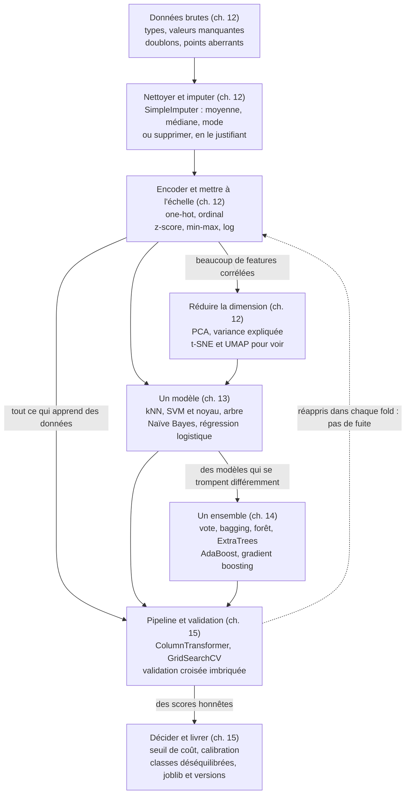

# Checkpoint III · Synthèse de la partie III — ML classique

> Une page à revoir avant l'examen blanc, puis avant la partie IV. Compte environ 90 minutes : redessine d'abord la carte mentale, de mémoire, récite les formules en cachant les colonnes de droite, puis relis les tableaux et dis le vocabulaire à voix haute (mode d'emploi en fin de page).

**Les quatre chapitres en une phrase chacun**

12. **Préparation des données** : un modèle ne voit que des nombres ; on nettoie, on impute, on encode les catégories, on met les features à l'échelle et l'on réduit la dimension, en apprenant chaque transformation sur l'entraînement seul.
13. **Classifieurs** : le kNN fait voter des voisins, le SVM cherche la frontière la plus éloignée des deux classes (et se courbe grâce au noyau), l'arbre enchaîne des questions qui réduisent l'impureté, Naïve Bayes applique la règle de Bayes à des features supposées indépendantes, la régression logistique transforme un score linéaire en probabilité.
14. **Ensembles** : beaucoup de modèles qui se trompent différemment valent mieux qu'un seul ; le bagging et les forêts font la moyenne de modèles indépendants pour réduire la variance, le boosting ajoute des modèles l'un après l'autre pour corriger les erreurs des précédents.
15. **scikit-learn** : une interface commune (`fit`, `predict`, `transform`), des pipelines qui enchaînent préparation et modèle sans fuite, et des recherches d'hyperparamètres notées par validation croisée.

## 1. Carte mentale

Redessine-la de mémoire, puis compare : chaque flèche doit pouvoir se justifier par un exemple (« tout ce qui apprend des données va dans le pipeline : un `StandardScaler` appris sur tout le dataset a vu les folds de validation, et un `SelectKBest` appris sur tout le dataset trouve du signal dans du bruit pur, 15.24 »).

## 2. Fiche d'une page : les 22 formules clés

| # | Notion | Formule | Ce qu'il faut savoir dire | Ch. | `mylearn` |
|---|---|---|---|---|---|
| 1 | z-score | $z = \frac{x - \mu}{\sigma}$, $\mu$ et $\sigma$ de l'entraînement, $\sigma$ divisé par $n$ (ddof = 0) | moyenne 0 et écart-type 1 sur l'entraînement seulement ; les données nouvelles en sortent un peu | 12 | `preprocessing.StandardScaler` |
| 2 | Min-max | $x' = \frac{x - \min}{\max - \min}$ | une donnée nouvelle peut sortir de $[0 ; 1]$ : c'est normal (`clip=True` pour borner) | 12 | `preprocessing.MinMaxScaler` |
| 3 | One-hot | une colonne par catégorie apprise, rangées dans l'ordre trié ; une catégorie inconnue : une ligne de zéros avec `handle_unknown="ignore"` | $K$ catégories, $K$ colonnes (ou $K - 1$ avec `drop`) | 12 | `preprocessing.OneHotEncoder`, `OrdinalEncoder` |
| 4 | Covariance et PCA | $\boldsymbol{\Sigma} = \frac{1}{n - 1}\mathbf{X}_c^\top\mathbf{X}_c$ ; variance le long de $\mathbf{u}$ : $\mathbf{u}^\top\boldsymbol{\Sigma}\,\mathbf{u}$ ; composantes = vecteurs propres ; part expliquée $\frac{\lambda_j}{\sum_l \lambda_l}$ | la PCA ignore la cible ; elle se standardise d'abord si les unités diffèrent | 12 | `preprocessing.PCA` |
| 5 | Distance euclidienne, kNN | $d(\mathbf{x}, \mathbf{x}') = \sqrt{\sum_j (x_j - x'_j)^2}$ ; vote à la majorité des $k$ plus proches | sans mise à l'échelle, la feature aux plus grands nombres décide seule | 13 | `neighbors.pairwise_distances`, `KNeighborsClassifier` |
| 6 | Distance à un hyperplan, marge | $\frac{\lvert \mathbf{w}\cdot\mathbf{x} + b \rvert}{\lVert \mathbf{w} \rVert}$ ; marge $\frac{1}{\lVert \mathbf{w} \rVert}$, bande de largeur $\frac{2}{\lVert \mathbf{w} \rVert}$ | seuls les vecteurs de support fixent la frontière ; petit C : marge large et tolérante | 13 | |
| 7 | Noyau | $K(\mathbf{x}, \mathbf{x}') = \varphi(\mathbf{x})\cdot\varphi(\mathbf{x}')$ ; RBF : $e^{-\gamma\lVert\mathbf{x} - \mathbf{x}'\rVert^2}$ | le SVM n'a besoin que de ressemblances : on ne calcule jamais $\varphi$ | 13 | |
| 8 | Gini | $G = 1 - \sum_k p_k^2$ | 0 pour un nœud pur, $1 - \frac{1}{K}$ au plus | 13 | `tree.gini_impurity` |
| 9 | Entropie d'un nœud | $H = -\sum_k p_k \log_2 p_k$ | 0 pour un nœud pur, $\log_2 K$ bits au plus | 13 | `tree.entropy_impurity` |
| 10 | Gain d'un split | $I(\text{parent}) - \frac{n_g}{n} I(g) - \frac{n_d}{n} I(d)$ | une moyenne **pondérée** par les effectifs ; seuils au milieu des valeurs consécutives | 13 | `tree.split_gain`, `best_split` |
| 11 | Naïve Bayes gaussien | $\ell_c = \ln P(c) + \sum_j \ln \mathcal{N}(x_j ; \mu_{cj}, \sigma_{cj}^2)$, puis $P(c \mid \mathbf{x}) = e^{\ell_c - \operatorname{logsumexp}(\ell)}$ | « naïf » : features indépendantes dans chaque classe ; trop sûr de lui quand elles sont corrélées | 13 | `naive_bayes.log_gaussian_pdf`, `logsumexp`, `GaussianNB` |
| 12 | Régression logistique | $P(y = 1 \mid \mathbf{x}) = \sigma(\mathbf{w}\cdot\mathbf{x} + b)$, $\sigma(z) = \frac{1}{1 + e^{-z}}$ ; gradient de la log loss $\frac{1}{n}\mathbf{X}^\top(\hat{\mathbf{p}} - \mathbf{y})$ | une frontière linéaire, des probabilités souvent bien calibrées ; la pénalité L2 est active par défaut (`C=1`) | 13 | `logistic.sigmoid`, `LogisticRegression` |
| 13 | Vote majoritaire | $P(\text{majorité juste}) = \sum_{j > M/2} \binom{M}{j} q^j (1 - q)^{M - j}$ | ne marche que si les votants sont meilleurs que le hasard ($q > 0{,}5$) et indépendants | 14 | `ensemble.plurality_vote` |
| 14 | Bootstrap | un exemple est oublié avec la probabilité $(1 - \frac{1}{n})^n \to e^{-1} \approx 0{,}368$ | environ 63 % d'exemples distincts par arbre ; les autres donnent le score out-of-bag | 14 | `ensemble.bootstrap_indices`, `BaggingClassifier` |
| 15 | Variance d'une moyenne corrélée | $\rho\,\sigma^2 + \frac{1 - \rho}{M}\sigma^2$ | aucun nombre d'arbres ne descend sous $\rho\,\sigma^2$ : il faut décorréler (forêt) | 14 | `ensemble.RandomForestClassifier`, `ExtraTreesClassifier` |
| 16 | AdaBoost (SAMME) | $\varepsilon_m$ pondérée ; $\alpha_m = \eta\big(\ln\frac{1 - \varepsilon_m}{\varepsilon_m} + \ln(K - 1)\big)$ ; $w_i \leftarrow w_i\,e^{\alpha_m \mathbb{1}[\text{mal classé}]}$, puis normaliser | à deux classes et $\eta = 1$, les mal classés pèsent ensuite la moitié du total | 14 | `ensemble.AdaBoostClassifier` |
| 17 | Gradient boosting | $F_0 = \bar{y}$ ; $r_i = y_i - F_{m-1}(\mathbf{x}_i)$ (l'opposé du gradient de la MSE) ; $F_m = F_{m-1} + \eta\,h_m$ | petit $\eta$ : plus d'arbres, souvent mieux ; s'arrêter grâce à la validation (early stopping) | 14 | `ensemble.GradientBoostingRegressor` |
| 18 | Coût d'une recherche | grille : $\prod_j n_j$ candidats × $k$ folds, + 1 réentraînement ; imbriquée : × le nombre de folds extérieurs | le hasard essaie plus de valeurs de chaque hyperparamètre pour le même budget | 15 | |
| 19 | Probabilité de tirer une bonne zone | $1 - (1 - q)^n$ pour $n$ essais au hasard, $q$ la part du carré qui bat la grille | 16 essais suffisent souvent quand un seul hyperparamètre compte | 15 | |
| 20 | Scores et probabilités | binaire : `decision_function` de forme `(n,)`, $P = \sigma(s)$ pour la régression logistique ; $K$ classes : `predict_proba` de forme `(n, K)`, softmax | un score n'est une probabilité que si le modèle est calibré | 15 | |
| 21 | Seuil de coût minimal | décider 1 si $p \ge \frac{C_{FP}}{C_{FP} + C_{FN}}$ | 0,5 seulement si les deux erreurs coûtent autant ; suppose des probabilités calibrées | 15 | |
| 22 | Poids des classes | `class_weight="balanced"` : $w_c = \frac{n}{K\,n_c}$ | déplace la décision vers la classe rare, comme un seuil plus bas ; juger au recall, à la precision, à l'average precision | 15 | |

## 3. Quel classifieur quand ?

| Modèle | Hypothèse sur les données | Mémoire et vitesse | Mise à l'échelle | Hyperparamètres clés | Quand le choisir |
|---|---|---|---|---|---|
| **kNN** | des voisins proches ont la même classe | garde tout l'entraînement ; `fit` instantané, `predict` lent ($n \times p$ par exemple) | **indispensable** | `n_neighbors`, la distance, `weights` | peu de features, une frontière irrégulière, une référence rapide à écrire |
| **SVM linéaire** | une frontière linéaire, avec une marge | garde les vecteurs de support | indispensable | `C` | beaucoup de features (texte), classes presque séparables |
| **SVM à noyau RBF** | une frontière lisse mais courbe | entraînement en $n^2$ à $n^3$ : au-delà de quelques dizaines de milliers d'exemples, trop lent | indispensable | `C`, `gamma` | des données moyennes, une frontière courbe |
| **Arbre de décision** | des règles « si … alors » sur des seuils | rapide, peu de mémoire | **inutile** | `max_depth`, `min_samples_leaf`, `ccp_alpha` | quand il faut lire et expliquer la règle ; instable seul |
| **Naïve Bayes** | features indépendantes dans chaque classe | très rapide, très peu de mémoire | inutile (gaussien) | le lissage (`alpha`, `var_smoothing`) | le texte (multinomial), une référence ; probabilités trop extrêmes |
| **Régression logistique** | une frontière linéaire en probabilités | rapide | recommandée (pénalité, convergence) | `C` | la référence à battre ; des probabilités utilisables, des coefficients lisibles |
| **Forêt aléatoire** | la moyenne d'arbres profonds décorrélés | parallèle (`n_jobs`), assez gourmande en mémoire | inutile | `n_estimators`, `max_features`, `min_samples_leaf` | un bon modèle sans réglage fin ; score out-of-bag gratuit |
| **Gradient boosting** (HistGradientBoosting, XGBoost, LightGBM) | une somme de petits arbres qui corrigent les erreurs | séquentiel, mais très rapide en version histogramme | inutile | `learning_rate`, nombre d'arbres (early stopping), `max_leaf_nodes` ou `max_depth` | **l'état de l'art sur le tabulaire** ; valeurs manquantes gérées nativement |

## 4. Les fuites de données et leurs parades

| Source de fuite | À quoi on la reconnaît | La parade |
|---|---|---|
| **Un prétraitement appris avant le découpage** (scaler, imputation, PCA, encodage) | `fit_transform(X)` sur tout le dataset, puis `train_test_split` | découper d'abord ; tout ce qui apprend va dans un `Pipeline`, réappris dans chaque fold |
| **Une sélection de features sur toutes les lignes** | `SelectKBest(...).fit(X, y)` avant la validation croisée : du signal trouvé dans du bruit | la sélection dans le pipeline ; validation croisée imbriquée si on règle $k$ |
| **Une feature calculée à partir de la cible** | un $R^2$ ou une accuracy « trop beaux » ; une colonne qui divise ou moyenne $y$ | se demander pour chaque feature : la connaîtrai-je au moment de prédire ? |
| **Un encodage par la cible sans validation interne** | moyenne de $y$ par catégorie, calculée sur toutes les lignes | `TargetEncoder` (validation croisée interne), dans le pipeline |
| **Des réglages choisis sur le test** | « je change de modèle et je reteste » ; le meilleur score de test annoncé | choisir par validation croisée sur l'entraînement ; le test, une seule fois |
| **Des fuites par la saisie** | identifiants, numéros d'échantillon, dates de collecte ou ordre des lignes qui suivent la cible (les nids A1/A2 de `penguins_raw`) | retirer ces colonnes, mélanger les lignes, vérifier chaque feature « trop utile » |
| **Des données dépendantes coupées au hasard** | les mesures d'un même patient, d'un même jour, d'une même maison des deux côtés du découpage | `GroupKFold`, `TimeSeriesSplit` (ch. 8) |
| **Le meilleur score de la recherche annoncé comme performance** | `best_score_` publié tel quel | validation croisée imbriquée, ou un test mis de côté avant la recherche |

## 5. Bagging contre boosting

| | Bagging et forêts | Boosting (AdaBoost, gradient boosting) |
|---|---|---|
| **Membres** | des modèles forts et instables (arbres profonds) | des modèles faibles (souches, petits arbres) |
| **Construction** | indépendante, en **parallèle**, chacun sur un bootstrap | **séquentielle** : chaque membre corrige les erreurs des précédents (poids des exemples ou résidus) |
| **Ce qu'il réduit** | surtout la **variance** (moyenne de modèles qui se trompent différemment) | surtout le **biais** (la somme de modèles simples devient complexe), et la variance avec un petit learning rate |
| **Risque** | peu d'overfitting en ajoutant des arbres ; plancher $\rho\,\sigma^2$ | overfitting si l'on ajoute trop d'arbres : early stopping |
| **Réglages** | `n_estimators` (assez), `max_features` (décorréler) | `learning_rate` et nombre d'arbres ensemble, profondeur des arbres |
| **Bonus** | score out-of-bag sans jeu de validation | état de l'art sur le tabulaire |

## 6. Anatomie de l'API scikit-learn

| Rôle | Méthodes | Exemples | À retenir |
|---|---|---|---|
| **Estimateur** | `__init__` (hyperparamètres, rien d'autre), `fit(X, y)` qui renvoie `self`, attributs appris en `_` (`coef_`, `classes_`) | tout objet de scikit-learn | `get_params`, `set_params`, `clone` lisent la signature de `__init__` |
| **Transformateur** | `fit`, `transform`, `fit_transform`, parfois `inverse_transform` | `StandardScaler`, `OneHotEncoder`, `PCA`, `SimpleImputer` | `fit` sur l'entraînement, `transform` partout |
| **Prédicteur** | `predict`, `score` ; classifieurs : `predict_proba`, `decision_function` | `LogisticRegression`, `SVC`, `RandomForestClassifier` | `X` toujours en deux dimensions ; `score` : accuracy ou $R^2$ |
| **Méta-estimateur** | enveloppe un autre estimateur | `Pipeline`, `ColumnTransformer`, `GridSearchCV`, `VotingClassifier`, `CalibratedClassifierCV`, `TunedThresholdClassifierCV` | il clone ce qu'il reçoit ; ses paramètres s'écrivent `étape__paramètre` |
| **Sélection de modèle** | `cross_val_score`, `cross_validate`, `GridSearchCV`, `RandomizedSearchCV` | `cv=5` stratifie pour un classifieur, sans mélanger | `best_params_`, `best_score_` (optimiste), `cv_results_` |
| **Son propre estimateur** | `class M(ClassifierMixin, BaseEstimator)` | l'adaptateur de 15.29 | mixins à gauche ; `__init__` range ses arguments sous leur nom ; le travail dans `fit` |

## 7. Qui sert à quoi plus tard

| Module (chapitre) | Ce que tu y as écrit | Où il revient |
|---|---|---|
| `preprocessing` (ch. 12) | `StandardScaler`, `MinMaxScaler`, `SimpleImputer`, `OrdinalEncoder`, `OneHotEncoder`, `PCA` | la standardisation des entrées d'un réseau (ch. 16 à 20) ; la PCA pour voir des espaces latents (ch. 25) ; le mini-projet MP3, avec leurs versions scikit-learn |
| `neighbors` (ch. 13) | `pairwise_distances`, `KNeighborsClassifier` | les distances vectorisées servent partout ; le kNN, référence des embeddings (B2, B4) |
| `tree` (ch. 13) | impuretés, gain, `best_split`, arbres de classification et de régression | tes ensembles du ch. 14 ; l'explicabilité (B6) |
| `naive_bayes` (ch. 13) | `log_gaussian_pdf`, `logsumexp`, `GaussianNB`, `MultinomialNB` | `logsumexp` revient avec le softmax et la cross-entropy des réseaux (ch. 17 à 20) |
| `logistic` (ch. 13) | `sigmoid`, la régression logistique par descente de gradient | c'est un neurone : la sortie d'un réseau de classification binaire (ch. 16 à 18) |
| `ensemble` (ch. 14) | vote, bootstrap, bagging, forêt, ExtraTrees, AdaBoost, gradient boosting | les ensembles de réseaux et le dropout vu comme un ensemble (ch. 20) ; le mini-projet MP3, avec HistGradientBoosting |

## 8. Vocabulaire à maîtriser à l'oral

Dis chaque définition à voix haute, avec un exemple, **avant** d'ouvrir la réponse.

<b>Fuite de données</b>
Le modèle, ou les choix qui l'ont construit, profitent d'une information qu'ils n'auraient pas en usage réel : un prétraitement qui a vu le test, une feature calculée à partir de la cible, un réglage choisi sur le test. Le score devient trop beau, sans prévenir.

<b>Transformateur, pipeline</b>
Un transformateur apprend une transformation (`fit`) et l'applique (`transform`). Un pipeline enchaîne des transformateurs et un modèle en un seul estimateur : la validation croisée le réapprend en entier dans chaque fold.

<b>Imputation</b>
Remplacer une valeur manquante par une estimation apprise sur l'entraînement (moyenne, médiane, catégorie la plus fréquente), plutôt que supprimer la ligne ; on peut garder un indicateur « était manquant ».

<b>One-hot</b>
Une colonne 0/1 par catégorie : aucun ordre inventé entre les catégories ; une catégorie inconnue doit être prévue (`handle_unknown`).

<b>Composante principale</b>
Une direction de variance maximale des données centrées (un vecteur propre de la matrice de covariance) ; les suivantes sont orthogonales aux précédentes. La PCA ne regarde pas la cible.

<b>Marge, vecteurs de support, C</b>
La marge est la distance de la frontière d'un SVM aux points les plus proches, les vecteurs de support, qui seuls fixent la frontière. C règle la tolérance aux points dans la marge : petit C, marge large et tolérante.

<b>Astuce du noyau</b>
Un SVM n'a besoin que de produits scalaires entre exemples ; un noyau les calcule directement comme s'ils étaient pris dans un espace de très grande dimension, sans jamais construire ses coordonnées.

<b>Impureté, gain</b>
L'impureté (Gini, entropie) mesure le mélange des classes d'un nœud ; un split est choisi pour le plus grand gain, l'impureté du parent moins la moyenne pondérée de celles des enfants.

<b>Naïve Bayes</b>
La règle de Bayes avec des features supposées indépendantes dans chaque classe : on multiplie (on additionne en log) les vraisemblances de chaque feature, puis on normalise.

<b>Bagging, out-of-bag</b>
Entraîner chaque membre sur un tirage avec remise (bootstrap) et faire la moyenne ; chaque exemple est absent d'environ 37 % des tirages, ce qui donne un score out-of-bag sans jeu de validation.

<b>Forêt aléatoire</b>
Un bagging d'arbres qui, à chaque nœud, ne regardent qu'un sous-ensemble tiré des features : des arbres moins corrélés, une moyenne de plus petite variance.

<b>Boosting, learning rate</b>
Ajouter des modèles faibles l'un après l'autre, chacun corrigeant les erreurs des précédents ; le learning rate réduit la part de chaque nouveau modèle : plus d'arbres, mais souvent une meilleure validation.

<b>Recherche en grille, recherche au hasard</b>
Essayer toutes les combinaisons d'une grille, ou un nombre fixé de tirages dans des distributions, chaque candidat noté par validation croisée ; le meilleur est réentraîné sur tout l'entraînement.

<b>Validation croisée imbriquée</b>
Une validation croisée extérieure qui refait toute la recherche d'hyperparamètres dans chaque tour : elle estime honnêtement la procédure « chercher puis réentraîner ».

<b>Calibration</b>
Un modèle est calibré si, parmi les exemples à qui il donne 0,8, environ 80 % sont positifs ; se vérifie par une courbe de fiabilité, se corrige par `CalibratedClassifierCV`.

<b>Seuil de décision</b>
La probabilité au-delà de laquelle on décide « positif » : il se choisit d'après le coût des erreurs, sur la validation, pas 0,5 par défaut.

## Mode d'emploi (≈ 90 minutes)

1. **15 min** : redessine la carte mentale, de mémoire, puis compare avec la section 1.
2. **30 min** : cache les colonnes « Formule » et « Ce qu'il faut savoir dire » de la section 2 ; pour chaque notion, réécris la formule et invente un exemple chiffré.
3. **15 min** : pour chaque ligne des sections 3 à 5, retrouve l'exercice où tu l'as rencontrée.
4. **15 min** : le vocabulaire de la section 8, à voix haute.
5. **15 min** : les flashcards en retard des chapitres 12 à 15.

Ensuite : l'examen blanc (`01_examen_sujet.md`), en conditions réelles, puis le mini-projet (`projets/partie_3_revenus/`).
