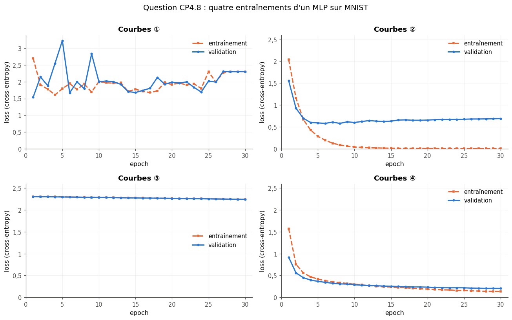

# Checkpoint IV · Examen blanc de la partie IV — Réseaux de neurones

| | |
|---|---|
| **Durée** | 114 minutes (2 h au plus), d'une traite |
| **Note** | sur 20 points ; 2 points (10 %) portent sur les parties I à III (CP4.12) |
| **Chapitres** | 16 à 20 (réseaux feed-forward, fonctions d'activation, rétropropagation, optimiseurs, deep learning et premiers pas en PyTorch), plus les chapitres 6, 9 et 12 |
| **Ta copie** | `04_mes_reponses.md` (ou une feuille de papier) ; la question de code se fait dans `02_examen_notebook.ipynb`, partie A |
| **Après** | la partie B du notebook vérifie tes réponses chiffrées ; `03_examen_corrige.md` donne le corrigé détaillé, le barème et la remédiation |

## Règles

- **Livre, fiches, notes, flashcards et corrigés fermés.** Pas d'assistant IA, pas de recherche sur le web.
- **Calculatrice autorisée** pour les questions papier, ou Python comme simple calculatrice (`+`, `*`, `**`, `math.sqrt`, `math.exp`, `math.log`, `math.log2`), sans NumPy, sans PyTorch et sans exécuter les extraits de CP4.7 et CP4.13.
- **Question de code** (CP4.9), dans le notebook de l'examen : NumPy seulement ; `help()` et la documentation officielle de NumPy sont permis, ni `mylearn`, ni `mylearn_ref`, ni PyTorch, ni les notebooks des chapitres.
- Donne le nombre de décimales demandé, et **n'arrondis qu'à la fin** du calcul. Quand une question dit « justifie » ou « montre », une réponse sans justification ne rapporte qu'une partie des points.
- **Conventions** : celles du workbook et de PyTorch. Une couche dense calcule $\mathbf{z} = \mathbf{x}\mathbf{W} + \mathbf{b}$, avec $\mathbf{W}$ de forme $(n_{\text{in}}, n_{\text{out}})$ ; un compte de paramètres inclut les biais ; les losses sont des **moyennes** sur le mini-batch ; les logarithmes sont népériens (nats), sauf mention contraire.
- Les durées sont indicatives : commence par ce que tu sais faire ; si tu bloques, passe à la question suivante et reviens-y à la fin.

| Question | Type | Sujet | Points | ⏱️ |
|---|---|---|---|---|
| CP4.1 | 🧠 | Questions flash : formes, nombres de paramètres, valeurs d'activations | 1,5 | 7 min |
| CP4.2 | ✏️ | Passe avant, rétropropagation et un pas de SGD sur un réseau 2-2-1 à ReLU | 3 | 16 min |
| CP4.3 | ✏️ | Deux pas de momentum, deux pas d'Adam, et le weight decay d'AdamW | 2 | 10 min |
| CP4.4 | ✏️ | Dropout et batchnorm : mode entraînement contre mode évaluation | 1,5 | 8 min |
| CP4.5 | ∂ | Pourquoi le gradient s'évanouit à travers des sigmoïdes empilées | 1 | 7 min |
| CP4.6 | 🧮 | Fermi : paramètres et mémoire d'entraînement d'un MLP avec AdamW | 1 | 6 min |
| CP4.7 | 🐛 | Quatre bugs dans une boucle d'entraînement PyTorch (sur papier) | 2 | 10 min |
| CP4.8 | 📈 | Quatre paires de courbes de loss, quatre diagnostics | 1 | 6 min |
| CP4.9 | 🔨 | Écrire de mémoire une epoch d'entraînement avec AdamW et clipping, en NumPy (notebook) | 2 | 15 min |
| CP4.10 | 💼 | Expliquer la rétropropagation comme en entretien | 1 | 5 min |
| CP4.11 | ⚖️ | Refus de crédit par un réseau : quelle explication fournir ? | 0,5 | 4 min |
| CP4.12 | ✏️ | Retour sur les parties I à III : cross-entropy, régularisation L2, standardisation sans fuite | 2 | 10 min |
| CP4.13 | 🔮 | Prédire ce que font cinq extraits PyTorch | 1 | 6 min |
| CP4.14 | 🗣️ | Expliquer en 5 lignes pourquoi on n'initialise pas les poids à zéro | 0,5 | 4 min |
| | | **Total** | **20** | **114 min** |

---

### CP4.1 — Questions flash : formes, nombres de paramètres, valeurs d'activations 🧠 ★ ⏱️ 7 min · 1,5 point

Réponds sans justifier ; chaque item vaut 0,25 point.

a) Le nombre de paramètres (poids et biais) d'un MLP 20-64-32-3.
b) La forme de la sortie de la deuxième couche cachée de ce MLP pour un mini-batch de 16 exemples, en chaîne (comme `"(1, 2)"`).
c) Les quatre valeurs $[\text{ReLU}(-1{,}5),\ \sigma(0),\ \tanh'(0),\ \text{leaky ReLU}(-2)]$, la leaky ReLU ayant une pente de 0,1 pour $z < 0$ (une liste).
d) La première probabilité de la softmax des logits $(2, 0, 0)$ (3 décimales).
e) Le nombre de paramètres **appris** de `nn.BatchNorm1d(64)`.
f) Le nombre de paramètres de `nn.Conv2d(3, 8, kernel_size=3)`.

### CP4.2 — Passe avant, rétropropagation et un pas de SGD sur un réseau 2-2-1 à ReLU ✏️ ★★ ⏱️ 16 min · 3 points

Un réseau 2-2-1 : deux entrées, deux neurones cachés à ReLU, une sortie sans activation, avec

$$\mathbf{W}^{(1)} = \begin{pmatrix} 1 & -0{,}5 \\ 0{,}5 & 1 \end{pmatrix}, \quad \mathbf{b}^{(1)} = (-0{,}5 ;\ 0), \quad \mathbf{W}^{(2)} = \begin{pmatrix} 0{,}75 \\ -1 \end{pmatrix}, \quad b^{(2)} = 0{,}5,$$

dans la convention $\mathbf{z} = \mathbf{x}\mathbf{W} + \mathbf{b}$ ($W^{(1)}_{jk}$ va de l'entrée $x_j$ au neurone caché $k$). Un seul exemple, $\mathbf{x} = (2 ;\ -1)$, de cible $y = 2$ ; la loss est $L = \frac{1}{2}(\hat y - y)^2$. On prend ReLU$'(0) = 0$.

a) Les sommes pondérées de la couche cachée, $(z_1, z_2)$ (une liste). **[0,3]**
b) La sortie et la loss, $[\hat y, L]$ (5 décimales). **[0,4]**
c) Le delta de sortie $\delta = \partial L / \partial \hat y$. **[0,3]**
d) Le gradient $\partial L / \partial \mathbf{W}^{(2)}$ (une liste de deux nombres) et $\partial L / \partial b^{(2)}$ : $[\partial L/\partial W^{(2)}_1,\ \partial L/\partial W^{(2)}_2,\ \partial L/\partial b^{(2)}]$ (4 décimales). **[0,4]**
e) Les deltas cachés $(\partial L / \partial z_1, \partial L / \partial z_2)$ (une liste, 4 décimales). **[0,4]**
f) Le gradient $\partial L / \partial \mathbf{W}^{(1)}$, rangé comme $\mathbf{W}^{(1)}$ (une liste de deux lignes, 4 décimales). **[0,4]**
g) Après un pas de SGD de learning rate $\eta = 0{,}1$ sur **tous** les paramètres, la nouvelle matrice $\mathbf{W}^{(1)}$ (une liste de deux lignes, 5 décimales). **[0,3]**
h) La loss du même exemple après ce pas (5 décimales). **[0,3]**
i) Pourquoi les poids qui arrivent au neurone caché 2 n'ont-ils pas bougé ? Que se passerait-il si c'était le cas pour **tous** les exemples du dataset ? **[0,2]**

### CP4.3 — Deux pas de momentum, deux pas d'Adam, et le weight decay d'AdamW ✏️ ★ ⏱️ 10 min · 2 points

Un seul poids, $w_0 = 1$, reçoit les gradients $g_1 = 2$ puis $g_2 = 1$ (donnés : on ne recalcule pas de loss).

**Momentum, convention de `torch.optim.SGD`** : $b_t = \mu\,b_{t-1} + g_t$ avec $b_1 = g_1$, puis $w_t = w_{t-1} - \eta\,b_t$ ; $\mu = 0{,}9$, $\eta = 0{,}1$.

a) La vitesse $b_2$. **[0,2]**
b) Le poids $w_2$. **[0,2]**

**Adam** : $\eta = 0{,}01$, $\beta_1 = 0{,}9$, $\beta_2 = 0{,}999$, $\epsilon$ négligeable, sans weight decay.

c) Le poids $w_1$ après le premier pas (5 décimales). **[0,3]**
d) Les moments corrigés du biais au deuxième pas, $[\hat m_2, \hat v_2]$ (3 décimales). **[0,3]**
e) Le poids $w_2$ (5 décimales). **[0,3]**

**Weight decay de 0,1**, premier pas seulement, mêmes réglages que c).

f) Avec `AdamW` (weight decay découplé, $w \leftarrow w\,(1 - \eta\lambda)$ avant le pas d'Adam), le poids $w_1$ (5 décimales). **[0,3]**
g) Avec `Adam(weight_decay=0.1)` (couplé : $\lambda w$ s'ajoute au gradient), le poids $w_1$ (5 décimales). **[0,2]**
h) Compare f) et g) : que fait la pénalité couplée au premier pas d'Adam, et pourquoi ? Qu'en conclus-tu sur le choix d'AdamW ? **[0,2]**

### CP4.4 — Dropout et batchnorm : mode entraînement contre mode évaluation ✏️ ★ ⏱️ 8 min · 1,5 point

**Dropout inversé** de PyTorch, $p = 0{,}25$ (probabilité de mettre une valeur à zéro), sur $\mathbf{x} = (2 ;\ 4 ;\ 6 ;\ 8)$. Le masque vient de quatre tirages uniformes $\mathbf{u} = (0{,}1 ;\ 0{,}6 ;\ 0{,}3 ;\ 0{,}9)$ : une valeur est gardée quand $u \ge p$.

a) La sortie en entraînement (une liste, 3 décimales). **[0,25]**
b) La sortie en évaluation (une liste). **[0,1]**
c) La moyenne des quatre valeurs de a). Le dropout inversé conserve la moyenne « en espérance » : pourquoi ne retrouve-t-on pas la moyenne de $\mathbf{x}$ ? **[0,15]**

**Batchnorm** d'une seule feature, comme `nn.BatchNorm1d(1)` : $\gamma = 0{,}5$, $\beta = -1$, $\epsilon$ négligeable, `momentum` $\rho = 0{,}1$ ; la couche est neuve (moyenne glissante 0, variance glissante 1). Elle reçoit en entraînement le mini-batch $(2 ;\ 6 ;\ 8 ;\ 12)$.

d) La moyenne et la variance (biaisée) du mini-batch, $[\mu, \sigma^2]$. **[0,2]**
e) La sortie pour la valeur 12 (4 décimales). **[0,25]**
f) Après ce mini-batch, $[\mu^{\text{run}}, \sigma^{2,\text{run}}]$ (4 décimales ; la variance glissante utilise la variance **non biaisée** du mini-batch). **[0,25]**
g) En évaluation, juste après, la sortie pour la valeur 7 (4 décimales). **[0,2]**
h) La valeur 7 est la moyenne du mini-batch : en entraînement, elle aurait donné $\beta = -1$. Pourquoi g) en est-il si loin ? **[0,1]**

### CP4.5 — Pourquoi le gradient s'évanouit à travers des sigmoïdes empilées ∂ ★★ ⏱️ 7 min · 1 point

Une chaîne de $L$ neurones à un seul neurone par couche : $a_0 = x$, puis $z_k = w_k\,a_{k-1} + b_k$ et $a_k = \sigma(z_k)$ pour $k = 1, \dots, L$, où $\sigma$ est la sigmoïde ; la loss ne dépend que de $a_L$.

a) Montre que $\sigma'(z) = \sigma(z)\,(1 - \sigma(z))$, puis que $\sigma'(z) \le \frac{1}{4}$ pour tout $z$. **[0,3]**
b) Écris $\dfrac{\partial L}{\partial a_0}$ en fonction de $\dfrac{\partial L}{\partial a_L}$, des $w_k$ et des $\sigma'(z_k)$ (règle de la chaîne). **[0,2]**
c) On suppose $|w_k| \le 1$ pour tout $k$. Le plus petit nombre de couches $L$ pour lequel la borne qu'on en déduit sur $\left|\frac{\partial L}{\partial a_0}\right| \big/ \left|\frac{\partial L}{\partial a_L}\right|$ passe sous $10^{-6}$. **[0,2]**
d) Avec une ReLU à la place de la sigmoïde, que devient le facteur $\sigma'(z_k)$ pour un neurone actif ? Cite un autre moyen, vu au ch. 20, de garder un gradient utile à travers des dizaines de couches, et dis en une phrase comment il agit sur le produit de b). **[0,3]**

### CP4.6 — Fermi : paramètres et mémoire d'entraînement d'un MLP avec AdamW 🧮 ★ ⏱️ 6 min · 1 point

Un MLP 784-1 024-1 024-10 pour MNIST, entraîné avec `AdamW` en `float32` (4 octets par nombre) ; un mégaoctet (Mo) vaut $10^6$ octets. Des estimations de tête suffisent ; chaque item vaut 0,25 point.

a) Son nombre de paramètres, en millions (1 décimale).
b) La mémoire qu'occupent pendant l'entraînement ses paramètres, leurs gradients et les deux moments d'AdamW, en Mo (arrondie à l'entier).
c) Combien de fois plus que les paramètres et les gradients seuls (SGD sans momentum) ?
d) Le nombre de mises à jour des poids en 10 epochs sur les 60 000 images d'entraînement, en mini-batches de 256 (le dernier mini-batch de chaque epoch, incomplet, compte).

### CP4.7 — Quatre bugs dans une boucle d'entraînement PyTorch (sur papier) 🐛 ★★ ⏱️ 10 min · 2 points

Un collègue entraîne un MLP de classification sur MNIST. Son script tourne sans erreur, mais il contient **quatre** erreurs classiques (les imports sont omis ; `MLP`, `device`, `train_loader` et `val_loader` sont corrects) :

```python
model = MLP().to(device)                                          # (A)
loss_fn = nn.CrossEntropyLoss()                                   # (B)
for epoch in range(20):                                           # (C)
    optimizer = torch.optim.AdamW(model.parameters(), lr=1e-3)    # (D)
    model.train()                                                 # (E)
    total = 0.0                                                   # (F)
    for X, y in train_loader:                                     # (G)
        X, y = X.to(device), y.to(device)                         # (H)
        loss = loss_fn(torch.softmax(model(X), dim=1), y)         # (I)
        loss.backward()                                           # (J)
        optimizer.zero_grad()                                     # (K)
        optimizer.step()                                          # (L)
        total += loss * len(y)                                    # (M)
    model.eval()                                                  # (N)
    with torch.no_grad():                                         # (O)
        val_loss = sum(loss_fn(model(X.to(device)), y.to(device)).item() * len(y)
                       for X, y in val_loader) / len(val_loader.dataset)   # (P)
    print(epoch, float(total) / len(train_loader.dataset), val_loss)       # (Q)
```

a) Les lettres des quatre lignes fautives (par exemple `"BFGN"`). **[1]**
b) Pour chacune : la correction, et le symptôme qu'elle produit dans un vrai entraînement. **[1]**

### CP4.8 — Quatre paires de courbes de loss, quatre diagnostics 📈 ★ ⏱️ 6 min · 1 point

La figure (`figures/cp4_8_courbes.png`, reproduite ci-dessous) montre quatre entraînements réels d'un MLP sur MNIST : pour chacun, la loss d'entraînement (mesurée pendant l'epoch) et la loss de validation (mesurée après), sur 30 epochs.



Pour chaque paire de courbes, donne la lettre du diagnostic le plus probable (une lettre par paire, 0,25 point chacune ; deux diagnostics ne servent pas) :
(A) un learning rate beaucoup trop grand · (B) un learning rate beaucoup trop petit · (C) de l'overfitting · (D) un entraînement sain, régularisé, qui pourrait encore continuer · (E) une fuite de données entre l'entraînement et la validation · (F) `model.eval()` oublié avant la validation.

a) Les courbes ①. b) Les courbes ②. c) Les courbes ③. d) Les courbes ④.

### CP4.9 — Écrire de mémoire une epoch d'entraînement avec AdamW et clipping, en NumPy 🔨 ★★ ⏱️ 15 min · 2 points

**Dans le notebook de l'examen, partie A, avec NumPy seulement.** Une régression softmax (un réseau sans couche cachée, 784 → 10) sur 2 048 images de Fashion-MNIST : ses paramètres sont la liste `params = [W, b]`, de formes `(784, 10)` et `(10,)`. La fonction fournie `loss_and_grads(params, X, y)` rend la cross-entropy moyenne du mini-batch et la liste `[dW, db]` de ses gradients. Écris :

a) `clip_by_global_norm(grads, max_norm)` : rend `(clipped, norm)`, où `norm` est la norme globale (la racine de la somme des carrés de **tous** les gradients) et `clipped` une liste de **nouveaux** tableaux, les gradients multipliés par $\min\left(1, \frac{\text{max\_norm}}{\text{norm} + 10^{-6}}\right)$ (la règle de `torch.nn.utils.clip_grad_norm_`). Elle ne modifie pas `grads`. **[0,5]**
b) `adamw_step(params, grads, state, lr, betas=(0.9, 0.999), eps=1e-8, weight_decay=0.01)` : un pas d'AdamW **sur place** (les tableaux de `params` sont modifiés), avec les conventions de `torch.optim.AdamW` : $t \leftarrow t + 1$ ; $w \leftarrow w\,(1 - \eta\lambda)$ ; $m \leftarrow \beta_1 m + (1 - \beta_1)\,g$ ; $v \leftarrow \beta_2 v + (1 - \beta_2)\,g^2$ ; $w \leftarrow w - \eta\,\dfrac{m / (1 - \beta_1^t)}{\sqrt{v / (1 - \beta_2^t)} + \epsilon}$. `state` est un dictionnaire, vide au premier appel, où la fonction range ce dont elle a besoin d'un pas à l'autre. **[0,7]**
c) `train_epoch(params, X, y, state, lr, batch_size, max_norm, rng)` : une epoch : `order = rng.permutation(len(X))`, puis les mini-batches de `batch_size` exemples **dans cet ordre** (le dernier peut être plus petit) ; pour chacun, la loss et les gradients, le clipping, un pas d'AdamW (avec les autres réglages par défaut). Elle rend la loss moyenne de l'epoch **par exemple** (chaque loss de mini-batch pesée par son nombre d'exemples), un `float`. **[0,5]**
d) Avec les réglages de la cellule d'essai, la loss moyenne que rend `train_epoch` (4 décimales) et l'accuracy des 2 048 images après l'epoch (3 décimales), sur ta feuille : $[\text{loss}, \text{accuracy}]$. **[0,3]**

### CP4.10 — Expliquer la rétropropagation comme en entretien 💼 ★ ⏱️ 5 min · 1 point

Le recruteur : « Expliquez-moi la rétropropagation, comme à un développeur qui ne fait pas de machine learning. Pourquoi est-elle si efficace, et qu'est-ce que PyTorch fait à votre place quand vous appelez `loss.backward()` ? » Réponds comme à l'oral, en quelques phrases. **[1]**

### CP4.11 — Refus de crédit par un réseau : quelle explication fournir ? ⚖️ ★ ⏱️ 4 min · 0,5 point

Une banque refuse un crédit à la consommation sur la seule décision d'un MLP. Le client demande pourquoi. En trois ou quatre phrases : la différence entre une explication **complète** et une explication **satisfaisante** ; un exemple d'explication satisfaisante (une explication contrefactuelle) ; ce que prévoit le droit européen dans ce cas (un texte suffit). **[0,5]**

### CP4.12 — Retour sur les parties I à III : cross-entropy, régularisation L2, standardisation sans fuite ✏️ ★ ⏱️ 10 min · 2 points

**Ch. 6.** Un classifieur d'espèces de manchots donne, pour un Gentoo, les probabilités (Adélie 0,2 ; Chinstrap 0,1 ; Gentoo 0,7).

a) La cross-entropy (log loss) de cette prédiction, en nats (3 décimales). **[0,3]**
b) La même, en bits (3 décimales). **[0,3]**
c) Trois manchots reçoivent, pour leur vraie espèce, les probabilités 0,7 ; 0,5 et 0,9 : leur log loss moyenne, en nats (4 décimales). **[0,3]**

**Ch. 9.** Une régression linéaire **sans ordonnée à l'origine**, $\hat y = w\,x$, sur trois points $x = (1, 2, 3)$, $y = (2, 3, 7)$, minimise $\sum_i (y_i - w\,x_i)^2 + \alpha\,w^2$.

d) Le poids $w$ pour $\alpha = 0$, puis pour $\alpha = 7$ : $[w_{\alpha=0}, w_{\alpha=7}]$ (3 décimales). **[0,5]**

**Ch. 12.** Les nageoires de quatre manchots d'entraînement mesurent 182, 191, 197 et 210 mm ; un manchot de test, 216 mm. On standardise comme `StandardScaler` (écart-type calculé en divisant par $n$).

e) Le z-score du manchot de test (3 décimales). **[0,4]**
f) Pourquoi ne calcule-t-on pas la moyenne et l'écart-type sur les cinq manchots ? **[0,2]**

### CP4.13 — Prédire ce que font cinq extraits PyTorch 🔮 ★ ⏱️ 6 min · 1 point

**Sans rien exécuter**, une lettre par extrait (0,2 point chacune ; les imports `torch` et `torch.nn as nn` sont omis).

a) **[0,2]**
```python
x = torch.ones(3, requires_grad=True)
for _ in range(2):
    (2 * x).sum().backward()
x.grad
```
(A) `tensor([2., 2., 2.])` · (B) `tensor([4., 4., 4.])` · (C) une erreur, car le graphe a été libéré · (D) `None`

b) `drop = nn.Dropout(0.5); drop.eval(); drop(torch.ones(4))` **[0,2]**
(A) quatre valeurs tirées parmi 0 et 2 · (B) `tensor([0.5, 0.5, 0.5, 0.5])` · (C) `tensor([1., 1., 1., 1.])` · (D) quatre zéros

c) `nn.BatchNorm1d(3)(torch.randn(1, 3))`, sur une couche neuve (donc en mode entraînement) **[0,2]**
(A) trois zéros · (B) l'entrée, inchangée · (C) une `ValueError`, car il faut plus d'une valeur par feature pour calculer une variance de mini-batch · (D) trois `nan`

d) `nn.Linear(5, 3).weight.shape` **[0,2]**
(A) `torch.Size([3, 5])` · (B) `torch.Size([5, 3])` · (C) `torch.Size([15])` · (D) `torch.Size([3])`

e) `nn.CrossEntropyLoss()(torch.zeros(2, 4), torch.tensor([1, 3]))` **[0,2]**
(A) `tensor(0.)` · (B) `tensor(0.2500)` · (C) une erreur, car des logits nuls ne sont pas des probabilités · (D) `tensor(1.3863)`, c'est-à-dire $\ln 4$

### CP4.14 — Expliquer en 5 lignes pourquoi on n'initialise pas les poids à zéro 🗣️ ★ ⏱️ 4 min · 0,5 point

Un ami qui débute te demande pourquoi on initialise les poids d'un réseau au hasard plutôt qu'à zéro, et pourquoi « au hasard » ne suffit pas (il faut la bonne **échelle**). Explique-le en cinq lignes au plus, sans formule, avec une image ou un exemple. **[0,5]**
