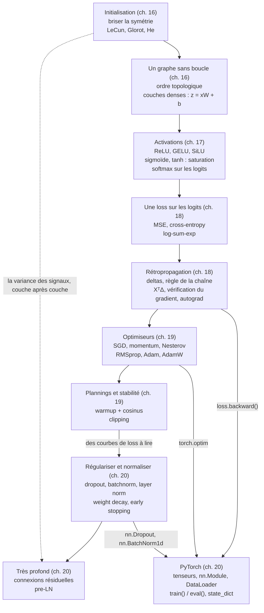

# Checkpoint IV · Synthèse de la partie IV — Réseaux de neurones

> Une page à revoir avant l'examen blanc, puis avant la partie V. Compte environ 90 minutes : redessine d'abord la carte mentale, de mémoire, récite les formules en cachant les colonnes de droite, puis relis les tableaux et dis le vocabulaire à voix haute (mode d'emploi en fin de page).

**Les cinq chapitres en une phrase chacun**

16. **Réseaux feed-forward** : un graphe orienté sans boucle de neurones, calculé couche par couche ($\mathbf{z} = \mathbf{x}\mathbf{W} + \mathbf{b}$, puis une activation), dont les poids partent au hasard, à une échelle qui conserve la variance des signaux.
17. **Fonctions d'activation** : sans non-linéarité, un réseau profond s'effondre en une seule couche affine ; la ReLU et ses variantes ont remplacé la sigmoïde et tanh dans les couches cachées, la softmax transforme des logits en probabilités.
18. **Rétropropagation** : la règle de la chaîne appliquée de la sortie vers l'entrée donne, en une passe arrière, le gradient de la loss par rapport à chaque poids ; on la vérifie par différences finies, et l'autograd la fait pour nous.
19. **Optimiseurs** : la descente de gradient par mini-batches, accélérée par le momentum, rendue adaptative par RMSprop et Adam, régularisée par le weight decay découplé d'AdamW, pilotée par un planning (warmup, cosinus) et protégée par le clipping.
20. **Deep learning et PyTorch** : une pile de couches (dense, dropout, normalisation, convolution, pooling, récurrente, utilitaires), entraînée par une boucle PyTorch, régularisée (dropout, weight decay, early stopping) et rendue très profonde par les connexions résiduelles.

## 1. Carte mentale



Redessine-la de mémoire, puis compare : chaque flèche doit pouvoir se justifier par un exemple (« la rétropropagation devient `loss.backward()` : PyTorch enregistre le graphe pendant la passe avant et le parcourt à l'envers, en **ajoutant** les gradients dans `.grad`, d'où `zero_grad()` à chaque pas, 20.15 »).

## 2. Fiche d'une page : les 24 formules clés

| # | Notion | Formule | Ce qu'il faut savoir dire | Ch. | `mylearn` |
|---|---|---|---|---|---|
| 1 | Couche dense | $\mathbf{Z} = \mathbf{X}\mathbf{W} + \mathbf{b}$, $\mathbf{X}$ de forme $(n, n_{\text{in}})$, $\mathbf{W}$ de forme $(n_{\text{in}}, n_{\text{out}})$ | une ligne par exemple ; PyTorch range `nn.Linear.weight` en $(n_{\text{out}}, n_{\text{in}})$ et calcule $\mathbf{X}\mathbf{W}^\top + \mathbf{b}$ | 16 | `nn.layers.dense_forward` |
| 2 | Nombre de paramètres | $\sum_\ell (n_{\ell-1}\,n_\ell + n_\ell)$ ; convolution : $C_{\text{out}}(C_{\text{in}}\,k_h k_w + 1)$ | la première couche dense d'un MLP sur des images en porte souvent l'essentiel | 16, 20 | `nn.layers.count_parameters` |
| 3 | Initialisations | LeCun $\operatorname{Var}(w) = \frac{1}{n_{\text{in}}}$ ; Glorot $\frac{2}{n_{\text{in}} + n_{\text{out}}}$ ; He $\frac{2}{n_{\text{in}}}$ ; loi uniforme $U(-a, a)$ : $\operatorname{Var} = \frac{a^2}{3}$ | des poids égaux restent jumeaux ; la bonne échelle garde la variance d'une couche à l'autre (He pour ReLU) | 16 | `nn.layers.init_weights`, `init_mlp` |
| 4 | ReLU et ses variantes | $\max(0, z)$ ; leaky : $z$ si $z > 0$, sinon $\alpha z$ ; dérivée en 0 : 0 (convention de PyTorch) | pente 1 sur la partie active : pas de saturation à droite ; un neurone toujours éteint est mort | 17 | `nn.activations.relu`, `leaky_relu` |
| 5 | Sigmoïde et tanh | $\sigma(z) = \frac{1}{1 + e^{-z}}$, $\sigma' = \sigma(1 - \sigma) \le \frac14$ ; $\tanh' = 1 - \tanh^2 \le 1$ | elles saturent des deux côtés : gradient minuscule ; la sigmoïde reste en sortie binaire | 17 | `nn.activations.sigmoid`, `tanh` |
| 6 | GELU, SiLU | $\text{GELU}(z) = z\,\Phi(z)$ ; $\text{SiLU}(z) = z\,\sigma(z)$ | des ReLU lissées, celles des Transformers | 17 | `nn.activations.gelu`, `silu` |
| 7 | Softmax stable | $p_k = \frac{e^{z_k - m}}{\sum_j e^{z_j - m}}$, $m = \max_j z_j$ ; $\log p_k = z_k - \operatorname{logsumexp}(\mathbf{z})$ | somme à 1, ordre conservé, invariante par translation ; une température $T$ divise les logits | 17 | `nn.activations.softmax`, `log_softmax` |
| 8 | Cross-entropy sur les logits | $L = -\frac{1}{n}\sum_i \log p_{i, y_i}$ ; $\frac{\partial L}{\partial z_{ik}} = \frac{p_{ik} - \mathbb{1}[k = y_i]}{n}$ | un gradient simple et stable : on ne met jamais de softmax avant `CrossEntropyLoss` | 18 | `nn.backward.softmax_cross_entropy` |
| 9 | BCE sur les logits | $L = \frac{1}{n}\sum_i \big(\log(1 + e^{z_i}) - y_i z_i\big)$ ; $\frac{\partial L}{\partial z_i} = \frac{\sigma(z_i) - y_i}{n}$ | `BCEWithLogitsLoss` plutôt que sigmoïde puis `BCELoss` | 18 | `nn.backward.binary_cross_entropy_with_logits` |
| 10 | Delta et règle de la chaîne | $\boldsymbol{\delta}^{(\ell)} = \frac{\partial L}{\partial \mathbf{z}^{(\ell)}} = \big(\boldsymbol{\delta}^{(\ell+1)}\,\mathbf{W}^{(\ell+1)\top}\big) \odot f'(\mathbf{z}^{(\ell)})$ | l'erreur remonte, multipliée à chaque couche par les poids et la pente de l'activation | 18 | `nn.backward.mlp_backward` |
| 11 | Gradients d'une couche dense | $\frac{\partial L}{\partial \mathbf{W}} = \mathbf{X}^\top\boldsymbol{\Delta}$, $\frac{\partial L}{\partial \mathbf{b}} = \sum_i \boldsymbol{\Delta}_i$, $\frac{\partial L}{\partial \mathbf{X}} = \boldsymbol{\Delta}\mathbf{W}^\top$ | un gradient a toujours la forme de son paramètre | 18 | `nn.backward.dense_backward` |
| 12 | Vérification du gradient | $\frac{L(w + \varepsilon) - L(w - \varepsilon)}{2\varepsilon}$, erreur relative $\frac{\lvert a - b \rvert}{\max(\lvert a \rvert + \lvert b \rvert,\ 10^{-12})}$ | différence centrée, en float64, sur quelques poids tirés au hasard | 18 | `nn.backward.gradient_check` |
| 13 | Descente de gradient | $w \leftarrow w - \eta\,\frac{\partial L}{\partial w}$ ; sur une parabole de courbure $a$, convergence si $\eta < \frac{2}{a}$ | trop grand : oscille ou diverge ; trop petit : lent ; le mini-batch donne un gradient bruité mais bon marché | 18, 19 | `optim.SGD` |
| 14 | Momentum (PyTorch) | $b_t = \mu\,b_{t-1} + g_t$ ($b_1 = g_1$), $w \leftarrow w - \eta\,b_t$ ; Nesterov : $w \leftarrow w - \eta(g_t + \mu\,b_t)$ | une bille qui roule : traverse les plateaux, amortit les zigzags ; trop de $\mu$ fait sortir de la vallée | 19 | `optim.Momentum`, `Nesterov` |
| 15 | RMSprop | $v \leftarrow \alpha v + (1 - \alpha)g^2$ (`alpha` = 0,99 dans PyTorch), $w \leftarrow w - \eta\,\frac{g}{\sqrt{v} + \epsilon}$ | un learning rate par poids, grand là où les gradients sont petits | 19 | `optim.RMSprop`, `Adagrad`, `Adadelta` |
| 16 | Adam | $m \leftarrow \beta_1 m + (1 - \beta_1) g$, $v \leftarrow \beta_2 v + (1 - \beta_2) g^2$, $\hat m = \frac{m}{1 - \beta_1^t}$, $\hat v = \frac{v}{1 - \beta_2^t}$, $w \leftarrow w - \eta\,\frac{\hat m}{\sqrt{\hat v} + \epsilon}$ | le premier pas vaut $\eta$ dans le sens opposé au signe du gradient ; défauts 0,9 ; 0,999 ; $10^{-8}$ | 19 | `optim.Adam` |
| 17 | AdamW | $w \leftarrow w\,(1 - \eta\lambda)$, puis le pas d'Adam sur le gradient brut | le weight decay couplé d'Adam est divisé par la normalisation ; AdamW pénalise tous les poids de la même façon | 19 | `optim.AdamW` |
| 18 | Warmup + cosinus | $\eta_t = \eta_0\,\frac{t}{t_w}$ puis $\eta_{\min} + (\eta_0 - \eta_{\min})\,\frac{1 + \cos(\pi\,\text{progress})}{2}$, $\text{progress} = \frac{t - t_w}{T - t_w}$ | monter doucement le temps que les moments d'Adam se stabilisent, puis descendre ; compté en pas | 19 | `optim.cosine_lr` |
| 19 | Clipping par la norme globale | si $\lVert\mathbf{g}\rVert > c$ : $\mathbf{g} \leftarrow \mathbf{g}\,\frac{c}{\lVert\mathbf{g}\rVert + 10^{-6}}$ | entre `backward()` et `step()` ; garde la direction, borne le pas | 19 | `optim.clip_grad_norm` |
| 20 | Dropout inversé | $\mathbf{y} = \mathbf{x} \odot \mathbf{m} / (1 - p)$, $m_i \sim \text{Bernoulli}(1 - p)$, un masque par valeur et par passe ; l'identité en évaluation | $\mathbb{E}[\mathbf{y}] = \mathbf{x}$ ; un ensemble implicite de sous-réseaux | 20 | `nn.regularization.dropout_forward` |
| 21 | Batchnorm | $\hat x = \frac{x - \mu_B}{\sqrt{\sigma_B^2 + \epsilon}}$ ($\sigma_B^2$ biaisée, divisée par $n$), $y = \gamma\hat x + \beta$ ; $\mu^{\text{run}} \leftarrow (1 - \rho)\,\mu^{\text{run}} + \rho\,\mu_B$, de même pour $\sigma^{2,\text{run}}$ avec la variance non biaisée ($\rho$ = `momentum` = 0,1 : ici le poids de la **nouvelle** valeur, à l'inverse de l'`alpha` de RMSprop et des $\beta$ d'Adam, poids de l'**ancienne** valeur) | statistiques du mini-batch en entraînement, glissantes en évaluation ; $\gamma$ et $\beta$ appris | 20 | `nn.regularization.batchnorm_forward` |
| 22 | Layer norm | la même normalisation, sur les features **d'un** exemple (dernier axe), avec $\gamma$ et $\beta$ | indépendante du mini-batch : identique en entraînement et en évaluation ; celle des Transformers | 20 | `nn.regularization.layer_norm` |
| 23 | Pénalité L2 | $\frac{\lambda}{2}\sum\lVert\mathbf{W}\rVert^2$, gradient $\lambda\mathbf{W}$ (le `weight_decay` de SGD) | le Ridge du ch. 9 pénalise $\alpha\lVert\mathbf{w}\rVert^2$, sans le ½, et l'ajoute à une **somme** de carrés : pour le même minimum qu'avec une loss moyenne, $\lambda = 2\alpha/n$ ; avec Adam, préférer AdamW | 20 | `nn.regularization.l2_penalty` |
| 24 | Connexion résiduelle | $\mathbf{x} \leftarrow \mathbf{x} + F(\mathbf{x})$, dérivée $\mathbf{I} + F'$ ; pre-LN : $\mathbf{x} + F(\text{LN}(\mathbf{x}))$ | le gradient garde une voie directe : on entraîne des centaines de couches | 20 | |

## 3. Diagnostiquer un entraînement

| Ce que tu vois | La cause probable | Ce que tu fais |
|---|---|---|
| La loss saute, explose ou devient `nan` | learning rate trop grand ; gradients qui explosent ; une division par zéro, un `log(0)` | diviser $\eta$ par 3 à 10 ; clipping ; losses sur les logits ; vérifier les entrées |
| La loss baisse à peine, sans saut | learning rate trop petit ; un neurone de sortie saturé ; des gradients effacés (`zero_grad` mal placé) | augmenter $\eta$ (un balayage du learning rate) ; vérifier l'ordre `zero_grad`, `backward`, `step` |
| La loss reste à $\ln K$ (le hasard sur $K$ classes) | des poids qui ne bougent pas : gradients nuls, ReLU mortes, `requires_grad` oublié, une couche dans une liste ordinaire | `model.parameters()` non vide ; gradients non nuls après `backward()` ; initialisation He |
| La loss ne descend pas sous un plancher, autour de 1,5 à 10 classes | une softmax avant `CrossEntropyLoss` | donner les logits à la loss |
| L'entraînement tend vers 0, la validation remonte | overfitting | plus de données, dropout, weight decay, augmentation, early stopping |
| Validation et entraînement hauts et collés | underfitting | un modèle plus grand, plus d'epochs, moins de régularisation |
| La validation saute d'une mesure à l'autre, au niveau de l'entraînement | `model.eval()` oublié (le dropout reste actif) | `model.eval()` et `torch.no_grad()` pour mesurer, `model.train()` pour reprendre |
| La validation sous l'entraînement | le dropout pendant l'entraînement, la loss moyennée pendant l'epoch | normal ; seule une validation **trop** belle et collée à l'entraînement fait soupçonner une fuite |
| La mémoire grossit au fil de l'epoch | `total += loss` (un tenseur qui garde l'historique de l'autograd ; tout le graphe sans `backward()` ni `no_grad`, en évaluation) | `loss.item()` |
| La loss de validation devient `nan`, celle d'entraînement reste finie | une valeur manquante ou infinie dans les données de validation ; un `log(0)` dans une loss écrite à la main, sur des probabilités exactement nulles | vérifier les entrées (`np.isfinite`) ; calculer les losses sur les logits |

## 4. La boucle d'entraînement PyTorch, et ses pièges

```python
model = MLP().to(device)
optimizer = torch.optim.AdamW(model.parameters(), weight_decay=1e-2)   # once, before the loop
# OneCycleLR sets the learning rate at each step (it starts at max_lr / 25)
scheduler = torch.optim.lr_scheduler.OneCycleLR(optimizer, max_lr=3e-3, total_steps=n_epochs * len(train_loader))
loss_fn = nn.CrossEntropyLoss()                                                 # takes logits
for epoch in range(n_epochs):
    model.train()                                         # dropout on, batchnorm on batch statistics
    for X, y in train_loader:                             # DataLoader(shuffle=True, generator=...)
        X, y = X.to(device), y.to(device)
        loss = loss_fn(model(X), y)
        optimizer.zero_grad()                             # gradients accumulate otherwise
        loss.backward()
        torch.nn.utils.clip_grad_norm_(model.parameters(), max_norm=1.0)
        optimizer.step()
        scheduler.step()                                  # OneCycleLR counts in steps: once per mini-batch
    model.eval()                                          # dropout off, batchnorm on running statistics
    with torch.no_grad():
        val_loss = sum(loss_fn(model(X.to(device)), y.to(device)).item() * len(y)
                       for X, y in val_loader) / len(val_loader.dataset)
    # early stopping on val_loss: keep copy.deepcopy(model.state_dict()) at each improvement
```

| Pièce | Le piège | La règle |
|---|---|---|
| `nn.Module` | des couches rangées dans une liste Python ordinaire | `nn.ModuleList`, `nn.Sequential` : sinon `parameters()` ne les voit pas |
| La loss | softmax puis `CrossEntropyLoss`, sigmoïde puis `BCELoss` | des logits, et les losses « with logits » |
| Les gradients | `backward()` additionne dans `.grad` | `zero_grad()` à chaque pas, avant `backward()` |
| Les modes | `model.eval()` oublié, ou `model.train()` jamais remis | changer de mode à chaque passage entraînement ↔ mesure |
| Le device | un modèle sur GPU, des données sur CPU | `.to(device)` pour les deux |
| La sauvegarde | `torch.save(model)`, un `state_dict` sans copie profonde | `state_dict()`, `copy.deepcopy` pour garder les meilleurs poids, l'optimiseur et les générateurs dans un checkpoint |
| La reproductibilité | un générateur de `DataLoader` partagé, des graines non fixées | `torch.manual_seed`, un `torch.Generator` par chargeur |

## 5. Choisir

| Question | Le choix par défaut | Quand faire autrement |
|---|---|---|
| Activation cachée | ReLU (GELU ou SiLU dans les Transformers) | leaky ReLU si beaucoup de neurones meurent |
| Sortie et loss | logits + `CrossEntropyLoss` ($K$ classes) ; un logit + `BCEWithLogitsLoss` (binaire, multi-étiquette) ; linéaire + MSE (régression) | Huber si des valeurs aberrantes |
| Initialisation | celle de PyTorch (`nn.Linear` : uniforme, variance $\frac{1}{3 n_{\text{in}}}$), ou He pour un réseau ReLU profond | Glorot pour tanh |
| Optimiseur | AdamW, $\eta \approx 10^{-3}$ | SGD avec momentum et un planning, souvent meilleur en vision s'il est bien réglé |
| Planning | warmup puis cosinus, ou `OneCycleLR` | `ReduceLROnPlateau` sur la loss de validation |
| Taille de mini-batch | 32 à 256 | plus grand pour aller vite (en augmentant $\eta$), plus petit si la mémoire manque |
| Normalisation | batchnorm pour les CNN, layer norm pour les Transformers et les petits mini-batches | aucune pour un petit MLP |
| Régularisation | weight decay + early stopping ; dropout dans les couches denses | plus de données avant tout |
| Réseau très profond | connexions résiduelles + normalisation (pre-LN) | |

## 6. Qui sert à quoi plus tard

| Module (chapitre) | Ce que tu y as écrit | Où il revient |
|---|---|---|
| `nn.layers` (ch. 16) | `count_parameters`, `dense_forward`, `init_weights`, `init_mlp`, `mlp_forward`, `topological_order` | le mini-projet MP4 (la couche `Dense` de `minifw`) ; les couches de la partie V |
| `nn.activations` (ch. 17) | dix activations et leurs dérivées, `get_activation`, softmax, log-softmax, la Jacobienne de la softmax | MP4 ; GELU et softmax de l'attention (B3) |
| `nn.backward`, `autograd_mini` (ch. 18) | losses sur les logits et leurs gradients, `dense_backward`, `mlp_backward`, `gradient_check`, `Value` | MP4 (chaque couche validée contre PyTorch) ; la convolution et la récurrence en NumPy (ch. 21, 22) |
| `optim` (ch. 19) | SGD, momentum, Nesterov, Adagrad, RMSprop, Adadelta, Adam, AdamW, plannings, clipping | MP4 (la boucle de `minifw`) ; tout entraînement PyTorch (`torch.optim` suit les mêmes conventions) |
| `nn.regularization` (ch. 20) | dropout, batchnorm, layer norm, pénalité L2, `EarlyStopping` | MP4 (`Dropout`, `BatchNorm1d`) ; la layer norm des Transformers (B3) |

## 7. Vocabulaire à maîtriser à l'oral

Dis chaque définition à voix haute, avec un exemple, **avant** d'ouvrir la réponse.

<details><summary><b>Réseau feed-forward</b></summary>Un réseau dont le graphe n'a pas de boucle : l'information va de l'entrée vers la sortie, chaque neurone calculé après tous ses parents (un ordre topologique). La passe arrière n'est pas une boucle : c'est un autre calcul, sur le même graphe.</details>
<details><summary><b>Logits</b></summary>Les sorties brutes de la dernière couche, avant la softmax : des nombres réels, de n'importe quel signe. Les losses de PyTorch les prennent directement.</details>
<details><summary><b>Saturation, gradient évanescent</b></summary>Une sigmoïde ou une tanh loin de 0 a une pente presque nulle ; empilées, ces pentes se multiplient et le gradient des premières couches s'éteint (au plus $\left(\frac14\right)^L$ pour des sigmoïdes à poids de taille au plus 1).</details>
<details><summary><b>Neurone mort</b></summary>Un neurone ReLU dont la somme est négative pour tous les exemples : sa sortie et son gradient sont nuls, il n'apprend plus. Causes : un grand pas, un biais trop négatif, une mauvaise initialisation.</details>
<details><summary><b>Delta</b></summary>La dérivée de la loss par rapport à la somme pondérée d'un neurone, $\partial L / \partial z$ : c'est elle que la rétropropagation fait remonter, et le gradient d'un poids vaut le delta de son neurone d'arrivée fois l'activation de son neurone de départ.</details>
<details><summary><b>Autograd</b></summary>La différentiation automatique : PyTorch enregistre les opérations de la passe avant dans un graphe, puis `backward()` applique la règle de la chaîne en le parcourant à l'envers et ajoute les gradients dans `.grad`.</details>
<details><summary><b>Epoch, mini-batch, mise à jour</b></summary>Une epoch est un passage sur tout l'entraînement ; elle compte autant de mises à jour que de mini-batches ($\lceil n / B \rceil$).</details>
<details><summary><b>Momentum</b></summary>Une moyenne des gradients passés qui sert de vitesse : elle accélère dans les directions constantes et amortit les oscillations.</details>
<details><summary><b>Adam, correction de biais</b></summary>Adam garde une moyenne mobile des gradients et de leurs carrés ; parties de zéro, elles sont trop petites au début : on les divise par $1 - \beta^t$.</details>
<details><summary><b>Weight decay découplé</b></summary>Réduire chaque poids d'un facteur $1 - \eta\lambda$ à chaque pas, à part du gradient (AdamW), plutôt que d'ajouter $\lambda w$ au gradient (que la normalisation d'Adam diviserait).</details>
<details><summary><b>Warmup</b></summary>Monter le learning rate de 0 à sa valeur pendant les premiers pas, le temps que les statistiques de l'optimiseur se stabilisent.</details>
<details><summary><b>Gradient clipping</b></summary>Ramener la norme globale des gradients à un plafond quand elle le dépasse, sans changer leur direction : une protection contre les pas énormes.</details>
<details><summary><b>Dropout</b></summary>Mettre à zéro chaque valeur avec la probabilité $p$ pendant l'entraînement (et diviser les autres par $1 - p$) ; l'identité en évaluation. Il empêche les neurones de compter les uns sur les autres.</details>
<details><summary><b>Batchnorm, layer norm</b></summary>Normaliser chaque feature sur le mini-batch (batchnorm : statistiques glissantes en évaluation), ou les features de chaque exemple (layer norm : le même calcul partout), puis appliquer $\gamma$ et $\beta$ appris.</details>
<details><summary><b>Early stopping</b></summary>Arrêter quand la loss de validation ne s'est pas améliorée depuis `patience` epochs, et recharger les poids de la meilleure epoch (une copie profonde).</details>
<details><summary><b>Connexion résiduelle</b></summary>Ajouter l'entrée d'un bloc à sa sortie, $x + F(x)$ : le bloc n'apprend que la correction, et le gradient traverse par l'identité.</details>
<details><summary><b>`state_dict`, checkpoint</b></summary>Le dictionnaire des paramètres et des buffers d'un module (ou de l'état d'un optimiseur) ; un checkpoint y ajoute l'epoch et les générateurs aléatoires pour reprendre un entraînement à l'identique.</details>
<details><summary><b>Explication satisfaisante</b></summary>Une explication qui nomme les facteurs décisifs, dit pourquoi ils sont légitimes et ce qui changerait la décision, plutôt que de montrer tous les calculs (une explication complète, souvent inutile).</details>

## Mode d'emploi (≈ 90 minutes)

1. **15 min** : redessine la carte mentale, de mémoire, puis compare avec la section 1.
2. **30 min** : cache les colonnes « Formule » et « Ce qu'il faut savoir dire » de la section 2 ; pour chaque notion, réécris la formule et invente un exemple chiffré (un petit réseau de ton choix, quelques pas d'un optimiseur).
3. **15 min** : réécris de mémoire la boucle de la section 4, puis compare ; pour chaque ligne de la section 3, retrouve l'exercice où tu as vu ce symptôme.
4. **15 min** : le vocabulaire de la section 7, à voix haute.
5. **15 min** : les flashcards en retard des chapitres 16 à 20.

Ensuite : l'examen blanc (`01_examen_sujet.md`), en conditions réelles, puis le mini-projet (`projets/partie_4_mini_framework/`).
