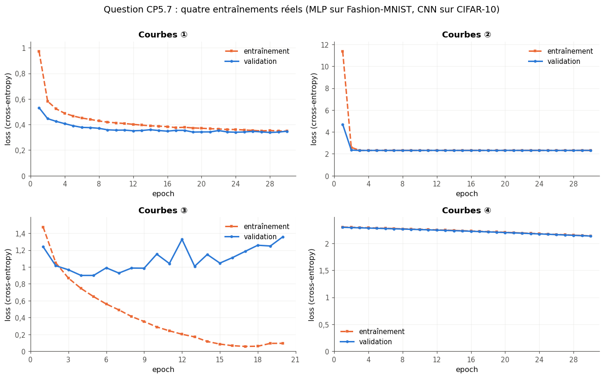

# Checkpoint V · Examen blanc de la partie V — Architectures : CNN, RNN, PyTorch en pratique

| | |
|---|---|
| **Durée** | 116 minutes (2 h au plus), d'une traite |
| **Note** | sur 20 points ; 2 points (10 %) portent sur les parties III et IV (CP5.10) |
| **Chapitres** | 21 à 24 (réseaux convolutifs, réseaux récurrents, PyTorch en pratique 1 et 2), plus les chapitres 15 et 18 |
| **Ta copie** | `04_mes_reponses.md` (ou une feuille de papier) ; les deux questions de code se font dans `02_examen_notebook.ipynb`, partie A |
| **Après** | la partie B du notebook vérifie ton code et tes réponses chiffrées ; `03_examen_corrige.md` donne le corrigé détaillé, le barème et la remédiation |

## Règles

- **Livre, fiches, notes, flashcards et corrigés fermés.** Pas d'assistant IA, pas de recherche sur le web.
- **Calculatrice autorisée** pour les questions papier, ou Python comme simple calculatrice (`+`, `*`, `**`, `math.sqrt`, `math.exp`, `math.tanh`, `math.log`), sans NumPy, sans PyTorch et sans exécuter les extraits de CP5.1 et CP5.4.
- **Questions de code** (CP5.5 et CP5.6), dans le notebook de l'examen : NumPy pour CP5.5, PyTorch pour CP5.6 ; `help()` et les documentations officielles de NumPy et de PyTorch sont permis, ni `mylearn`, ni `mylearn_ref`, ni les notebooks des chapitres.
- Donne le nombre de décimales demandé, et **n'arrondis qu'à la fin** du calcul. Quand une question dit « justifie » ou « montre », une réponse sans justification ne rapporte qu'une partie des points.
- **Conventions** : celles de PyTorch. Une image est un tenseur `(N, C, H, W)` ; une séquence est `(temps, batch, features)` sauf `batch_first=True`, qui donne `(batch, temps, features)` ; une couche dense calcule $\mathbf{Z} = \mathbf{X}\mathbf{W} + \mathbf{b}$, avec $\mathbf{W}$ de forme $(n_{\text{in}}, n_{\text{out}})$ ; un compte de paramètres inclut les biais (les couches récurrentes de PyTorch en ont deux par bloc, `b_ih` et `b_hh`) ; une « forme » s'écrit comme un tuple, par exemple `(8, 16, 28, 28)`.
- Les durées sont indicatives : commence par ce que tu sais faire ; si tu bloques, passe à la question suivante et reviens-y à la fin.

| Question | Type | Sujet | Points | ⏱️ |
|---|---|---|---|---|
| CP5.1 | 🔮 | Forme de sortie ou erreur ? Six extraits PyTorch à prédire sans les exécuter | 2 | 10 min |
| CP5.2 | ✏️ | Formes, paramètres et champ récepteur d'un petit CNN pour CIFAR-10 | 2,5 | 15 min |
| CP5.3 | ✏️ | Un pas de LSTM à la main | 2 | 10 min |
| CP5.4 | 🐛 | Formes et `batch_first` : quatre bugs de CNN et de RNN (sur papier) | 2 | 10 min |
| CP5.5 | 🔨 | Écrire `rnn_forward` à partir d'une cellule fournie (notebook, NumPy) | 1,5 | 10 min |
| CP5.6 | 🔨 | Entraîner avec early stopping et garder le meilleur modèle (notebook, PyTorch) | 2 | 15 min |
| CP5.7 | 📈 | Diagnostiquer quatre paires de courbes d'entraînement | 1 | 6 min |
| CP5.8 | 🧮 | Fermi : paramètres et durée d'une epoch d'un générateur de texte LSTM | 1 | 5 min |
| CP5.9 | 🗣️ | Choisir et justifier une architecture pour trois projets | 1 | 5 min |
| CP5.10 | ✏️ | Retour sur les parties III et IV : Pipeline sans fuite et gradient d'une couche dense | 2 | 10 min |
| CP5.11 | 🧠 | Questions flash : paramètres et tailles de quatre couches | 1 | 5 min |
| CP5.12 | ∂ | Rétropropager dans une convolution 1D | 1 | 7 min |
| CP5.13 | 💼 | `model.eval()` et `torch.inference_mode()` : à quoi servent-ils ? | 0,5 | 4 min |
| CP5.14 | ⚖️ | « Le modèle B gagne 0,8 point » sur une seule graine : que peut-on écrire au client ? | 0,5 | 4 min |
| | | **Total** | **20** | **116 min** |

---

### CP5.1 — Forme de sortie ou erreur ? Six extraits PyTorch à prédire sans les exécuter 🔮 ★ ⏱️ 10 min · 2 points

**Sans rien exécuter**, donne pour chaque extrait la forme du tenseur obtenu, ou « erreur » si l'extrait lève une erreur (0,25 point chacun ; les imports `torch` et `torch.nn as nn` sont omis).

a) `nn.Conv2d(3, 16, kernel_size=5)(torch.zeros(8, 3, 32, 32)).shape`
b) `nn.Conv2d(3, 16, kernel_size=3, padding=1)(torch.zeros(8, 32, 32, 3)).shape`
c) `nn.MaxPool2d(2)(torch.zeros(1, 4, 7, 7)).shape`
d) `nn.LSTM(10, 20, num_layers=2)(torch.zeros(4, 7, 10))[1][0].shape`
e) `nn.GRU(10, 20, batch_first=True, bidirectional=True)(torch.zeros(4, 7, 10))[0].shape`
f) `nn.Linear(16, 5)(torch.zeros(2, 3, 16)).shape`
g) Pour chaque extrait qui lève une erreur : pourquoi, et la correction en une ligne (avec la forme qu'on obtient alors). Pour d) : que représentent les trois nombres de la forme ? **[0,5]**

### CP5.2 — Formes, paramètres et champ récepteur d'un petit CNN pour CIFAR-10 ✏️ ★★ ⏱️ 15 min · 2,5 points

Un CNN reçoit **une** image CIFAR-10, un tenseur `(1, 3, 32, 32)` :

```python
model = nn.Sequential(
    nn.Conv2d(3, 16, 3, padding=1), nn.ReLU(), nn.MaxPool2d(2),               # bloc A
    nn.Conv2d(16, 32, 3, padding=1), nn.ReLU(), nn.MaxPool2d(2),              # bloc B
    nn.Conv2d(32, 64, 3, stride=2, padding=1), nn.ReLU(),                     # convolution C
    nn.AdaptiveAvgPool2d(1), nn.Flatten(), nn.Linear(64, 10))                 # tête
```

a) La forme de la sortie du bloc A. **[0,2]**
b) La forme de la sortie du bloc B. **[0,2]**
c) La forme de la sortie de la convolution C (après sa ReLU). **[0,2]**
d) Le nombre de paramètres des quatre couches qui en ont, dans l'ordre, puis le total (une liste de cinq nombres). **[0,6]**
e) Le nombre de multiplications-additions (MAC) de la convolution C pour cette image, sans compter les biais. **[0,4]**
f) Le champ récepteur, en pixels de l'image, d'une valeur de la sortie de la convolution C (le côté du carré d'entrée dont elle dépend ; ignore les bords). **[0,6]**
g) Pourquoi `AdaptiveAvgPool2d(1)` plutôt que `Flatten()` directement après la convolution C ? Donne le nombre de paramètres de la couche dense dans ce second cas, et une autre conséquence. **[0,3]**

### CP5.3 — Un pas de LSTM à la main ✏️ ★ ⏱️ 10 min · 2 points

Un LSTM à une entrée et un seul neurone (`hidden_size = 1`), dans l'ordre des portes de PyTorch : entrée $i$, oubli $f$, proposition $g$, sortie $o$. Ses poids d'entrée valent $(0{,}5 ;\ 1 ;\ 0{,}25 ;\ -0{,}5)$ et ses biais (déjà additionnés) $(-1 ;\ 0 ;\ 0 ;\ 1)$, dans cet ordre ; l'état de départ est $h_0 = 0$ (ses poids récurrents ne servent donc pas ici) et la cellule de départ $c_0 = 0{,}5$. Il reçoit $x_1 = 2$.

$$i = \sigma(\cdot),\quad f = \sigma(\cdot),\quad g = \tanh(\cdot),\quad o = \sigma(\cdot),\qquad c_1 = f\,c_0 + i\,g,\qquad h_1 = o\,\tanh(c_1)$$

a) Les quatre valeurs $[i, f, g, o]$ (4 décimales). **[0,6]**
b) La cellule $c_1$ (4 décimales). **[0,4]**
c) L'état $h_1$ (4 décimales). **[0,4]**
d) Le nombre de paramètres de `nn.LSTM(10, 20)` (une couche). **[0,3]**
e) Pourquoi la mise à jour **additive** $c_t = f\,c_{t-1} + i\,g$ aide-t-elle le gradient à traverser de longues séquences, là où un RNN simple le perd ? Une ou deux phrases. **[0,3]**

### CP5.4 — Formes et `batch_first` : quatre bugs de CNN et de RNN (sur papier) 🐛 ★★ ⏱️ 10 min · 2 points

Un collègue compare deux classifieurs sur un mini-batch de 64 images de Fashion-MNIST : un petit CNN, et un LSTM qui lit chaque image ligne par ligne (28 pas de temps de 28 pixels). `X_train` est un tableau NumPy `(N, 28, 28)` d'entiers de 0 à 255 et `y_train` ses labels ; les imports sont omis. Le script contient **quatre** lignes fautives :

```python
images = torch.from_numpy(X_train[:64]).float() / 255                    # (A)  (64, 28, 28)
x = images.unsqueeze(-1)                                                 # (B)  ajoute l'axe des canaux
conv = nn.Sequential(nn.Conv2d(1, 8, 3, padding=1), nn.ReLU(), nn.MaxPool2d(2))   # (C)
head = nn.Linear(8 * 28 * 28, 10)                                        # (D)
logits_cnn = head(conv(x).flatten(1))                                    # (E)
lstm = nn.LSTM(input_size=28, hidden_size=64)                            # (F)
fc = nn.Linear(64, 10)                                                   # (G)
out, (h_n, c_n) = lstm(images)                                           # (H)  (batch, temps, features)
logits_rnn = fc(out[:, 0])                                               # (I)  un vecteur par image
labels = torch.from_numpy(y_train[:64])                                  # (J)
loss = F.cross_entropy(logits_cnn, labels) + F.cross_entropy(logits_rnn, labels)   # (K)
```

a) Les lettres des quatre lignes fautives (par exemple `"ACEG"`). Une erreur peut se déclarer plus loin que sa cause : on demande la ligne **à corriger**. **[1]**
b) Pour chacune : la correction, et ce qui se passe sans elle (une erreur, à quelle ligne et pourquoi, ou un résultat faux sans message). **[1]**

### CP5.5 — Écrire `rnn_forward` à partir d'une cellule fournie 🔨 ★ ⏱️ 10 min · 1,5 point

**Dans le notebook de l'examen, partie A, avec NumPy seulement.** La fonction fournie `rnn_cell(x_t, h, Wx, Wh, b)` fait un pas d'un RNN simple pour un mini-batch : $h_t = \tanh(x_t W_x + h_{t-1} W_h + b)$, avec `x_t` de forme `(N, D)` et `h` de forme `(N, H)`.

a) `rnn_forward(X, h0, Wx, Wh, b)` reçoit `X` de forme `(N, T, D)` (batch, temps, features : la convention `batch_first=True`) et l'état de départ `h0`, de forme `(N, H)`. Elle rend le couple `(H_all, h_last)` : `H_all`, de forme `(N, T, H)`, où `H_all[:, t]` est l'état **après** le pas `t` (`h0` n'y figure pas), et `h_last`, l'état après le dernier pas, de forme `(N, H)`. Elle ne modifie pas `X`. **[1,2]**
b) Avec les données de la cellule (`X_S`, `H0_S`, `WX_S`, `WH_S`, `B_S`), reporte `H_all[1, 4, 0]` (4 décimales). **[0,3]**

### CP5.6 — Entraîner avec early stopping et garder le meilleur modèle 🔨 ★★ ⏱️ 15 min · 2 points

**Dans le notebook de l'examen, partie A, avec PyTorch.** `make_cnn()` rend un petit CNN neuf (avec dropout, en `float64`) et `make_loaders()` le couple `(train_loader, val_loader)` sur 2 048 et 1 024 images de Fashion-MNIST ; les mini-batches de validation ont 300 images, sauf le dernier (124).

a) `fit_early_stopping(model, train_loader, val_loader, max_epochs, patience, path, lr=1e-3)` : **[1,6]**
- crée **un** optimiseur, `torch.optim.Adam(model.parameters(), lr=lr)` ;
- à chaque epoch (numérotées à partir de 1, au plus `max_epochs`) : en mode entraînement, un passage sur `train_loader` (cross-entropy moyenne du mini-batch sur les logits, `zero_grad`, `backward`, `step`) ; la loss d'entraînement de l'epoch est la moyenne **par exemple** des losses des mini-batches (chacune pesée par son nombre d'exemples) ; puis, en mode évaluation et sans gradient, la loss de validation : la cross-entropy moyenne **par exemple** sur tout `val_loader` ;
- si la loss de validation est **strictement** plus petite que la meilleure vue jusque-là, sauvegarde `model.state_dict()` dans `path` (`torch.save`) et retient l'epoch ; sinon, compte une epoch sans progrès ; l'entraînement s'arrête dès que `patience` epochs **de suite** n'ont pas progressé ;
- à la fin, recharge dans `model` les poids sauvegardés (`torch.load(path, weights_only=True)`) et rend le dictionnaire `{"train_loss": [...], "val_loss": [...], "best_epoch": k}` : une valeur (un `float`) par epoch faite, et l'epoch des poids gardés, numérotée à partir de 1.

b) La cellule d'essai entraîne `make_cnn()` sur `make_loaders()` avec `max_epochs=30`, `patience=3` et `lr=3e-3` (une dizaine de secondes) : reporte $[\text{best\_epoch}, \text{loss de validation à cette epoch}]$ (4 décimales). **[0,4]**

### CP5.7 — Diagnostiquer quatre paires de courbes d'entraînement 📈 ★ ⏱️ 6 min · 1 point

La figure (`figures/cp5_7_courbes.png`, reproduite ci-dessous) montre quatre entraînements réels : pour chacun, la loss d'entraînement (moyenne des mini-batches **pendant** l'epoch, en mode entraînement) et la loss de validation (mesurée **après** l'epoch, en mode évaluation). ① : un MLP 784-32-32-10 avec dropout, sur Fashion-MNIST ; ② et ④ : le même MLP, sans dropout ni batchnorm, avec deux réglages d'Adam ; ③ : un CNN profond avec batchnorm, sans dropout, sur 20 000 images de CIFAR-10.



Pour chaque paire de courbes, donne la lettre du diagnostic le plus probable (une lettre par paire, 0,25 point chacune ; deux diagnostics ne servent pas) :
(A) un learning rate beaucoup trop grand · (B) de l'overfitting · (C) le dropout, actif pendant l'entraînement seulement · (D) des labels mélangés au hasard dans le dataset d'entraînement · (E) un learning rate beaucoup trop petit · (F) `model.eval()` oublié avant la validation.

a) Les courbes ①. b) Les courbes ②. c) Les courbes ③. d) Les courbes ④.

### CP5.8 — Fermi : paramètres et durée d'une epoch d'un générateur de texte LSTM 🧮 ★ ⏱️ 5 min · 1 point

Un générateur de texte au niveau des mots : `nn.Embedding(10_000, 256)`, puis `nn.LSTM(256, 512)` (une couche), puis `nn.Linear(512, 10_000)`. Une epoch voit $10^6$ tokens. Comme au ch. 23, compte 6 FLOP par paramètre et par token pour l'entraînement (2 pour la passe avant, 4 pour la passe arrière). Des estimations de tête suffisent ; chaque item vaut 0,25 point.

a) Son nombre de paramètres, en millions (1 décimale).
b) La part de la couche de sortie dans ce total, en pourcentage (arrondi à l'unité).
c) Le nombre de FLOP d'une epoch, en unités de $10^{13}$ (1 décimale).
d) La durée d'une epoch, en secondes (arrondie à l'unité), sur une machine qui fait réellement $10^{13}$ FLOP par seconde.

### CP5.9 — Choisir et justifier une architecture pour trois projets 🗣️ ★★ ⏱️ 5 min · 1 point

Pour chaque projet, en deux ou trois phrases : l'architecture que tu essaierais d'abord, une raison, et un piège à éviter. **[1]**

1. Repérer des rayures sur des photos de pièces métalliques : 2 000 photos étiquetées « défaut » ou « sans défaut ».
2. Prévoir la consommation électrique d'un bâtiment heure par heure pour le lendemain, à partir de deux ans d'historique horaire.
3. Ranger des messages courts de clients (une ou deux phrases) dans cinq catégories, avec 8 000 messages étiquetés.

### CP5.10 — Retour sur les parties III et IV : Pipeline sans fuite et gradient d'une couche dense ✏️ ★ ⏱️ 10 min · 2 points

**Ch. 15.** On évalue `pipe = Pipeline([("scaler", StandardScaler()), ("svc", SVC())])` par `cross_val_score(pipe, X, y, cv=KFold(3))` (sans mélange), sur une seule feature dont les six valeurs sont, dans l'ordre, $x = (1, 2, 3, 4, 5, 9)$.

a) Dans le premier fold : la moyenne et l'écart-type que le scaler apprend, $[\mu, \sigma]$ (4 décimales ; $\sigma$ divise par $n$, comme `StandardScaler`). **[0,3]**
b) La valeur standardisée de l'exemple de test $x = 2$ dans ce fold (3 décimales). **[0,3]**
c) On lance ensuite `GridSearchCV(pipe, {"svc__C": [0.1, 1, 10, 100]}, cv=3)`, avec `refit=True` (le défaut). Combien de fois, en tout, le scaler est-il ajusté (`fit`) ? **[0,2]**

**Ch. 18.** Une couche dense $\mathbf{Z} = \mathbf{X}\mathbf{W} + \mathbf{b}$ reçoit un mini-batch de deux exemples à deux features ; la rétropropagation lui apporte $\partial L / \partial \mathbf{Z}$ :

$$\mathbf{X} = \begin{pmatrix} 1 & 2 \\ 0 & -1 \end{pmatrix}, \quad \mathbf{W} = \begin{pmatrix} 1 & 0 & -1 \\ 2 & 1 & 0 \end{pmatrix}, \quad \frac{\partial L}{\partial \mathbf{Z}} = \begin{pmatrix} 0{,}5 & -1 & 0 \\ 1 & 0 & 2 \end{pmatrix}.$$

d) $\partial L / \partial \mathbf{W}$ (une liste de deux lignes). **[0,4]**
e) $\partial L / \partial \mathbf{b}$ (une liste). **[0,3]**
f) $\partial L / \partial \mathbf{X}$ (une liste de deux lignes). **[0,5]**

### CP5.11 — Questions flash : paramètres et tailles de quatre couches 🧠 ★ ⏱️ 5 min · 1 point

Réponds sans justifier ; chaque item vaut 0,25 point.

a) Le nombre de paramètres de `nn.Conv1d(4, 8, kernel_size=5)`.
b) Le nombre de paramètres de `nn.GRU(10, 20)` (une couche).
c) La hauteur de la sortie de `nn.ConvTranspose2d(8, 4, kernel_size=4, stride=2, padding=1)` sur une entrée `(1, 8, 16, 16)`.
d) Le nombre de paramètres de `nn.Embedding(5000, 64)`.

### CP5.12 — Rétropropager dans une convolution 1D ∂ ★★ ⏱️ 7 min · 1 point

Une convolution 1D à un canal, comme `nn.Conv1d(1, 1, kernel_size=2)` (une corrélation croisée, sans padding, stride 1), de noyau $(w_1, w_2)$ et de biais $b$, sur une entrée $\mathbf{x} = (x_1, x_2, x_3, x_4)$ :

$$y_t = w_1\,x_t + w_2\,x_{t+1} + b, \qquad t = 1, 2, 3, \qquad L = \frac{1}{2}\sum_{t=1}^{3} y_t^2.$$

a) Avec $\mathbf{x} = (1 ;\ 2 ;\ -1 ;\ 3)$, $(w_1, w_2) = (1, -1)$ et $b = 0$ : la sortie $(y_1, y_2, y_3)$ (une liste). **[0,2]**
b) Montre que $\dfrac{\partial L}{\partial w_1} = \sum_t y_t\,x_t$, puis écris de même $\dfrac{\partial L}{\partial w_2}$ et $\dfrac{\partial L}{\partial b}$. D'où vient la somme sur $t$ ? **[0,3]**
c) Les valeurs $\left[\dfrac{\partial L}{\partial w_1}, \dfrac{\partial L}{\partial w_2}, \dfrac{\partial L}{\partial b}\right]$ pour les nombres de a). **[0,3]**
d) Le gradient par rapport à l'entrée, $\left(\dfrac{\partial L}{\partial x_1}, \dots, \dfrac{\partial L}{\partial x_4}\right)$ (une liste). **[0,2]**

### CP5.13 — `model.eval()` et `torch.inference_mode()` : à quoi servent-ils ? 💼 ★ ⏱️ 4 min · 0,5 point

Le recruteur : « Dans votre code d'évaluation, vous écrivez `model.eval()` puis `with torch.inference_mode():`. Que fait chacun, et que se passe-t-il si l'on oublie l'un ou l'autre avec un réseau qui a du dropout et de la batchnorm ? » Réponds comme à l'oral, en quelques phrases. **[0,5]**

### CP5.14 — « Le modèle B gagne 0,8 point » sur une seule graine : que peut-on écrire au client ? ⚖️ ★★ ⏱️ 4 min · 0,5 point

Ton équipe livre à un hôpital un classifieur de radiographies. Un collègue a entraîné une fois l'architecture A et une fois l'architecture B, et veut écrire dans le rapport : « B est meilleur que A : 91,3 % d'accuracy de test contre 90,5 % ». En trois ou quatre phrases : pourquoi cette phrase n'est pas encore justifiée, ce qu'il faudrait faire (ou écrire) à la place, et pourquoi c'est une question d'honnêteté envers le client, pas seulement de méthode. **[0,5]**
