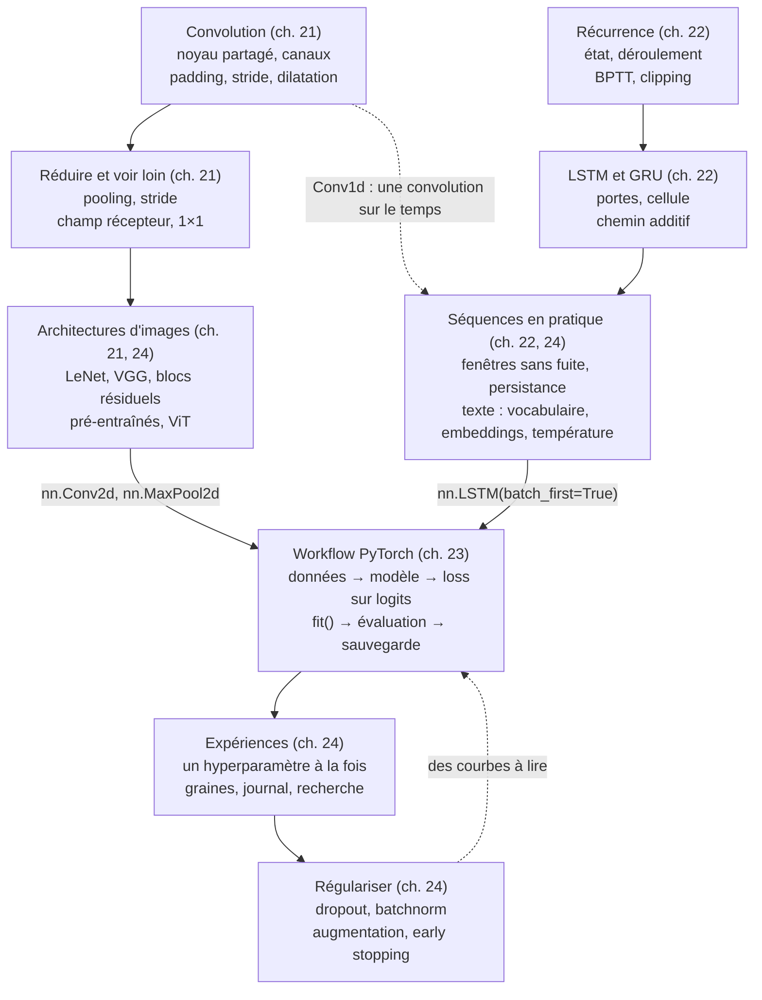

# Checkpoint V · Synthèse de la partie V — Architectures : CNN, RNN, PyTorch en pratique

> Une page à revoir avant l'examen blanc, puis avant la partie VI. Compte environ 90 minutes : redessine d'abord la carte mentale, de mémoire, récite les formules en cachant les colonnes de droite, puis relis les tableaux et dis le vocabulaire à voix haute (mode d'emploi en fin de page).

**Les quatre chapitres en une phrase chacun**

21. **Réseaux convolutifs** : un même petit filtre promené sur toute l'image (partage de poids), des cartes de features de plus en plus abstraites et de plus en plus petites (stride, pooling), un champ récepteur qui grandit couche après couche, et des réseaux qu'on sait aussi tromper (exemples adversariaux).
22. **Réseaux récurrents** : un état qui porte la mémoire d'un pas de temps au suivant, avec les mêmes poids à chaque pas ; la rétropropagation dans le temps multiplie les dérivées, d'où les gradients évanescents ou explosifs, que le chemin additif du LSTM (et du GRU) contourne.
23. **PyTorch en pratique (1)** : un workflow complet et reproductible, des données (tenseurs `float32`, `(N, C, H, W)`, split stratifié, normalisation apprise sur l'entraînement) au modèle sauvegardé et rechargé, en passant par une boucle `fit()` avec validation, meilleur checkpoint, planning de learning rate et early stopping.
24. **PyTorch en pratique (2)** : améliorer un modèle par des expériences contrôlées (un hyperparamètre à la fois, plusieurs graines, un journal), régulariser (dropout, batchnorm, augmentation), valider sans fuite, et sortir de `nn.Sequential` (branches, poids partagés, blocs résiduels, séquences et texte).

## 1. Carte mentale



Redessine-la de mémoire, puis compare : chaque flèche doit pouvoir se justifier par un exemple (« une convolution 1D sur le temps lit aussi une séquence : un noyau de taille $k$ regarde $k$ pas d'un coup, en parallèle, là où un RNN avance pas à pas, 21.20, 22.R1 »).

## 2. Fiche d'une page : les 22 formules clés

| # | Notion | Formule | Ce qu'il faut savoir dire | Ch. | `mylearn` |
|---|---|---|---|---|---|
| 1 | Taille de sortie | $\left\lfloor \frac{n + 2p - d(k - 1) - 1}{s} \right\rfloor + 1$ (sans dilatation : $\left\lfloor \frac{n + 2p - k}{s} \right\rfloor + 1$) | `padding=1` avec $k = 3$ garde la taille ; le pooling $2 \times 2$ divise par 2 en arrondissant vers le bas | 21 | `conv.conv_output_size` |
| 2 | Corrélation croisée | $y_{o,i,j} = b_o + \sum_{c,u,v} w_{o,c,u,v}\,x_{c,\,si+u,\,sj+v}$ | `nn.Conv2d` ne retourne pas le noyau ; un filtre couvre **tous** les canaux d'entrée | 21 | `conv.conv2d`, `im2col` |
| 3 | Paramètres d'une convolution | $C_{\text{out}}\,(C_{\text{in}}\,k_h k_w + 1)$ (groupes : $C_{\text{in}} / g$ à la place de $C_{\text{in}}$) | indépendant de la taille de l'image, contrairement à une couche dense | 21 | |
| 4 | Coût d'une convolution | $C_{\text{out}} \times H_{\text{out}} W_{\text{out}} \times C_{\text{in}} k_h k_w$ MAC | un stride de 2 divise le coût des couches suivantes par 4 | 21, 24 | |
| 5 | Champ récepteur | $r \leftarrow r + (k - 1)\,j$, puis $j \leftarrow j \cdot s$, en partant de $r = j = 1$ | il grandit vite après les strides et les poolings ; dilater les noyaux l'agrandit sans paramètres | 21 | |
| 6 | Convolution transposée | $(n - 1)s - 2p + d(k - 1) + p_{\text{out}} + 1$ | insérer $s - 1$ zéros entre les valeurs, puis convoluer : elle agrandit ($k = 4$, $s = 2$, $p = 1$ double la taille) | 21 | `conv.conv_transpose2d` |
| 7 | Gradient d'une convolution | $\frac{\partial L}{\partial w} = \sum_{\text{positions}} \delta \cdot x$ ; $\frac{\partial L}{\partial x}$ = convolution « pleine » des deltas par le noyau retourné | le partage des poids **additionne** les contributions de toutes les positions | 21 | `conv.conv2d_backward` |
| 8 | FGSM | $\mathbf{x}' = \mathbf{x} + \varepsilon\,\operatorname{sign}\!\big(\nabla_{\mathbf{x}} L\big)$, ramené dans $[0, 1]$ | une perturbation invisible, dans la direction qui fait le plus monter la loss | 21 | |
| 9 | Cellule RNN | $\mathbf{h}_t = \tanh(\mathbf{x}_t \mathbf{W}_{ih} + \mathbf{h}_{t-1} \mathbf{W}_{hh} + \mathbf{b})$ | les mêmes poids à chaque pas ; l'état résume tout ce qui a été lu | 22 | `rnn.rnn_cell_forward`, `rnn_forward` |
| 10 | BPTT | $\frac{\partial \mathbf{h}_T}{\partial \mathbf{h}_t} = \prod_{k=t+1}^{T} \operatorname{diag}(1 - \mathbf{h}_k^2)\,\mathbf{W}_{hh}^\top$ | un produit de facteurs : il s'évanouit (gradients évanescents) ou explose (clipping) | 22 | |
| 11 | LSTM | $\mathbf{i}, \mathbf{f}, \mathbf{o} = \sigma(\cdot)$, $\mathbf{g} = \tanh(\cdot)$ ; $\mathbf{c}_t = \mathbf{f} \odot \mathbf{c}_{t-1} + \mathbf{i} \odot \mathbf{g}$ ; $\mathbf{h}_t = \mathbf{o} \odot \tanh(\mathbf{c}_t)$ | ordre des portes de PyTorch : i, f, g, o ; le chemin additif laisse passer le gradient | 22 | `rnn.lstm_cell_forward`, `lstm_forward` |
| 12 | GRU | $\mathbf{r}, \mathbf{z} = \sigma(\cdot)$, $\mathbf{n} = \tanh(\mathbf{x}\mathbf{W}_{in} + \mathbf{b}_{in} + \mathbf{r} \odot (\mathbf{h}\mathbf{W}_{hn} + \mathbf{b}_{hn}))$, $\mathbf{h}_t = (1 - \mathbf{z}) \odot \mathbf{n} + \mathbf{z} \odot \mathbf{h}_{t-1}$ | deux portes, pas de cellule séparée ; souvent aussi bon qu'un LSTM, un quart de paramètres en moins | 22 | `rnn.gru_cell_forward` |
| 13 | Paramètres récurrents | $G\,(H\,D + H^2 + 2H)$ par couche et par sens, $G$ = 1 (RNN), 3 (GRU), 4 (LSTM) | PyTorch a **deux** biais par bloc, `b_ih` et `b_hh` | 22 | |
| 14 | Sorties de `nn.LSTM` | `output` : `(N, T, D·H)` avec `batch_first=True` ; `h_n`, `c_n` : `(D·L, N, H)` | `output[:, -1]` = `h_n[-1]` pour une couche dans un seul sens ; `h_n` n'obéit jamais à `batch_first` | 22, 24 | |
| 15 | Température | $p_k = \frac{e^{z_k / T}}{\sum_j e^{z_j / T}}$ | $T \to 0$ : toujours le plus probable ; $T$ grand : presque uniforme | 22 | `sequences.temperature_softmax`, `sample_from_logits` |
| 16 | Perplexité | $\text{PPL} = e^{L}$, $L$ la cross-entropy moyenne par token, en nats | le nombre de choix « équiprobables » entre lesquels le modèle hésite ; comparer seulement à vocabulaire égal (par caractère, pas par token) | 22, 24 | |
| 17 | Fenêtres sans fuite | $n - w - h + 1$ fenêtres de $w$ pas pour prévoir $h$ pas plus loin ; split **temporel**, scaler ajusté sur le passé | battre la persistance ($\hat y_{t+h} = y_t$) avant tout | 22, 24 | `sequences.make_windows`, `make_sequence_pairs` |
| 18 | Cross-entropy sur les logits | `F.cross_entropy(logits, y)`, `y` des indices de classe (`int64`) | jamais de softmax avant ; `ln K` au départ pour $K$ classes équilibrées | 23 | |
| 19 | Mises à jour | $\lceil n / B \rceil$ par epoch ; FLOP d'une epoch $\approx 6\,P\,N$ | 2 pour la passe avant, 4 pour la passe arrière, par paramètre et par exemple | 23 | |
| 20 | Early stopping | arrêter après `patience` epochs sans progrès **strict** de la loss de validation, recharger le meilleur `state_dict` | la loss de validation est une moyenne **par exemple** ; les poids gardés sont ceux de la meilleure epoch, pas de la dernière | 23 | |
| 21 | Dropout et max-norm | $\mathbb{E}\left[\frac{m\,x}{1 - p}\right] = x$ ; max-norm : $\mathbf{w} \leftarrow \mathbf{w} \min\!\left(1, \frac{c}{\lVert \mathbf{w} \rVert}\right)$ | avec dropout, la loss d'entraînement mesurée pendant l'epoch dépasse souvent celle de validation | 24 | |
| 22 | Comparer deux réglages | moyenne $\pm$ écart-type sur plusieurs graines, même split, test ouvert une fois | un écart plus petit que la variabilité d'une graine à l'autre n'est pas établi | 24 | |

## 3. Diagnostiquer : formes, courbes et comparaisons

| Ce que tu vois | La cause probable | Ce que tu fais |
|---|---|---|
| « expected input … to have 3 channels, but got 32 » | une image NHWC (canaux en dernier) donnée à `nn.Conv2d` | `x.permute(0, 3, 1, 2)` ; `ToTensor` / `ToImage` rendent déjà `(C, H, W)` |
| « mat1 and mat2 shapes cannot be multiplied » après `flatten` | la taille annoncée à la couche dense ne suit pas les poolings | recalculer avec la formule 1, ou `nn.LazyLinear`, ou `AdaptiveAvgPool2d(1)` |
| Un LSTM qui tourne mais n'apprend rien d'utile | `batch_first` oublié (silencieux si $N = T$ ou par chance de formes), `output[:, 0]` au lieu du dernier pas | vérifier `h_n.shape` : `(L, N, H)` ; `batch_first=True` partout |
| La loss d'entraînement au-dessus de la validation | le dropout actif à l'entraînement, la moyenne prise pendant l'epoch | normal ; mesurer aussi l'entraînement en mode évaluation à la fin de l'epoch (24.14) |
| L'entraînement descend vers 0, la validation remonte | overfitting | early stopping, augmentation, dropout, weight decay, plus de données |
| La loss dépasse $\ln K$ dès la première epoch puis reste plate à $\ln K$ | learning rate beaucoup trop grand | diviser $\eta$ par 10 ; un balayage du learning rate |
| Les deux losses baissent ensemble, très lentement, depuis $\ln K$ | learning rate beaucoup trop petit | augmenter $\eta$ |
| Les prédictions changent avec la taille du batch, ou d'un appel à l'autre | `model.eval()` oublié (dropout, batchnorm) | `model.eval()` + `torch.inference_mode()` pour prédire |
| Un modèle « meilleur » de quelques dixièmes de point | une seule graine | plusieurs graines, moyenne et écart-type (24.9, 24.11) |
| Une série temporelle « trop bien » prédite | fuite : fenêtres mélangées entre train et validation, scaler ajusté sur tout | split temporel, scaler sur le passé, comparer à la persistance |
| Un CNN qui s'effondre sur des images décalées de quelques pixels | pas d'augmentation de translation, pas de pooling global | augmentation (`RandomCrop` avec padding), `AdaptiveAvgPool2d` |

## 4. Le workflow PyTorch, en une page

```python
# data: a stratified split, the normalization learned on the training images only
mean, std = X_train.mean(axis=(0, 2, 3)), X_train.std(axis=(0, 2, 3))          # per channel, (N, C, H, W)
train_tf = v2.Compose([v2.ToImage(), v2.RandomCrop(32, padding=4), v2.RandomHorizontalFlip(),
                       v2.ToDtype(torch.float32, scale=True), v2.Normalize(mean, std)])
train_loader = DataLoader(train_set, batch_size=128, shuffle=True, generator=torch.Generator().manual_seed(0))

torch.manual_seed(0)                                       # then build the model: the same starting weights
model = nn.Sequential(
    nn.Conv2d(3, 32, 3, padding=1), nn.BatchNorm2d(32), nn.ReLU(), nn.MaxPool2d(2),
    nn.Conv2d(32, 64, 3, padding=1), nn.BatchNorm2d(64), nn.ReLU(), nn.MaxPool2d(2),
    nn.AdaptiveAvgPool2d(1), nn.Flatten(), nn.Dropout(0.3), nn.Linear(64, 10)).to(device)
optimizer = torch.optim.AdamW(model.parameters(), lr=3e-3, weight_decay=1e-2)    # once
scheduler = torch.optim.lr_scheduler.OneCycleLR(optimizer, max_lr=3e-3, total_steps=epochs * len(train_loader))

for epoch in range(1, epochs + 1):
    model.train()
    for X, y in train_loader:
        loss = F.cross_entropy(model(X.to(device)), y.to(device))    # logits
        optimizer.zero_grad()
        loss.backward()
        optimizer.step()
        scheduler.step()                                             # per step for OneCycleLR
    model.eval()
    with torch.inference_mode():
        val_loss = sum(F.cross_entropy(model(X.to(device)), y.to(device), reduction="sum").item()
                       for X, y in val_loader) / len(val_loader.dataset)
    # early stopping on val_loss; torch.save({"model": model.state_dict(), "optimizer": optimizer.state_dict(),
    #   "epoch": epoch, "mean": mean, "std": std, "config": config}, path) at each strict improvement
```

| Pièce | Le piège | La règle |
|---|---|---|
| Les images | `uint8` donné au modèle, NHWC, normalisation calculée sur tout le dataset | `float32` dans $[0, 1]$, `(N, C, H, W)`, moyenne et écart-type par canal **du train** |
| L'augmentation | appliquée à la validation ou au test, ou une transformation qui change la classe (un 6 retourné) | seulement sur l'entraînement, et des transformations plausibles |
| Les séquences | `batch_first` oublié, un état porté sans `detach()` | `batch_first=True` ; `h = h.detach()` entre deux mini-batches si l'état est porté |
| La validation | moyenne des moyennes de mini-batches inégaux, `model.eval()` oublié | moyenne **par exemple** ; `eval()` et `inference_mode` |
| La sauvegarde | `torch.save(model)` (lié au code), le prétraitement oublié | `state_dict` + statistiques de normalisation + configuration ; `torch.load(..., weights_only=True)` |
| Les expériences | deux changements à la fois, une seule graine, le test regardé à chaque essai | un hyperparamètre à la fois, plusieurs graines, un journal, le test une fois à la fin |

## 5. Choisir

| Question | Le choix par défaut | Quand faire autrement |
|---|---|---|
| Images, peu de données | un CNN **pré-entraîné** (ResNet-18, EfficientNet), nouvelle tête, puis affiner | beaucoup de données et du calcul : entraîner depuis zéro, ou un ViT |
| Images, CNN maison | blocs conv-conv-pool (ou stride 2), batchnorm, `AdaptiveAvgPool2d(1)`, une petite tête | des connexions résiduelles au-delà d'une dizaine de couches |
| Réduire la taille | stride 2 (moins de calcul) ou max pooling (un peu plus robuste) | |
| Séries temporelles | baselines (persistance, saisonnalité), puis LSTM / GRU / Conv1d sur des fenêtres | des modèles classiques (gradient boosting sur des features de retard) sont souvent aussi bons |
| Texte | un Transformer pré-entraîné | un LSTM au niveau des caractères pour apprendre, ou pour un très petit modèle |
| LSTM ou GRU | GRU pour aller vite, LSTM par défaut | |
| Régularisation | augmentation + weight decay + early stopping ; dropout dans la tête | batchnorm **et** dropout ensemble : placer le dropout après, ou garder l'un des deux |
| Recherche d'hyperparamètres | learning rate d'abord, sur une échelle log ; hasard plutôt que grille ; un sous-ensemble, puis zoom | Optuna (recherche bayésienne) quand chaque essai coûte cher |
| Vitesse | `DataLoader` avec `num_workers`, précision mixte et `torch.compile` sur GPU | mesurer avant de croire : sur CPU, le gain est souvent nul |

## 6. Qui sert à quoi plus tard

| Module ou outil (chapitre) | Ce que tu y as écrit | Où il revient |
|---|---|---|
| `conv` (ch. 21) | tailles, padding, im2col, `conv2d` (stride, padding, dilatation, groupes), poolings, convolution transposée, rétropropagation | le mini-projet MP5 (`conv_output_size` pour dimensionner la tête) ; les autoencodeurs et les modèles génératifs (convolution transposée) |
| `rnn`, `sequences` (ch. 22) | cellules RNN, LSTM, GRU en NumPy ; vocabulaire, encodage, fenêtres, température | l'attention et les Transformers (B3) ; la génération de texte |
| La boucle `fit()` (ch. 23, 24) | validation, meilleur checkpoint, early stopping, planning, journal d'expériences | MP5 (le paquet `train.py`) ; le passage en production (B7) |
| `metrics`, `model_selection` (parties II et III) | `confusion_matrix`, `accuracy`, `train_test_split` stratifié | MP5 (le split, l'analyse d'erreurs) |

## 7. Vocabulaire à maîtriser à l'oral

Dis chaque définition à voix haute, avec un exemple, **avant** d'ouvrir la réponse.

<details><summary><b>Partage de poids</b></summary>Le même filtre (convolution) ou la même cellule (récurrence) appliqué à toutes les positions ou à tous les pas : peu de paramètres, une invariance (ou une équivariance) à la translation, et des gradients qui s'additionnent sur les positions.</details>
<details><summary><b>Carte de features, canal</b></summary>La sortie d'un filtre sur toute l'image ; une couche de 64 filtres produit 64 canaux, qui sont l'entrée de la suivante.</details>
<details><summary><b>Padding, stride, dilatation</b></summary>Ajouter des zéros sur les bords (garder la taille), sauter des positions (réduire la taille et le coût), espacer les poids du noyau (voir plus loin sans paramètres).</details>
<details><summary><b>Pooling</b></summary>Résumer une fenêtre par son maximum ou sa moyenne, canal par canal, sans paramètres ; le pooling global (`AdaptiveAvgPool2d(1)`) réduit chaque carte à un nombre.</details>
<details><summary><b>Champ récepteur</b></summary>La zone de l'image d'entrée dont dépend une valeur d'une couche : elle grandit avec la profondeur, surtout après les strides.</details>
<details><summary><b>Convolution 1×1</b></summary>Un mélange des canaux en chaque pixel, sans regarder les voisins : pour changer le nombre de canaux à bas prix.</details>
<details><summary><b>Exemple adversarial</b></summary>Une entrée modifiée de façon imperceptible qui change la prédiction ; FGSM la fabrique en un pas dans la direction du signe du gradient par rapport à l'entrée.</details>
<details><summary><b>État caché</b></summary>Le vecteur qu'un réseau récurrent transmet d'un pas au suivant : un résumé de la séquence lue jusque-là, de taille fixe.</details>
<details><summary><b>Rétropropagation dans le temps (BPTT)</b></summary>La rétropropagation sur le réseau déroulé : un gradient par pas, sommés pour les poids partagés ; tronquée, elle ne remonte que quelques dizaines de pas.</details>
<details><summary><b>Gradient évanescent, explosif</b></summary>Un produit de nombreux facteurs plus petits (ou plus grands) que 1 : le gradient des pas lointains s'éteint (ou explose). Remèdes : LSTM/GRU, clipping, initialisation, connexions résiduelles.</details>
<details><summary><b>Porte</b></summary>Un vecteur de valeurs entre 0 et 1 (une sigmoïde) qui multiplie un autre vecteur, composante par composante : oublier, laisser entrer, laisser sortir.</details>
<details><summary><b>Many-to-one, many-to-many</b></summary>Une sortie pour toute la séquence (classer une phrase : le dernier pas) ou une sortie par pas (étiqueter chaque mot, prévoir chaque pas suivant).</details>
<details><summary><b>Persistance</b></summary>La baseline d'une série temporelle : prévoir que demain ressemblera à aujourd'hui. Un modèle qui ne la bat pas n'apporte rien.</details>
<details><summary><b>Embedding</b></summary>Une table apprise qui associe à chaque token un vecteur dense ; équivalente à une couche dense sur un one-hot, sans le calcul inutile.</details>
<details><summary><b>Température, perplexité</b></summary>Diviser les logits par $T$ avant la softmax règle l'audace de la génération ; l'exponentielle de la cross-entropy moyenne mesure l'hésitation du modèle de langage.</details>
<details><summary><b>`state_dict`, checkpoint</b></summary>Les paramètres et buffers d'un module ; un checkpoint y ajoute l'optimiseur, l'epoch, les générateurs et le prétraitement, pour reprendre ou déployer.</details>
<details><summary><b>Data augmentation</b></summary>Transformer au hasard les images d'entraînement (recadrage, symétrie, couleur) par des transformations qui ne changent pas la classe : plus de diversité, moins d'overfitting.</details>
<details><summary><b>Fine-tuning, gel</b></summary>Partir d'un réseau pré-entraîné, remplacer sa tête, entraîner d'abord la tête seule (couches gelées, `requires_grad=False`, batchnorm en mode évaluation), puis éventuellement tout le réseau avec un petit learning rate.</details>
<details><summary><b>Connexion résiduelle</b></summary>Ajouter l'entrée d'un bloc à sa sortie, $x + F(x)$ : le gradient traverse par l'identité, et des réseaux de dizaines ou centaines de couches s'entraînent.</details>
<details><summary><b>Journal d'expériences</b></summary>Une ligne par run : date, code, hyperparamètres, graine, métriques, durée. Sans lui, impossible de savoir quelle modification a aidé.</details>

## Mode d'emploi (≈ 90 minutes)

1. **15 min** : redessine la carte mentale, de mémoire, puis compare avec la section 1.
2. **30 min** : cache les colonnes « Formule » et « Ce qu'il faut savoir dire » de la section 2 ; pour chaque notion, réécris la formule et invente un exemple chiffré (un petit CNN de ton choix, un pas de LSTM, une fenêtre de série).
3. **15 min** : réécris de mémoire le workflow de la section 4, puis compare ; pour chaque ligne de la section 3, retrouve l'exercice où tu as vu ce symptôme.
4. **15 min** : le vocabulaire de la section 7, à voix haute.
5. **15 min** : les flashcards en retard des chapitres 21 à 24.

Ensuite : l'examen blanc (`01_examen_sujet.md`), en conditions réelles, puis le mini-projet (`projets/partie_5_classifieur_cifar10/`).
