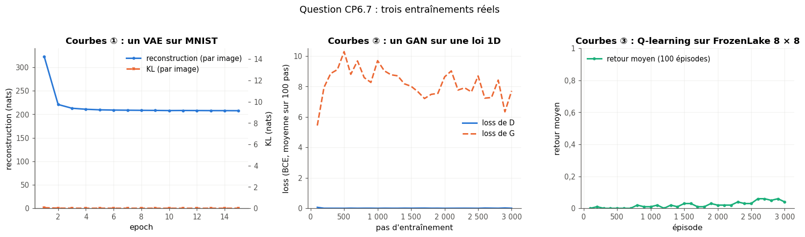

# Checkpoint VI · Examen blanc de la partie VI — Génératif et apprentissage par renforcement

| | |
|---|---|
| **Durée** | 114 minutes (2 h au plus), d'une traite |
| **Note** | sur 20 points ; 2 points (10 %) portent sur les parties IV et V (CP6.13) |
| **Chapitres** | 25 à 29 (autoencodeurs et VAE, apprentissage par renforcement, GAN, applications créatives, datasets), plus les chapitres 19 et 21 |
| **Ta copie** | `04_mes_reponses.md` (ou une feuille de papier) ; les deux questions de code se font dans `02_examen_notebook.ipynb`, partie A |
| **Après** | la partie B du notebook vérifie ton code et tes réponses chiffrées ; `03_examen_corrige.md` donne le corrigé détaillé, le barème et la remédiation |

## Règles

- **Livre, fiches, notes, flashcards et corrigés fermés.** Pas d'assistant IA, pas de recherche sur le web.
- **Calculatrice autorisée** pour les questions papier, ou Python comme simple calculatrice (`+`, `*`, `**`, `math.sqrt`, `math.exp`, `math.log`), sans NumPy, sans PyTorch et sans exécuter de code pour CP6.6.
- **Questions de code** (CP6.8 et CP6.9), dans le notebook de l'examen, avec PyTorch ; `help()` et la documentation officielle de PyTorch sont permis, ni `mylearn`, ni `mylearn_ref`, ni les notebooks des chapitres.
- Donne le nombre de décimales demandé, et **n'arrondis qu'à la fin** du calcul. Quand une question dit « justifie » ou « montre », une réponse sans justification ne rapporte qu'une partie des points.
- **Conventions** : celles des fiches. $\ln$ est le logarithme népérien (les KL sont en nats) ; un encodeur de VAE rend $\boldsymbol{\mu}$ et $\log\boldsymbol{\sigma}^2$ (la log-**variance**) ; la loss d'un GAN est la cross-entropy binaire (BCE), celle de $D$ additionne le terme des vrais exemples et celui des faux, celle de $G$ est non saturante, $-\ln D(G(\mathbf{z}))$ ; une table Q a une ligne par état et une colonne par action ; une matrice de Gram est normalisée, $G = \frac{1}{CHW} F F^\top$ ; une « forme » s'écrit comme un tuple, par exemple `(2, 5, 7, 7)` ; 1 Mo = $10^6$ octets, 1 Go = $10^9$ octets.
- Les durées sont indicatives : commence par ce que tu sais faire ; si tu bloques, passe à la question suivante et reviens-y à la fin.

| Question | Type | Sujet | Points | ⏱️ |
|---|---|---|---|---|
| CP6.1 | 🧠 | Questions flash : dix réponses courtes sur la partie VI (valeurs, formes, vrai/faux) | 2,5 | 10 min |
| CP6.2 | ✏️ | VAE : un tirage reparamétrisé et sa divergence KL | 2 | 10 min |
| CP6.3 | ✏️ | Deux transitions : mise à jour Q-learning puis SARSA | 2 | 10 min |
| CP6.4 | ∂ | Discriminateur optimal et losses à l'équilibre | 2 | 12 min |
| CP6.5 | ✏️ | Matrice de Gram de trois cartes d'activation | 1 | 5 min |
| CP6.6 | 🔮 | Prédire : γ → 0 puis ε = 0 pour un agent Q-learning sur Flippers | 1 | 7 min |
| CP6.7 | 📈 | Trois courbes, trois diagnostics : VAE, GAN, apprentissage par renforcement | 1 | 8 min |
| CP6.8 | 🔨 | Écrire la loss d'un VAE en PyTorch et la tester sur un batch fourni (notebook) | 2 | 15 min |
| CP6.9 | 🐛 | Réparer un pas d'entraînement de GAN (notebook) | 1,5 | 10 min |
| CP6.10 | 🧮 | Table Q ou réseau : estimer la mémoire nécessaire | 1 | 6 min |
| CP6.11 | ⚖️ | Un dataset de visages pour un produit commercial | 1 | 5 min |
| CP6.12 | 💼 | Comme en entretien : GAN, VAE ou diffusion, la réponse en 60 secondes | 1 | 6 min |
| CP6.13 | ✏️ | Retour sur les parties IV et V : taille de sortie d'une convolution et un pas d'Adam | 2 | 10 min |
| | | **Total** | **20** | **114 min** |

---

### CP6.1 — Questions flash : dix réponses courtes sur la partie VI (valeurs, formes, vrai/faux) 🧠 ★ ⏱️ 10 min · 2,5 points

Réponds sans justifier ; chaque item vaut 0,25 point.

a) Le facteur de compression d'un autoencodeur dense 784 → 32 → 784 (taille de l'entrée divisée par celle du code ; 1 décimale).
b) Vrai ou faux : avec un autoencodeur ordinaire (pas un VAE) entraîné sur MNIST, décoder un code tiré au hasard dans $\mathcal{N}(\mathbf{0}, \mathbf{I})$ donne en général un chiffre net.
c) Le prior d'un VAE est : (A) la gaussienne $\mathcal{N}(\boldsymbol{\mu}, \boldsymbol{\sigma}^2)$ rendue par l'encodeur ; (B) $\mathcal{N}(\mathbf{0}, \mathbf{I})$ ; (C) la loi uniforme sur $[0, 1]^d$.
d) Le retour actualisé, depuis le pas 0, d'un épisode de récompenses $(0, 0, 1)$ avec $\gamma = 0{,}9$ (2 décimales).
e) La forme de la table Q de FrozenLake 4 × 4.
f) La sortie $D(\mathbf{x})$ du discriminateur à l'équilibre théorique d'un GAN.
g) Vrai ou faux : l'effondrement de mode (*mode collapse*), c'est un générateur qui ne produit qu'une partie des modes (des « pics ») de la distribution des données.
h) La forme de la matrice de Gram d'une couche de 64 cartes d'activation de 14 × 14.
i) Le nombre total d'images de Fashion-MNIST (entraînement et test).
j) Vrai ou faux : un dataset sous licence CC BY peut servir à entraîner un produit vendu, à condition de citer sa source et sa licence.

### CP6.2 — VAE : un tirage reparamétrisé et sa divergence KL ✏️ ★ ⏱️ 10 min · 2 points

L'encodeur d'un VAE à deux latents rend, pour une image, $\boldsymbol{\mu} = (0{,}5 ;\ -1)$ et $\log\boldsymbol{\sigma}^2 = (0 ;\ \ln 0{,}25)$. On tire $\boldsymbol{\varepsilon} = (1{,}2 ;\ -0{,}4)$.

a) Le code $\mathbf{z} = \boldsymbol{\mu} + \boldsymbol{\sigma} \odot \boldsymbol{\varepsilon}$, $[z_1, z_2]$ (4 décimales). **[0,4]**
b) La divergence KL de chaque latent contre $\mathcal{N}(0, 1)$, $[\mathrm{KL}_1, \mathrm{KL}_2]$ (4 décimales). **[0,6]**
c) La dérivée $\partial z_2 / \partial (\log\sigma_2^2)$ pour ces nombres (4 décimales). **[0,4]**
d) La KL d'un latent pour lequel l'encodeur rend $\mu = 0$ et $\log\sigma^2 = -10$ (4 décimales). **[0,3]**
e) Pourquoi tire-t-on $\boldsymbol{\varepsilon}$ au lieu de tirer directement $\mathbf{z}$ dans $\mathcal{N}(\boldsymbol{\mu}, \boldsymbol{\sigma}^2)$ ? Et que dit d) de ce que la KL empêche ? Deux ou trois phrases. **[0,3]**

### CP6.3 — Deux transitions : mise à jour Q-learning puis SARSA ✏️ ★ ⏱️ 10 min · 2 points

Un agent joue à une version simplifiée de Flippers où il n'a que **trois** actions, 0, 1 et 2 (trois tuiles qu'il peut retourner). Trois plateaux nous intéressent, A, B et C. Sa table Q contient, pour ces plateaux :

| | action 0 | action 1 | action 2 |
|---|---|---|---|
| A | 0,2 | 0,4 | 0,1 |
| B | 0,5 | 0,3 | 0,8 |
| C | 0,6 | 0 | 0 |

C est un plateau **gagnant** : la partie s'arrête dès qu'on l'atteint (sa ligne contient des valeurs quelconques, par exemple celles d'une initialisation au hasard, que l'agent ne met jamais à jour). On prend $\alpha = 0{,}5$ et $\gamma = 0{,}9$. Chaque question part de la table ci-dessus.

a) Le Q-learning sur la transition $(s = A,\ a = 1,\ r = 0,\ s' = B)$ : la nouvelle valeur de $Q(A, 1)$ (4 décimales). **[0,4]**
b) Le Q-learning sur la transition $(s = B,\ a = 2,\ r = 1,\ s' = C)$ : la nouvelle valeur de $Q(B, 2)$ (4 décimales). **[0,4]**
c) SARSA sur la transition de a), sachant que l'agent choisit ensuite l'action $a' = 0$ dans B : la nouvelle valeur de $Q(A, 1)$ (4 décimales). **[0,4]**
d) Avec une politique ε-greedy, $\varepsilon = 0{,}2$ (l'exploration tire une action au hasard parmi les trois, la gloutonne comprise), la probabilité de choisir l'action 2 dans B (4 décimales). **[0,4]**
e) Pourquoi dit-on que SARSA apprend la valeur de la politique qu'il suit (*on-policy*) et le Q-learning celle de la politique gloutonne (*off-policy*) ? Une conséquence pratique, en deux phrases. **[0,4]**

### CP6.4 — Discriminateur optimal et losses à l'équilibre ∂ ★★ ⏱️ 12 min · 2 points

Pour un générateur fixé, le discriminateur maximise $V(D) = \mathbb{E}_{\mathbf{x} \sim p_{\text{data}}}[\ln D(\mathbf{x})] + \mathbb{E}_{\mathbf{x} \sim p_g}[\ln(1 - D(\mathbf{x}))]$, où $p_g$ est la loi des exemples générés.

a) Montre que le discriminateur optimal est $D^*(\mathbf{x}) = \dfrac{p_{\text{data}}(\mathbf{x})}{p_{\text{data}}(\mathbf{x}) + p_g(\mathbf{x})}$ (indice : en chaque $\mathbf{x}$, maximise $a \ln y + b \ln(1 - y)$ sur $y \in\ ]0, 1[$). **[0,7]**
b) À l'équilibre, $p_g = p_{\text{data}}$. Donne alors $[\text{loss de } D, \text{loss de } G]$ (3 décimales), avec les conventions de l'énoncé (loss de $D$ = somme des deux BCE ; loss de $G$ non saturante). **[0,4]**
c) En un point où $p_{\text{data}}(\mathbf{x}) = 0{,}3$ et $p_g(\mathbf{x}) = 0{,}1$, la valeur de $D^*(\mathbf{x})$ (4 décimales). **[0,3]**
d) Au début de l'entraînement, $D(G(\mathbf{z})) \approx 0$. Pourquoi minimiser $\ln(1 - D(G(\mathbf{z})))$ donne-t-il alors un gradient presque nul au générateur, et que fait la loss non saturante ? **[0,3]**
e) Un collègue arrête l'entraînement « parce que la loss de $D$ a atteint 0,5, la valeur idéale ». Qu'en penses-tu ? Comment juger un GAN pendant son entraînement ? **[0,3]**

### CP6.5 — Matrice de Gram de trois cartes d'activation ✏️ ★ ⏱️ 5 min · 1 point

Une couche a $C = 3$ cartes d'activation de 2 × 2. Mises à plat (ligne par ligne), elles donnent la matrice $F$ de forme $(3, 4)$ :

$$F = \begin{pmatrix} 1 & 0 & 2 & 1 \\ 0 & 1 & 1 & 0 \\ 2 & 1 & 0 & 1 \end{pmatrix}.$$

a) Le produit $F F^\top$ (une liste de trois lignes). **[0,4]**
b) Les coefficients $[G_{00}, G_{02}]$ de la matrice de Gram normalisée $G = \frac{1}{CHW} F F^\top$ (4 décimales). **[0,3]**
c) On applique la même permutation aux quatre positions de chaque carte (on mélange les pixels de la même façon dans les trois cartes). Que devient $G$ ? Qu'est-ce que cela dit de ce que la matrice de Gram capture, et pourquoi en fait-on une description du style ? **[0,3]**

### CP6.6 — Prédire : γ → 0 puis ε = 0 pour un agent Q-learning sur Flippers 🔮 ★ ⏱️ 7 min · 1 point

**Sans rien exécuter.** On entraîne un agent Q-learning sur Flippers 3 × 3 (sans camion ; récompense seulement à la victoire, comme au ch. 26), 3 000 parties, chacune partant d'un plateau non gagnant tiré au hasard, $\alpha = 0{,}5$, table Q initialisée à 0, parties coupées à 100 coups. Pendant l'entraînement, les égalités de la politique ε-greedy se départagent **au hasard** (`epsilon_greedy_action` du ch. 11). On mesure ensuite la politique **gloutonne** (égalités : la plus petite action, comme `np.argmax`) sur les 506 plateaux non gagnants : la part des plateaux qu'elle gagne en moins de 100 coups. Avec $\gamma = 0{,}9$ et $\varepsilon = 0{,}1$, cette part vaut entre 80 et 95 % selon la graine.

a) Même entraînement avec $\gamma = 0$ (et $\varepsilon = 0{,}1$) : la part gagnée est (A) d'au moins 95 % ; (B) entre 30 et 95 % ; (C) inférieure à 30 %. **[0,4]**
b) Même entraînement avec $\gamma = 0{,}9$ mais $\varepsilon = 0$ (aucune exploration ε) : (A) d'au moins 95 % ; (B) entre 30 et 95 % ; (C) inférieure à 30 %. **[0,4]**
c) Justifie tes deux prédictions en une phrase chacune. **[0,2]**

### CP6.7 — Trois courbes, trois diagnostics : VAE, GAN, apprentissage par renforcement 📈 ★ ⏱️ 8 min · 1 point

La figure (`figures/cp6_7_courbes.png`, reproduite ci-dessous) montre trois entraînements réels. ① : un VAE dense sur 6 000 images MNIST, la reconstruction (axe de gauche) et la KL (axe de droite), en moyenne par image, à chaque epoch. ② : un GAN sur une loi à une dimension, les losses de $D$ et de $G$, en moyenne sur 100 pas. ③ : un agent Q-learning sur FrozenLake 8 × 8 glissant ; le retour d'un épisode vaut 1 si l'agent atteint le but, 0 sinon ; la courbe en donne la moyenne par paquet de 100 épisodes.



Pour chaque panneau, la lettre du diagnostic le plus probable (une lettre par panneau, 1/3 de point chacune ; trois diagnostics ne servent pas) :
(A) la KL reste collée à 0 (l'effondrement du posterior) : le décodeur ignore le code · (B) un VAE qui apprend normalement : la reconstruction baisse, la KL monte puis se stabilise · (C) le discriminateur gagne : sa loss tend vers 0, celle du générateur reste haute (le générateur n'apprend plus) · (D) l'équilibre : les deux losses se stabilisent près de leurs valeurs théoriques à l'équilibre (CP6.4) · (E) un agent qui apprend : son retour moyen monte vers celui d'une bonne politique · (F) une récompense presque jamais atteinte : le retour reste près de 0, l'agent n'apprend presque rien.

a) Le panneau ①. b) Le panneau ②. c) Le panneau ③.

### CP6.8 — Écrire la loss d'un VAE en PyTorch et la tester sur un batch fourni 🔨 ★★ ⏱️ 15 min · 2 points

**Dans le notebook de l'examen, partie A, avec PyTorch.** La cellule des données fournit un batch de 16 images MNIST `X_V` (valeurs dans $[0, 1]$, forme `(16, 1, 28, 28)`), des **logits** tirés au hasard, comme ceux d'un décodeur pas encore entraîné (`LOGITS_V`, même forme), et les deux têtes d'un encodeur à $d = 4$ latents (`MU_V`, `LOGVAR_V`, forme `(16, 4)`) ; tout est en `float64`. Avec ces logits, la reconstruction sera bien plus grande que celle d'un VAE entraîné.

a) `vae_loss(logits, x, mu, log_var, beta=1.0)` rend le triplet `(loss, rec, kl)` de tenseurs à 0 dimension, **par image** (moyennés sur le batch) : `rec`, la cross-entropy binaire entre `x` et `sigmoid(logits)`, **sommée** sur les pixels d'une image ; `kl`, la divergence KL entre $\mathcal{N}(\boldsymbol{\mu}, \operatorname{diag}(e^{\log\boldsymbol{\sigma}^2}))$ et $\mathcal{N}(\mathbf{0}, \mathbf{I})$, sommée sur les latents ; `loss = rec + beta * kl`. Elle marche pour toute forme d'images (`(N, 784)` comme `(N, 1, 28, 28)`) et garde le graphe (le gradient doit pouvoir remonter jusqu'à `logits`, `mu` et `log_var`). **[1,4]**
b) Avec le batch fourni : reporte $[\text{rec}, \text{kl}]$ (2 décimales). **[0,3]**
c) La loss pour `beta=3` (2 décimales). **[0,3]**

### CP6.9 — Réparer un pas d'entraînement de GAN 🐛 ★★ ⏱️ 10 min · 1,5 point

**Dans le notebook de l'examen, partie A, avec PyTorch.** `gan_step_buggy` doit faire **un** pas d'entraînement d'un GAN : d'abord le discriminateur (vrais exemples contre faux), puis le générateur (loss non saturante). `make_gan()` rend un générateur, un discriminateur (qui rend un **logit**) et leurs deux optimiseurs ; `bce` est `nn.BCEWithLogitsLoss()` ; `real_batch()` tire 64 vrais exemples de $\mathcal{N}(4 ;\ 1{,}25^2)$. Le pas contient **trois** lignes fautives ; une erreur peut se déclarer plus loin que sa cause.

```python
def gan_step_buggy(G, D, real, opt_d, opt_g):
    ones, zeros = torch.ones(len(real), 1), torch.zeros(len(real), 1)          # A
    fake = G(torch.randn(len(real), 1))                                         # B
    d_loss = bce(D(real), ones) + bce(D(fake), zeros)                           # C
    opt_d.zero_grad()                                                           # D
    d_loss.backward()                                                           # E
    opt_d.step()                                                                # F
    g_loss = bce(D(fake), zeros)                                                # G
    opt_g.zero_grad()                                                           # H
    g_loss.backward()                                                           # I
    opt_d.step()                                                                # J
    return d_loss.item(), g_loss.item()                                         # K
```

a) Les lettres des trois lignes **à corriger** (par exemple `"ABC"`). **[0,6]**
b) `gan_step_fixed(G, D, real, opt_d, opt_g)`, la version corrigée : même signature, mêmes sorties, et le même tirage (un seul appel à `torch.randn`, ligne B). La cellule d'essai l'enchaîne 1 500 fois : la moyenne des exemples générés doit s'approcher de 4. **[0,9]**

### CP6.10 — Table Q ou réseau : estimer la mémoire nécessaire 🧮 ★ ⏱️ 6 min · 1 point

Chaque item vaut 0,2 point. Une valeur Q est un `float32` (4 octets).

a) Une table Q pour le morpion 3 × 3 avec une ligne par **codage** de plateau (chaque case vide, croix ou rond) et une colonne par case : sa taille, en Mo (2 décimales).
b) La même table restreinte aux 5 478 plateaux réellement atteignables, en Mo (2 décimales).
c) La table complète pour le morpion 4 × 4 (une ligne par codage, une colonne par case), en Go (3 décimales).
d) Pour le morpion 4 × 4, un réseau à la place de la table : en entrée, chaque case codée en *one-hot* (3 valeurs par case) ; deux couches cachées de 128 neurones ; en sortie, une valeur Q par case. Son nombre de paramètres, biais compris.
e) Au-delà de la mémoire, qu'apporte le réseau que la table n'a pas ? Une phrase.

### CP6.11 — Un dataset de visages pour un produit commercial ⚖️ ★ ⏱️ 5 min · 1 point

Une start-up veut entraîner un générateur de portraits (un GAN) pour une application vendue sur les magasins d'applications. Le développeur propose CelebA (≈ 200 000 photos de célébrités, trouvées en ligne et annotées de 40 attributs) parce qu'il « est public et que tout le monde l'utilise ». En quatre ou cinq phrases : ce qu'il faut vérifier avant (au moins trois points), ce que tu réponds pour CelebA, et ce que tu proposes à la place. **[1]**

### CP6.12 — Comme en entretien : GAN, VAE ou diffusion, la réponse en 60 secondes 💼 ★ ⏱️ 6 min · 1 point

Le recruteur : « Pour générer des images, vous choisiriez un VAE, un GAN ou un modèle de diffusion ? Expliquez-moi les différences. » Réponds comme à l'oral, en une minute : le principe de chacun, une force et une faiblesse de chacun, et ton choix pour un cas concret que tu nommes. **[1]**

### CP6.13 — Retour sur les parties IV et V : taille de sortie d'une convolution et un pas d'Adam ✏️ ★ ⏱️ 10 min · 2 points

**Ch. 21.** Une image `(1, 3, 64, 64)` passe dans `nn.Conv2d(3, 32, kernel_size=5, stride=2, padding=2)`, puis le résultat dans `nn.ConvTranspose2d(32, 16, kernel_size=4, stride=2, padding=1)`.

a) La forme de la sortie de la convolution. **[0,3]**
b) Le nombre de paramètres de la convolution. **[0,3]**
c) La forme de la sortie de la convolution transposée. **[0,3]**

**Ch. 19.** Un poids $w_0 = 1$ est mis à jour par Adam ($\eta = 0{,}01$, $\beta_1 = 0{,}9$, $\beta_2 = 0{,}999$, $\epsilon = 10^{-8}$, moments initialisés à 0, correction du biais comme dans `torch.optim.Adam`). Il reçoit le gradient $g_1 = 0{,}5$, puis $g_2 = -0{,}1$.

d) Le poids $w_1$ après le premier pas (4 décimales). **[0,4]**
e) Le poids $w_2$ après le second pas (4 décimales). **[0,5]**
f) Pourquoi le premier pas d'Adam vaut-il presque exactement $\eta$, quelle que soit la taille du gradient ? **[0,2]**
