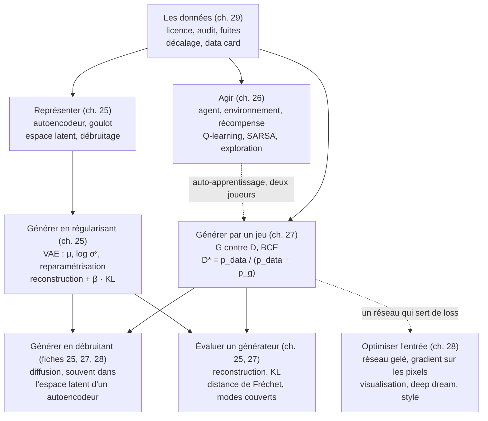

# Checkpoint VI · Synthèse de la partie VI — Génératif et apprentissage par renforcement

> Une page à revoir avant l'examen blanc, puis avant les chapitres bonus et le projet final. Compte environ 90 minutes : redessine d'abord la carte mentale, de mémoire, récite les formules en cachant les colonnes de droite, puis relis les tableaux et dis le vocabulaire à voix haute (mode d'emploi en fin de page).

**Les cinq chapitres en une phrase chacun**

25. **Autoencodeurs et VAE** : un réseau qui recopie son entrée à travers un goulot invente son propre code ; le VAE rend ce code probabiliste (une moyenne et une variance par latent), le tire par reparamétrisation et le régularise par une KL vers $\mathcal{N}(\mathbf{0}, \mathbf{I})$, ce qui en fait un générateur.
26. **Apprentissage par renforcement** : un agent apprend par essais et récompenses, sans exemples corrigés ; le Q-learning et SARSA estiment, après chaque pas, la valeur de chaque action dans chaque état, avec un compromis permanent entre explorer et exploiter.
27. **GAN** : un générateur et un discriminateur s'entraînent l'un contre l'autre ; l'équilibre (le discriminateur répond ½ partout) est rarement atteint proprement : instabilité, effondrement de mode, et une évaluation par des mesures comme la distance de Fréchet.
28. **Applications créatives** : un réseau pré-entraîné **gelé** sert d'instrument de mesure, et l'on optimise les **pixels** : visualiser des filtres, faire rêver un réseau, transférer un style par des matrices de Gram.
29. **Datasets** : avant d'entraîner, choisir et juger les données (licence, provenance, retraits, biais), les auditer (manquants déguisés, doublons, fuites), mesurer le décalage de distribution, et documenter (data card, téléchargement vérifié).

## 1. Carte mentale

Redessine-la de mémoire, puis compare : chaque flèche doit pouvoir se justifier par un exemple (« le discriminateur d'un GAN et le VGG16 du transfert de style sont tous deux un réseau qui sert de loss : l'un apprend en même temps, l'autre est gelé, 28.R1 »).

## 2. Fiche d'une page : les 18 formules clés

| # | Notion | Formule | Ce qu'il faut savoir dire | Ch. | `mylearn` |
|---|---|---|---|---|---|
| 1 | Reparamétrisation | $\mathbf{z} = \boldsymbol{\mu} + e^{\frac{1}{2}\log\boldsymbol{\sigma}^2} \odot \boldsymbol{\varepsilon}$, $\boldsymbol{\varepsilon} \sim \mathcal{N}(\mathbf{0}, \mathbf{I})$ | le hasard devient une entrée : le gradient remonte vers $\boldsymbol{\mu}$ et $\log\boldsymbol{\sigma}^2$ ; $\partial z / \partial \log\sigma^2 = \frac{1}{2}\sigma\varepsilon$ | 25 | `vae.reparameterize`, `reparameterize_backward` |
| 2 | KL gaussienne | $\frac{1}{2}\sum_j(\mu_j^2 + \sigma_j^2 - 1 - \ln\sigma_j^2)$ | nulle pour $\mu = 0$, $\sigma = 1$ ; une variance minuscule coûte cher | 25 | `vae.gaussian_kl`, `gaussian_kl_grad` |
| 3 | Loss du VAE | $L = \underbrace{\textstyle\sum_{\text{pixels}} \text{BCE}}_{\text{rec}} + \beta\,\mathrm{KL}$, par image | la reconstruction **sommée** sur les pixels ; moyennée, elle cache un β de 784 | 25 | |
| 4 | Interpolation sphérique | $\text{slerp}(\mathbf{z}_0, \mathbf{z}_1; t) = \frac{\sin((1-t)\Omega)}{\sin\Omega}\mathbf{z}_0 + \frac{\sin(t\Omega)}{\sin\Omega}\mathbf{z}_1$ | en grande dimension, les tirages gaussiens vivent sur une coquille : la ligne droite passe par un centre trop « vide » | 25 | `vae.interpolate_latents` |
| 5 | Retour actualisé | $G_t = \sum_{k \ge 0} \gamma^k r_{t+k+1}$, au plus $\frac{r_{\max}}{1 - \gamma}$ | horizon effectif $\approx \frac{1}{1-\gamma}$ ; $\gamma$ fait partie de l'objectif | 26 | `rl.discounted_return`, `returns_to_go` |
| 6 | Q-learning | $Q(s,a) \leftarrow Q(s,a) + \alpha\,[r + \gamma \max_{a'} Q(s', a') - Q(s,a)]$ | off-policy ; cible $r$ seule sur un état **terminal** (pas sur une troncature) | 26 | `rl.q_learning_update` |
| 7 | SARSA | $Q(s,a) \leftarrow Q(s,a) + \alpha\,[r + \gamma\,Q(s', a') - Q(s,a)]$ | on-policy : l'action $a'$ réellement choisie, exploration comprise | 26 | `rl.sarsa_update` |
| 8 | ε-greedy | gloutonne avec $1 - \varepsilon + \frac{\varepsilon}{K}$, chaque autre $\frac{\varepsilon}{K}$ | le tirage au hasard peut tomber sur la gloutonne ; égalités départagées au hasard | 11, 26 | `bandit.epsilon_greedy_action` |
| 9 | Bellman | $Q^*(s,a) = \mathbb{E}[r + \gamma \max_{a'} Q^*(s', a')]$ | le point fixe que vise le Q-learning ; l'itération sur les valeurs le calcule quand on connaît le modèle | 26 | `rl.value_iteration` |
| 10 | Losses d'un GAN | $L_D = -\ln D(\mathbf{x}) - \ln(1 - D(G(\mathbf{z})))$ ; $L_G = -\ln D(G(\mathbf{z}))$ (non saturante) | à l'équilibre : $D = \frac{1}{2}$, $L_D = 2\ln 2 \approx 1{,}39$, $L_G = \ln 2 \approx 0{,}69$ | 27 | |
| 11 | Discriminateur optimal | $D^*(\mathbf{x}) = \frac{p_{\text{data}}(\mathbf{x})}{p_{\text{data}}(\mathbf{x}) + p_g(\mathbf{x})}$ | maximiser $a\ln y + b\ln(1-y)$ point par point | 27 | |
| 12 | Distance de Wasserstein 1D | $W_1 = \frac{1}{n}\sum_i \lvert u_{(i)} - v_{(i)} \rvert$ (échantillons triés, même taille) | une distance entre deux lois qui reste informative quand elles ne se recouvrent pas | 27 | `gen_metrics.wasserstein_1d` |
| 13 | Distance de Fréchet | $\lVert \boldsymbol{\mu}_1 - \boldsymbol{\mu}_2 \rVert^2 + \operatorname{Tr}(\boldsymbol{\Sigma}_1 + \boldsymbol{\Sigma}_2 - 2(\boldsymbol{\Sigma}_1\boldsymbol{\Sigma}_2)^{1/2})$ | sur les features d'un classifieur (FID : Inception v3) ; dépend de l'extracteur et du nombre d'images | 27 | `gen_metrics.frechet_distance` |
| 14 | Matrice de Gram | $G = \frac{1}{CHW} F F^\top$, $C \times C$ | garde les co-activations, oublie les positions : une texture, un style | 28 | |
| 15 | Loss de style et de contenu | $L = \alpha \lVert F(\mathbf{x}) - F(\mathbf{c}) \rVert^2 + \beta \sum_\ell w_\ell \lVert G^\ell(\mathbf{x}) - G^\ell(\mathbf{s}) \rVert_F^2 + \lambda L_{TV}$ | on optimise les pixels de $\mathbf{x}$, le réseau est gelé | 28 | |
| 16 | Montée de gradient sur l'entrée | $\mathbf{x} \leftarrow \mathbf{x} + \eta\,\nabla_{\mathbf{x}} a(\mathbf{x})$, pixels ramenés dans $[0, 1]$ | régulariser (décalages, flou, octaves) pour éviter le bruit de haute fréquence | 28 | |
| 17 | Mémoire d'un dataset | $N \times H \times W \times C \times$ (octets par valeur) | `uint8` sur le disque, `float32` par mini-batch | 29 | |
| 18 | Référence majoritaire | accuracy $= \max_c n_c / N$ | à battre avant toute chose ; le recall de la classe rare dit le reste | 29 | |

## 3. Comparer les modèles génératifs

| | Autoencodeur | VAE | GAN | Diffusion |
|---|---|---|---|---|
| **Objectif** | recopier l'entrée à travers un goulot | maximiser une borne de la vraisemblance (l'ELBO) | tromper un discriminateur | retirer un bruit ajouté pas à pas |
| **Loss** | reconstruction | reconstruction + β · KL | BCE de $D$ et de $G$ (ou variantes : Wasserstein) | erreur de prédiction du bruit |
| **Génère ?** | mal : son espace latent a des trous | oui : décoder $\mathbf{z} \sim \mathcal{N}(\mathbf{0}, \mathbf{I})$ | oui, en une passe | oui, en plusieurs dizaines de pas |
| **Forces** | compression, débruitage, anomalies | stable, espace latent régulier, interpolations | images nettes, génération rapide | qualité et diversité, entraînement stable |
| **Faiblesses** | pas un générateur | images floues, effondrement du posterior si β trop grand | instable, effondrement de mode, pas de vraisemblance | génération lente, coûteuse |
| **Mesures** | erreur de reconstruction, PSNR | reconstruction et KL séparées | distance de Fréchet, classes couvertes, voisins (mémorisation) | distance de Fréchet, et les mêmes contrôles |

## 4. L'apprentissage par renforcement en une page

- **La boucle** : `state, info = env.reset(seed=…)`, puis `state, reward, terminated, truncated, info = env.step(action)` jusqu'à `terminated or truncated`. `terminated` : l'épisode est vraiment fini (pas d'amorçage) ; `truncated` : coupé de l'extérieur (on amorce quand même).
- **Le retour** : la somme des récompenses actualisées par $\gamma$ ; un petit $\gamma$ rend l'agent myope : l'avenir compte peu.
- **Bellman → Q-learning, SARSA** : une mise à jour après chaque pas, vers la cible $r + \gamma \cdot$(max, ou action choisie). Off-policy contre on-policy ; au bord d'une falaise, SARSA apprend le chemin prudent.
- **Explorer** : ε-greedy (souvent décroissant), softmax, ou une table initialisée de façon optimiste.
- **Régler** : $\alpha$ petit ou décroissant si l'environnement est aléatoire ; $\gamma$ entre 0,9 et 0,99 ; plusieurs graines et un intervalle pour rapporter un résultat.
- **Au-delà des tables** : un réseau remplace la table (DQN : rejeu d'expérience et réseau cible) ; les méthodes de politique (PPO) ; le RLHF ajuste les modèles de langage avec une récompense apprise de préférences humaines.

## 5. Le gradient par rapport à l'entrée

Un même geste, quatre usages : on **gèle** le réseau et l'on dérive par rapport à l'**image**.

| Usage | Ce qui monte ou descend | Ch. |
|---|---|---|
| Exemple adversarial (FGSM) | la loss **monte**, en un pas $\varepsilon\,\operatorname{sign}(\nabla_{\mathbf{x}} L)$ | 21 |
| Visualiser un filtre ou une couche | son activation **monte**, à partir d'un bruit | 28 |
| Deep dream | les activations de plusieurs couches **montent**, à partir d'une photo | 28 |
| Transfert de style | les écarts de contenu et de style **descendent** | 28 |

Les réglages qui comptent : `requires_grad_(False)` sur les poids et `requires_grad_(True)` sur l'image, `model.eval()`, l'optimiseur qui ne reçoit que `[x]`, la normalisation d'ImageNet **dans** la passe avant, les pixels ramenés dans $[0, 1]$ après chaque pas.

## 6. Check-list d'un dataset

1. **Licence** : usage commercial ? attribution ? partage à l'identique ? Pas de licence = aucun droit.
2. **Contenus et personnes** : droits d'auteur des œuvres, données personnelles (RGPD), consentement, droit à l'image.
3. **Histoire** : provenance, versions, **retraits** (MS-Celeb-1M, Tiny Images, LAION-5B) ; une copie sur un miroir ne lève rien.
4. **Représentativité** : la population du dataset est-elle celle de l'usage ?
5. **Qualité** : manquants (y compris codés −999), doublons, unités, labels mal écrits ou faux, classes rares.
6. **Fuites** : quasi-doublons entre entraînement et test (découper **par groupes**), colonne qui trahit le label, prétraitement ajusté sur tout.
7. **Décalage** : un jeu de test venu d'ailleurs ; le même prétraitement en production qu'à l'entraînement.
8. **Documentation** : une data card (provenance, contenu, licence, usage prévu, limites et biais, téléchargement) et un téléchargement vérifié (révision figée, SHA-256).

## 7. Les pièges de la partie

| Piège | Symptôme | La règle |
|---|---|---|
| Amorcer sur un état terminal | des valeurs Q fausses près de la fin des épisodes | cible $r$ seule si `terminated` ; amorcer si seulement `truncated` |
| `detach` oublié à l'étape de $D$ | « Trying to backward through the graph a second time », ou $G$ poussé par la loss de $D$ | `D(fake.detach())` pour $D$, `D(fake)` avec le label 1 pour $G$ |
| La KL mal pondérée | images floues (β trop grand, ou reconstruction **moyennée** sur les pixels), ou espace latent troué (KL oubliée) | reconstruction sommée sur les pixels ; régler β en lisant les deux termes |
| La loss « idéale » 0,5 | arrêter ou juger un GAN sur sa loss | à l'équilibre $2\ln 2$ et $\ln 2$ ; juger sur des échantillons et une distance de Fréchet |
| La normalisation d'ImageNet oubliée | couleurs fausses, transfert de style délavé | `model((x - mean) / std)` dans la passe avant, pixels dans $[0, 1]$ |
| L'optimiseur qui reçoit les poids | l'image ne bouge pas | `Adam([x])`, réseau gelé |
| `log_var` lu comme $\log\sigma$ | une KL et des tirages faux | $\sigma = e^{\frac{1}{2}\log\sigma^2}$ |
| Un score de test trop beau | 99 à 100 % sur une tâche difficile | doublons, groupes, colonne fuyante, choix faits sur le test |
| Un résultat RL sur une seule graine | une courbe « meilleure » qui ne se reproduit pas | au moins cinq graines, un intervalle, évaluation sans exploration |

## 8. Vocabulaire à maîtriser à l'oral

Dis chaque définition à voix haute, avec un exemple, **avant** d'ouvrir la réponse.

<b>Espace latent</b>
L'espace des codes que l'encodeur produit ; un bon espace latent place près l'un de l'autre des exemples semblables, et (pour un VAE) se laisse échantillonner.

<b>Prior, posterior approché</b>
Le prior $\mathcal{N}(\mathbf{0}, \mathbf{I})$ est fixé d'avance ; le posterior approché $q(\mathbf{z} \mid \mathbf{x})$ est la gaussienne que l'encodeur rend pour une image donnée.

<b>Effondrement du posterior</b>
La KL tombe à 0 : l'encodeur rend le prior pour toutes les images, le décodeur ignore le code et produit une image moyenne (β trop grand, décodeur trop puissant).

<b>ELBO</b>
La borne inférieure de la log-vraisemblance que maximise un VAE ; la loss du VAE en est l'opposé : reconstruction + KL.

<b>Politique, valeur, table Q</b>
La politique choisit l'action ; $Q(s, a)$ estime le retour obtenu en jouant $a$ dans $s$ puis en jouant au mieux ; la table Q en a une case par couple.

<b>On-policy, off-policy</b>
Apprendre la valeur de la politique qu'on suit (SARSA) ou d'une autre, la gloutonne (Q-learning), avec les données de n'importe quelle politique.

<b>Exploration, exploitation</b>
Essayer pour apprendre ou jouer ce qu'on croit le meilleur ; ε-greedy en fait un tirage.

<b>Rejeu d'expérience</b>
Garder les transitions dans une mémoire et en réutiliser des mini-batches tirés au hasard : moins de corrélation, plus d'apprentissage par épisode.

<b>Équilibre d'un GAN</b>
$p_g = p_{\text{data}}$ : le discriminateur répond ½ partout, aucun des deux ne gagne à changer seul.

<b>Effondrement de mode</b>
Le générateur ne produit qu'une partie des modes des données (quelques chiffres, une seule pose) ; on le voit en comptant les classes générées.

<b>Loss non saturante</b>
$-\ln D(G(\mathbf{z}))$ au lieu de $\ln(1 - D(G(\mathbf{z})))$ : même point fixe, un gradient fort quand le générateur est mauvais.

<b>Distance de Fréchet (FID)</b>
La distance entre deux gaussiennes ajustées aux features de vraies images et d'images générées ; plus petite, meilleure, mais dépendante de l'extracteur.

<b>Matrice de Gram</b>
Les produits scalaires des cartes d'activation deux à deux, normalisés : quels filtres s'activent ensemble, sans dire où.

<b>Data card</b>
La notice d'un dataset : provenance, contenu, licence, usage prévu, limites et biais, téléchargement reproductible.

<b>Décalage de distribution</b>
Des données d'usage différentes de celles d'entraînement (entrées, classes ou relation) : le score de test ne dit plus rien sans un test venu d'ailleurs.

## Mode d'emploi (≈ 90 minutes)

1. **15 min** : redessine la carte mentale, de mémoire, puis compare avec la section 1.
2. **30 min** : cache les colonnes « Formule » et « Ce qu'il faut savoir dire » de la section 2 ; pour chaque notion, réécris la formule et invente un exemple chiffré (un tirage reparamétrisé, une mise à jour de Q-learning, une matrice de Gram 2 × 2).
3. **15 min** : recopie le tableau de la section 3 de mémoire ; pour chaque ligne de la section 7, retrouve l'exercice où tu as vu ce piège.
4. **15 min** : le vocabulaire de la section 8, à voix haute.
5. **15 min** : les flashcards en retard des chapitres 25 à 29.

Ensuite : l'examen blanc (`01_examen_sujet.md`), en conditions réelles, puis le mini-projet (`projets/partie_6_generatif/`).
