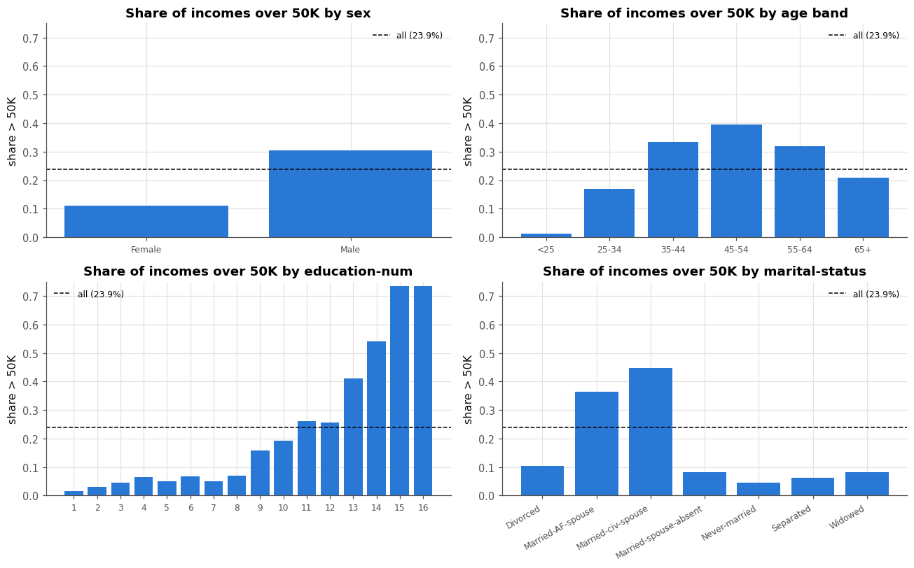
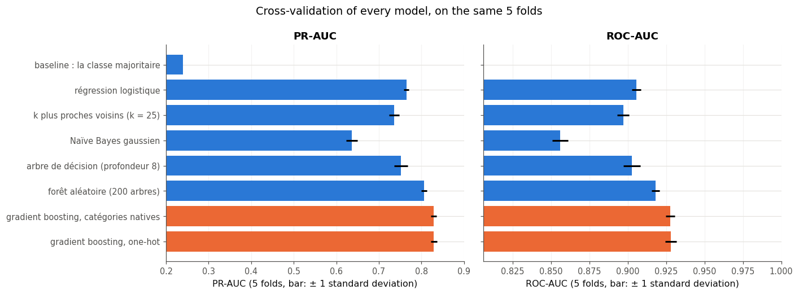
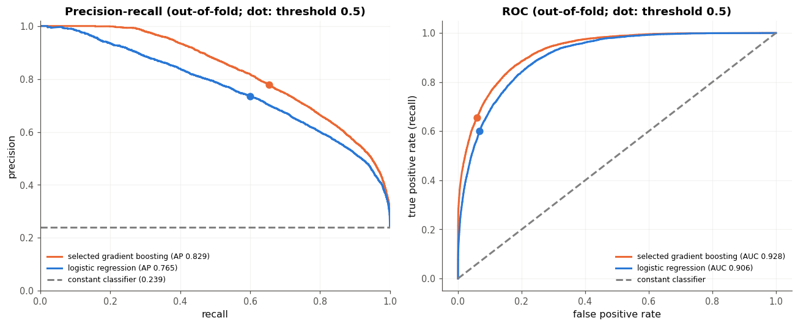
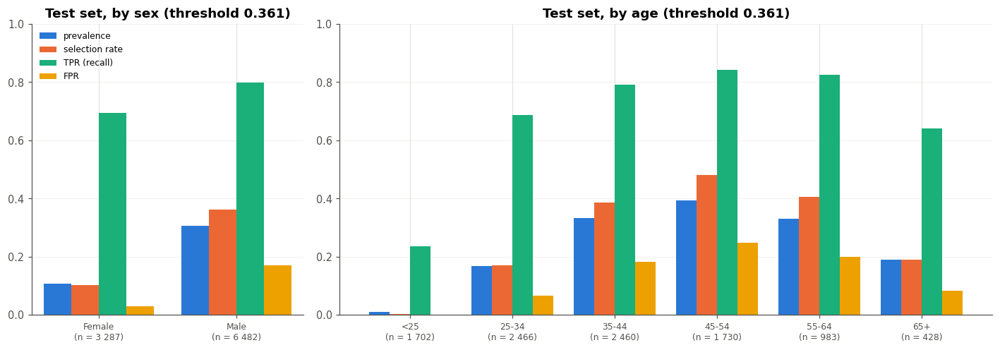
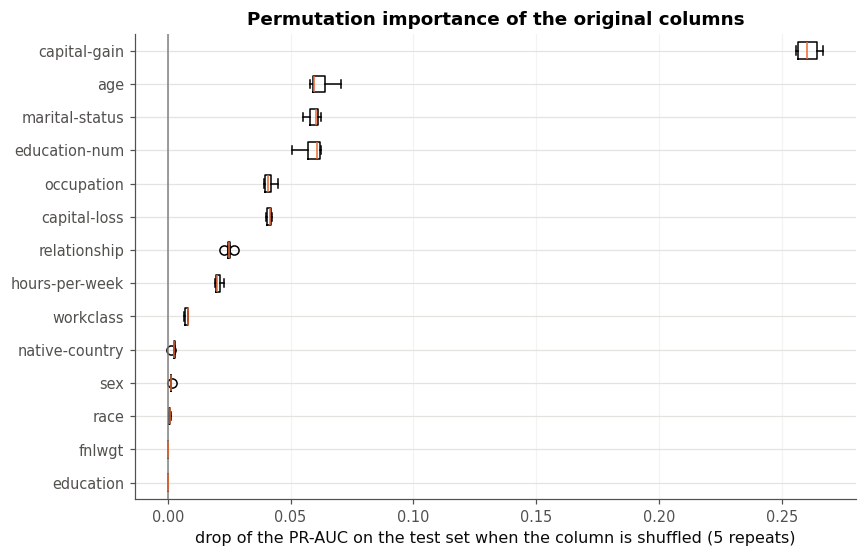

# Prédire un revenu à partir du recensement de 1994 : un pipeline tabulaire complet et un audit d'équité

> Un gradient boosting dans un `Pipeline` scikit-learn sans fuite, choisi en validation croisée parmi huit modèles sur 39 073 personnes ; mesuré une seule fois sur 9 769 personnes mises de côté dès le départ, il atteint une PR-AUC de 0,832 (intervalle à 95 % : [0,821 ; 0,845]) et une ROC-AUC de 0,931, contre 0,239 et 0,5 pour la baseline. L'audit montre qu'au seuil retenu il sur-prédit les revenus élevés des hommes (36 % prédits pour 31 %) et sous-prédit un peu ceux des femmes (10 % pour 11 %), et que retirer la colonne `sex` n'y change rien.

Mini-projet du checkpoint III du workbook *Deep Learning* (d'après A. Glassner), **solution de référence** : elle montre un résultat possible, et la façon de le présenter. Voir aussi la [model card](MODEL_CARD.md) et la [data card](DATA_CARD.md). Les modèles viennent de scikit-learn ; la matrice de confusion et la ROC-AUC de l'audit, et les intervalles bootstrap, viennent de la librairie `mylearn` écrite aux chapitres 2 et 3.

## Le problème

Un institut de statistique complète la tranche de revenu (plus ou moins de 50 000 dollars par an) des personnes qui n'ont pas répondu à cette question d'une enquête, à partir de leurs autres réponses. La prédiction ne décide rien pour une personne : elle entre dans des statistiques publiées, comme la part des revenus élevés par sexe ou par âge. Un faux positif gonfle cette part, un faux négatif la réduit, et une erreur qui pèse plus sur un groupe fausse la statistique de ce groupe : l'audit par sous-groupe fait donc partie de l'évaluation. *Adult* est un dataset d'exemple, et cet usage un cadre d'exercice : des données de 1994 ne disent rien des revenus d'aujourd'hui.

Le **score de décision** est la PR-AUC (`average_precision`) : elle ne dépend pas d'un seuil, se concentre sur la classe rare (24 % de revenus élevés), et sa baseline, la prévalence, rend visible l'apport d'un modèle. La ROC-AUC sert de second avis.

## Les données

*Adult* (*Census Income*) : 48 842 personnes extraites par Barry Becker du recensement américain de 1994, publiées en 1996 sur le dépôt de l'UCI (licence CC BY 4.0, [doi:10.24432/C5XW20](https://doi.org/10.24432/C5XW20)), chargées depuis OpenML (`data_id=1590`) ou la copie versionnée du dépôt. Détails dans la [data card](DATA_CARD.md).

- **14 colonnes** : 6 numériques (l'âge, le niveau d'études codé de 1 à 16, les plus-values et les moins-values (`capital-gain`, `capital-loss`), les heures travaillées par semaine, et `fnlwgt`) et 8 catégorielles (le secteur d'emploi, le diplôme, la situation matrimoniale, le métier, la place dans le foyer, la catégorie raciale du recensement, le sexe, le pays de naissance).
- **La cible** : 23,9 % de revenus au-dessus de 50 000 dollars ; une baseline qui répond toujours « non » a donc 76,1 % d'accuracy.
- **Des valeurs manquantes** : `occupation` (5,7 % des personnes d'entraînement), `workclass` (5,7 %, presque toujours avec `occupation`) et `native-country` (1,8 %). Elles ne tombent pas au hasard : sans métier déclaré, 10 % seulement de revenus élevés. Le pipeline les garde comme une information (une catégorie `missing`, ou un NaN que le gradient boosting traite à part).
- **Deux colonnes écartées** : `fnlwgt`, un poids d'échantillonnage (le nombre de personnes que la ligne représente, pas une caractéristique de la personne), et `education`, une copie exacte de `education-num`.
- **Le jeu de test** : 9 769 personnes (20 %), tirées avec une stratification sur la cible et la graine 2026, enregistrées dans `test_indices.npy` et **commitées seules le 16 octobre 2026, avant toute modélisation** (`git log -- test_indices.npy`).

## La démarche

- **Un `Pipeline` par modèle** : un `ColumnTransformer` (médiane et standardisation pour les numériques, catégorie `missing` et one-hot pour les catégorielles ; ou, pour le gradient boosting, un codage ordinal et ses catégories natives), puis le modèle. La validation croisée réentraîne tout le pipeline dans chaque fold. Un test pytest vérifie que les médianes et les moyennes sont celles des seules lignes reçues par `fit`, un autre que le score d'un fold est celui d'un pipeline entraîné à la main sur ce fold.
- **Cinq folds stratifiés communs** (graine 0) sur les 39 073 personnes d'entraînement : tous les modèles sont mesurés sur les mêmes découpages, et comparés fold par fold.
- **Une règle annoncée** pour le gradient boosting : le meilleur candidat d'une recherche au hasard (12 candidats) ne remplace les valeurs par défaut que s'il les bat sur au moins 4 folds sur 5, et de plus d'une erreur type de la différence appariée.
- **Le seuil** : celui du meilleur F1 sur les prédictions hors fold, fixé avant d'ouvrir le coffre (voir « Le seuil » : pour l'usage, le seuil de la prévalence aurait mieux convenu).
- **Le coffre** (`data.TestVault`) n'a été ouvert qu'une fois, pour le modèle et le seuil retenus ; `vault.json` garde la trace de cette ouverture (le 16 octobre 2026). L'audit et l'importance par permutation se font sur ce test sans plus rien changer ; l'expérience qui compare des variantes du modèle se fait sur les folds.

## Les résultats

| Modèle | PR-AUC (5 folds) | ROC-AUC (5 folds) | Accuracy (seuil 0,5) | Entraînement par fold |
|---|---|---|---|---|
| Baseline : la classe majoritaire | 0,239 ± 0,000 | 0,500 | 0,761 | 0,2 s |
| Régression logistique | 0,765 ± 0,006 | 0,906 ± 0,003 | 0,852 | 0,8 s |
| k plus proches voisins (k = 25) | 0,736 ± 0,012 | 0,897 ± 0,004 | 0,848 | 0,2 s (près de 2 s pour prédire) |
| Naïve Bayes gaussien | 0,636 ± 0,013 | 0,856 ± 0,005 | 0,705 | 0,2 s |
| Arbre de décision (profondeur 8) | 0,752 ± 0,015 | 0,903 ± 0,006 | 0,858 | 0,3 s |
| Forêt aléatoire (200 arbres) | 0,806 ± 0,007 | 0,918 ± 0,003 | 0,866 | 2,4 s |
| Gradient boosting, one-hot | 0,829 ± 0,008 | 0,928 ± 0,004 | 0,873 | 1,4 s |
| **Gradient boosting, catégories natives (retenu)** | **0,829 ± 0,007** | **0,928 ± 0,003** | 0,873 | 0,6 s |

**Le test** (9 769 personnes, intervalles bootstrap à 95 %, 300 rééchantillons) : PR-AUC **0,832** [0,821 ; 0,845], ROC-AUC **0,931** [0,927 ; 0,937], et au seuil retenu (0,361) F1 0,728 [0,716 ; 0,742] et accuracy 0,860 [0,853 ; 0,866], contre une PR-AUC de 0,239 et une accuracy de 0,761 pour la baseline. Les PR-AUC et ROC-AUC de validation croisée tombent dans les intervalles du test.



**L'exploration.** La part des revenus élevés varie fortement d'un groupe à l'autre : 30 % chez les hommes, 11 % chez les femmes ; 1 % avant 25 ans, 39 % entre 45 et 54 ans ; de 1,5 % à 73 % selon le niveau d'études ; 45 % chez les personnes mariées, 4,5 % chez les célibataires. Les gains en capital sont nuls pour 92 % des personnes, mais 62 % de celles qui en déclarent ont un revenu élevé.



**Les modèles.** Les ensembles d'arbres dominent : la forêt aléatoire bat la régression logistique sur les 5 folds (+0,042 de PR-AUC), le gradient boosting bat la forêt de 0,023. Le Naïve Bayes gaussien est loin derrière : ses hypothèses (des colonnes indépendantes et gaussiennes) ne tiennent pas sur 77 colonnes de 0/1 qui disent souvent la même chose. Les catégories natives du gradient boosting donnent le même score que le one-hot, en deux fois moins de temps. La recherche au hasard n'a rien apporté : ses cinq meilleurs candidats sont à égalité (0,828), un peu sous les valeurs par défaut (0,829), et la règle garde celles-ci.



**Le seuil.** La PR-AUC sépare mieux les modèles que la ROC-AUC (+0,064 contre +0,022 entre la régression logistique et le gradient boosting) : la ROC-AUC rapporte les faux positifs aux 76 % de revenus modestes, où ils pèsent peu. Au seuil 0,5, le modèle a une precision de 0,778 et un recall de 0,654 hors fold ; le seuil du meilleur F1 (0,361) échange de la precision (0,690) contre du recall (0,774). Mais il prédit 26,9 % de revenus élevés pour une prévalence de 23,9 % (27,5 % sur le test) : pour une imputation, le seuil 0,416, qui en prédit autant qu'il y en a, serait préférable, pour un F1 presque égal (0,726). Cette solution a pourtant déployé le seuil du meilleur F1, fixé avant l'ouverture du coffre : une erreur de cadrage que les prédictions hors fold montraient déjà. Le coffre n'est pas rouvert pour la corriger (un seuil annoncé après avoir vu le test serait une nouvelle décision, dont le score de test ne serait plus honnête) : la model card recommande le seuil de la prévalence pour une imputation.

## L'audit



| Groupe (test) | Effectif | Prévalence | Taux de sélection | TPR | FPR | ROC-AUC |
|---|---|---|---|---|---|---|
| Femmes | 3 287 | 0,109 | 0,103 | 0,695 | 0,030 | 0,957 |
| Hommes | 6 482 | 0,306 | 0,363 | 0,798 | 0,171 | 0,911 |
| Moins de 25 ans | 1 702 | 0,010 | 0,002 | 0,235 | 0,000 | 0,954 |
| 45-54 ans | 1 730 | 0,393 | 0,482 | 0,841 | 0,249 | 0,895 |
| Tout le test | 9 769 | 0,239 | 0,275 | 0,782 | 0,116 | 0,931 |

- **Femmes et hommes** : le modèle sous-prédit un peu les revenus élevés des femmes et sur-prédit nettement ceux des hommes. L'écart de taux de sélection prédit (26,0 points) dépasse l'écart réel (19,7 points) : imputée par ce modèle, la statistique « part des revenus élevés » exagérerait l'écart entre les sexes. Une partie des écarts de TPR et de FPR vient de la prévalence (un même seuil donne moins de faux positifs là où les positifs sont rares), et le classement est même meilleur chez les femmes (ROC-AUC 0,957 contre 0,911).
- **L'âge** : le modèle ne retrouve que 4 des 17 revenus élevés de moins de 25 ans, et sur-prédit les 45-54 ans (48 % pour 39 %).
- **Les petits groupes** : les catégories raciales « Amer-Indian-Eskimo » (90 personnes, 10 revenus élevés) et « Other » (75) sont trop petites pour qu'un taux mesuré dise quelque chose.
- **Sans `sex`, puis sans `sex` ni `relationship`** (prédictions hors fold) : la PR-AUC ne bouge pas (0,829, 0,829, 0,828), ni l'écart de sélection entre hommes et femmes (0,244, 0,234, 0,247). La situation matrimoniale, le métier, les heures travaillées portent la même information : un modèle « aveugle » au sexe reproduit les mêmes écarts.



**L'importance par permutation** (la baisse de la PR-AUC du test quand on mélange une colonne) : les gains en capital dominent (0,26), devant l'âge, la situation matrimoniale et le niveau d'études (0,06 chacun). `sex` (0,0015) et `race` (0,0009) ne comptent presque pas ; pour `sex`, ce n'est pas que le modèle l'ignore : `relationship` et `marital-status` portent déjà l'essentiel de son information ; `fnlwgt` et `education`, écartées par le pipeline, valent exactement 0, un contrôle utile.

## Les limites

- **Des données de 1994** et un seuil de 50 000 dollars de 1994 (environ le double aujourd'hui) : le modèle ne dit rien des revenus actuels. *Adult* a d'ailleurs été « mis à la retraite » comme benchmark d'équité par Ding, Hardt, Miller et Schmidt (2021), qui proposent des tâches tirées de l'enquête ACS récente.
- **Un seuil haut** : 50 000 dollars était le 76ᵉ centile des revenus de 1994, et bien plus haut pour les femmes ; une accuracy de 0,94 chez les femmes tient surtout à leur faible prévalence.
- **Des catégories datées** : deux sexes, cinq catégories raciales du recensement de 1994, et des groupes trop petits pour être audités.
- **Des indicateurs indirects** : `relationship` (« Husband », « Wife ») et `marital-status` révèlent le sexe ; retirer `sex` ne rend pas le modèle équitable.
- **Le seuil déployé** gonfle la part des revenus élevés (27,5 % prédits pour 23,9 %) ; pour une imputation, il faudrait le seuil de la prévalence, ou des probabilités calibrées et un tirage au hasard selon elles.
- **Des usages exclus** : toute décision sur une personne (crédit, embauche, assurance, aides). Le modèle n'a été évalué que pour des statistiques agrégées.

## Pistes

- Calibrer les probabilités (`CalibratedClassifierCV`) et imputer par un tirage selon la probabilité, pour respecter la part des revenus élevés dans chaque groupe.
- Mesurer l'audit avec des intervalles bootstrap par groupe, et étudier un seuil par groupe, avec les questions qu'il pose (chapitre B6).
- Refaire le projet sur les données ACS récentes (`folktables`, tâche `ACSIncome`), État par État.
- Expliquer les prédictions avec SHAP (chapitre B6).

## Reproduire

Depuis la racine du dépôt :

```bash
python -m pytest projets/partie_3_revenus/solution -q   # les 26 tests du module
```

puis ouvrir `mp3_revenus.ipynb` et tout exécuter (environ 2 minutes sur un CPU en mode rapide). Les graines, les choix, les scores par fold, les scores du test, l'audit et les versions des bibliothèques (Python 3.13, scikit-learn 1.6.1) sont dans `results.json` ; le notebook réécrit `model.joblib`, le pipeline entraîné, que `income.load_model` recharge en vérifiant la version de scikit-learn.
