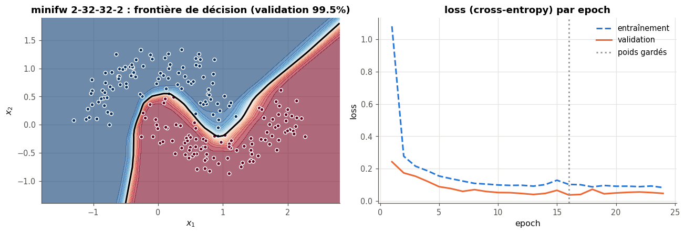
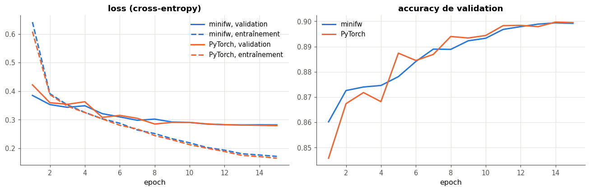
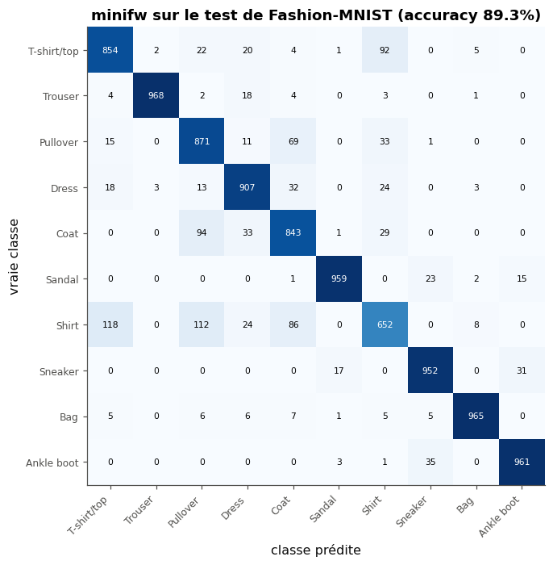

# minifw : un mini-framework de deep learning en NumPy, validé contre PyTorch

> minifw assemble en quelque 450 lignes de NumPy (docstrings comprises) les couches, les losses et la boucle d'entraînement d'un MLP ; ses 23 tests, dont 12 le comparent à PyTorch en `float64` (écarts de l'ordre de $10^{-16}$), le prouvent juste, deux epochs d'entraînement donnent les mêmes poids que PyTorch à l'arrondi près, et il atteint **89,3 %** d'accuracy de test sur Fashion-MNIST, à 0,03 point de PyTorch en validation, 2,3 fois plus lentement.

Mini-projet du checkpoint IV du workbook *Deep Learning* (d'après A. Glassner) : des couches (`Dense`, activations, `Dropout`, `BatchNorm1d`), un conteneur `Sequential`, des losses et une boucle d'entraînement (AdamW, warmup + cosinus, clipping, early stopping), écrits en NumPy à partir de ma librairie `mylearn`, et prouvés justes par des tests d'équivalence avec PyTorch.

## L'objectif

PyTorch cache en une ligne (`loss.backward()`, `optimizer.step()`) ce qui fait apprendre un réseau. minifw le rend visible : chaque couche a sa passe avant et sa passe arrière, écrites à la main, un conteneur les enchaîne, et l'optimiseur de `mylearn` modifie les poids sur place, comme dans PyTorch.

Ce qu'il ne fait **pas** : ni GPU, ni autograd, ni convolution, ni `float32`. Son intérêt n'est pas d'aller vite mais d'être **prouvé juste**, à trois niveaux : chaque couche contre son équivalent PyTorch (sorties et gradients, en entraînement et en évaluation), le réseau entier (contre PyTorch et par différences finies), et un entraînement de deux epochs (158 pas), identique à celui de PyTorch à l'arrondi près (écart des poids : $1{,}7 \times 10^{-16}$).

## L'architecture du code

```
minifw/
├── layers.py   Layer (base) ─┬─ Dense(n_in, n_out)      W, b · dW, db       ← mylearn.nn.layers, nn.backward
                              ├─ Activation ── ReLU, Tanh                     ← mylearn.nn.activations
                              ├─ Dropout(p, rng)          masque inversé      ← mylearn.nn.regularization
                              └─ BatchNorm1d(n)           gamma, beta · statistiques glissantes
├── losses.py   SoftmaxCrossEntropy, MSELoss : (loss moyenne, dL/dlogits)     ← mylearn.nn.backward
├── model.py    Sequential(*layers) : forward → · ← backward · parameters · gradients · train/eval · state_dict
└── train.py    iterate_minibatches · evaluate · fit (AdamW, cosine_lr, clip_grad_norm, EarlyStopping) ← mylearn.optim
```

**Le contrat d'une couche** : `forward(x)` rend la sortie d'un mini-batch et garde ce dont la passe arrière aura besoin (l'entrée pour `Dense`, le masque pour `Dropout`, $\hat{\mathbf{x}}$ et l'inverse de l'écart-type pour `BatchNorm1d`) ; `backward(dout)` range les gradients des paramètres **dans** la couche et rend $\partial L/\partial x$ ; `parameters()` et `gradients()` rendent les tableaux eux-mêmes, dans le même ordre ; l'attribut `training` règle le dropout et la batchnorm.

**Un pas d'entraînement** :

```python
logits = model(xb)                         # passe avant, couche après couche
loss, dlogits = loss_fn(logits, yb)        # la loss se calcule sur les logits (softmax stable)
model.backward(dlogits)                    # passe arrière, de la dernière couche à la première
clip_grad_norm(model.gradients(), max_norm)
optimizer.lr = cosine_lr(step, total, base_lr, warmup_steps, min_lr)
optimizer.step(model.gradients())          # AdamW de mylearn : les poids changent sur place
```

minifw ne recode rien de ce que fait `mylearn` : il l'emballe. Le projet appelle seize fonctions de la librairie (ch. 3, 16 à 20) : treize dans le package, l'optimiseur `AdamW` passé à `fit`, `gradient_check` et `confusion_matrix` dans le notebook.

## Les tests

`test_minifw.py` : **23 tests** (environ 2 s). Douze comparent minifw à PyTorch en `float64`, avec une tolérance de $10^{-6}$ (relative) et $10^{-8}$ (absolue) ; les écarts réels sont de l'ordre de $10^{-16}$ à $10^{-15}$. Les onze autres vérifient ce que PyTorch ne vérifie pas pour moi : le masque du dropout, l'initialisation tirée du générateur, l'ordre des paramètres, `state_dict`, le planning de `fit`, l'early stopping.

| Famille | Ce qui est vérifié |
|---|---|
| `Dense` | la sortie (contre `nn.Linear`, qui range $\mathbf{W}$ transposée), $\partial L/\partial x$, `dW`, `db` (contre l'autograd), l'initialisation de He tirée du générateur, `parameters()` qui rend les tableaux eux-mêmes |
| Activations | `ReLU` et `Tanh`, passes avant et arrière (avec $\mathrm{ReLU}'(0) = 0$, comme PyTorch) ; aucun paramètre |
| `Dropout` | des zéros ou $x/(1-p)$ en entraînement, le masque réutilisé par la passe arrière, l'identité en évaluation (contre `nn.Dropout().eval()`) |
| `BatchNorm1d` | la sortie et les trois gradients en entraînement, les statistiques glissantes après plusieurs mini-batches et la sortie en évaluation (contre `nn.BatchNorm1d`) |
| Losses | `SoftmaxCrossEntropy` et `MSELoss` : un `float` et son gradient, contre `F.cross_entropy` et `F.mse_loss` |
| `Sequential` | un réseau entier (Dense, BatchNorm1d, ReLU, Tanh) : la loss et **chaque** gradient ; l'ordre et le nombre des paramètres ; `train()`/`eval()` ; `state_dict()` copie, `load_state_dict()` recopie sur place |
| Entraînement | deux pas d'AdamW sur le modèle contre `torch.optim.AdamW` ; `fit` suit le planning pas à pas, et ses poids après 12 pas rognés par le clipping sont ceux de la même boucle en PyTorch (`clip_grad_norm_`) ; l'early stopping recharge la meilleure epoch ; chaque exemple vu une fois par epoch |

Les tests attrapent les **six mutants** du notebook (des versions de minifw cassées exprès : un gradient faux de 1 %, une batchnorm décalée de 0,001, un dropout qui multiplie par $1 - p$ en évaluation, une couche oubliée dans la passe arrière…).

## Les résultats

Fashion-MNIST : les 50 000 premières images d'entraînement pour apprendre, les 10 000 dernières pour la validation, le test (10 000 images) ouvert **une seule fois** (`test_log.json`). MLP 784-256-128-10, mini-batches de 128, AdamW (learning rate 0,002, weight decay $10^{-4}$), warmup de 100 pas puis cosinus, clipping à 5, early stopping (patience 3), 15 epochs au plus. CPU à deux cœurs.

**L'entraînement jumeau** : sans dropout (minifw et PyTorch ne tirent pas leurs masques avec le même générateur), deux epochs sur 10 000 images, mêmes poids de départ, mêmes mini-batches : après 158 pas, les poids diffèrent de $1{,}7 \times 10^{-16}$.

**minifw contre PyTorch**, même architecture et mêmes réglages (batchnorm et dropout 0,2) ; PyTorch garde son initialisation par défaut (uniforme), son ordre des mini-batches et le `float32` :

| | minifw (NumPy, `float64`) | PyTorch (`float32`) |
|---|---|---|
| Paramètres | 235 914 | 235 914 |
| Meilleure accuracy de validation (15 epochs au plus) | 0,8994 | 0,8997 |
| Temps par epoch (50 000 images) | 3,2 s | 1,4 s |

**L'ablation** (12 epochs, mêmes graines) et le choix. La règle, écrite avant de lire le tableau : la meilleure accuracy de validation.

| Configuration | Accuracy de validation | Loss de validation minimale |
|---|---|---|
| ni dropout ni batchnorm | 0,8963 | 0,2884 |
| dropout 0,2 | 0,8931 | 0,2900 |
| **batchnorm** (retenue) | **0,8992** | 0,2981 |
| les deux | 0,8988 | 0,2765 |

**Le test** : le modèle retenu, réentraîné (meilleure epoch : la 9ᵉ, validation 0,8976), fait **0,8932** d'accuracy et 0,326 de loss sur le test, au-dessus de l'objectif de 88 %.



*Les deux demi-lunes, pour la mise au point : la frontière apprise par un MLP minifw 2-32-32-2, et ses courbes de loss ; l'early stopping garde les poids de l'epoch 16.*



*Fashion-MNIST, minifw contre PyTorch, même architecture et mêmes réglages : les courbes se superposent, aux différences d'initialisation et de tirage près.*



*La matrice de confusion du test (une seule ouverture) : les erreurs se concentrent entre chemises, T-shirts, pulls et manteaux ; « Shirt » n'est reconnue qu'à 65 %.*

## Les limites

- **La vitesse** : 2,3 fois plus lent que PyTorch sur CPU. À précision égale (l'entraînement jumeau, en `float64` des deux côtés : 1,3 s contre 0,7 s), il reste un facteur proche de 2 : l'essentiel vient des appels Python et des caches copiés à chaque couche, le reste du `float64`, qui double les octets de chaque produit matriciel. Et rien ne tourne sur GPU.
- **Pas d'autograd** : chaque nouvelle couche demande sa passe arrière écrite à la main, et ses tests. C'est ce qui rend la comparaison à PyTorch indispensable.
- **Une seule graine** : les écarts de l'ablation (0,6 point au plus) sont du même ordre que le bruit d'une accuracy mesurée sur 10 000 images (un écart-type d'environ 0,3 point). Batchnorm et « les deux » sont à égalité ; le choix tient à la règle, pas à une vraie différence.
- **La validation est un peu optimiste** : le test (0,8932) est 0,4 point sous la validation du modèle final, en partie parce que la configuration et l'epoch ont été choisies sur elle.
- **Un MLP sur des images** : il ignore la structure spatiale. Un petit réseau convolutif dépasse 91 % sur Fashion-MNIST ; minifw n'a pas de couche de convolution.

## Ce que j'ai appris

- **Un test qui ne casse jamais ne prouve rien** : les mutants montrent ce que mes tests voient. Le dropout qui multiplie par $1 - p$ en évaluation n'est attrapé que par un seul test sur 23 ; sans lui, un réseau qui se trompe en production aurait passé toute la suite.
- **Ce que fait vraiment `model.eval()`** : il ne change rien aux poids, seulement le comportement du dropout (l'identité) et de la batchnorm (les statistiques glissantes, avec la variance non biaisée). Oublier de revenir en mode entraînement après une évaluation fige la batchnorm sans aucune erreur.
- **Les références comptent** : l'optimiseur garde des références vers les poids ; `parameters()` doit rendre les tableaux eux-mêmes, et `load_state_dict` doit recopier sur place, sinon le modèle cesse d'apprendre en silence.
- **Les losses se calculent sur les logits** : le gradient de softmax + cross-entropy vaut $(\mathbf{p} - \mathbf{y})/n$, simple et stable, alors qu'un softmax suivi d'un logarithme déborde dès que les logits sont grands.

## Pistes

- Une couche `Conv2d` écrite par im2col (la convolution devient un produit matriciel), comparée à `nn.Conv2d` sorties et gradients compris, puis un petit réseau convolutif sur Fashion-MNIST : c'est là que se gagnent les points d'accuracy qui manquent à un MLP.
- Un autograd vectoriel, qui généralise la classe `Value` du ch. 18 à des tableaux NumPy : `Sequential` retrouverait ses gradients sans passe arrière écrite à la main, et les tests actuels serviraient d'oracle.
- Des connexions résiduelles et la layer norm, pour entraîner un MLP de 20 couches et mesurer ce qu'elles changent au gradient des premières couches.
- Plusieurs graines pour l'ablation : ses écarts sont plus petits que le bruit d'une mesure sur 10 000 images, et seuls des intervalles diraient si la batchnorm l'emporte vraiment.
- La sauvegarde de `state_dict()` au format `.npz`, avec l'état de l'optimiseur et des générateurs, pour une reprise d'entraînement identique au bit près ; puis le profilage (`cProfile`) des passes avant et arrière.

## Reproduire

```bash
python -m pytest projets/partie_4_mini_framework/solution -q    # from the workbook repository: the 23 tests
```

Puis exécute `mp4_mini_framework.ipynb` de bout en bout (`FAST_MODE = False` pour les chiffres de ce README, environ cinq minutes sur un CPU à deux cœurs). Versions : Python 3.13, NumPy 2.1.3, PyTorch 2.11.0 (dans `results.json`).
