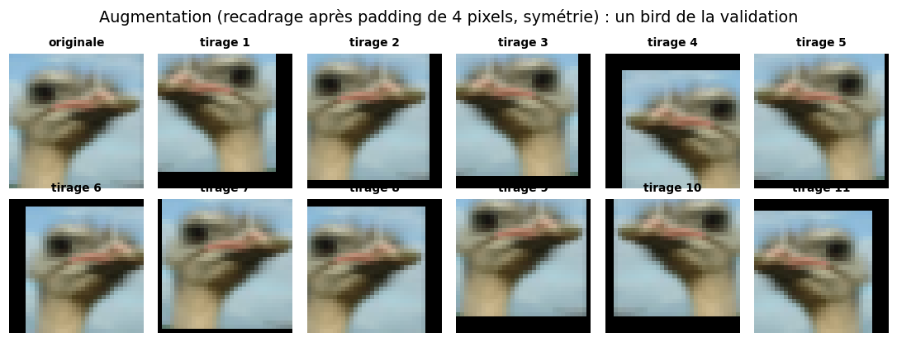
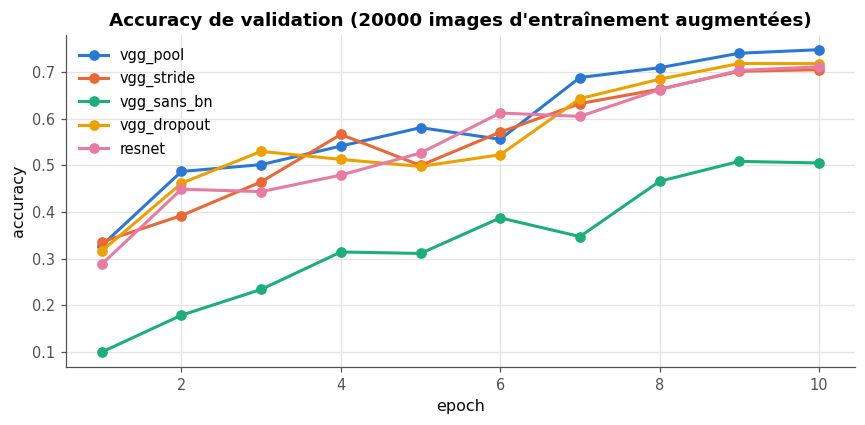
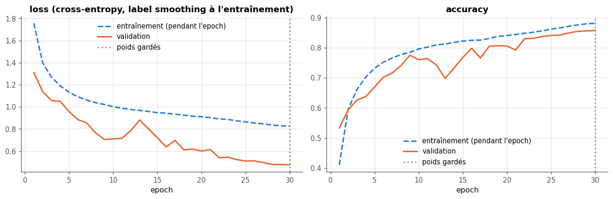
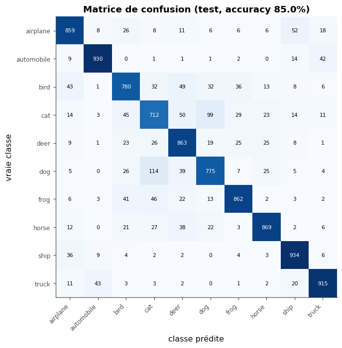
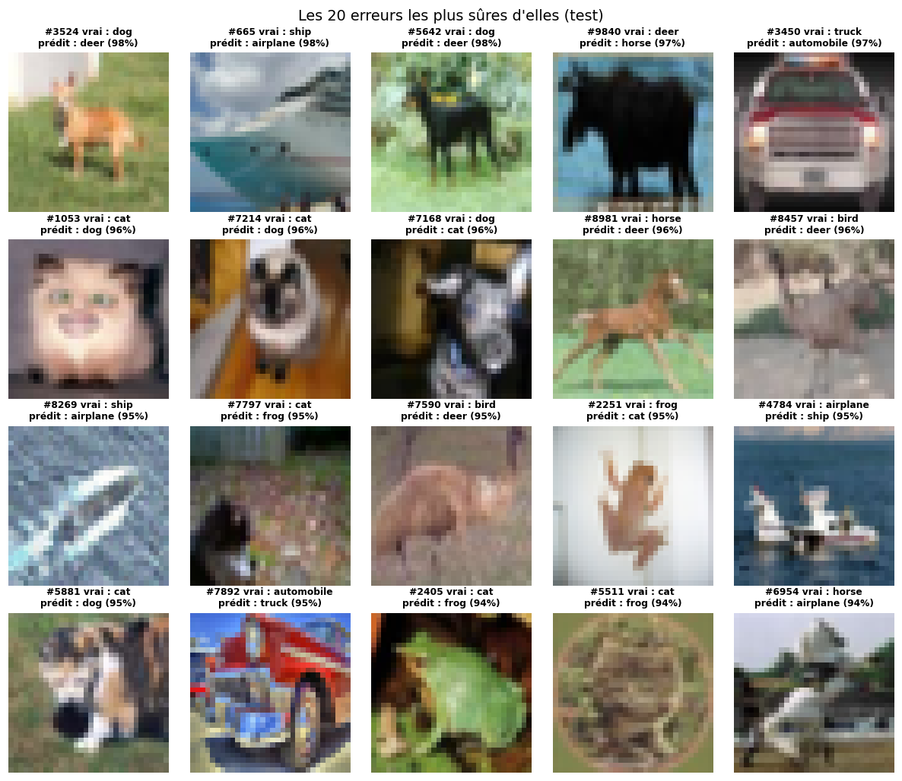
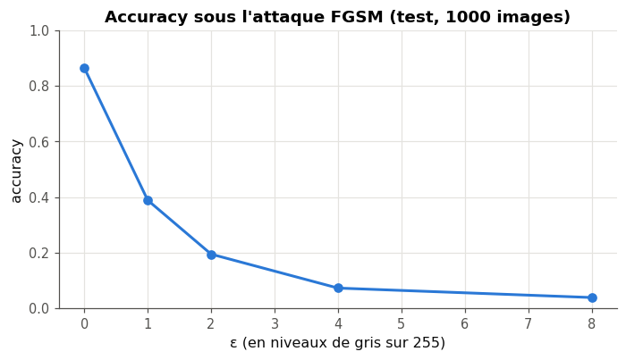

# cifarkit : un classifieur d'images CIFAR-10 en PyTorch, de la baseline au modèle livré

> Un CNN de type VGG de 72 954 paramètres, choisi parmi cinq architectures et réglé par une recherche aléatoire, atteint **85,0 % d'accuracy sur le test** de CIFAR-10 (ouvert une seule fois), contre 72,1 % pour le petit CNN de départ ; un ResNet-18 pré-entraîné sur ImageNet, dont on n'entraîne que la tête, fait à peine mieux en validation (86,1 % contre 85,8 %) pour cinquante fois plus de calcul par image.

Mini-projet du checkpoint V du workbook *Deep Learning* (d'après A. Glassner) : un package PyTorch testé (`cifarkit` : le pipeline de données, les modèles, la boucle d'entraînement, la livraison), une démarche expérimentale notée dans un journal, un modèle livré avec son prétraitement, et une analyse d'erreurs.

## L'objectif

Classer des photos couleur de 32 × 32 pixels dans les dix classes de CIFAR-10 (avion, automobile, oiseau, chat, cerf, chien, grenouille, cheval, bateau, camion). Les classes sont équilibrées : l'**accuracy** est une métrique honnête, et le hasard en donne 10 %. L'objectif chiffré : au moins 80 % sur le test, avec un modèle assez petit pour s'entraîner sur un CPU. Le projet ne cherche pas l'état de l'art (au-delà de 99 % avec des réseaux pré-entraînés géants) : il cherche une démarche propre, des choix justifiés, et un modèle qu'un autre peut recharger sans le notebook.

## Le protocole

- **Le découpage** : les 50 000 images d'entraînement sont coupées par un découpage **stratifié** (graine 0) en 45 000 pour l'entraînement et 5 000 pour la validation, 500 par classe ; tous les choix se font sur la validation. Le test (10 000 images) n'a été ouvert **qu'une fois**, pour le modèle final (`test_log.json`).
- **Le prétraitement** : la moyenne et l'écart-type de chaque canal sont calculés sur les 45 000 images d'entraînement seulement (0,4916 ; 0,4823 ; 0,4466 et 0,2471 ; 0,2435 ; 0,2615), et enregistrés avec le modèle (`model.json`).
- **L'augmentation** (entraînement seulement) : un recadrage aléatoire 32 × 32 après un padding de 4 pixels, une symétrie horizontale.
- **Les graines** : `torch.manual_seed(0)` avant de construire chaque modèle, un `torch.Generator` par `DataLoader`.
- **Une variable à la fois** : chaque comparaison change une seule chose, à budget égal ; les **16 runs** sont dans `runs.csv`.

## L'architecture du code

| Module | Contenu |
|---|---|
| `cifarkit/pipeline.py` | découpage stratifié, statistiques par canal, transformations `torchvision.transforms.v2`, `Dataset`, `DataLoader` à graine |
| `cifarkit/models.py` | MLP et petit CNN (baselines), VGG (pooling ou stride, batchnorm, dropout), bloc résiduel et petit ResNet, `build_model(config)` |
| `cifarkit/train.py` | `evaluate` (moyenne par exemple), `fit` (meilleur checkpoint, early stopping, `OneCycleLR` compté en pas, reprise exacte), `save_model` et `load_model`, `predict_proba`, `fgsm`, le journal |
| `cifarkit/predict.py` | `python -m cifarkit.predict photo.jpg --model .` |

**Les tests** (`test_cifarkit.py`, 19 tests, 3 s sur CPU) vérifient sur des images aléatoires ce que l'entraînement ne montre pas : les proportions du découpage, les statistiques par canal (contre NumPy), la normalisation (contre un calcul à la main), le nombre de paramètres de chaque modèle, le bloc résiduel, la moyenne par exemple d'`evaluate` sur des mini-batches inégaux, les poids de la meilleure epoch, la **reprise au bit près** (2 + 2 epochs contre 4 d'affilée, avec dropout et `OneCycleLR`), la sauvegarde, et la taille de la perturbation FGSM. Ils attrapent les cinq mutants du notebook (une moyenne de moyennes, des statistiques mélangées entre canaux, les poids de la dernière epoch, un pas de 2ε, un split non stratifié).

**Le modèle livré** : `model.pt` (le `state_dict`, 300 Ko) et `model.json` (la configuration, la normalisation, les classes, les métriques et les versions). `cifarkit` n'a besoin que de PyTorch, torchvision et Pillow pour le recharger.

## Les résultats

**Les baselines** (45 000 images, 10 epochs, Adam, sans augmentation) : toujours prédire « avion » donne 10,0 % ; un MLP de 1,58 million de paramètres plafonne à 52,8 % ; un petit CNN de 60 362 paramètres atteint 72,1 %. Le même petit CNN entraîné par `fit` (SGD de Nesterov, `OneCycleLR`) passe à 74,5 %, et à 76,2 % avec l'augmentation.

**Les architectures** (20 000 images augmentées, 10 epochs, SGD et `OneCycleLR` jusqu'à 0,05 ; une seule graine) :

| Architecture | Paramètres | Accuracy de validation | Secondes par epoch (CPU) |
|---|---|---|---|
| VGG 16-32-64, pooling, batchnorm | 72 954 | **74,8 %** | 25 |
| … stride 2 au lieu du pooling | 72 954 | 70,5 % | 19 |
| … sans batchnorm | 72 730 | 50,8 % | 22 |
| … avec dropout 0,3 | 72 954 | 71,8 % | 25 |
| ResNet 16-32-64 (un bloc par largeur) | 78 042 | 71,1 % | 33 |

**La recherche** (VGG retenu, 10 000 images, 4 epochs ; quatre tirages log-uniformes, puis deux autour du meilleur) : de 48,3 % (learning rate 0,012) à 61,5 % (0,145 et un weight decay de 10⁻⁴). Les cinq meilleurs runs tiennent en 1,1 point, à peine plus que le bruit d'une mesure sur 5 000 images (±0,7 point) : seul un learning rate trop petit est clairement écarté.

**Le modèle livré** (VGG 16-32-64, 45 000 images, 30 epochs, learning rate 0,145, weight decay 10⁻⁴, augmentation, label smoothing 0,1 ; 28 minutes sur un CPU à deux cœurs) :

| Modèle | Paramètres entraînés | Accuracy de validation | Accuracy de test |
|---|---|---|---|
| Toujours la même classe | 0 | 10,0 % | — |
| MLP (baseline) | 1 578 506 | 52,8 % | — |
| Petit CNN (baseline) | 60 362 | 72,1 % | — |
| **VGG 16-32-64 (livré)** | **72 954** | **85,8 %** | **85,0 %** |
| ResNet-18 ImageNet gelé + tête (10 000 images en 224 × 224) | 5 130 (11,7 M gelés) | 86,1 % | — |

Le test perd 0,8 point face à la validation : environ un écart-type et demi de la mesure, et la validation, qui a servi à tous les choix, est un peu optimiste. La meilleure epoch est la dernière : avec `OneCycleLR`, le learning rate finit presque à zéro, et la validation monte jusqu'au bout.



*Un oiseau de la validation et onze tirages de l'augmentation : décalé de quelques pixels (les bords noirs viennent du padding), parfois retourné.*



*Les cinq architectures, à budget égal : sans batchnorm, le VGG n'apprend presque rien avec ce learning rate ; le stride coûte 4 points ici, pour 25 % de temps en moins.*



*Le modèle livré : la loss d'entraînement (avec label smoothing, mesurée pendant l'epoch, augmentée) reste au-dessus de celle de validation ; la validation saute au milieu, quand le learning rate est au plus haut, puis se stabilise quand il décroît.*

## L'analyse d'erreurs



*La matrice de confusion du test : la diagonale porte 85 % des images.*

Les classes les plus faibles sont **chat** (71,2 %), **chien** (77,5 %) et **oiseau** (78,0 %) ; les plus fortes, **bateau** (93,4 %), **automobile** (93,0 %) et **camion** (91,5 %). Les confusions vont par paires qui se ressemblent en 32 × 32 : chat et chien (213 images dans les deux sens), avion et bateau (88, le ciel et la mer sont tous deux de grands fonds bleus), automobile et camion (85).



*Les 20 erreurs du test où le modèle était le plus sûr de lui (94 à 98 %).*

Parmi ces 20 erreurs, plusieurs sont excusables : des images où l'objet est minuscule, coupé ou vu d'un angle inhabituel (un bateau vu de très près, pris pour un avion), un camion de pompiers étiqueté « automobile » (le label se discute), et au moins deux images dont le label semble faux à l'œil (une « grenouille » étiquetée chat, un « cheval » qui ressemble à un avion). D'autres ne le sont pas : des chiens debout dans l'herbe pris pour des cerfs, avec 98 % de confiance ; le modèle s'appuie sur le fond (l'herbe, la forêt) autant que sur l'animal. Ces probabilités très élevées sur des erreurs montrent aussi que le modèle est trop sûr de lui : ses probabilités ne sont pas calibrées.



*FGSM sur 1 000 images de test : 86,5 % sans attaque, 38,9 % avec ε = 1/255, 19,5 % avec 2/255, 7,3 % avec 4/255.*

Une perturbation d'un seul niveau de gris sur 255 par pixel, invisible, divise l'accuracy par plus de deux ; à 4/255, le modèle se trompe presque toujours. Rien dans l'entraînement ne l'en protège : il faudrait un entraînement adversarial (avec des exemples FGSM ou PGD), qui coûte du calcul et un peu d'accuracy sur les images normales.

## Les limites

- **Une seule graine** pour chaque run : les écarts de moins d'un point (la recherche, le dropout contre le ResNet) ne sont pas établis, et la comparaison des architectures, à 10 epochs sur 20 000 images, favorise les réseaux qui apprennent vite ; sur un entraînement long, le classement pourrait changer (le ResNet, en particulier, est plus lent à démarrer).
- **Le budget** : 72 954 paramètres et 30 epochs sur CPU. Un ResNet plus large sur GPU dépasse 90 % ; le ResNet-18 pré-entraîné fait déjà 86,1 % avec 10 000 images et sa tête seule, mais il agrandit chaque image en 224 × 224 et coûte 25 ms par image contre 0,5 ms ici (et ses poids, appris sur ImageNet, portent la licence et les biais de ce dataset).
- **La robustesse** : nulle face à FGSM ; et le modèle choisit toujours une des dix classes, même pour une image qui n'en contient aucune.
- **La distribution** : des photos 32 × 32 des années 2000 ; une photo actuelle, réduite en 32 × 32, peut être classée bien moins bien (aucune mesure ici).
- **Les labels** : quelques images du test semblent mal étiquetées ; à 85 %, leur effet sur le score est faible, mais il existe.

## Reproduire

Depuis la racine du dépôt :

```bash
python -m pytest projets/partie_5_classifieur_cifar10/solution -q    # the 19 tests, a few seconds
cd projets/partie_5_classifieur_cifar10/solution
python -m cifarkit.predict photo.jpg --model .                       # classify an image with the delivered model
```

Puis exécute `mp5_classifieur_cifar10.ipynb` de bout en bout : en mode rapide (`FAST_MODE = True`), une dizaine de minutes sur CPU ; avec `FAST_MODE = False` pour les chiffres de ce README, quelques minutes sur un GPU de Colab, environ une heure vingt sur un CPU à deux cœurs. Les versions sont dans `results.json` et `model.json` (Python 3.13, PyTorch 2.11, torchvision 0.26).

## Ce que j'ai appris

- **La batchnorm décide du learning rate qu'on peut se permettre** : sans elle, le même VGG, au même learning rate, plafonne à 50,8 % au lieu de 74,8 %. La comparaison « à réglages égaux » mesure aussi la tolérance de chaque architecture à ces réglages.
- **Une reprise exacte demande tout l'état** : le modèle et l'optimiseur ne suffisent pas ; il faut le planning, l'état aléatoire de PyTorch (dropout, augmentation) et celui du générateur du `DataLoader`. Le test « 2 + 2 epochs = 4 epochs au bit près » le prouve, et il échoue dès qu'une pièce manque.
- **Le plus gros gain ne vient pas de l'architecture** : passer de 20 000 images et 10 epochs à 45 000 images et 30 epochs, avec un planning qui finit à un learning rate presque nul, fait gagner 11 points au VGG ; changer d'architecture, au plus 4.
- **Un modèle à 85 % n'est pas robuste** : une perturbation invisible le fait tomber sous 40 %, et ses erreurs les plus sûres d'elles montrent qu'il regarde le fond autant que l'objet.
