# genbench : un banc d'essai génératif, VAE contre DCGAN sur Fashion-MNIST

> Sur trois graines et 10 000 images, un DCGAN de 385 000 paramètres atteint une distance de Fréchet de **95,1 ± 4,8** aux images de validation, contre **214,9 ± 3,2** pour un VAE convolutif (β = 1) et 1,1 pour deux échantillons d'images réelles ; un GAN conditionnel descend à 37,3. Aucun des deux générateurs ne s'effondre sur quelques classes, et aucun ne recopie ses images d'entraînement : le protocole, écrit avant les expériences, le vérifie.

Mini-projet du checkpoint VI du workbook *Deep Learning* (d'après A. Glassner) : un package PyTorch testé (`genbench` : les modèles, l'entraînement, l'évaluation), un protocole d'évaluation écrit avant les expériences, trois graines par générateur, une galerie et une fiche modèle ([`MODEL_CARD.md`](MODEL_CARD.md)).

## L'objectif

Générer des images de vêtements 28 × 28 en niveaux de gris (Fashion-MNIST) avec deux familles de modèles, un **VAE** convolutif et un **DCGAN**, et dire lequel imite le mieux la distribution des images, sans effondrement de mode ni mémorisation. Le projet ne cherche pas l'état de l'art (les modèles de diffusion font bien mieux) : il cherche une comparaison honnête, reproductible, dont les conclusions ne dépassent pas ce que les mesures permettent.

## Le protocole d'évaluation

Écrit avant les expériences (`config.json` garde la configuration, datée) :

1. **L'instrument** : un petit CNN (218 586 paramètres) entraîné sur les 50 000 images d'entraînement ; ses **features** (les 128 valeurs de l'avant-dernière couche) remplacent celles d'Inception du FID. Il atteint **92,5 %** d'accuracy de validation, et il sépare nettement des images réelles (plancher 1,1) d'images floutées (212) ou bruitées (491).
2. **La distance de Fréchet** entre 10 000 images générées et les 10 000 images de **validation**, que ni le classifieur ni les générateurs n'ont vues ; le même nombre d'images pour chaque modèle.
3. **Trois graines** d'entraînement (0, 1, 2) par générateur ; la moyenne et l'écart-type, jamais la meilleure seule.
4. **L'effondrement de mode** : les classes que le classifieur prédit pour les images générées, leur entropie normalisée (1 si toutes les classes ont la même part) et la plus grande part.
5. **La mémorisation** : la distance entre pixels de chaque échantillon à son plus proche voisin d'entraînement ; une **quasi-copie** est plus proche que 99 % des images de validation (le quantile 0,01 de leur propre distance à l'entraînement).
6. **β** du VAE : parmi 0,5, 1 et 4, la plus petite distance de Fréchet sur la graine 0, avec une graine de tirage réservée à ce choix, à condition de garder au moins la moitié des latents actifs.
7. **L'inspection visuelle** : des grilles pour un bruit fixé, les plus proches voisins, des interpolations.

## La méthode

| Module | Contenu |
|---|---|
| `genbench/models.py` | le classifieur de référence ; `ConvVAE` (deux convolutions de stride 2, 16 latents, deux convolutions transposées, des logits) ; le DCGAN selon les règles de Radford (convolutions de stride 2 et transposées, batchnorm, ReLU et tanh dans G, Leaky ReLU dans D), conditionnel en option (un embedding du label) |
| `genbench/train.py` | `vae_loss` (cross-entropy binaire **sommée** sur les pixels, KL sommée sur les latents, les deux divisées par N), `train_vae` ; `gan_step` (loss non saturante, faux détachés), `train_gan` (Adam 2·10⁻⁴, β₁ = 0,5 ; `log.csv` ; un checkpoint complet par epoch et une reprise au bit près) |
| `genbench/evaluate.py` | les features, la distance de Fréchet (la fonction de ma librairie `mylearn`, sinon SciPy), `class_report`, `nearest_neighbors`, `sample_images`, `interpolate` (le slerp de `mylearn.vae.interpolate_latents`) |

L'entraînement du DCGAN de la graine 0 a été **interrompu** après 8 epochs sur 10, puis repris depuis `runs/gan_seed0/last.pt` avec des réseaux neufs : les deux réseaux, les deux optimiseurs, l'historique et les états aléatoires sont restaurés, et la courbe ne montre aucune marche. **Les tests** (`test_genbench.py`, 19 tests, 2 s sur CPU) vérifient sur de petites images aléatoires la formule de la loss du VAE, un pas de GAN contre un pas écrit à la main, la reprise au bit près, les features en mode évaluation et les distances contre NumPy ; ils attrapent les cinq mutants du notebook.

## Les résultats

Mode complet (`results.json`) : 50 000 images d'entraînement, VAE 15 epochs, DCGAN de largeur 48 (G : 385 057 paramètres, D : 79 441) 10 epochs, 10 000 images par mesure ; 48 minutes sur un CPU à deux cœurs pour tout le notebook.

**Le choix de β** (graine 0) :

| β | Reconstruction (val, nats) | KL (val, nats) | Latents actifs | Distance de Fréchet |
|---|---|---|---|---|
| 0,5 | 213,5 | 24,7 | 16 / 16 | 217,3 |
| **1** | 216,3 | 17,2 | 16 / 16 | **214,9** |
| 4 | 231,7 | 7,4 | 9 / 16 | 277,6 |

La règle retient β = 1 ; l'écart avec β = 0,5 (2,4) est de l'ordre de l'écart entre graines, celui avec β = 4 ne l'est pas.

**Les générateurs** :

| Modèle | Distance de Fréchet (3 graines) | Entropie des classes | Plus grande part | Quasi-copies |
|---|---|---|---|---|
| Images réelles (plancher) | 1,1 | 0,999 | 11 % | — |
| VAE (β = 1) | 214,9 ± 3,2 (217,7 ; 211,5 ; 215,5) | 0,96 | 17 % (chemise) | 0 % |
| **DCGAN** | **95,1 ± 4,8** (98,2 ; 97,6 ; 89,6) | 0,97 à 0,98 | 16 % (chemise) | 0 % |
| cGAN (option, une graine) | 37,3 | 0,994 | 13 % | — |

Le DCGAN bat le VAE de 120 points, vingt-cinq fois l'écart entre graines. Le GAN conditionnel fait encore mieux, et le classifieur retrouve la classe demandée pour 87 % de ses images. Aucun générateur ne s'effondre sur quelques classes, mais les parts diffèrent de celles des données : le VAE fait trop de chemises et de sacs et trop peu de sandales (2,5 %), le DCGAN trop peu de pulls (5 %). Aucune quasi-copie : les échantillons sont même un peu plus loin de l'entraînement (médianes 3,8 et 4,8) que les images de validation (3,5).

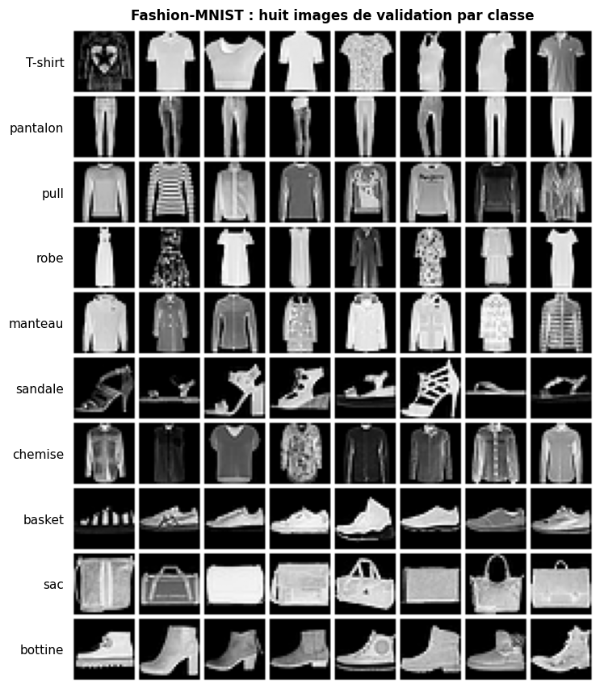

*Les données : huit images de validation par classe, des photos de catalogue centrées sur fond noir.*

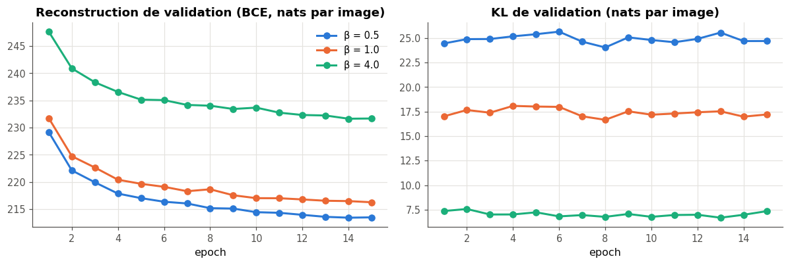

*Le compromis β : quand β monte, la reconstruction se dégrade et la KL baisse.*

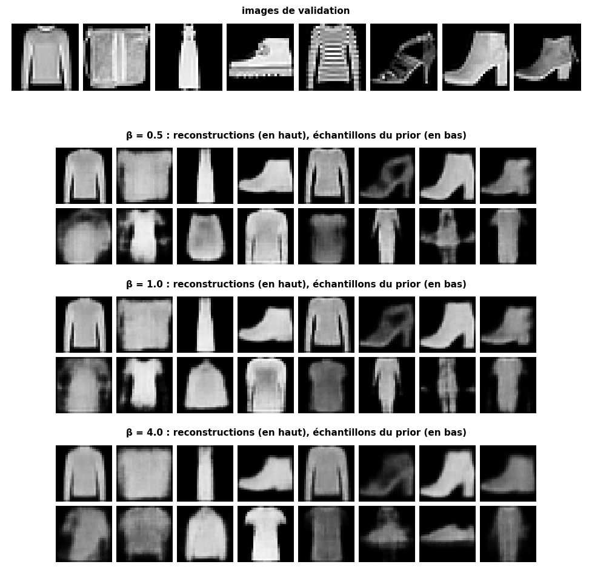

*Pour chaque β, des reconstructions d'images de validation (en haut) et des échantillons du prior (en bas) : à β = 4, plus flous et plus uniformes.*

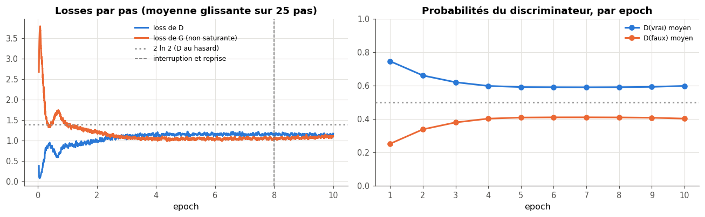

*Le DCGAN : les losses se stabilisent dès la quatrième epoch, D(vrai) vers 0,59 et D(faux) vers 0,41 ; l'interruption et la reprise (epoch 8) ne laissent aucune trace.*

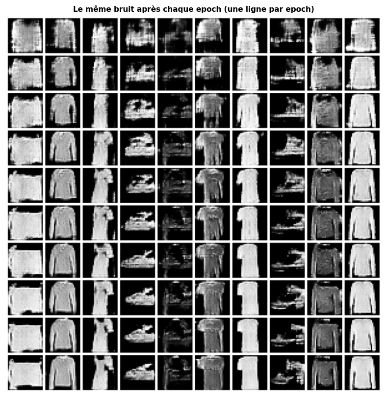

*Dix bruits fixés, une ligne par epoch : des taches à la première, des vêtements dès la troisième, qui s'affinent ensuite.*

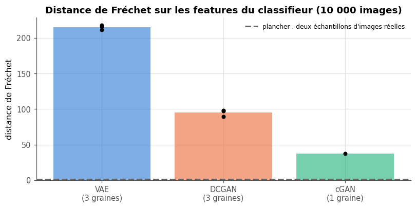

*La distance de Fréchet par graine (points) et sa moyenne (barres), à côté du plancher des images réelles.*

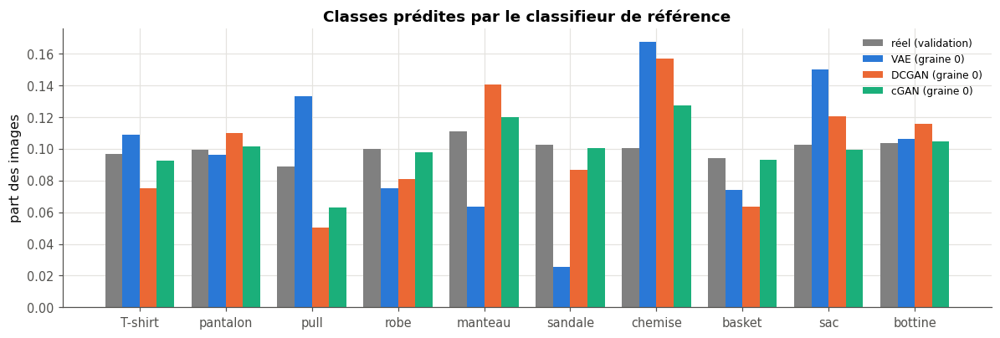

*Les classes prédites par le classifieur de référence : toutes présentes, mais pas dans les proportions des données.*

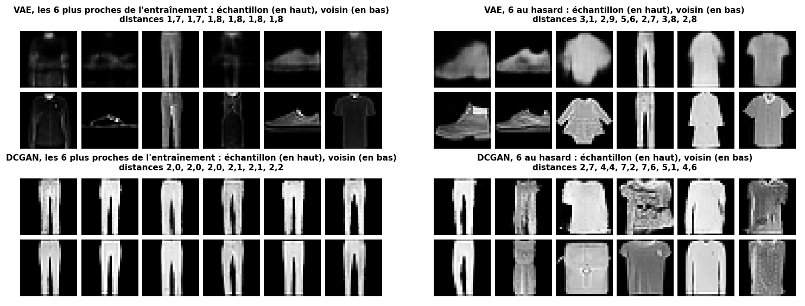

*La mémorisation : les échantillons les plus proches de l'entraînement sont des images sombres ou des pantalons, des formes simples ; aucun n'est une copie.*

## La galerie

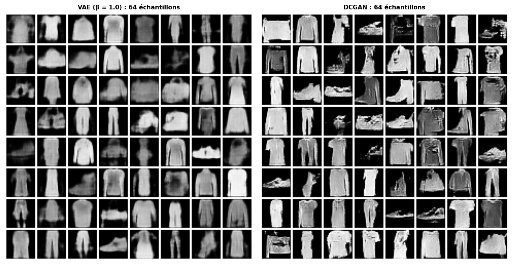

*64 échantillons de chaque générateur (graine 0, même graine de tirage) : le VAE donne des vêtements reconnaissables mais flous, en aplats ; le DCGAN des images nettes, texturées, dont certaines sont déformées (des sandales en morceaux).*

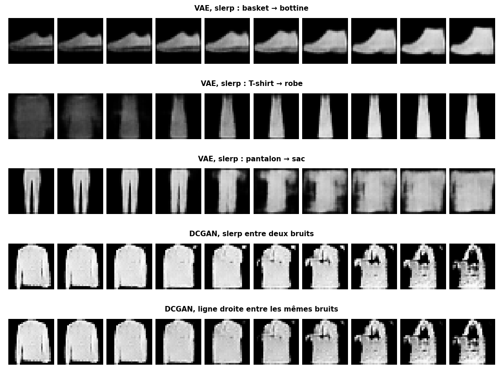

*Des interpolations sphériques (slerp) : pour le VAE, entre les codes de deux vraies images (une basket qui monte en bottine ; entre un pantalon et un sac, un milieu qui n'est ni l'un ni l'autre) ; pour le DCGAN, entre deux bruits, et la ligne droite entre les mêmes bruits, ici presque identique.*

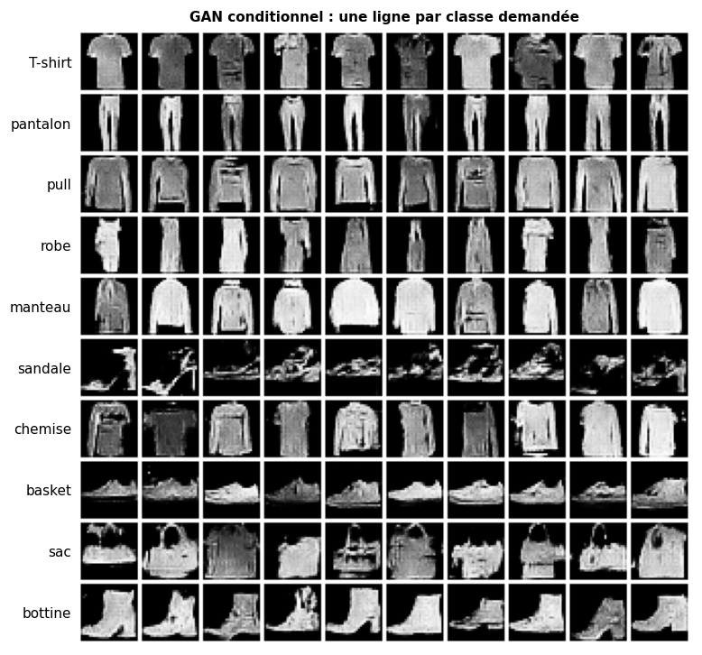

*Le GAN conditionnel : une ligne par classe demandée ; les sandales, les formes les plus fines, sont les moins réussies.*

## Les limites et les usages responsables

- **Une mesure maison** : la distance de Fréchet est calculée sur les features d'un petit CNN de 92,5 % d'accuracy, pas sur celles d'Inception : elle n'est **pas comparable aux FID publiés**, et le classement pourrait dépendre de l'extracteur (une extension du projet). Sa classe la plus faible (la chemise, 79,9 %) gonfle aussi la part des « chemises » parmi les échantillons flous.
- **De petits modèles, peu d'entraînement** : 10 et 15 epochs sur CPU ; trois graines seulement, et β choisi sur la validation qui sert aussi aux mesures finales (avec d'autres images tirées).
- **La mémorisation** n'est cherchée qu'en distance entre pixels, sur 2 000 échantillons : une copie décalée de quelques pixels lui échapperait.
- **Des images de catalogue** : 28 × 28, fond neutre, aucune personne ; rien ne dit que ces générateurs feraient de même sur d'autres images.
- **Les usages responsables** : ces images sont générées et doivent être présentées comme telles (jamais comme des photos de produits) ; un générateur peut restituer des données d'entraînement, d'où le contrôle des voisins, à refaire sur toute nouvelle donnée, surtout si elle contient des personnes ; l'article 50 du règlement européen sur l'IA (AI Act) demande aux fournisseurs de systèmes qui génèrent des images de marquer leurs sorties comme artificielles.

## Reproduire

Depuis la racine du dépôt :

```bash
python tools/run_all_notebooks.py projets/partie_6_generatif/solution/mp6_generatif.ipynb          # mode rapide, ≈ 4 min sur CPU
python tools/run_all_notebooks.py projets/partie_6_generatif/solution/mp6_generatif.ipynb --full --timeout 3600   # mode complet, ≈ 50 min sur CPU
python -m pytest projets/partie_6_generatif/solution -q                                                # les tests, ≈ 2 s
```

La configuration est dans `config.json` (mode complet) et `config_rapide.json`, les mesures par modèle et par graine dans `results.json` et `results_rapide.json`. Les checkpoints du DCGAN (`runs/`) ne sont pas versionnés : ils se régénèrent.

## Ce que j'ai appris

- **La distance de Fréchet ne suffit pas** : un générateur qui recopierait l'entraînement aurait une distance proche du plancher. Il faut le contrôle des voisins pour l'écarter, et l'histogramme des classes pour voir ce qui manque.
- **Les repères donnent l'échelle** : un léger flou coûte déjà près de deux cents fois le plancher ; sans eux, 95 ou 215 ne voudraient rien dire.
- **Écrire la règle avant de voir les chiffres** : en mode rapide, la même règle retient β = 0,5, en mode complet β = 1, et l'écart entre les deux est de l'ordre de l'écart entre graines : la règle tranche, la mesure ne les sépare pas vraiment.
- **Une reprise exacte demande tout l'état** : les deux réseaux, les moments d'Adam des deux optimiseurs, le générateur qui tire les mini-batches et le bruit ; le test « 2 + 1 epochs = 3 epochs au bit près » l'a vérifié, et le mutant qui oublie le générateur est attrapé.
